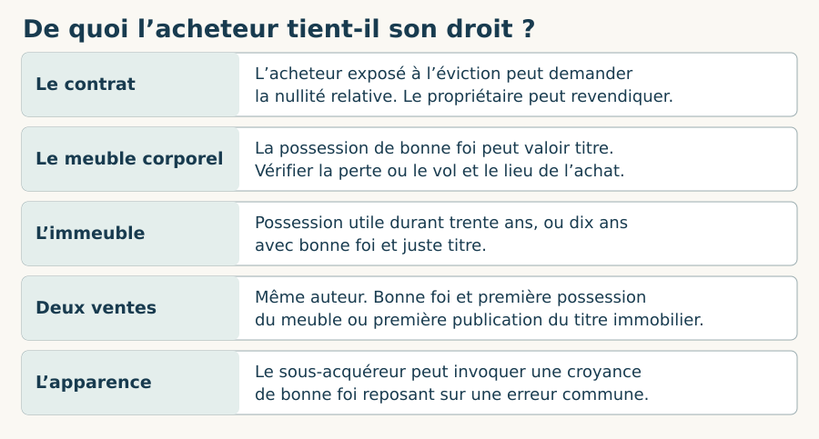

# ENS Rennes · D-E — Droit civil 2024 · Corrigé brut

*Corrigé rédigé par IA, non officiel. Signalez toute erreur.*

**Lecture du rapport du jury** · GPT-6.2 Astra Ultra · vitesse non renseignée

**Rédaction** · GPT-6.2 Astra Ultra · vitesse non renseignée

**Autocontrôle** · GPT-6.2 Astra Ultra · vitesse non renseignée

**Révision (tour 1)** · GPT-6.2 Astra Ultra · vitesse non renseignée

## L’acquisition d’un bien vendu par un non-propriétaire

Une violoniste confie son instrument à un atelier. Le réparateur le vend en son nom à une musicienne qui le paie et l’emporte, convaincue de traiter avec le propriétaire. Si l’accord sur la chose et le prix suffisait à tout régler, un réparateur pourrait, par sa seule volonté, disposer des instruments de ses clients. Si, à l’inverse, l’absence de titre chez le vendeur interdisait toujours l’acquisition, la musicienne devrait restituer le violon alors même que sa possession offrait extérieurement toutes les garanties d’une acquisition régulière. Les deux solutions extrêmes méconnaissent la pluralité des fondements de l’acquisition.

Vendre consiste à s’engager à livrer une chose contre un prix. Acquérir la propriété suppose, au-delà de cette relation entre deux personnes, d’obtenir un droit réel opposable aux tiers. Le vendeur envisagé ici prétend céder pour lui-même un droit dont il est dépourvu. Le mandataire qui agit au nom du véritable propriétaire dans les limites de son pouvoir se trouve donc hors du cas. Comment l’acheteur peut-il obtenir le droit recherché alors qu’il manque au vendeur le pouvoir de le transmettre ? Il faut d’abord mesurer les effets du défaut de titre dans la vente, puis identifier les mécanismes qui permettent à l’acheteur de tenir sa propriété d’un autre fondement.

### I. L’accord avec le vendeur laisse irrésolue la question de l’acquisition

**A. La formation de la vente ne crée pas le droit qui manque au vendeur.** Selon les articles 1583 et 1196 du Code civil, le transfert s’opère en principe par l’accord, sous réserve notamment d’un report résultant de la volonté des parties, de la nature des choses ou de la loi. Ce mécanisme allège les formalités lorsqu’un propriétaire vend. Il ne donne à personne le droit de prélever un actif dans le patrimoine d’un tiers. Le prix versé établit ce dont l’acheteur s’est acquitté. Le reçu et la remise du bien peuvent rendre l’opération vraisemblable. Aucun de ces faits, pris uniquement comme preuve de l’accord, n’établit que le vendeur était propriétaire. Le propriétaire demeuré étranger à la vente peut donc, en principe, revendiquer sa chose.

L’acquéreur, de son côté, s’est exposé à l’éviction. Dans la vente de la chose d’autrui, l’article 1599 lui ouvre une action en nullité et prévoit des dommages-intérêts s’il ignorait que la chose était à autrui. La nullité est relative. La chambre commerciale le rappelle le 15 octobre 2013 (n° 12-19.756) en censurant une annulation demandée par la propriétaire du bien vendu. L’acheteur qui obtient l’anéantissement du contrat et les restitutions envisage une tout autre issue que celui qui entend conserver la propriété. Identifier ce recours ne fournit donc qu’une première réponse, négative, à la question de l’acquisition.

**B. Lorsque deux acheteurs tiennent leurs droits du même auteur, la loi règle une préférence.** Supposons que le propriétaire d’un violon individualisé le vende à Louise, qui le laisse avec son accord quelques jours au magasin. Une seconde vente consentie à Nora porte désormais sur un violon que le vendeur a déjà aliéné. Alors que la chronologie des accords favorise Louise, l’article 1198, alinéa premier, préfère celui des deux acquéreurs de meubles corporels qui prend possession le premier, à condition d’être de bonne foi. Nora, ignorant la première vente, peut donc être préférée si elle reçoit effectivement le violon la première. Le paiement du prix par Nora avant Louise ne lui aurait pas donné à lui seul cette préférence.

Pour deux droits concurrents issus du même auteur et portant sur un même immeuble, l’alinéa 2 retient une autre publicité. L’acquéreur de bonne foi qui publie le premier son titre d’acquisition passé en la forme authentique au fichier immobilier est préféré, même si son droit est postérieur. Ce qui est publié est son titre d’acquisition. Une inscription hypothécaire rend publique une sûreté et ne remplit pas cette fonction. Une seconde vente conclue en connaissance de la première ne bénéficie pas de la préférence réservée à la bonne foi. Enfin, publier l’acte d’une personne totalement étrangère à la chaîne de propriété ne saurait faire jouer la règle des deux acquéreurs de même auteur. Reste précisément à expliquer comment on peut acquérir d’un tel vendeur.

### II. Un fondement acquisitif distinct peut suppléer le défaut de titre

**A. Une possession qualifiée peut procurer la propriété.** Revenons au violon remis au réparateur. Celui-ci le détenait pour autrui et le savait. La musicienne qui l’achète et le reçoit se comporte au contraire comme propriétaire. En matière de meubles corporels, l’article 2276 donne un effet acquisitif à la possession utile du tiers acquéreur de bonne foi. Son erreur porte sur le titre de celui dont elle reçoit le violon. La propriétaire initiale s’en était volontairement dessaisie au profit du réparateur. Dans cette hypothèse, une possession effective, paisible, publique et non équivoque à titre de propriétaire, entrée de bonne foi, peut faire échec à la revendication. La musicienne tient alors son droit de la loi attachée à cette possession. L’atelier n’a jamais eu à transmettre une propriété qu’il aurait lui-même acquise.

Si le violon a été volé ou perdu, l’article 2276 permet au propriétaire de le revendiquer dans les trois ans à compter de la perte ou du vol, même contre un possesseur de bonne foi, sauf le recours de ce dernier contre celui dont il le tient. S’il a été acheté dans une foire ou un marché, dans une vente publique ou chez un marchand vendant des choses pareilles, l’article 2277 subordonne la restitution au remboursement du prix payé par le possesseur. Acheter l’instrument à un particulier et l’acheter chez un marchand d’instruments n’emportent donc pas exactement les mêmes conséquences. L’origine de la dépossession et les conditions de l’entrée en possession donnent ici son sens juridique à la confiance de l’acquéreur.

Le terrain vendu par un non-propriétaire appelle une solution différente. L’article 2261 exige une possession continue et non interrompue, paisible, publique, non équivoque et à titre de propriétaire. Des actes conformes à un bail s’expliquent par la détention pour autrui et ne suffisent pas. La prescription immobilière de droit commun est de trente ans. L’acquéreur qui est de bonne foi et dispose d’un juste titre peut prescrire par dix ans, en vertu de l’article 2272. Le juste titre est un acte qui aurait pu transférer la propriété du bien déterminé si son auteur l’avait eue. L’acte nul pour défaut de forme ne fonde pas la prescription abrégée, conformément à l’article 2273. La bonne foi est présumée par l’article 2274. Celui qui soutient que l’acquéreur connaissait le défaut de propriété doit le prouver. Pour la prescription abrégée, l’article 2275 situe cette bonne foi au moment de l’acquisition. Une lettre révélant seulement après la vente le défaut de titre n’établit donc pas, à elle seule, que l’acquéreur en avait connaissance lorsqu’il a acquis le terrain. Dans les deux régimes, payer le prix ou occuper les lieux quelques jours ne fournit pas l’équivalent de la durée requise. La prescription trentenaire peut bénéficier à un possesseur de mauvaise foi si toutes les conditions de la possession utile et du délai sont remplies.

**B. L’apparence protège parfois l’acquéreur avant l’écoulement d’un délai.** Une première vente est annulée alors que son acquéreur a déjà revendu un immeuble. Le sous-acquéreur risque de subir rétroactivement le défaut de titre. Dans l’arrêt du 6 septembre 2011 (3e chambre civile, n° 10-20.412 et 10-21.318), les juges du fond avaient déduit de la disparition du titre de la venderesse l’annulation de la revente. La Cour de cassation leur reproche de ne pas avoir recherché si les sous-acquéreurs avaient cru de bonne foi à sa propriété sous l’empire d’une erreur commune. Elle renvoie l’affaire après cassation partielle. Elle n’attribue pas elle-même définitivement le bien aux intéressés. Une croyance seulement personnelle ou une simple affirmation de confiance serait insuffisante. Il faut caractériser les circonstances objectives qui donnaient du crédit à l’apparence de propriété.

L’acquisition recherchée procède ainsi de règles précises de préférence, d’une possession à laquelle la loi attache un effet acquisitif ou, exceptionnellement, d’une apparence juridiquement qualifiée. À défaut de l’un de ces fondements, l’acheteur ne peut opposer son achat au véritable propriétaire et conserve les recours ouverts contre le vendeur. Le droit peut donc rendre l’acquisition efficace sans jamais prêter au vendeur sans titre un pouvoir général de disposer des biens d’autrui.

[Sujet officiel](https://www.ens-rennes.fr/medias/fichier/sujet-droit-civil-d-e-2024_1729180725192-pdf) · [Rapport du jury](https://www.ens-rennes.fr/medias/fichier/rapport-de-jury-droit-civil-2024_1742461531899-pdf)

[Article 1198, concours entre deux acquéreurs](https://www.legifrance.gouv.fr/codes/article_lc/LEGIARTI000032041283/2024-04-16) · [Possession et prescription](https://www.legifrance.gouv.fr/codes/id/LEGISCTA000019017155/) · [Article 1599, vente de la chose d’autrui](https://www.legifrance.gouv.fr/codes/article_lc/LEGIARTI000006441437) · [Cass. com., 15 octobre 2013](https://www.legifrance.gouv.fr/juri/id/JURITEXT000028098845) · [Cass. 3e civ., 6 septembre 2011](https://www.legifrance.gouv.fr/juri/id/JURITEXT000024549720)

[Code civil, art. 2274](https://www.legifrance.gouv.fr/codes/article_lc/LEGIARTI000019017404/2024-04-16) · [Code civil, art. 2275](https://www.legifrance.gouv.fr/codes/article_lc/LEGIARTI000019017412/2024-04-16)
