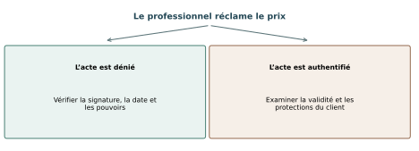
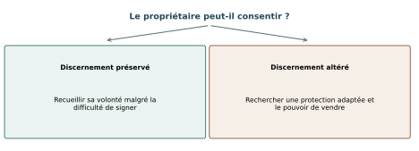
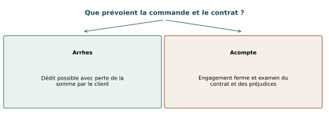

# ENS Rennes D-E — Droit (oral) 2024 · Corrigé brut

*Corrigé rédigé par IA, non officiel.*

**Rédaction** · GPT-6.2 Astra Ultra · vitesse non renseignée

Le fascicule contient vingt tirages distincts. Chacun réunit une question théorique et une situation pratique. Les solutions utilisent les textes et la jurisprudence disponibles à la session. Les relances sont proposées pour l’entraînement.

Les sujets 21, 22, 24 et 25 sont imprimés deux fois. Leurs deux paginations sont indiquées au fil du corrigé.

## Sujet 01 — Preuve des actes · commande de véranda attribuée à Édouard

*Fascicule, page 1.*

### Question théorique

Celui qui demande l’exécution d’une obligation doit la prouver (Code civil, art. 1353). Un acte portant sur plus de 1 500 euros requiert en principe un écrit, sous réserve des exceptions légales. La signature identifie l’auteur et manifeste son consentement. Une facture établie par le professionnel ne suffit pas à prouver à elle seule la commande d’un consommateur.

### Application au cas

BATITOU produit un bon de 20 000 euros. Édouard, annoncé incapable de tenir un stylo mais lucide, peut dénier la signature qu’on lui attribue. Le juge procède alors, si la pièce est décisive, à sa vérification (art. 1373 du Code civil et 287 et suivants du Code de procédure civile). Recueillir l’original, dater précisément l’incapacité motrice et rechercher les traces d’un mandat ou d’une signature régulière. La faiblesse physique actuelle ne suffit pas à établir son état exact un mois auparavant.

En l’absence de consentement ou de représentation valable, la commande ne peut être imposée à Édouard. L’âge ne constitue pas une incapacité juridique. En principe c’est lui qui agit, ses enfants pouvant l’assister ou le représenter s’ils ont pouvoir pour cela. L’intervention d’un commercial itinérant conduit aussi à vérifier les protections du contrat hors établissement, les informations fournies et le droit de rétractation selon la nature de la commande.

**Relance.**  Pourquoi distinguer signature contestée et insanité d’esprit ?

Un faux désigne un acte que la personne n’a pas signé. L’insanité supposerait une altération mentale au moment de l’acte, que les faits ne démontrent pas.

## Sujet 02 — Possession et vices · vélo trouvé

*Fascicule, page 2.*

### Question théorique

La possession associe maîtrise de fait et intention d’exercer le droit pour soi. Une possession utile à la prescription doit notamment être continue, paisible, publique et non équivoque (art. 2261). La détention pour autrui ne suffit pas. La bonne foi est la croyance légitime d’acquérir du propriétaire, appréciée à l’acquisition.

### Application au cas

Le dépôt au commissariat, puis la remise à la découvreuse après un an et un jour, n’effacent pas le droit du propriétaire d’un meuble perdu ou volé. Aux termes de l’article 2276, il peut le revendiquer pendant trois ans à compter de la perte ou du vol contre celui qui le détient. Mélina soupçonnait le vol et n’a pas acheté le vélo. Elle ne bénéficie pas du remboursement spécial d’un prix payé dans certains circuits professionnels.

La voisine devra prouver sa propriété et l’identité du vélo, par exemple par numéro de série, facture ou photos, et établir la date pertinente. Si la disparition est contemporaine de la découverte, sa réclamation dix-huit mois plus tard intervient dans le délai. Le délai de garde administratif ne confère pas à Mélina un meilleur titre que celui de la propriétaire.

**Relance.**  Une voisine qui reconnaît simplement la couleur peut-elle récupérer le vélo sur cette seule affirmation ?

Elle doit établir qu’il s’agit précisément de son bien. La ressemblance générique ne suffit pas en cas de contestation.

## Sujet 03 — Juge du contrat · ordinateur acheté à Nantes

*Fascicule, page 3.*

### Question théorique

La compétence dépend de la nature du litige, de la qualité des parties et du territoire. Pour une demande civile de 800 euros contre son vendeur professionnel, le consommateur peut saisir la juridiction judiciaire civile, tribunal judiciaire ou chambre de proximité suivant l’organisation locale. La localisation peut suivre la livraison effective en matière contractuelle ou l’option protectrice du domicile du consommateur prévue par l’article R. 631-3 du Code de la consommation.

### Application au cas

L’achat et la remise de l’ordinateur ont lieu à Nantes. Le siège réunionnais n’impose pas à Karl de s’y rendre. Une clause dérogeant à la compétence territoriale n’est pas opposable ici comme une clause conclue entre commerçants (art. 48 du Code de procédure civile). Il faut identifier le vendeur au contrat et vérifier les conditions de tentative amiable préalable pour une petite demande.

Sur le fond, la garantie légale de conformité oblige le vendeur. Un défaut apparu peu après l’achat d’un bien neuf bénéficie de la présomption d’antériorité dans le délai légal. Ouvrir la trappe après la panne ne prouve pas que Karl l’a causée. Une clause ne peut supprimer la garantie légale. La réparation ou le remplacement viennent en principe d’abord, puis la réduction du prix ou la résolution dans les cas prévus, notamment refus de tout remède ou défaut suffisamment grave. [Compétence protectrice](https://www.legifrance.gouv.fr/codes/article_lc/LEGIARTI000032808504/2024-06-01)

**Relance.**  Une garantie commerciale peut-elle restreindre la garantie légale ?

Elle peut offrir un avantage assorti de conditions. Elle ne réduit pas les droits que la loi confère au consommateur contre le vendeur.

## Sujet 04 — Résiliation · pension convenue pour le chien Mickey

*Fascicule, page 4.*

### Question théorique

La résiliation met fin pour l’avenir à une relation à exécution successive. Elle peut résulter d’une clause, d’un accord ou des mécanismes de résolution pour inexécution. La caducité vise une autre hypothèse, celle d’un contrat valablement formé dont disparaît ensuite un élément essentiel (art. 1186). Il faut d’abord interpréter l’accord selon la commune intention des parties.

### Application au cas

La somme mensuelle de 50 euros paraît financer l’entretien de Mickey en contrepartie de son accueil et du droit de visite. Sa mort met fin aux frais futurs et rend les visites impossibles. Si l’existence du chien est l’élément essentiel de la convention, Mme E. conservera la créance déjà acquise pour le mois de prise en charge mais ne pourra réclamer dix années de versements pour son entretien.

Vérifier toutefois le texte de la convention de divorce. Si la somme était en réalité une compensation forfaitaire autonome payée par échéances, la mort de l’animal n’aurait pas nécessairement le même effet. S’il existe un titre exécutoire ou une contestation sérieuse, faire constater l’extinction selon ce titre et saisir le juge compétent. La « pension » d’un animal n’est pas de plein droit la pension légale due à un enfant.

**Relance.**  Pourquoi l’inexécution fautive de Mme E. est-elle un fondement fragile ?

Le décès n’établit aucune faute. Le problème principal porte sur la disparition de la prestation dont dépendaient les versements futurs.

## Sujet 05 — Biens et choses · chien recueilli en forêt

*Fascicule, page 5.*

### Question théorique

Une chose peut faire l’objet d’un droit si elle est appropriable. Tous les biens n’ont pas une existence corporelle, telle une créance, et certaines choses sont hors appropriation privée. Les animaux sont des êtres vivants doués de sensibilité et, sous réserve des lois qui les protègent, soumis au régime des biens (art. 515-14 du Code civil).

### Application au cas

Lucy et son père ont recueilli et soigné un chien blessé. L’absence momentanée du maître ne vaut pas abandon de propriété. L’identification de l’animal, les fichiers et documents vétérinaires, témoignages et circonstances de la disparition permettent d’établir son propriétaire. Après un an, le propriétaire d’un animal perdu peut en principe le revendiquer dans le délai de trois ans de l’article 2276. Le cadre de prise en charge des animaux errants et de la fourrière visait précisément à permettre l’identification du maître.

L’affection de Lucy ne crée donc pas un titre contre le véritable propriétaire. Le père peut discuter le remboursement de frais nécessaires et utiles, notamment sur le terrain de la gestion d’affaires, justificatifs à l’appui. Une adoption ou cession régulière, si elle avait eu lieu, changerait l’analyse. En cas de contestation, la restitution se règle par accord ou selon les voies civiles appropriées.

**Relance.**  La reconnaissance affectueuse du maître par le chien suffit-elle à trancher ?

C’est un indice. L’identification et les autres preuves de propriété sont plus déterminantes en cas de litige.

## Sujet 06 — Tutelle · protection envisagée par la fille de Jacques

*Fascicule, page 6.*

### Question théorique

Une mesure de protection suppose une altération médicalement constatée des facultés mentales ou de facultés corporelles de nature à empêcher l’expression de la volonté (art. 425). Nécessité, subsidiarité et proportionnalité guident le juge. La tutelle assure une représentation continue lorsque sauvegarde ou curatelle ne suffisent pas. La curatelle permet plutôt une assistance pour les actes importants.

### Application au cas

L’addiction, la dégradation de la santé et la ruine rapportées par Bérénice justifient de s’informer, mais elles ne suffisent pas à constater l’altération prévue par la loi. Si une mesure est nécessaire, la fille, en tant que proche habilitée à saisir le juge, n’a pas besoin de l’accord de son frère. La requête au juge des contentieux de la protection doit en particulier être accompagnée du certificat circonstancié d’un médecin inscrit sur la liste du procureur.

Le juge entend normalement Jacques, examine ses capacités et préfère une assistance adaptée ou une solution moins contraignante lorsqu’elle suffit. Une sauvegarde peut convenir à une situation provisoire. En présence de difficultés financières seules, des aides sociales ou budgétaires et un accompagnement volontaire peuvent être plus appropriés qu’une privation de capacité.

**Relance.**  Les enfants peuvent-ils se substituer immédiatement au père pour gérer son compte ?

Le lien familial ne vaut pas pouvoir général de représentation. Il faut un mandat valable ou une habilitation ou mesure judiciaire adaptée.

## Sujet 10 — Notion d’obligation · promesse verbale après un gain

*Fascicule, page 7.*

### Question théorique

L’obligation civile permet au créancier d’exiger une prestation du débiteur. Elle naît d’actes juridiques, de faits juridiques ou de la loi. L’article 1100 mentionne aussi l’exécution volontaire ou la promesse d’exécution d’un devoir de conscience envers autrui. Ce mécanisme peut faire passer une obligation naturelle à une obligation civile.

### Application au cas

Au dîner, Jessica annonce un versement de 1 000 euros à chacune si elle gagne. Il faut distinguer une simple intention de faire un cadeau, une libéralité à laquelle les formes applicables manquent et un devoir de conscience dont Jessica reconnaît vouloir s’acquitter. Le lendemain du tirage elle s’engage de nouveau, cette fois alors que le résultat est acquis, à régler dès perception des fonds. Cette seconde déclaration rend plus plausible une volonté ferme, sans démontrer à elle seule un devoir préexistant envers ses amies.

Les deux créancières devraient établir les circonstances, la teneur de chaque engagement, la perception du gain et le fondement invoqué. Chacune réclame 1 000 euros. La preuve peut en principe être libre pour chacune de ces obligations distinctes inférieures au seuil légal. Le juge apprécie les témoignages. Un précédent sur un gain partagé admet la transformation d’une obligation naturelle, mais il portait sur un devoir établi et ne rend pas toute promesse amicale exécutoire. [Civ. 1re, 10 octobre 1995, n° 93-20.300](https://www.legifrance.gouv.fr/juri/id/JURITEXT000007034947/)

**Relance.**  La condition de gain suffit-elle à créer une obligation ?

Elle fixe un événement dont dépendrait l’exécution. Il faut encore une obligation valablement née et déterminée envers chacune des bénéficiaires.

## Sujet 11 — Choix d’une protection · vente de la maison d’Hubert

*Fascicule, page 8.*

### Question théorique

Une simple difficulté d’écriture n’équivaut pas à une perte de discernement. Le juge adapte la protection aux facultés réellement altérées. Une procuration consentie lucidement, une assistance, une habilitation familiale, une sauvegarde ou une tutelle n’ont ni les mêmes conditions ni les mêmes effets. Une représentation ne se présume pas du seul lien de filiation.

### Application au cas

Dans le récit, Hubert est le père en EHPAD et Jean-Christophe le fils qui s’adresse à l’agence. Si Hubert comprend et veut vendre, une solution notariale adaptée à sa difficulté de signer peut recueillir sa volonté. Ni son absence d’opposition ni l’approbation du fils ne valent mandat de vente. Si ses troubles cognitifs l’empêchent réellement de consentir, le fils doit rechercher une habilitation ou mesure adaptée avec certificat médical et contrôle du juge.

La vente du logement d’une personne protégée exige une autorisation du juge ou du conseil de famille selon l’article 426. Si l’acte a pour finalité l’accueil en établissement, l’avis préalable du médecin extérieur à l’établissement prévu par ce texte doit aussi être recueilli. Le récit ne dit pas si maintenir le séjour est le but de la vente. La sœur du fils peut être consultée pour une habilitation familiale mais son accord ne remplace pas celui du père ou la décision judiciaire. Si « sa sœur » désigne celle d’Hubert, la même absence de mandat automatique vaut. [Article 426](https://www.legifrance.gouv.fr/codes/article_lc/LEGIARTI000030253928/2024-06-01)

**Relance.**  Pourquoi distinguer mandat de mise en vente et vente elle-même ?

L’étendue des pouvoirs doit être précisée. Une simple mission de rechercher un acquéreur n’emporte pas nécessairement pouvoir de conclure la vente.

## Sujet 12 — Offre contractuelle · attribution de la sculpture

*Fascicule, page 9.*

### Question théorique

L’offre comprend les éléments essentiels de l’opération et exprime la volonté d’être lié en cas d’acceptation (art. 1114). À défaut il s’agit d’une invitation à négocier. Sa révocation avant le terme fixé ou avant un délai raisonnable peut engager la responsabilité sans faire naître le contrat non encore accepté.

### Application au cas

Ici le contrat est déjà conclu. Le vendeur invoquerait une erreur sur une qualité essentielle, l’auteur de la sculpture, et non la simple découverte d’une meilleure offre. La formule « attribuée à », le prix et l’explication donnée par M. M. établissent que l’incertitude sur l’attribution à Claudel avait été expressément acceptée. L’article 1133 écarte l’erreur sur une qualité dont l’aléa avait été accepté. La seule erreur d’évaluation économique n’est pas une cause de nullité (art. 1136).

Il reste à déterminer le champ exact de l’aléa commun. Si les parties ont accepté de traiter malgré l’incertitude sur l’auteur de la sculpture, la découverte de Rodin réalise ce risque et le vendeur ne peut récupérer l’œuvre au seul motif de l’écart de valeur. Une qualité différente que les parties tenaient pour certaine et une erreur déterminante et excusable appelleraient une autre analyse. Une dissimulation frauduleuse n’est pas établie.

**Relance.**  À qui incombe la preuve de l’erreur utile ?

À celui qui invoque la nullité. Il lui faut établir l’élément déterminant du consentement et l’absence d’acceptation du risque sur cet élément.

## Sujet 14 — Responsabilité du fait des choses · incendie de la trottinette

*Fascicule, page 10.*

### Question théorique

L’article 1242, alinéa 1, engage la responsabilité du gardien d’une chose ayant joué un rôle causal dans le dommage. La garde correspond aux pouvoirs d’usage, de direction et de contrôle. La responsabilité du fait des produits défectueux, articles 1245 et suivants, offre ici un fondement propre contre le producteur d’une chose qui ne présente pas la sécurité légitimement attendue.

### Application au cas

Côme doit établir dommage, défaut et lien causal, sans devoir démontrer une faute du fabricant. Le rapport d’expertise sur le branchement inadapté dès la conception, la troisième charge et les dégâts à l’appartement sont essentiels. Le régime spécial vise les atteintes aux personnes et aux autres biens dans les limites légales, avec seuil de 500 euros pour l’atteinte aux biens. La perte du produit lui-même relève d’autres voies, notamment la garantie de conformité contre le vendeur.

Le fabricant portugais est identifié. Faire circuler un produit au sein de l’Union ne transforme pas tout grossiste ou distributeur en importateur assimilé au producteur. Si le producteur était inconnu, le fournisseur pourrait être recherché dans les conditions de l’article 1245-6. La nationalité différente des sociétés ne prive pas Côme de son recours. Identifier l’assureur et préserver contradictoirement les éléments de preuve.

**Relance.**  Pourquoi ne pas se contenter d’assigner le gardien de la trottinette ?

Côme utilisait lui-même la chose. Le régime du défaut de sécurité permet d’examiner directement le rôle du producteur dans les dommages à l’appartement.

## Sujet 15 — Directive européenne · exception réservée aux filiales américaines

*Fascicule, page 11.*

### Question théorique

L’article 288 TFUE lie l’État membre quant au résultat à atteindre, en lui laissant le choix des moyens de transposition. Dans le champ du droit de l’Union, une disposition nationale incompatible doit recevoir le traitement qu’imposent la primauté et les règles d’invocabilité. Après le délai, un particulier peut invoquer contre une autorité publique une disposition précise et inconditionnelle d’une directive. Cette voie ne suffit pas à imposer une obligation directement à une autre personne privée.

### Application au cas

Examiner le champ matériel, les seuils et le calendrier de la directive de vigilance évoquée. Une filiale constituée dans un État membre et le groupe établi hors de l’Union peuvent relever de critères juridiques différents. La seule origine américaine du groupe ne constitue pas une faculté générale d’exemption nationale. Si les entités visées satisfont aux critères européens, leur exclusion de principe compromet le résultat prescrit.

L’État doit corriger sa transposition. Un recours en manquement peut être engagé contre lui et le juge national doit rechercher l’interprétation conforme, sans interprétation contraire au texte national. Si la directive laisse une véritable marge sur le périmètre et que les conditions européennes sont respectées, une différence peut se discuter. La conclusion demande donc le texte applicable, et non une simple étiquette de nationalité.

**Relance.**  Peut-on immédiatement condamner une filiale privée sur la seule base d’une obligation non transposée ?

Une directive n’a pas d’effet direct horizontal. Il faut examiner le droit national et les autres voies, dont la responsabilité éventuelle de l’État.

## Sujet 16 — Caractères de la loi · alerte d’une association environnementale

*Fascicule, page 12.*

### Question théorique

La loi est une norme adoptée par l’autorité compétente et promulguée. Elle est en principe générale et impersonnelle, obligatoire à compter de son entrée en vigueur et susceptible de sanction. L’article premier du Code civil diffère, pour les seules dispositions qui nécessitent des mesures d’application, l’entrée en vigueur jusqu’à ces mesures. D’autres dispositions suffisamment précises peuvent déjà produire effet.

### Application au cas

Les prélèvements et la mortalité des poissons constituent des faits que l’association peut faire connaître. Il faut distinguer le produit directement interdit des seuls dérivés dont le décret doit établir la liste. Une qualification répressive ne peut être étendue par analogie à un dérivé encore indéterminé. D’autres règles environnementales sur les rejets ou les atteintes à l’eau peuvent s’appliquer indépendamment.

L’association peut alerter les autorités et la presse en présentant méthodes, résultats et hypothèses, sans affirmer comme certain l’auteur de la pollution ni l’existence d’une infraction non établie. Conserver les analyses et solliciter des contrôles contradictoires. En cas de carence du pouvoir réglementaire dans un délai raisonnable, un refus de prendre les mesures nécessaires peut aussi être contesté devant le juge administratif.

**Relance.**  Le décret manquant prive-t-il toute la loi de portée ?

Il faut identifier les seules dispositions dont l’exécution dépend nécessairement du décret. Les dispositions autonomes et les règles déjà applicables restent à examiner.

## Sujet 17 — Vie privée et droit à l’image · publication sur un réseau social

*Fascicule, page 13.*

### Question théorique

L’article 9 du Code civil protège le respect de la vie privée. L’image d’une personne identifiable est également protégée. Le juge met ces droits en balance avec la liberté d’expression en tenant compte du sujet, du contexte, de la contribution à un débat d’intérêt général et de la gravité de l’atteinte.

### Application au cas

Hélène publie une photographie personnelle découverte dans un grenier. La prise matérielle d’un cliché et sa diffusion à un public en ligne sont des actes distincts. Avoir vu son amie emporter ou photographier l’image et avoir deviné son intention ne vaut pas consentement certain à la mise en ligne. Chacune des deux personnes représentées peut faire valoir son droit. La célébrité de l’une ne transforme pas sa vie privée en information d’intérêt général.

Un retrait rapide, la cessation de la diffusion et des dommages-intérêts selon le préjudice peuvent être demandés. Une mesure en référé peut être envisagée si ses conditions sont réunies. L’étendue de la diffusion, les réglages du compte et le contexte peuvent modifier l’appréciation sans donner à la détentrice du support un droit de publication.

**Relance.**  Un accord pour conserver une photo privée couvre-t-il une publication sur un compte public ?

Non en principe. Il faut apprécier l’objet et la portée précise de l’autorisation.

## Sujet 18 — Contracter pour autrui · console commandée au nom de Timothée

*Fascicule, page 14.*

### Question théorique

Le représentant qui agit dans la limite de ses pouvoirs au nom et pour le compte du représenté engage ce dernier (art. 1153 et 1154). Le porte-fort promet le fait d’autrui sans l’obliger. La stipulation pour autrui confère un droit au tiers et ne permet pas de mettre librement une dette à sa charge.

### Application au cas

L’envie de Timothée d’acheter la console ne donne pas à Stéphane un mandat. Sans pouvoir ni ratification, la commande lui est en principe inopposable (art. 1156). Le magasin pourrait invoquer une croyance légitime dans les pouvoirs du prétendu représentant, notamment créée par le comportement du représenté. Aucune manifestation de Timothée en ce sens n’est donnée. Il peut donc en principe refuser de payer.

Si Stéphane s’est personnellement engagé ou a acheté en son propre nom, le magasin peut lui réclamer le prix. S’il s’est présenté uniquement comme mandataire, le prix n’est pas automatiquement sa dette, mais sa faute ou une garantie consentie peut engager sa responsabilité envers le vendeur. Le remboursement de l’acompte par Timothée supposerait mandat, ratification ou gestion d’affaires utile, difficile à établir pour un loisir simplement souhaité.

**Relance.**  Le paiement de l’acompte prouve-t-il le mandat ?

Il manifeste un acte accompli par Stéphane. Il ne prouve pas que Timothée lui avait donné pouvoir.

## Sujet 19 — Enclave · transformation d’une fenêtre de toit

*Fascicule, page 15.*

### Question théorique

Le fonds enclavé est privé d’issue suffisante sur la voie publique. L’article 682 permet de réclamer un passage suffisant moyennant indemnité proportionnée au dommage. Le trajet tient compte de la distance et du moindre dommage (art. 683). Cette servitude de passage se distingue des règles relatives aux ouvertures sur la propriété voisine.

### Application au cas

La fenêtre translucide à châssis fixe peut fonctionner comme un simple jour qui laisse entrer la lumière sans permettre de regarder normalement chez le voisin. Selon sa position et le mur considéré, les règles des articles 675 à 677 sont à vérifier. Un vitrage transparent et ouvrant susceptible de donner un regard normal sur le jardin peut créer une vue. Une fenêtre de toit n’est pas automatiquement une vue si sa hauteur ou son orientation empêche de regarder le fonds.

En l’absence d’accord ou de titre, une vue droite exige en principe 1,90 m et une vue oblique 0,60 m (art. 678 à 680). Vérifier la distance de l’ouverture à la limite, l’angle, la hauteur, l’éventuelle servitude et l’autorisation d’urbanisme requise. La création nouvelle ne profite pas de l’ancienneté d’un simple jour comme si celui-ci avait été une vue. L’opposition du voisin est donc fondée si les conditions des vues ne sont pas respectées.

**Relance.**  Le projet d’aménager une chambre permet-il d’invoquer l’enclave ?

Non. L’enclave concerne l’accès à la voie publique. Le besoin de lumière ne crée pas une servitude de vue.

## Sujet 20 — Silence et acceptation · offres successives de vente

*Fascicule, page 16.*

### Question théorique

L’article 1120 refuse en principe de donner au silence le sens d’une acceptation, sauf loi, usages, relations d’affaires ou circonstances particulières. Pour former le contrat, une offre précise et ferme doit être acceptée dans le délai fixé ou dans un délai raisonnable. Le contrat est conclu lorsque l’acceptation parvient à l’offrant (art. 1121).

### Application au cas

Le neveu n’acquiert aucune priorité par le seul fait que son oncle l’a sollicité en premier. Reconstituer les dates de l’offre, de sa réception, de sa caducité ou de son retrait éventuellement notifié, de la vente concurrente et de l’arrivée de l’acceptation. L’existence d’une promesse unilatérale ou d’un pacte de préférence serait une qualification différente, dont le sujet ne donne pas les éléments.

Si l’offre était caduque ou valablement retirée, le neveu ne peut obtenir la maison. Un retrait irrégulier avant le terme peut engager la responsabilité sans imposer le contrat retiré (art. 1116). La vente à la fille de la voisine ne suffit toutefois pas à établir que le neveu a reçu un retrait. Si deux titres concurrents étaient effectivement constitués, il faudrait aussi examiner la publicité foncière et la bonne foi (art. 1198). Le seul ordre des sollicitations ne décide en aucun cas.

**Relance.**  Que changerait une acceptation reçue avant toute révocation et avant la vente concurrente ?

Si l’offre était toujours valable et ses conditions acceptées, un contrat pouvait déjà être formé. Le conflit entre acquéreurs demanderait alors l’examen de leurs titres.

## Sujet 21 — Sanctions de l’inexécution · mariage annulé et acompte

*Fascicule, pages 17 et 20.*

### Question théorique

Les sanctions de l’article 1217 dépendent de l’obligation inexécutée. La suspension protège contre une inexécution suffisamment grave, la résolution met fin au contrat, les dommages-intérêts réparent un dommage imputable. Il faut identifier le débiteur empêché et vérifier le contrat avant de réclamer une restitution.

### Application au cas

La rupture du couple empêche la fête envisagée, mais ne démontre pas que le traiteur soit incapable de fournir le buffet. Une circonstance affectant l’utilité personnelle que le client attend de la prestation ne constitue pas automatiquement une force majeure le libérant. Le versement est qualifié d’acompte, ce qui indique un paiement partiel d’un engagement ferme. Si le contrat de consommation ne précisait rien, la règle supplétive de l’article L. 214-1 ferait des sommes versées d’avance des arrhes qui peuvent être perdues en cas de dédit du consommateur.

Vérifier le bon de commande, la clause d’annulation, la date de résiliation, la qualification réelle et les frais économisés ou engagés. Élie n’a pas, pour le seul motif de la rupture, droit au remboursement automatique des 3 850 euros. Le professionnel ne peut davantage cumuler toutes les sommes indépendamment de ses droits contractuels et de la réparation du dommage. Une clause pénale manifestement excessive peut être modérée.

**Relance.**  Qu’est-ce qui distingue ce cas de l’annulation définitive d’une prestation interdite par la loi ?

Ici le prestataire semble en mesure d’exécuter. C’est la situation personnelle d’un client qui change.

## Sujet 22 — Préjudice réparable · collision d’une personne en rollers et d’un chien

*Fascicule, pages 18 et 21.*

### Question théorique

Un préjudice réparable doit être certain, personnel et causalement rattaché au fait générateur. Il peut être corporel, matériel ou moral. Une perte de chance réelle et sérieuse constitue un préjudice propre, évalué selon sa probabilité. La réparation intégrale doit éviter tout enrichissement ou double indemnisation.

### Application au cas

Les rollers ordinaires sont mus par l’effort humain. Aucun véhicule terrestre à moteur n’étant décrit, la loi du 5 juillet 1985 ne devient pas applicable du seul fait que Capucine roule. Selon l’article 1243, le propriétaire d’un animal ou celui qui s’en sert pendant qu’il est à son usage répond des dommages causés même s’il s’est échappé. Le chien divaguait et a directement participé au choc. Capucine peut réclamer réparation de son poignet et de son téléphone, avec justificatifs.

Les gardiens peuvent discuter une faute de Capucine ayant contribué au dommage. Pour leurs frais vétérinaires il faut établir un fait générateur à sa charge, le lien de causalité, les dépenses et la part de responsabilité liée au chien. Une vitesse inadaptée prouvée ou, selon les circonstances, le rôle causal des rollers comme chose sous sa garde peuvent être invoqués. Les deux demandes doivent être examinées séparément.

**Relance.**  La seule absence de laisse démontre-t-elle toute l’affaire ?

Elle peut éclairer les circonstances, mais le régime de l’animal ne requiert pas nécessairement une faute. La causalité et les préjudices restent à établir.

## Sujet 24 — Gestion d’affaires · gestion spontanée d’un blog

*Fascicule, pages 19 et 22.*

### Question théorique

La gestion d’affaires suppose qu’une personne gère sciemment et utilement l’affaire d’autrui, sans y être tenue, à l’insu ou sans opposition du maître de l’affaire (art. 1301). Le gérant agit avec les soins d’une personne raisonnable, poursuit la gestion dans les conditions légales et rend compte. Le maître rembourse les dépenses utiles et peut devoir indemniser les dommages subis du fait de la gestion.

### Application au cas

Sauvegarder temporairement les recettes pendant l’absence de la blogueuse pouvait être utile. Modifier la ligne éditoriale de la mode vers la cause animale constitue une autre décision, qui doit être appréciée au moment où elle a été prise et selon l’intérêt raisonnablement prévisible de la titulaire. La connaissance des identifiants ne prouve pas l’autorisation d’effectuer ce changement. Le témoignage de Tamaso peut éclairer les faits mais ne crée pas par lui-même un mandat.

Fanchon doit justifier chaque dépense et distinguer les frais utiles des initiatives imprudentes. La blogueuse peut demander réparation des pertes directement causées par une faute de gestion, en tenant compte des gains réellement acquis et sans traiter une annonce de partenariat comme un contrat certain. La ratification aurait les effets d’un mandat. À défaut de gestion complète, un enrichissement procuré peut ouvrir la voie subsidiaire de l’article 1301-5.

**Relance.**  Une opération globalement lucrative efface-t-elle toute faute ?

Il faut apprécier les actes, leur utilité et les préjudices concrets. Un nouveau partenariat annoncé ne rend pas automatiquement justifiées toutes les décisions antérieures.

## Sujet 25 — Effet relatif · révision des conditions du jardinage

*Fascicule, pages 23 et 24.*

### Question théorique

Le contrat oblige les parties et ne crée en principe pas d’obligations à la charge des tiers (art. 1199). Les tiers doivent respecter la situation qu’il instaure. Le jardinage rémunéré décrit ici lie directement Juliette et ses voisins. Leur conflit concerne les conditions d’exécution d’un contrat entre parties plutôt que l’effet relatif lui-même.

### Application au cas

Les dépenses sont intégralement remboursées, mais tardivement. Le surcoût invoqué est surtout celui de leur préfinancement et de la trésorerie. Examiner les stipulations sur l’échéance, la durée de la mission, le montant habituel et l’évolution imprévisible des avances. Aucun droit général à imposer un nouveau calendrier ne résulte de la simple hausse des prix. Juliette peut proposer une provision, des achats directs par les voisins ou des remboursements périodiques.

Sous les conditions de l’article 1195, un changement imprévisible rendant l’exécution excessivement onéreuse pour une partie qui n’en a pas accepté le risque autorise une demande de renégociation. Elle doit continuer l’exécution pendant cette phase. Après refus ou échec, les voies d’accord et, dans les conditions légales, de révision ou de fin par le juge sont ouvertes. Si la convention est à durée indéterminée, une résiliation pour l’avenir avec préavis raisonnable peut aussi être discutée. L’avance ne peut être exigée par un arrêt immédiat unilatéral sur ces seuls faits.

**Relance.**  Pourquoi vérifier le remboursement promis avant d’invoquer l’imprévision ?

Si les voisins supportent déjà la hausse définitive des coûts, Juliette doit établir que la seule avance de trésorerie rend quand même sa prestation excessivement onéreuse.

[Fascicule de la session](https://www.ens-rennes.fr/medias/fichier/sujets-droit-oral-d-e-2024_1731603639923-pdf) · [Rapport du jury](https://www.ens-rennes.fr/medias/fichier/rapport-de-jury-oral-droit-d-e-2024_1747059808329-pdf) · [Code civil à la date de la session](https://www.legifrance.gouv.fr/codes/texte_lc/LEGITEXT000006070721/2024-06-01/)
