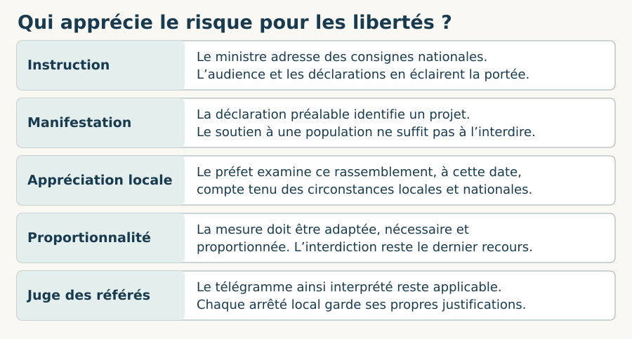

# ENS Rennes · D-E — Droit public 2024 · Corrigé brut

*Corrigé rédigé par IA, non officiel. Signalez toute erreur.*

**Lecture du rapport du jury** · GPT-6.2 Astra Ultra · vitesse non renseignée

**Rédaction** · GPT-6.2 Astra Ultra · vitesse non renseignée

**Autocontrôle** · GPT-6.2 Astra Ultra · vitesse non renseignée

**Révision (tour 1)** · GPT-6.2 Astra Ultra · vitesse non renseignée

## Une instruction nationale peut-elle commander l’interdiction de toutes les manifestations ?

Le 12 octobre 2023, après les attaques commises le 7 octobre par le Hamas en Israël, le ministre de l’intérieur adresse aux préfets un télégramme dont la rédaction paraît prescrire l’interdiction générale des manifestations pro-palestiniennes. L’association Comité Action Palestine en demande la suspension au juge des référés du Conseil d’État. Elle se prévaut d’atteintes aux libertés de manifestation et d’expression. Saisi au titre de l’article L. 521-2 du code de justice administrative, le juge doit apprécier si cette instruction fait peser, à la date où il statue, une atteinte grave et manifestement illégale sur ces libertés. Il rejette la requête le 18 octobre 2023 après avoir resserré le sens du texte et précisé à quelles conditions le préfet peut, dans chaque cas, interdire une manifestation.

### I. Le contrôle de l’instruction ministérielle en référé-liberté

Une instruction générale peut peser immédiatement sur les libertés de manifestation et d’expression. Encore faut-il déterminer la portée exacte des prescriptions adressées aux préfets avant d’apprécier leur légalité.

**A. La protection immédiate des libertés face à une instruction nationale.** Le recours vise un télégramme aux préfets, en amont des arrêtés qui pourraient être pris sur son fondement. Il serait peu protecteur de subordonner absolument l’intervention du juge à la forme de l’acte. L’article L. 521-2 lui permet d’ordonner en urgence les mesures nécessaires à la sauvegarde d’une liberté fondamentale à laquelle l’administration aurait gravement et manifestement illégalement porté atteinte dans l’exercice de ses pouvoirs. Le juge examine le texte et le comportement des autorités. Il ne lui appartient ici ni d’annuler une mesure par un jugement au fond, ni d’ordonner ou de prohiber par anticipation toutes les manifestations à venir. L’enjeu immédiat est la portée que les services de l’État peuvent donner à l’instruction déjà diffusée.

**B. L’interprétation restrictive du télégramme ministériel.** Le point 4 reprend les termes du télégramme, qui établissaient un lien général entre soutien à la cause palestinienne et troubles éventuels. Le point 5 tient compte des explications apportées à l’audience et d’éléments postérieurs à celle-ci, notamment des déclarations publiques du ministre. Le juge entend l’instruction comme visant les manifestations qui justifieraient ou valoriseraient des actes terroristes. Au point 8, sa critique de la rédaction explique l’intérêt de ce détour. Pris isolément, le texte risquait de produire une interdiction indifférenciée. Sa lecture à la lumière des éclaircissements rend possible le rejet de la demande tout en privant une lecture générale de toute autorité. La méthode a un coût pour la prévisibilité de l’action administrative. Il faut une audience et une ordonnance pour dire aux destinataires ce que le texte, à lui seul, ne rendait pas clair.

### II. L’examen préfectoral de la nécessité de chaque interdiction

L’interprétation retenue au point 5 laisse à chaque préfet une décision à prendre. La légalité de cette décision dépend à la fois de l’exercice effectif de son pouvoir d’appréciation et de l’adéquation de la mesure aux circonstances.

**A. L’appréciation locale du risque par le préfet.** Le décret d’attributions du 26 juillet 2023 permet au ministre de préparer et de mettre en œuvre la politique gouvernementale de sécurité intérieure et de donner des instructions aux représentants de l’État. Le code de la sécurité intérieure règle la déclaration préalable des manifestations sur la voie publique et attribue aux autorités préfectorales mentionnées par l’ordonnance le pouvoir de prononcer l’interdiction en cause. Une déclaration ne vaut donc pas demande d’autorisation que le ministre pourrait accepter ou refuser pour tout le territoire. Le préfet doit apprécier la réalité et l’ampleur des risques à la date de sa propre décision au regard du contexte national et des circonstances locales de la manifestation. Un arrêté qui énoncerait exclusivement que le ministre a donné une consigne éluderait la compétence que la loi confie à son signataire.

**B. La proportionnalité de l’interdiction au regard d’une menace caractérisée.** Le point 3 met en balance les deux libertés fondamentales et l’exigence constitutionnelle de sauvegarde de l’ordre public. L’autorité doit se demander si la mesure répond au risque identifié, si une mesure moins restrictive suffirait et si le sacrifice des libertés reste proportionné aux circonstances. Cette démarche prolonge l’arrêt *Benjamin* du 19 mai 1933. En octobre 2023, la recrudescence des actes antisémites constitue un élément du contexte relevé par le juge. Une interdiction peut prendre en compte un risque de troubles matériels ou la commission suffisamment certaine et imminente d’infractions affectant l’ordre public, y compris sans désordre matériel. L’ordonnance distingue le soutien à la population palestinienne, qui ne justifie par lui-même aucune interdiction, des agissements répondant aux qualifications pénales rappelées au point 6. L’appréciation individualisée vaut quelle que soit la partie au conflit soutenue par le rassemblement. Le lien avec un conflit international ne tient pas lieu de preuve d’un trouble local.

Ainsi interprété, le télégramme ne porte pas, à la date de l’ordonnance, l’atteinte grave et manifestement illégale requise. La condition d’urgence, cumulative, reste expressément sans examen. Les quarante-huit heures fixées par l’article L. 521-2 sont le délai imparti au juge pour se prononcer. À l’échelon local, l’article L. 211-4 du code de la sécurité intérieure prévoit une autre temporalité : l’arrêté d’interdiction est immédiatement notifié aux signataires de la déclaration au domicile élu. Le premier délai concerne le jugement et la seconde exigence l’information immédiate des déclarants. Le rejet permet au ministre d’adresser des instructions, tout en donnant au juge de chaque arrêté futur des critères pour contrôler l’appréciation personnelle du préfet. Sa portée protectrice se trouve dans ces motifs, dont aucune validation générale des interdictions ne peut être tirée.

[Sujet officiel](https://www.ens-rennes.fr/medias/fichier/sujet-epr-a-options-droit-com-droit-public-maths-d-e-2024_1729180742250-pdf#page=5) · [Rapport du jury](https://www.ens-rennes.fr/medias/fichier/rapport-de-jury-droit-public-e-crit-d-e-2024_1734001947279-pdf) · [Ordonnance du Conseil d’État](https://conseil-etat.fr/fr/arianeweb/CE/decision/2023-10-18/488860)

[Code de justice administrative, art. L. 521-2](https://www.legifrance.gouv.fr/codes/article_lc/LEGIARTI000006449327/2024-04-17) · [Code de la sécurité intérieure, art. L. 211-4](https://www.legifrance.gouv.fr/codes/article_lc/LEGIARTI000025505140/2024-04-17)
