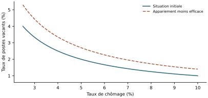
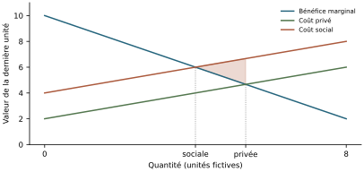
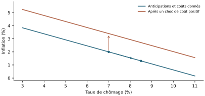
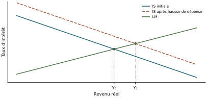
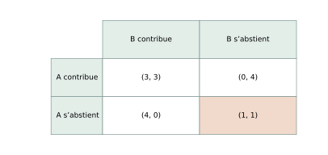

# ENS Rennes D-E — Économie (oral) 2024 · Corrigé brut

*Corrigé rédigé par IA, non officiel.*

**Rédaction** · GPT-6.2 Astra Ultra · vitesse non renseignée

Le jury prévoit 30 minutes de préparation et environ 10 minutes d’exposé avant les questions. Les 23 tirages sont présentés dans l’ordre du fascicule. Les relances proposées ci-dessous sont des exercices de préparation.

## Sujet 1 — Le passager clandestin

Un habitant profite d’une digue même s’il refuse de cotiser à sa construction. La protection est difficilement excluable et, dans la zone protégée, un habitant supplémentaire réduit peu celle de ses voisins. Chacun peut souhaiter que les autres paient. La somme des contributions volontaires risque alors d’être inférieure à celle nécessaire, même si le bénéfice collectif dépasse le coût.

Supposons trois ménages prêts à verser chacun 50 euros pour une protection qui coûte 120 euros. La somme des dispositions à payer atteint 150 euros. Aucun ménage isolé ne veut payer 120 euros, alors que trois contributions imposées de 40 euros laisseraient chacun gagnant. Plus généralement, pour un bien collectif, on compare la somme des bénéfices marginaux individuels au coût marginal de production.

L’impôt local, une cotisation obligatoire, une règle de réciprocité ou une organisation de petits groupes peuvent résoudre le problème, à des coûts différents. Un péage permet parfois l’exclusion mais peut écarter des usagers dont la venue coûterait peu. La réponse institutionnelle dépend donc de la possibilité de mesurer le bénéfice, d’exclure et d’organiser la coopération.

**Relance.**  Une ressource commune pose-t-elle le même problème ?

Sa consommation est rivale. La pêche en accès libre peut être excessive, tandis que la construction volontaire d’une digue peut être insuffisante.

## Sujet 2 — Qu’est-ce que le plein emploi ?

Il existe toujours des départs, des embauches et des personnes qui cherchent un emploi adapté. Le plein emploi désigne une situation où l’insuffisance de débouchés ne laisse plus une réserve importante de personnes employables sans poste. Le taux de chômage au sens du BIT est le rapport du nombre de personnes sans emploi, disponibles et en recherche active à la population active.

À taux de chômage égal, une économie avec de nombreuses sorties vers l’inactivité diffère d’une autre où les personnes retrouvent rapidement un emploi. Il faut examiner le taux d’emploi par groupe, le temps partiel subi, le chômage de longue durée et le nombre de postes vacants. La courbe de Beveridge relie chômage et postes vacants. Son déplacement peut renseigner sur la qualité de l’appariement.

Le seuil compatible avec des tensions de prix stables dépend de la productivité, des institutions et de la conjoncture. L’objectif social d’un accès effectif à l’emploi ajoute la qualité des postes et l’intégration des personnes éloignées du marché du travail. Une cible numérique unique répond imparfaitement à ces deux dimensions.

**Relance.**  Pourquoi un surcroît de recrutements peut-il être accompagné d’une hausse du chômage ?

Des personnes auparavant inactives se remettent à chercher un travail. Elles peuvent entrer dans la population active plus vite qu’elles ne sont embauchées.

## Sujet 3 — Anti-sélection et risque moral

L’assureur automobile ne connaît pas exactement le risque de chaque conducteur. S’il facture une prime correspondant à la moyenne, certains conducteurs prudents renoncent au contrat. La clientèle restante est plus risquée, ce qui pousse la prime à la hausse. Cette sélection adverse provient d’une information privée sur le type de l’agent avant l’échange.

L’aléa moral porte sur une action difficile à observer après la conclusion du contrat. Une couverture intégrale peut réduire l’incitation à choisir un stationnement sûr. Une franchise laisse au conducteur une partie du coût d’un sinistre, mais transfère davantage de risque sur un ménage qui souhaitait précisément s’assurer. Dans le crédit, le risque moral peut prendre la forme d’un projet plus risqué après déblocage des fonds.

Un menu de contrats révèle en partie les types, une assurance obligatoire conserve une base large et une franchise agit sur la prévention. Il faut associer chaque remède à la cause et arbitrer incitations, protection financière et équité. Observer une sinistralité forte chez les assurés ne suffit pas à attribuer l’effet à l’une ou l’autre cause.

**Relance.**  Comment distinguer empiriquement les deux phénomènes ?

Suivre un même groupe avant et après une modification de franchise aide à isoler un changement de comportement. Il faut contrôler la sélection des personnes qui changent de formule.

## Sujet 4 — Externalités et politiques publiques

Une usine choisit sa production en fonction de ses recettes et de ses coûts. Si des rejets dégradent la santé des riverains, le coût marginal social inclut un dommage omis par l’usine. À l’équilibre privé, certaines unités produites coûtent plus à la collectivité qu’elles ne lui rapportent. Une activité de recherche peut présenter le défaut inverse, lorsque ses découvertes profitent à d’autres producteurs.

Une taxe pigouvienne égale au dommage marginal au niveau efficace fait coïncider les incitations privées et sociales. Un marché de permis fixe la quantité et laisse les entreprises arbitrer les réductions selon leurs coûts. Une norme est intéressante si une limite de concentration ne doit pas être franchie. Une subvention à la recherche peut soutenir la diffusion d’une connaissance.

Chaque instrument a besoin d’informations et d’un contrôle différents. Surveiller les émissions, déterminer le périmètre et traiter les effets distributifs font partie du choix. Quand les parties sont peu nombreuses, les droits bien définis et les coûts de transaction faibles, elles peuvent négocier une solution. Un changement climatique mondial réunit des conditions beaucoup moins favorables à ce type d’accord.

**Relance.**  La recette d’une taxe mesure-t-elle le gain environnemental ?

Elle est un transfert vers le budget. Le gain est le dommage évité, diminué des coûts de réduction et de mise en œuvre.

## Sujet 5 — L’efficacité économique

L’efficacité productive consiste à produire une quantité et une qualité données avec le moins de ressources possible. L’efficacité allocative demande si ces ressources sont dirigées vers les usages les plus valorisés. Sur un marché simple, elle se traduit par l’égalité entre disposition marginale à payer et coût marginal social. L’efficacité dynamique ajoute l’innovation et l’adaptation à long terme.

Sur une frontière des possibilités de production, les combinaisons intérieures laissent des ressources inemployées ou mal utilisées. Deux points différents de la frontière peuvent néanmoins être productivement efficaces. Pour choisir entre eux il faut connaître les préférences, les effets sur les tiers et la distribution. Au sens de Pareto, un changement est une amélioration s’il bénéficie à au moins une personne sans nuire à une autre.

Un monopole innovant peut produire efficacement tout en facturant au-dessus du coût marginal, et un service universel peut accepter des coûts plus élevés pour atteindre une commune isolée. Évaluer exige donc d’annoncer le critère, la période, les coûts pertinents et les personnes concernées. Un gain global de surplus n’implique pas que les perdants seront effectivement dédommagés.

**Relance.**  Toute allocation efficace au sens de Pareto est-elle juste ?

Une répartition très inégale peut être efficace si aider un perdant exige de réduire le bien-être d’un autre. Il faut un critère distributif supplémentaire.

## Sujet 6 — Assiste-t-on à un retour de la politique monétaire conventionnelle ?

Les taux directeurs orientent le prix des liquidités bancaires, puis celui du crédit et les décisions de dépense. À proximité d’une borne effective, les achats d’actifs et les opérations de refinancement à long terme ont pris une place importante. Parler de retour suppose donc d’observer quels instruments changent effectivement et quels canaux redeviennent centraux.

Après le regain d’inflation, les hausses des taux directeurs ont de nouveau structuré le resserrement. Le 6 juin 2024, la BCE décide une baisse de 25 points de base qui ramène le taux de dépôt à 3,75 % le 12 juin. Le mouvement s’inverse mais la modification d’un taux reste l’instrument principal de l’annonce. Son effet dépend des anticipations de taux futurs et des conditions de refinancement des banques. [Décision du 6 juin 2024](https://www.ecb.europa.eu/press/pr/date/2024/html/ecb.mp240606~2148ecdb3c.en.html)

Le stock de titres déjà détenus et son rythme de réduction continuent cependant d’affecter les conditions financières. La BCE a aussi développé des moyens de préserver la transmission entre pays. Le taux peut retrouver le premier rôle alors que le bilan agit encore. L’analyse doit porter sur le dosage des outils et leur horizon.

**Relance.**  Une baisse du taux directeur rend-elle forcément la politique accommodante ?

Une baisse réduit le degré de restriction. Le niveau du taux réel, les anticipations et la situation de l’économie déterminent si le financement reste restrictif.

## Sujet 7 — Faut-il s’inquiéter du retour de l’inflation ?

En mai 2024, l’IPC français progresse de 2,3 % sur un an et reste stable sur le mois. Un taux positif mesure la variation du niveau général des prix, non l’évolution de chaque prix. Pour les ménages dont les dépenses essentielles augmentent plus vite que les revenus, la perte de pouvoir d’achat peut persister lorsque l’inflation ralentit. [IPC de mai 2024](https://www.insee.fr/fr/statistiques/8202257)

Il faut distinguer le choc initial et sa persistance. Un renchérissement de l’énergie relève le niveau des prix importés. Si les anticipations restent ancrées, cet effet peut se résorber dans le glissement annuel. Si entreprises et salariés ajustent durablement leurs décisions sur une inflation élevée, la diffusion aux services et aux salaires rend la désinflation plus coûteuse. Les débiteurs à taux fixe et les épargnants en monnaie ne subissent pas les mêmes effets.

Une réponse monétaire peut réduire les tensions de demande, avec délai et coût pour l’activité. Des aides temporaires ciblées peuvent protéger les ménages les plus exposés sans maintenir indéfiniment tous les prix. Le motif d’inquiétude dépend de la persistance, des anticipations, de la répartition et du risque de réaction excessive.

**Relance.**  Pourquoi une inflation redevenue modeste ne ramène-t-elle pas le panier de courses à son ancien prix ?

Elle ajoute une hausse plus lente au niveau déjà atteint. Un retour au niveau antérieur demanderait une baisse effective des prix.

## Sujet 8 — Les cycles économiques

Un cycle désigne une fluctuation de l’activité autour d’une trajectoire de plus longue période. Expansion, ralentissement, récession et reprise décrivent des mouvements coïncidant imparfaitement entre PIB, emploi et investissement. Deux trimestres de croissance lente ne suffisent pas à conclure que le niveau de production a diminué.

Des chocs de demande déplacent les ventes attendues et l’investissement, tandis que des chocs d’offre affectent productivité et coûts. L’accélérateur d’investissement amplifie les variations de demande. L’amplification financière joue lorsqu’une baisse du prix des actifs réduit les garanties et freine le crédit. Les stocks et les délais d’embauche expliquent que certains indicateurs précèdent ou suivent le PIB.

Les stabilisateurs automatiques soutiennent les revenus pendant la contraction. Une action discrétionnaire mal datée peut intervenir en pleine reprise. Mesurer le cycle exige une estimation incertaine de la tendance. Une contraction prolongée peut en outre diminuer les capacités futures par sous-investissement. Il faut comparer plusieurs indicateurs et préciser le mécanisme qui relie leurs variations.

**Relance.**  Comment reconnaître un choc d’offre défavorable plutôt qu’une chute de la demande ?

Toutes choses égales, il tend à faire monter les prix en réduisant la production. Une demande en baisse exerce généralement une pression à la baisse sur les deux.

## Sujet 9 — La dette publique est-elle souhaitable ?

L’emprunt public reporte une partie du financement dans le temps. Il peut amortir un choc temporaire de recettes, éviter une politique procyclique et financer un investissement dont plusieurs générations profiteront. Une infrastructure utile peut relever la production future. Son rendement économique doit inclure entretien, externalités et usage réel.

Le service de la dette mobilise des ressources fiscales. Lorsque le taux d’intérêt effectif excède durablement la croissance, stabiliser le ratio demande un excédent primaire plus important. Une dette à taux fixe et longue échéance transmet lentement la hausse des taux. La structure des détenteurs, la monnaie d’émission et la confiance dans les institutions influencent aussi le risque de refinancement.

Le bon critère est de comparer l’usage marginal des fonds empruntés avec les prélèvements, les risques et les occasions alternatives. Une récession profonde peut justifier un déficit temporaire, alors qu’un engagement permanent nécessite des recettes durables. La dette brute ne renseigne pas à elle seule sur l’actif créé, ni sur les coûts reportés entre groupes et générations.

**Relance.**  Un investissement public rentable s’autofinance-t-il forcément ?

Son bénéfice social peut être supérieur au coût total sans engendrer assez de recettes fiscales directes pour rembourser les emprunts.

## Sujet 10 — Les limites de la politique économique

Fixer des objectifs de prix, d’emploi et d’équilibre externe avec un seul instrument crée des conflits. Pour atteindre plusieurs objectifs indépendants, il faut en général plusieurs instruments dont les effets diffèrent. Même alors, les autorités observent avec retard le niveau d’activité et doivent anticiper les réactions des ménages, des entreprises et de leurs partenaires.

Une relance budgétaire peut mobiliser des capacités inutilisées. Son effet diminue si une partie des achats part à l’importation ou si la banque centrale relève ses taux. Une politique de prix plafonnés protège temporairement les acheteurs mais peut créer une pénurie si elle décourage la production. Anticipations, seuil de rentabilité, contraintes financières et recours aux tribunaux modifient les effets attendus.

Ces limites ne condamnent pas toute intervention. Elles conduisent à séparer le diagnostic conjoncturel et les transformations structurelles, choisir un indicateur pertinent, prévoir des clauses de réexamen et comparer les résultats à un scénario sans mesure. Certaines politiques, comme l’assurance chômage automatique, réduisent les délais de décision en jouant dès le retournement.

**Relance.**  Pourquoi un recul après une mesure publique ne prouve-t-il pas son inefficacité ?

Il faut construire le résultat contrefactuel. Si la situation se serait dégradée davantage sans la mesure, son effet peut être positif.

## Sujet 11 — L’indépendance de la Banque centrale

L’indépendance désigne la capacité de décider des instruments sans instructions politiques quotidiennes. Elle se distingue de la définition collective du mandat et de l’obligation d’expliquer les décisions. La question économique est de savoir si déléguer l’instrument rend les engagements de stabilité plus crédibles.

Une autorité pourrait annoncer une inflation faible puis chercher une expansion surprise après la fixation des salaires. Si ce comportement est anticipé, les contrats incorporent davantage d’inflation et le gain réel se dissipe. Une banque indépendante, responsable d’un objectif explicite, peut réduire ce biais. Le mécanisme suppose que les acteurs croient effectivement à la réaction future.

La politique monétaire déplace aussi les revenus entre débiteurs, créanciers et détenteurs d’actifs. Les décisions appellent donc transparence, contrôle démocratique du mandat et évaluation. Un choc d’offre ou une crise financière exigent parfois une coordination avec le budget tout en préservant le pouvoir de décider du taux. Le statut juridique seul ne garantit ni une prévision juste ni une maîtrise immédiate des prix.

**Relance.**  La reddition de comptes détruit-elle l’indépendance ?

Expliquer les décisions devant les représentants du public évalue le respect du mandat. Cela se distingue d’une instruction imposant le prochain taux directeur.

## Sujet 12 — L’arbitrage inflation / activité

Une hausse de la demande accroît les ventes lorsque les prix et les salaires s’ajustent lentement. Les capacités deviennent plus tendues, les recrutements plus difficiles et certains prix augmentent. L’arbitrage à court terme concerne alors l’ampleur des fluctuations d’emploi acceptées pour revenir à une inflation plus faible.

La courbe de Phillips augmentée relie inflation, activité relative au potentiel et anticipations. Un choc de demande fait évoluer l’économie le long de la relation. Un choc de coûts la déplace. Un pétrole plus cher peut faire accélérer les prix tandis que la production baisse. Un resserrement négligeant cette distinction risque d’amplifier inutilement le recul de l’activité.

Si les anticipations s’adaptent, une hausse permanente du taux d’inflation ne procure pas une croissance durable du PIB réel. Une politique crédible peut limiter le coût d’une désinflation, à condition que les contrats et les anticipations s’ajustent effectivement. Le choix de l’horizon et des aides complémentaires importe autant que le sens du mouvement du taux directeur.

**Relance.**  Peut-on observer simultanément désinflation et reprise ?

Oui. Une amélioration de l’offre, par exemple une baisse durable des coûts importés, peut soutenir les quantités produites et modérer les prix.

## Sujet 13 — À quoi sert le modèle de concurrence pure et parfaite ?

Ce modèle isole les conséquences d’un marché où aucun agent ne pèse sur le prix, les produits sont homogènes, l’entrée libre, l’information disponible et les facteurs mobiles. L’entreprise choisit sa quantité en comparant prix et coût marginal. L’intersection des dispositions à acheter et à vendre donne le prix qui rend compatibles les décisions individuelles.

Le modèle fournit une référence de surplus. Si la dernière unité vaut 10 euros à son acheteur et coûte 8 euros à produire, un échange supplémentaire crée 2 euros de surplus total, tant qu’il ne nuit pas à un tiers. Sans défaillance de marché, les échanges se poursuivent jusqu’à épuisement de ces gains. Ce résultat suppose notamment des droits et des marchés permettant de prendre en compte les ressources rares.

Comparer avec un marché concret permet d’identifier le mécanisme qui manque. Une pollution introduit un coût externe, une marque peut disposer d’un pouvoir de marché, une information cachée peut empêcher un échange. Le modèle éclaire les conséquences de chaque écart. Il ne suffit pas d’observer des profits ou des inégalités pour attribuer une cause précise.

**Relance.**  Une entreprise preneuse de prix peut-elle être temporairement bénéficiaire ?

Oui. La libre entrée tend à réduire les profits économiques à long terme sous les hypothèses du modèle, mais coûts et capacités ne s’ajustent pas instantanément.

## Sujet 14 — Le plein emploi a-t-il un coût ?

Le retour à l’emploi produit des biens, des revenus et des recettes fiscales, et réduit le risque de perte de compétences. Demander son coût oblige à comparer les ressources mobilisées avec ces gains, en précisant qui les supporte. Lorsqu’il reste de nombreuses capacités inutilisées, une hausse de la demande peut créer des emplois avec peu de pression immédiate sur les prix.

À proximité des capacités disponibles, des offres d’emploi supplémentaires peuvent faire monter les salaires dans les métiers en pénurie. Si les coûts unitaires augmentent, une tension inflationniste apparaît. Recruter dans des régions ou métiers mal desservis nécessite aussi formation, infrastructures de mobilité ou garde d’enfants. Ces dépenses ont un coût budgétaire immédiat et des bénéfices dans la durée.

Le coût dépend enfin du type d’emploi obtenu. Des aides versées pour une embauche qui aurait eu lieu de toute façon créent un effet d’aubaine. Une action sur le logement ou les qualifications peut au contraire augmenter durablement le potentiel et réduire les tensions. Le critère pertinent est le coût net par emploi additionnel durable, complété par la qualité des emplois.

**Relance.**  Que faut-il retrancher du coût brut d’une politique d’emploi ?

Les cotisations et impôts supplémentaires, certaines allocations évitées et, dans l’évaluation sociale, la valeur de production et les effets sur le bien-être.

## Sujet 15 — Le contrôle des risques financiers

Une banque transforme des dépôts liquides en prêts de plus longue durée. Un emprunteur peut faire défaut et un déposant demander un retrait immédiat. À ces risques de crédit et de liquidité s’ajoutent les variations de prix des actifs. Si plusieurs établissements vendent en même temps, la chute des prix dégrade aussi les bilans de ceux qui n’avaient pas prévu de vendre.

Les outils microprudentiels limitent la probabilité et le coût d’une défaillance individuelle. Fonds propres pour absorber les pertes, coussins de liquidité, diversification, garanties et tests de résistance agissent sur des canaux différents. La surveillance macroprudentielle examine le levier collectif, les expositions communes et les chaînes de financement. Un coussin contracyclique peut être constitué pendant l’expansion puis libéré au retournement.

Une garantie des dépôts réduit les retraits de précaution mais peut diminuer la vigilance des épargnants. Une procédure de résolution et une surveillance crédible réduisent ce risque d’incitation. Éliminer tout risque empêcherait de financer des projets incertains. Il s’agit de faire supporter les pertes à ceux qui prennent le risque et de protéger les paiements et l’activité contre la contagion.

**Relance.**  Une banque solvable peut-elle manquer de liquidités ?

Des actifs de bonne qualité payables dans dix ans ne fournissent pas immédiatement de monnaie pour une vague de retraits. Leur vente précipitée peut transformer un manque de liquidités en perte de solvabilité.

## Sujet 16 — La concurrence imparfaite

La concurrence devient imparfaite lorsque une ou plusieurs entreprises peuvent influencer leurs conditions de vente. Différenciation, brevet, accès exclusif à une infrastructure, recherche coûteuse ou interactions de petit nombre créent des mécanismes distincts. L’unité d’analyse est le marché des substituts disponibles aux acheteurs.

Un monopole choisit la quantité pour laquelle sa recette marginale égale son coût marginal. Avec une demande décroissante, le prix est plus élevé que ce coût et certains échanges disparaissent. Dans un oligopole, chaque décision dépend des réactions anticipées des concurrents. Deux entreprises en quantités avec capacités limitées ne donnent pas le même résultat qu’une guerre de prix entre biens parfaitement identiques.

La concurrence imparfaite peut aussi rendre possible la récupération d’un coût fixe de recherche, tandis que des rentes protégées peuvent décourager l’innovation. L’action publique doit donc examiner marges, barrières, accès et effets sur la qualité. Les remèdes vont de l’interdiction d’une entente à la réglementation d’un réseau ou à l’abaissement d’un coût de changement.

**Relance.**  Une forte concentration suffit-elle à prouver une entente ?

Elle peut rendre la coordination plus facile, mais ne démontre aucun accord. Il faut des éléments sur les pratiques, les barrières, les coûts et les comportements.

## Sujet 17 — La politique économique en économie ouverte

Une relance nationale accroît la demande mais une partie se porte sur des importations. L’effet sur l’activité dépend des politiques des partenaires, des mouvements de capitaux et du régime de change. L’autonomie d’une banque centrale diffère selon qu’elle promet une parité ou laisse flotter sa monnaie.

Dans le modèle de Mundell-Fleming à court terme, petite économie et capitaux très mobiles, une relance monétaire sous flottement peut déprécier la monnaie, soutenir les exportations nettes et augmenter la demande. Une relance budgétaire peut entraîner une appréciation qui en compense une partie. En change fixe crédible, défendre la parité limite l’indépendance des taux et la politique budgétaire est généralement plus puissante dans ce cadre.

Ces résultats dépendent de la réponse des échanges à leur prix, du régime de financement et de la capacité de la banque centrale à tenir ses engagements. Une livre, un euro ou un dollar emprunté en devise étrangère expose différemment les bilans. La coordination des politiques peut préserver les débouchés réciproques et éviter qu’une contraction simultanée ne déprime tous les partenaires.

**Relance.**  Pourquoi une dépréciation peut-elle d’abord détériorer le solde commercial ?

La facture des importations augmente avant l’ajustement des quantités sous contrats. La réaction ultérieure dépend des élasticités de demande.

## Sujet 18 — Le modèle IS/LM est-il toujours d’actualité ?

Le modèle IS/LM montre comment s’articulent équilibre du marché des biens et équilibre monétaire à prix fixés. Une hausse du taux d’intérêt réduit l’investissement et, en général, le revenu compatible avec l’équilibre des biens. À masse monétaire réelle donnée, un revenu plus élevé accroît la demande de monnaie et nécessite un taux plus élevé pour maintenir l’équilibre monétaire.

Le dessin rend visibles le multiplicateur et l’éviction partielle. Une hausse de dépense déplace IS à droite. Le revenu et le taux peuvent augmenter, ce qui limite l’investissement privé. Près d’une trappe à liquidité ou si la banque centrale stabilise le taux, ce mécanisme d’éviction s’atténue.

Les banques centrales modernes communiquent un taux directeur. Les banques commerciales créent des dépôts avec le crédit et les primes de risque peuvent rompre le lien entre taux directeur et coût de financement. Une règle monétaire, la formation des prix, les anticipations et l’ouverture enrichissent alors le modèle. Il reste un outil pédagogique de comparaison à court terme si l’on indique quelles variables sont données.

**Relance.**  Où se déplace la courbe IS après une baisse autonome d’investissement ?

Pour chaque taux, la demande de biens est plus faible et le revenu d’équilibre diminue. IS se déplace vers la gauche, à règle monétaire constante.

## Sujet 19 — Les anticipations

Investir aujourd’hui dépend des ventes futures, prêter dépend du remboursement attendu et négocier un salaire dépend de l’inflation anticipée. Une même valeur observée du taux nominal peut donc correspondre à des coûts réels différents. L’approximation de Fisher donne $r\simeq i-\pi^e$ pour les taux modestes.

Une anticipation adaptative réagit à l’erreur passée et s’ajuste progressivement. Une anticipation rationnelle utilise l’information disponible, sans garantir une prévision exacte. Avec des contrats à long terme, une annonce crédible de politique future peut déjà modifier des taux longs ou les décisions courantes. Une annonce inattendue peut avoir un effet différent d’une action déjà intégrée aux prix.

Les anticipations peuvent se réaliser par les comportements qu’elles suscitent. Un doute sur la liquidité d’une banque conduit à des retraits simultanés. Une garantie crédible peut prévenir cette dynamique. Pour observer les anticipations, comparer enquêtes et prix de marché en tenant compte des primes de risque. La prévision du modèle et la prévision effectivement utilisée par l’agent doivent être distinguées.

**Relance.**  Une anticipation correcte après coup prouve-t-elle la qualité de la méthode ?

Un seul résultat peut être fortuit. Il faut examiner plusieurs prévisions, leur information initiale et la structure de leurs erreurs.

## Sujet 20 — Quel est l’intérêt de l’étude du dilemme du prisonnier ?

Considérons deux entreprises qui choisissent de contribuer ou de ne pas contribuer à une recherche commune. Si les deux contribuent, chacune obtient un gain de 3. Si une seule contribue, le bénéficiaire qui s’abstient obtient 4 et le contributeur 0. Si aucune ne contribue, chacune obtient 1. Quel que soit le choix de l’autre, s’abstenir donne un gain supérieur.

L’équilibre de Nash est donc l’abstention mutuelle, alors que les deux auraient préféré contribuer. L’intérêt de l’exemple est de séparer rationalité individuelle et efficacité collective en présentant explicitement les gains. Il s’applique, avec des paramètres appropriés, à la réduction de pollution ou à la production d’un bien partagé. Un conflit entre personnes n’est pas automatiquement un dilemme du prisonnier.

Quand le jeu se répète, une contribution présente peut préserver des bénéfices futurs. Des engagements vérifiables, une règle collective ou une sanction crédible modifient les gains. La répétition ne garantit pas la coopération si les joueurs accordent peu de valeur à l’avenir ou observent mal les choix. L’analyse compare ainsi plusieurs institutions et explique leur condition d’efficacité.

**Relance.**  Pourquoi l’issue coopérative n’est-elle pas un équilibre dans le jeu à un tour ?

Si l’autre contribue, passer unilatéralement de la contribution à l’abstention rapporte 4 au lieu de 3. Chacun a donc une déviation profitable.

## Sujet 21 — Les déséquilibres macroéconomiques externes

Le solde courant enregistre notamment les échanges de biens et services et les revenus et transferts courants avec le reste du monde. Dans une présentation simplifiée des comptes nationaux, il correspond à l’épargne nationale moins l’investissement. Un déficit s’accompagne d’un financement net par le reste du monde ou d’une réduction d’avoirs extérieurs.

Un déficit peut être soutenable si un pays jeune importe des biens d’équipement productifs et dispose de revenus futurs pour rembourser. Il est plus préoccupant s’il finance une bulle immobilière à court terme en devises. Un excédent peut résulter d’une population vieillissante qui épargne ou d’une demande intérieure chroniquement insuffisante. Le signe du solde seul ne tranche pas.

L’ajustement peut passer par la demande intérieure, la compétitivité, le change, ou l’épargne des partenaires. Une dévaluation n’agit que si les volumes réagissent et si elle n’aggrave pas excessivement les bilans en devises. Il faut donc suivre le stock d’actifs extérieurs nets, les échéances, la monnaie de financement et les revenus nécessaires à l’ajustement.

**Relance.**  Le solde commercial et le solde courant sont-ils identiques ?

Le solde courant comprend aussi les services, revenus primaires et transferts courants. Selon la convention retenue, le solde commercial des marchandises n’en est qu’une partie.

## Sujet 22 — Le chômage peut-il être volontaire ?

Dans un modèle de recherche, une personne accepte un emploi si l’offre lui apporte davantage que la poursuite de la recherche. Le salaire de réservation dépend des ressources, de la durée de recherche attendue, des coûts de transport et de garde, ainsi que de la qualité de l’emploi. Refuser une offre peut permettre un appariement ultérieur plus productif.

Cette décision sous contrainte n’établit pas que les chômeurs préfèrent rester sans emploi. Une demande insuffisante peut laisser plusieurs candidats qualifiés pour un seul poste même s’ils acceptent tous le salaire proposé. L’information imparfaite, les discriminations, les rigidités géographiques et le rationnement sur certains marchés réduisent aussi l’ensemble des choix possibles.

La définition statistique du BIT exige l’absence d’emploi, la disponibilité et la recherche active. Elle ne contient pas de jugement moral sur les préférences. Pour choisir une politique, distinguer incitation financière, délai normal d’appariement et manque de postes. Une sanction uniforme risque de réduire le taux mesuré en provoquant des sorties vers l’inactivité sans créer d’emploi.

**Relance.**  L’assurance chômage peut-elle simultanément allonger la recherche et améliorer l’emploi trouvé ?

Oui. Elle peut relever le salaire de réservation et autoriser une recherche plus longue, mais aussi permettre d’accepter un poste mieux adapté aux compétences.

## Sujet 23 — La poursuite de la construction économique de l’Europe nécessite-t-elle une union fiscale ?

Une union fiscale peut désigner des ressources propres communes, une harmonisation de bases, une capacité d’emprunt ou un budget de stabilisation. Il faut distinguer ces degrés. Dans la zone euro, le taux d’intérêt est commun tandis que les budgets nationaux absorbent l’essentiel des chocs propres à un pays. Une récession locale ne peut plus être compensée par une dévaluation nationale.

Des transferts temporaires, une assurance chômage commune ou le financement de biens publics transfrontaliers peuvent mieux partager les risques. Les achats en faveur d’un pays soutiennent aussi ses partenaires. Un budget commun peut créer une capacité d’emprunt et éviter que des contraintes nationales n’imposent simultanément des coupes en récession. La réforme des règles budgétaires adoptée en avril 2024 organise des trajectoires nationales de moyen terme. [Réforme du cadre européen](https://www.consilium.europa.eu/en/press/press-releases/2024/04/29/economic-governance-review-council-adopts-reform-of-fiscal-rules/)

La mutualisation soulève des choix de responsabilité, d’aléa moral et de légitimité démocratique. Des règles transparentes d’éligibilité et un contrôle parlementaire rendent les engagements plus crédibles. Une meilleure union bancaire, la mobilité et une coordination nationale offrent aussi des amortisseurs. Une intégration plus poussée peut donc demander certaines fonctions fiscales communes sans exiger l’uniformisation générale des impôts.

**Relance.**  Fixer partout le même taux d’impôt sur les sociétés créerait-il un budget européen de stabilisation ?

Non. Il faudrait une recette ou une capacité d’emprunt commune et des règles de dépense ou de transfert répondant effectivement aux chocs.

[Fascicule officiel des sujets](https://www.ens-rennes.fr/medias/fichier/sujets-oral-e-co-d-e-2024_1731603660290-pdf) · [Rapport du jury](https://www.ens-rennes.fr/medias/fichier/rapport-de-jury-e-conomie-oral-d-e-2024_1730905818017-pdf)
