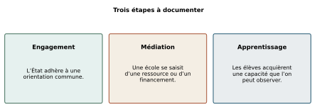
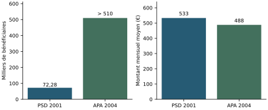
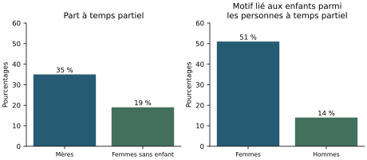
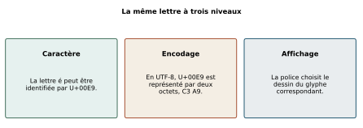

# ENS Rennes D-E — Entretien (oral) 2024 · Corrigé guidé

*Corrigé rédigé par IA, non officiel.*

**Rédaction** · GPT-6.2 Astra Ultra · vitesse non renseignée

Le fascicule de 47 pages contient 21 tirages. Les numéros imprimés et les pages permettent de retrouver chaque extrait, y compris lorsque plusieurs tirages proviennent du même article. Les titres proposés ici désignent les problèmes discutés. Les développements préparent à un exposé personnel de dix minutes au maximum. Les relances sont proposées pour l’entraînement.

Pendant la préparation, noter la proposition précise que l’extrait permet de défendre, l’élément le plus convaincant et une limite susceptible de la modifier. À l’oral, partir du passage choisi et défendre une conclusion devant une objection possible.

## Sujet 1 — L’influence éducative des organisations internationales

*Fascicule, pages 1 à 2.*

> [!INDICATION]
> Tracer le parcours d’une recommandation depuis sa publication jusqu’à la séance effectivement conduite.

Que change un engagement international dans une classe dont les programmes sont nationaux ? Hugh Starkey fait voisiner les transformations politiques européennes, la défense des droits de l’homme et le travail local des enseignants. L’enchaînement est plausible, mais l’adhésion d’un État à une déclaration ne prouve pas que ses élèves apprennent à discuter des droits. Je défendrais la proposition plus limitée suivante. La norme internationale peut ouvrir des possibilités d’action à des acteurs locaux à condition que ceux-ci aient les ressources et la liberté de s’en saisir.

Il faut distinguer une obligation, une incitation et une ressource. Une déclaration fournit un vocabulaire que peut utiliser une association. Un financement rend un projet praticable. Un programme national peut ménager ou fermer un espace de discussion. Ces trois effets appellent des preuves différentes. L’exemple des transitions démocratiques espagnole, portugaise et grecque ne permet pas, à lui seul, d’imputer le changement politique aux organisations évoquées. Des gouvernements déjà favorables aux droits peuvent adhérer aux engagements puis réformer l’école pour les mêmes raisons.

Je comparerais deux établissements soumis au même programme. L’un organise un débat dans lequel un élève peut contester une décision argumentée, l’autre fait réciter le texte de la déclaration. Tous deux déclarent avoir enseigné les droits. Seul l’examen des pratiques, de la prise de parole des élèves et de leur capacité à appliquer un principe à un cas nouveau permet de savoir ce que l’influence annoncée a produit. Les orientations internationales jouent alors un rôle identifiable sans effacer la médiation nationale et locale.

**Relance.** Que mesurer pour dépasser la liste des États signataires ?

Observer la ressource effectivement reçue, la modification pédagogique attribuable à son usage et l’apprentissage des élèves. Des établissements qui pratiquaient déjà le débat peuvent servir à étudier le risque de sélection.

## Sujet 2 — École, classements internationaux et éducation à la citoyenneté

*Fascicule, pages 3 à 4.*

> [!INDICATION]
> Séparer l’enquête PISA, le classement qu’on en tire et la décision prise à partir du classement.

Une même école peut afficher une ambition démocratique et consacrer l’essentiel du temps mesuré à des résultats immédiatement comparables. Starkey rapproche modernisation conservatrice, concurrence, patriotisme et classements PISA. La tension entre objectifs affichés et critères d’évaluation est convaincante. L’idée que ces évolutions formeraient partout une cause unique l’est moins. Le vote britannique sur l’Union ou une présidentielle américaine ne mesure ni l’éducation politique de chaque votant ni le contenu des cours qu’il a suivis.

PISA produit une comparaison dans des domaines déterminés. Ce sont les décideurs qui transforment éventuellement ce résultat en palmarès puis en cible pour les établissements. Si une direction accorde des moyens d’après les seuls résultats mesurés, elle donne une raison de déplacer du temps vers ces apprentissages. Une autre direction peut utiliser un résultat faible pour soutenir des élèves défavorisés sans retrancher un débat civique. Le même indicateur change de fonction avec la règle qui l’accompagne. Le texte gagnerait à documenter ce maillon.

Le rapprochement effectué après les attentats de 2015 montre aussi que la coordination internationale peut soutenir une éducation commune aux droits. Développer l’esprit critique suppose cependant que les élèves puissent discuter d’un désaccord réel, y compris avec une institution. Mon critère serait double. Les savoirs mesurés progressent-ils, et les élèves disposent-ils encore d’occasions de justifier, comparer et réviser leurs positions ? Apprendre à lire un classement et ses limites pourrait précisément réunir ces deux ambitions.

**Relance.** La comparaison internationale impose-t-elle la concurrence scolaire ?

Elle rend possibles l’émulation et l’apprentissage mutuel. Pour établir un effet concurrentiel, il faut montrer comment le rang détermine la réputation, les ressources ou les choix des familles.

## Sujet 3 — Quels oraux l’école valorise-t-elle ?

*Fascicule, pages 5 à 6.*

> [!INDICATION]
> Choisir deux interactions concrètes et demander ce que l’élève doit réussir dans chacune.

Dire que l’école « retrouve » l’oral suppose un point de départ homogène. Coste et Gauthier rappellent pourtant l’importance des traditions orales en Inde, du dialogue socratique et de l’enseignement par récitation. La même étiquette recouvre ainsi une restitution apprise, une interrogation qui oblige à réviser sa réponse et une délibération entre pairs. Augmenter le nombre de minutes parlées ne permet pas de distinguer ces opérations. Je jugerais une politique de l’oral à la distribution des situations dans lesquelles les élèves peuvent agir sur l’échange.

La comparaison internationale a ici une force et une limite. Elle dénaturalise la manière française d’organiser une prise de parole, mais une observation dans une école argentine ne représente pas un système fédéral fragmenté. Comparons une soutenance et une discussion scientifique. La première valorise une exposition structurée. La seconde demande d’écouter une objection et de modifier une hypothèse. Un élève discret peut réussir la seconde et échouer à la première. En déduire un déficit général d’oral confondrait une pratique sociale et une personnalité.

Une réforme cohérente énoncerait ce qu’elle souhaite enseigner, donnerait plusieurs occasions de s’exercer et évaluerait des opérations observables. Reformuler loyalement l’argument d’un camarade ou citer une preuve est plus précis que « avoir de l’aisance ». On pourrait suivre les progrès d’un même élève dans plusieurs situations et vérifier qui intervient spontanément. Le bénéfice serait alors de rendre accessibles des pratiques de parole jusque-là implicitement requises.

**Relance.** Pourquoi une grille explicite peut-elle elle-même produire une inégalité ?

Si elle assimile la maîtrise au débit, à l’accent ou au regard, elle transforme des habitudes sociales en critères scolaires. Il faut rattacher chaque critère au travail intellectuel visé.

## Sujet 4 — Former l’esprit critique face à la désinformation

*Fascicule, pages 7 à 8.*

> [!INDICATION]
> Séparer l’auteur du message, la personne qui le reprend et celle qui le vérifie.

À partir d’exemples sénégalais, Kouakou rapproche la propagation des rumeurs, certaines pratiques journalistiques et les discours militants diffusés en ligne. L’explication par l’émotion a une vertu, celle de rappeler qu’une information se partage avant même qu’on l’ait vérifiée. Elle risque aussi d’attribuer un défaut de raisonnement au public tout en sous-estimant les intérêts des diffuseurs. Un journaliste qui publie de peur d’être devancé et un lecteur qui partage pour demander confirmation n’accomplissent pas le même acte.

Je séparerais capacité et disposition, distinction faite dans le document. Un élève sait vérifier une date quand on le lui demande. Il peut omettre la vérification lorsqu’un titre flatte sa conviction, surtout si la publication suivante ne laisse guère de temps pour réfléchir. Inversement, le doute systématique peut rendre l’élève vulnérable à la thèse selon laquelle aucune source ne mérite crédit. Un test pertinent consisterait à faire comparer deux affirmations portant sur le même événement, retracer la source initiale et rechercher une confirmation réellement indépendante. Trois reprises du même témoignage ne font qu’une source.

Le texte annonce des choix de méthode sans que le fascicule fournisse tous les résultats. Ses exemples ne prouvent donc pas une aptitude générale d’un pays, d’une génération ou d’une catégorie de militants. À la formation des lecteurs j’ajouterais les conditions d’une correction visible, datée et aussi accessible que l’annonce initiale. Le succès se mesure alors à la qualité d’une révision justifiée, y compris lorsque l’information de départ se révèle finalement exacte.

**Relance.** Une émotion forte indique-t-elle que le récit est faux ?

Elle indique qu’on risque de lui accorder trop vite son attention. Son exactitude dépend des éléments vérifiables. Une information exacte sur une injustice peut susciter une émotion légitime.

## Sujet 8 — Québec, réformes scolaires et départs d’enseignants

*Fascicule, pages 9 à 11.*

> [!INDICATION]
> Décomposer un besoin de recrutement et rechercher ce que le fascicule renseigne pour chacune des composantes.

L’extrait relie le décrochage professionnel à la transformation du travail enseignant au Québec. La différenciation pédagogique, la concurrence entre programmes et la gestion axée sur les résultats peuvent demander davantage de préparation ou de justification. Il importe pourtant de distinguer un mécanisme intelligible et une attribution démontrée. Une hausse des besoins de recrutement peut tenir aux effectifs d’élèves, aux départs à la retraite ou au passage à temps partiel, même si aucun nouveau professeur ne renonce à la profession.

Le mécanisme de surcharge mérite une expérience de pensée. Deux enseignants ont le même horaire de face-à-face. Celui qui prépare des supports différenciés pour plusieurs groupes et répond en outre à de nouvelles obligations de suivi travaille davantage en dehors de la classe. Si la direction lui procure du temps commun avec ses collègues, la même réforme peut réduire l’isolement. Il faut donc examiner les ressources accompagnant la prescription et le rôle effectif de la direction. La gestion par objectifs peut révéler un besoin ou détourner l’activité vers ce qui se compte, selon l’usage des résultats.

Je suivrais une cohorte d’entrants en distinguant changement d’établissement, fin de remplacement et véritable sortie d’emploi. Des entretiens permettraient de comprendre les motifs, une comparaison entre établissements différemment exposés testerait l’hypothèse. Les témoignages sur une charge excessive méritent d’être entendus dès maintenant. Ils ne suffisent pas à identifier une cause unique commune aux quatre régions francophones nominalement couvertes par l’article.

**Relance.** Une hausse des embauches de personnel sans qualification établit-elle l’attrition ?

Elle signale un besoin non satisfait selon les règles habituelles de recrutement. Il faut encore mesurer entrées, sorties et évolution du nombre de postes pour l’expliquer.

## Sujet 10 — Attirer et retenir les enseignants en France

*Fascicule, pages 12 à 13.*

> [!INDICATION]
> Mettre trois dates sur une ligne, le choix des études, l’affectation et la décision de rester.

Le texte de Farges et Szerdahelyi rapproche conditions d’affectation, rémunération et dispositifs de préprofessionnalisation. Son intérêt est de montrer que « rendre attractif » peut viser plusieurs décisions. Un étudiant choisit une filière, un lauréat accepte un poste, un professeur confirmé décide de rester dans un établissement. Attribuer à tous la même sensibilité à la prime ou au risque d’une affectation éloignée ferait manquer l’essentiel du diagnostic.

L’indemnité REP+ citée passe de 2 312 euros en 2015 à 4 646 en 2019. Ce doublement environ est une variation de l’incitation. Il ne mesure pas un doublement des candidatures. Le document indique plutôt un effet différent pour les débuts de carrière et les personnes déjà en poste. Un professeur ayant constitué un réseau familial peut accorder plus de poids à la distance qu’un entrant, sans avoir des préférences moins favorables à l’éducation prioritaire. Il faudrait comparer les évolutions de postes comparables, tenir compte des postes vacants au départ et distinguer candidature et maintien effectif.

L’AED Prépro agit plus tôt. Un emploi rémunéré peut lever une contrainte de ressources et rendre le métier observable avant le concours. Il peut aussi ajouter une charge à des études exigeantes. Les volontaires auraient peut-être choisi l’enseignement en l’absence du programme. Suivre leur trajectoire et celle de candidats comparables qui n’y ont pas accédé permettrait de tester la portée du dispositif. Je distinguerais ainsi une politique qui rend possible l’entrée et une politique qui améliore le travail quotidien après l’entrée.

**Relance.** Le succès d’un dispositif se lit-il au nombre de contrats signés ?

Cela mesure son utilisation. Pour juger son objectif de recrutement durable, il faut regarder réussite aux études, concours, prise de poste et maintien, en précisant les populations de comparaison.

## Sujet 11 — Que produit une concertation sur l’école ?

*Fascicule, pages 14 à 15.*

> [!INDICATION]
> Chercher une trace qui permettrait d’attribuer un changement du texte final à une intervention.

Nathalie Mons décrit un dispositif qui veut remettre en discussion les buts de l’école en associant professionnels et société civile. Faire entendre des acteurs rarement présents peut révéler un obstacle invisible depuis l’administration centrale. Il reste une difficulté. Une consultation visible peut donner le sentiment d’une décision collective alors que l’autorité a fixé d’avance les options recevables. La présence d’une assemblée ne suffit à mesurer ni sa représentativité ni son influence.

Le succès professionnel de certains diplômés, pris en exemple, renseigne peu sur la capacité de l’école à faire progresser des élèves défavorisés. De même, l’assistance à une réunion renseigne peu sur la distribution des prises de parole. Le parent disponible un mardi après-midi et le parent travaillant à cette heure ne disposent pas du même accès au débat. J’examinerais qui fixe l’ordre du jour, comment les désaccords sont consignés et quelles propositions ont effectivement modifié le projet. Une proposition rejetée avec un motif public peut témoigner d’une délibération plus sérieuse qu’une formule consensuelle sans conséquence.

Le dilemme n’oppose donc pas simplement Paris et les territoires. L’égalité peut réclamer des droits communs, tandis que des obstacles différents requièrent des moyens différents. La concertation éclaire un arbitrage dont le responsable doit rester identifiable. Elle ne remplace ni une décision démocratiquement assumée ni l’évaluation ultérieure de ses effets sur les élèves.

**Relance.** Peut-on organiser une concertation sérieuse en désaccord persistant ?

Oui. Des participants peuvent préciser les faits en litige et reconnaître le coût d’options incompatibles. Publier la raison du choix et les objections persistantes rend l’arbitrage contrôlable.

## Sujet 12 — La pluralité des origines de la pédagogie coopérative

*Fascicule, pages 16 à 17.*

> [!INDICATION]
> Choisir une pratique historique, une finalité et l’observation susceptible de les relier.

Chez Connac, les filiations Freinet, Cousinet, Profit, Oury et les travaux de psychologie font apparaître une diversité que le seul mot de coopération pourrait masquer. Faire vivre une caisse commune relève d’une responsabilité collective. Organiser une rencontre entre des raisonnements différents vise une transformation cognitive. Partager des rôles peut servir les deux fins, sans que l’une entraîne automatiquement l’autre. L’ancienneté d’une méthode démontre surtout qu’elle a suscité des engagements durables.

Considérons la classe-puzzle évoquée dans le fascicule. Chaque élève travaille d’abord sur une partie d’un dossier, puis en devient le répondant auprès de camarades ayant étudié d’autres parties. L’obligation d’expliquer peut révéler une incompréhension que la lecture solitaire aurait laissée inaperçue. Mais si un élève se contente de recopier la contribution de son voisin, la qualité de la synthèse collective surestime son apprentissage. Les pédagogues cités fournissent des hypothèses sur ce qui rend l’entraide féconde. Ils ne peuvent tenir lieu de preuve dans cette classe précise.

J’évaluerais séparément la qualité du travail commun et la capacité de chacun, le lendemain, à expliquer une partie qu’il n’avait pas préparée seul. J’observerais aussi qui a eu le droit d’enseigner aux autres et qui a transmis seulement la fiche. La coopération devient une proposition explicable et révisable, qui intéresse autant la formation du jugement que le partage des responsabilités.

**Relance.** La comparaison avec un travail individuel suffit-elle ?

Il faut maintenir autant que possible le temps disponible, les supports et la difficulté de la tâche. Sinon l’effet apparent de la coopération peut venir d’un avantage de temps ou de matériel.

## Sujet 13 — Coopérer, collaborer, apprendre

*Fascicule, pages 18 à 19.*

> [!INDICATION]
> Distinguer dans l’exemple du rugby le but de gagner aujourd’hui et le but d’apprendre un nouveau rôle.

Connac distingue le bénéfice individuel recherché par une pédagogie coopérative de la performance collective rendue possible par une spécialisation. Son analogie avec le rugby rend la différence sensible. Confier toujours une tâche à la personne déjà la plus habile peut améliorer le résultat de l’équipe et priver les autres de l’occasion de progresser. Ce constat logique ne démontre cependant pas qu’un travail collaboratif ferait généralement baisser le niveau.

Dans une classe, deux élèves doivent remettre une enquête illustrée. Si le premier, déjà à l’aise, écrit et que l’autre ajoute les images sans relire, un beau dossier peut coexister avec des apprentissages très inégaux. Si, au contraire, chacun doit expliquer le choix d’une donnée, critiquer l’inférence de l’autre puis refaire seul la démarche, la spécialisation initiale a produit un outil de transmission. L’intervention de l’enseignant porte alors sur les responsabilités, leur rotation et la vérification individuelle. La coopération impose par ailleurs des coûts de coordination qui peuvent nuire à l’étude solitaire d’une étape difficile.

Le terme pertinent dépend de la fin poursuivie. Pour produire un journal dans un temps limité, spécialiser certaines fonctions peut être justifié. Pour apprendre à tous à rédiger un argument, il faut que chacun rédige, reçoive une critique et recommence. Le bénéfice peut se juger à partir d’un exercice inédit réalisé individuellement et de l’évolution de l’écart entre élèves.

**Relance.** Tout échange entre élèves compte-t-il comme une aide ?

Une réponse dictée peut achever la tâche et empêcher le destinataire d’en comprendre la démarche. Lui demander de reformuler ou de tester une hypothèse permet d’apprécier ce que l’échange lui apporte.

## Sujet 14 — Vérité politique et histoire de la rumeur

*Fascicule, pages 20 à 21.*

> [!INDICATION]
> Classer un fait vérifiable, un jugement politique et une accusation portée contre un média.

Le qualificatif de « post-vérité » contient une comparaison historique ambitieuse. Il suppose un temps antérieur où le vrai réglait mieux le débat. Laurent Petit rappelle l'ancienneté des rumeurs et la manière dont l'accusation de *fake news* peut être retournée contre un journaliste. Ces exemples établissent que le phénomène n'est pas né avec une plateforme. Ils laissent ouverte la possibilité que sa vitesse, sa visibilité ou son économie aient changé.

Prenons une mairie qui dément un chiffre inexact de dépenses. Le chiffre relève d'une vérification comptable. Juger si la dépense était prioritaire suppose de comparer des besoins et des valeurs. Si l'on présente la préférence majoritaire comme preuve de l'exactitude du chiffre, on renonce au contrôle des faits. Si l'on présente le chiffre rectifié comme une justification du choix budgétaire, on retire aux citoyens une décision qui leur revient. La vérité importe en politique sous des formes différentes selon le type d'énoncé.

Pour tester la nouveauté, je choisirais des épisodes comparables et suivrais le temps séparant apparition, circulation, démenti et correction durable. Il faudrait compter les personnes exposées au récit et celles qui y adhèrent, deux grandeurs distinctes. Si le numérique rend la rumeur plus facile à retrouver que des conversations anciennes, sa visibilité accrue peut donner une impression trompeuse de multiplication. Il faut donc critiquer une prétention historique sans nier les changements réels de diffusion.

**Relance.** Le fait qu’une rumeur soit plausible lui donne-t-il une valeur de preuve ?

La plausibilité explique sa circulation. Une preuve exigerait de relier l’énoncé à des observations ou à des pièces vérifiables, quel que soit le nombre de personnes qui le reprennent.

## Sujet 15 — L’expertise répond-elle à la défiance ?

*Fascicule, pages 22 à 23.*

> [!INDICATION]
> Reprendre une proposition du texte et distinguer ce qui peut être réfuté d’un choix qui doit être justifié.

Dans ce second extrait de Laurent Petit, le problème se déplace de l'histoire des rumeurs à l'autorité de ceux qui interviennent pour les rectifier. Une vérification peut rétablir un fait faux sans répondre au motif pour lequel une institution a perdu la confiance du public. Cette distinction aide à comprendre pourquoi corriger les biais d'un lecteur ne peut tenir lieu de politique générale de l'information.

Supposons qu'un expert annonce une fourchette de prévision puis recommande une dépense publique. La première affirmation mobilise un modèle, des données et une incertitude. La seconde introduit un jugement sur le coût acceptable d'une erreur. Un décideur peut accepter toutes les données et attribuer un poids différent aux erreurs possibles. Le diagnostic d'une irrationnelle « résistance à la vérité » serait ici mal posé. À l'inverse, présenter toute expertise comme l'expression d'un intérêt ferait disparaître la possibilité d'une vérification indépendante. La critique du pouvoir de l'expert doit préserver une distinction entre les méthodes qu'il expose et les choix qu'il préconise.

L'extrait mentionne la crise médiatique et l'expertise pendant la pandémie. Une chronologie des avis permettrait d'identifier une correction motivée par de nouvelles observations. Elle ne devrait pas être automatiquement qualifiée de contradiction. Je défendrais une expertise qui publie les hypothèses, les désaccords et les critères de révision, et une décision politique qui expose son propre arbitrage. Ce partage n'exige ni d'abandonner la recherche du vrai ni de convertir chaque résultat en règle de gouvernement.

**Relance.** Quand reprocher à un expert de sortir de son rôle ?

Lorsqu’il présente comme résultat nécessaire des données une prescription qui dépend de priorités contestables. Il peut défendre cette prescription, à condition d’expliciter le passage du constat à la préférence.

## Sujet 16 — Peut-on mesurer l’école sans choisir ses valeurs ?

*Fascicule, pages 24 à 25.*

> [!INDICATION]
> Changer l’indicateur d’une formation sans changer ses élèves et observer comment change le jugement.

Boissinot et Delvaux décrivent un déplacement des débats, des finalités de l'école vers la mesure de ses performances. Mesurer le taux d'insertion ou les compétences sanctionnées par un diplôme semble éviter les querelles de valeurs. Pourtant une école qui classe ses résultats d'après l'emploi obtenu six mois après la sortie choisit déjà un horizon temporel et une conception de la réussite. La question sérieuse est de savoir qui effectue ce choix et comment le discuter.

Deux formations placent la même proportion de diplômés en emploi. L'une a sélectionné des élèves disposant de réseaux familiaux étendus, l'autre a formé des jeunes moins dotés. Le taux brut ne mesure pas leur contribution respective. Si l'on omet cet écart, un indicateur défendable peut encourager une sélection contraire au principe d'égalité que les deux formations revendiquent. Il faut donc expliciter la valeur en jeu, définir un résultat observable puis contrôler les effets que la mesure induit.

L'opposition construite entre différents imaginaires culturels donne de la profondeur historique à la discussion. Elle peut aussi figer « Occident » et traditions confucéennes en blocs homogènes. Des familles d'un même pays peuvent défendre des fins différentes, de l'autonomie intellectuelle à l'accès à un emploi stable. Un horizon commun n'impose pas que chacune adopte la même conception de la réussite. Il peut porter sur des capacités dont tous disposent pour participer à la discussion de ces fins. Leur évaluation doit laisser place aux résultats inattendus et à la révision du critère.

**Relance.** Supprimer les indicateurs résoudrait-il le désaccord ?

Cela rendrait certaines inégalités moins visibles. Publier plusieurs dimensions et leurs limites permet de discuter les fins et de vérifier si l’école les atteint.

## Sujet 22 — Le droit à une aide et la prise en compte de la dépendance

*Fascicule, pages 26 à 27.*

> [!INDICATION]
> Comparer les deux dates exactes, puis décomposer le montant total en nombre de bénéficiaires et moyenne.

Le texte de Garabige et Trabut fait apparaître un changement d'échelle entre la prestation spécifique dépendance et l'allocation personnalisée d'autonomie. À domicile, il oppose 72 280 bénéficiaires fin juin 2001 à plus de 510 000 fin décembre 2004. Le montant mensuel moyen cité passe de 533 à 488 euros. Une extension du nombre de personnes aidées peut donc accompagner une diminution du montant moyen. L'intervalle entre ces deux points est d'environ trois ans et demi. La formule « moins de trois ans » ne convient pas à la comparaison des deux dates affichées.

Il serait tentant d'en conclure que l'accompagnement individuel s'est dégradé. Les populations couvertes et la distribution des besoins ont pu changer avec l'ouverture du droit. Imaginons que de nouveaux bénéficiaires aient besoin de moins d'heures d'aide. La moyenne baissera même si chaque ancien bénéficiaire conserve son plan. Inversement, une dépense totale en hausse ne dit pas si une personne dépourvue d'un service à proximité peut réellement recevoir son aide. Il faut distinguer droit ouvert, recours à la prestation, réalisation du plan et effets sur la vie quotidienne.

L'intérêt de l'échelle départementale apparaît alors concret. Une prestation définie nationalement suppose un diagnostic des besoins et une offre locale. Deux départements de même budget peuvent différer par les distances, le recrutement des intervenants ou l'accès à l'information. Pour juger l'approche « globale », je confronterais le montant, les heures réellement fournies et le choix possible de la personne. Cette enquête donne un sens vérifiable aux mots d'autonomie et d'égalité territoriale.

**Relance.** La dépense à domicile peut-elle croître tandis que le montant moyen diminue ?

Oui. En multipliant approximativement les moyennes mensuelles par les effectifs cités, on passe de 38,5 à plus de 248 millions d’euros par mois. Il s’agit d’ordres de grandeur reconstitués pour deux dates.

## Sujet 23 — Connexion numérique et autonomie démocratique

*Fascicule, pages 28 à 29.*

> [!INDICATION]
> Repérer ce qui tient à l’outil, au modèle publicitaire et à l’organisation du travail dans l’exemple du cadre.

Éric Dacheux décrit une connexion permanente qui empiète sur le repos et le temps long de la discussion démocratique. L'exemple du cadre gardant son téléphone allumé montre la possibilité matérielle d'être sollicité en permanence. Il faut encore expliquer comment cette possibilité devient une obligation sociale. Le même téléphone sert aussi à des habitants éloignés pour participer à une consultation sans un coûteux déplacement.

Trois causes méritent d'être dissociées. Un réglage facilite la consultation répétée. Un modèle économique rémunère l'attention retenue. Une organisation du travail récompense celui qui répond la nuit. Modifier un seul terme ne produit pas nécessairement une déconnexion effective. Un salarié qui désactive les alertes peut toujours craindre le reproche d'avoir répondu trop tard. Inversement, une règle collective autorisant une réponse différée peut changer le sens du même outil. Le raisonnement gagne à désigner l'institution qui est en mesure d'agir.

Le texte revendique une science publique qui assume ses valeurs. La défense de l'autonomie est un choix que l'on peut argumenter. Affirmer une diminution effective de cette autonomie exige en plus des observations sur le contrôle de l'ordre du jour, la diversité des interlocuteurs et la capacité de renoncer à un service. Je comparerais deux consultations municipales, l'une entièrement organisée sur un réseau marchand et l'autre également accessible par réunion et courrier. On pourrait alors vérifier à qui chaque modalité ouvre la parole et qui disparaît de la discussion.

**Relance.** Un chiffre de temps d’écran mesure-t-il à lui seul une perte d’autonomie ?

Il agrège des usages choisis et subis. Deux heures à rédiger une contribution collective et deux heures d’astreinte informelle ne correspondent pas à la même capacité de décider.

## Sujet 24 — Dommages actuels et risques futurs de l’intelligence artificielle

*Fascicule, pages 30 à 32.*

> [!INDICATION]
> Donner un exemple de dommage observable puis identifier la personne qui pourrait demander réparation.

Les auteurs, chercheurs d'ELLIS, invitent en 2023 à traiter les dommages présents des systèmes existants. Un contenu fabriqué mais convaincant ou une erreur systématique de classement peuvent déjà nuire à une personne identifiable. Cette observation soutient une intervention immédiate. Elle ne suffit pas à fixer à zéro le risque d'événements encore hypothétiques. Une mise en concurrence absolue de ces préoccupations demanderait de montrer qu'elles consomment la même ressource et ne peuvent pas se renforcer.

Dans une procédure administrative fictive, un système oriente des demandes vers une vérification supplémentaire. Un taux de réussite global élevé peut masquer des erreurs concentrées sur un groupe ou des recours trop lents pour être utiles. La personne lésée a aujourd'hui besoin d'une explication, d'une intervention humaine et d'une possibilité de rectification. Une discussion sur une intelligence générale future ne répond à aucune de ces exigences. Mais conserver des évaluations indépendantes et documenter les défaillances peut également améliorer l'anticipation de risques futurs.

La compétence des signataires justifie d'examiner leur diagnostic, elle ne prouve pas à elle seule leur choix de priorités. Il faut regarder la gravité, la vraisemblance, l'incertitude et le coût d'une mesure de protection. Pour un dommage documenté fréquent, une règle précise peut être expérimentée puis évaluée. Pour une hypothèse très incertaine mais grave, une veille et des travaux de recherche peuvent avoir une valeur sans absorber tout le budget. Ma conclusion porte sur une allocation justifiée des efforts et sur le droit de recours des personnes touchées.

**Relance.** Comment vérifier une priorité sans prédire exactement l’avenir ?

Rendre explicites les hypothèses et comparer le bénéfice de mesures révisables dans plusieurs scénarios. Certaines améliorent déjà la détection des erreurs et gardent une utilité si les capacités évoluent.

## Sujet 26 — Naissances, travail et marges de choix des parents

*Fascicule, pages 33 à 35.*

> [!INDICATION]
> Écrire le dénominateur des quatre pourcentages relatifs au temps partiel avant toute comparaison.

Sabrina Tanquerel invite à examiner la place des entreprises dans les décisions familiales. Le rapprochement de la baisse des naissances et de contraintes professionnelles inégalement réparties ouvre une question sérieuse. Il ne démontre pas qu'une politique d'employeur ferait remonter mécaniquement la natalité. Le nombre annuel de naissances dépend aussi de la structure par âge et du calendrier des projets. Une naissance différée ne se distingue d'une naissance définitivement absente qu'en suivant des générations.

Le document indique que 35 % des mères travaillent à temps partiel contre 19 % des femmes sans enfant. Il mentionne aussi 51 % des femmes à temps partiel et 14 % des hommes à temps partiel qui donnent les enfants comme raison. Le premier rapprochement porte sur la situation d'emploi de deux populations, le second sur les motifs déclarés à l'intérieur des temps partiels. On ne peut multiplier ces nombres sans vérifier les champs. On peut en revanche interroger la répartition des horaires, des tâches domestiques et de la pénalité de carrière. Un emploi aux horaires prévisibles peut ouvrir un choix à un couple qui souhaite un enfant, sans modifier le choix de ceux qui n'en souhaitent pas.

Je comparerais des salariés avant et après une réforme des horaires, en observant aussi les établissements sans réforme. Il faudrait mesurer accès réel, évolution de carrière et sentiment de pouvoir concilier ses engagements. L'entreprise a une responsabilité sur les conditions qu'elle fixe. Les préférences reproductives appartiennent aux personnes. L'amélioration de leurs choix constitue ainsi un résultat évalué indépendamment du sens dans lequel elles les exercent.

**Relance.** Pourquoi distinguer fécondité et intentions déclarées ?

Une intention peut changer ou rencontrer un obstacle et un indicateur annuel dépend du calendrier des naissances. Les deux éclairent le phénomène sans être interchangeables.

## Sujet 27 — Qui décide de l’art installé dans l’espace public ?

*Fascicule, pages 36 à 38.*

> [!INDICATION]
> Distinguer le commanditaire, l’artiste, les passants et les usagers quotidiens du lieu.

Philippe Simay fait apparaître, derrière la sculpture de place ou de parvis, la question de celui qui finance, choisit et occupe l'espace. Les installations devant le Seagram Building peuvent servir le prestige d'une entreprise et devenir un lieu d'expérience esthétique pour des passants. Ces deux fonctions sont compatibles. De l'identité du financeur, on ne déduit donc pas à elle seule la signification reçue par tous les publics.

Le texte défend la consultation des habitants. Il faut préciser ce qu'elle tranche. Un riverain qui doit faire chaque jour un détour peut signaler un coût d'usage que le projet de commande a ignoré. Une minorité qui aime une œuvre dérangeante peut, de son côté, ne disposer d'aucune place dans un vote d'approbation esthétique. Une procédure sérieuse distinguerait l'accessibilité du lieu, l'information sur le financement et le jugement de goût. L'artiste peut répondre à une contrainte d'accès sans abandonner la liberté d'exposer une forme impopulaire.

Le débat lui-même constitue parfois un usage de l'œuvre. Mais toute controverse n'est pas la preuve d'une démocratisation. Les acteurs disposant de temps, de relations médiatiques ou de moyens juridiques ont des avantages dans la contestation. Pour établir qu'une controverse a donné voix à de nouveaux groupes, je chercherais qui a pris la parole, quels changements ont été acceptés et qui utilise désormais le lieu. Un bilan fréquentation-prix de l'immobilier ne suffirait pas davantage qu'un sondage sur la beauté.

**Relance.** Une œuvre unanimement appréciée peut-elle poser une difficulté démocratique ?

Oui, par exemple si les règles de commande ou d’accès au lieu écartent certains usagers. La satisfaction esthétique ne répond pas à la question de l’égalité d’usage.

## Sujet 28 — La politesse protège-t-elle l’échange ou la hiérarchie ?

*Fascicule, pages 39 à 40.*

> [!INDICATION]
> Utiliser la même formule de courtoisie dans deux relations de pouvoir différentes.

Samir Tiyal parcourt des conceptions de la politesse allant d'un code de distinction sociale à une disposition morale d'ouverture à autrui. Ce passage de l'histoire des formes à la valeur du comportement demande une justification. Une manière de parler parfaitement codée peut humilier quelqu'un. Inversement, une personne qui ignore le titre exact d'un interlocuteur peut l'écouter avec attention. L'intention, la forme et l'effet sur l'échange ne coïncident pas toujours.

Un étudiant interrompt une discussion pour contester un chiffre qui lui paraît faux. Une règle du tour de parole peut protéger la possibilité pour l'intervenant de finir sa démonstration. La même exigence, brandie sélectivement contre ceux qui ont peu de pouvoir, peut soustraire une assertion à la critique. Le critère pertinent est alors la réciprocité. Les règles donnent-elles aussi aux moins familiers des codes une occasion de reprendre la parole et d'obtenir une réponse sur le fond ? Une courtoisie identique en apparence peut avoir des effets opposés selon la position des interlocuteurs.

L'extrait invite à distinguer civilité et vertu. Attribuer une « politesse du cœur » rend compte d'un idéal mais demeure difficile à vérifier. Le débat public peut plus aisément adopter des garanties observables, telles que reformuler l'objection avant d'y répondre, sanctionner une humiliation sans interdire la contradiction et autoriser la reprise d'une maladresse. Une règle de politesse peut ainsi favoriser l'égalité à condition de pouvoir être elle-même discutée.

**Relance.** Faut-il alors accepter toute interruption ?

L’urgence d’une rectification, le temps disponible et la possibilité d’une réponse ultérieure comptent. Annoncer une règle de reprise également accessible permet d’arbitrer sans sélectionner les personnes selon leur rang.

## Sujet 30 — Du graffiti au street art commandé

*Fascicule, pages 41 à 42.*

> [!INDICATION]
> Distinguer la légalité de l’occupation d’un mur, le statut artistique et les conditions de la commande.

Julie Vaslin retrace un changement des politiques territoriales. Des graffitis sont effacés tandis que des municipalités ouvrent des murs, commandent des fresques et travaillent avec des associations. La différence peut tenir à la propriété du support, à l'autorisation ou au jugement esthétique porté sur la réalisation. Une municipalité peut donc célébrer le « street art » tout en continuant de sanctionner d'autres inscriptions. Il serait trop simple de parler d'une reconnaissance uniforme d'une pratique.

Une fresque autorisée peut fournir temps, rémunération et visibilité à un artiste. Elle peut également introduire un processus de sélection qui favorise les projets durables, lisibles et compatibles avec l'image d'un quartier. L'extrait cite des murs programmés et des intermédiaires associatifs. Ces exemples permettent de préciser le mécanisme mais pas d'en déduire que tous les artistes ont perdu en indépendance. Les uns trouvent une nouvelle possibilité d'exposer, d'autres restent hors de la commande. Il faudrait interroger ces deux groupes, les habitants et les services d'entretien.

Pour juger la « gouvernance », j'observerais la répartition des droits de décider. Qui peut proposer un mur, choisir le thème, demander le retrait ou modifier le calendrier ? Si tout financement public est lu comme une récupération, on rend l'hypothèse invérifiable. Si toute fresque financée est présentée comme une preuve de liberté culturelle, on rend invisible la sélection. Suivre une commande précise de la proposition à la réception restitue aux acteurs leur diversité et aux hypothèses leur fragilité.

**Relance.** Quelle preuve distinguerait soutien et contrôle dans un même programme ?

Comparer les projets proposés et retenus, les raisons de refus et la liberté de révision de l’artiste. Un contrat peut offrir une ressource réelle tout en imposant des contraintes identifiables.

## Sujet 31 — Numériser l’écriture, représenter les signes

*Fascicule, pages 43 à 45.*

> [!INDICATION]
> Écrire les quatre niveaux, caractère, point de code, octets et glyphe, puis placer chaque critique au bon niveau.

Éric Guichard envisage l'écriture comme une technologie intellectuelle, puis examine les choix opérés pour rendre des signes échangeables entre ordinateurs. Son objection politique est féconde. Les besoins d'une communauté minoritaire n'ont pas forcément le même poids dans les instances de normalisation que ceux d'un acteur industriel. Il importe de séparer cette question de représentation de l'affirmation selon laquelle l'architecture technique serait incohérente par nature.

Un caractère abstrait, son point de code, sa représentation en octets et son dessin dans une police sont des objets différents. Unicode associe un répertoire de caractères à des points de code. UTF-8 encode ces points de code en suites d'octets. Un logiciel peut donc transporter correctement un caractère dont la police locale ne possède pas le glyphe. Une lettre accentuée peut également avoir des représentations combinées ou précomposées, d'où le besoin de normalisation lors de comparaisons. Conclure d'un dessin manquant à l'impossibilité d'encoder toute une langue sauterait une étape.

La nécessité de distinguer ces niveaux ne disqualifie pas la critique. Une norme peut privilégier l'interopérabilité historique, multiplier des signes pratiques pour certains utilisateurs et laisser aux autres un coûteux travail documentaire. Pour tester cette hypothèse, on pourrait suivre une demande précise d'ajout, examiner la présence de représentants des locuteurs et vérifier les usages après acceptation. Il faudrait dater les exemples du texte publié en 2016 car le répertoire, les polices et les logiciels évoluent selon des calendriers différents. La meilleure défense de la diversité linguistique commence par identifier le maillon qui fait défaut.

**Relance.** Deux écrans montrant des dessins différents ont-ils nécessairement reçu deux textes différents ?

Non. Ils peuvent avoir reçu la même suite de caractères et utiliser des polices différentes. Comparer le contenu enregistré précède l’interprétation de la différence graphique.

## Sujet 32 — Mensonge, erreur et coopération

*Fascicule, pages 46 à 47.*

> [!INDICATION]
> Faire varier séparément la vérité de la proposition, la croyance du locuteur et l’interprétation anticipée.

Gérard Lenclud part d'une définition exigeante du mensonge. Il faut qu'un locuteur présente pour vrai à autrui ce qu'il tient pour faux, avec l'intention appropriée. Une erreur sincère et une phrase de fiction ne remplissent pas les mêmes conditions. Cette analyse permet de résister à l'accusation facile de mensonge dès qu'une affirmation se révèle fausse. Elle ne règle pas encore le jugement moral ni la possibilité de mesurer les mensonges.

Deux déclarations également inexactes peuvent avoir des histoires opposées. Dans la première, le locuteur répète une information qu'il a vérifiée avec des moyens raisonnables et corrige son erreur. Dans la seconde, il dissimule une information qu'il sait déterminante pour un engagement. Le premier cas met en cause la qualité des preuves disponibles, le second la possibilité pour autrui de se fier à la parole donnée. Mais l'observateur ne lit pas directement une intention. Il doit chercher les éléments que le locuteur connaissait au moment de parler. Un comptage judiciaire ne recense en outre que des faits juridiquement qualifiés et portés devant une institution.

L'évocation du développement de l'enfant suggère que la capacité à tromper suppose de pouvoir attribuer à autrui une croyance différente de la sienne. Cela explique une capacité cognitive, sans louer chaque usage de cette capacité. Une coopération durable exige de comprendre le point de vue de son partenaire et de pouvoir croire raisonnablement à ses engagements. Le même développement qui rend possible la tromperie rend concevables l'excuse, la promesse et la réparation. C'est cette ambivalence que le fascicule autorise à discuter.

**Relance.** Peut-on tromper en disant quelque chose de littéralement vrai ?

Oui, en créant volontairement par sélection une interprétation fausse. Cela montre la limite d’une définition centrée sur la seule fausseté des mots et oblige à analyser le contexte de l’affirmation.

## Le dialogue sur le projet professionnel

Le jury a raccourci cette partie devant des réponses souvent convenues. Une réponse crédible peut rester ouverte. Partir d’une expérience réelle, expliquer la question qu’elle a fait naître et donner un moyen de tester une piste. Par exemple, une personne hésitant entre recherche et enseignement peut distinguer le plaisir d’enquêter sur un problème et celui de le rendre intelligible, puis envisager un stage ou l’observation d’un cours pour comparer ces activités. Elle doit pouvoir expliquer ce qui la ferait changer d’avis. Le jury peut relancer sur une difficulté rencontrée, une formation requise ou une piste abandonnée. Rattacher la réponse à ce que l’on a effectivement fait et à ce que l’on a encore à découvrir.

[Fascicule officiel](https://www.ens-rennes.fr/medias/fichier/sujets-e-preuve-d-entretien-d-e-2024_1731603679306-pdf) · [Rapport de la session](https://www.ens-rennes.fr/medias/fichier/rapport-de-jury-oral-entretien-d-e-2024_1747059716339-pdf)
