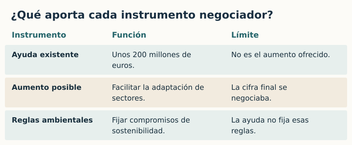
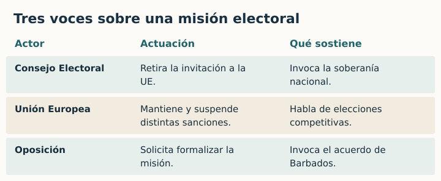
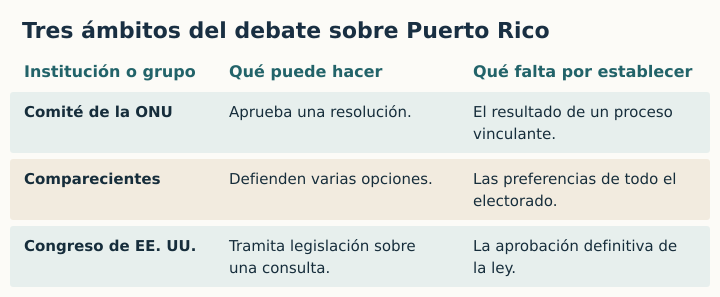

# ENS Rennes · D-E · Espagnol (oral) 2024 — Corrigé brut partiel

*Corrigé rédigé par IA, non officiel. Signalez toute erreur.*

**Rédaction** · GPT-6.2 Astra Ultra · vitesse non renseignée

Le fascicule reproduit les sujets 1 à 6. Le rapport désigne un septième sujet de 477 mots et un sujet de secours de 488 mots, non utilisé. Pour le n° 7, le communiqué de la CEPAL est identifié mais la coupe exacte reste inconnue. Pour le secours, le rapport attribue le texte à la Commission européenne. Le document homonyme de Carta España sert uniquement à situer le débat. Les deux feuillets manquants ne sont pas reconstitués.

Les prises de parole et les réponses aux questions sont des propositions d’entraînement.

[Fascicule officiel](https://www.ens-rennes.fr/medias/fichier/sujets-oral-espagnol-d-e-2024_1731603738587-pdf) · [Rapport du jury](https://www.ens-rennes.fr/medias/fichier/rapport-de-jury-lve-espagnol-oral-d-e-2024_1742461742900-pdf)

## Sujet 1 · Hay que restablecer la credibilidad del Mercosur

Félix Peña · La Nación · 23 mai 2024

### ¿Qué haría creíble un acuerdo entre socios?

Félix Peña parte de un diagnóstico poco favorable del Mercosur. Un especialista citado por La Nación habla de dos décadas de parálisis. La pregunta del autor es qué podría cambiar para que otros gobiernos, empresas y trabajadores confiaran en la capacidad del bloque de tomar decisiones y cumplirlas. El artículo, publicado el 23 de mayo de 2024, es una propuesta de reforma. Sus verbos condicionales no anuncian cambios ya acordados.

Argentina y Brasil ocupan una posición central por el peso de sus economías, especialmente al negociar con terceros países. Sin embargo, la credibilidad del bloque no se reduce al entendimiento entre dos presidentes. Peña distingue tres frentes. El primero consiste en examinar cómo se elaboran las decisiones y por qué algunas no resultan efectivas. El segundo exige conciliar reglas flexibles con seguridad jurídica. Una empresa necesita saber qué normas seguirán vigentes cuando haya realizado una inversión, mientras que una organización regional debe poder adaptarse. El tercero se refiere al trabajo técnico de la Secretaría. Antes de presentar una decisión como común, alguien debe preparar opciones que reflejen de verdad los intereses de los socios.

Este último punto explica por qué el autor le da prioridad. Una secretaría capaz de comparar propuestas y precisar sus consecuencias puede facilitar un acuerdo sin sustituir a los gobiernos que deberán asumirlo. También justifica la presencia de empresarios y sindicatos en el razonamiento: una norma que parece conveniente para un Estado puede imponer costes muy distintos dentro de su propia economía.

Las negociaciones con la Unión Europea y las relaciones que Peña propone desarrollar con Asia y África sirven de prueba exterior. Cuanto más fiables sean los métodos internos, más fácil será negociar compromisos creíbles con terceros. Abrir un nuevo frente diplomático no resuelve por sí solo una dificultad para decidir entre los socios.

**Pregunta. ¿Propone Peña cambiar únicamente las normas jurídicas?** Incluye los métodos de trabajo, la concertación de intereses y la preparación técnica de las decisiones.

**Pregunta. ¿Por qué pueden entrar en tensión flexibilidad y seguridad jurídica?** Adaptar una regla puede ser razonable, pero un socio necesita prever bajo qué condiciones se cumplirán los acuerdos que ya ha aceptado.

[Coupure officielle, p. 1](https://www.ens-rennes.fr/medias/fichier/sujets-oral-espagnol-d-e-2024_1731603738587-pdf#page=1)

## Sujet 2 · La UE juega fuerte con una nueva carta para destrabar el acuerdo con el Mercosur

Juan Landaburu · La Nación · 30 mai 2024

### ¿Puede un fondo de cooperación desbloquear una negociación comercial?

Juan Landaburu presenta una oferta europea para facilitar el acuerdo con el Mercosur. En mayo de 2024 las ayudas de cooperación no reembolsables citadas sumaban unos doscientos millones de euros. Las fuentes consultadas hablaban de multiplicar esa suma por más de tres, aunque todavía no podían precisar la cifra definitiva. El artículo distingue por tanto el dinero existente de una oferta sometida a negociación.

La razón económica es que un mismo acuerdo puede ampliar el comercio y reducir la competitividad de determinados productores. El texto pone el ejemplo de la industria automotriz brasileña. Si los sectores que necesitan adaptarse no disponen de financiación, una mejora general prevista puede resultar políticamente inaceptable para un gobierno que debe responder ante sus trabajadores. Los fondos pretenden modificar esa distribución de costes. Su efecto dependería de quién los recibiera y de qué cambios permitieran realizar.

Hay asimismo una discrepancia sobre las condiciones ya discutidas. Desde Brasil se sostiene que la introducción de exigencias ambientales europeas modificó el entendimiento alcanzado en 2019. La UE había propuesto un instrumento adicional sobre sostenibilidad para no reabrir todo el texto. Dinero y reglas responden a problemas distintos: una ayuda puede facilitar el cumplimiento de una exigencia sin resolver quién tiene derecho a establecerla ni cómo se vigilará.

El cierre del artículo vuelve al tiempo político. Se acercaban las elecciones europeas, los gobiernos del Mercosur no tenían posiciones idénticas y fuentes europeas reconocían que la región había recibido poca atención en el pasado. Un incentivo financiero es una carta en esa negociación, como dice el título. No es la firma de un tratado. El valor del reportaje consiste precisamente en mostrar qué condiciones tendrían que coincidir para que la carta surtiera efecto.

**Pregunta. ¿Podemos dar por aprobado un nuevo presupuesto de seiscientos millones?** No. Las fuentes hablan de más del triple y no facilitan una cifra definitiva. Además, la oferta está en negociación.

**Pregunta. ¿Por qué se menciona la industria automotriz de Brasil?** Ilustra la posibilidad de pérdidas sectoriales aun cuando otros actores obtengan beneficios del comercio.

[Coupure officielle, p. 2](https://www.ens-rennes.fr/medias/fichier/sujets-oral-espagnol-d-e-2024_1731603738587-pdf#page=2)

## Sujet 3 · Venezuela retira invitación a la Unión Europea para observar elecciones presidenciales

AFP · repris par France 24 selon le jury · 29 mai 2024

### ¿Qué se pierde cuando se retira una invitación a observar unas elecciones?

La noticia de la AFP se sitúa dos meses antes de las presidenciales venezolanas del 28 de julio de 2024. El Consejo Nacional Electoral retiró a la Unión Europea la invitación a observarlas después de que esta ratificara sanciones contra funcionarios venezolanos. El título anuncia una decisión sobre la observación. No informa del resultado de las elecciones ni dice que se haya retirado la invitación a todos los observadores.

El desacuerdo se escucha en dos interpretaciones de una misma medida. La UE mantuvo sanciones contra cincuenta funcionarios pero suspendió temporalmente las de Elvis Amoroso y otros tres exdirectivos del Consejo. Un portavoz europeo presentó esa suspensión como apoyo a un proceso inclusivo y competitivo. Amoroso la calificó de chantaje y justificó la revocación invocando la soberanía venezolana. Identificar ambas voces permite explicar la disputa sin presentar una de esas interpretaciones como hecho incontrovertido.

La coalición opositora reclamaba formalizar la misión europea y vinculaba su presencia a compromisos del acuerdo de Barbados. El artículo recuerda que su candidato, Edmundo González Urrutia, representaba a una alianza cuya dirigente María Corina Machado había sido inhabilitada. Para la oposición, la observación tiene valor porque produce una evaluación pública bajo condiciones disputadas. Una misión anterior había señalado tanto mejoras en el sistema de votación como irregularidades relacionadas con recursos estatales y el trato a los contendientes. Observar puede aportar matices que la simple etiqueta de aprobación o rechazo ocultaría.

El texto enumera también otros organismos invitados. Una invitación no garantiza ni la presencia efectiva ni las condiciones de trabajo de cada misión. La cuestión decisiva sería qué información se permite recabar y con qué independencia se pueden publicar las conclusiones. Esa pregunta reúne dos aspectos centrales del artículo: la autoridad de un Estado para organizar las elecciones y la necesidad de que quienes compiten y votan puedan confiar en cómo se desarrollan.

**Pregunta. ¿La UE había levantado todas sus sanciones?** No. Hubo suspensiones temporales individuales junto con la ratificación de otras sanciones.

**Pregunta. ¿Un observador decide quién gana?** Su función es evaluar el proceso. La administración electoral y la observación independiente tienen responsabilidades distintas.

[Coupure officielle, p. 3](https://www.ens-rennes.fr/medias/fichier/sujets-oral-espagnol-d-e-2024_1731603738587-pdf#page=3)

## Sujet 4 · ¿Cuáles son las nuevas medidas de EE.UU. para apoyar a los empresarios de Cuba (y la dura respuesta del gobierno de la isla)?

BBC News Mundo · 29 mai 2024

### ¿A quién alcanza una apertura financiera limitada?

BBC News Mundo explica que el gobierno de Biden autorizó a empresarios cubanos a abrir cuentas bancarias en Estados Unidos incluso si se encontraban en Cuba o en un tercer país. La medida también recuperó determinadas transferencias que la administración anterior había restringido. El artículo pregunta qué cambia para la actividad económica real de los trabajadores privados de la isla.

Los restaurantes vinculados al turismo y las empresas que compran bienes en el extranjero pueden tener especial interés en operar con divisas y realizar pagos internacionales. En cambio, un pequeño negocio que compra y vende localmente puede no ver una diferencia inmediata. Según las cifras del gobierno cubano citadas en el texto, existían unas once mil empresas privadas y estas proporcionaban aproximadamente un tercio del empleo. Esa cifra ayuda a situar el peso del sector. No es una estimación del número de personas que se beneficiarán de una cuenta en Estados Unidos.

La disputa política surge de la distancia entre una medida concreta y el marco del embargo. Washington la presenta como apoyo al pueblo cubano y como estímulo al sector privado. La representante del gobierno cubano replica que mantiene intactas restricciones fundamentales y que, a su juicio, trata de separar al sector privado del público con un objetivo político. El texto atribuye esa acusación a La Habana. Que una disposición facilite ciertas operaciones no demuestra por sí solo ni que transformará la economía de la isla ni que todos los participantes compartirán el propósito que le atribuya un gobierno.

También hay una cuestión de aplicación. Una autorización jurídica amplía lo que se puede hacer, pero una entidad bancaria debe estar dispuesta a prestar el servicio. La inclusión de Cuba en la lista estadounidense mencionada por el artículo es uno de los obstáculos que invoca la representante cubana. Entre la norma anunciada y el efecto sobre una empresa concreta hay, por tanto, varias decisiones que conviene distinguir.

**Pregunta. ¿Equivale esa autorización al fin del embargo?** No. Modifica operaciones determinadas dentro de un conjunto mayor de restricciones.

**Pregunta. ¿Por qué el tamaño del sector privado no mide el beneficio de la medida?** Muchas empresas del sector no realizan las operaciones internacionales a las que se refiere la reforma.

[Coupure officielle, p. 4](https://www.ens-rennes.fr/medias/fichier/sujets-oral-espagnol-d-e-2024_1731603738587-pdf#page=4)

## Sujet 5 · ¿Qué cambia realmente con la nueva propuesta del gobierno de Biden para migrantes que solicitan asilo en EE.UU.?

BBC News Mundo · 10 mai 2024

### ¿Qué cambia si una decisión sobre el asilo se toma antes?

La noticia de BBC News Mundo, publicada en mayo de 2024, examina una propuesta del gobierno de Biden para la frontera sur estadounidense. Su pregunta principal es temporal. Algunas razones para negar el asilo ya podían tenerse en cuenta durante el procedimiento. El cambio consistiría en permitir que se examinaran en una etapa mucho más temprana, cuando intervienen los agentes que reciben a la persona.

El departamento presenta la reforma como una forma de identificar antes a quienes considera un peligro para la seguridad y acelerar determinadas decisiones y deportaciones. El texto recuerda también que el derecho a presentar una solicitud no equivale al reconocimiento del asilo. Para obtenerlo hay que demostrar persecución o temor a sufrirla por determinados motivos. A esto se añade la cuestión de las causas de exclusión. Una explicación clara debe mantener separados esos momentos, pues reconocer el derecho a pedir protección no obliga a concederla automáticamente.

La aceleración tiene dos caras. Para la administración, una decisión inicial puede ahorrar tiempo en casos que considera claros y contribuir a reducir la acumulación de expedientes. Pero adelantar la decisión también puede significar que se disponga de menos información precisamente cuando las consecuencias de un error son muy graves. Haber tenido oportunidad de explicar el caso, entender las preguntas o presentar documentos puede cambiar la calidad de una apreciación. La palabra «riesgo» del anuncio es una categoría que los agentes tendrían que aplicar a una persona concreta.

El contexto electoral explica que la administración quiera mostrar resultados en la frontera. No basta para establecer cuántas solicitudes quedarían afectadas ni qué efecto tendría la medida sobre el conjunto de llegadas. Por eso el título pregunta qué cambia realmente. La respuesta más precisa es el momento, la autoridad que interviene inicialmente y, con ello, las condiciones prácticas para adoptar una decisión. Conviene seguir hablando de una propuesta allí donde el texto la presenta como tal.

**Pregunta. ¿Es lo mismo solicitar asilo que obtenerlo?** No. Se puede presentar una solicitud, cuyo fundamento y eventuales causas de exclusión tendrán que evaluarse.

**Pregunta. ¿Qué tendría que medirse para apreciar los resultados de la reforma?** Además de la duración de los expedientes, convendría conocer el número de decisiones recurridas y qué errores se detectan en su revisión.

[Coupure officielle, p. 5](https://www.ens-rennes.fr/medias/fichier/sujets-oral-espagnol-d-e-2024_1731603738587-pdf#page=5)

## Sujet 6 · La ONU vuelve a pedir a EE.UU. que facilite la libre determinación de Puerto Rico

Agencia EFE · repris par Swissinfo selon le jury · 22 juin 2023

### ¿Quién puede decidir el futuro político de Puerto Rico?

La agencia EFE informa de una resolución del Comité de Descolonización de la ONU en junio de 2023. El Comité pide de nuevo a Estados Unidos que facilite un proceso de libre determinación. El hecho de que la resolución se apruebe por consenso y recuerde textos adoptados desde 1972 muestra la persistencia de la demanda. No significa que todos los puertorriqueños prefieran el mismo resultado ni que el Comité pueda cambiar por sí solo el estatus de la isla.

La resolución relaciona el margen de decisión política con necesidades económicas y sociales. Menciona desempleo, insolvencia y pobreza, así como los efectos de huracanes, terremotos y de la pandemia. También atribuye parte de la precariedad a las medidas de austeridad y la privatización de servicios. Es importante distinguir las afirmaciones del Comité de los hechos sobre el desarrollo de la audiencia que el periodista relata en nombre propio.

Durante esa audiencia se oyen varias opciones. Muchos intervinientes, incluidas personas de la diáspora, defienden la independencia. El secretario de Estado de Puerto Rico, Omar Marrero, sostiene en cambio que los votantes ya han expresado su deseo de integrarse en Estados Unidos como estado de pleno derecho. La expresión *estadidad* designa esta última opción. Una mayoría entre quienes toman la palabra en una audiencia no constituye una encuesta de toda la población. Tampoco la declaración de un representante sustituye a una consulta con efectos jurídicos.

Queda, por último, el papel del Congreso estadounidense. Un proyecto aprobado en la Cámara Baja contemplaba una consulta vinculante sobre independencia, estadidad o soberanía en libre asociación, pero la renovación del Congreso obligó a reiniciar el proceso legislativo. Una resolución internacional, una votación en una cámara y una consulta vinculante son actos distintos. La libre determinación plantea así dos preguntas inseparables: qué prefieren los habitantes y qué procedimiento permitiría que esa preferencia tuviera efecto.

**Pregunta. ¿La resolución incorpora a Puerto Rico como estado número 51?** No. Esa es una de las opciones discutidas por quienes comparecen. La resolución pide facilitar un proceso.

**Pregunta. ¿Por qué se menciona la renovación del Congreso?** Explica por qué un proyecto ya aprobado en una cámara no desembocó automáticamente en el referéndum descrito.

[Coupure officielle, p. 6](https://www.ens-rennes.fr/medias/fichier/sujets-oral-espagnol-d-e-2024_1731603738587-pdf#page=6)

## Sujet 7 · La CEPAL actualizó sus proyecciones de crecimiento económico para los países de la región

CEPAL · 9 mai 2024

### ¿Qué indica una revisión al alza cuando el crecimiento sigue siendo bajo?

La referencia del jurado coincide con el subtítulo del comunicado de la CEPAL de 9 de mayo de 2024. En la publicación consultada, la comisión de las Naciones Unidas revisa ligeramente al alza su previsión y espera un crecimiento medio regional del 2,1 por ciento en 2024. Una revisión al alza compara la previsión nueva con la anterior. No convierte por sí misma una tasa modesta en un crecimiento vigoroso, ni una estimación publicada en mayo en un resultado anual observado.

El promedio regional incluye trayectorias diferentes. La comisión prevé un 1,6 por ciento para América del Sur, un 2,7 para Centroamérica y México y un 2,8 para el Caribe sin Guyana. Esas cifras no describen todos los países de cada grupo por igual. En el plano internacional, el crecimiento y el comercio mundiales se encuentran por debajo de sus medias históricas, mientras los altos tipos de interés en economías desarrolladas encarecen la financiación de los mercados emergentes. En el plano interno, la menor inflación ha permitido a varios bancos centrales bajar sus tipos. Ambos mecanismos pueden coexistir.

La institución pasa después de la coyuntura a problemas estructurales. Habla de productividad, de inversión en capital físico y humano y de la calidad de los proyectos. Mejorar la formación o una infraestructura puede favorecer la capacidad de producir a largo plazo sin garantizar un resultado preciso para este año. La publicación cumple así dos funciones: comunica una estimación revisable y sostiene una posición sobre las prioridades del desarrollo.

**Pregunta. ¿La cifra del 2,1 por ciento demuestra que cada país crecerá?** Es un promedio previsto para la región. No permite atribuir idéntico resultado a todas sus economías.

**Pregunta. ¿Pueden bajar los tipos nacionales aunque siga siendo cara la financiación exterior?** Sí. Intervienen autoridades y mercados diferentes. El comunicado distingue ambos mecanismos.

[Publication de la CEPAL, limites du billet inconnues](https://www.cepal.org/es/comunicados/economias-america-latina-caribe-creceran-21-2024-un-contexto-incertidumbre-nivel-global) · [Référence du sujet dans le rapport](https://www.ens-rennes.fr/medias/fichier/rapport-de-jury-lve-espagnol-oral-d-e-2024_1742461742900-pdf#page=2)

## Sujet 0 de secours · La UE estrecha los lazos con Latinoamérica y el Caribe

Commission européenne selon le jury · 2023

### ¿Cómo se convierte una cumbre en una relación duradera?

El informe identifica un texto de reserva de 2023, atribuido a la Comisión Europea. El artículo homónimo de Carta España consultado para este ejercicio trata de la cumbre UE-CELAC de julio de 2023, celebrada en Bruselas tras varios años sin una reunión de ese nivel. Lo utilizo como documento de contexto. Sin el billete reservado no podemos atribuirle su selección de citas, su orden ni sus cifras.

Una cumbre permite a muchos gobiernos hablar públicamente de un compromiso. Para juzgar si estrecha de verdad los lazos, interesa saber quién tendrá que volver a reunirse, sobre qué asuntos y con qué medios. La hoja de ruta para 2023-2025 ofrece un ejemplo de esa diferencia entre la ceremonia y las medidas de seguimiento. El comercio, el clima y la cooperación para el desarrollo implican instituciones distintas y pueden suscitar desacuerdos incluso cuando todos respaldan un diálogo más frecuente.

Tampoco se trata de una conversación entre dos actores uniformes. Los países de cada región tienen intereses distintos, y los vínculos con la otra región abarcan migraciones, inversiones y relaciones culturales previas. Un gobierno puede valorar el acercamiento político y discutir al mismo tiempo las condiciones de un acuerdo comercial. Por ello distinguiría, al presentar el tema, entre el acuerdo sobre la conveniencia de hablar y el acuerdo sobre una política concreta. Esa distinción permite preparar preguntas de conversación, aunque el jurado confirma que no tuvo que utilizar el billete de reserva.

**Pregunta. ¿Qué evidencia iría más allá de una declaración conjunta?** Un calendario cumplido, una decisión adoptada por las autoridades competentes o la ejecución comprobable de un proyecto.

**Pregunta. ¿Puede asegurarse que este fuera el orden del texto de reserva?** No. Se conoce la referencia del informe, y el artículo utilizado aquí permite trabajar el contexto, pero falta la copia del billete.

[Document homonyme de contexte, secours non utilisé](https://www.inclusion.gob.es/es/web/cartaespana/w/la-ue-estrecha-los-lazos-con-latinoamerica-y-el-caribe) · [Référence du sujet dans le rapport](https://www.ens-rennes.fr/medias/fichier/rapport-de-jury-lve-espagnol-oral-d-e-2024_1742461742900-pdf#page=2)
