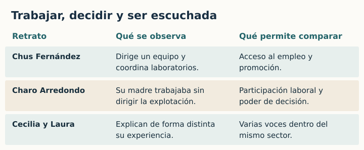

# ENS Rennes · D-E · Espagnol 2024 — Corrigé brut

*Corrigé rédigé par IA, non officiel. Signalez toute erreur.*

**Rédaction** · GPT-6.2 Astra Ultra · vitesse non renseignée

L’épreuve dure quatre heures. Chacune des deux réponses d’expression écrite doit compter de 225 à 275 mots.

## I. Version

Les progrès récents de l’intelligence artificielle (IA) ont suscité un intérêt croissant pour l’utilisation d’outils d’IA afin d’améliorer les services publics. Les grands modèles de langage et l’IA générative, avec ChatGPT en tête, se sont ainsi imposés comme des outils puissants, capables de produire des textes très proches du langage humain. Ils peuvent servir à améliorer les services publics, en particulier l’accueil des usagers et l’automatisation du traitement des documents.

À mes yeux, la question est moins d’interdire ce type d’outils que de pouvoir les utiliser à bon escient et avec toutes les garanties juridiques nécessaires. Il est en particulier indispensable que l’utilisation des systèmes d’IA respecte les droits fondamentaux, notamment l’égalité, la non-discrimination et la protection des données. L’élément déterminant est donc de mettre en place des procédures rigoureuses d’analyse d’impact afin de repérer et d’atténuer les risques potentiels que présentent ces systèmes.

Sur ce point, mon expérience de conseiller international en matière de réglementation et de consultant m’a appris qu’il n’existait pas de méthode unique pour évaluer l’impact de l’IA sur les droits fondamentaux. Les risques et les effets particuliers varieront selon le contexte précis dans lequel ces systèmes seront employés. Certains principes généraux peuvent néanmoins s’appliquer à toutes les analyses d’impact.

Il importe en premier lieu d’associer à l’évaluation un large éventail de parties prenantes. Cela comprend aussi bien les personnes que le système d’IA affectera que les spécialistes de domaines pertinents tels que le droit, l’éthique et la technologie.

## II. Thème

El 17 de octubre, la Asamblea Nacional aprobó el proyecto de ley de regulación del espacio digital, que pretende proteger a los ciudadanos cuando realizan actividades en línea. Sin embargo, los peligros que se contemplan en el texto, como las estafas por internet o el ciberacoso, no son los únicos que están en juego. Lo que en realidad corre peligro es la salud de cada persona en el conjunto de la población, como ya han demostrado sobradamente las investigaciones científicas.

La edad media a la que se adquiere el primer teléfono inteligente sigue bajando. En Francia se sitúa actualmente en los nueve años. Los adolescentes pasan ante las pantallas por motivos de ocio un tiempo que, según el investigador Michel Desmurget, además de excesivo resulta «desorbitado»: unas seis horas diarias de media. Un estudio francés sobre 776 alumnos de secundaria mostraba que la mayoría de los adolescentes utilizaban el móvil durante la noche. Algunos incluso ponían el despertador para hacerlo, con consecuencias desastrosas para el sueño, pilar de su salud física y mental y de su aprendizaje.

Por otra parte, según varios estudios recientes, el consumo de pornografía en el móvil está muy extendido entre los adolescentes. Esto contrasta con otros datos: el 43 % de las personas de entre 18 y 25 años declara no haber mantenido relaciones sexuales durante el último año. Ello sugiere que la vida sexual de los adultos jóvenes podría estar desvinculada de sus relaciones interpersonales.

## III.1. ¿Cómo presenta el artículo la incorporación de las mujeres al trabajo?

Claudia Vila Galán presenta la incorporación laboral de las mujeres al campo mediante una serie de retratos. El verbo del titular sugiere una conquista, pero las entrevistadas recuerdan que sus madres y abuelas ya trabajaban en las explotaciones. Lo que ha cambiado es, entre otras cosas, quién puede dirigirlas, decidir cómo se organizan y contar públicamente su experiencia.

La veterinaria Chus Fernández recuerda las miradas de desconfianza que tuvo que soportar al principio. Ahora ocupa un puesto de responsabilidad y tiene a cuatro mujeres a su cargo. Su trayectoria aparece junto al plan de igualdad de la empresa, que abarca la selección y la promoción interna. En la explotación de Charo Arredondo, la enfermedad del marido modificó el reparto de tareas. La hija volvió a trabajar con su familia por gusto. Pasar de una generación a otra permite así distinguir el trabajo realizado, el poder de decisión y las razones de cada elección.

La periodista también deja oír voces que complican la idea de una marcha uniforme hacia la igualdad. Cecilia Castro habla de su relación con los animales en términos de instinto maternal y de los sacrificios que algunas jóvenes prefieren evitar. Laura González, en cambio, dice que nunca ha percibido diferencias entre hombres y mujeres en su propio entorno.

Las citas directas conservan esas discrepancias. El cierre, en el que Arredondo afirma que volvería a elegir el campo, da protagonismo a su decisión personal sin borrar las dificultades materiales ni convertir su historia en la de todas las trabajadoras rurales.

*252 mots.*

## III.2. ¿Hasta qué punto es posible acabar con la discriminación de género en el trabajo?

Creo que sí es posible eliminar prácticas discriminatorias concretas en cualquier sector. La dificultad consiste en detectar las que siguen actuando después de que una empresa haya abierto formalmente sus puertas a todo el mundo. Una oferta de empleo puede parecer neutral y, sin embargo, la decisión final puede seguir dependiendo de contactos informales o de suposiciones sobre quién se encargará de los hijos.

Un primer paso sería publicar criterios de selección y promoción que correspondan a lo que exige el puesto. En una explotación, por ejemplo, habría que comprobar qué tareas requieren determinada capacidad física y cuáles pueden realizarse con maquinaria adecuada. Descartar de antemano a todas las mujeres por una exigencia que solo afecta a algunas tareas priva a la empresa de personas preparadas. Lo mismo sucede cuando se considera poco apropiado que un hombre trabaje en educación infantil o cuide de personas dependientes.

La igualdad de acceso debe ir acompañada de medidas durante la carrera profesional. Las bandas salariales transparentes, unos horarios previsibles y los permisos de cuidados que puedan utilizar tanto hombres como mujeres ayudan a evitar que años de trabajo similares conduzcan a sueldos o ascensos distintos. También debe existir una vía para denunciar decisiones injustas sin poner en peligro el empleo.

Ninguna cifra aislada demuestra que la discriminación haya desaparecido. Dos personas pueden elegir oficios diferentes por motivos propios. Lo decisivo es que cada una pueda conocer las alternativas, adquirir la formación necesaria y competir en condiciones comparables. Para comprobarlo, conviene escuchar a quienes abandonaron un sector además de celebrar a quienes consiguieron quedarse.

*260 mots.*

[Sujet officiel, pages 8 à 10](https://www.ens-rennes.fr/medias/fichier/sujet-toutes-lve-e-crit-d-e-2024_1729180755099-pdf#page=8) · [Rapport du jury](https://www.ens-rennes.fr/medias/fichier/rapport-de-jury-lve-espagnol-e-crit-d-e-2024_1729180936932-pdf)
