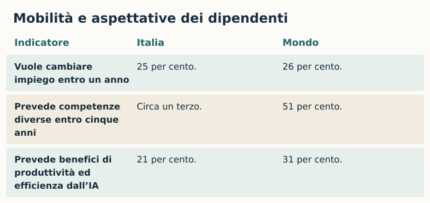

# ENS Rennes · D-E · Italien 2024 — Corrigé guidé

*Corrigé rédigé par IA, non officiel. Signalez toute erreur.*

**Rédaction** · GPT-6.2 Astra Ultra · vitesse non renseignée

L’épreuve dure quatre heures. Chacune des deux réponses d’expression écrite doit compter de 225 à 275 mots.

## Préparer la copie

### Version et thème

Pour traduire le dispositif italien, notez séparément le montant par bénéficiaire et le budget total du programme. La première somme augmente de 600 à 1 500 euros. Les crédits passent de 25 millions en 2022 à 5 millions en 2023, puis à 8 millions pour 2024. Évitez de laisser entendre que le budget a diminué **entre 2023 et 2024**. Le financement est prioritaire pour les revenus les plus modestes, sans limite d’âge. Il concerne des séances chez des professionnels privés inscrits au registre, dans les 180 jours de l’attribution. *Abbia ricevuto* exprime une condition pour la personne susceptible d’en bénéficier.

Le texte de thème demande de traduire également son titre. Pour rendre le « on » français, l’italien offre ici plusieurs constructions. *Si preferisce quella della reciprocità* maintient une préférence formulée sans sujet individuel. Dans la dernière phrase, *quello che è stato chiamato “terzo settore”* permet de conserver l’antériorité de la dénomination. Conservez les trois verbes du texte français sur le don, y compris *scambiare* pour « échanger ». L’auteur décrit des pratiques précises, dont les groupes d’achat de quartier et le temps comptabilisé dans des réseaux d’échange.

### Choisir les comparaisons pertinentes

Le sondage ne mesure pas toutes les variables sur le même groupe. Les intentions de mobilité professionnelle en Italie sont comparables à la moyenne mondiale. L’écart porte notamment sur les compétences dont les salariés prévoient la transformation et sur les gains d’efficacité qu’ils attendent de l’IA. Les pourcentages de personnes en difficulté financière et de personnes plus à l’aise qui recherchent une formation sont donnés pour le monde. Présentez-les comme une piste explicative, en distinguant cette comparaison sociale de la comparaison entre pays.

La seconde consigne demande dans quels **secteurs** les effets sont les plus importants à votre avis. Pour chaque secteur retenu, nommez une tâche, la modification qu’un outil peut y apporter et une décision qui demeure sous responsabilité humaine. La différence est concrète en traduction juridique, où confondre faculté et obligation peut changer la portée d’une clause. On peut enfin comparer ces activités à un métier nécessitant la présence physique, dans lequel les horaires et les dossiers évoluent davantage que le geste professionnel lui-même.

## I. Version

**L’aide aux consultations psychologiques en 2023. Comment fonctionne-t-elle et qui peut en bénéficier ?**

La dernière loi de finances a reconduit pour 2023 l’aide aux consultations psychologiques, une prestation sociale qui contribue au financement des séances de psychothérapie. Elle en a porté le montant de 600 à 1 500 euros, tout en réduisant l’enveloppe globale. Alors que 25 millions d’euros avaient été affectés à cette aide en 2022, les crédits sont tombés à 5 millions d’euros pour 2023 et à 8 millions pour 2024.

En laissant de nombreuses personnes aux prises avec la perte de leur emploi, des difficultés financières, l’isolement et l’incertitude quant à l’avenir, la pandémie de Covid-19 a eu d’importantes répercussions sur la santé mentale de la population. Il en est résulté une forte augmentation des demandes de soutien psychologique. Pour répondre aux besoins des personnes les plus touchées par la pandémie, le gouvernement Draghi avait instauré par décret, en 2022, ce que l’on appelle le « bonus psychologue ». Cette aide financière, destinée à promouvoir le droit à la santé mentale, a été reconduite pour les deux années à venir.

Elle s’adresse à toute personne qui, confrontée à la dépression, à l’anxiété, au stress ou à une fragilité psychologique, a reçu de son médecin traitant le feu vert pour suivre une psychothérapie. Elle sera attribuée en priorité aux personnes appartenant aux tranches de revenus les plus modestes, sans condition d’âge.

Elle pourra être demandée pour contribuer au paiement de séances de psychothérapie assurées exclusivement par des praticiens exerçant dans le privé et inscrits au registre professionnel des psychologues et psychothérapeutes, en cabinet comme en ligne. Elle devra être utilisée dans les 180 jours suivant son attribution.

## II. Thème

**In Italia un’altra economia è possibile**

Ogni giorno migliaia di italiani vivono al di fuori dei percorsi consueti dell’economia di mercato. Nelle campagne, ma anche negli ambienti culturali, ridefiniscono a piccoli passi il legame sociale.

Fin dall’inizio degli anni Novanta la Rete italiana dei villaggi ecologici (RIVE) contrappone alla «società del petrolio» e all’utilitarismo dell’Homo oeconomicus pratiche di condivisione e di coproduzione che si ispirano alla teoria del dono di Marcel Mauss e si fondano su tre momenti: dare, ricevere, scambiare. Alla logica della transazione tra domanda e offerta, su cui si fonda il mercato, si preferisce quella della reciprocità e della relazione. E nel permanente squilibrio proprio della dinamica del dono si vuole scorgere un’anticipazione del processo di formazione dell’Homo politicus.

Gruppi di acquisto di quartiere, banche del tempo, economia di comunione: le «utopie del fare bene», come le chiama il sociologo Giulio Marcon, hanno una lunga storia che va dal mutualismo alle cooperative e a quello che è stato chiamato «terzo settore». Cercano di distinguersi sia dalla logica del mercato sia da quella dell’intervento pubblico.

## III.1. In che senso i lavoratori italiani si dichiarano meno pronti al cambiamento?

Secondo l’indagine di PwC, essere pronti al cambiamento non significa semplicemente desiderare un altro impiego. In Italia un lavoratore su quattro vorrebbe cambiare lavoro entro un anno, una percentuale vicina al 26 per cento registrato nel mondo. Tra i più giovani la disponibilità è ancora maggiore. Si può tuttavia voler lasciare un posto per ottenere uno stipendio migliore senza prevedere che cambino le competenze necessarie a svolgere il proprio mestiere.

Proprio su questo secondo punto emerge una differenza. Nel mondo il 51 per cento degli intervistati pensa che, entro cinque anni, le competenze richieste dal proprio lavoro cambieranno sensibilmente. In Italia lo pensa soltanto un terzo dei dipendenti. I dirigenti italiani si preoccupano del divario tra competenze disponibili e competenze necessarie, mentre molti lavoratori non avvertono la stessa urgenza di aggiornarsi. Anche le aspettative sull’intelligenza artificiale sono più caute: il 21 per cento degli italiani prevede un aumento della produttività e dell’efficienza, contro il 31 per cento a livello mondiale.

Sarebbe però improprio attribuire la differenza a un tratto nazionale immutabile. L’indagine mette in luce anche una disuguaglianza materiale. Nel campione mondiale, chi riesce a pagare le bollette senza difficoltà cerca più spesso occasioni di formazione rispetto a chi fatica ad arrivare a fine mese. Un secondo lavoro può ridurre il tempo disponibile per studiare. I dati descrivono dunque aspettative e opportunità dichiarate dai lavoratori. Per capire quanto siano preparati nella pratica, bisognerebbe sapere anche quale formazione offrono le imprese e chi riesce davvero a frequentarla.

*246 mots.*

## III.2. In quali settori il lavoro cambia di più con l’intelligenza artificiale?

A mio parere l’effetto più immediato si vede nei settori in cui una parte consistente del lavoro consiste nel trasformare informazioni già disponibili in un documento nuovo. In un ufficio amministrativo, per esempio, un programma può classificare domande o preparare una risposta a una richiesta frequente. Il tempo risparmiato è utile soltanto se un addetto può correggere una classificazione sbagliata e se il cittadino sa a chi rivolgersi quando il suo caso non rientra nelle categorie previste.

Un altro esempio è la traduzione. Per un primo esame di documenti ripetitivi, una bozza automatica può accelerare il lavoro. In un contratto, però, confondere la facoltà di fare qualcosa con l’obbligo di farlo può modificare l’interpretazione di un’intera clausola. Il traduttore deve conoscere la materia, verificare la terminologia e assumersi la responsabilità del risultato. Cambiano così le mansioni quotidiane e le competenze richieste, anche quando la figura professionale continua a essere indispensabile.

Anche nella sanità e nell’industria l’analisi di immagini o di segnali può aiutare a individuare anomalie. Il suo valore dipende dalla qualità dei dati e dal modo in cui gli operatori verificano un risultato inatteso. Le professioni che richiedono presenza fisica, come l’assistenza domiciliare, possono intanto usare strumenti simili per organizzare gli appuntamenti, pur continuando a dipendere dal rapporto personale.

Per valutare un settore guarderei quindi alle singole attività, alla frequenza degli errori e alle conseguenze di una decisione sbagliata. La stessa tecnologia può alleggerire un compito ripetitivo oppure aumentare il carico di verifica di chi deve risponderne.

*248 mots.*

[Sujet officiel, pages 11 à 13](https://www.ens-rennes.fr/medias/fichier/sujet-toutes-lve-e-crit-d-e-2024_1729180755099-pdf#page=11) · [Rapport du jury](https://www.ens-rennes.fr/medias/fichier/rapport-de-jury-lve-italien-e-crit-d-e-2024_1729180829932-pdf)
