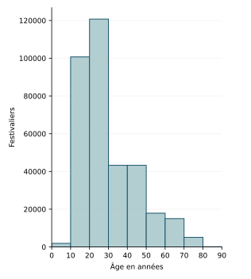
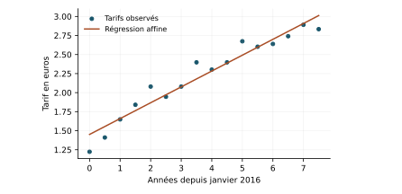
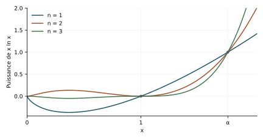

# ENS Rennes D-E — Mathématiques appliquées et statistiques 2024 · Corrigé brut

*Corrigé rédigé par IA, non officiel. Signalez toute erreur.*

**Rédaction** · GPT-6.2 Astra Ultra · vitesse non renseignée

**Révision** · GPT-6.2 Astra Ultra · vitesse non renseignée

Les données du festival et du bar à jeux sont fictives. Les trois exercices portent successivement sur l’ajustement statistique, les puissances du produit $x\ln x$ et les probabilités d’essais répétés.

## Exercice 1. Festivaliers et tarifs du bar à jeux

### Question 1.1.a

Il s’agit d’une série statistique univariée. Le caractère étudié est l’âge, quantitatif continu, regroupé en classes de dix ans. Les $x_i$ du tableau sont les effectifs de ces classes.

### Question 1.1.b

Construire neuf rectangles contigus de largeur 1 cm, le premier à partir de zéro. Les hauteurs en cm, un centimètre représentant 10 000 personnes, sont $0{,}190$, $10{,}073$, $12{,}075$, $4{,}325$, $4{,}327$, $1{,}790$, $1{,}500$, $0{,}510$ et $0{,}010$.

### Question 1.1.c

L’effectif maximal est $120\,750$ ; la seule classe modale est $[20,30[$ ans.

### Question 1.1.d

Notons $p_i$ le pourcentage de bénévoles converti en proportion, notamment $0{,}05\,\%=0{,}0005$. Le total des festivaliers vaut $N=348\,000$ et le total estimé de bénévoles est $\sum_i x_ip_i=206\,940{,}45$. Le pourcentage global vaut donc $100\sum x_ip_i/N\simeq59{,}466\,\%$. Le total fractionnaire provient des pourcentages fictifs du tableau.

### Question 1.1.e

Avec les centres $c_i=5,15,\ldots,85$, l’âge moyen estimé vaut $\sum_i c_ix_ip_i/\sum_i x_ip_i\simeq26{,}516$ ans. Ce calcul représente chaque âge par le centre de sa classe ; la moyenne individuelle exacte dépend de la distribution interne.

### Question 1.1.f

Le seuil est $N/4=87\,000$. Le cumul vaut $1\,900$ avant 10 ans et $102\,630$ avant 20 ans. Sous l’hypothèse uniforme dans la deuxième classe, le premier quartile est $10+10(87\,000-1\,900)/100\,730\simeq18{,}448$ ans.

Dans la classe de 10 à 20 ans il faut encore $87000-1900=85100$ personnes. Elles représentent environ $84{,}48\,\%$ des 100 730 membres de cette classe. Parcourir la même proportion de ses dix années retrouve les 18,448 ans estimés.

### Question 1.2.a

Placer les seize couples du tableau, de $(0,1{,}2237)$ à $(7{,}5,2{,}8332)$, avec 2 cm pour un rang et 5 cm pour un euro. La figure inclut la droite demandée plus loin.

### Question 1.2.b

On obtient $\bar y=\sum_i y_i/16=2{,}23165625\simeq2{,}232$ euros et $V_y=\sum_i y_i^2/16-\bar y^2\simeq0{,}245$ euro au carré.

### Question 1.2.c

On a $\bar x=3{,}75$, $V_x=5{,}3125$ et $C_{xy}=\sum x_iy_i/16-\bar x\bar y=1{,}105292$. Ainsi $r=C_{xy}/\sqrt{V_xV_y}\simeq0{,}968$. La liaison est fortement croissante et un ajustement affine est approprié sur la période observée.

### Question 1.2.d

La méthode des moindres carrés donne $a=C_{xy}/V_x=0{,}208055$ et $b=\bar y-a\bar x=1{,}45145$. La droite représentée en 1.2.a est $y\simeq0{,}208x+1{,}451$ au millième.

### Question 1.2.e

Janvier 2025 correspond à $x=9$. Avec les coefficients non arrondis, $9a+b=3{,}323945\simeq3{,}324$ euros.

### Question 1.2.f.i

Le tableau regroupe deux blocs de huit observations ; les résultats sont arrondis au millième.

| Rang | 0 | 0,5 | 1 | 1,5 | 2 | 2,5 | 3 | 3,5 |
|---|---|---|---|---|---|---|---|---|
| z | 3,400 | 4,100 | 5,200 | 6,300 | 8,000 | 7,000 | 8,000 | 10,999 |

| Rang | 4 | 4,5 | 5 | 5,5 | 6 | 6,5 | 7 | 7,5 |
|---|---|---|---|---|---|---|---|---|
| z | 9,999 | 10,999 | 14,499 | 13,499 | 13,999 | 15,499 | 17,999 | 17,000 |

### Question 1.2.f.ii

Les valeurs non arrondies donnent $\bar z\simeq10{,}406$, $V_z\simeq20{,}199$, $C_{xz}\simeq10{,}176$. Donc $r_{xz}=C_{xz}/\sqrt{V_xV_z}\simeq0{,}982$. L’ajustement affine de $z$ en $x$ est justifié et sa corrélation est plus élevée que celle de $y$ en $x$.

### Question 1.2.f.iii

Avec $a'=C_{xz}/V_x\simeq1{,}915497$ et $b'=\bar z-a'\bar x\simeq3{,}222524$, la droite est $z\simeq1{,}915x+3{,}223$ au millième.

### Question 1.2.f.iv

Puisque $z=e^y$, le modèle est $y=\ln(a'x+b')$. Dépasser $3{,}2$ euros équivaut à $x>(e^{3,2}-b')/a'\simeq11{,}125$. Le premier rang semestriel admissible est $11{,}5$, soit **juillet 2027**. C’est une extrapolation à partir des données finissant en 2023.

Aux rangs semestriels voisins, le modèle donne $\ln(11a'+b')\simeq3{,}190$ euros en janvier 2027 et $\ln(11{,}5a'+b')\simeq3{,}229$ euros en juillet 2027. La croissance du logarithme et $a'>0$ assurent qu’il s’agit du premier franchissement.

## Exercice 2. Puissances de x ln x, intégrales et densité

### Question 2.I.1

Par croissance comparée, $x\ln x\to0$ quand $x\downarrow0$ et $x\ln x\to+\infty$ quand $x\to+\infty$. Ainsi $g(x)=x\ln x-1$ a respectivement pour limites $-1$ et $+\infty$.

### Question 2.I.2

Sur $]0,\infty[$, identité et logarithme sont dérivables. Leur produit moins un l’est aussi et $g'(x)=\ln x+1$.

### Question 2.I.3

La fonction décroît strictement de la limite $-1$ en zéro jusqu’à $g(e^{-1})=-1-e^{-1}$, puis croît strictement jusqu’à $+\infty$. La dérivée change de signe en $e^{-1}$.

### Question 2.I.4

La première branche reste négative. Sur $[e^{-1},\infty[$, $g$ est continue strictement croissante et passe d’une valeur négative à $+\infty$, donc admet un unique zéro $\alpha$. Comme $g(1)=-1<0$, on a $\alpha>1$. En particulier $\alpha\ln\alpha=1$.

### Question 2.I.5

La décroissance initiale entièrement sous l’axe et la croissance de la seconde branche donnent $g(x)<0$ pour $0<x<\alpha$, $g(\alpha)=0$ et $g(x)>0$ au-delà.

### Question 2.II.1

Pour tout $n\ge1$, le domaine de l’expression $f_n(x)=(x\ln x)^n$ est $]0,\infty[$, où elle est continue puisque le produit et la puissance le sont.

### Question 2.II.2

On a $f_n(x)\to0$ en $0^+$ et $f_n(x)\to+\infty$ en $+\infty$. On peut donc prolonger continûment $f_n$ en zéro en posant $f_n(0)=0$.

### Question 2.II.3

Comme $\alpha\ln\alpha=1$, on a $f_n(\alpha)=1$ pour tout $n\ge1$.

### Question 2.II.4

La dérivation en chaîne donne $f_n'(x)=n(x\ln x)^{n-1}(1+\ln x)=n x^{n-1}(\ln x)^{n-1}(1+\ln x)$, avec le facteur de puissance zéro égal à un lorsque $n=1$.

### Question 2.II.5

Posons $u=x\ln x$. Il décroît de $0$ à $-1/e$ sur $]0,1/e]$, puis croît jusqu’à zéro en $1$ et vers $+\infty$. Si $n$ est impair, $f_n$ décroît jusqu’à $-e^{-n}$ puis croît jusqu’à l’infini, en passant par zéro en $1$. Si $n$ est pair, $f_n$ croît de $0$ à $e^{-n}$, décroît ensuite jusqu’à zéro en $1$ et croît enfin vers $+\infty$. Toutes les variations indiquées sont strictes sur leurs intervalles.

| Valeur ou limite | $0^+$ | $1/e$ | $1$ | $+\infty$ |
|---|---:|---:|---:|---:|
| $n$ impair | $0$ | $-e^{-n}$ | $0$ | $+\infty$ |
| Variation vers la colonne suivante | Décroît | Croît | Croît | |
| $n$ pair | $0$ | $e^{-n}$ | $0$ | $+\infty$ |
| Variation vers la colonne suivante | Croît | Décroît | Croît | |

### Question 2.II.6

Si $n$ est impair, le minimum vaut $m_n=-e^{-n}<0$, atteint uniquement en $1/e$. Si $n$ est pair, le minimum vaut $0$, atteint uniquement en $1$ sur le domaine ouvert de départ. La valeur zéro du prolongement en zéro ne change pas ce résultat sur le domaine imprimé.

### Question 2.II.7

Toutes les fonctions sont dérivables en $1$ et $f_n(1)=0$. Pour $n=1$, la pente vaut $1$, donc la tangente est $y=x-1$. Pour $n\ge2$, la pente vaut zéro et la tangente est l’axe $y=0$.

### Question 2.II.8

On a $f_{n+1}-f_n=(x\ln x)^n(x\ln x-1)$. Les courbes se rencontrent aux points $(1,0)$ et $(\alpha,1)$ sur le domaine. Sur $]0,1[$, le premier facteur a le signe $(-1)^n$ et le second est négatif : $C_{n+1}$ est au-dessus de $C_n$ pour $n$ impair, au-dessous pour $n$ pair. Sur $]1,\alpha[$, $C_{n+1}$ est au-dessous, et sur $]\alpha,\infty[$ elle est au-dessus, pour toute parité.

### Question 2.II.9

Toutes les courbes tendent vers zéro à gauche et vers l’infini à droite. Le minimum de $f_1$ est $-1/e$, celui de $f_3$ est $-e^{-3}$ et le sommet local de $f_2$ est $e^{-2}$ en $1/e$. Les positions relatives viennent de la question précédente.

### Question 2.III.1

Posons $b=1+(\alpha-1)/2=(1+\alpha)/2$. Alors $1<b<\alpha$ et, pour tout $n\ge0$, $(x\ln x)^n$ est continue sur $[1,b]$, avec intégrande constant un pour $n=0$. Les intégrales $I_n$ existent.

### Question 2.III.2

On a $I_0=b-1=(\alpha-1)/2$. Une primitive de $x\ln x$ est $x^2\ln x/2-x^2/4$, d’où $I_1=b^2\ln b/2-b^2/4+1/4$.

### Question 2.III.3

Sur $[1,b]$, $0\le x\ln x<1$, car $x<\alpha$ et $g(x)<0$. On a donc $(x\ln x)^{n+1}\le(x\ln x)^n$, avec inégalité stricte à l’intérieur. Par intégration, la suite est strictement décroissante.

### Question 2.III.4

L’intégrande est positif ou nul et strictement positif sur $]1,b]$. Tous les $I_n$ sont donc strictement positifs.

### Question 2.III.5

Décroissante et minorée par zéro, la suite des $I_n$ converge vers un réel $\ell\ge0$.

### Question 2.III.6

La fonction $x\ln x$ est croissante sur $[1,b]$. Son maximum y vaut $q=b\ln b$, strictement entre zéro et $1$ car $1<b<\alpha$. Cette constante donne la majoration uniforme demandée.

### Question 2.III.7

Pour tout $n\ge1$, $0\le I_n\le\int_1^b q^n dx=q^n(b-1)=q^n(\alpha-1)/2$.

### Question 2.III.8

Comme $0<q<1$, le majorant précédent tend vers zéro. Par encadrement, $\ell=0$.

### Question 2.IV.1

Une densité est mesurable, positive ou nulle presque partout et d’intégrale un sur la droite. Ici la fonction est continue par morceaux, à support borné ; il reste à imposer la positivité et la normalisation.

### Question 2.IV.2

Il faut $a\ge0$ et $1=a\int_0^1 xe^{-2x^2}dx=a(1-e^{-2})/4$. Ainsi $a=4/(1-e^{-2})$.

### Question 2.IV.3.a

La fonction de répartition est nulle pour $x<0$, vaut $G(x)=(1-e^{-2x^2})/(1-e^{-2})$ pour $0\le x\le1$, et vaut $1$ pour $x>1$.

### Question 2.IV.3.b

On trouve $\mathbb P(X>1/\sqrt2)=1-G(1/\sqrt2)=(e^{-1}-e^{-2})/(1-e^{-2})=1/(e+1)\simeq0{,}269$.

## Exercice 3. Paniers, temps d’attente et loi normale

### Question 3.I.1

La probabilité du ballon bleu est $\mathbb P(B)=1-\mathbb P(O)-\mathbb P(V)=1/2$.

### Question 3.I.2

La probabilité conditionnelle recherchée est $\mathbb P(M\mid V)=2/5$ d’après les données.

### Question 3.I.3

La formule composée donne $\mathbb P(V\cap M)=\mathbb P(V)\mathbb P(M\mid V)=(1/4)(2/5)=1/10$.

### Question 3.I.4

Les trois événements $O,V,B$ sont incompatibles et couvrent tous les choix. Donc $\mathbb P(M)=(1/4)(3/5)+(1/4)(2/5)+(1/2)(1/2)=1/2$. La probabilité de manquer vaut aussi $\mathbb P(\overline M)=1/2$.

### Question 3.I.5

On a $\mathbb P(B\mid\overline M)=\mathbb P(B)\mathbb P(\overline M\mid B)/\mathbb P(\overline M)=(1/2)(1/2)/(1/2)=1/2$.

### Question 3.II.1

Un succès dès le premier essai donne zéro échec. Tout nombre $k\ge0$ d’échecs avant un premier succès est possible puisque $0<p<1$. Dans le modèle d’essais indépendants, le succès finit par survenir presque sûrement. Le support est $\mathbb N$.

### Question 3.II.2

Pour tout $k\ge0$, $\{Y=k\}=(\bigcap_{i=1}^k\overline M_i)\cap M_{k+1}$ ; l’intersection vide pour $k=0$ donne le seul événement $M_1$.

### Question 3.II.3

Sous le modèle usuel de tentatives indépendantes de probabilité de réussite $p$, la probabilité des $k$ échecs suivis d’un succès vaut $\mathbb P(Y=k)=(1-p)^kp$.

### Question 3.II.4

$X=Y+1$ est le rang du premier panier réussi, autrement dit le nombre total de tentatives jusqu’au premier succès inclus.

### Question 3.II.5

On a $\mathbb P(X=k)=(1-p)^{k-1}p$ pour $k\ge1$. C’est la loi géométrique sur $\mathbb N^*$. Son espérance et sa variance sont finies et valent $1/p$ et $(1-p)/p^2$.

### Question 3.II.6

Sur des répétitions indépendantes de l’expérience, le nombre moyen de tentatives nécessaires au premier panier est $1/p$, tentative réussie comprise.

### Question 3.III.1

La variable $Z$ a la loi uniforme sur $\{1,2,3\}$, soit $1/3$ pour chaque valeur. Donc $\mathbb E(Z)=2$ et $V(Z)=(1+4+9)/3-4=2/3$.

### Question 3.III.2

Le joueur réussit au plus tôt au premier lancer. Pour chaque $k\ge1$, une suite de $k-1$ échecs puis d’un succès a une probabilité strictement positive dans chacune des salles, car $0<p_i=2^{-i}<1$. Le support est $\mathbb N^*$.

### Question 3.III.3

Sachant $Z=i$, les lancers dans cette salle restent des essais indépendants de probabilité $p_i$. La loi conditionnelle de $X$ est géométrique, avec $\mathbb P(X=k\mid Z=i)=(1-p_i)^{k-1}p_i$.

### Question 3.III.4

Par les probabilités totales, pour $k\ge1$,
$$\mathbb P(X=k)=\tfrac13\big[\tfrac12(\tfrac12)^{k-1}+\tfrac14(\tfrac34)^{k-1}+\tfrac18(\tfrac78)^{k-1}\big].$$
Le choix unique de la salle conduit à ce mélange de trois lois.

### Question 3.III.5

La probabilité d’échouer aux $k$ premiers essais est $\frac13\sum_{i=1}^3(1-p_i)^k\to0$. Le succès éventuel, qui termine le jeu, a donc probabilité $1$.

### Question 3.III.6

L’espérance conditionnelle dans la salle $i$ vaut $1/p_i=2^i$. En sommant les trois séries positives pondérées de la loi, on obtient l’espérance finie $\mathbb E(X)=(2+4+8)/3=14/3$ tentatives.

Le choix de la salle fixe la probabilité de réussite pour toute la partie. La moyenne des trois probabilités de réussite au premier lancer vaut $7/24$, mais son inverse $24/7$ ne donne pas le temps moyen. Ce dernier se calcule en pondérant les trois temps moyens conditionnels.

### Question 3.IV.1

La variable $N^*=(N-15)/3$ suit la normale centrée réduite. Inversement $N=15+3N^*$.

### Question 3.IV.2

Sur tout $\mathbb R$, une densité de la loi normale centrée réduite est $\phi(x)=(2\pi)^{-1/2}e^{-x^2/2}$.

### Question 3.IV.3

On a $\mathbb P(N\le18{,}3)=\Phi((18{,}3-15)/3)=\Phi(1{,}10)$. La ligne $1{,}1$ et la colonne $0{,}00$ de la table donnent $0{,}8643$.

### Question 3.IV.4

Les bornes centrées réduites sont $-2{,}10$ et $1{,}22$. La table donne $\Phi(1{,}22)=0{,}8888$ (ligne $1{,}2$, colonne $0{,}02$) et $\Phi(2{,}10)=0{,}9821$. Ainsi $\Phi(-2{,}10)=1-0{,}9821=0{,}0179$ et la probabilité demandée vaut $0{,}8888-0{,}0179=0{,}8709$.
