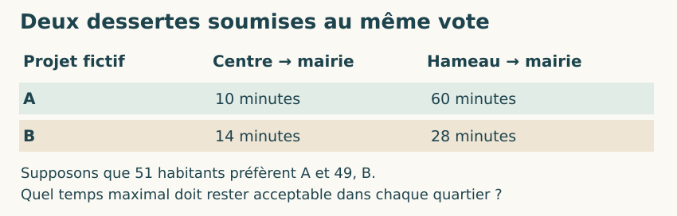

# ENS · Cycle master mathématiques — Français et culture générale 2024 · Corrigé guidé

*Corrigé rédigé par IA, non officiel. Signalez toute erreur.*

**Rédaction** · GPT-6.2 Astra Ultra · vitesse non renseignée

**Autocontrôle** · GPT-6.2 Astra Ultra · vitesse non renseignée

**Révision (tour 1)** · GPT-6.2 Astra Ultra · vitesse non renseignée · 26 novembre 2026

## Sujet et consignes

École normale supérieure Paris Saclay et École normale supérieure Rennes. Mardi 27 février 2024, de 8 h 30 à 11 h 30. Concours 2A Mathématiques, Épreuve n° 1. Dictionnaires interdits. Durée de l’épreuve, trois heures.

P. Rosanvallon, La légitimité démocratique. Impartialité, réflexivité, proximité, Points Essais, 2008. La page 2 est blanche. Le texte occupe les pages 3 à 5 du PDF. Deux notes p. 3 renvoient à Louis Blanc et à Adhémar Esmein. Questions p. 5.

Résumer le texte en 250 mots (avec une marge de tolérance de + ou – 10%). Le nombre exact de mots utilisés sera indiqué en fin de résumé. L’intervalle admis va de 225 à 275 mots.

Sous forme d’un développement construit, commenter, au choix, l’une des deux réflexions suivantes de l’auteur : Chaque exercice vaut dix points. Les deux options sont traitées ici.

Le rapport écrit traite p. 1 du nombre de mots, de la reformulation, du plan, de la culture mobilisée et de la langue. La p. 2 conclut ce bilan.

## Préparer les deux exercices

Tracer d’abord deux colonnes. Dans la première, noter ce que l’élection permet de décider. Dans la seconde, noter tout ce que cette procédure laisse à justifier. Deux écarts apparaissent. Les électeurs majoritaires représentent une partie de la société. Le jour de l’élection représente un moment de la vie du régime. Dès que ces deux écarts sont visibles, la crise du parlementarisme et la recherche de nouveaux supports de légitimité cessent d’être de simples illustrations historiques.

Le résumé doit suivre le mouvement du texte jusque dans sa dernière comparaison. Rosanvallon part de la rupture avec les anciens pouvoirs, distingue les deux fictions, décrit les désillusions de la période 1890–1920, puis examine comment l’administration devient porteuse d’une nouvelle espérance. La France met en avant la vocation du service public, les États-Unis la gestion rationnelle. Le passage évoque aussi brièvement l’attrait exercé par des projets totalitaires. Ce point ne doit ni disparaître ni occuper à lui seul le dernier mouvement.

Dans 2 a, donner d’abord un sens précis au mot « établissement ». L’évolution du corps électoral permet de distinguer l’héritage historique et le principe qui le justifie. La question 2 b porte davantage sur la façon dont des raisons communes peuvent naître des pratiques d’un régime. Un exemple suivi, tel le réseau de transport ci-dessous, évite de remplacer cette difficulté par une liste abstraite de bonnes institutions. Pour tester un argument, se demander ce qu’un citoyen minoritaire pourrait encore demander après le vote.

Rosanvallon mobilise Louis Blanc pour la rupture avec la légitimité héréditaire et Esmein pour la discussion de la majorité. Relevez ensuite les deux écarts distincts que le résumé doit restituer. Dans le second commentaire, refaites le calcul des deux trajets et formulez la raison que la commune pourrait donner à la personne la moins bien desservie.

## 1. Résumé

Nous tenons pour évident que le pouvoir démocratique vient du peuple. Opposer le choix des citoyens aux privilèges de naissance ou à la volonté divine a longtemps dispensé de justifier une autre équivalence, celle du nombre majoritaire avec la volonté commune. Face aux minorités dominantes, invoquer le grand nombre avait un sens émancipateur. Compter également les suffrages a ensuite paru fournir une règle équitable de décision.

Pourtant le peuple, titulaire de la souveraineté, comprend tous ses membres, tandis que la majorité demeure une fraction de la société. Les droits de chacun et la valeur égale des personnes donnent à la démocratie pour horizon le consentement de tous. Nous avons donc supposé que la partie représentait le tout et que la légitimité acquise au moment du scrutin se prolongeait durant tout le mandat suivant.

Entre 1890 et 1920, les désillusions se multiplient. Malgré son extension parmi les hommes, le suffrage porte au premier plan les clientèles et les rivalités entre partis. Au Parlement, la négociation des avantages particuliers prend le pas sur la délibération commune. Le vote reste indispensable, mais ses bienfaits ne sont plus assurés.

Pour redonner consistance au bien public, certains en viennent à désirer un pouvoir totalitaire. Une transformation plus durable se produit avec le renforcement des administrations. Le service public français attend de ses agents une identification professionnelle au désintéressement. Dans le modèle américain, la gestion scientifique promet une autre voie vers la généralité. Deux héritages du gouvernement rationnel se trouvent ainsi intégrés à la recherche démocratique.

**250 mots.**

## 2a. La démocratie peut-elle se défaire de « ses conditions d’établissement » ?

Le lendemain d’une élection, le bulletin a désigné ceux qui gouverneront. A-t-il déjà rendu démocratiques les décisions qu’ils prendront pendant plusieurs années ? Le rapprochement proposé par Rosanvallon concerne d’abord une distinction de temps. Une origine jugée légitime et la conduite durable d’un régime se laissent aisément confondre. Il concerne aussi une histoire. Le suffrage majoritaire s’est imposé contre des pouvoirs de naissance et de privilège. Nous examinerons ce que la démocratie perdrait à renier cette origine, puis les raisons pour lesquelles elle doit la dépasser, avant de préciser quelles institutions peuvent prolonger l’autorisation initiale.

**Les gouvernés doivent pouvoir décider qui gouverne.** Un gouvernement expert peut construire une école ou garantir une pension. La qualité du service ne répond pas à la question de savoir au nom de qui il gouverne, ni par qui il peut être remplacé. L’élection rend visible l’égalité des voix et ménage une issue au désaccord sans exiger que les concurrents renoncent à leurs convictions. Ce droit de choisir et de congédier est un acquis de la lutte contre le privilège. En France, le suffrage longtemps qualifié d’universel à partir de 1848 excluait pourtant les femmes. L’ordonnance du 21 avril 1944 reconnaissant leur droit de vote montre qu’un régime peut devenir plus fidèle à son principe en rompant avec une limite de sa fondation historique.

**La volonté d’une majorité à une date donnée ne vaut pas approbation de tous les actes futurs.** Les opposants demeurent des citoyens. Les électeurs du vainqueur ont pu choisir son programme pour des motifs différents. Enfin une crise imprévue peut imposer un arbitrage que personne n’avait soumis au scrutin. Imaginer que chaque mesure possède d’avance la légitimité du résultat électoral prive de sens le débat parlementaire. Dans la France de la fin du XIXe siècle, Rosanvallon décrit comment les transactions entre groupes et clientèles ont déçu l’attente qu’une assemblée élue suffirait à produire une délibération publique. La fidélité à la promesse démocratique impose ici de regarder le fonctionnement effectif des institutions.

**La durée du mandat doit donc offrir des occasions de justification et de contestation.** La publicité d’un débat permet de savoir quelles raisons ont fait changer un texte. La presse, les associations et les recours rendent perceptibles les conséquences d’une décision pour ceux qui ne l’ont pas voulue. La décision du Conseil constitutionnel sur la liberté d’association en 1971 en donne un exemple précis. La majorité parlementaire pouvait légiférer, mais sa délibération devait respecter un droit qui permet justement aux gouvernés de se réunir et de s’exprimer entre deux scrutins. Un tel contrôle est lui-même borné par les règles publiques qui définissent sa compétence. Sinon, la substitution du juge ou de l’expert à l’électeur déplacerait seulement le problème.

La décision du 16 juillet 1971 reconnaît à la liberté d’association le rang de principe fondamental reconnu par les lois de la République. Le dispositif législatif examiné aurait permis de subordonner l’acquisition de la capacité juridique par certaines associations à un contrôle judiciaire préalable. En l’écartant, le Conseil protège une manière, pour les citoyens, de se constituer en interlocuteurs de la majorité après l’élection. La légitimité initiale du législateur et la légitimité de chacune de ses dispositions deviennent ainsi deux questions distinctes.

La démocratie peut ainsi se défaire de certaines limites de son établissement et de la fiction d’un mandat approuvé par avance. Elle dépend toujours du pouvoir égal des gouvernés de choisir et de remplacer leurs représentants. Juger l’exercice de ce pouvoir tout au long du mandat donne sa portée à l’acte qui l’a institué.

## 2b. Le fonctionnement démocratique peut-il réaliser « l’exigence de généralité » ?

Une commune doit desservir plusieurs quartiers par un nouveau réseau de bus. Si la majorité des habitants vit au centre, une consultation suffit-elle à produire un réseau qui serve toute la commune ? Chez Rosanvallon, la « généralité » désigne l’exigence de rapporter l’action publique au corps social tout entier en reconnaissant la valeur de chacun de ses membres. Une décision générale n’a donc pas à procurer le même gain à tous. Elle doit pouvoir se justifier auprès de ceux auxquels elle s’applique. Il faut voir pourquoi le vote ne suffit pas à cette tâche, comment la délibération et le service public peuvent la poursuivre, et à quelles conditions leur prétention reste contrôlable.

**Compter les voix donne au conflit une issue commune.** Le quartier le plus nombreux n’a pas à recevoir un poids supplémentaire en raison de sa richesse ou de son prestige. Chaque citoyen compte également. Mais une règle de majorité peut aussi reconduire à chaque vote le désavantage du même quartier excentré. Lui opposer qu’il a voté ne répond pas à la question du trajet qu’un habitant âgé ou sans voiture pourra effectivement faire. Rousseau distinguait la volonté de tous, addition d’intérêts orientés vers des objets privés, et la volonté générale, qui porte sur ce que les citoyens ont en commun. L’addition des préférences renseigne sur leur distribution. Elle ne suffit pas à définir l’objet sur lequel il est juste de décider ensemble.

**Une administration et une délibération peuvent modifier la question.** Des agents peuvent recueillir les horaires d’emploi, repérer l’absence de desserte d’un hôpital et comparer les besoins de mobilité des groupes qui participent peu aux réunions publiques. Le service public fournit ainsi une continuité et des connaissances qui manquent au seul moment du scrutin. Le débat entre représentants peut transformer des demandes rivales en un critère commun, par exemple garantir à chaque quartier un accès raisonnable aux services essentiels, puis répartir les moyens restants selon la fréquentation. Le centre et la périphérie ne recevront pas nécessairement la même fréquence. La différence doit pouvoir se rapporter à un principe intelligible pour tous.

Imaginons cent votants et deux tracés. Cinquante et un habitants préfèrent A. Il amène ceux du centre à la mairie en dix minutes et ceux du hameau en une heure. Avec B, ces durées seraient de quatorze et vingt-huit minutes. Le décompte établit quelle option a gagné. Il reste à discuter en public si quatre minutes épargnées au centre justifient trente-deux minutes supplémentaires au hameau. Décider d’un temps maximal de desserte peut modifier l’objet même sur lequel on consulte les habitants.

**Aucun corps ne possède pourtant à lui seul le point de vue de la société.** Les services peuvent prendre pour universels les usages des personnes que leurs outils savent mesurer. Une consultation en ligne suffit à rendre invisibles certains habitants. Publier les données, organiser une réunion accessible à plusieurs horaires, entendre des associations et permettre un recours donnent des prises à la contestation. Modifier ensuite un itinéraire à la lumière de l’expérience manifeste une capacité de révision. La généralité tient aussi à la possibilité, pour un membre d’abord oublié, de faire apparaître à tous l’insuffisance du critère choisi.

Le fonctionnement démocratique peut réaliser cette exigence dans des décisions déterminées, à condition que la règle, ses motifs et ses effets soient exposés au jugement de ceux qu’elle oblige. Il ne l’acquiert jamais définitivement. C’est précisément pourquoi les institutions qui organisent la révision d’une décision comptent autant que celles qui permettent de la prendre.

[Sujet officiel](https://ens-paris-saclay.fr/sites/default/files/CONCOURS/ANNALES_2C/2C_Math/2024_Fran%C3%A7ais_2A%20Maths.pdf) · [Rapport du jury](https://ens-paris-saclay.fr/sites/default/files/CONCOURS/ANNALES_2C/2C_Math/2024_Rapport%20fran%C3%A7ais_2A%20Maths_ECRIT.pdf)
