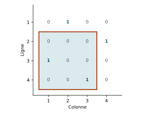

# ENS Paris-Saclay et Rennes — Écrit 2A Mathématiques 2024 · Corrigé guidé

*Corrigé rédigé par IA, non officiel. Signalez toute erreur.*

**Rédaction** · GPT-6.2 Astra Ultra · vitesse non renseignée

**Révision** · GPT-6.2 Astra Ultra · vitesse non renseignée · 26 novembre 2026

**Décomposition de Bruhat, drapeaux et opérateur de Volterra.** Les deux problèmes indépendants de cette épreuve de cinq heures ont le même poids. En analyse, le produit hermitien est linéaire en son premier argument.

## Algèbre I. Décomposition de Bruhat

### Question Algèbre I.1

> [!INDICATION]
> Calculer un coefficient de la matrice élémentaire multipliée à gauche.

#### Solution

On a $(E_{ij}A)_{k\ell}=\delta_{ki}a_{j\ell}$. Donc $(T_{ij}(\lambda)A)_{k\ell}=a_{k\ell}+\lambda\delta_{ki}a_{j\ell}$. La ligne $i$ devient $L_i+\lambda L_j$, toutes les autres restent égales aux lignes de $A$.

### Question Algèbre I.2

> [!INDICATION]
> Pour une multiplication à droite, observer cette fois la colonne du coefficient non nul.

#### Solution

La matrice $D_i(\lambda)$ est diagonale avec $\lambda$ en position $i$ et 1 ailleurs. Elle multiplie $L_i(A)$ à gauche et $C_i(A)$ à droite par $\lambda$. De plus $(AE_{ij})_{k\ell}=a_{ki}\delta_{j\ell}$, si bien que $C_j(AT_{ij}(\lambda))=C_j(A)+\lambda C_i(A)$. Chacune de ces opérations laisse les autres lignes ou colonnes inchangées.

### Question Algèbre I.3

> [!INDICATION]
> Suivre l’image d’un vecteur de la base canonique.

#### Solution

On a $P_\sigma e_j=e_{\sigma(j)}$. Ainsi $P_\sigma P_\tau e_j=e_{\sigma(\tau(j))}$ pour chaque $j$, et $P_\sigma P_\tau=P_{\sigma\circ\tau}$. De plus $P_{\mathrm{id}}=I_n$ et $P_\sigma^{-1}=P_{\sigma^{-1}}$. Il s’agit bien d’un morphisme dans $\mathrm{GL}_n(K)$.

### Question Algèbre I.4

> [!INDICATION]
> À gauche et à droite, les indices apparaissent en sens inverse. Écrire une formule pour chaque rang.

#### Solution

Pour toute permutation, $L_i(P_\sigma A)=L_{\sigma^{-1}(i)}(A)$, car $P_\sigma$ envoie la ligne d’indice $j$ à la position $\sigma(j)$. À droite, $C_j(AP_\sigma)=A P_\sigma e_j=C_{\sigma(j)}(A)$. Si $\tau$ échange $p,q$, $P_\tau A$ échange les lignes $p,q$ et $AP_\tau$ les colonnes $p,q$.

### Question Algèbre I.5

> [!INDICATION]
> Prendre le pivot non nul le plus bas dans la première colonne. Dans quelles directions les opérations triangulaires sont-elles autorisées ?

#### Solution

La première colonne de $A$ est non nulle puisque $A$ est inversible. Soit $i_1$ son dernier indice non nul et $a=a_{i_1,1}$. Multiplier à gauche par $D_{i_1}(a^{-1})$ rend le pivot égal à 1. Pour chaque $k<i_1$, soustraire à $L_k$ son coefficient de première colonne fois $L_{i_1}$. Cette opération est triangulaire supérieure puisque $k<i_1$. Les coefficients au-dessous du pivot étaient déjà nuls. La première colonne est maintenant $e_{i_1}$.

Pour chaque $j>1$, soustraire à $C_j$ son coefficient de ligne $i_1$ fois $C_1$, par une matrice $T_{1j}$ à droite. La ligne du pivot devient nulle hors de la première colonne. Tous les facteurs sont inversibles et triangulaires supérieurs, donc leurs produits donnent les $T_g,T_d$ demandées, y compris si $i_1=n$.

### Question Algèbre I.6

> [!INDICATION]
> Retirer provisoirement la ligne et la colonne déjà réglées en conservant l’ordre naturel des indices restants.

#### Solution

Par développement sur la première colonne de $B$, le mineur obtenu en supprimant la ligne $i_1$ et la colonne 1 est inversible. Dans sa première colonne, choisissons le dernier coefficient non nul, de ligne originale $i_2\ne i_1$. Répétons I.5 sur les indices restants en ne faisant aucune opération sur la ligne $i_1$ ni sur la colonne 1. Les opérations de lignes restent triangulaires supérieures dans les indices d’origine et agissent sur des lignes dont la première coordonnée est nulle. Les opérations de colonnes utilisent $C_2$ pour effacer à sa droite, donc ne modifient ni $C_1$ ni la ligne $i_1$. Finalement les deux premières colonnes sont $e_{i_1},e_{i_2}$ et les lignes correspondantes sont nulles à leur droite. Ceci donne les deux formes selon l’ordre des deux indices.

### Question Algèbre I.7

> [!INDICATION]
> Itérer en conservant l’inversibilité du mineur restant après chaque pivot.

#### Solution

Supposons les $k$ premières colonnes réduites aux $e_{i_j}$, $1\le j\le k$, avec les lignes déjà traitées nulles ailleurs. Le mineur non traité est inversible par développement successif du déterminant. On peut donc le réduire d’une ligne et d’une colonne comme en I.6. Au bout de $n$ étapes, les indices $i_1,\ldots,i_n$ sont distincts. La matrice obtenue est $P_\sigma$ avec $\sigma(j)=i_j$. En regroupant dans l’ordre les produits à gauche et à droite, on a $T_g A T_d=P_\sigma$.

### Question Algèbre I.8

> [!INDICATION]
> Inverser les deux facteurs triangulaires.

#### Solution

Les inverses de $T_g,T_d$ appartiennent à $T^+$. Ainsi $A=T_g^{-1}P_\sigma T_d^{-1}\in T^+P_\sigma T^+$. Réciproquement tout produit de cette forme est inversible. D’où $\mathrm{GL}_n(K)=\bigcup_\sigma T^+P_\sigma T^+$.

### Question Algèbre I.9

> [!INDICATION]
> Chercher des rangs qui soient invariants sous les opérations de lignes et de colonnes autorisées.

#### Solution

Notons $r_{ij}(M)$ le rang du rectangle formé des lignes $i,\ldots,n$ et des colonnes $1,\ldots,j$. À gauche, une matrice triangulaire supérieure inversible transforme ces lignes par son bloc terminal inversible. À droite, elle transforme ces colonnes par son bloc initial inversible. Les $r_{ij}$ sont donc inchangés. Pour une matrice de permutation, les colonnes non nulles dans ce rectangle sont indépendantes, d’où
$$r_{ij}(P_\sigma)=\#\{k\le j:\sigma(k)\ge i\}.$$
Par différence avec $r_{i,j-1}$ (nul pour $j-1=0$), on obtient l’indicatrice de $\sigma(j)\ge i$. On lit une seule position nouvelle par colonne, donnée par le plus grand $i$ où cette différence vaut 1. L’égalité $TP_\sigma=P_{\sigma'}T'$ impose les mêmes rangs, donc $\sigma(j)=\sigma'(j)$ pour tout $j$.

### Question Algèbre I.10

> [!INDICATION]
> Ramener deux décompositions à l’égalité de I.9. Tester la non-unicité des autres facteurs sur la matrice identité.

#### Solution

Si $T_1P_\sigma U_1=T_2P_\tau U_2$, on obtient $(T_2^{-1}T_1)P_\sigma=P_\tau(U_2U_1^{-1})$, donc $\sigma=\tau$ par I.9. L’existence est I.8. Les deux facteurs ne sont pas uniques en général. Déjà pour $A=I$ et $\sigma=\mathrm{id}$, $I=I P_{\mathrm{id}} I=S P_{\mathrm{id}} S^{-1}$ avec $S=I+E_{12}\ne I$. Cet exemple fonctionne aussi sur un corps à deux éléments.

## Algèbre II. Drapeaux

### Question Algèbre II.1

> [!INDICATION]
> Compter les augmentations de dimension entre zéro et n.

#### Solution

Les $n$ inclusions à partir de $E_0=0$ sont strictes, donc chaque accroissement $\dim E_i-\dim E_{i-1}$ est un entier au moins égal à 1. Leur somme vaut $n$. Chacun vaut donc 1 et $\dim E_i=i$.

### Question Algèbre II.2

> [!INDICATION]
> Choisir dans chaque drapeau une base adaptée par extensions successives.

#### Solution

Un automorphisme conserve les inclusions strictes et les dimensions. L’identité fixe chaque drapeau et $M(M'E_i)=(MM')E_i$, ce qui donne une action. Pour un drapeau $E$, choisissons $v_i\in E_i\setminus E_{i-1}$. Alors $(v_1,\ldots,v_i)$ est une base de $E_i$. Étant donnés deux drapeaux, l’isomorphisme qui envoie les vecteurs de la première base adaptée sur ceux de la seconde envoie l’un sur l’autre. L’action est transitive et a **une seule orbite**.

### Question Algèbre II.3

> [!INDICATION]
> Traduire le fait que l’image du j-ième vecteur de base doit rester dans les j premières directions.

#### Solution

Si $M$ fixe $D_0$, $Me_j\in\mathrm{Vect}(e_1,\ldots,e_j)$, donc sa colonne $j$ est nulle en dessous du coefficient diagonal. Ainsi $M\in T^+$. Réciproquement une telle matrice envoie chaque espace initial dans lui-même, et l’invertibilité donne l’égalité des espaces par dimension. Le stabilisateur est $T^+$.

### Question Algèbre II.4

> [!INDICATION]
> Comparer la relation définie à l’égalité des images du drapeau canonique.

#### Solution

La relation est réflexive car $I\in T^+$, symétrique par passage à l’inverse, transitive par produit. De plus $A\cdot D_0=B\cdot D_0$ équivaut à $A^{-1}B\in\mathrm{Stab}(D_0)=T^+$. L’application sur les classes est ainsi bien définie et injective. Sa surjectivité résulte de la transitivité de II.2. C’est la bijection cherchée.

### Question Algèbre II.5

> [!INDICATION]
> Décomposer la matrice relative aux deux représentants. Le facteur de droite disparaît dans sa classe.

#### Solution

Appliquons Bruhat à $A^{-1}B=T P_\sigma U$ avec $T,U\in T^+$. Pour les classes à droite, $[AT]=[A]$ et $[AT P_\sigma]=[B]$, ce qui donne $( [A],[B])=AT\cdot([I],[P_\sigma])$. Réciproquement une égalité de cette forme force $A^{-1}B\in T^+P_\sigma T^+$. Un changement de représentants ajoute à gauche et à droite des facteurs de $T^+$. Le résultat de I.10 rend donc $\sigma$ unique dans tous les cas.

### Question Algèbre II.6

> [!INDICATION]
> Décrire un représentant par permutation et vérifier que deux représentants distincts ne se rejoignent pas.

#### Solution

Par II.5 chaque orbite contient $([I],[P_\sigma])$. Si deux tels couples sont dans une même orbite, l’image de $[I]$ reste $[I]$ et la matrice agissante appartient à $T^+$. On en déduit $P_\tau\in T^+P_\sigma T^+$, donc $\sigma=\tau$. Les $n!$ permutations donnent exactement **$n!$ orbites** de couples de drapeaux.

On peut lire la permutation directement dans les deux drapeaux. Après changement de base, écrivons le premier $D_0=(E_i)$ et le second $(F_j)$, où $F_j$ est engendré par les $j$ premières colonnes de $A$. La projection de $F_j$ sur les $n-i$ dernières coordonnées a pour noyau $F_j\cap E_i$. Sa matrice est précisément le rectangle de I.9, donc
$$\dim(E_i\cap F_j)=j-r_{i+1,j}(A)=\#\{k\le j:\sigma(k)\le i\}.$$
Pour $i=n$, on pose $r_{n+1,j}=0$. Pour deux drapeaux du plan, les deux orbites correspondent ainsi aux droites égales ou distinctes.

## Analyse I. Adjoint et opérateurs compacts

### Question Analyse I.1

> [!INDICATION]
> Pour un vecteur fixé, choisir un deuxième vecteur unitaire qui donne l’égalité dans Cauchy–Schwarz.

#### Solution

Pour $\|v\|=\|w\|=1$, $|\langle Tv,w\rangle|\le\|Tv\|\le\|T\|$. Si $Tv\ne0$, le choix $w=Tv/\|Tv\|$ donne l’égalité avec $\|Tv\|$ ; pour $Tv=0$ tout $w$ unitaire convient. En prenant le supremum sur $v$, on obtient la formule.

### Question Analyse I.2.a

> [!INDICATION]
> Appliquer Riesz à une forme linéaire continue en la variable v.

#### Solution

Pour $w$ fixé, $v\mapsto\langle Tv,w\rangle$ est linéaire avec la convention du sujet et majorée en module par $\|T\|\|w\|\|v\|$. Riesz donne un unique vecteur $T^*w$ tel que $\langle Tv,w\rangle=\langle v,T^*w\rangle$ pour tout $v$.

### Question Analyse I.2.b

> [!INDICATION]
> Suivre les conjugaisons dans le deuxième argument et utiliser la caractérisation de la norme d’un vecteur.

#### Solution

Pour tous $v,w,z$ et scalaires $a,b$, $\langle Tv,aw+bz\rangle=\bar a\langle v,T^*w\rangle+\bar b\langle v,T^*z\rangle=\langle v,aT^*w+bT^*z\rangle$. L’unicité de I.2.a assure la linéarité. De plus $\|T^*w\|=\sup_{\|v\|=1}|\langle v,T^*w\rangle|\le\|T\|\|w\|$. D’où la continuité et $\|T^*\|\le\|T\|$.

### Question Analyse I.2.c

> [!INDICATION]
> Prendre le conjugué de l’identité d’adjonction.

#### Solution

La symétrie hermitienne donne $\langle T^*v,w\rangle=\overline{\langle w,T^*v\rangle}=\overline{\langle Tw,v\rangle}=\langle v,Tw\rangle$. Donc $(T^*)^*=T$ par unicité. Appliquons I.2.b à $T^*$ pour obtenir $\|T\|\le\|T^*\|$, puis l’égalité par l’inégalité déjà obtenue.

### Question Analyse I.3.a

> [!INDICATION]
> Développer la différence des deux formes quadratiques.

#### Solution

Posons $Q(x)=\langle Tx,x\rangle$. Puisque $T=T^*$, $\langle Tw,v\rangle=\overline{\langle Tv,w\rangle}$. Donc
$$\operatorname{Re}\langle Tv,w\rangle=\tfrac14\bigl(Q(v+w)-Q(v-w)\bigr).$$

### Question Analyse I.3.b

> [!INDICATION]
> Ajuster la phase du deuxième vecteur pour obtenir un produit scalaire réel, puis utiliser le parallélogramme.

#### Solution

Soit $s=\sup_{\|v\|=1}|Q(v)|$. On a $s\le\|T\|$ et $|Q(u)|\le s\|u\|^2$. Pour $v,w$ unitaires, multiplions $w$ par un complexe de module un afin que $\langle Tv,w\rangle$ soit réel positif (il n’y a rien à faire s’il est nul). Par I.3.a et l’identité du parallélogramme, son module est au plus $s(\|v+w\|^2+\|v-w\|^2)/4=s$. La formule de I.1 donne $\|T\|\le s$, puis l’égalité.

### Question Analyse I.3.c

> [!INDICATION]
> Calculer le produit scalaire sur un vecteur propre, puis sur deux vecteurs propres.

#### Solution

Pour $Tv=\lambda v$ avec $v\ne0$, $\lambda\|v\|^2=\langle Tv,v\rangle$ est réel par auto-adjonction, donc $\lambda\in\mathbb R$. Si $Tw=\mu w$, alors $\lambda\langle v,w\rangle=\langle Tv,w\rangle=\langle v,Tw\rangle=\mu\langle v,w\rangle$. Pour $\lambda\ne\mu$ cette égalité impose $v\perp w$.

### Question Analyse I.4

> [!INDICATION]
> Où se trouve la suite des images et que sait-on des suites bornées en dimension finie ?

#### Solution

Si $(v_n)$ est bornée, $(Tv_n)$ l’est également par continuité de $T$. Les images appartiennent à l’espace de dimension finie $T(H)$, où toute suite bornée admet une sous-suite convergente. La limite est aussi une limite dans $H$, d’où la compacité de $T$.

### Question Analyse I.5

> [!INDICATION]
> Pour chaque ordre de composition, repérer le moment où extraire une sous-suite.

#### Solution

Si $(v_n)$ est bornée, $(Bv_n)$ l’est. La compacité de $T$ fournit une sous-suite convergente de $(TBv_n)$. D’autre part on extrait d’abord une sous-suite convergente de $(Tv_n)$, puis sa suite d’images par $B$ converge par continuité. Donc $TB$ et $BT$ sont compacts. Pour la structure additive de l’idéal, deux extractions successives rendent simultanément convergentes les images sous deux compacts, et la multiplication par un scalaire préserve la convergence.

## Analyse II. Opérateurs diagonaux sur les suites

### Question Analyse II.1

> [!INDICATION]
> Calculer la distance entre deux éléments distincts de la famille.

#### Solution

Si $m\ne n$, $\|e_m-e_n\|^2=2$ par orthonormalité, donc aucune sous-suite n’est de Cauchy. Une telle suite existe dans tout Hilbert de dimension infinie par choix successifs dans les compléments orthogonaux. La boule unité fermée la contient et n’est donc pas compacte. Si la boule est prise ouverte, la suite $(e_n/2)$ donne la même conclusion.

### Question Analyse II.2

> [!INDICATION]
> Majorer la somme des carrés par une constante fois celle de la suite de départ.

#### Solution

Avec $M=\sup_n|\alpha_n|<\infty$, on a $\sum_n|\alpha_n u_n|^2\le M^2\sum_n|u_n|^2<\infty$. Ainsi $(\alpha_n u_n)\in\ell^2$.

### Question Analyse II.3

> [!INDICATION]
> Tirer la continuité de l’inégalité précédente, en vérifiant la linéarité.

#### Solution

Les opérations étant faites coordonnée par coordonnée, $T$ est linéaire. La question II.2 donne $\|Tu\|_2\le M\|u\|_2$, donc la continuité. En testant les vecteurs canoniques $e_n$ on obtient même $\|T\|=\sup_n|\alpha_n|$.

### Question Analyse II.4

> [!INDICATION]
> Les vecteurs canoniques de coordonnées non nulles donnent des directions indépendantes dans l’image.

#### Solution

Si le support de $\alpha$ est fini, l’image est contenue dans l’espace engendré par les $e_n$ de ce support. Inversement, pour chaque $n$ du support, $e_n=T(e_n/\alpha_n)$ appartient à l’image. Ainsi le rang est fini si et seulement si $\alpha_n$ est nulle à partir d’un certain rang, et dans ce cas il est égal à la taille du support.

### Question Analyse II.5

> [!INDICATION]
> Si les coefficients tendent vers zéro, séparer un nombre fini de coordonnées de la queue. Sinon, choisir une sous-suite de vecteurs canoniques.

#### Solution

Si $\alpha_n$ ne tend pas vers zéro, il existe $\eta>0$ et une suite d’indices distincts $n_j$ avec $|\alpha_{n_j}|\ge\eta$. Les $Te_{n_j}$ sont deux à deux distants d’au moins $\sqrt2\eta$, donc $T$ n’est pas compact.

Supposons $\alpha_n\to0$ et soit $(u^{(j)})$ une suite de norme au plus $M$. Par extraction diagonale on obtient une sous-suite dont chaque coordonnée converge, grâce à la compacité des disques fermés bornés de $\mathbb C$. Pour deux termes de cette sous-suite, la norme de la différence de leurs images au-delà du rang $K$ est au plus $2M\sup_{n>K}|\alpha_n|$, arbitrairement petite pour $K$ grand. Pour les $K+1$ premières coordonnées, la différence tend vers zéro par convergence dans un espace de dimension finie. Les images forment donc une suite de Cauchy dans $\ell^2$, complète. On a bien la compacité.

## Analyse III. Opérateur de Volterra

### Question Analyse III.1.a

> [!INDICATION]
> Appliquer Cauchy–Schwarz sur le segment de longueur x.

#### Solution

Pour tout $x\in[0,1]$, $|Tf(x)|=|\int_0^x f|\le\sqrt{x}(\int_0^x|f|^2)^{1/2}\le\sqrt{x}\|f\|_2$. L’intégrale ne dépend pas du représentant de $f$. Comme $f\in L^1$, sa primitive est absolument continue et mesurable, et la majoration assure que $Tf\in L^2$.

### Question Analyse III.1.b

> [!INDICATION]
> Intégrer le carré du majorant en x.

#### Solution

L’intégrale est linéaire, et $\|Tf\|_2^2\le\int_0^1 x\|f\|_2^2\,dx=\tfrac12\|f\|_2^2$. Ainsi $T$ est un endomorphisme continu et $\|T\|\le1/\sqrt2$.

### Question Analyse III.2

> [!INDICATION]
> Comparer les intégrales prises en deux points.

#### Solution

Pour $x\le y$, $|Tf(y)-Tf(x)|=|\int_x^y f|\le\|f\|_2\sqrt{y-x}$. Par symétrie le même résultat vaut pour tous les couples, avec $|y-x|$. Cela donne un représentant continu sur $[0,1]$.

### Question Analyse III.3

> [!INDICATION]
> Traiter la valeur zéro séparément. Pour une autre valeur propre, choisir un représentant continu et obtenir une équation différentielle.

#### Solution

Si $Tf=0$ presque partout, son représentant continu est nul partout, donc $f=(Tf)'=0$ presque partout. Si $Tf=\lambda f$ avec $\lambda\ne0$, prenons $g=Tf/\lambda$, représentant continu de $f$. Alors $Tg=\lambda g$ partout, les deux membres étant continus et égaux presque partout. D’où $g(0)=0$ et $\lambda g'=g$ par dérivation d’une primitive de fonction continue. La solution de ce problème de Cauchy est identiquement nulle, comme le montre $(e^{-x/\lambda}g(x))'=0$. Aucun vecteur propre non nul n’existe.

### Question Analyse III.4.a

> [!INDICATION]
> La borne au point x place la suite complexe dans un disque borné.

#### Solution

Notons $M>0$ un majorant des normes des $f_n$. À $x$ fixé, $|Tf_n(x)|\le\sqrt{x}M$. Toute suite bornée de $\mathbb C$ admet une sous-suite convergente.

### Question Analyse III.4.b

> [!INDICATION]
> Énumérer les rationnels et ne garder qu’une diagonale des extractions successives.

#### Solution

Énumérons $\mathbb Q\cap[0,1]=\{r_1,r_2,\ldots\}$. Extraire pour la convergence en $r_1$, puis de la suite obtenue extraire pour $r_2$, et ainsi de suite. En prenant le $k$-ième terme de la $k$-ième extraction, on obtient une sous-suite d’indices strictement croissants. Pour chaque $j$ ses termes de rang $k\ge j$ appartiennent à l’extraction de rang $j$ et convergent donc au point $r_j$.

### Question Analyse III.4.c

> [!INDICATION]
> Réutiliser la continuité obtenue en III.2 avec le même majorant pour toute la suite.

#### Solution

L’inégalité de III.2 donne directement $|Tf_{n_k}(y)-Tf_{n_k}(x)|\le\|f_{n_k}\|_2\sqrt{|x-y|}\le M\sqrt{|x-y|}$ pour tous $k,x,y$. Le module de continuité est uniforme en $k$.

### Question Analyse III.4.d

> [!INDICATION]
> Réduire le contrôle uniforme à celui d’un nombre fini de rationnels.

#### Solution

Soit $\varepsilon>0$. Prenons un maillage rationnel de $[0,1]$ de pas $\delta$ tel que $2M\sqrt\delta<\varepsilon/2$. Aux finitement nombreux sommets, les fonctions extraites forment des suites de Cauchy. Il existe donc un rang commun après lequel deux d’entre elles diffèrent de moins de $\varepsilon/2$ en chacun de ces sommets. Pour tout $x$, choisissons un sommet $r$ à distance au plus $\delta$. Par inégalité triangulaire, la différence en $x$ est majorée par la différence en $r$ plus $2M\sqrt\delta$, donc par $\varepsilon$. C’est la condition de Cauchy en norme uniforme.

### Question Analyse III.4.e

> [!INDICATION]
> Comparer la norme du carré intégrable et la norme uniforme sur l’intervalle de longueur un.

#### Solution

L’espace $C([0,1])$ est complet pour la norme uniforme, donc la sous-suite de $Tf_n$ y converge vers une fonction continue $g$. On a $\|Tf_{n_k}-g\|_2\le\|Tf_{n_k}-g\|_\infty\to0$. Toute suite bornée admet une sous-suite d’images convergente dans $L^2$, donc $T$ est compact.

### Question Analyse III.5

> [!INDICATION]
> Échanger les intégrations sur le triangle des couples ordonnés et respecter la conjugaison.

#### Solution

Pour $f,g\in L^2\subset L^1$, le produit $|f(t)g(x)|$ est intégrable sur le carré, donc aussi sur $t\le x$. Fubini donne
$$\langle Tf,g\rangle=\int_0^1 f(t)\overline{\left(\int_t^1 g(x)\,dx\right)}\,dt.$$
La fonction entre parenthèses appartient à $L^2$, par Cauchy–Schwarz comme en III.1. L’unicité de l’adjoint donne $(T^*g)(t)=\int_t^1g(x)\,dx$.

### Question Analyse III.6

> [!INDICATION]
> Appliquer la propriété d’idéal et écrire le produit scalaire avec T une fois sur chaque argument.

#### Solution

Puisque $T$ est compact et $T^*$ borné, $A=T^*T$ est compact par I.5. Pour tous $f,g$, $\langle Af,g\rangle=\langle Tf,Tg\rangle=\langle f,Ag\rangle$. Donc $A$ est auto-adjoint.
