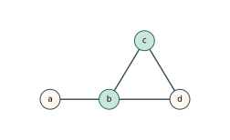
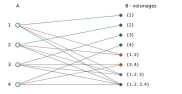
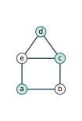

# ENS · MP-MPI · Informatique fondamentale 2024 — corrigé brut

*Corrigé rédigé par IA, non officiel. Signalez toute erreur.*

**Rédaction** · GPT-6.2 Astra Ultra · vitesse non renseignée · 25 novembre 2026

**Couverture minimale d’un graphe.** Le sujet comporte 37 questions. On distingue une couverture de cardinal minimum d’une couverture seulement minimale pour l’inclusion. Le coût de lecture de la matrice d’adjacence en IV.4 est précisé conformément au rapport du jury.

## I. Propriétés des couvertures

### Question I.1 · Triangle avec une feuille

Le dessin contient les arêtes $ab,bc,bd,cd$. Les arêtes $ab$ et $cd$ forment un couplage de taille deux ; quatre sommets interdisent un couplage plus grand, donc $\mu=2$. Une couverture doit rencontrer ces deux arêtes disjointes, et $\{b,c\}$ couvre bien les quatre : $\tau=2$. Enfin $\{a,c\}$ est indépendant et un indépendant choisit au plus un sommet du triangle $bcd$ en plus de $a$. Donc $\alpha=2$.



### Question I.2 · Quatre familles de graphes

Dans $K_n$, laisser deux sommets hors de la couverture laisserait leur arête découverte, et en prendre $n-1$ suffit. Ainsi $\tau(K_n)=n-1$, même pour $n=1$.

Pour $P_n$, prendre les sommets pairs couvre toutes les arêtes et en utilise $\lfloor n/2\rfloor$. Les arêtes disjointes $12,34,\ldots$ exigent chacune un sommet, d'où $\tau(P_n)=\lfloor n/2\rfloor$.

Pour $C_n$, $n\ge3$, chaque sommet couvre deux arêtes au plus, donc il en faut au moins $\lceil n/2\rceil$. L'alternance des sommets pairs suffit pour $n$ pair ; pour $n$ impair ajouter le dernier sommet. Ainsi $\tau(C_n)=\lceil n/2\rceil$. La construction simple de l'énoncé fait de $C_2$ l'unique arête déjà présente dans $P_2$ et donne aussi $1$.

Dans $K_{a,b}$, prendre le côté de taille minimale suffit. On dispose de $\min(a,b)$ arêtes deux à deux disjointes en appariant tous les sommets du petit côté avec des sommets distincts de l'autre. Ainsi $\tau(K_{a,b})=\min(a,b)$.

### Question I.3 · Complémentaire d'une couverture

$S$ couvre toutes les arêtes exactement lorsqu'aucune arête n'a ses deux extrémités dans $V\setminus S$, c'est-à-dire lorsque $V\setminus S$ est indépendant. La complémentation est une bijection entre ces deux familles et échange les tailles $s$ et $|V|-s$. D'où $\tau=|V|-\alpha$.

### Question I.4 · Borne par couplage

Pour couvrir les arêtes d'un couplage, il faut au moins une extrémité par arête. Ces extrémités sont distinctes puisque les arêtes du couplage sont disjointes. La borne vaut pour tout couplage, en particulier pour un maximum : $\tau(G)\ge\mu(G)$.

### Question I.5 · Recherche exhaustive

Parcourir les $2^n$ masques de sommets. Pour chaque masque, examiner le triangle supérieur de la matrice d'adjacence ; le rejeter si une arête a deux extrémités absentes. Garder un masque admissible de plus petite cardinalité. Le masque plein est admissible, y compris pour le graphe vide, et toute solution possible est examinée. Le coût est $O(2^n n^2)$.

## II. Arbres

### Question II.1 · Échange au voisin d'une feuille

Si une couverture minimum contient $u$, elle ne contient pas $v$ : la seule arête de $v$ est déjà couverte et on pourrait sinon supprimer $v$. Si elle ne contient pas $u$, elle doit contenir $v$ pour couvrir $uv$. Remplacer $v$ par $u$ préserve la taille et la couverture : la seule arête qui dépendait de $v$ est $uv$. On obtient la solution voulue, même pour un arbre à deux sommets.

### Question II.2 · Élimination des feuilles

Voici un pseudo-code où les listes d'adjacence initiales restent disponibles pour parcourir les voisins d'un sommet retiré. Le tableau $d$ donne les degrés restants. Le tableau $s$ donne la somme des numéros des voisins restants, ce qui identifie en temps constant le voisin unique d'une feuille.

```text
S ← ensemble vide
pour chaque sommet v :
    d[v] ← nombre de voisins de v
    s[v] ← somme des numéros de ces voisins
file ← tous les sommets de degré 1
tant que la file est non vide :
    v ← retirer le premier de la file
    si d[v] ≠ 1 : passer au suivant
    u ← s[v]
    ajouter u à S
    d[u] ← 0
    pour chaque voisin w de u dans la liste initiale :
        si d[w] > 0 :
            d[w] ← d[w] − 1
            s[w] ← s[w] − u
            si d[w] = 1 : ajouter w à la file
renvoyer S
```

Le graphe résiduel est une forêt. QII.1 appliquée à la composante de $v$ montre que fixer $u$ coûte exactement un sommet, puis il reste à couvrir les autres arêtes. Toute composante non triviale a une feuille, et toute feuille nouvelle est ajoutée à la file. À l'arrêt le résidu est donc sans arêtes. Un sommet auquel on a fixé le degré zéro reste inactif ; les entrées périmées de la file sont ignorées. Un sommet est sélectionné au plus une fois et le total des longueurs de ses listes d'origine est au plus $2(n-1)$. L'initialisation et la file sont également linéaires. Le résultat est minimum en $O(n)$, sans hypothèse de binarité.

### Question II.3 · Programmation dynamique sur l'arbre

Enraciner l'arbre par un parcours en profondeur qui enregistre les parents et un ordre où le parent précède ses enfants. Traiter cet ordre à l'envers.

```text
si l'arbre est vide : renvoyer 0
pour v dans l'ordre inverse :
    inclus[v] ← 1
    exclu[v] ← 0
    pour chaque enfant w de v :
        inclus[v] ← inclus[v] + minimum[w]
        exclu[v] ← exclu[v] + inclus[w]
    minimum[v] ← min(inclus[v], exclu[v])
renvoyer minimum[racine]
```

Une feuille reçoit $(1,0,0)$. Si $v$ est retenu, chaque enfant peut choisir sa meilleure configuration ; sinon tous les enfants doivent couvrir leur arête vers $v$. Le parcours et les sommes coûtent $O(n)$ : chaque arête est examinée un nombre borné de fois, même lorsque la racine a $n-1$ enfants.

## III. Algorithmes d’approximation

### Question III.1 · Correction de l'heuristique

Une arête disparaît uniquement lors de la sélection d'une de ses extrémités. À l'arrêt, toutes les arêtes ont disparu ; elles rencontrent donc toutes l'ensemble $S$ renvoyé. L'algorithme termine, puisqu'il supprime un sommet à chaque tour.

### Question III.2 · Contre-exemple en étoile

Sur $K_{1,n-1}$, choisir toutes les feuilles une à une est autorisé. L'exécution utilise $n-1$ sommets pour une couverture optimale de taille un, le centre. La valeur du pire choix est au moins $n-1$ fois l'optimum.

### Question III.3 · Un graphe G₄

Numérotons $A=\{1,2,3,4\}$. Un exemple est donné par les voisinages $\{1\},\{2\},\{3\},\{4\}$ au premier niveau, $\{1,2\},\{3,4\}$ au deuxième, $\{1,2,3\}$ au troisième et $\{1,2,3,4\}$ au quatrième. On a $\mathrm{OPT}=4$ et $\mathrm{Glouton}=8$. Le glouton peut choisir tous les sommets du côté $B$. Il ne peut choisir les deux extrémités d'une paire formée par un sommet de $A$ et sa feuille privée : cette feuille n'est choisie que lorsque le degré maximal vaut un. La valeur huit est donc atteinte et maximale.



### Question III.4 · Rapport du glouton non borné

L'ensemble $A_n$ est couvrant et les $n$ feuilles de $B_n^1$ donnent un couplage parfait vers lui, donc $\mathrm{OPT}=n$. Après suppression des couches d'indice $>k$, un sommet de $A_n$ a au plus un voisin dans chacune des $k$ couches restantes, donc son degré est au plus $k$. Chaque sommet non supprimé de $B_n^k$ a encore ses $k$ voisins puisque l'exécution n'a choisi aucun sommet de $A_n$. On peut donc choisir toute la couche $k$, y compris en cas d'égalité des degrés. En descendant de $n$ à $1$, cette exécution sélectionne $\sum_{k=1}^n\lfloor n/k\rfloor$ sommets. Le rapport est au moins $\sum_{k=1}^n1/k-1$, qui tend vers l'infini.

### Question III.5 · Correction de l'algorithme par arêtes

À chaque tour, les deux extrémités de l'arête choisie sont ajoutées à $S$. À l'arrêt le complément $V\setminus S$ n'induit aucune arête. Il est indépendant, donc $S$ est une couverture par I.3.

### Question III.6 · Garantie du facteur deux

Leurs extrémités sont supprimées immédiatement : les arêtes choisies forment donc un couplage $M$. L'algorithme rend $2|M|$ sommets et toute couverture en contient au moins $|M|$ par I.4. D'où $|S|\le2\tau(G)$. Si le graphe n'a pas d'arêtes, les deux quantités sont nulles et l'inégalité demeure vraie.

### Question III.7 · Optimalité de la garantie

Prendre $G_n$ égal à une réunion disjointe de $n$ arêtes. L'optimum est $n$, une extrémité par arête. Quelle que soit l'exécution, l'algorithme en renvoie $2n$. Le rapport vaut exactement deux pour tout $n\ge1$ et contredit chaque garantie $c<2$.

## IV. Complexité paramétrée

### Question IV.1 · Énumérer à budget fixé

Si $k<0$, répondre non ; si $k\ge n$, répondre oui. Sinon, énumérer les sous-ensembles de exactement $k$ sommets et chercher si l'un couvre chaque arête. Toute couverture d'au plus $k$ sommets se complète en une de taille $k$. On examine $\binom nk\le n^k$ ensembles, chacun en $O(n^2)$, soit $O(n^{k+2})$.

### Question IV.2 · Disjonction sur une arête

Si une couverture $S$ de taille au plus $k$ contient $u$, alors $S\setminus\{u\}$ couvre $G-u$ en au plus $k-1$ sommets ; sinon $v$ appartient à $S$ et l'argument s'applique à $G-v$. Réciproquement, réajouter l'extrémité supprimée à une couverture d'un des deux sous-graphes couvre les arêtes incidentes à cette extrémité et donne une couverture de $G$ de taille au plus $k$.

### Question IV.3 · Arbre de recherche binaire

```text
Décider(G, k) :
    si k < 0 : renvoyer NON
    si aucune arête : renvoyer OUI
    si k = 0 : renvoyer NON
    choisir une arête uv
    renvoyer Décider(G − u, k − 1) OU Décider(G − v, k − 1)
```

La récurrence sur $k$ utilise IV.2 pour la transition et les trois cas d'arrêt sont immédiats. La profondeur est au plus $k$ pour $k\ge0$ et l'arbre contient au plus $2^{k+1}-1$ appels. Scanner ou copier une matrice coûte $O(n^2)$ par appel. La complexité est $O(2^k n^2)$.

### Question IV.4 · Graphes de degré au plus deux et accès à la matrice

Une composante réduite à un sommet est un chemin trivial. Si elle contient un sommet de degré un, partir de ce sommet et avancer sans revenir en arrière. Aucune bifurcation n'est possible et on ne peut rejoindre un sommet déjà parcouru sans lui donner un troisième voisin ou contredire le degré un du départ. Par connexité le chemin obtenu épuise la composante. Dans une composante non triviale sans sommet de degré un, tous les degrés valent deux ; le parcours se referme en cycle et aucun sommet extérieur à ce cycle ne peut s'y rattacher.

Avec des listes de voisins, un seul parcours relève le type et la taille $m$ de chaque composante. Additionner $\lfloor m/2\rfloor$ pour les chemins et $\lceil m/2\rceil$ pour les cycles, puis comparer à $k$. Le coût est $O(n)$ car le nombre d'arêtes est au plus $n$.

Avec la matrice d'adjacence explicitement imposée dans cette partie, la garantie linéaire est impossible : pour $k=0$, distinguer la matrice vide de celle contenant une seule arête cachée nécessite de consulter les $\binom n2$ paires dans le pire cas. Si l'on exige un degré maximal **égal** à deux, ajouter une composante fixe $P_3$ et prendre $k=1$ donne le même argument. La conversion en listes puis le parcours coûtent $O(n^2)$. Le rapport du jury relève expressément cette incompatibilité.

### Question IV.5 · Branchement sur un voisinage

Une couverture contenant $v$ se traite par $G-v$ et le budget $k-1$. Si elle ne contient pas $v$, tous les sommets de $N(v)$ y appartiennent. En les retirant il reste une couverture de $G-N[v]$ de taille au plus $k-d(v)$. Réciproquement, dans la seconde branche, adjoindre les $d(v)$ voisins couvre toutes les arêtes supprimées, y compris celles issues de $v$. La première branche se relève par ajout de $v$. La disjonction est donc équivalente au problème initial.

### Question IV.6 · Arbre de recherche à branchements inégaux

```text
DéciderVite(G, k) :
    si k < 0 : renvoyer NON
    si le graphe est sans arêtes : renvoyer OUI
    si k = 0 : renvoyer NON
    si le degré maximal vaut au plus deux :
        renvoyer (somme des couvertures de ses composantes ≤ k)
    choisir un sommet v de degré d ≥ 3
    renvoyer DéciderVite(G − v, k − 1) OU DéciderVite(G − N[v], k − d)
```

La correction suit de IV.4 et IV.5. Une matrice résiduelle se forme en $O(n^2)$ en marquant les sommets à exclure puis en copiant, si nécessaire, les lignes et colonnes actives. Une feuille de faible degré se résout elle aussi en $O(n^2)$ avec la matrice. Pour les budgets $0,1,2$, le nombre de feuilles est borné par une constante. Pour les autres, il satisfait une borne récurrente de type $L(k-1)+L(k-3)$. Le résultat admis donne $L(k)=O(1{,}4656^k)$, et l'arbre binaire compte au plus $2L(k)-1$ nœuds. Temps total $O(1{,}4656^k n^2)$.

## V. Noyau quadratique

### Question V.1 · Décider après réduction à un noyau

Calculer $(G',k')$ avec l'algorithme de noyau en temps polynomial $P(n)$. Si $|V(G')|>f(k)$, répondre non par contraposition de la condition (ii). Sinon appliquer IV.1 au graphe réduit. Les conditions (i) et (iii) permettent de rendre cette réponse pour $G$, en temps $O(P(n)+f(k)^{k+2})$ (les tailles nulles ou unitaires sont traitées directement).

### Question V.2 · Supprimer un sommet isolé

Aucune arête n'est incidente à un sommet isolé $v$. Toute couverture de $G-v$ couvre donc $G$, et retirer $v$ d'une couverture de $G$ conserve la propriété sur $G-v$. Ainsi les deux optima sont égaux et le budget reste $k$.

### Question V.3 · Supprimer un sommet forcé

Si $d(v)\ge k+1$, une couverture d'au plus $k$ sommets ne peut contenir tous ses voisins. Elle doit donc contenir $v$. Son retrait laisse une couverture de $G-v$ dans le budget $k-1$. Réciproquement, ajouter $v$ à une solution réduite couvre toutes ses arêtes et respecte le budget $k$.

### Question V.4 · Coût de la réduction élémentaire

Initialiser les degrés par un parcours de la matrice en $O(n^2)$. À chaque tour, balayer les sommets actifs pour trouver un degré nul ou supérieur au budget courant. Lors d'une suppression, balayer la ligne du sommet pour décrémenter les degrés de ses voisins actifs et marquer le sommet inactif. Chacun de ces travaux coûte $O(n)$ par tour, et il y a au plus $n$ suppressions. Le coût total est $O(n^2)$. Recalculer tous les degrés à chaque passage donnerait aussi une réduction polynomiale, en $O(n^3)$.

### Question V.5 · Taille du graphe réduit

Si le budget devient négatif, l'instance est immédiatement rejetée. À l'arrêt normal, l'impossibilité des deux règles impose $1\le d(v)\le k'$ pour tout sommet actif. Supposons qu'une couverture $S$ de taille $\le k'$ existe. Toutes les arêtes sont incidentes à $S$ : leur nombre est au plus $\sum_{v\in S}d(v)\le k'^2$. Tout sommet extérieur à $S$ a un voisin, qui doit appartenir à $S$ puisque le complément est indépendant. Il y a donc au plus $k'^2$ sommets extérieurs, d'où $|V(G')|\le k'+k'^2$.

### Question V.6 · Noyau quadratique

Les réductions V.2 et V.3 préservent l'équivalence et ne font jamais croître le paramètre : $k'\le k$. Elles sont polynomiales par V.4. Sur une instance positive V.5 assure $|V(G')|\le k'^2+k'\le k^2+k$. Cela établit le noyau demandé. Une détection d'impossibilité peut être représentée par une instance négative fixe, par exemple une arête avec budget zéro pour un budget initial non négatif.

## VI. Relâchement fractionnaire et noyau linéaire

### Question VI.1 · Programme entier du graphe maison

Le dessin présente le cycle $a,b,c,d,e,a$ et l'arête $ce$. On minimise $x_a+x_b+x_c+x_d+x_e$ sous les six inégalités

$$
x_a+x_b\ge1,\quad x_b+x_c\ge1,\quad x_c+x_d\ge1,\quad
x_d+x_e\ge1,\quad x_e+x_a\ge1,\quad x_e+x_c\ge1,
$$

avec $x_v\in\{0,1\}$ pour les cinq sommets.



### Question VI.2 · Vérification des quatre vecteurs

Dans l'ordre donné par le sujet :

1. $(1/2,1/2,1/2,1/2,1/2)$ est admissible, de taille $5/2$.
2. $(1/3,1/3,2/3,2/3,1/3)$ échoue notamment sur $ab$ et $ae$, où la somme vaut $2/3$.
3. $(1,1,0,1,0)$ échoue sur $ce$, dont les deux poids sont nuls.
4. $(1,0,1,1,0)$ couvre toutes les arêtes et a taille $3$.

### Question VI.3 · Écart entre optimum entier et fractionnaire

Le vecteur constant $1/2$ est admissible pour tout graphe, donc $\tau_f(G)\le n/2$. Pour $K_n$, I.2 donne $\tau=n-1$ et par conséquent $\tau-\tau_f\ge n/2-1$. Cette quantité est arbitrairement grande.

### Question VI.4 · Sommets de poids faible

Deux poids de $V_0$ ont une somme $<1$ ; ils ne peuvent donc être adjacents. Un poids de $V_0$ et un poids de $V_{1/2}$ ont également une somme $<1$. Ainsi tout voisin d'un sommet de $V_0$ appartient à $V_1$.

### Question VI.5 · Arrondi au demi et approximation

Posons $U=V_{1/2}\cup V_1$. Son complément est indépendant par VI.4, donc $U$ est couvrant. En outre,

$$
|U|\le2\sum_{v\in U}x_v\le2\tau_f(G)\le2\tau(G).
$$

Obtenir en temps polynomial une solution fractionnaire minimum, puis retourner tous les sommets de poids au moins $1/2$, donne donc une 2-approximation polynomiale.

### Question VI.6 · Préserver la couverture sur les poids moyens

Soit $S^*$ une couverture minimum et $S=(S^*\cap V_{1/2})\cup V_1$. Toute arête incidente à $V_1$ est couverte. Toutes les autres ont leurs deux extrémités dans $V_{1/2}$ par VI.4. L'une appartenait à $S^*$ et se trouve donc dans $S$. Cela prouve que $S$ est couvrant.

### Question VI.7 · Perturbation de l'optimum fractionnaire

Lorsque $\varepsilon=0$, $y=x$. Sinon les valeurs abaissées restent au moins $1/2$ et les valeurs augmentées au plus $1/2$ par la définition du minimum des distances au seuil. Les autres restent dans $[0,1]$. Pour une arête dont une extrémité $u$ est abaissée, $u\notin S^*$ et son voisin $v$ appartient donc à $S^*$. Si $v\in V_0$, son poids est augmenté exactement de $\varepsilon$, conservant la somme. Si $v\in V_{1/2}\cup V_1$, son poids reste au moins $1/2$, comme celui de $u$. Toute autre arête garde sa somme ou la voit augmenter. Ainsi $y$ est admissible.

### Question VI.8 · Optimalité après l'échange

Si $V_0\cup V_1$ est vide, $S=S^*$ directement. Sinon $\varepsilon>0$ car le minimum porte sur un ensemble fini de distances strictement positives. L'optimalité de $x$ et l'admissibilité de $y$ donnent

$$
0\le\sum_v(y_v-x_v)=\varepsilon\bigl(|V_0\cap S^*|-|V_1\setminus S^*|\bigr).
$$

On ajoute à $S^*$ exactement $|V_1\setminus S^*|$ sommets et on retire $|V_0\cap S^*|$ sommets pour former $S$. D'où $|S|\le|S^*|$. Comme $S$ est couvrant par VI.6 et $S^*$ minimum, leurs tailles sont égales.

### Question VI.9 · Rejets justifiés

En ligne 3, $\tau(G)\ge\tau_f(G)=\sum_v x_v>k$. En ligne 4, $|V_{1/2}|>2k$ implique $\tau_f(G)\ge |V_{1/2}|/2>k$, et à nouveau $\tau(G)>k$. Les deux rejets sont donc corrects.

### Question VI.10 · Noyau linéaire en 2k

Par VI.8, on peut choisir une couverture minimum qui contient $V_1$ et exclut $V_0$. Sa restriction à $V_{1/2}$ couvre $G'=G-V_0-V_1$. Réciproquement, toute couverture de $G'$ complétée par $V_1$ couvre $G$ car les arêtes restantes rencontrent $V_1$ par VI.4. Ainsi $\tau(G)=|V_1|+\tau(G')$, d'où l'équivalence pour $k'=k-|V_1|$. Après les tests de VI.9, $|V(G')|=|V_{1/2}|\le2k$ et $k'\le k$. Le calcul fractionnaire et la réduction sont polynomiaux, ce qui donne le noyau de taille $2k$. La force brute de la dernière ligne sert à décider l'instance réduite ; elle n'est pas nécessaire pour produire le noyau.
