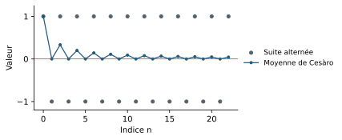
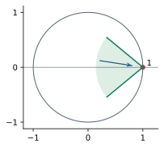
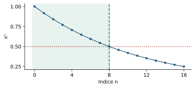
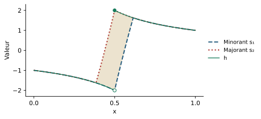
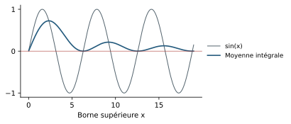
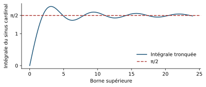

# ENS MP-MPI — Mathématiques C 2024 · Corrigé guidé

*Corrigé rédigé par IA, non officiel. Signalez toute erreur.*

**Rédaction** · modèle exact non renseigné (famille GPT-6) · effort non renseigné · vitesse non renseignée

**Révision** · modèle exact non renseigné (famille GPT-6) · effort non renseigné · vitesse non renseignée

## Présentation du sujet

L’épreuve commune aux ENS Ulm, Lyon, Paris-Saclay et Rennes du 19 avril 2024 dure quatre heures. Ses trois parties, regroupant 39 questions et sous-questions, étudient les lemmes de Cesàro et d’Abel, leurs réciproques taubériennes et leurs variantes intégrales. [Sujet officiel](https://www.ens.psl.eu/sites/default/files/24_mp_sujet_mathc.pdf)

> [!JURY]
> Le jury demande de justifier la convergence de la série alternée avant le passage à la limite en II.2 et de préciser les hypothèses de l’approximation polynomiale en II.5g. Les dessins commentés des enveloppes de II.5f ont été valorisés. [Rapport officiel](https://www.ens.psl.eu/sites/default/files/24_mp_rap_emathc.pdf)

## I — Lemme de Cesàro

Pour une suite $u_n$ on pose $\sigma_n=(u_0+\cdots+u_n)/(n+1)$ et $e_n=u_{n+1}-u_n$. Les énoncés de Hardy étudient la réciproque lorsque les écarts sont contrôlés.

### Question I.1

> [!INDICATION]
> Fixez un rang au-delà duquel tous les termes sont proches de la limite.

> [!INDICATION]
> Séparez les termes avant et après ce rang, puis traitez les limites infinies avec un seuil arbitraire.

#### Solution

Soit $\sigma_n=(n+1)^{-1}\sum_{k=0}^n u_k$. Pour $u_k\to\ell\in\mathbb C$, choisissons $N$ avec $|u_k-\ell|\leq\varepsilon$ dès $k\geq N$. Pour $n\geq N$, $|\sigma_n-\ell|\leq (n+1)^{-1}\sum_{k<N}|u_k-\ell|+\varepsilon$. La première quantité tend vers zéro et $\varepsilon$ est arbitraire. Si $u_k\to+\infty$ dans $\mathbb R$, pour tout $M$ les termes à partir d’un certain rang sont au moins $M$. Leur proportion dans la moyenne tend vers un et la contribution des termes précédents tend vers zéro, donc $\liminf\sigma_n\geq M$ pour tout $M$. Le cas $-\infty$ suit en changeant le signe de la suite.

### Question I.2

> [!INDICATION]
> Reconnaissez la moyenne des premiers termes d’une suite convergente.

> [!INDICATION]
> Encadrez la somme harmonique entre deux intégrales de la fonction inverse.

#### Solution

La suite $v_n=n^{-1}\sum_{k=1}^n 1/k$ est une moyenne de la suite $1/k\to0$. Cesàro donne donc $v_n\to0$. Par décroissance de $1/t$, $\log(n+1)\leq\sum_{k=1}^n 1/k\leq1+\log n$. En divisant par $n$, on trouve l’équivalent précis $v_n\sim(\log n)/n$.

### Question I.3

> [!INDICATION]
> Les différences successives ont des sommes qui télescopent.

> [!INDICATION]
> Pour la seconde méthode, ramenez-vous à des différences positives et comparez-les aux termes constants d’une série divergente.

#### Solution

Notons $e_k=u_{k+1}-u_k$. La moyenne $n^{-1}\sum_{k=0}^{n-1}e_k=(u_n-u_0)/n$ tend vers $\alpha$ par Cesàro. Comme $\alpha\ne0$, $u_n\sim\alpha n$. Autre preuve : si $\alpha>0$, à partir d’un rang fixe les $e_k$ sont positifs et équivalents à la constante $\alpha$. La série des constantes diverge et la comparaison des sommes partielles donne $\sum_{k=N}^{n-1}e_k\sim\alpha n$. Ajouter $u_N$ conserve cet équivalent. Pour $\alpha<0$, appliquer cet argument à $-u_k$.

### Question I.4

> [!INDICATION]
> Prenez les logarithmes pour faire apparaître une somme de différences.

> [!INDICATION]
> Traitez les limites infinies des logarithmes puis calculez les rapports des deux suites factorielles demandées.

#### Solution

Par télescopage,
$$\frac1n\log u_n=\frac{\log u_0}{n}+\frac1n\sum_{k=0}^{n-1}\log(u_{k+1}/u_k).$$
Si $0<\ell<\infty$, la moyenne tend vers $\log\ell$, et après exponentiation $u_n^{1/n}\to\ell$. Pour $\ell=0$ ou $+\infty$, les logarithmes tendent respectivement vers $-\infty$ ou $+\infty$ et I.1 s’applique encore. Avec $u_n=n!$, le rapport vaut $n+1$, donc $(n!)^{1/n}\to+\infty$. Avec $u_n=n^n/n!$ pour $n\geq1$, le rapport vaut $(1+1/n)^n\to e$, donc $(n^n/n!)^{1/n}\to e$.

### Question I.5

> [!INDICATION]
> Ajoutez puis retranchez un produit ayant un seul facteur variable.

> [!INDICATION]
> Une des suites est bornée et les moyennes des modules des erreurs tendent vers zéro.

#### Solution

La suite $(b_n)$ est bornée, disons $|b_n|\leq M$. Décomposons $a_kb_{n-k}-ab=(a_k-a)b_{n-k}+a(b_{n-k}-b)$. Après sommation et division par $n$, le module de l’écart à $(n+1)ab/n$ est au plus $M n^{-1}\sum_{k=0}^n|a_k-a|+|a|n^{-1}\sum_{k=0}^n|b_k-b|$. Ces deux moyennes tendent vers zéro par I.1, puisque $(n+1)/n\to1$. Le résultat suit.

Le produit de Cauchy a pour terme $c_n=\sum_{k=0}^n a_kb_{n-k}$ et $C_n=\sum_{k=0}^n c_k$.

### Question I.6

> [!INDICATION]
> Introduisez les sommes partielles des deux séries initiales.

> [!INDICATION]
> Comparez le nombre d’occurrences d’un même produit dans les deux sommes finies.

#### Solution

Écrivons $A_j=\sum_{i=0}^j a_i$ et $B_j=\sum_{i=0}^j b_i$. Dans la somme finie $\sum_{j=0}^n A_jB_{n-j}$, le terme $a_i b_h$ apparaît pour $i\leq j\leq n-h$, soit $n-i-h+1$ fois si $i+h\leq n$ et zéro fois sinon. Son coefficient dans $\sum_{k=0}^n C_k$ est le même car ce produit est dans $c_{i+h}$ et donc dans chaque $C_k$ pour $k\geq i+h$. Les deux sommes sont ainsi égales. Appliquons I.5 aux sommes partielles $A_j\to A$ et $B_j\to B$. Après division par $n$, la limite vaut $AB$.

### Question I.7

> [!INDICATION]
> Cherchez une suite qui alterne entre deux valeurs.

> [!INDICATION]
> Calculez les moyennes pour les deux parités.

#### Solution

Pour $u_n=(-1)^n$, les deux sous-suites de parités opposées donnent des limites distinctes. Cependant la somme des $n+1$ premiers termes est un si $n$ est pair et zéro sinon. La moyenne tend donc vers zéro.

### Question I.8

> [!INDICATION]
> Toute suite monotone réelle a déjà une limite dans la droite réelle achevée.

> [!INDICATION]
> Comparez cette limite à celle des moyennes par le résultat direct.

#### Solution

Une suite réelle monotone possède toujours une limite dans $\mathbb R\cup\{-\infty,+\infty\}$. Par I.1 et ses cas infinis, sa suite de moyennes possède cette même limite. Par unicité, cette limite est la valeur $\ell$ prescrite pour les moyennes, qu’elle soit finie ou infinie.

### Question I.9

> [!INDICATION]
> Sommez les écarts avec un poids égal à leur indice.

> [!INDICATION]
> Utilisez une seconde fois Cesàro sur le terme pondéré tendant vers zéro.

#### Solution

En décalant les indices, $\sum_{k=0}^nk e_k=nu_{n+1}-\sum_{k=1}^n u_k$. Comme $ke_k\to0$, I.1 donne $n^{-1}\sum_{k=0}^nke_k\to0$. D’autre part $n^{-1}\sum_{k=1}^n u_k=((n+1)\sigma_n-u_0)/n\to\ell$. L’identité donne alors $u_{n+1}\to\ell$, donc $u_n\to\ell$.

Pour le théorème de Hardy fort, on suppose $\sigma_n\to\ell$ et $e_n=O(1/n)$.

### Question I.10a

> [!INDICATION]
> Écrivez chaque différence à l’aide de plusieurs écarts successifs.

> [!INDICATION]
> Comptez le nombre de fois où un même écart apparaît dans la somme.

#### Solution

Pour $n<k\leq m$, on a $u_k-u_n=\sum_{j=n}^{k-1}e_j$. En sommant sur $k$, chaque $e_j$ apparaît $m-j$ fois. On trouve
$$\sum_{k=n+1}^m u_k-(m-n)u_n=\sum_{j=n}^{m-1}(m-j)e_j.$$

### Question I.10b

> [!INDICATION]
> Majorez la somme pondérée de la question précédente et divisez par la longueur de la fenêtre.

> [!INDICATION]
> Comparez la somme harmonique tronquée à l’intégrale de la fonction inverse.

#### Solution

Prenons $C>0$ avec $|e_j|\leq C/j$ pour $j\geq1$ en agrandissant la constante pour les premiers indices. En divisant I.10a par $m-n$, on obtient
$$\left|\frac{(m+1)\sigma_m-(n+1)\sigma_n}{m-n}-u_n\right|\leq C\sum_{j=n}^{m-1}\frac1j\leq C\log\frac{m-1}{n-1},$$
où l’on intègre $1/t$ sur $[n-1,m-1]$. Retranchons $\ell$ au quotient de moyennes. Les coefficients de $\ell$ s’annulent car $(m+1)-(n+1)=m-n$. Par l’inégalité triangulaire et $n+1\leq m+1$, on obtient
$$|u_n-\ell|\leq C\log\frac{m-1}{n-1}+\frac{m+1}{m-n}(|\sigma_m-\ell|+|\sigma_n-\ell|).$$

### Question I.10c

> [!INDICATION]
> Choisissez d’abord le rapport entre les indices strictement supérieur à un et fixé.

> [!INDICATION]
> Après passage à la limite sur les indices, rapprochez ce rapport de un.

#### Solution

Fixons $\alpha>1$ et posons $m=1+\lfloor\alpha n\rfloor$. Le facteur $(m+1)/(m-n)$ tend vers $\alpha/(\alpha-1)$ et multiplie une quantité tendant vers zéro. Le logarithme tend vers $\log\alpha$. On en déduit $\limsup_{n\to\infty}|u_n-\ell|\leq C\log\alpha$ pour chaque $\alpha>1$. Faire décroître $\alpha$ vers un donne la convergence de $u_n$ vers $\ell$.

## II — Théorème d’Abel et réciproques taubériennes

Si $\sum a_n$ converge, $S$ désigne sa somme, $S_N$ sa somme partielle d’indice $N$ et $R_N=S-S_N$ son reste. On note $f(z)=\sum a_nz^n$ dans le disque unité.

### Question II.1a

> [!INDICATION]
> Dans ce cas, le point un est à l’intérieur du disque de convergence.

> [!INDICATION]
> On peut même utiliser la convergence normale sur le disque fermé unité.

#### Solution

Si $R>1$, la série entière converge normalement sur le disque fermé unité, car $\sum_n |a_n|$ converge. Sa somme est continue en $1$ et y vaut $\sum_n a_n$ par définition, ce qui donne la limite selon toute approche dans le secteur.

### Question II.1b

> [!INDICATION]
> Soustrayez la somme partielle et écrivez chaque coefficient à partir de deux restes successifs.

> [!INDICATION]
> Décalez un des indices en conservant le terme de bord final.

#### Solution

Pour $n\geq1$, $a_n=R_{n-1}-R_n$ où $R_n=S-S_n$. Le terme $n=0$ disparaît dans $\sum_{n=0}^N a_n(z^n-1)$. En développant les différences et en regroupant les termes de même reste on obtient
$$\sum_{n=0}^Na_nz^n-S_N=(z-1)\sum_{n=0}^{N-1}R_n z^n-R_N(z^N-1).$$
En effet les coefficients des $R_n$ pour $n<N$ sont $z^{n+1}-z^n$, et l’extrémité restante est $-R_N(z^N-1)$.

### Question II.1c

> [!INDICATION]
> Pour un point fixé du disque ouvert, la série des restes pondérés converge absolument.

> [!INDICATION]
> Examinez le terme de bord quand le rang tend vers l’infini.

#### Solution

Pour $|z|<1$, les $R_n$ sont bornés et $\sum R_n z^n$ converge absolument. On a $R_N\to0$ et $|z^N-1|\leq2$. Le passage à la limite dans II.1b donne donc $f(z)-S=(z-1)\sum_{n=0}^\infty R_n z^n$.

### Question II.1d

> [!INDICATION]
> La queue de la suite des restes est uniformément petite.

> [!INDICATION]
> Séparez une somme finie et évaluez la série géométrique majorant la queue.

#### Solution

Donnons-nous $\varepsilon>0$ et choisissons $N_0$ avec $|R_n|\leq\varepsilon$ pour $n>N_0$. Coupons la série de II.1c à ce rang. Sa partie finie est majorée en module par la somme des $|R_n|$ et sa queue par $\varepsilon\sum_{n>N_0}|z|^n\leq\varepsilon/(1-|z|)$. Ainsi
$$|f(z)-S|\leq |z-1|\sum_{n=0}^{N_0}|R_n|+\varepsilon\frac{|z-1|}{1-|z|}.$$

### Question II.1e

> [!INDICATION]
> Multipliez le quotient par un facteur contenant la somme des deux modules.

> [!INDICATION]
> Exprimez la différence des carrés avec l’angle de l’approche puis choisissez une borne sur la distance au sommet.

#### Solution

Écrivons $z=1-\rho e^{i\theta}$ dans le secteur $|\theta|\leq\theta_0<\pi/2$. Comme $1-|z|^2=2\rho\cos\theta-\rho^2$, on a
$$\frac{|z-1|}{1-|z|}=\frac{1+|z|}{2\cos\theta-\rho}\leq\frac2{\cos\theta_0}$$
pour $0<\rho\leq\cos\theta_0$ et $|z|<1$. Dans II.1d, le terme fini tend vers zéro lorsque $z\to1$ et la limite supérieure de l’écart est au plus $2\varepsilon/\cos\theta_0$. La liberté de $\varepsilon$ donne la limite d’Abel.

### Question II.2

> [!INDICATION]
> Quelle primitive s’obtient en intégrant une série géométrique de raison négative quadratique ?

> [!INDICATION]
> Vérifiez le rayon et la convergence de la série alternée avant de passer au bord.

#### Solution

Pour $|x|<1$, intégrer $1/(1+t^2)=\sum_{n\geq0}(-1)^nt^{2n}$ sur le segment de zéro à $x$ donne $\arctan x=\sum_{n\geq0}(-1)^n x^{2n+1}/(2n+1)$, par convergence uniforme sur ce segment. Cette série entière a rayon un : pour $|x|>1$, ses termes d’ordre impair ne tendent pas vers zéro. Sa série en un converge par le critère des séries alternées. Le théorème d’Abel pour $x\uparrow1$ donne donc $\sum_{n\geq0}(-1)^n/(2n+1)=\arctan 1=\pi/4$.

### Question II.3

> [!INDICATION]
> Cherchez une série géométrique dont le pôle est à l’opposé du point un.

> [!INDICATION]
> Vérifiez le comportement de la série des coefficients sans la variable.

#### Solution

Choisissons $a_n=(-1)^n$. La série géométrique a rayon un et sa somme $1/(1+z)$ tend vers $1/2$ lorsque $z\to1$ à l’intérieur du disque, quelle que soit l’approche. La série des $a_n$ diverge, car son terme général ne tend pas vers zéro.

### Question II.4a

> [!INDICATION]
> Distinguez les termes d’indice au plus $n$ de ceux de la queue.

> [!INDICATION]
> Pour les premiers indices, factorisez la différence de puissances. Pour les autres, utilisez la borne sur l’indice pondéré.

#### Solution

Pour $0<x<1$, $1-x^k=(1-x)\sum_{j=0}^{k-1}x^j\leq k(1-x)$. En écrivant $S_n-f(x)=\sum_{k=0}^n a_k(1-x^k)-\sum_{k>n}a_kx^k$ on obtient
$$|S_n-f(x)|\leq(1-x)\sum_{k=1}^n k|a_k|+\frac{\sup_{k>n}k|a_k|}{n(1-x)}.$$
En effet la queue est au plus $(\sup_{k>n}k|a_k|)\sum_{k>n}x^k/n$, et la somme géométrique est au plus $1/(1-x)$.

### Question II.4b

> [!INDICATION]
> Choisissez la distance à un égale à l’inverse du nombre de termes.

> [!INDICATION]
> Dans la borne, reconnaissez une moyenne de Cesàro et un supremum de queue.

#### Solution

Pour $n\geq2$, prenons $x_n=1-1/n$. Le premier terme de II.4a est la moyenne des $k|a_k|\to0$ et tend donc vers zéro. Le second vaut au plus $\sup_{k>n}k|a_k|\to0$. Comme $f(x_n)\to S$, on a $S_n\to S$, la conclusion attendue.

### Question II.5a

> [!INDICATION]
> Une constante dans une série entière modifie quel coefficient ?

> [!INDICATION]
> Vérifiez simultanément l’effet sur la limite d’Abel et sur les sommes partielles.

#### Solution

Remplaçons $a_0$ par $a_0-S$. La somme de la série entière devient $f(x)-S$, dont la limite est zéro, et les sommes partielles diminuent également de $S$. La condition asymptotique sur $a_n$ et le rayon de convergence sont inchangés. Une fois le résultat prouvé avec limite nulle, ce décalage rétablit la conclusion générale.

$\Theta$ désigne l’ensemble des fonctions réelles $\theta$ sur le segment unité pour lesquelles $\sum_n a_n\theta(x^n)$ converge pour chaque $0\leq x<1$ et tend vers zéro quand $x\uparrow1$. On suppose $a_n=O(1/n)$ et $f(x)\to0$.

### Question II.5b

> [!INDICATION]
> Revenez aux deux conditions définissant l’ensemble des fonctions-tests.

> [!INDICATION]
> La série pondérée et la limite sont linéaires.

#### Solution

La fonction nulle appartient à $\Theta$. Pour $\theta,\eta\in\Theta$ et $a,b\in\mathbb R$, les séries associées à $a\theta+b\eta$ convergent pour chaque $x\in[0,1[$ par linéarité, et leur somme tend vers $a\cdot0+b\cdot0=0$. On a donc bien un espace vectoriel réel.

### Question II.5c

> [!INDICATION]
> Commencez par un seul monôme de degré positif.

> [!INDICATION]
> La série correspondante s’évalue en une puissance de la variable.

#### Solution

Pour $j\geq1$, la fonction $\theta(t)=t^j$ donne $\sum_n a_n\theta(x^n)=f(x^j)$, qui existe pour $0\leq x<1$ et tend vers zéro lorsque $x\uparrow1$. Ainsi chaque monôme de degré strictement positif est dans $\Theta$. Par II.5b, tout polynôme de terme constant nul est dans $\Theta$.

### Question II.5d

> [!INDICATION]
> Par linéarité, il suffit de tester l’énoncé sur la base monomiale.

> [!INDICATION]
> Sommez explicitement la série géométrique obtenue.

#### Solution

Pour $P(t)=t^j$ avec $j\geq0$, $(1-x)\sum_{n\geq0}x^{n(j+1)}=(1-x)/(1-x^{j+1})$ tend vers $1/(j+1)=\int_0^1t^j\,\mathrm dt$. Les deux côtés étant linéaires en $P$, cette limite vaut pour tout polynôme.

$g$ est l’indicatrice de l’intervalle fermé de $1/2$ à $1$. L’objectif est de montrer son appartenance à $\Theta$.

### Question II.5e

> [!INDICATION]
> Quand la fonction indicatrice évaluée en $x^n$ est-elle égale à un ?

> [!INDICATION]
> Choisissez $x$ qui place précisément le seuil au rang voulu.

#### Solution

Pour $0<x<1$, la condition $g(x^n)=1$ se traduit par $n\leq\log(1/2)/\log x$ avec égalité autorisée. La série correspondante est donc une somme finie. En prenant $x=2^{-1/N}$ pour $N\geq1$, on obtient exactement $S_N$. Lorsque $N\to\infty$, ces $x$ tendent vers un. Par conséquent $g\in\Theta$ implique $S_N\to0$ et donne le théorème réduit en II.5a.

### Question II.5f

> [!INDICATION]
> Écrivez les deux branches rationnelles de la fonction de part et d’autre du saut.

> [!INDICATION]
> Lissez le saut d’un côté pour un minorant et de l’autre pour un majorant. Contrôlez la largeur et la hauteur de l’écart.

#### Solution

Pour $0\leq x<1/2$, $h(x)=-1/(1-x)$, et pour $1/2\leq x\leq1$, $h(x)=1/x$, avec les valeurs aux extrémités données. Définissons sur tout le segment les prolongements continus $L(x)=-1/(1-\min(x,1/2))$ et $U(x)=1/\max(x,1/2)$. Ils encadrent $h$, et $0\leq U-L\leq4$.

Prenons $0<\delta\leq\min(1/4,\varepsilon/8)$. Définissons $s_1=(1-w_1)L+w_1U$ où $w_1$ vaut zéro avant $1/2$, monte linéairement à un sur $[1/2,1/2+\delta]$ et vaut un après. Définissons $s_2$ de même en faisant monter son poids $w_2$ de zéro à un sur $[1/2-\delta,1/2]$. À gauche du saut $s_1=h$, à droite $s_2=h$, et les mélanges restent entre $L$ et $U$. Ainsi $s_1\leq h\leq s_2$. L’écart est au plus quatre, nul hors d’un intervalle de longueur $2\delta$, d’où $\int_0^1(s_2-s_1)\leq8\delta\leq\varepsilon$.

### Question II.5g

> [!INDICATION]
> Quel théorème concerne l’approximation uniforme d’une fonction continue sur un segment ?

> [!INDICATION]
> Vérifiez le corps des valeurs et appliquez-le à chacune des deux enveloppes.

#### Solution

Le théorème d’approximation de Weierstrass sur le segment compact $[0,1]$ donne, pour chacune des fonctions continues réelles $s_1,s_2$, un polynôme réel qui l’approche uniformément à $\varepsilon$ près. Ce sont les $T_1,T_2$ demandés.

Les polynômes du sujet sont $P_1=x+x(1-x)(T_1-\varepsilon)$ et $P_2=x+x(1-x)(T_2+\varepsilon)$, avec $Q=(P_2-P_1)/(x(1-x))$ après simplification.

### Question II.5h

> [!INDICATION]
> L’erreur de l’approximation uniforme peut être compensée par un décalage vertical.

> [!INDICATION]
> Après simplification, le quotient est un polynôme. Intégrez son encadrement.

#### Solution

Sur $[0,1]$, $T_1-\varepsilon\leq s_1\leq h\leq s_2\leq T_2+\varepsilon$. En multipliant par $x(1-x)\geq0$ et en ajoutant $x$, il vient $P_1\leq g\leq P_2$. Les deux polynômes valent zéro en zéro et un en un par leur définition. Enfin $Q=T_2-T_1+2\varepsilon$ se prolonge polynomialement aux extrémités. On a $0\leq Q\leq s_2-s_1+4\varepsilon$. Son intégrale sur le segment est donc au plus $5\varepsilon$.

### Question II.5i

> [!INDICATION]
> Commencez par isoler l’indice zéro et comparez les poids ponctuellement.

> [!INDICATION]
> Reliez le facteur $1-x^n$ à $n(1-x)$ pour compenser la borne sur le coefficient.

#### Solution

Choisissons $M$ avec $|a_n|\leq M/n$ pour $n\geq1$, en incluant les premiers indices. Le terme d’indice zéro disparaît de la différence car $g(1)=P_1(1)=1$. Pour $t=x^n$ et $n\geq1$, on a $0\leq g(t)-P_1(t)\leq t(1-t)Q(t)$. Or $(1-x^n)/n\leq1-x$. Après sommation,
$$\left|\sum_{n\geq0}a_n g(x^n)-\sum_{n\geq0}a_nP_1(x^n)\right|\leq M(1-x)\sum_{n\geq1}x^nQ(x^n).$$
Les sommes existent : celle de $g$ est finie et celle de $P_1$ converge selon II.5c. Le terme de droite est une série géométriquement majorée à $x$ fixé.

### Question II.5j

> [!INDICATION]
> Appliquez la limite pondérée de II.5d au majorant polynomial.

> [!INDICATION]
> Vérifiez quel facteur est indépendant de la précision choisie avant de faire tendre celle-ci vers zéro.

#### Solution

$P_1\in\Theta$ par II.5c. En passant à la limite supérieure dans II.5i et en appliquant II.5d à $Q$, on obtient $\limsup_{x\uparrow1}|\sum_n a_ng(x^n)|\leq M\int_0^1 Q\leq5M\varepsilon$. Ôter le terme d’indice zéro dans II.5d n’affecte pas la limite puisque son facteur est $1-x$. La constante $M$ dépend uniquement de la suite. En faisant tendre $\varepsilon$ vers zéro, $g\in\Theta$ (en $x=0$ la série de $g$ se réduit aussi à son premier terme). La question II.5e conclut.

## III — Versions continues

La dernière partie étudie les moyennes intégrales de fonctions continues et la transformée de Laplace $L(f)(t)=\int_0^\infty e^{-tx}f(x)\,\mathrm dx$ pour $t>0$.

### Question III.1

> [!INDICATION]
> Découpez l’intégrale avant et après un seuil de convergence.

> [!INDICATION]
> Le morceau fixe devient négligeable après division par la borne variable.

#### Solution

Choisissons $A$ tel que $|f(t)-\ell|\leq\varepsilon$ pour $t\geq A$. Pour $x\geq A$,
$$\left|\frac1x\int_0^x f(t)\,\mathrm dt-\ell\right|\leq\frac1x\int_0^A|f(t)-\ell|\,\mathrm dt+\varepsilon.$$
L’intégrale finie existe par continuité sur le segment. Le premier terme tend vers zéro, puis on fait tendre $\varepsilon$ vers zéro.

### Question III.2

> [!INDICATION]
> Utilisez une fonction continue oscillante dont la primitive reste bornée.

> [!INDICATION]
> Vérifiez que la fonction elle-même n’admet pas de limite.

#### Solution

La fonction $f(t)=\sin t$ est continue et n’a pas de limite à l’infini (elle atteint un et moins un arbitrairement loin). Pourtant $x^{-1}\int_0^x\sin t\,\mathrm dt=(1-\cos x)/x\to0$.

### Question III.3

> [!INDICATION]
> Écrivez la variable comme somme d’un entier et d’un décalage appartenant à un segment fixe.

> [!INDICATION]
> Télescopez les différences à partir de ce décalage en contrôlant uniformément la partie initiale.

#### Solution

Écrivons $x=n+s$ avec $n=\lfloor x\rfloor$ et $0\leq s<1$. Posons $h(t)=f(t+1)-f(t)-\ell\to0$. Le télescopage donne
$$f(x)-\ell x=f(s)-\ell s+\sum_{k=0}^{n-1} h(s+k).$$
Pour $\varepsilon>0$, choisissons un entier $N$ tel que $|h(t)|\leq\varepsilon$ au-delà de $N$. Le terme initial et les $N$ premiers termes sont uniformément bornés en $s$ par continuité de $f,h$ sur des segments fixes. Pour $n\geq N$, la suite restante a un module total au plus $n\varepsilon$. En divisant par $x$ et en utilisant $n/x\to1$, on obtient $f(x)/x\to\ell$.

### Question III.4

> [!INDICATION]
> Fixez un segment compact de paramètres strictement positifs.

> [!INDICATION]
> Trouvez une fonction intégrable dominant simultanément les dérivées des intégrandes sur ce segment.

#### Solution

Pour $t>0$, l’intégrande est en module au plus $\|f\|_\infty e^{-tx}$, intégrable sur la demi-droite. Sur tout segment de paramètres $[a,b]\subset]0,\infty[$, la dérivée par rapport à $t$ est dominée par $\|f\|_\infty x e^{-ax}$, encore intégrable. Le théorème de dérivation sous le signe intégral et la continuité par convergence dominée donnent $L(f)\in C^1$ et $L(f)'(t)=-\int_0^\infty x e^{-tx}f(x)\,\mathrm dx$. Le même argument avec $x^j$ donne même la régularité à tout ordre.

### Question III.5a

> [!INDICATION]
> Écrivez le reste comme la différence d’une constante et d’une primitive.

> [!INDICATION]
> Combinez continuité locale et comportement de la queue à l’infini.

#### Solution

Notons $S=\int_0^\infty f(t)\,\mathrm dt$. La queue vaut $F(x)=S-\int_0^x f(t)\,\mathrm dt$, ce qui assure son existence et sa continuité sur la demi-droite, ainsi que $F'=-f$ sur $]0,\infty[$ par le théorème fondamental. De plus $F(x)\to0$ à l’infini. Elle est donc bornée, grâce aussi à la continuité sur tout segment initial.

### Question III.5b

> [!INDICATION]
> Intégrez par parties sur un segment avant de passer à la demi-droite.

> [!INDICATION]
> Dans le terme de reste, séparez un segment fixe et une queue où le reste de l’intégrale est petit.

#### Solution

Sur $[0,B]$, intégrons par parties en utilisant $f=-F'$. Le terme $e^{-tB}F(B)$ tend vers zéro pour $B\to\infty$, car $F$ est bornée. Il vient
$$L(f)(t)=F(0)-t\int_0^\infty e^{-tx}F(x)\,\mathrm dx.$$
Pour $A$ tel que $|F(x)|\leq\varepsilon$ au-delà de $A$, l’intégrale multipliée par $t$ est en module au plus $t A\|F\|_\infty+\varepsilon e^{-tA}$. Faire tendre $t$ vers zéro puis $\varepsilon$ vers zéro donne $L(f)(t)\to F(0)=S$.

### Question III.6

> [!INDICATION]
> Vérifiez d’abord la convergence impropre de l’intégrale visée.

> [!INDICATION]
> Dérivez la transformée, fixez sa constante à l’infini puis appliquez le résultat d’Abel continu.

#### Solution

Prolongeons $f(x)=\sin(x)/x$ par $f(0)=1$. Elle est continue bornée et son intégrale converge à l’infini par intégration par parties sur $[1,B]$ : le terme de bord en $B$ est de taille au plus $1/B$ et le reste est dominé par $1/x^2$. Par III.4,
$$L(f)'(t)=-\int_0^\infty e^{-tx}\sin x\,\mathrm dx=-\frac1{1+t^2},$$
en prenant la partie imaginaire de l’intégrale de $e^{(-t+i)x}$. D’autre part $|L(f)(t)|\leq\|f\|_\infty/t\to0$ pour $t\to\infty$. Par intégration, $L(f)(t)=\pi/2-\arctan t$. Sa limite en zéro est $\pi/2$ et III.5b l’identifie à l’intégrale de Dirichlet cherchée.

### Question III.7

> [!INDICATION]
> La fonction indicatrice tronque exactement l’intégrale à une borne dépendant du paramètre.

> [!INDICATION]
> Traitez un intervalle initial par convergence uniforme. Sur la queue, utilisez $1-e^{-u}\leq u$ et le petit écart intégral entre les polynômes.

#### Solution

Pour $t>0$, l’intégrale $\int_0^\infty f(x)g(e^{-tx})\,\mathrm dx$ est $\int_0^{(\log 2)/t} f(x)\,\mathrm dx$. Il suffit donc de montrer sa convergence vers $S$ lorsque $t\downarrow0$. Choisissons les polynômes $P_1,Q$ de II.5h pour un $\varepsilon>0$. Si $P_1(u)=\sum_{j=1}^d p_j u^j$, on a
$$\int_0^\infty f(x)P_1(e^{-tx})\,\mathrm dx=\sum_{j=1}^d p_j L(f)(jt)\longrightarrow S \sum_{j=1}^d p_j=S,$$
car $P_1(0)=0$ et $P_1(1)=1$. Prenons $M,A>0$ tels que $|f(x)|\leq M/x$ pour $x\geq A$. Sur $[0,A]$, $g(e^{-tx})$ vaut identiquement un pour $t$ assez petit et $P_1(e^{-tx})$ tend uniformément vers un. L’intégrale de la différence tend donc vers zéro sur ce segment.

Sur $[A,\infty[$, on utilise $0\leq g(u)-P_1(u)\leq u(1-u)Q(u)$, puis $(1-e^{-tx})/x\leq t$. La différence des intégrales a un module au plus
$$M\int_A^\infty Q(e^{-tx})e^{-tx}\frac{1-e^{-tx}}{x}\,\mathrm dx
\leq M\int_0^{e^{-tA}}Q(u)\,\mathrm du\leq5M\varepsilon,$$
par la substitution $u=e^{-tx}$ et II.5h. La limite supérieure de l’écart total à $S$ est donc au plus $5M\varepsilon$ pour tout $\varepsilon>0$, avec $M$ indépendant de cette précision. Finalement $\int_0^X f(x)\,\mathrm dx\to S$ pour tout $X\to\infty$ en prenant $t=(\log 2)/X$.

## Bilan

Cesàro et Abel transportent la convergence ordinaire vers des moyennes ou vers une limite au bord. Le contrôle des écarts ou des coefficients permet une réciproque. Dans les deux théorèmes taubériens forts, le même encadrement polynomial de la fonction indicatrice contrôle l’erreur au moment de revenir à une somme ou à une intégrale tronquée.
