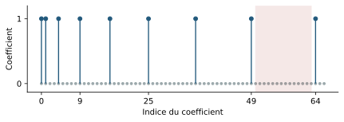
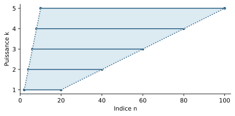
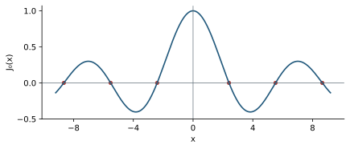

# ENS MP — Mathématiques D 2024 · Corrigé brut

*Corrigé rédigé par IA, non officiel. Signalez toute erreur.*

**Rédaction** · modèle exact non renseigné (famille GPT-6) · effort non renseigné · vitesse non renseignée

**Révision (tour 1)** · modèle exact non renseigné (famille GPT-6) · effort non renseigné · vitesse non renseignée

**Révision (tour 2)** · GPT-6.2 Astra Ultra · vitesse non renseignée

**Révision (tour 3)** · GPT-6.2 Astra Ultra · vitesse non renseignée · 26 novembre 2026

## Présentation du sujet

L’épreuve de six heures du 18 avril 2024, spécifique à l’ENS Ulm, comporte 45 questions. Elle démontre l’indépendance linéaire sur les rationnels des exponentielles de rationnels distincts, puis applique les méthodes obtenues aux fonctions E et à la fonction de Bessel. [Sujet officiel](https://www.ens.psl.eu/sites/default/files/24_mp_sujet_mathd.pdf)

## A — Conséquences de l’indépendance des exponentielles

Le théorème 1 affirme l’indépendance linéaire sur $\mathbb Q$ des $e^{a_i}$ lorsque les exposants $a_i$ sont rationnels et distincts.

### Question 1

Si $q=\log a$ était rationnel, on aurait $q\ne0$ puisque $a\ne1$ et la relation rationnelle $e^q-ae^0=0$ entre exponentielles de deux rationnels distincts. Cela contredit le théorème 1.

### Question 2

Écrivons $P=\sum_{j=0}^d p_jX^j$. Les nombres $ja$ correspondant aux coefficients non nuls sont rationnels et distincts car $a\ne0$. Le théorème 1 exclut l’annulation de $P(e^a)=\sum_jp_j e^{ja}$ s’il y a au moins deux termes. Avec un seul terme, celui-ci est non nul puisque l’exponentielle est strictement positive.

## B — Séries formelles et fractions rationnelles

On travaille dans $\mathbb Q[[x]]$ avec le produit de Cauchy. Une série $f$ est globalement bornée s’il existe $A,B\in\mathbb N^*$ tels que $Af(Bx)$ ait des coefficients entiers.

### Question 3

La convergence impose $c_n\alpha^n\to0$. Comme $\alpha\geq1$, tout coefficient entier non nul donnerait $|c_n\alpha^n|\geq1$. À partir d’un certain rang les coefficients sont donc tous nuls, ce qui caractérise un polynôme.

### Question 4

Notons $Q=\sum_{j=0}^d q_jx^j$, avec $q_0\ne0$. L’identité $Qf=1$ impose $c_0=1/q_0$ puis, pour $n\geq1$,
$$c_n=-q_0^{-1}\sum_{j=1}^{\min(d,n)}q_jc_{n-j}.$$
Ces relations définissent successivement des rationnels uniques et assurent l’identité à tous les degrés. Lorsque $q_0=\pm1$ et les $q_j$ sont entiers, une récurrence dans cette même formule rend tous les $c_n$ entiers.

### Question 5

Si $P=0$, la solution est zéro, puisque multiplier une série non nulle par $Q\ne0$ conserve un premier coefficient non nul. Sinon simplifions la puissance maximale de $x$ commune à $P$ et $Q$. Comme zéro n’est pas un pôle, le dénominateur obtenu $Q_0$ a terme constant non nul. La solution est l’unique $g=P_0 Q_0^{-1}$ de 4. La règle du produit en croix montre que deux présentations donnent le même développement. En prenant un dénominateur commun pour la somme ou le produit des dénominateurs pour le produit, l’unicité montre la compatibilité des deux opérations. Enfin la dérivation de $P=Qg$ donne $Q^2g'=P'Q-PQ'$ par Leibniz, ce qui identifie le développement de la dérivée à $g'$.

### Question 6

Écrivons $Q(x)=1+\sum_{j\geq1}q_j x^j$. Prenons pour $b$ un multiple commun positif des dénominateurs des $q_j$. Pour $j\geq1$, $b^jq_j=b^{j-1}(bq_j)$ est entier, et le terme constant est déjà un.

### Question 7

Par 5, présentons la fraction sous forme $P/Q$ avec $Q(0)=1$ en normalisant. Trouvons $B$ par 6 tel que $Q(Bx)$ soit entier, puis choisissons $A>0$ pour que le polynôme $AP(Bx)$ soit entier. Par 4, l’inverse formel de $Q(Bx)$ est entier. Son produit par $AP(Bx)$ est donc entier et vaut $Af(Bx)$.

### Question 8

Si la série était rationnelle, en choisissant un dénominateur $Q=q_0+\cdots+q_dx^d$ avec $q_0\ne0$, l’identité $Qf=P$ donnerait pour $n>\deg P$ une relation exprimant $c_n$ à partir des $d$ coefficients précédents. Or pour un carré $n=m^2$ assez grand, le carré précédent $(m-1)^2$ se situe à distance $2m-1>d$. Les $d$ termes précédents sont donc nuls mais $c_n=1$, contradiction. Si $d=0$, l’identité affirmerait directement que la série est un polynôme.

### Question 9

Prenons $f=1/(1-x)$. Sa primitive de terme constant nul est $\sum_{n\geq1}x^n/n$. Si elle était rationnelle, elle serait globalement bornée par 7. Pour tout choix d’entiers $A,B>0$, choisissons un nombre premier $p$ ne divisant pas $AB$. Le coefficient d’indice $p$ de la série normalisée est $AB^p/p$, qui n’est pas entier. Ceci contredit 7.

### Question 10

Dans la décomposition en éléments simples sur $\mathbb Q$, tous les pôles sont rationnels, non nuls puisque $f$ se développe en zéro. Les termes polynomiaux et ceux d’ordre au moins deux ont une primitive rationnelle. Les termes de pôle simple s’écrivent $c_i a_i/(1-a_i x)$ pour des $a_i\in\mathbb Q^\times$ distincts. Il suffit de traiter la primitive correspondante
$$g(x)=\sum_{n\geq1}\frac{S(n)}{n}x^n,\qquad S(n)=\sum_i c_i a_i^n.$$
Elle est globalement bornée par hypothèse et par 7 : la différence de deux séries globalement bornées l’est encore en prenant des multiples communs de leurs deux paramètres.

Fixons $m\geq1$. À tout premier $p$ qui ne divise ni les paramètres de normalisation $A,B$, ni les dénominateurs des $a_i,c_i$, l’intégralité de $AB^{pm}S(pm)/(pm)$ impose $S(pm)\equiv0\pmod p$. Le petit théorème de Fermat donne $a_i^{pm}\equiv a_i^m\pmod p$ pour ces rationnels réduits modulo $p$. Ainsi $S(m)$ est nul modulo une infinité de premiers, donc ce rationnel est nul. Pour les $m=1,\ldots,s$ où $s$ est le nombre de pôles simples, le système $\sum_i(c_i a_i)a_i^{m-1}=0$ est de Vandermonde inversible. Tous les $c_i$ sont donc nuls et la primitive initiale est rationnelle.

## C — Opérateurs différentiels

Un opérateur est une somme finie de termes $R_j(x)\partial^j$ avec $R_j\in\mathbb Q[x]$ et $\partial=\mathrm d/\mathrm dx$. On étudie les séries annulées par un opérateur non nul.

### Question 11

Appliquons Leibniz à la dérivée d’ordre $\mu$ du produit $x^mf$. Le terme correspondant à $i$ dérivations de $x^m$ est $\binom\mu i m(m-1)\cdots(m-i+1)x^{m-i} f^{(\mu-i)}$. Il s’annule pour $i>m$. Avec $(a)_{\underline i}=a(a-1)\cdots(a-i+1)$ et $(a)_{\underline0}=1$, on obtient l’identité imprimée sous la forme
$$\partial^\mu(x^mf)=x^m\partial^\mu f+
\sum_{i=1}^{\min(\mu,m)}\frac{(m)_{\underline i}(\mu)_{\underline i}}{i!}\,x^{m-i}\partial^{\mu-i}f.$$
Pour $m=0$ ou $\mu=0$, la somme est vide.

### Question 12

Pour $f=P/Q\ne0$, la dérivation du quotient donne $(PQ)f'-(P'Q-PQ')f=0$. Le coefficient $PQ$ est non nul, donc l’ordre est bien un, même si $f$ est constante non nulle. Pour $f=0$, l’équation $f'=0$ convient.

### Question 13

Notons $(t)_{\underline j}=t(t-1)\cdots(t-j+1)$, le produit vide valant un. Dans un opérateur non nul $L=\sum_{j,m}a_{jm}x^m\partial^j$, choisissons $M$ au moins égal à tous les $m$. Le coefficient de degré $n+M$ de $Lf$ est
$$\sum_{j,m}a_{jm}(n+M-m+j)_{\underline j}\,c_{n+M-m+j}.$$
Les décalages $i=M-m+j$ sont positifs ou nuls. Pour un $i$ fixé, chaque ordre $j$ correspond à un seul $m$ et les polynômes $(n+i)_{\underline j}$ ont des degrés distincts. Un groupe contenant un $a_{jm}\ne0$ ne peut donc être identiquement nul. En regroupant et en chassant les dénominateurs, on obtient la récurrence entière.

Réciproquement posons $\theta=x\partial$ et $K=\sum_{i=0}^d x^{d-i}S_i(\theta-i)$. Son action sur $x^h$ est $\sum_i S_i(h-i)x^{h+d-i}$. Pour un entier $h$ assez grand, ces monômes ont des exposants distincts et l’un des coefficients est non nul, donc $K$ est non nul. Le coefficient de $x^{n+d}$ dans $Kf$ est précisément la récurrence. Ainsi $Kf$ est un polynôme de degré strictement inférieur à $d$ (nul si $d=0$). L’opérateur $\partial^dK$ annule $f$ et est non nul, puisque son coefficient de dérivation d’ordre maximal est le coefficient dominant de $K$. Sa mise sous forme d’opérateur à coefficients polynomiaux résulte de Leibniz.

### Question 14

Si la série des carrés était rationnelle, 12 puis 13 lui donneraient une récurrence avec décalage maximal $d$ et $S_d\ne0$. Choisissons un carré $m^2$ assez grand pour que $S_d(m^2-d)\ne0$ et que les $d$ entiers précédents soient tous non carrés. Pour $n=m^2-d$, la récurrence ne garde alors que $S_d(n)c_{m^2}=S_d(n)\ne0$, contradiction.

### Question 15

Notons $c_n=(2n)!(3n)!/(n!)^5$. La division de deux termes successifs donne $(n+1)^3c_{n+1}=6(2n+1)(3n+1)(3n+2)c_n$. C’est la récurrence polynomiale requise par 13. Avec $\theta=x\,\mathrm d/\mathrm dx$, une équation explicite est
$$\theta^3 h-6x(2\theta+1)(3\theta+1)(3\theta+2)h=0.$$
En effet chaque coefficient de degré $n+1$ est exactement la récurrence, et celui de degré zéro est nul. Il s’agit bien d’une équation d’ordre trois.

### Question 16

La factorisation $c_n=\binom{2n}{n}^2\binom{3n}{n}$ redonne exactement $(2n)!(3n)!/(n!)^5$. Ces trois coefficients binomiaux sont entiers.

La transformée de Laplace formelle du sujet remplace $\sum c_n x^n/n!$ par $\sum c_n x^n$. Elle est notée $\widehat f$.

### Question 17

Si les $c_n/n!$ vérifient $\sum_{i=0}^d S_i(n)c_{n+i}/(n+i)!=0$, multiplions par $(n+d)!$. Les coefficients devant les $c_{n+i}$ deviennent les polynômes $S_i(n)\prod_{j=i+1}^d(n+j)$. Réciproquement, d’une relation sur les $c_{n+i}$ divisée par $n!$, on tire une relation sur les $c_{n+i}/(n+i)!$ en multipliant chaque coefficient par $\prod_{j=1}^i(n+j)$. Dans les deux sens la relation reste non triviale. La caractérisation de 13 donne l’équivalence.

## D — Une série qui ne peut être rationnelle

On fixe $r\geq2$, des rationnels $a_i$ distincts et des $b_i\in\mathbb Q^\times$. On pose $f=\sum_i b_i e^{a_i x}=\sum_n u_n x^n/n!$, puis $v_n=n!\sum_{j=0}^n u_j/j!$ et $v=\sum_n v_nx^n$.

### Question 18

L’égalité $u_n=\sum_i b_i a_i^n$ donne après transformation $\widehat f(x)=\sum_i b_i/(1-a_ix)$ par la série géométrique. Pour chaque $a_i\ne0$, cette fraction a un pôle simple en $1/a_i$ puisque les $a_i$ sont distincts et $b_i\ne0$. Il existe au moins un tel indice car $r\geq2$. Ainsi $\widehat f\ne0$, et $f\ne0$ puisque les deux séries sont simultanément nulles.

### Question 19

Par définition, pour $n\geq1$ on a $n v_{n-1}=n!\sum_{i=0}^{n-1}u_i/i!$, donc $v_n-nv_{n-1}=u_n$. Pour $n=0$, $v_0=u_0$ et l’on convient que le terme à indice négatif multiplié par zéro est nul. La série cherchée s’écrit donc $\sum_{n\ge0}(v_n-nv_{n-1})x^n=\sum_{n\ge0}u_nx^n=\widehat f(x)$. Dans cette identité formelle, on peut prendre $v_{-1}=0$ pour uniformiser l’écriture.

### Question 20

Le coefficient d’indice $n$ dans $-x^2v'+(1-x)v$ vaut $v_n-[(n-1)+1]v_{n-1}=v_n-nv_{n-1}$ pour $n\geq1$, et vaut $v_0$ pour $n=0$. C’est donc $u_n$ par 19. La somme rationnelle obtenue est celle de 18.

### Question 21

Si une fraction rationnelle $v$ est régulière en $c=1/a_i$ pour $a_i\ne0$, sa dérivée est régulière en $c$, et $Lv$ l’est également. La question 20 donne pourtant un pôle simple en $c$. Ainsi chacun de ces nombres est nécessairement un pôle de $v$.

### Question 22

Fixons un de ces $c\ne0$. Pour une fraction $v$ ayant un pôle d’ordre $m\geq1$ en $c$, le terme $-x^2v'$ a un pôle d’ordre $m+1$ car $-c^2\ne0$. Le terme $(1-x)v$ a un pôle d’ordre au plus $m$, donc le pôle supérieur ne peut disparaître. Cela contredit le pôle simple de $Lv$ en $c$ fourni par 20. En conséquence $v$ n’est pas rationnelle.

### Question 23

En supposant le théorème, groupons les termes d’un polynôme exponentiel par exposants $c_i$ distincts. Si la valeur en un s’annule, l’indépendance des $e^{c_i}$ impose $P_i(1)=0$ pour chaque $i$ (le cas d’un seul exposant est immédiat). Chaque $P_i$ est divisible par $x-1$, d’où la propriété.

Réciproquement, supposons cette propriété et une relation $f(1)=0$ pour $f=\sum_i b_ie^{a_ix}$ avec exposants distincts et coefficients non nuls. Le quotient $g=f/(x-1)$ serait un polynôme exponentiel. La transformée de Laplace d’un terme $x^je^{cx}$ vaut $j!x^j/(1-cx)^{j+1}$, comme on le voit en sommant les dérivées de la série géométrique, formule valable aussi pour $c=0$. La transformée de $g$ serait donc rationnelle. Or $g=-f/(1-x)$ a pour coefficient d’indice $n$ la somme $-\sum_{i\leq n}u_i/i!$, donc $\widehat g=-v$. Ceci contredit 22 et établit la réciproque.

## E — Arithmétique des coefficients

On suppose $f(1)=0$ et on a multiplié $f$ par un entier pour que $u_0,\ldots,u_{r-1}$ soient entiers. Les coefficients $s_j$ sont définis par $\prod_i (T-a_i)=T^r-\sum_{j=1}^r s_jT^{r-j}$. On note $D$ un dénominateur commun des $a_i$.

### Question 24

Chaque $a_i$ annule le polynôme $T^r-s_1T^{r-1}-\cdots-s_r$. Multiplier cette identité en $a_i$ par $b_i a_i^n$ et sommer sur $i$ donne $u_{n+r}=\sum_{j=1}^r s_j u_{n+r-j}$. Pour $n=0$ on utilise la convention des puissances dans la série exponentielle, $a_i^0=1$ même si $a_i=0$.

### Question 25

Les $s_j$ sont, au signe près, les sommes des produits de $j$ des $a_i$, donc $D^j s_j\in\mathbb Z$. Multiplions la récurrence de 24 par $D^{n+r}$. Les $U_n=D^n u_n$ vérifient une récurrence linéaire à coefficients entiers $D^js_j$. Les $r$ premières valeurs sont entières par la normalisation du sujet, donc toutes les suivantes aussi.

### Question 26

L’hypothèse $f(1)=0$ permet d’utiliser la queue de la série absolument convergente : $v_n=-n!\sum_{i>n}u_i/i!$. Posons $B=\sum_j|b_j|$ et $A=\max(1,|a_1|,\ldots,|a_r|)$. Alors $|u_i|\leq BA^i$. En écrivant $i=n+1+j$ et en utilisant $(n+1+j)!\geq(n+1)!j!$, on trouve $|v_n|\leq B e^A A^{n+1}/(n+1)$. Ainsi $c_1=Be^A$ convient.

Pour $k\geq0$, les $v_n(k)$ sont les coefficients de $Q(x)^k v(x)$ avec $Q(x)=1-s_1x-\cdots-s_rx^r$.

### Question 27

Posons $Q(x)=1-s_1x-\cdots-s_rx^r=\prod_i(1-a_ix)$. Si $Q^k v$ est un polynôme, la série $v$ est rationnelle car $Q(0)=1$. Réciproquement, pour une éventuelle fraction rationnelle $v$, tout pôle fini $c$ est non nul et impose un pôle de $Lv$ par le calcul d’ordre de 22. Par 20 il doit donc figurer parmi les $1/a_i$ avec $a_i\ne0$. Les zéros de $Q$ sont précisément ces points, même si un $a_i$ est nul. En effet, si $c$ était un autre pôle complexe de $v$, écrivons le terme dominant $d(x-c)^{-m}$ avec $d\ne0$. Alors $-x^2v\prime$ aurait pour coefficient dominant $mc^2d$ à l’ordre $m+1$, que $(1-x)v$ ne pourrait compenser. Cela forcerait un pôle de $Lv$ en dehors de la liste fournie en 20. Une puissance assez grande de $Q$ annule donc tous les pôles de $v$. La fraction $Q^k v$ n’a plus de pôle fini et est un polynôme. Cette implication sur les pôles complète celle de 21 dans l’autre sens.

### Question 28

L’égalité $Q^{k+1}v=Q(Q^kv)$ donne par le produit de Cauchy $v_n(k+1)=v_n(k)-\sum_{j=1}^r s_jv_{n-j}(k)$ pour $n\geq r$. La même règle vaut pour $n<r$ en omettant les termes d’indice négatif.

### Question 29

$D^n v_n$ est entier, car $v_n=\sum_{i=0}^n (n!/i!)u_i$ et $D^iu_i$ est entier d’après 25. Comme $Q(Dx)$ est un polynôme entier par 25, la série $Q(Dx)^k v(Dx)$ est entière ; son coefficient d’indice $n$ vaut bien $D^n v_n(k)$. Posons $C=1+\sum_j|s_j|$. La somme des valeurs absolues des coefficients de $Q^k$ est au plus $C^k$ par convolution. La borne de 26 donne $|v_m|\leq c_1 A\,A^m$ et, puisque $A\geq1$, chaque terme du produit d’indice $m\leq n$ vérifie $|v_m|\leq c_1 A\,A^n$. On en déduit $|v_n(k)|\leq c_2 A^n C^k$ avec $c_2=c_1 A$, en particulier pour $n\geq kr$.

### Question 30

Les termes $n<\ell$ sont nuls et peuvent être omis. Posons $m=n-\ell$ dans la série. En remplaçant $u_m=\sum_i b_i a_i^m$ et en utilisant $\sum_{m\geq0}\binom{m+\ell}{\ell}z^m=(1-z)^{-\ell-1}$, on obtient
$$\ell! x^\ell\sum_{i=1}^r\frac{b_i}{(1-a_ix)^{\ell+1}}.$$
Le dénominateur commun $Q^{\ell+1}$ convient. Le numérateur est $\ell!x^\ell\sum_i b_i\prod_{j\ne i}(1-a_jx)^{\ell+1}$ et son degré est au plus $\ell+(r-1)(\ell+1)=r(\ell+1)-1$, comme demandé.

On pose $w_{n,k}=n!\sum_{i=0}^{n-k}u_i/i!$. Pour chaque $k$, les $w_n(k)$ sont les coefficients de $Q(x)^k\sum_m w_{m,k}x^m$.

### Question 31

Avec la convention qu’une somme vide vaut zéro, la différence $v_n-w_{n,k}$ est la somme des $k$ derniers termes (ou de tous ceux présents si $n<k$). En posant $\ell=n-i$, ils sont $(n)_{\underline\ell}u_{n-\ell}$ pour $0\leq\ell<k$ et $\ell\leq n$. La série génératrice de chaque famille en $\ell$ est donc celle de 30. Après multiplication par $Q^k$, elle devient le polynôme $P_\ell Q^{k-\ell-1}$ de degré strictement inférieur à $r(\ell+1)+r(k-\ell-1)=rk$. Ainsi la différence des séries définissant $v_n(k)$ et $w_n(k)$ est un polynôme de degré $<rk$, donc leurs coefficients coïncident pour $n\geq rk$. Pour $k=0$, la différence est directement nulle.

### Question 32

Pour $i\leq m-k$, $(m!/i!)/k!=\binom mk(m-k)!/i!$ est entier. Par 25, $D^m w_{m,k}$ est donc divisible par $k!$ pour toute valeur de $m$, y compris $m<k$ où la somme est vide. Écrivons $Q^k=\sum_j q_jx^j$. Comme $Q(Dx)$ est entier, $D^jq_j$ est entier. Dans
$$D^n w_n(k)=\sum_{j\leq n}(D^j q_j)\,D^{n-j}w_{n-j,k},$$
chaque terme est multiple de $k!$. La question 31 permet de remplacer $w_n(k)$ par $v_n(k)$ pour $n\geq kr$.

### Question 33

Pour tout réel $a$ et tout entier $m\geq0$, des intégrations par parties successives donnent
$$e^a\int_a^\infty e^{-t}t^m\,\mathrm dt=m!\sum_{j=0}^m\frac{a^j}{j!}.$$
Pour $m=0$ l’égalité est immédiate, et le passage à $m$ ajoute le terme de bord $a^m$. Multiplions par $b_i$ pour $a=a_i$ puis sommons. Le membre de droite est $v_m$. Pour le domaine $n\geq kr$ des questions voisines, écrivons $Q^k=\sum_{j=0}^{kr}q_j x^j$. On a alors $v_n(k)=\sum_j q_jv_{n-j}$, et tous les exposants $n-j$ sont positifs ou nuls. Dans l’intégrale, la somme des monômes est
$$\sum_jq_j t^{n-j}=t^{n-kr}\prod_{h=1}^r(t-a_h)^k.$$
On obtient exactement $v_n(k)=\sum_i b_i e^{a_i}\int_{a_i}^\infty e^{-t}t^{n-kr}\prod_h(t-a_h)^k\,\mathrm dt$. La condition $n\geq kr$ assure que l’intégrande est défini même lorsque le trajet rencontre zéro.

Pour un indice $0\le n<kr$, le produit de séries formelles impose la troncature. Le noyau toujours polynomial qui résulte du même calcul est
$$K_{n,k}(t)=\sum_{j=0}^{\min(n,kr)}q_j t^{n-j},\qquad
v_n(k)=\sum_i b_i e^{a_i}\int_{a_i}^{\infty} e^{-t}K_{n,k}(t)\,dt.$$
La somme commence ainsi avec $K_{0,k}=q_0=1$. Dès $n\ge kr$, tous les coefficients de $Q^k$ sont présents et la factorisation de l’énoncé est exacte. Cette troncature précise où la preuve utilise la borne sur $n$.

## F — Annulation et conclusion du théorème

Le dénominateur commun des exposants, la croissance réelle et la divisibilité des coefficients vont forcer une même série à être rationnelle sous l’hypothèse $f(1)=0$.

### Question 34

Pour $n\geq kr$ et $v_n(k)\ne0$, le nombre $D^n v_n(k)$ est un multiple entier non nul de $k!$ d’après 32, donc sa valeur absolue est au moins $k!$. La majoration de 29 multipliée par $D^n$ fournit la seconde inégalité, $|D^n v_n(k)|\leq c_2(AD)^n C^k$.

### Question 35

Comme $AD\geq1$, pour $kr\leq n\leq10kr$ la borne supérieure est au plus $c_2[(AD)^{10r}C]^k$. Pour une constante fixée $H>0$, $k!/H^k\to\infty$ (les rapports successifs valent $(k+1)/H$). Il existe donc $k_0\geq1$ tel que la dernière borne soit strictement inférieure à $k!$ pour tout $k\geq k_0$. Par 34 toute valeur sur la bande indiquée est alors nulle.

### Question 36

Montrons par récurrence forte sur $n\geq k_0r$ que $v_n(k)=0$ pour tout $k\geq k_0$ avec $kr\leq n$. À $n$ fixé, descendons en $k$ depuis $\lfloor n/r\rfloor$ jusqu’à $k_0$. Si $n\leq10kr$, l’annulation vient de 35, ce qui traite en particulier le premier $k=\lfloor n/r\rfloor$. Sinon $n>10kr$ assure $(k+1)r\leq n$ et $n-j\geq kr$ pour $1\leq j\leq r$. La descente donne $v_n(k+1)=0$ et la récurrence sur $n$ donne $v_{n-j}(k)=0$. En isolant $v_n(k)$ dans 28, on obtient zéro. Le premier $n=k_0r$ ne nécessite que 35. L’induction prouve en particulier $v_n(k_0)=0$ pour tout $n\geq k_0r$. Par 27, $v$ serait rationnelle sous l’hypothèse $f(1)=0$, ce que 22 exclut. Le théorème 1 est donc établi.

## G — Fonctions E

Une fonction E est une série $\sum_{n\geq0} b_nx^n/n!$ annulée par un opérateur différentiel non nul, telle que la taille de $b_n$ et le dénominateur commun de $b_0,\ldots,b_n$ soient bornés par $C^n$ pour $n\geq1$.

### Question 37

La borne arithmétique $|b_n|\leq C^n$ implique pour $n\geq1$ une majoration par $(C|\alpha|)^n/n!$ des termes de la série de $f(\alpha)$. Cette série majorante converge pour tout réel $\alpha$. Le terme constant étant fini, la convergence absolue est démontrée.

### Question 38

Pour chaque indice $n\geq1$ avec $b_n\ne0$, le dénominateur de $b_n$ est au plus le dénominateur commun de $b_0,\ldots,b_n$, lui-même au plus $C^n$, en augmentant $C$ si besoin. Ainsi $|b_n|\geq C^{-n}$. Une fonction non polynomiale possède une infinité de tels indices, et pour $|\alpha|>C$ les termes $|b_n\alpha^n|\geq(|\alpha|/C)^n$ sur cette sous-suite ne tendent pas vers zéro. La série ne converge donc pas.

### Question 39

Si $f$ est une fonction E non polynomiale, 38 donne des valeurs réelles pour lesquelles la série de $\widehat f$ diverge. Ce serait impossible par 37 si $\widehat f$ était également une fonction E. Les polynômes rationnels conviennent tous car la transformation conserve le caractère polynomial et tout polynôme rationnel est une fonction E. Ce sont exactement les solutions.

### Question 40

Une série est solution d’une équation différentielle polynomiale si et seulement si ses dérivées engendrent un espace de dimension finie sur le corps $\mathbb Q(x)$ (on peut travailler dans les séries de Laurent). Une relation différentielle permet d’exprimer la dérivée la plus élevée par les précédentes, puis toutes les suivantes en dérivant et en utilisant que les dérivées des coefficients restent rationnelles. Réciproquement, une dépendance linéaire entre dérivées donne une équation polynomiale après élimination des dénominateurs. Pour deux séries de ce type, les dérivées de la somme restent dans la somme des espaces finis. Celles du produit restent, par Leibniz, dans l’espace engendré par les produits des vecteurs de deux bases finies.

Pour les bornes, écrivons $f=\sum b_nx^n/n!$, $g=\sum c_nx^n/n!$. Prenons $K\geq1$ tel que $|b_j|,|c_j|\leq K^{j+1}$ pour tous $j$, et que les deux dénominateurs communs jusqu’au rang $n$ soient au plus $K^n$ pour $n\geq1$. Les coefficients normalisés de $f+g$ sont $b_n+c_n$. Ceux de $fg$ sont $\sum_{j=0}^n\binom nj b_jc_{n-j}$, de module au plus $2^nK^{n+2}$. Dans les deux cas, le produit des deux dénominateurs communs au rang $n$ est un dénominateur valable pour tous les rangs jusqu’à $n$ et est au plus $K^{2n}$. Toutes ces bornes sont dominées par $C^n$ pour $n\geq1$ avec une constante assez grande. Les deux opérations préservent donc les fonctions E.

### Question 41

Pour $a\in\mathbb Q$, $e^{ax}$ satisfait $f'=af$. Ses coefficients normalisés sont $a^n$, de croissance géométrique et de dénominateur commun jusqu’au rang $n$ divisant le dénominateur de $a$ à la puissance $n$. L’exponentielle et les polynômes sont donc des fonctions E, puis leurs produits et sommes finies le sont par 40. La formule de 23 donne pour chaque terme $x^je^{ax}$ la transformée $j!x^j/(1-ax)^{j+1}$, polynomiale pour $a=0$ et à seul pôle possible rationnel $1/a$ sinon. La somme a donc des pôles rationnels.

### Question 42

Décomposons la fraction en partie polynomiale et termes $c/(1-ax)^m$ avec $a,c\in\mathbb Q$, $a\ne0$ et $m\geq1$. La transformation inverse de la partie polynomiale reste un polynôme. Les coefficients d’un terme simple sont $c\binom{n+m-1}{m-1}a^n$. Le facteur binomial est polynomial en $n$, et s’écrit comme combinaison rationnelle des $(n)_{\underline j}$. Or $\sum_{n\geq0}(n)_{\underline j}a^n x^n/n!=(ax)^j e^{ax}$. La série inverse est donc un polynôme exponentiel, fonction E par 41.

Pour le pôle d’ordre $m$, on peut donner explicitement le facteur polynomial obtenu par transformation inverse. L’identité de Vandermonde donne
$$\binom{n+m-1}{m-1}=\sum_{j=0}^{m-1}\binom{m-1}{j}\binom{n}{j}.$$
Or $\sum_{n\ge0}\binom{n}{j}(ax)^n/n!=e^{ax}(ax)^j/j!$. Ainsi le terme $c/(1-ax)^m$ a pour série inverse
$$c\, e^{ax}\sum_{j=0}^{m-1}\binom{m-1}{j}\frac{(ax)^j}{j!}.$$
Le degré du facteur en $x$ est $m-1$ lorsque $a,c\ne0$.

### Question 43

La série vérifie $x^2J_0''+xJ_0'+x^2J_0=0$, car si $c_j=[x^j]J_0$ on a $j^2c_j=-c_{j-2}$ pour $j\geq2$, avec $c_1=0$. Les coefficients normalisés impairs sont nuls et ceux d’indice $2m$ valent $(-1)^m\binom{2m}{m}/4^m$. Leur module est au plus un, et le dénominateur commun jusqu’au rang $n$ divise $4^{\lfloor n/2\rfloor}$. Ainsi $J_0$ est une fonction E. Par le développement binomial de $(1+z)^{-1/2}$, sa transformée est $\widehat J_0=(1+x^2)^{-1/2}$, donc $(1+x^2)\widehat J_0^2=1$. La fraction $1/(1+x^2)$ a un pôle simple en $i$ alors que le carré d’une fraction rationnelle n’a que des pôles d’ordre pair. La transformée n’est donc pas rationnelle et 41 exclut que $J_0$ soit un polynôme exponentiel.

### Question 44

Comme $J_0(0)=1$, un zéro réel $\alpha$ est non nul. Au voisinage de $\alpha$, l’équation s’écrit $y''+y'/x+y=0$ avec coefficients continus. Si $J_0(\alpha)=J'_0(\alpha)=0$, l’unicité du problème de Cauchy force la solution nulle sur la demi-droite contenant $\alpha$. Par continuité en zéro cela donnerait $J_0(0)=0$, contradiction. Tous les zéros réels sont donc simples.

### Question 45

Posons $g=f/(x-1)=\sum_{n\geq0}d_n x^n/n!$. Si $L$ est un opérateur non nul annulant $f$, alors $L\circ (x-1)$, où $(x-1)$ désigne la multiplication, annule $g$. Cet opérateur est non nul : son coefficient de plus haut ordre est celui de $L$ multiplié par $x-1$. La première condition est établie.

En coefficients, $d_n=-\sum_{j=0}^n(n!/j!)b_j$. Tous les facteurs $n!/j!$ sont entiers, donc le dénominateur commun des $d_0,\ldots,d_n$ divise celui des $b_0,\ldots,b_n$. D’autre part $f(1)=0$ permet de réécrire $d_n=n!\sum_{j>n}b_j/j!$. Si $|b_j|\leq C^j$ pour $j\geq1$, la même estimation qu’en 26 donne $|d_n|\leq C^{n+1}e^C/(n+1)$. En augmentant la constante, les deux bornes sont de la forme requise pour $n\geq1$. Ainsi $g$ est une fonction E.
