# ENS Ulm — PC, Chimie B 2024 · Corrigé guidé

*Corrigé rédigé par IA, non officiel.*

**Rédaction** · GPT-6.2 Astra Ultra · vitesse non renseignée

**Couverture.** Les 85 questions sont traitées. Les décalages de numérotation des figures 6 et 9, les hypothèses de population des conformères en Q31 et les conventions cinétiques des Q65 et 75–78 sont explicités. Les masses molaires sont estimées par lecture graphique.

## Spirochensilide A. Stéréochimie initiale

### Question 1 — Centres asymétriques

> [!INDICATION]
> Suivre les jonctions des cycles avant les substituants périphériques.

#### Solution

On trouve neuf carbones portant quatre chemins distincts. Ce sont le C–OH de A, les deux jonctions A/B, l’atome commun à B et C, la jonction C/D portant Me, les deux jonctions D/E, le C–Me périphérique de E et le spirocarbone E/F. Le carbone gem-diméthylé de A a deux substituants égaux. Les doubles liaisons endocycliques des petits cycles n’ajoutent pas de choix indépendant. Sans réduction par symétrie, le décompte formel est $2^9=512$ configurations, indépendamment des contraintes de stabilité des cycles.

### Question 2 — Configuration du spirocarbone

> [!INDICATION]
> Comparer les deux chemins oxygénés un rang plus loin que l’oxygène.

#### Solution

Priorités CIP décroissantes : O de la lactone F, O de l’éther E, carbone vinylique de F, méthylène de E. Les deux O portent un C au rang suivant, mais le carbone du carbonyle donne ensuite O,O,C contre C,C,H pour celui de l’éther. Le carbone vinylique donne C,C,H contre C,H,H pour le méthylène. En plaçant le méthylène à l’arrière, le chemin 1–2–3 est antihoraire : **(S)**.

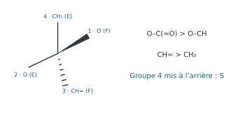

## Préparation de l’époxyde

### Question 3 — Tosylation sélective

> [!INDICATION]
> Chercher l’oxygène le plus accessible, sans toucher à la liaison C–O.

#### Solution

Le composé 2 est 1 avec l’OH secondaire remplacé par OTs, sur la même face. L’alcool tertiaire gem-diméthylé reste libre. Le doublet de l’oxygène secondaire attaque S de TsCl, la liaison S–Cl rend son doublet à Cl, puis la pyridine prend le proton de l’oxonium, avec retour de la liaison O–H vers O. L’accès stérique favorise l’alcool secondaire. Il s’agit d’une régiosélectivité.

### Question 4 — Fermeture de l’époxyde

> [!INDICATION]
> Repérer le carbone où la liaison est rompue lors de la substitution interne.

#### Solution

Le $pK_a$ de $\mathrm{Et_3NH^+/Et_3N}$ est voisin de 10,7 dans l’eau. La base assiste la déprotonation du OH tertiaire. L’oxygène attaque par l’arrière le C secondaire porteur de OTs et la liaison C–OTs se rompt vers OTs⁻. La fermeture intramoléculaire et le bon groupe partant entraînent la réaction malgré la faible population d’alcoolate. Le C attaqué s’inverse. L’oxygène de l’époxyde provient de l’alcool tertiaire, l’autre C conserve ses deux Me.

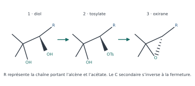

### Question 5 — Attribution du spectre de 3

> [!INDICATION]
> Parcourir la chaîne depuis l’oxirane vers l’acétate et retrouver les mêmes constantes sur deux sites voisins.

#### Solution

Dans l’ordre croissant, les attributions du proton sont les suivantes.

| $\delta$ (ppm) | Signal | Attribution et voisinage |
|---|---|---|
| 1,34–1,44 | s, 6 H au total | Deux Me sur le C quaternaire de l’oxirane, sans H vicinal sur ce C |
| 1,69 | s, 3 H | Me sur le C substitué de la double liaison |
| 1,81 | td, 2 H | Premier méthylène après le CH époxydique, couplé au CH (5,4 Hz) et au méthylène suivant (7,5 Hz) |
| 2,00 | t, 2 H | Méthylène allylique du côté du C vinylique sans H, couplé au CH₂ précédent |
| 2,05 | s, 3 H | Méthyle de l’acétate |
| 2,81 | t, 1 H | CH de l’oxirane, couplé au premier CH₂ |
| 4,61 | d, 2 H | CH₂–OAc allylique couplé au CH vinylique, 6,6 Hz |
| 5,29 | t, 1 H | CH vinylique couplé aux deux H du CH₂–OAc |

### Question 6 — Libération de l’alcool allylique

> [!INDICATION]
> Suivre les deux oxygènes de l’ester séparément.

#### Solution

4 est 3 avec $\mathrm{-CH_2OCOCH_3}$ devenu $\mathrm{-CH_2OH}$. HO⁻ attaque le C du carbonyle acétyle, le doublet π monte sur O. Le tétraèdre s’effondre en reformant C=O et en expulsant l’alcoolate de la chaîne. Transfert de proton donne l’alcool et l’acétate, puis acidification. C’est une saponification.

### Question 7 — Activation puis allongement

> [!INDICATION]
> Identifier le carbone nucléophile de l’espèce lithiée.

#### Solution

5 est le tosylate primaire allylique de 4, $\mathrm{=CH-CH_2OTs}$. Dans 6, cette terminaison devient $\mathrm{=CH-CH_2-CH_2-C{\equiv}C-SiMe_3}$, sans modifier l’époxyde ni la géométrie de l’alcène. Le carbone $\mathrm{LiCH_2-C{\equiv}C-SiMe_3}$ se lie au méthylène qui perd OTs. La liaison C–Li, plus polarisée que C–Mg, fournit un carbanion équivalent très réactif pour cette alkylation directe. Un Grignard ordinaire n’offre pas la même garantie de couplage d’un sulfonate sans activation supplémentaire.

### Question 8 — Alcyne terminal

> [!INDICATION]
> Repérer la protection qui a été nécessaire pendant l’alkylation.

#### Solution

Une méthanolyse douce par $\mathrm{K_2CO_3/MeOH}$ enlève le TMS terminal. Un nucléophile oxygéné attaque Si, la liaison C–Si se rompt puis le solvant protone l’acétylure : on obtient l’extrémité $\mathrm{-C{\equiv}CH}$ de 7.

## Cyclisation et contraction de cycle

### Question 9 — Acidité de Lewis

> [!INDICATION]
> Compter les électrons autour de l’aluminium dans le monomère.

#### Solution

Trois liaisons simples Al–Cl, trois doublets libres sur chaque Cl, aucun sur Al et une orbitale vacante sur Al. L’aluminium tricoordonné, plan, est entouré de six électrons. $\mathrm{AlCl_3}$ est un acide de Lewis.

### Question 10 — Cascade bicyclisante

> [!INDICATION]
> Partir du côté gem-diméthylé de l’époxyde, puis suivre les électrons π.

#### Solution

Le doublet de l’oxirane se coordonne à Al. La liaison O–C du côté gem-diméthylé rend son doublet à O, ce qui donne un carbocation tertiaire et conserve l’oxygène sur le CH secondaire. La liaison π de l’alcène forme le premier cycle à six par son extrémité CH, laissant la charge sur le C portant Me. L’alcyne ferme le deuxième cycle à six en liant son extrémité terminale à ce C. La charge vinylique sur le C interne est interceptée par Br⁻, ce qui donne le bromure vinylique. L’hydrolyse/protonation du complexe d’aluminium rend le OH de 8. Les deux nouvelles liaisons C–C sont compatibles avec la jonction trans dessinée.

### Question 11 — Couplage de Sonogashira

> [!INDICATION]
> Distinguer le précurseur métallique du palladium du cycle catalytique.

#### Solution

Le bromure vinylique est remplacé par $\mathrm{-C{\equiv}C-SiMe_3}$ : c’est un couplage croisé C(sp²)–C(sp), ou substitution formelle du brome. Le complexe introduit est un précatalyseur de palladium, le cuivre étant cocatalyseur. Deux phosphines neutres et deux chlorures à −I conduisent à Pd(+II) dans $\mathrm{PdCl_2(PPh_3)_2}$.

### Question 12 — Protection du OH en éther silylé

> [!INDICATION]
> Un doublet de l’alcool peut s’additionner au silicium électrophile.

#### Solution

10 est 9 avec OH remplacé par O–SiMe₂–tert-Bu, sans inversion sur le C portant O. L’alcool attaque Si de TBSCl, le chlorure part au cours de la substitution au Si (état pentacoordonné possible), puis $\mathrm{Et_3N}$ déprotone l’oxonium silylé.

### Question 13 — Époxidation de l’alcène

> [!INDICATION]
> Distinguer transfert d’un atome O et simple perte de proton.

#### Solution

L’acide métachloroperbenzoïque est $m$-Cl–C₆H₄–C(=O)–O–OH. Son réducteur conjugué est l’acide métachlorobenzoïque. La demi-équation est $\mathrm{ArCO_3H+2H^++2e^-\rightarrow ArCO_2H+H_2O}$. Dans 11 un même atome O ponte les deux C de l’ancienne double liaison du cycle de droite de 10. L’alcyne et les protections sont conservés.

### Question 14 — Contraction du cycle

> [!INDICATION]
> Faire le bilan simultané de l’époxyde et de la nouvelle liaison C=O.

#### Solution

La coordination de BF₃ à O favorise l’ouverture de l’époxyde. Une migration 1,2 d’une liaison C–C du cycle accompagne la formation d’un carbonyle aldéhydique, tandis que le cycle à six devient un cycle à cinq. La libération de tension de l’époxyde et la formation d’une liaison C=O sont les deux moteurs. Une contraction six vers cinq ne suffit pas à elle seule à justifier le sens.

## Allongement asymétrique et réaction de Pauson–Khand

### Question 15 — Réactif de Grignard

> [!INDICATION]
> Le carbone qui portait Br devient l’extrémité nucléophile.

#### Solution

L’insertion de Mg dans la liaison C–Br du 1-(2-bromoéthyl)cycloprop-1-ène donne cyclopropényle–CH₂–CH₂–MgBr. Employer de la verrerie et un éther coordinant anhydres, sous atmosphère inerte. L’eau ou un alcool protoneraient le réactif, O₂ et CO₂ le consommeraient. L’introduction contrôlée du dérivé bromé limite l’échauffement.

### Question 16 — Création d’un centre alcoolique

> [!INDICATION]
> Numéroter le carbone du carbonyle avant l’addition.

#### Solution

En notant B le squelette bicyclique de 12, 13 est $\mathrm{B-CH(OH)-CH_2-CH_2-(cycloprop\acute enyle)}$. Le carbone lié à Mg donne son doublet à C du CHO, π(C=O) va sur O, puis $\mathrm{H_3O^+}$ protone l’alcoolate. L’alcyne garde son TMS. Dans la vue de 14, les deux produits sont OH hachuré/H plein ou OH plein/H hachuré sur ce nouveau CH, avec tous les centres de B conservés : deux diastéréoisomères.

### Question 17 — Trajectoire de Felkin–Anh

> [!INDICATION]
> Comparer les quatre approches à l’angle de Bürgi–Dunitz, dans les deux conformères.

#### Solution

L’attaque doit présenter son doublet au lobe de $\pi^*_{CO}$ sous un angle Nu–C–O voisin de 107°. Le plus gros substituant est disposé orthogonalement au système π. Sur le conformère 2, l’approche rouge vient du côté du petit groupe et à l’opposé du grand, et évite mieux le groupe moyen que l’autre approche anti au grand. Les deux attaques du côté du grand rencontrent un encombrement supérieur. Le modèle est au document 3 de l’annexe.

### Question 18 — Face majoritaire de 13

> [!INDICATION]
> Distinguer les deux chemins cycliques du petit substituant linéaire.

#### Solution

Le chemin vers la jonction quaternaire du bicycle est le grand groupe, le chemin via le méthylène cyclique est le moyen et $\mathrm{C{\equiv}C-SiMe_3}$ est le petit. En regardant le carbonyle dans la projection du document 3 et en attaquant du côté du petit groupe, on obtient dans la vue de 14 **OH hachuré, H plein**, chaîne vers la droite. La silylation ultérieure conserve la liaison C–O.

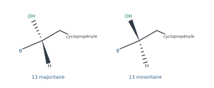

### Question 19 — Deux protections différentes

> [!INDICATION]
> Chercher dans le document 1 les deux opérations orthogonales.

#### Solution

Enlever le TMS de l’alcyne par $\mathrm{K_2CO_3/MeOH}$ pour libérer C≡CH, puis protéger le nouvel OH en OTES par TESCl et une base faible. Le TBS du premier alcool reste en place. L’ordre proposé évite d’exposer inutilement le nouvel éther TES à la première opération.

### Question 20 — Géométrie et dipôle du HMPA

> [!INDICATION]
> Une double liaison compte pour une seule direction en VSEPR.

#### Solution

Dans $\mathrm{O=P(NMe_2)_3}$, P est de type AX₄, tétraédrique. Les trois composantes transversales des dipôles P–N se compensent par symétrie approximative, leurs composantes axiales subsistent. Le ligand O n’est pas équivalent aux trois N. La liaison phosphoryle, fortement polarisée et décrite aussi par $\mathrm{P^+-O^-}$, porte un important moment résultant le long de l’axe P–O.

### Question 21 — Cycle de Pauson–Khand

> [!INDICATION]
> Compter séparément substitutions de ligand, insertions et changements d’état d’oxydation.

#### Solution

Étape 1, échange de L pour la coordination η² de l’alcyne. Étape 2, perte d’un deuxième L et coordination η² intramoléculaire de l’alcène. Étape 3, couplage oxydant donnant un métallacycle, W(0) vers W(II). Étape 4, insertion migratoire d’un CO dans W–C et formation de l’acyle. Étape 5, association de CO. Étape 6, élimination réductrice formant la liaison C–C de la cyclopenténone, association de L et retour à W(0). Étape 7, déplacement de la cétone liée par O par un autre L, avec régénération de I.

### Question 22 — Les deux cycloadduits

> [!INDICATION]
> Suivre dans la figure 5 les deux carbones de l’alcène du cyclopropène.

#### Solution

Désignons par A le C de l’alcyne portant le squelette, par B son C terminal et par C13 le C de l’alcène portant la chaîne. La nouvelle cyclopenténone a pour tour $\mathrm{A{=}B-C(=O)-C17-C13-A}$. La liaison A–C13 ferme simultanément le cycle portant OTES. Le pont CH₂ du cyclopropane reste cis par rapport à lui-même aux deux extrémités de la jonction : il est devant pour un adduit et derrière pour l’autre. Les configurations imposées sont (13R,17S) pour 15a et (13S,17R) pour 15b. Les centres préexistants sont communs : il s’agit de diastéréoisomères.

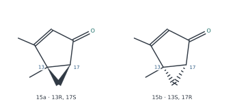

### Question 23 — Deux rôles du CO

> [!INDICATION]
> Retrouver dans le produit le carbone absent de l’ényne.

#### Solution

CO fournit le carbone et l’oxygène du carbonyle de la cyclopenténone et sert de ligand. Une activité suffisante du CO permet de réapprovisionner les complexes carbonylés après son insertion et d’entretenir le cycle catalytique.

### Question 24 — Choisir sur le rendement de l’isomère utile

> [!INDICATION]
> Multiplier le rendement total par la fraction du diastéréoisomère que l’on va poursuivre.

#### Solution

La légende de la figure 6 indique que l’on poursuit **15a**. Les rendements isolables en cet isomère sont, pour W, $0{,}61/2=30{,}5\,\%$, pour Ni, $0{,}84/5=16{,}8\,\%$, pour Mo, $0{,}70/3=23{,}3\,\%$. Le tungstène est le meilleur pour cette cible. Si l’on visait 15b, le classement s’inverserait en tête avec 67,2 % pour Ni. Le cartouche de départ « 14b » de la figure 6 est décalé par rapport à la légende et à la numérotation des questions.

## Cyclopropane, aldolisation et méthylations

### Question 25 — Hydrogénation de face

> [!INDICATION]
> La surface du métal délivre les deux hydrogènes du même côté.

#### Solution

16 est 15a avec la double liaison A=B de la cyclopenténone saturée : A devient CH et B devient CH₂, le cyclopropane est intact. Le substrat adsorbé présente la face la moins masquée au Pd. Les deux H arrivent syn de la surface, à l’opposé de l’encombrement du squelette, avec la jonction ainsi fixée telle qu’elle subsiste dans 17. La question suit la numérotation du texte, le dernier cartouche de la figure 6 désignant en fait 17.

### Question 26 — Tension du petit cycle

> [!INDICATION]
> Comparer l’angle imposé à celui du carbone tétraédrique.

#### Solution

Le carbone saturé est AX₄ et préfère environ 109,5°. Le triangle impose 60° : les liaisons sont coudées et se recouvrent moins efficacement. À cette tension angulaire s’ajoute l’éclipse des substituants sur les carbones voisins.

### Question 27 — Ouverture du cyclopropane

> [!INDICATION]
> Chercher une rupture dont le doublet puisse se délocaliser vers le carbonyle.

#### Solution

H⁻ attaque le méthylène du pont à trois chaînons. La liaison entre ce méthylène et le C α du carbonyle se rompt vers ce C, donnant un énolate : $\mathrm{C_\alpha^--C(=O)\leftrightarrow C_\alpha=C(O^-)}$. L’ancien pont CH₂, resté attaché à C13, devient son substituant Me. La libération de tension et la délocalisation sélectionnent cette ouverture. La protonation à C α, ou la protonation sur O suivie de tautomérie, livre la cyclopentanone 17.

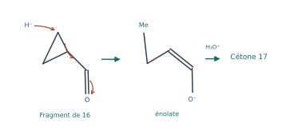

### Question 28 — Triflate et base encombrée

> [!INDICATION]
> Comparer la stabilité des deux anions de sulfonates.

#### Solution

La charge du triflate est délocalisée sur les oxygènes. Le groupe CF₃ fortement inductif attracteur le stabilise davantage que le p-tolyle dans le tosylate. C’est donc une base plus faible et un meilleur groupe partant. La diisopropyléthylamine, base encombrée peu nucléophile, arrache H en α de la cétone activée par coordination de O à B et piège l’acide formé. On obtient l’énolate de bore 18 figuré.

### Question 29 — Aldolisation et quatre configurations

> [!INDICATION]
> Tracer la liaison entre C α de 18 et l’ancien C aldéhydique de 19.

#### Solution

Notons F le furyle déjà substitué de 19. La double liaison de l’énolate attaque le C de $\mathrm{O{=}CH-CH_2-F}$, la liaison π de l’aldéhyde va sur O et le carbonyle de la cyclopentanone se reforme. Hydrolyse de l’alcoolate lié au bore : $\mathrm{cycle-C_\alpha(H)-CH(OH)-CH_2-F}$. Pour cette même constitution, choisir le substituant CH(OH)CH₂F en avant ou en arrière du cycle et l’un ou l’autre sens du nouveau C–OH. Les couples $(+,+),(+,-),(-,+),(-,-)$ sur ces deux seuls centres décrivent les quatre diastéréoisomères, les liaisons de $R_1,R_2$ restant celles de 17.

### Question 30 — Coordonnée de réaction

> [!INDICATION]
> Distinguer chemin moléculaire et durée de l’expérience.

#### Solution

CR paramètre la progression géométrique des noyaux le long d’un chemin entre réactifs et produits sur une surface d’énergie. Elle combine par exemple la formation de C–C et les variations C–O et O–B. Un maximum du chemin de moindre énergie correspond à l’état de transition.

### Question 31 — Comparer les barrières

> [!INDICATION]
> Lire à la fois les niveaux X et TS, puis préciser la population de départ supposée.

#### Solution

Relativement à chacun des X, les barrières sont 8,9, 8,3, 9,8 et 15,9 kcal·mol⁻¹. Pour des X initialement également peuplés qui réagissent séparément, la voie 2 est intrinsèquement la plus rapide. Pour des conformères qui s’interconvertissent rapidement, leur population de Boltzmann intervient : $p_i k_i\propto\exp[-G(TS_i)/RT]$. Le **TS1** à 9,4 kcal·mol⁻¹ domine alors, avec la chaîne CH₂–furyle pseudoéquatoriale, du côté opposé aux contacts H/H dessinés en bleu pour TS2. Le produit est Z1 : conserver la liaison naissante entre le C α et le C aldéhydique de la chaise TS1, remplacer B–O par O–H et restituer la cétone. La chaise TS2 inverserait la configuration du seul carbone alcoolique par rapport à TS1. La seule mention « contrôle cinétique » ne spécifie pas la vitesse d’interconversion des X. Le minimum Z3 est sans pertinence pour le choix cinétique.

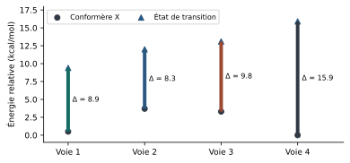

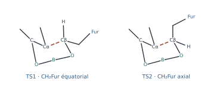

### Question 32 — Crotonisation

> [!INDICATION]
> Repérer les hydrogènes situés en α du carbonyle de l’aldol.

#### Solution

En milieu basique chaud, HO⁻ arrache H en α du cycle. L’énolate ainsi formé élimine HO⁻ du carbone β par E1cb, après délocalisation du doublet en Cα=Cβ. Le produit 21 conserve le carbonyle cyclique et présente la double liaison exocyclique $\mathrm{C_\alpha{=}CH-CH_2-F}$. Les deux centres créés à l’étape d’aldolisation deviennent plans.

### Question 33 — Addition conjuguée de méthyle

> [!INDICATION]
> Écrire la forme mésomère à charge positive sur C β.

#### Solution

$\mathrm{O=C-C_\alpha=C_\beta\leftrightarrow {}^-O-C=C_\alpha-C_\beta^+}$. La forme polarisée du carbonyle expose aussi C carbonylé. Le cuprate transfère un Me au C β, les électrons π vont vers le carbonyle pour former l’énolate. Protonation en α (ou sur O puis tautomérie) restitue la cétone 22 portant la chaîne $\mathrm{-CH(Me)-CH_2-F}$ sur le carbone α droit. La configuration du CHMe est celle du dessin qui précède 24.

### Question 34 — Méthylation thermodynamique

> [!INDICATION]
> L’éthanolate forme-t-il quantitativement et irréversiblement l’énolate ?

#### Solution

Pour $\mathrm{EtO^-+cetone\rightleftharpoons EtOH+enolate}$, $K\sim10^{16-25}=10^{-9}$. L’énolisation est réversible, et les 24 h avant CH₃I permettent la sélection de l’énolate le plus substitué, formé au C α portant déjà la chaîne, à droite du dessin. Ce C de l’énolate attaque CH₃I par substitution bimoléculaire, I⁻ part. 23 est la cétone avec un C α quaternaire portant simultanément Me (coin plein dans la vue de 24) et CH(Me)CH₂F.

## Énone, oxygène et spiroacétal

### Question 35 — Contrôler la formation de l’énone

> [!INDICATION]
> Choisir un signal qui distingue 24 de la cétone saturée 23.

#### Solution

Une CCM côte à côte avec un témoin de départ montre la consommation de 23 et l’apparition d’une nouvelle tache. Pour confirmer l’identité, la RMN révèle dans 24 un proton vinylique du cycle et deux C sp² supplémentaires. En IR, la conjugaison déplace le carbonyle de cyclopentanone vers les plus faibles nombres d’onde et une nouvelle bande C=C peut apparaître vers 1 620–1 680 cm⁻¹. Une nouvelle tache seule ne permet pas d’attribuer sa structure.

### Question 36 — Réduction sélective de 24

> [!INDICATION]
> Le produit garde sa double liaison et transforme la cétone en alcool.

#### Solution

Ajouter $\mathrm{NaBH_4}$ à $\mathrm{CeCl_3/MeOH}$ (réduction de Luche). Le cérium coordonne l’oxygène et favorise l’addition 1,2. La protonation de l’alcoolate donne l’alcool allylique 25.

### Question 37 — Nature de la cyclisation oxydante

> [!INDICATION]
> Identifier le diène et le fragment à deux atomes qui le ponte.

#### Solution

C’est une cycloaddition concertée [4+2] de type Diels–Alder. Le furane apporte ses quatre électrons π, le dioxygène singulet joue le rôle du diénophile et forme un pont endoperoxyde conservant O–O.

### Question 38 — Orbitales du dioxygène

> [!INDICATION]
> Fixer un axe internucléaire et distinguer les recouvrements axiaux des latéraux.

#### Solution

Avec $z$ suivant O–O, l’ordre de valence est $\sigma_g(2s)^2,\sigma_u^*(2s)^2,\sigma_g(2p_z)^2,\pi_u(2p_x)^2=\pi_u(2p_y)^2,\pi_g^*(2p_x)^1=\pi_g^*(2p_y)^1,\sigma_u^*(2p_z)^0$. Les deux électrons célibataires ont des spins parallèles (Hund, triplet). Les niveaux de cœur $\sigma_g(1s)^2,\sigma_u^*(1s)^2$ sont plus bas. Une σ résulte d’un contact axial, une π d’un contact latéral. Une combinaison antiliante possède un nœud supplémentaire entre noyaux. L’indice de liaison est $(8-4)/2=2$ pour la valence.

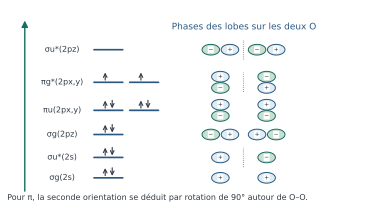

### Question 39 — Recouvrement et énergie

> [!INDICATION]
> Inspecter les phases de la HO sur les deux extrémités du diène.

#### Solution

La HO du furane présente des lobes opposés aux deux carbones terminaux. On peut orienter une $\pi_g^*$ de O₂ de manière à obtenir un recouvrement constructif aux deux futures liaisons C–O. HO du furane/SOMO de O₂ réunit initialement trois électrons. Deux occupent la combinaison liante, un l’antiliante, donc le bilan est stabilisant. L’écart $|-9{,}31-(-12{,}7)|=3{,}39$ eV est bien inférieur à celui SOMO(O₂)/BV(furane), 13,42 eV, ou HO(furane)/BV(O₂), 13,51 eV.

### Question 40 — Énergie d’un photon rouge

> [!INDICATION]
> Convertir $hc/\lambda$ en électronvolts avant de comparer.

#### Solution

À 650 nm, $E=3{,}06\,10^{-19}$ J soit 1,91 eV. L’écart SOMO–BV de O₂ vaut 16,9 eV et l’écart HO–BV du furane 10,03 eV. Au niveau des énergies fournies, un photon ne suffit pour aucune de ces promotions vers une orbitale vacante de plus haute énergie.

### Question 41 — Réactivité du singulet

> [!INDICATION]
> Conserver les électrons dans le sous-espace des deux π* dégénérées.

#### Solution

Le dioxygène excité est singulet, de spin total nul. Dans une représentation orbitale de $^1\Delta_g$, on peut employer une composante à paire dans une $\pi_g^*$ et l’autre $\pi_g^*$ vacante ; la description complète du terme requiert des combinaisons de configurations. Le furane peut donner deux électrons dans la combinaison vacante de symétrie adaptée, sans occupation simultanée de l’interaction antiliante. La réaction concertée entre singulets devient compatible avec la conservation du spin.

### Question 42 — Rôle du colorant

> [!INDICATION]
> Relier absorption visible, croisement intersystème et transfert d’énergie.

#### Solution

Le bleu de méthylène est un photosensibilisateur. Il absorbe la lumière, accède à un état triplet par conversion intersystème, puis transfère de l’énergie au dioxygène triplet. Le colorant revient à son état fondamental et le dioxygène est produit à l’état singulet. Cela explique la photosensibilisation même si l’absorption directe triplet–singulet de O₂ est faible.

### Question 43 — Formation du spiroacétal

> [!INDICATION]
> Commencer par le nucléophile alcoolique de 27.

#### Solution

Protoner la cétone de la chaîne, puis faire attaquer son carbone par le doublet du OH allylique de 27 : fermeture du cycle E à six et formation d’un hémiacétal cyclique après transfert de proton. Protoner l’OH issu de la cétone, puis départ de H₂O vers un oxocarbénium stabilisé par l’oxygène de E. Le OH carboxylique attaque intramoléculairement ce même C, fermant la lactone insaturée F à cinq. Déprotonation de l’oxonium régénère l’acide. Les deux O simples de E et F se rejoignent au nouveau centre spiro.

### Question 44 — De 28 au produit naturel

> [!INDICATION]
> Il faut oxyder un seul des deux alcools protégés.

#### Solution

Enlever sélectivement TES de l’alcool du cycle C dans les conditions orthogonales du document 1 (fluorure de tétrabutylammonium sous contrôle). Oxyder cet alcool secondaire en cétone, par exemple par Dess–Martin. Déprotéger ensuite l’éther TBS du cycle A avec un fluorure approprié pour libérer le OH final. La succession permet de garder protégé l’alcool qui doit subsister lors de l’oxydation.

## Luminlays. Tacticité du PMMA

### Question 45 — Diades et triades du PMMA

> [!INDICATION]
> Fixer un sens de parcours et un premier centre de référence.

#### Solution

Dessiner le squelette étendu $\mathrm{L-CH_2-C^*(Me)(CO_2Me)-CH_2-C^*(Me)(CO_2Me)-\cdots-R}$ en gardant des extrémités distinctes des Me latéraux. Notons + un ester en coin plein, − un ester en coin hachuré dans la même convention de squelette, avec le Me sur la face opposée. À inversion globale près, les diades sont ++ (méso, m) et +− (racémo, r). Les triades sont +++ (mm), ++− (mr), +−− (rm), +−+ (rr). Le spectre ne distingue pas nécessairement mr et rm, qui sont deux lectures inverses d’un même voisinage.

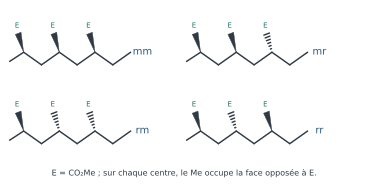

### Question 46 — Rigidité et mise en forme

> [!INDICATION]
> Comparer l’alternance des substituants et les fractions obtenues par chaque méthode.

#### Solution

L’alternance régulière des gros esters peut favoriser l’empilement des chaînes, des contacts interchaînes plus étendus et davantage d’interactions de dispersion coopératives. Les mouvements segmentaires sont freinés, en accord avec $T_g$ de 160 °C, contre 105 et 43 °C dans le tableau. Pour une incrustation rigide, la voie radicalaire donne ici le plus de syndiotactique (55,5 %). Une $T_g$ élevée rend le thermoformage plus exigeant et laisse une pièce plus cassante au-dessous de cette température.

### Question 47 — Deux lavages sur le fritté

> [!INDICATION]
> Raisonner sur la fraction d’impureté dissoute qui reste dans le liquide retenu.

#### Solution

Si le gâteau retient un volume $v$ de liquide après essorage et qu’un lavage de volume $V$ se mélange à ce liquide, il reste la fraction $v/(v+V)$ de l’impureté soluble. Avec deux lavages de 15 mL la fraction est $[v/(v+15)]^2$, inférieure à $v/(v+30)$ pour $v>0$. Renouveler l’eau rétablit un gradient d’extraction.

### Question 48 — RMN et IR de la polymérisation

> [!INDICATION]
> Chercher d’abord les marqueurs de la liaison π consommée.

#### Solution

Les deux H vinyliques de MMA vers 5,6 et 6,1 ppm disparaissent dans le PMMA. On voit les CH₂ saturés de la chaîne vers 1,6–2,1 ppm et les Me latéraux vers 0,8–1,2 ppm, tandis que OMe demeure vers 3,6 ppm. En IR la bande $\nu(\mathrm{C=C})$ vers 1 635 cm⁻¹ du MMA disparaît fortement, alors que le carbonyle d’ester reste intense vers 1 720–1 730 cm⁻¹. La combinaison de ces indices confirme la transformation de l’alcène en chaîne saturée.

### Question 49 — Effet d’un haut champ RMN

> [!INDICATION]
> Comparer un écart de déplacements chimiques et un couplage en hertz.

#### Solution

À déplacements chimiques distincts fixés en ppm, l’écart de fréquences croît avec $B_0$. Le couplage $J$ reste approximativement constant en hertz, et son espacement exprimé en ppm diminue comme $1/B_0$. Les signaux voisins dus aux différents environnements de triade se séparent donc mieux.

### Question 50 — Polymère isotactique et région aliphatique

> [!INDICATION]
> Compter les environnements du méthyle α et distinguer les deux H d’un méthylène méso.

#### Solution

Un isotactique idéal ne donne qu’une famille de triades mm et donc une seule résonance principale pour les Me latéraux (singulet, 3 H par motif, près de 1,2 ppm). Les deux H diastéréotopiques du CH₂ d’une diade m peuvent donner deux composantes d’un système AB, dédoublées par le couplage géminé, vers 1,5–2,2 ppm. Les trois signaux de Me de la figure 17 excluent un polymère purement isotactique.

### Question 51 — Attribution des trois pics

> [!INDICATION]
> Combiner intégrations et enrichissement syndiotactique de la voie radicalaire.

#### Solution

Le signal ① le plus intense, vers 1,0 ppm, est rr. Le signal ② intermédiaire est mr+rm, et le faible ③ le plus déblindé est mm. L’ordre des aires concorde avec la prédominance des diades racémo de cette voie. Deux orientations mixtes contribuent au paquet ②. Les multiplicités apparentes du tracé ne correspondent pas à un simple comptage de H vicinaux des Me, car le carbone portant chaque Me ne porte aucun H.

### Question 52 — Probabilités de triades

> [!INDICATION]
> Une triade contient deux choix successifs de diade.

#### Solution

Si $p=P_m$ et les choix sont indépendants et identiquement distribués, $P_{mm}=p^2$, $P_{mr+rm}=2p(1-p)$ et $P_{rr}=(1-p)^2$. Les deux ordres m puis r et r puis m sont incompatibles et de même probabilité. La somme vaut 1.

### Question 53 — Aires relatives et paramètre de Bernoulli

> [!INDICATION]
> Comparer les trois courbes et utiliser les aires normalisées.

#### Solution

La courbe croissante est $P_{mm}$, la décroissante $P_{rr}$, et celle à maximum 1/2 en $p=1/2$ est $P_{mr+rm}$. Les observations donnent respectivement 0,10, 0,50 et 0,40 pour mm, rr et mixte. La proportion de diades m est $0{,}10+0{,}40/2=0{,}30$. On prédit alors 0,09, 0,49 et 0,42. Le modèle est compatible avec la précision des intégrales, sans être démontré par leur seule proximité.

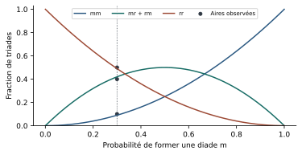

## Osmométrie et moyennes molaires

### Question 54 — Sens du flux osmotique

> [!INDICATION]
> Comparer le potentiel chimique du benzène seul et dans le mélange.

#### Solution

Initialement les deux côtés sont à même $T,P$. En A, $\mu_1^A=\mu_1^*$ ; en B, $\mu_1^B=\mu_1^*+RT\ln x_1<\mu_1^A$. La membrane laissant passer le benzène, le transfert A vers B diminue G. À l’équilibre, la surpression du côté solution relève son potentiel chimique jusqu’à l’égalité.

### Question 55 — Volume molaire partiel

> [!INDICATION]
> Effectuer les deux dérivations croisées de la même fonction G.

#### Solution

Pour un mélange, $dG=-S\,dT+V\,dP+\sum_j\mu_j\,dn_j$. Ainsi $\mu_i=(\partial G/\partial n_i)_{T,P,n_{j\ne i}}$ et $V=(\partial G/\partial P)_{T,n}$. L’égalité des dérivées croisées donne $(\partial\mu_i/\partial P)_{T,n}=(\partial V/\partial n_i)_{T,P,n_{j\ne i}}=\overline V_i$, volume molaire partiel.

### Question 56 — Loi de Van’t Hoff

> [!INDICATION]
> Écrire l’égalité des potentiels chimiques au terme du flux.

#### Solution

À l’équilibre, $0=\int_P^{P+\Pi}\overline V_1\,dP+RT\ln x_1$. Pour un liquide peu compressible et une solution idéale diluée, $\overline V_1\simeq V_1^*$ et $-\ln x_1=-\ln(1-x_2)\simeq n_2/n_1$. Avec $V\simeq n_1V_1^*$ on obtient $\Pi\simeq RT n_2/V=RTC$. La concentration compte les macromolécules entières.

### Question 57 — Pourquoi l’osmose mesure une moyenne en nombre

> [!INDICATION]
> Exprimer ensemble la masse et le nombre de moles de toutes les chaînes.

#### Solution

Pour $n_i$ moles de chaînes de masse molaire $M_i$, $C_m=\sum n_i M_i/V$ et $C=\sum n_i/V$. Leur rapport vaut $M_n=\sum n_i M_i/\sum n_i$, d’où $\Pi=RTC_m/M_n$. Chaque chaîne exerce le même effet osmotique par particule. La moyenne massique $M_w$ pondère au contraire par $n_iM_i$.

### Question 58 — Écart à l’idéalité

> [!INDICATION]
> Tracer Π contre la concentration et tester la pente depuis l’origine.

#### Solution

Les quatre points, dans les unités du tableau, sont (5 ; 1,09), (10 ; 2,49), (20 ; 6,02), (30 ; 10,7). La pente depuis l’origine passe de 0,218 à 0,249, 0,301 puis 0,357. Le tracé se courbe vers le haut : la loi idéale linéaire devient insuffisante aux concentrations étudiées. Ce test de proportionnalité est indépendant du facteur d’échelle imprimé pour Π.

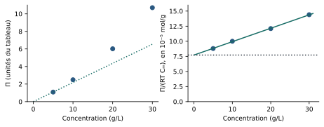

### Question 59 — Extrapolation à dilution infinie

> [!INDICATION]
> Lire l’ordonnée à l’origine, puis l’inverser.

#### Solution

Sur le graphe corrigé, l’extrapolation à $C_m=0$ donne $1/M_n\simeq(7{,}6$ à $7{,}9)\,10^{-5}$ mol·g⁻¹. Ainsi $M_n\simeq1{,}3\,10^4$ g·mol⁻¹ et $DP_n\simeq M_n/100\simeq130$ motifs, en négligeant les masses de bouts de chaîne. L’axe gradué du graphe corrigé permet cette lecture indépendamment de l’unité atypique du tableau de pression.

## Chromatographie d’exclusion stérique

### Question 60 — Exclusion stérique

> [!INDICATION]
> Dessiner les pores comme des détours accessibles différemment selon la taille.

#### Solution

Une grosse pelote contourne les billes et circule dans le volume interstitiel. Une petite pelote explore en plus une partie des pores avant de rejoindre le courant. À chimie et conformation comparables, les grandes masses éluent donc en premier, les petites en dernier. La séparation porte directement sur le volume hydrodynamique.

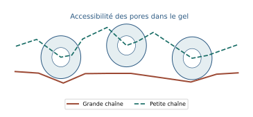

### Question 61 — Volume d’élution

> [!INDICATION]
> Quel est le volume des pores seuls ?

#### Solution

Les pores occupent $V_t-V_0$. La molécule accède à une fraction $K_d$ de ce volume, donc $V_e=V_0+K_d(V_t-V_0)$. Très grande, $K_d\simeq0$ et $V_e\simeq V_0$. Très petite, $K_d\simeq1$ et $V_e\simeq V_t$.

### Question 62 — Masse moyenne en masse sur le chromatogramme

> [!INDICATION]
> Intégrer le pic positif avec sa ligne de base et lire les masses sur l’axe de droite logarithmique.

#### Solution

Le pic de polymère s’étend approximativement de 7,1 à 9,2 mL, avec son maximum vers 8,1 mL. Pour des tranches de même largeur, soustraire la ligne de base locale du signal $h_j$, puis lire $M_j$ sur la courbe rouge d’étalonnage au même volume. Pour un détecteur à réponse massique comparable, $M_w\simeq\sum h_jM_j/\sum h_j$. Une intégration graphique fournit environ $2\,10^4$ g·mol⁻¹ (ordre de grandeur 2 à 3 dizaines de milliers suivant les limites et la ligne de base), soit $I_p\simeq1{,}6$ avec $M_n\simeq1{,}3\,10^4$. La masse au sommet est seulement la masse du mode. Les fortes déflexions tardives ne font pas partie du pic intégré.

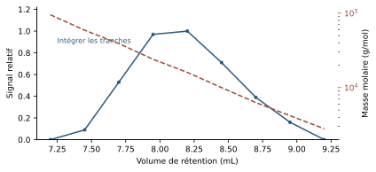

### Question 63 — Dispersité et variance

> [!INDICATION]
> Former la différence entre les deux moments de la distribution en nombre.

#### Solution

$M_w=\langle M^2\rangle_n/\langle M\rangle_n$ et $M_n=\langle M\rangle_n$, d’où $I_p=1+\mathrm{Var}_n(M)/M_n^2\ge1$. L’égalité requiert une seule masse pour toutes les chaînes. En synthèse radicalaire, amorçages, propagations et terminaisons ne surviennent pas aux mêmes instants pour toutes : la variance est positive.

## Cinétique radicalaire et recyclage

### Question 64 — Vitesses totales

> [!INDICATION]
> Sommer sur toutes les longueurs en utilisant l’unicité des constantes de vitesse.

#### Solution

$v_p=\sum_jk_p[R_j^\bullet][M]=k_p[R^\bullet][M]$. La définition de terminaison adoptée dans le texte donne $v_t=k_t(\sum_i[R_i^\bullet])(\sum_j[R_j^\bullet])=k_t[R^\bullet]^2$.

### Question 65 — État quasi stationnaire des radicaux

> [!INDICATION]
> La propagation change la longueur d’une chaîne sans changer le nombre total de radicaux.

#### Solution

Pour les radicaux primaires très réactifs, $d[I^\bullet]/dt=2k_d[A]-v_a\simeq0$. Pour les macroradicaux, la propagation se compense dans la somme. Avec la convention de l’expression demandée, $k_t[R^\bullet]^2$ est la vitesse **de disparition des centres radicaux** : $d[R^\bullet]/dt=v_a-k_t[R^\bullet]^2\simeq0$, d’où $[R^\bullet]=\sqrt{2k_d[A]/k_t}$. Si l’on compte chaque événement de combinaison une seule fois, il consomme deux radicaux et sa constante vaut $k_t/2$ dans cette convention. Les approximations tiennent après le transitoire court d’amorçage.

### Question 66 — Loi de consommation du monomère

> [!INDICATION]
> L’amorçage et la propagation consomment tous deux M, mais avec des poids différents.

#### Solution

Pour des chaînes longues, $-d[M]/dt=v_a+v_p\simeq k_p\sqrt{2k_d/k_t}\,[M][A]^{1/2}$. Ainsi $k=k_p\sqrt{2k_d/k_t}$, les ordres partiels sont 1 en monomère et 1/2 en amorceur, et l’ordre global est 3/2.

### Question 67 — Pseudo-premier ordre

> [!INDICATION]
> Identifier le réactif dont la concentration peut être tenue constante.

#### Solution

Si $[A]$ varie très peu pendant la durée considérée (ou est maintenue constante), $k_{\mathrm{obs}}=k\sqrt{[A]}$ est constant. On observe un ordre apparent un en $M$, par dégénérescence de l’ordre.

### Question 68 — Demi-vie de l’amorceur

> [!INDICATION]
> Utiliser la dissociation propre de A.

#### Solution

$-d[A]/dt=k_d[A]$, donc $t_{1/2}=\ln2/k_d\simeq9{,}9\,10^4$ s = 27,5 h. Après 1 h, $[A]/[A]_0=e^{-0{,}0252}\simeq0{,}975$. La variation de 2,5 % justifie l’approximation de concentration pratiquement constante sur cet intervalle.

### Question 69 — Durée de vie des centres actifs

> [!INDICATION]
> Diviser le stock de radicaux par son flux de disparition.

#### Solution

$[R^\bullet]\simeq\sqrt{2(7{,}0\,10^{-6})(10^{-3})/(3{,}5\,10^7)}=2{,}0\,10^{-8}$ mol·L⁻¹. Le flux est $2k_d[A]=1{,}4\,10^{-8}$ mol·L⁻¹·s⁻¹, donc $\tau=[R^\bullet]/(2k_d[A])\simeq1{,}4$ s. Un radical disparaît à une échelle bien plus courte que celle de variation du mélange sur une heure, comme l’exige l’état quasi stationnaire.

### Question 70 — Longueur cinétique de chaîne

> [!INDICATION]
> Comparer le flux de monomères propagés et le flux de chaînes amorcées.

#### Solution

Initialement $v_p=700(2{,}0\,10^{-8})(1{,}0)=1{,}4\,10^{-5}$ mol·L⁻¹·s⁻¹ et $v_a=1{,}4\,10^{-8}$ dans les mêmes unités. Ainsi $\lambda=v_p/v_a\simeq10^3$ : un radical propage environ mille motifs avant de mourir. L’hypothèse de chaînes longues est vérifiée. $\lambda=k_p[M]/\sqrt{2k_dk_t[A]}$ diminue avec $[M]$ lorsque $[A]$ reste quasi constante.

### Question 71 — Critère thermodynamique

> [!INDICATION]
> Ne pas confondre conditions courantes et conditions standard.

#### Solution

À température et pression fixées, avancer dans le sens direct diminue G si $\Delta_rG=\Delta_rG^\circ+RT\ln Q<0$, soit $Q<K$. À l’équilibre $\Delta_rG=0$.

### Question 72 — Chaleur par motif

> [!INDICATION]
> Écrire le nombre d’étapes de propagation après le premier motif.

#### Solution

Pour une chaîne comportant $i$ motifs, avec amorçage incorporant le premier et un terme de terminaison attribué à la chaîne, $\Delta_pH^\circ=[\Delta_aH^\circ+(i-1)\Delta_{pr}H^\circ+\Delta_tH^\circ]/i$. Si deux chaînes terminent ensemble, on répartit l’enthalpie terminale entre elles. Pour $i\gg1$, les deux termes de bout sont négligeables : $\Delta_pH^\circ\simeq\Delta_{pr}H^\circ$.

### Question 73 — Entropie et énergie des liaisons

> [!INDICATION]
> Comparer un monomère libre et un motif dans la chaîne.

#### Solution

L’incorporation fait perdre à chaque monomère de la liberté de translation et réduit le nombre de configurations accessibles, d’où $\Delta_pS^\circ<0$. Le bilan retrouve deux liaisons simples à la place d’une double, donc une estimation $600-2(350)=-100$ kJ·mol⁻¹. Le signe et l’ordre de grandeur sont ceux de −56 kJ·mol⁻¹. Les énergies moyennes ne tiennent pas compte de la substitution et du milieu.

### Question 74 — Température plafond et recyclage

> [!INDICATION]
> Faire apparaître l’activité du monomère dans la condition de propagation.

#### Solution

Si les deux activités radicalaires se compensent, $Q\simeq1/a_M$. Ainsi $\Delta_rG=\Delta_pH^\circ-T(\Delta_pS^\circ+R\ln a_M)$. Pour un dénominateur négatif dans le domaine considéré, $T_p=\Delta_pH^\circ/(\Delta_pS^\circ+R\ln a_M)$ et la propagation est favorable pour $T<T_p$. À $a_M=1$, $T_p\simeq479$ K, soit 206 °C. Chauffer au-dessus de la température plafond et retirer le MMA libéré permet un recyclage chimique par dépolymérisation. Le retrait du monomère favorise le sens inverse.

## Fluorescence et phosphorescence

### Question 75 — Déclin du singulet

> [!INDICATION]
> Distinguer le retour T vers S des trois sorties de S.

#### Solution

Après extinction, avec retour $T_1\to S_1$ négligeable comme le suppose l’équation demandée, $\dot S=-(k_f+k_{CI}+k_{CIS})S$, où $S=[S_1]$. Ainsi $\tau_f=1/(k_f+k_{CI}+k_{CIS})$ et $S(t)=S(0)e^{-t/\tau_f}$. Si le dernier retour CIS imprimé dans le mécanisme est maintenu à vitesse significative, il faut ajouter $+k_{TS}[T_1]$ au bilan et la décroissance ne suit plus en général cette exponentielle simple.

### Question 76 — Alimentation et décroissance du triplet

> [!INDICATION]
> Intégrer l’équation du triplet avec le singulet de la question 75.

#### Solution

Avec $T(0)=0$, retour négligeable et $\tau_p=1/k_p$, on a $\dot T+T/\tau_p=k_{CIS}S(0)e^{-t/\tau_f}$. Multiplier par $e^{t/\tau_p}$ et intégrer de 0 à $t$ donne $T(t)=k_{CIS}S(0)\,\tau_f\tau_p[ e^{-t/\tau_f}-e^{-t/\tau_p}]/(\tau_f-\tau_p)$. Si les deux durées sont égales à $\tau$, la limite est $k_{CIS}S(0)t e^{-t/\tau}$.

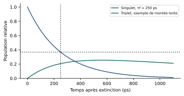

### Question 77 — Régimes prompt et retardé

> [!INDICATION]
> Séparer le transitoire de formation de la décroissance lente.

#### Solution

$S(t)=S(0)e^{-t/\tau_f}$ reste inchangé. Pour $\tau_f\ll\tau_p$, $T(t)\simeq k_{CIS}S(0)\tau_f(e^{-t/\tau_p}-e^{-t/\tau_f})$. Après quelques $\tau_f$, seul subsiste le terme lent $k_{CIS}S(0)\tau_f e^{-t/\tau_p}$. On observe une fluorescence prompte et une éventuelle phosphorescence plus durable. La durée seule ne fixe pas les nombres totaux de photons des deux émissions.

### Question 78 — Rendements et état de départ

> [!INDICATION]
> Distinguer le branchement d’un triplet déjà formé du rendement par photon absorbé.

#### Solution

Au départ du singulet, $\phi_f=k_f/(k_f+k_{CI}+k_{ST})$, avec $k_{ST}=k_{CIS}$ pour $S\to T$. Pour un triplet formé, les deux voies du schéma complet donnent $\phi_{p\mid T}=k_p/(k_p+k_{TS})$, soit $k_p/(k_p+k_{CIS})$ avec la notation commune du sujet. Par photon absorbé, il faut aussi peupler T. En négligeant le retour comme aux Q75–77, $\Phi_p=k_{ST}/(k_f+k_{CI}+k_{ST})$, car chaque triplet phosphoresce. Si le retour est conservé et peut relancer les cycles, poser $a=k_{ST}/(k_f+k_{CI}+k_{ST})$ et $b=k_p/(k_p+k_{TS})$ : le rendement global de phosphorescence est $ab/[1-a(1-b)]$ par sommation des retours successifs.

## Coumarines et mesures optiques

### Question 79 — Construire le noyau coumarine

> [!INDICATION]
> Former d’abord la liaison C–C entre malonate et aldéhyde.

#### Solution

Sous catalyse basique douce, l’acide malonique forme un nucléophile en son CH₂, qui s’additionne au salicylaldéhyde. Déshydratation de Knoevenagel : ortho-$\mathrm{HO-C_6H_4-CH=C(CO_2H)_2}$. En milieu approprié, l’OH phénolique attaque intramoléculairement un carboxyle et ferme une lactone à six avec perte d’eau. Le chauffage décarboxyle l’acide coumarine-3-carboxylique et restitue le H en C3, donnant la coumarine modèle.

### Question 80 — Couleurs d’émission

> [!INDICATION]
> Lire pour chaque coumarine son propre maximum d’émission.

#### Solution

Dans les deux figures, le bleu est l’absorption et le noir l’émission, décalée vers le rouge après les pertes vibrationnelles. La coumarine 6 absorbe près de 455–460 nm et émet près de 500 nm (bleu-vert à vert). La 314 absorbe vers 435–440 nm et émet vers 475–480 nm (bleu à bleu-cyan). Elles permettent des repères lumineux visibles de teintes différentes lorsqu’elles sont excitées.

### Question 81 — Déplacement de Stokes

> [!INDICATION]
> Qu’arrive-t-il à la lumière émise si elle se trouve encore dans la bande d’absorption ?

#### Solution

Un grand décalage diminue le recouvrement entre absorption et émission. La fluorescence est moins réabsorbée dans l’épaisseur du matériau, s’échappe plus facilement et se sépare mieux de la lumière excitatrice.

### Question 82 — Intensité de fluorescence et absorbance

> [!INDICATION]
> Exprimer la lumière réellement absorbée avant de multiplier par le rendement.

#### Solution

En flux de photons comparables et à géométrie de collecte fixée, $I_t=I_0 10^{-A}$ et $I_{abs}=I_0-I_t$. Il vient $I_f=\phi_f I_0(1-10^{-A})$, à un facteur de collecte près si le détecteur ne reçoit qu’une partie de l’émission.

### Question 83 — Proportionnalité à faible concentration

> [!INDICATION]
> Combiner le développement limité et Beer–Lambert.

#### Solution

À faible absorbance, $1-10^{-A}\simeq(\ln10)A$ et $A=\varepsilon\ell c$. On obtient $I_f\simeq kc$ avec $k=(\ln10)\phi_f I_0\varepsilon\ell\simeq2{,}30\phi_f I_0\varepsilon\ell$. Le rendement dépend des voies concurrentes selon Q78.

### Question 84 — Temps de fluorescence et rendement de la coumarine 6

> [!INDICATION]
> Lire l’instant où l’intensité est tombée à sa valeur initiale divisée par e.

#### Solution

$I_f(t)=k_f[S_1](t)$, donc le temps pour passer d’environ 2 000 à environ 735 unités vaut $\tau_f\simeq250$ ps, avec une incertitude graphique de quelques dizaines de ps. On en déduit $\phi_f=k_f\tau_f\simeq(2\,10^9)(2{,}5\,10^{-10})\simeq0{,}50$.

### Question 85 — Pente de Beer–Lambert

> [!INDICATION]
> Employer le maximum d’absorption, puis diviser la pente par la longueur de cuve.

#### Solution

Mesurer vers 455–460 nm, maximum d’absorption de la coumarine 6, où la sensibilité est élevée et la pente spectrale faible. Les quatre points de $A(c)$ ajustés par une droite passant par l’origine donnent une pente d’environ $0{,}102$ par µmol·L⁻¹, soit $1{,}02\,10^5$ L·mol⁻¹. Avec $\ell=2$ cm, **$\varepsilon\simeq5{,}1\,10^4$ L·mol⁻¹·cm⁻¹**. Le fluorophore capte donc efficacement la lumière excitatrice à faible charge, propriété souhaitable dans un repère en PMMA.

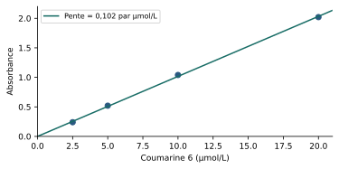
