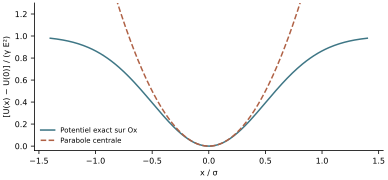
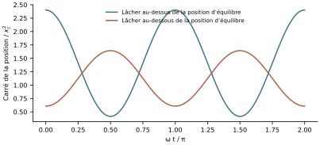
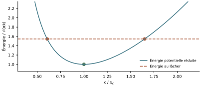
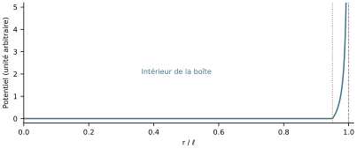
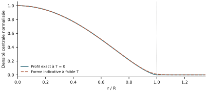
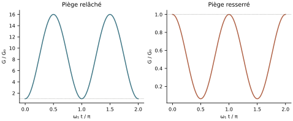

# Physique C — ENS PC 2024 · Corrigé brut

*Corrigé rédigé par IA, non officiel.*

**Rédaction** · GPT-6.2 Astra Ultra · vitesse non renseignée

## 1 · Piège optique

### Question 1 — Oscillateur isotrope

**a)** La force est $\mathbf F=-\nabla U=-k\mathbf r$. Dans le référentiel galiléen, $m\ddot{\mathbf r}=-k\mathbf r$. Chaque coordonnée $u=x,y,z$ vérifie $\ddot u+\omega^2u=0$, avec $\omega=\sqrt{k/m}$.
**b)** La solution est $\mathbf A\cos(\omega t)+\mathbf B\sin(\omega t)$. À $t=0$, la position fixe $\mathbf A=\mathbf r(0)$ et la vitesse fixe $\omega\mathbf B=\mathbf v(0)$. D’où $\mathbf r(t)=\mathbf r(0)\cos(\omega t)+\mathbf v(0)\sin(\omega t)/\omega$.

### Question 2 — Direction et polarisation

Pour le premier faisceau, la phase $qx-\Omega t+\varphi_1$ constante se déplace vers les $x$ croissants. Le champ électrique oscille selon $y$, donc la polarisation est rectiligne suivant $y$. Pour le deuxième, la propagation est vers $+y$ et la polarisation suivant $z$. Pour le troisième, elle est vers $+z$ et la polarisation suivant $x$.

### Question 3 — Énergie dans les faisceaux croisés

Les trois polarisations sont orthogonales, donc le carré de la norme du champ total est la somme des trois carrés, sans termes croisés. À position fixée, chaque $\cos^2$ a pour moyenne $1/2$. On obtient
$$U=-\frac{\gamma E^2}{2}\left[e^{-2(y^2+z^2)/\sigma^2}+e^{-2(x^2+z^2)/\sigma^2}+e^{-2(x^2+y^2)/\sigma^2}\right].$$
Le facteur deux dans chaque exposant provient du carré de l’amplitude.

### Question 4 — Raideur au centre

À l’ordre deux en $r/\sigma$, $e^{-2A/\sigma^2}=1-2A/\sigma^2+O(r^4/\sigma^4)$. La somme des trois $A$ vaut $2(x^2+y^2+z^2)=2r^2$. Ainsi $U(0)=-3\gamma E^2/2$ et $U-U(0)\simeq2\gamma E^2r^2/\sigma^2$. L’identification à $kr^2/2$ donne $k=4\gamma E^2/\sigma^2$.

### Question 5 — Mouvement du lithium 6

**a)** La masse d’un atome vaut $m=(6{,}02\times10^{-3})/(6{,}02\times10^{23})=10^{-26}$ kg. Avec $k=1{,}02\times10^{-18}\ \mathrm{kg\,s^{-2}}$, $\omega\simeq1{,}01\times10^4\ \mathrm{s^{-1}}$. La période est $2\pi/\omega\simeq6\times10^{-4}$ s à un chiffre significatif.
**b)** Pour $\mathbf r(0)=0$, l’amplitude maximale est $v(0)/\omega\simeq1\ \mu\mathrm m$. Elle est environ soixante fois plus petite que $\sigma=60\ \mu\mathrm m$. L’approximation harmonique est cohérente tout au long de cette trajectoire.

### Question 6 — Interférences résiduelles

Des polarisations qui cessent d’être orthogonales donnent des termes en $\mathbf E_i\cdot\mathbf E_j$ dont la moyenne contient une frange spatiale pour des faisceaux cohérents à phases fixes et fréquence commune. Choisir trois fréquences légèrement différentes fait défiler les franges. Si les périodes de battement sont très courtes devant le temps de réponse mécanique de l’atome, les termes croisés se moyennent à zéro et l’on retrouve le potentiel de la question 3, à enveloppes et coefficient $\gamma$ sensiblement inchangés.

## 2 · Oscillateur sur une demi-droite

### Question 7 — Potentiel sur la demi-droite

Le travail de $F_x=\alpha/x^3-kx$ s’intègre sur $x>0$ et ne dépend que des extrémités. Une primitive de $-F_x$ est $U(x)=\alpha/(2x^2)+kx^2/2+C$. Ainsi $A=\alpha/2$ et $B=k/2$.

### Question 8 — Équation fermée pour le carré de la position

Avec $g=x^2$, $m\ddot g=2m\dot x^2+2x(\alpha/x^3-kx)$. Puisque $4E=2m\dot x^2+2\alpha/x^2+2kx^2$, il vient $m\ddot g=4E-4kg$. Le terme singulier est incorporé dans l’énergie conservée.

### Question 9 — Évolution avec des données initiales quelconques

L’équation $\ddot g+4\omega^2(g-E/k)=0$ a pour solution
$$g(t)=\frac Ek+\left(g_0-\frac Ek\right)\cos(2\omega t)+\frac{h_0}{2\omega}\sin(2\omega t).$$
La dérivée initiale vaut bien $h_0$. Le décalage $E/k$ a la dimension d’une longueur au carré.

### Question 10 — Lâcher sans vitesse

Ici $h_0=0$, $g_0=x_0^2$ et $E/k=[x_0^2+\alpha/(kx_0^2)]/2$. Plutôt que de chercher le signe d’une racine à chaque demi-oscillation, on utilise $x>0$. On obtient
$$x(t)=\sqrt{x_0^2\cos^2(\omega t)+\frac{\alpha}{kx_0^2}\sin^2(\omega t)}.$$
Pour une oscillation non constante, la période est $\pi/\omega$. Au point d’équilibre, $x$ est constant.

### Question 11 — Isochronisme

La période est rigoureusement indépendante de l’amplitude même pour de grandes oscillations. Ce résultat est remarquable dans un potentiel anharmonique. Il découle ici de l’équation linéaire exacte pour $x^2$, alors qu’une linéarisation autour d’un minimum ne garantirait en général l’isochronisme que pour des amplitudes infinitésimales.

### Question 12 — Points de retournement

Posons $x_c=(\alpha/k)^{1/4}$ et $x_1=x_c^2/x_0$. Le graphe de $x^2$ est un cosinus de période $\pi/\omega$, de moyenne $(x_0^2+x_1^2)/2$, partant horizontalement de $x_0^2$ et rejoignant $x_1^2$ après une demi-période. Si $x_0>x_c$, alors $(x_{\min},x_{\max})=(x_1,x_0)$. Si $x_0<x_c$, les valeurs sont $(x_0,x_1)$. En cas d’égalité, la trajectoire se réduit à $x_c$.

### Question 13 — Vérification par l’énergie

Le potentiel diverge à $0^+$ et à l’infini. Sa dérivée $kx-\alpha/x^3$ change de signe en $x_c=(\alpha/k)^{1/4}$ et $U''=k+3\alpha/x^4>0$. Un niveau d’énergie au-dessus du minimum coupe la courbe en deux points. Au lâcher et au retournement, les vitesses sont nulles. L’égalité $U(x)=U(x_0)$ se factorise en $(x^2-x_0^2)[k-\alpha/(x^2x_0^2)]=0$. Les deux solutions positives $x_0$ et $\sqrt{\alpha/k}/x_0$ sont de part et d’autre de $x_c$ sauf au minimum, et l’on retrouve les deux classements de la question 12.

## 3 · Viriel et système de particules

### Question 14 — Force extérieure locale

La force extérieure sur la particule $i$ est $\mathbf F_{\mathrm{ext},i}=-(\nabla U_{\mathrm{ext}})(\mathbf r_i)$. Le gradient porte sur la variable spatiale du potentiel, puis on évalue ce champ à la position de la particule.

### Question 15 — Force de paire

Le vecteur unitaire allant de $j$ vers $i$ est $(\mathbf r_i-\mathbf r_j)/r_{ij}$. En le multipliant par la norme répulsive $\alpha/r_{ij}^3$, on obtient $\mathbf F_{j\to i}=\alpha(\mathbf r_i-\mathbf r_j)/r_{ij}^4$. On retrouve directement $\mathbf F_{i\to j}=-\mathbf F_{j\to i}$.

### Question 16 — Viriel microscopique

Pour $G=\sum_i r_i^2$, on a $m\ddot G=4E_{\rm cin}+2\sum_i\mathbf r_i\cdot\mathbf F_i$. Regroupons les termes internes par paires non ordonnées. Pour $i<j$, leur somme dans $\sum_i\mathbf r_i\cdot\mathbf F_i$ vaut $(\mathbf r_i-\mathbf r_j)\cdot\mathbf F_{j\to i}=\alpha/r_{ij}^2$. Or $E_{\rm int}=(\alpha/2)\sum_{i<j}r_{ij}^{-2}$, car la somme de l’énoncé compte deux fois chaque paire. Finalement
$$m\ddot G=4(E_{\rm cin}+E_{\rm int})+2\sum_i\mathbf r_i\cdot\mathbf F_{\rm ext,i}.$$

### Question 17 — Respiration en piège harmonique

Avec $U_{\rm ext}=kr^2/2$, la somme extérieure vaut $-kG$ et $E_{\rm cin}+E_{\rm int}=E-kG/2$. L’équation devient $m\ddot G=4E-4kG$. La solution est donc
$$G(t)=\frac Ek+\left(G_0-\frac Ek\right)\cos(2\omega t)+\frac{H_0}{2\omega}\sin(2\omega t).$$
Le terme interne ne modifie pas la fréquence de cette observable collective.

### Question 18 — Contrôle dans la limite libre d’interactions

Posons $A=\sum_i r_i(0)^2$, $B=\sum_i v_i(0)^2/\omega^2$ et $C=\sum_i\mathbf r_i(0)\cdot\mathbf v_i(0)/\omega$. La question 1b appliquée à chaque atome donne $G=A\cos^2(\omega t)+B\sin^2(\omega t)+2C\sin(\omega t)\cos(\omega t)$. Ici $E/k=(A+B)/2$, $G_0=A$ et $H_0/(2\omega)=C$. Le passage aux angles doubles fournit exactement l’expression de la question 17, y compris son coefficient sinusoïdal.

### Question 19 — Caractère extraordinaire

Pour $N>2$ en interaction, on dispose d’une loi analytique exacte pour $G(t)$ sans résoudre les trajectoires individuelles. Avec des conditions initiales qui excitent la respiration, $G$ oscille indéfiniment, même à grand $N$. Le système ne rejoint donc pas l’équilibre stationnaire ordinaire évoqué par l’énoncé.

### Question 20 — Potentiel de bord de la boîte

Le potentiel est nul sur $0\le r\le\ell-\ell_*$, puis croît continûment et diverge quand $r\to\ell^-$. À l’échelle de la boîte, son graphe paraît presque horizontal sur tout le rayon. La montée se concentre dans une couche mince d’épaisseur $\ell_*\ll\ell$. Le sujet laisse libre la forme précise du raccordement.

### Question 21 — Moyenne de la dérivée seconde

**a)** Les énergies potentielles de la boîte et des paires sont positives ou nulles, donc $\sum_i v_i^2\le2E/m$. En outre $G\le N\ell^2$. Cauchy-Schwarz appliquée à $\dot G=2\sum_i\mathbf r_i\cdot\mathbf v_i$ donne $|\dot G|\le 2\ell\sqrt{2NE/m}=D$, indépendant du temps.
**b)** Sur une durée $t_m$, la moyenne de $\ddot G$ est $[\dot G(t_m)-\dot G(0)]/t_m$. Sa valeur absolue est majorée par $2D/t_m$, qui tend vers zéro. Ainsi $\langle\ddot G\rangle=0$.

### Question 22 — Pression à la paroi

La géométrie sphérique et le potentiel radial sont invariants par rotation autour du centre. L’état d’équilibre du fluide dans ces conditions ne privilégie aucun point du bord. La pression est donc identique sur toute la sphère $r=\ell$.

### Question 23 — Portée de la paroi

La répulsion de la matière constituant la paroi agit à une distance microscopique. La boîte a une taille macroscopique. Cette séparation d’échelles donne $\ell_*\ll\ell$.

### Question 24 — Direction de la réaction

Puisque $U_{\rm ext}$ croît vers l’extérieur, $\mathbf F_{\rm ext,i}=-U'_{\rm ext}(r_i)\mathbf u_i=-F_{\rm ext,i}\mathbf u_i$, dirigée vers le centre là où la paroi agit. Dans la zone centrale, sa norme est nulle.

### Question 25 — Du petit élément à la sphère

**a)** Avec $\mathbf u_\Sigma$ normale sortante au centre de la portion, $\mathbf F_{\mathrm{ext},\mathcal R}\simeq-P\ell_\Sigma^2\mathbf u_\Sigma$. Outre $\ell_\Sigma\ll\ell$ pour une normale presque uniforme, il faut $\ell_\Sigma$ grand devant le libre parcours moyen pour une pression mésoscopique et devant $\ell_*$ pour assimiler la couche de force à une action surfacique.
**b)** Les vecteurs des forces dans le cône ont sensiblement la direction $-\mathbf u_\Sigma$. En projetant la somme, on trouve $\sum_{i\in S_\mathcal R}F_{\rm ext,i}\simeq P\ell_\Sigma^2$ à l’échelle de la moyenne macroscopique.
**c)** Les cônes qui pavent la sphère couvrent toutes les particules, et la pression est partout la même. La somme des **normes** vaut donc $\sum_iF_{\rm ext,i}\simeq4\pi\ell^2P$. La somme vectorielle sur toute la sphère s’annule par symétrie.

### Question 26 — Énergie interne et pression

Seules les particules telles que $\ell-\ell_*<r_i<\ell$ subissent une force de la paroi. On peut donc remplacer $r_i$ par $\ell$ dans $\sum_i r_iF_{\rm ext,i}$, avec une erreur relative d’ordre $\ell_*/\ell$. En moyennant la question 16, on obtient $0\simeq4U-2\ell(4\pi\ell^2P)$. Comme $V=4\pi\ell^3/3$, cela donne $U\simeq3PV/2$.

### Question 27 — Vérification avec le gaz parfait

Si $\alpha=0$, les particules ponctuelles monoatomiques constituent un gaz parfait classique. L’équipartition donne $U=3Nk_BT/2$ et l’équation d’état $PV=Nk_BT$. L’élimination de $T$ redonne directement $U=3PV/2$.

## 4 · Thermodynamique et mécanique du gaz unitaire

### Question 28 — Adiabatique et loi d’échelle de la pression

**a)** La compression lente d’un gaz initialement en équilibre dans une enceinte calorifugée est quasi statique et adiabatique. En l’absence de frottement ou d’autre dissipation, elle est réversible, donc $\mathrm dS=0$ et $\mathrm dU=-P\,\mathrm dV$. En différentiant $U=3PV/2$, on trouve $3V\,\mathrm dP+5P\,\mathrm dV=0$, soit $P^3V^5=\text{constante}$.
**b)** À $N$ fixé, $s=S/N$ est constant et $P/n^{5/3}$ reste constant sur chaque isentrope. Comme $P=f_P(n,s)$, on peut comparer, pour chaque $s$, tous les états à une même densité de référence $n_*$. Le rapport égale $g_P(s)=f_P(n_*,s)/n_*^{5/3}$, d’où $P=n^{5/3}g_P(s)$.
**c)** Une seule série de mesures à $n_*$ variable en entropie détermine la fonction d’une variable $g_P$. La puissance connue de $n$ prédit ensuite les autres densités.

### Question 29 — Ce qui distingue l’équation d’état

**a)** Pour un fluide homogène simple de composition donnée, deux variables intensives indépendantes, par exemple $n$ et $s$, déterminent l’état local et donc sa pression.
**b)** En général, la portée des interactions fournit une longueur propre à comparer à la distance moyenne $n^{-1/3}$. Les effets de la densité et de l’entropie sur la pression se combinent alors d’une manière plus complexe. La séparation en une puissance universelle de $n$ et une fonction du seul $s$ est particulière.
**c)** Les principes thermodynamiques ordinaires et l’identité $U=3PV/2$ ont suffi à déduire cette séparation inhabituelle. L’identité est donc elle-même une contrainte particulière pour un gaz en interaction.

### Question 30 — Loi d’échelle de la température

**a)** À volume et effectif fixes le travail des forces de pression est nul. Pour l’apport élémentaire quasi statique et réversible, $\mathrm dU=\delta Q=T\,\mathrm dS$.
**b)** Par particule, $u=U/N=(3/2)n^{2/3}g_P(s)$. À $n$ et $N$ fixes, $\mathrm du=T\,\mathrm ds$. Par conséquent $T=n^{2/3}g_T(s)$ avec $g_T(s)=(3/2)g'_P(s)$.

### Question 31 — Équilibre mécanique local

**a)** Chaque atome subit $-k\mathbf r$, donc la densité de force est $\mathbf f=-kn(\mathbf r)\mathbf r$, en $\mathrm{N\,m^{-3}}$.
**b)** Pour un élément au repos, $-\nabla P+\mathbf f=0$. Il vient $\nabla P=-kn(\mathbf r)\mathbf r$, en particulier $\mathrm dP/\mathrm dr=-krn(r)$ sous la symétrie radiale.

### Question 32 — Symétrie des profils d’équilibre

Le piège dépend de la distance au centre. En l’absence de gravité et de toute direction privilégiée de l’état d’équilibre, une rotation laisse le problème inchangé. Les champs scalaires $n$, $P$ et $s$ ne dépendent donc que du rayon $r$.

### Question 33 — Équilibre thermique

Les différentes régions du gaz peuvent échanger de la chaleur. Un gradient de température provoquerait un flux thermique et une évolution de l’état. À l’équilibre thermodynamique, la température est donc uniforme, alors que la pression varie sous l’effet du piège.

### Question 34 — Équation d’état locale

On suppose qu’il existe des cellules mésoscopiques grandes devant les longueurs microscopiques, contenant assez d’atomes, mais petites devant la longueur de variation des profils. Chaque cellule est alors approximativement homogène et en équilibre thermodynamique. Les relations du gaz homogène s’y appliquent avec les valeurs locales, $P(r)=n(r)^{5/3}g_P(s(r))$ et $s(r)=g_s(T/n(r)^{2/3})$.

### Question 35 — Nuage à température nulle

**a)** À l’intérieur, $s=g_s(0)=0$ et $P=g_P(0)n^{5/3}$. En insérant cette expression dans $P'=-krn$ et en divisant par $n>0$, on obtient $(5/2)g_P(0)(n^{2/3})'=-kr$. L’intégration et $n(R)=0$ donnent
$$R^2=\frac{5g_P(0)n(0)^{2/3}}{k},\qquad n(r)=n(0)\left(1-\frac{r^2}{R^2}\right)^{3/2}\quad(0\le r<R).$$
**b)** La densité part horizontalement de son maximum central, diminue, rejoint zéro avec une pente nulle à $R$, puis reste nulle.
**c)** Avec $m=10^{-26}$ kg, $n(0)^{1/3}=3{,}0\times10^6\ \mathrm{m^{-1}}$. On obtient $R=\sqrt{5\xi}\,\hbar n(0)^{1/3}/\sqrt{mk}\simeq6\times10^{-6}$ m, à un chiffre significatif.
**d)** Tous les atomes se trouvent à $r\le R\simeq0{,}1\sigma$. Les corrections relatives de la force au terme linéaire sont d’ordre $(r/\sigma)^2$, au plus de l’ordre du pour cent dans ce nuage.

### Question 36 — Profil à basse température

**a)** Pour un rayon bien à l’intérieur de $R$, la densité demeure suffisamment grande pour que $T/n^{2/3}$ soit petit à basse température. Par continuité, $s=g_s(T/n^{2/3})$ est voisin de zéro et $g_P(s)$ de $g_P(0)$. Ainsi la relation locale pression-densité, puis le profil donné par l’équilibre mécanique, sont proches de ceux de la question 35 pour des conditions centrales proches. Ce raisonnement perd sa validité au bord, où la densité froide s’annule.
**b)** Le maximum est central avec tangente horizontale par symétrie. Le profil arrondit l’ancienne coupure, se prolonge au-delà de $R$, reste strictement positif et tend vers zéro à l’infini. La queue représentée sur le schéma est qualitative.

### Question 37 — Force volumique après changement de piège

À l’instant $t$ le nombre d’atomes par unité de volume vaut $n(\mathbf r,t)$. La force extérieure volumique est $\mathbf f(\mathbf r,t)=-k(t)n(\mathbf r,t)\mathbf r$. La raideur change instantanément tandis que la densité reste continue par hypothèse.

### Question 38 — Mouvement sphérique

L’état initial est invariant par toute rotation autour de l’origine et le changement de raideur conserve cette invariance. Les scalaires $n$, $s$, $P$ et $T$ ne dépendent que de $(r,t)$. En un point donné, les rotations autour de son rayon laissent ce point fixe, donc le vecteur vitesse ne peut avoir de composante tangentielle. Ainsi $\mathbf v=v_r(r,t)\mathbf u_r$.

### Question 39 — Avant la perturbation

Pour $t\le0$ le fluide est au repos, donc $\mathbf v=0$, ses dérivées spatiales et l’accélération sont nulles. Les deux termes visqueux disparaissent de (12). Il reste $\nabla P_0=-k_0n_0\mathbf r$, l’équation de la statique des fluides.

### Question 40 — Équilibre local pendant l’écoulement

La taille de la cellule doit dépasser le libre parcours moyen ou les longueurs microscopiques de corrélation et rester petite devant les longueurs de variation des champs. Il faut aussi que le temps de relaxation interne soit court devant le temps de variation de l’écoulement. L’état de chaque cellule admet alors une pression et une température thermodynamiques instantanées. On obtient $P=n^{5/3}g_P(s)$ et $s=g_s(T/n^{2/3})$ en chaque $(r,t)$.

### Question 41 — Respiration collective sans amortissement

La même dilatation $\lambda(t)$ entraîne toutes les sphères contenant une fraction donnée des particules. Sa périodicité implique des cycles répétés sans amortissement pour la perturbation de raideur décrite. Un fluide ordinaire initialement perturbé relaxerait en général vers un nouvel équilibre aux temps longs. Cette absence de relaxation est la propriété extraordinaire.

### Question 42 — Nombre d’atomes dans une boule

En intégrant les coquilles de volume $4\pi r^2\mathrm dr$, on obtient $N_B(R,t)=4\pi\int_0^R n(r,t)\,r^2\,\mathrm dr$. La densité compte déjà les atomes par unité de volume.

### Question 43 — Dilatation du profil

Les propriétés P1 et P3 donnent $N_B(\lambda R,t)=N_B(R,0)$ pour tout $R$. En dérivant **par rapport à $R$ à temps fixé**, on trouve $4\pi(\lambda R)^2\lambda\,n(\lambda R,t)=4\pi R^2n_0(R)$. D’où, en posant $r=\lambda R$,
$$n(r,t)=\lambda^{-3}n_0(r/\lambda).$$
Par continuité la relation vaut aussi au centre. Le facteur $\lambda^3$ est celui du changement de volume.

### Question 44 — Vitesse radiale

**a)** Intégrée sur la boule fixe, la conservation de $n$ donne $\partial_t N_B(R,t)=-4\pi R^2n(R,t)v_r(R,t)$, le signe moins indiquant qu’un flux sortant diminue l’effectif.
**b)** Dérivons à présent $N_B(\lambda(t)R,t)$ par rapport à **$t$ à $R$ fixé**. On obtient $0=\partial_tN_B(\lambda R,t)+\dot\lambda R\,\partial_rN_B(\lambda R,t)$. Le premier terme contient $-v_r$ et le second $\dot\lambda R$, multipliés par $4\pi(\lambda R)^2n(\lambda R,t)$. Puisque $n>0$, $v_r(r,t)=(\dot\lambda/\lambda)r$, avec $v_r(0,t)=0$ par continuité.

### Question 45 — Tenseur de cisaillement

Notons $a=\dot\lambda/\lambda$. En cartésiennes $v_i=ax_i$, donc $\partial_kv_i=a\delta_{ik}$ et $\nabla\cdot\mathbf v=3a$. Pour chaque couple d’indices, $\partial_kv_i+\partial_iv_k-(2/3)\delta_{ik}\nabla\cdot\mathbf v=0$. La somme des carrés est donc $K=0$. Une dilatation isotrope change les volumes sans cisaillement.

### Question 46 — Bilan intégré d’entropie

L’entropie totale est $S=\int ns\,\mathrm d\tau$. En utilisant $\partial_tn=-\nabla\cdot(n\mathbf v)$, on a $\partial_t(ns)+\nabla\cdot(ns\mathbf v)=n(\partial_ts+\mathbf v\cdot\nabla s)$. On intègre (13) sur l’espace. Les flux convectif et thermique à l’infini s’annulent par l’hypothèse de décroissance. Le cisaillement vaut zéro et $\nabla\cdot\mathbf v=3\dot\lambda/\lambda$. Il reste
$$\dot S=\int\left[\kappa\frac{|\nabla T|^2}{T^2}+\frac{9\zeta}{T}\left(\frac{\dot\lambda}{\lambda}\right)^2\right]\mathrm d\tau\ge0.$$

### Question 47 — Entropie constante

La périodicité commune de $\lambda$ et $T(r,t)$ implique celle de $n=\lambda^{-3}n_0(r/\lambda)$ et de $s=g_s(T/n^{2/3})$. L’intégrale $S=\int ns\,\mathrm d\tau$ est donc périodique. La question 46 la montre aussi croissante au sens large. Une fonction croissante qui retrouve sa valeur à chaque période est constante.

### Question 48 — Viscosité de dilatation

**a)** Les deux termes de production sont non négatifs. À chaque instant où $\dot\lambda\ne0$, l’annulation de leur intégrale impose $\zeta=0$ dans le gaz (presque partout, puis partout pour des coefficients continus). Les profils initiaux peuvent être choisis à température et densité arbitraires. En faisant varier la préparation et par continuité aux points de retournement, cela donne $f_\zeta(n,T)=0$ pour les états du gaz unitaire considérés.
**b)** Ce coefficient de transport est ainsi connu exactement pour ce gaz en interaction, sans mesurer une fonction de deux variables.
**c)** Une viscosité de dilatation positive convertirait à chaque respiration une partie de l’énergie d’écoulement en chaleur, amortissant le mouvement. Une oscillation isotrope indéfiniment périodique est compatible avec sa nullité.

### Question 49 — Température uniforme et loi temporelle

**a)** Si $\kappa>0$, le premier terme de la question 46 impose $\nabla T=0$. L’espace occupé par le gaz étant connexe, la température est une fonction de $t$ seul.
**b)** Posons $\mathbf u=\mathbf r/\lambda$ et $b(t)=T(t)\lambda^2$. Le changement de variable dans l’entropie totale donne
$$S(t)=\int n_0(u)\,g_s\!\left(\frac{b(t)}{n_0(u)^{2/3}}\right)\mathrm d^3u.$$
Comme $n_0>0$ et $g_s$ est strictement croissante, cette intégrale est strictement croissante comme fonction de $b$. La constance de $S$ impose $b(t)=b(0)=T_0$. On en déduit $T(t)=T_0/\lambda^2$.

### Question 50 — Transport de l’entropie et de la pression

**a)** Avec $u=r/\lambda$, le quotient local $T/n^{2/3}$ égale $T_0/n_0(u)^{2/3}$. L’équation d’état donne $s(r,t)=s_0(r/\lambda)$.
**b)** Ainsi $P(r,t)=[\lambda^{-3}n_0(u)]^{5/3}g_P(s_0(u))=\lambda^{-5}P_0(r/\lambda)$. Un élément matériel conserve son entropie par atome au cours du cycle.

### Question 51 — Équation de la dilatation

**a)** La viscosité de dilatation et le tenseur de cisaillement sont nuls. L’accélération matérielle du champ $\mathbf v=a(t)\mathbf r$ vaut $(\dot a+a^2)\mathbf r=(\ddot\lambda/\lambda)\mathbf r$. La pression vérifie $\nabla_rP=\lambda^{-6}\nabla_uP_0$ avec $\mathbf u=\mathbf r/\lambda$, et l’équilibre initial donne $\nabla_uP_0=-k_0n_0(u)\mathbf u$. En divisant l’équation d’Euler par $mn(r,t)$, on trouve $\ddot\lambda\mathbf r/\lambda=[\omega_0^2/\lambda^4-\omega_1^2]\mathbf r$, soit
$$\ddot\lambda+\omega_1^2\lambda=\frac{\omega_0^2}{\lambda^3}.$$
**b)** La continuité des positions et du champ de vitesse initialement nul donne $\lambda(0)=1$, $\dot\lambda(0)=0$. L’équation est celle de la question 10 avec une masse unité, $k=\omega_1^2$ et $\alpha=\omega_0^2$. La racine positive est $\lambda(t)=\sqrt{\cos^2(\omega_1t)+(\omega_0/\omega_1)^2\sin^2(\omega_1t)}$.

### Question 52 — Second moment du nuage

**a)** La description continue de $\sum_i r_i^2$ est $\int r^2 n(r,t)\,\mathrm d^3r$. Avec $\mathbf r=\lambda\mathbf u$, le facteur de densité compense celui du volume et il reste $G(t)=G_0\lambda^2(t)$. Ainsi, avec $q=\omega_0/\omega_1$,
$$G(t)=\frac{G_0}{2}\left[1+q^2+(1-q^2)\cos(2\omega_1t)\right].$$
**b)** Comme à la question 17, on obtient une constante plus une sinusoïde au double de la fréquence du piège final. Le terme en sinus est nul pour le lâcher à vitesse initiale nulle. Cette concordance était suggérée par la respiration et par l’analogie d’échelle des deux systèmes. Elle ne découlait pas de la seule loi microscopique particulière en $1/r^3$, qui décrivait un autre gaz.
**c)** Pour $q\gg1$, la courbe part de $G_0$ (minimum) et atteint $q^2G_0\gg G_0$ après un quart de période du piège final. Le piège est devenu beaucoup moins raide et le nuage s’étend. Pour $q\ll1$, la courbe part de $G_0$ (maximum) et descend à $q^2G_0\ll G_0$ au même instant. Le piège resserré comprime le nuage. Les deux courbes recommencent leur cycle au bout de $\pi/\omega_1$.

[Sujet officiel](https://banques-ecoles.fr/cms/wp-content/uploads/2024/08/24_pc_sujet_PhyC.pdf) · [Rapport du jury](https://banques-ecoles.fr/cms/wp-content/uploads/2024/10/24_pc_rap_ePhyC.pdf)
