# ENS de Lyon — PC, Physique-chimie 2024 · Corrigé brut

*Corrigé rédigé par IA, non officiel.*

**Rédaction** · GPT-6.2 Astra Ultra · vitesse non renseignée

**Couverture.** Les 28 questions de physique, dont les huit lectures de la question 11, et les 37 questions de chimie sont traitées. Les deux numérotations de l’énoncé sont précédées ici de P et C.

## Physique. Adhérence et glissement

### Question P1 — Équilibre du bloc et point de contact

Le poids $-Mg\vec e_y$ passe par G. La traction $F_R\vec e_x$ appliquée en A a également sa droite d’action à la hauteur de G. La réaction du sol passe donc par G pour que le moment total soit nul. Elle vaut $\vec R=-F_R\vec e_x+Mg\vec e_y$. Son point d’application I, sur le sol, est décalé vers la droite, d’une distance $x_I-u=L_y F_R/(Mg)$. La somme vectorielle et la somme des moments sont nulles. Tant que le solide adhère, $|F_R|\le f_sMg$ et I doit rester dans la base.

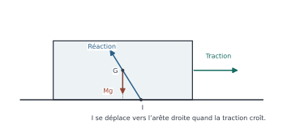

### Question P2 — Glisser avant de basculer

Le glissement commence à $F_R=f_sMg$. Alors $x_I-u=f_sL_y$. Pour que le contact n’ait pas déjà atteint l’arête avant, il faut **$f_sL_y<L_x$**. À l’égalité les deux seuils coïncident.

### Question P3 — Loi de frottement multivaluée

Pour $v>0$, $\alpha=-f_d$. Pour $v<0$, $\alpha=+f_d$. À $v=0$, la réaction s’adapte et $\alpha$ peut prendre toute valeur entre $-f_s$ et $+f_s$, les extrémités étant les limites de glissement. La représentation comprend donc deux demi-droites horizontales et le segment vertical à l’origine.

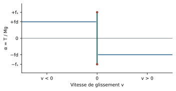

### Question P4 — Équation du mouvement

La projection verticale donne $N=Mg$. Horizontalement $M\ddot u=T+k(s-a)$. Les conditions initiales impliquent $s-a=V_Bt-u$. Avec $\omega_0=\sqrt{k/M}$ on obtient $\ddot u+\omega_0^2u=\alpha g+\omega_0^2V_Bt$.

### Question P5 — Nature de l’équation

Le membre de gauche est celui d’un oscillateur de pulsation $\omega_0$. Le terme de traction est une rampe en temps. Le frottement sec dépend du signe de $\dot u$ et peut s’ajuster à vitesse nulle. Sur un intervalle de glissement de signe fixé, l’équation est linéaire à second membre connu. Le mouvement complet est par morceaux, avec des changements d’état imposés par le contact.

### Question P6 — Variables sans dimension

Avec $u=gU/\omega_0^2$ et $\theta=\omega_0t$, on a $\dot u=(g/\omega_0)U'$ et $\ddot u=gU''$. L’équation devient **$U''+U=\alpha+W_B\theta$** avec $W_B=\omega_0V_B/g$.

### Question P7 — Premier instant de décollement

Tant que $U=U'=0$, $\alpha=-W_B\theta$. La limite statique négative est atteinte à **$\theta_1=f_s/W_B$**, pour $W_B>0$. Si la vitesse de tirage reste nulle, il n’y a pas de première phase de glissement.

### Question P8 — Solution pendant le premier glissement

Posons $\phi=\theta-\theta_1$, $\delta=f_s-f_d$. Le mouvement est vers $+x$, donc $F''+F=\delta+W_B\phi$, $F(0)=F'(0)=0$. La solution est $F(\phi)=W_B(\phi-\sin\phi)+\delta(1-\cos\phi)$. Sa dérivée $F'=W_B(1-\cos\phi)+\delta\sin\phi$ fournit la vitesse réduite et vérifie $F''(0)=\delta>0$.

### Question P9 — Fin du glissement

L’intervalle glissé vaut $\Delta_{12}=\phi_2$. La condition $F'=0$ donne $2\sin(\phi_2/2)[W_B\sin(\phi_2/2)+\delta\cos(\phi_2/2)]=0$. Le premier arrêt est dans $(\pi,2\pi)$, donc $\tan(\phi_2/2)=-r$ pour $r=\delta/W_B>0$. Ainsi **$\Delta_{12}=2\pi-2\arctan r$**.

### Question P10 — Deux régimes de vitesse de traction

Pour $r\gg1$ (petit $W_B$ à $\delta$ fixé), $\arctan r\simeq\pi/2-1/r$, donc $\Delta_{12}\simeq\pi+2/r$. C’est la condition $C_\pi$. Pour $r\ll1$ (tirage rapide), $\arctan r\simeq r$, donc $\Delta_{12}\simeq2\pi-2r$. C’est $C_{2\pi}$.

### Question P11 — Huit lectures des figures 2 et 3

**11.1.** Le tracé (1) est $F'$ (nul au début puis à l’arrêt), (2) est $F$ et la droite (3) est $X_B$. **11.2.** À l’arrêt, (3) reste au-dessus de (2), environ 2,4 contre 2,0. Le ressort est encore en extension. **11.3.** La droite croît d’environ 2 quand $\phi$ croît de $2\pi$, soit $W_B\simeq1/\pi\simeq0{,}32$. **11.4.** La première annulation de (1) après le départ se lit à $\Delta_{12}/\pi\simeq1{,}8$. **11.5.** $r=-\tan(0{,}9\pi)\simeq0{,}32$. **11.6.** Au départ $X_B(0)-F(0)$, lu sur le graphe en phase décalée, vaut $f_s\simeq0{,}6$. **11.7.** Ainsi $\theta_1/\pi=f_s/(\pi W_B)\simeq0{,}6$. **11.8.** Le bloc reste à $F(\phi_2)\simeq2{,}0$ jusqu’à ce que (3) atteigne environ $2{,}6$, donc de $1{,}8\pi$ à $2{,}0\pi$ en phase décalée. On lit **$\Delta_{23}/\pi\simeq0{,}2$**.

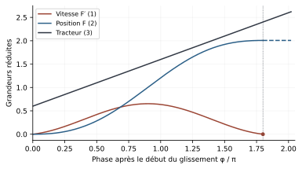

### Question P12 — Plusieurs cycles et fréquence

Pendant chaque glissement, la position suit la même loi $F$ translatée dans le temps et dans l’espace. Entre deux glissements, elle reste constante. Le tracteur suit continûment $X_B=W_B\theta$. Entre deux départs, la largeur angulaire vaut $\Delta=\Delta_{12}+\Delta_{23}\simeq(1{,}8+0{,}2)\pi=2\pi$. La période temporelle est $\Delta/\omega_0$ et $f_{ss}/f_0=2\pi/\Delta\simeq1$. Plus précisément, l’élongation en fin de glissement vaut $f_s-2\delta$, donc $\Delta_{23}=2r$.

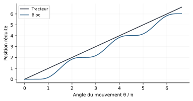

### Question P13 — Analogie avec un oscillateur électronique

Le plateau ne dure qu’environ un dixième du cycle, et $f_{ss}$ est proche de la fréquence propre. Pour ce jeu de données, l’oscillation vue depuis le tracteur est **quasi harmonique**. L’opérateur qui maintient le tracteur à vitesse constante fournit la puissance dissipée par frottement, rôle analogue à celui de l’alimentation continue de l’oscillateur électronique.

## Flexion d’un bâton de craie

### Question P14 — Traction d’une barre élastique

La loi de Hooke donne $F/S=E(\ell-\ell_0)/\ell_0$. La force **extérieure appliquée** vaut donc $F=ES(\ell-\ell_0)/\ell_0$, positive en traction selon la convention adoptée. La force de rappel exercée par la barre a le signe opposé.

### Question P15 — Énergie emmagasinée en extension

$E_p=\int_{\ell_0}^{\ell}ES(\lambda-\ell_0)\,d\lambda/\ell_0=ES(\ell-\ell_0)^2/(2\ell_0)$. Cette énergie est positive en traction comme en compression.

### Question P16 — Flèche de l’arc

L’angle de l’arc vaut $L_0/R$. La flèche est $q=R[1-\cos(L_0/R)]\simeq L_0^2/(2R)$ au premier ordre non nul en faible courbure. Avec un rayon signé, $q$ change de signe lorsque la courbure s’inverse.

### Question P17 — Déplacement d’une section

La distance à l’encastrement est approximativement $L_0-Y$. On obtient $X(Y)\simeq(L_0-Y)^2/(2R)=q(1-Y/L_0)^2$. Le déplacement et sa dérivée par rapport à $Y$ s’annulent à l’encastrement $Y=L_0$, et $X(0)=q$ au tableau.

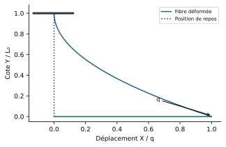

### Question P18 — Énergie cinétique et masse effective

Avec $dm=\rho h^2dY$ et $\dot X=\dot q(1-Y/L_0)^2$, $E_c=\tfrac12\rho h^2\dot q^2\int_0^{L_0}(1-Y/L_0)^4dY=\tfrac12(\rho h^2L_0/5)\dot q^2$. Ainsi $M^\star=M/5=\rho h^2L_0/5$.

### Question P19 — Sens physique de la masse effective

Dans le référentiel du support, la plupart des sections se déplacent plus lentement que l’extrémité Q et la section encastrée reste fixe. Pour une même vitesse $\dot q$ de Q, leur énergie totale est plus petite que si toute la masse avançait à cette vitesse. La masse équivalente en énergie cinétique est donc inférieure à $M$.

### Question P20 — Longueur d’une fibre décalée

En mesurant $e$ positivement vers l’extérieur du centre de courbure, comme pour la fibre extérieure EF, son rayon est $R+e$. L’angle commun est $L_0/R$, d’où $L(e)=L_0(1+e/R)$. Si $e$ est orienté vers le centre, la même relation s’écrit avec $-e$. La fibre neutre garde la longueur $L_0$.

### Question P21 — Énergie de flexion

La déformation longitudinale est $e/R$. D’après P15, $dE_p=\tfrac12 E L_0(e/R)^2 h\,de$. En intégrant entre $-h/2$ et $h/2$, on obtient **$E_p=E L_0h^4/(24R^2)$**. Elle s’annule pour une barre droite.

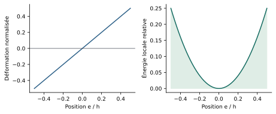

### Question P22 — Raideur associée à la flèche

Il vient $E_p=Eh^4q^2/(6L_0^3)=\tfrac12 k^\star q^2$, d’où **$k^\star=Eh^4/(3L_0^3)$** dans le modèle d’arc circulaire imposé.

### Question P23 — Pourquoi une loi quadratique

Le système est invariant par réflexion $q\mapsto-q$. L’énergie est paire et présente un minimum en zéro. Pour de faibles déplacements, le premier terme variable de son développement est donc un terme quadratique positif. Sa dérivée donne une force de rappel linéaire.

## Fréquence du crissement

### Question P24 — Pulsation propre de la craie

À efforts d’entretien absents, $\tfrac12M^\star\dot q^2+\tfrac12k^\star q^2$ est conservée. La dérivation donne $M^\star\ddot q+k^\star q=0$ par continuité. Ainsi $\omega_0^2=k^\star/M^\star=5Eh^2/(3\rho L_0^4)$.

### Question P25 — Fréquence propre numérique

Avec $E=10^{10}$ Pa, $h=10^{-2}$ m, $L_0=4\times10^{-2}$ m et $\rho=1{,}5\times10^3\ \mathrm{kg\,m^{-3}}$, on trouve $\omega_0\simeq2{,}1\times10^4\ \mathrm{rad\,s^{-1}}$. Donc $f_0=\omega_0/(2\pi)\simeq3{,}3\times10^3$ Hz, soit **environ 3 kHz** à un chiffre significatif.

### Question P26 — Mouvement de l’extrémité au tableau

Avec l’origine initiale de la figure, $q=u-V_Bt$. La force élastique sur l’extrémité est $-k^\star q$. Comme $T=N\alpha(\dot u)$, on a $M^\star\ddot u=-k^\star(u-V_Bt)+N\alpha(\dot u)$. Donc $\ddot u+\omega_0^2u=(N/M^\star)\alpha(\dot u)+\omega_0^2 V_Bt$.

### Question P27 — Accélération effective

$g_{\rm eff}=N/M^\star$. Le sujet donne ici $N=1$ N et $M^\star\simeq10^{-3}$ kg, donc $g_{\rm eff}\simeq10^3\ \mathrm{m\,s^{-2}}$. Cette grandeur traduit l’appui imposé au bâton.

### Question P28 — Fréquence du crissement

Avec $r\simeq0{,}1$, le terme $2\arctan r$ est petit devant $2\pi$ et le temps d’adhérence est court. Le mouvement relatif est quasi harmonique et $f_{ss}\simeq f_0\simeq3$ kHz. Cette fréquence est bien audible, dans la région de quelques kilohertz où l’oreille humaine est particulièrement sensible, à l’intérieur de la gamme approximative 20 Hz–20 kHz.

## Chimie. Bilan de dépollution

### Question C1 — Choix d’un réacteur ouvert

Un réacteur fermé n’échange pas de matière avec son environnement pendant une opération, même s’il peut échanger énergie électrique ou chaleur. Un réacteur ouvert reçoit et évacue des flux de matière. Pour un effluent industriel continu, il permet de traiter le débit à mesure qu’il arrive, sans interrompre périodiquement l’installation pour charger et vidanger une cuve.

### Question C2 — Oxydation complète du phénol

La minéralisation est $\mathrm{C_6H_6O+7O_2\to6CO_2+3H_2O}$. Une mole de phénol demande donc sept moles de dioxygène.

### Question C3 — Lien entre DCO et phénol

Pour un seul polluant et une concentration molaire $c$ en phénol, $\mathrm{DCO}=7M_{O_2}c$, soit $224c$ en $\mathrm{g\,L^{-1}}$ si $c$ est en $\mathrm{mol\,L^{-1}}$. La concentration massique du phénol est $94c$ dans les mêmes unités. Ainsi 1 mg de phénol correspond à environ 2,38 mg de dioxygène.

### Question C4 — Demi-équation anodique

En milieu aqueux, $\mathrm{C_6H_6O+11H_2O\to6CO_2+28H^++28e^-}$. Les 28 électrons correspondent également à sept réductions de $O_2$ à quatre électrons.

### Question C5 — Rendement faradique de minéralisation

La disparition de DCO équivaut à $n_{O_2}=(\mathrm{DCO}_e-\mathrm{DCO}_s)V/M_{O_2}$ moles. La charge affectée à la minéralisation est $4Fn_{O_2}$. Avec la charge totale $I\Delta t$, on trouve $r_F=4F(\mathrm{DCO}_e-\mathrm{DCO}_s)V/(M_{O_2}I\Delta t)$, les unités de masse de la DCO et de $M_{O_2}$ devant être cohérentes.

### Question C6 — De la vitesse au courant utile

Si $n$ est le nombre d’électrons échangés par molécule de réducteur et $v=-dn_{\rm Red}/dt$ en $\mathrm{mol\,s^{-1}}$, le débit d’électrons vaut $nv$. Le courant anodique utile est $I_F=nFv$. Ici $n=28$ pour l’oxydation complète.

### Question C7 — Ordre apparent sous courant imposé

Lorsque $I_F=I_{\rm imp}$, $v=I_{\rm imp}/(nF)$ indépendamment de $c$. L’ordre apparent en phénol est zéro dans ce domaine. À courant et rendement faradique égaux, un appareil ouvert ou fermé élimine donc la même quantité de polluant par unité de temps, sous réserve d’un apport suffisant à l’électrode.

### Question C8 — Concentration dans la cuve fermée

Tant que tout le courant oxyde le phénol, $Vdc/dt=-I_{\rm imp}/(nF)$. Ainsi $c(t)=c_0-I_{\rm imp}t/(nFV)$. La droite ne doit pas être prolongée au-delà du domaine où le transport permet ce courant.

## Évolution au cours de l’électrolyse

### Question C9 — Palier sur la courbe courant–potentiel

Le palier est le **courant limite de transport de matière**. À potentiel suffisamment oxydant, le phénol arrivant à l’anode y est consommé presque immédiatement et sa concentration interfaciale est faible. Le flux depuis le liquide impose alors $I_{\rm lim}=nFAk_mc$.

### Question C10 — Évolution du palier au cours du traitement

À mesure que le phénol disparaît, la hauteur de son palier baisse proportionnellement à $c$. Le courant imposé est une horizontale fixe. Son intersection se déplace du domaine de la vague du phénol vers la montée d’oxydation de l’eau lorsque le palier n’atteint plus la consigne. Le schéma représente cette évolution qualitative.

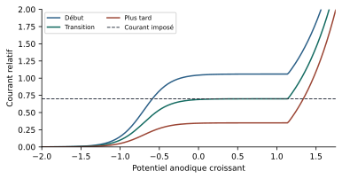

### Question C11 — Instant de partage du courant

La transition satisfait $c_m=I_{\rm imp}/(nFAk_m)$. Après $t_m$, $I_{\rm lim}<I_{\rm imp}$. Le potentiel anodique monte et l’eau s’oxyde selon $\mathrm{2H_2O\to O_2+4H^++4e^-}$. Le phénol reçoit la fraction $I_{\rm lim}/I_{\rm imp}<1$ du courant.

### Question C12 — Cinétique après la transition

$Vdc/dt=-I_{\rm lim}/(nF)=-Ak_mc$. Avec $c(t_m)=c_m$ et $\tau_m=V/(Ak_m)$, la solution est $c(t)=c_m\exp[-(t-t_m)/\tau_m]$. La décroissance devient exponentielle à cause de l’appauvrissement du transport.

### Question C13 — Rendement instantané après la transition

Pour $t>t_m$, $r_F=I_{\rm lim}/I_{\rm imp}=c/c_m=\exp[-(t-t_m)/\tau_m]$. La valeur est continue au seuil, avec $r_F(t_m)=1$.

### Question C14 — Confrontation aux cinétiques expérimentales

Sur la figure 2, la DCO diminue d’abord approximativement en ligne droite, puis ralentit et tend vers zéro. Le rendement est proche de 1 jusqu’à environ 0,8–0,9 h puis chute comme une exponentielle. Les points suivent dans l’ensemble les deux courbes théoriques. Un point légèrement supérieur à 1 dans le premier régime traduit la dispersion expérimentale d’une estimation, le rendement physique utile restant borné par 1.

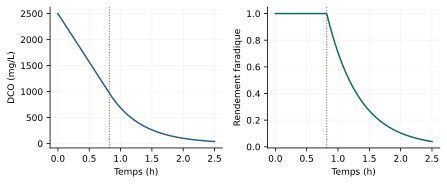

## Réacteurs ouverts en régime permanent

### Question C15 — Réacteur parfaitement agité en régime permanent

Le bilan en mole par seconde donne $0=Qc_e-Qc_s-k_mAc_s$. La concentration à l’électrode intervient à travers la loi de transport depuis le liquide homogène de concentration $c_s$. En posant $p=k_mA/Q$, on trouve **$c_s=c_e/(1+p)$**. Le facteur $p$ est sans dimension.

### Question C16 — Conversion d’un réacteur agité

$X=1-c_s/c_e=1-(1+p)^{-1}=p/(1+p)$. Ainsi $X$ tend vers zéro pour un facteur de performance faible et vers un quand $p$ croît beaucoup.

### Question C17 — Bilan dans une tranche d’un réacteur piston

Dans la tranche $dx$, le débit de disparition est $k_m c(x)\,2L\,dx$. En régime permanent, $Qc(x)-Qc(x+dx)-2Lk_mc(x)dx=0$. On obtient $dc/c=-2Lk_mdx/Q$. En intégrant de 0 à $\ell$, $c_s=c_e\exp(-2L\ell k_m/Q)=c_e e^{-p}$, puisque l’aire active totale est $A=2L\ell$.

### Question C18 — Conversion d’un réacteur piston

Avec le bilan précédent, $X=1-c_s/c_e=1-e^{-p}$. On a $X(0)=0$ et $X\to1$ lorsque $p\to+\infty$.

### Question C19 — Comparaison à facteur égal

Pour $p>0$, $e^p>1+p$, d’où $1-e^{-p}>p/(1+p)$. Le piston idéal laisse donc une concentration de sortie plus faible pour une même concentration d’entrée, une même aire active, un même débit et un même coefficient de transport. Il est le meilleur des deux modèles idéaux pour la dépollution. Les bulles et un transfert transverse médiocre peuvent altérer cet avantage pratique.

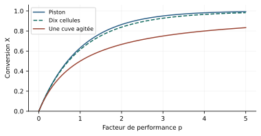

### Question C20 — Cascade de réacteurs agités

Posons $c_0=c_e$. Pour $i=0,\ldots,n-1$, la cuve suivante vérifie $Q(c_i-c_{i+1})=k_m(A/n)c_{i+1}$. Donc $c_{i+1}=c_i/(1+p/n)$. Les $n$ applications successives donnent $c_s=c_n=c_e(1+p/n)^{-n}$. La concentration d’une cellule à l’autre suit une progression géométrique.

### Question C21 — Limite d’une longue cascade

$\ln(c_s/c_e)=-n\ln(1+p/n)\to-p$. Ainsi $c_s\to c_e e^{-p}$ et $X\to1-e^{-p}$, résultats du piston. La part de rétromélange à l’échelle de l’ensemble diminue quand on compartimente davantage.

## Interprétation des mesures de traitement

### Question C22 — Temps théorique et dispersion du traceur

$\tau=8{,}4/40\ \mathrm h=0{,}21\ \mathrm h=12{,}6$ min, soit de l’ordre de 13 min. Le trait de moyenne sans électrolyse se situe vers 12–13 min, en accord avec ce bilan. Le pic s’étale sur plusieurs minutes, avec une queue aux temps longs, au lieu de l’impulsion d’un piston idéal. Une cascade de cellules mélangées a précisément une distribution étalée et moins asymétrique que celle d’une cuve unique. Ces observations sont compatibles avec le modèle, sans suffire à démontrer le mélange parfait de chaque cellule séparément.

### Question C23 — Effet de l’électrolyse sur le traceur

La forme reste voisine avec électrolyse, avec une moyenne ramenée à environ 11–12 min. Le fonctionnement global est donc peu perturbé. Les bulles occupent une partie du volume des dix cellules, réduisant le volume effectivement disponible au liquide et donc le temps moyen au même débit.

### Question C24 — DCO dans les dix cellules

La DCO passe d’environ 115–120 à près de 20 $\mathrm{mg\,L^{-1}}$ entre l’entrée et la dixième cellule. La baisse est forte dans les premières cellules puis les gains absolus diminuent, conformément à la décroissance approximativement géométrique de Q20. L’abattement est de l’ordre de 80–85 %. La cascade assure donc une réduction importante de la charge organique avec une DCO résiduelle mesurable à temps de séjour fini.

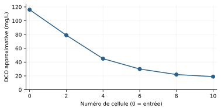

### Question C25 — Choix du temps de passage

Prolonger le séjour diminue d’abord nettement la DCO de sortie. Pour le dispositif multicellule, elle tombe vers 15–20 $\mathrm{mg\,L^{-1}}$ à 100 min puis baisse encore plus lentement. La monocellule tend vers un plateau plus élevé. Le rendement faradique finit par diminuer quand le phénol devient rare et que l’eau consomme du courant. Un séjour de 100 min permet ainsi un abattement significatif tout en conservant un signal de sortie et en évitant d’allonger beaucoup l’essai pour un gain modeste.

### Question C26 — Concentration en entrée et résultats de sortie

À $p$ fixé, $c_s/c_e$ est constant pour chaque modèle, avec $1/(1+p)$ pour une cuve et $(1+p/n)^{-n}$ pour la cascade. La DCO étant proportionnelle à $c$, la figure 9 doit donc montrer des droites approximatives de DCO de sortie en fonction de la DCO d’entrée, de pente plus faible pour la cascade. À courant et temps fixés, le rendement est proportionnel à la DCO éliminée et croît ainsi avec la charge entrante dans le domaine représenté.

### Question C27 — Dispositif expérimental le plus efficace

La cascade multicellule laisse généralement moins de DCO en sortie et présente un rendement faradique nettement supérieur à la monocellule. Ces deux critères traduisent respectivement un effluent plus propre et une meilleure utilisation de la charge électrique. Les cellules successives approchent l’avantage du piston tout en conservant un mélange local favorisant le transport à l’électrode.

## Régiosélectivité d’une allylation

### Question C28 — Noms des trois molécules

Le substrat 1 est le **1-chloro-3-méthylbut-2-ène**. L’adduit $\alpha$, $\mathrm{PhCH(OH)CH_2CH{=}C(CH_3)_2}$, est le **4-méthyl-1-phénylpent-3-én-1-ol**. L’adduit $\gamma$, $\mathrm{PhCH(OH)C(CH_3)_2CH{=}CH_2}$, est le **2,2-diméthyl-1-phénylbut-3-én-1-ol**.

### Question C29 — Carbanion allylique mésomère

Notons RCl le dérivé 1. Sa réduction est $\mathrm{RCl+2e^-\to R^-+Cl^-}$. Les formes limites sont $\mathrm{^-CH_2{-}CH{=}C(CH_3)_2\leftrightarrow CH_2{=}CH{-}C^-(CH_3)_2}$. Le déplacement d’un doublet du carbone terminal vers sa liaison voisine déplace le doublet π vers le carbone substitué. L’espèce réelle est un seul anion délocalisé.

### Question C30 — Deux additions sur le benzaldéhyde

Il s’agit d’une **addition nucléophile sur un aldéhyde**, suivie d’une protonation. L’extrémité $\mathrm{CH_2^-}$ attaque le carbone de $\mathrm{PhCHO}$, les électrons π de C=O passent sur O et l’alcoolate donne, après protonation, $\mathrm{PhCH(OH)CH_2CH{=}C(CH_3)_2}$, l’adduit $\alpha$. Si la nouvelle liaison part de l’extrémité $\mathrm{C^-(CH_3)_2}$, on obtient de la même manière $\mathrm{PhCH(OH)C(CH_3)_2CH{=}CH_2}$, l’adduit $\gamma$.

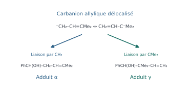

### Question C31 — Effet du contre-ion sur la nucléophilie

Sur la figure 11, le carbone terminal $\mathrm{CH_2}$ porte la charge partielle la plus négative, environ $-0{,}59$, contre $-0{,}37$ sur le carbone diméthylé. Il interagit davantage avec le cation tétrabutylammonium. Ce contact diminue sa disponibilité nucléophile. En présence de l’électrolyte, l’extrémité diméthylée, moins fortement masquée, présente ainsi la nucléophilie effective la plus élevée dans l’interprétation du sujet.

### Question C32 — Adduit issu majoritairement du carbanion

L’attaque par le carbone diméthylé forme le lien benzylique avec ce carbone et laisse une double liaison terminale. L’adduit attendu est donc **$\gamma$** lorsque c’est la réduction du dérivé chloré qui engendre le nucléophile.

### Question C33 — Identification par RMN du produit de la voie radicalaire

On identifie **l’adduit $\alpha$**, qui possède un seul proton vinylique et un méthylène allylique. Le multiplet de 7,40–7,23 ppm (5 H) est celui du phényle monosubstitué. À 5,15 ppm (m, 1 H) résonne le proton vinylique ; à 4,68 ppm (m, 1 H), le CH benzylique portant OH, déblindé par O. Le multiplet à 2,43 ppm (2 H) correspond au $\mathrm{CH_2}$ entre ce CH et l’alcène. Le singulet large à 1,83 ppm (1 H) est le OH échangeable. Les singulets à 1,72 et 1,61 ppm, chacun de 3 H, sont les deux méthyles vinyliques placés dans des environnements cis/trans distincts vis-à-vis du reste de la chaîne. L’adduit $\gamma$ aurait trois H vinyliques et aucun tel $\mathrm{CH_2}$ saturé.

### Question C34 — Sélectivité dans une cuve unique

En cuve, les deux substrats accèdent simultanément à la cathode. Le benzaldéhyde est réduit dès environ $-1{,}52$ V contre $-2{,}20$ V pour le dérivé chloré. La voie radicalaire du benzaldéhyde, également présent en excès, est favorisée et explique les 71 % de $\alpha$. La concurrence de la réduction du chlorure, ainsi que la régiosélectivité imparfaite des voies, laisse une fraction $\gamma$ de 29 %.

### Question C35 — Importance de l’entrée adjacente à la cathode

Quand le chlorure arrive dans la solution A au voisinage de la cathode, il forme le carbanion. Celui-ci peut migrer vers l’anode positive, rencontrer le benzaldéhyde dans la zone de contact et donner surtout $\gamma$ (87 %). Quand A contient le benzaldéhyde, sa réduction radicalaire est favorisée à la cathode et conduit surtout à $\alpha$ (91 %). La séparation hydrodynamique des alimentations permet de sélectionner le substrat cathodique. Des transferts diffusifs et ioniques restent possibles à l’interface.

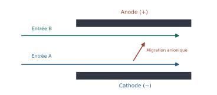

### Question C36 — Voies organomagnésiennes vers les deux alcools

L’insertion de Mg dans C–Cl donne un réactif allylmagnésien que l’on peut représenter par $\mathrm{ClMgCH_2{-}CH{=}CMe_2}$, en relation allylique avec $\mathrm{CH_2{=}CH{-}C(MgCl)Me_2}$. La coordination de l’oxygène de $\mathrm{PhCHO}$ au magnésium polarise le carbonyle. Une addition à partir de la première extrémité forme $\mathrm{PhCH(OMgCl)CH_2CH{=}CMe_2}$. Une addition de l’autre extrémité avec déplacement de la liaison π forme $\mathrm{PhCH(OMgCl)CMe_2CH{=}CH_2}$. L’hydrolyse des alcoolates donne respectivement $\alpha$ et $\gamma$. Une représentation cyclique du transfert allylique associe dans la même étape la liaison O–Mg et la formation de la liaison C–C.

### Question C37 — Intérêt de l’électrolyse en flux

La position des arrivées permet de choisir l’adduit majoritaire, jusqu’à 91 % de $\alpha$ ou 87 % de $\gamma$ dans les essais. La voie magnésienne fournit le mélange et consomme un métal stœchiométrique, avec production de sels de magnésium à l’hydrolyse. L’électrolyse en flux utilise le courant comme source d’électrons, peut fonctionner en continu et règle l’accès de chaque substrat à la cathode.
