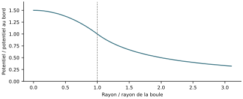
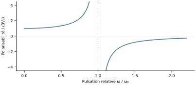
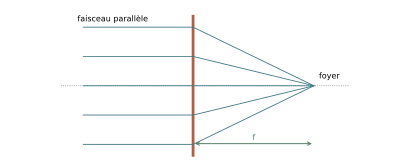
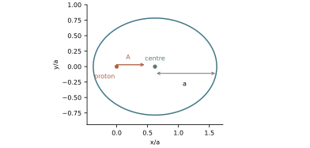
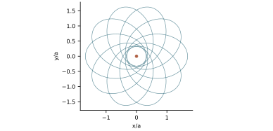
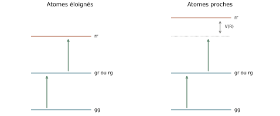

# Physique U — ENS PSI 2024 · Corrigé guidé

*Corrigé rédigé par IA, non officiel.*

**Rédaction** · GPT-6.2 Astra Ultra · vitesse non renseignée

Le corrigé conserve la convention du sujet pour le vecteur de Runge-Lenz, orienté vers le plus grand rayon. Les questions finales demandent deux moyennes distinctes, sur la révolution puis sur la précession. Les mesures de double excitation sont lues sur les deux graphiques originaux de la page 10.

## I · Atome de Thomson et forces optiques

### Question 1 — Moyenne de deux oscillations

> [!INDICATION]
> Dans le produit des deux parties réelles, conserver uniquement les termes de fréquence nulle.

#### Solution

En écrivant les grandeurs réelles $A_i=(\underline A_i+\underline A_i^*)/2$, les termes proportionnels à $\exp(\pm2i\omega t)$ ont une moyenne nulle sur une période. Ainsi $\langle A_1A_2\rangle=(\underline A_1\underline A_2^*+\underline A_1^*\underline A_2)/4=\mathrm{Re}(\underline A_1\underline A_2^*)/2$.

### Question 2 — Densité positive de Thomson

> [!INDICATION]
> Garder le signe de la charge de l’électron donné dans le tableau.

#### Solution

La boule positive neutralise l’unique électron de charge $q_e<0$. Ainsi $\rho(4\pi\mathcal R_0^3/3)=-q_e$, d’où $\rho=-3q_e/(4\pi\mathcal R_0^3)>0$.

### Question 3 — Champ de la boule

> [!INDICATION]
> La fraction de charge enfermée dans une sphère intérieure est une fraction de volume.

#### Solution

La symétrie impose un champ radial. À l’intérieur, le flux $4\pi r^2 E_r$ égale $(-q_e/\epsilon_0)(r/\mathcal R_0)^3$. À l’extérieur, toute la charge est enfermée. On trouve $\mathbf E=-q_e\,\mathbf r/(4\pi\epsilon_0\mathcal R_0^3)$ pour $r<\mathcal R_0$ et $\mathbf E=-q_e\,\mathbf r/(4\pi\epsilon_0r^3)$ au-delà. Les deux champs sont dirigés vers l’extérieur.

### Question 4 — Raccord du potentiel

> [!INDICATION]
> Distinguer une densité volumique qui s’arrête net d’une charge surfacique.

#### Solution

On a $\mathbf E=-\nabla U$ et, ici, $E_r=-U'(r)$. Le potentiel est continu en $\mathcal R_0$ et le champ normal est continu car la distribution ne comporte aucune charge surfacique singulière. La dérivée radiale du potentiel est donc continue également.

### Question 5 — Potentiel électrostatique

> [!INDICATION]
> Intégrer depuis l’extérieur puis fixer la constante intérieure par le raccord.

#### Solution

Le potentiel est défini à une constante additive près. La distribution est localisée, son champ extérieur en $1/r^2$ s’intègre depuis l’infini. Avec $Q=-q_e>0$, $U(r)=Q/(4\pi\epsilon_0 r)$ pour $r\ge\mathcal R_0$. À l’intérieur, l’intégration et le raccord en $\mathcal R_0$ donnent $U(r)=Q[3-(r/\mathcal R_0)^2]/(8\pi\epsilon_0\mathcal R_0)$.

### Question 6 — Profil du potentiel

> [!INDICATION]
> Identifier les valeurs au centre, au bord et à l’infini.

#### Solution

La courbe part avec une tangente horizontale de $3Q/(8\pi\epsilon_0\mathcal R_0)$. Elle décroît comme une parabole concave jusqu’au bord où elle vaut $Q/(4\pi\epsilon_0\mathcal R_0)$. Elle rejoint ensuite, avec la même pente, une branche en $1/r$ décroissante et convexe qui tend vers zéro.

### Question 7 — Force sur un électron intérieur

> [!INDICATION]
> Multiplier le champ par la charge de la particule qui le subit.

#### Solution

La force est $q_e\mathbf E=-q_e^2\mathbf r/(4\pi\epsilon_0\mathcal R_0^3)=-m_e\omega_0^2\mathbf r$. Par conséquent $\omega_0^2=q_e^2/(4\pi\epsilon_0m_e\mathcal R_0^3)$. Le signe impose un rappel vers le centre.

### Question 8 — Champ magnétique de l’onde

> [!INDICATION]
> Utiliser la transversalité et la relation de Maxwell-Faraday.

#### Solution

Dans le vide, pour une onde plane progressive, $\underline{\mathbf B}=\mathbf{\hat k}\times\underline{\mathbf E}/c$. L’amplitude magnétique est $B_0=E_0/c$.

### Question 9 — Forces et approximation dipolaire

> [!INDICATION]
> La même petite vitesse contrôle la force magnétique et l’ordre de la variation de phase sur l’orbite forcée.

#### Solution

La force totale est $-m_e\omega_0^2\mathbf r+q_e[\mathbf E(\mathbf r,t)+\dot{\mathbf r}\times\mathbf B(\mathbf r,t)]$. La correction magnétique par rapport à l’action électrique du laser est au plus d’ordre $v/c\ll1$. Si l’amplitude du déplacement est $r_{\rm osc}$, la variation de phase vaut $k r_{\rm osc}\sim\omega r_{\rm osc}/c\sim v/c$ pour le mouvement forcé, donc $\mathbf E(\mathbf r,t)\simeq\mathbf E(0,t)$. L’enveloppe varie elle aussi peu sur cette distance.

### Question 10 — Réponse forcée

> [!INDICATION]
> Remplacer la dérivée seconde temporelle par $-\omega^2$ pour le régime forcé.

#### Solution

Pour le mouvement à la pulsation du laser, $m_e(\ddot{\mathbf r}+\omega_0^2\mathbf r)=q_e\mathbf E(0,t)$. On obtient $\underline{\mathbf r}=q_e\underline{\mathbf E}(0,t)/[m_e(\omega_0^2-\omega^2)]$, hors résonance. Une oscillation libre éventuelle à $\omega_0$ n’entre pas dans cette composante.

### Question 11 — Dipôle induit

> [!INDICATION]
> Le signe algébrique de la charge intervient deux fois.

#### Solution

Avec $\mathbf d=q_e\mathbf r$, la solution précédente donne $\underline{\mathbf d}=\epsilon_0\alpha(\omega)\underline{\mathbf E}(0,t)$ avec $\alpha=q_e^2/[\epsilon_0m_e(\omega_0^2-\omega^2)]$. Le modèle sans dissipation donne un coefficient réel et la même relation s’applique aux champs réels.

### Question 12 — Volume de polarisabilité

> [!INDICATION]
> Éliminer la charge et la masse à l’aide de la fréquence propre.

#### Solution

Si $V_0=4\pi\mathcal R_0^3/3$, alors $\alpha=3V_0/[1-(\omega/\omega_0)^2]$, de dimension $\mathrm{m^3}$. La polarisabilité vaut $3V_0$ à fréquence nulle. Elle tend vers $+\infty$ par valeurs inférieures de $\omega$ à la résonance, puis repart de $-\infty$ et tend vers $0^-$ à haute fréquence. La divergence signale l’absence d’une réponse harmonique stationnaire bornée à résonance dans ce modèle idéal. Une dissipation réelle régularise le pic.

### Question 13 — Taille effective du rubidium

> [!INDICATION]
> Distinguer le volume effectif ajusté sur une raie du volume du noyau physique.

#### Solution

Avec $\omega_0=2\pi c/(780\ \mathrm{nm})\simeq2{,}42\times10^{15}\ \mathrm{s^{-1}}$, on trouve $V_0=q_e^2/(3\epsilon_0m_e\omega_0^2)\simeq1{,}8\times10^{-28}\ \mathrm{m^3}$. Le rayon de la boule serait $\mathcal R_0\simeq3{,}5\times10^{-10}$ m. Il s’agit d’une dimension atomique effective de quelques ångströms. Le noyau réel est bien plus petit et le rubidium possède plusieurs électrons.

### Question 14 — Résultante sur un atome neutre

> [!INDICATION]
> Soustraire d’abord les forces sur les charges opposées avant de comparer les termes qui subsistent.

#### Solution

Plaçons la charge positive $-q_e$ en $\mathbf R$ et l’électron en $\mathbf R+\mathbf r$. Les actions internes s’annulent dans le bilan de l’atome. Les forces électriques uniformes aussi. Au premier ordre, la différence des deux champs donne $(\mathbf d\cdot\nabla)\mathbf E$. Les forces magnétiques associées à la vitesse commune du centre s’annulent au même ordre pour un atome lent. Il reste la vitesse relative, donc $\mathbf F\simeq(\mathbf d\cdot\nabla)\mathbf E+\dot{\mathbf d}\times\mathbf B$, les champs étant pris en $\mathbf R$. On suppose $kr\ll1$, une enveloppe peu variable sur l’atome et une vitesse du centre négligeable sur une période. Les termes dipolaire et magnétique conservés sont tous deux d’ordre $q_e kr E$ pour une onde progressive.

### Question 15 — Énergie du dipôle induit

> [!INDICATION]
> Transformer la dérivée du dipôle par intégration temporelle sur une période.

#### Solution

À $\mathbf R$ fixe, la moyenne de $\partial_t(\mathbf d\times\mathbf B)$ est nulle. Maxwell-Faraday donne alors $\langle\dot{\mathbf d}\times\mathbf B\rangle=\langle\mathbf d\times(\nabla\times\mathbf E)\rangle$. Pour $\mathbf d=\epsilon_0\alpha\mathbf E$, l’identité $(\mathbf E\cdot\nabla)\mathbf E+\mathbf E\times(\nabla\times\mathbf E)=\nabla E^2/2$ donne $\langle\mathbf F\rangle=\epsilon_0\alpha\nabla\langle E^2\rangle/2$. Comme $\langle E^2\rangle=|\mathbf E_0|^2/2$, l’énergie est $U_{\rm dip}=-\epsilon_0\alpha|\mathbf E_0|^2/4$ à une constante près.

### Question 16 — Proximité d’une résonance

> [!INDICATION]
> Factoriser la différence des carrés avant de faire l’approximation.

#### Solution

Pour $\Delta=\omega-\omega_0$ avec $|\Delta|\ll\omega_0$, $\omega_0^2-\omega^2\simeq-2\omega_0\Delta$. On obtient $\alpha\simeq-q_e^2/(2\epsilon_0m_e\omega_0\Delta)=-3V_0\omega_0/(2\Delta)$, dans la limite non amortie hors du centre de raie.

### Question 17 — Signe du désaccord

> [!INDICATION]
> Le sens de la force découle du minimum de l’énergie dipolaire.

#### Solution

Pour $\Delta<0$, $\alpha>0$. Le potentiel diminue quand l’intensité augmente, de sorte que l’atome est attiré vers les régions brillantes. Pour $\Delta>0$, $\alpha<0$ et le minimum de potentiel est au contraire du côté des faibles intensités.

### Question 18 — Intensité dans le vide

> [!INDICATION]
> Distinguer une amplitude crête d’une amplitude efficace.

#### Solution

Pour l’amplitude crête du champ électrique d’une onde progressive, la moyenne temporelle du flux de Poynting est $I=\epsilon_0c E_0^2/2$. L’intensité annoncée est $60\ \mathrm{kW\,cm^{-2}}=6{,}0\times10^8\ \mathrm{W\,m^{-2}}$.

### Question 19 — Profondeur du piège rouge

> [!INDICATION]
> À plus grande longueur d’onde correspond une plus faible pulsation.

#### Solution

La longueur d’onde du laser, $850$ nm, dépasse $780$ nm, donc sa pulsation est inférieure à $\omega_0$ et $\alpha>0$. Le foyer, maximum d’intensité, est un minimum de $U_{\rm dip}=-\alpha I/(2c)$. En prenant une intensité négligeable loin du foyer, la profondeur positive est $\Delta U_{\rm dip}=\alpha I_{\max}/(2c)$.

### Question 20 — Échelle de température

> [!INDICATION]
> Convertir les watts par centimètre carré avant de comparer la profondeur à $k_BT$.

#### Solution

La formule exacte non amortie donne $\alpha\simeq3{,}45\times10^{-27}\ \mathrm{m^3}$ à $850$ nm. Ainsi $\Delta U_{\rm dip}\simeq3{,}45\times10^{-27}$ J et $\Delta U_{\rm dip}/k_B\simeq2{,}5\times10^{-4}$ K. Une énergie thermique typique $k_BT$ inférieure à la profondeur permet le piégeage. Pour limiter les pertes de la queue de distribution, on recherche une température nettement inférieure à $250\ \mu\mathrm K$.

## I · Focalisation et réseau de pinces

### Question 21 — Foyer d’un faisceau parallèle

> [!INDICATION]
> Un faisceau parallèle correspond en optique géométrique à un objet à l’infini.

#### Solution

Les rayons paraxiaux incidents parallèles à l’axe convergent après la lentille au foyer image, à une distance $f$ du plan de la lentille mince.

### Question 22 — Limite géométrique

> [!INDICATION]
> Relier l’intensité au flux d’énergie et à l’aire du foyer.

#### Solution

Le faisceau idéal converge en un point, de diamètre nul. Pour une puissance finie non nulle, la division par une aire nulle prédirait une intensité infinie. La diffraction donne une taille finie et rend ce résultat géométrique inapplicable exactement au foyer.

### Question 23 — Ouverture du cône

> [!INDICATION]
> Le texte donne un diamètre, et l’angle marginal se construit sur un rayon.

#### Solution

Le rayon du faisceau incident vaut $w/2$. Le rayon marginal rejoint l’axe à la distance $f$, donc $\tan\theta_{\max}=w/(2f)$ et $\theta_{\max}\simeq w/(2f)$ dans l’approximation paraxiale.

### Question 24 — Bande de nombres d’onde

> [!INDICATION]
> Projeter le vecteur d’onde d’un rayon marginal.

#### Solution

Pour $k=2\pi/\lambda=\omega/c$, la projection transversale maximale vaut $|k_x|_{\max}=k\sin\theta_{\max}\simeq kw/(2f)$. Les deux bords du faisceau fournissent des composantes de signes opposés.

### Question 25 — Impulsions transversales

> [!INDICATION]
> Calculer l’écart du bord gauche au bord droit de la distribution.

#### Solution

La relation de de Broglie est $\mathbf p=\hbar\mathbf k$. La plage de $p_x$ va de $-\hbar kw/(2f)$ à $+\hbar kw/(2f)$. Sa largeur totale est donc $\Delta p_x\simeq\hbar kw/f$ avec la convention de largeur du sujet.

### Question 26 — Largeur minimale au foyer

> [!INDICATION]
> Appliquer l’inégalité à la dispersion transversale, puis remplacer $k$ par $2\pi/\lambda$.

#### Solution

En assimilant la plage précédente à la dispersion comme le demande l’énoncé, $\Delta x\Delta p_x\ge\hbar/2$ donne $\Delta x_{\min}\simeq f/(2kw)=\lambda f/(4\pi w)$. Cette convention pour des largeurs d’ordres différents détermine un facteur numérique indicatif. La dépendance robuste est celle de la limite de diffraction, $\Delta x\propto\lambda f/w$.

### Question 27 — Élimination de la constante de Planck

> [!INDICATION]
> Repérer les deux occurrences de la constante de Planck dans le calcul.

#### Solution

Le facteur $\hbar$ de l’incertitude se simplifie avec celui de $p_x=\hbar k_x$. L’effet est aussi compris comme la diffraction d’une onde classique de longueur d’onde finie. Il existe pour la lumière indépendamment du comptage individuel des photons.

### Question 28 — Choix de l’ouverture

> [!INDICATION]
> Augmenter le diamètre du verre n’accroît le cône utile que si la lumière le remplit.

#### Solution

Pour une longueur d’onde, une focale et une puissance transmises fixées, un faisceau de diamètre utile $w$ plus grand donne une tache plus petite et augmente l’intensité au foyer. Une lentille de grande ouverture, convenablement remplie par le faisceau, permet un grand $w/f$, sous réserve des aberrations et du domaine paraxial.

### Question 29 — Translation du foyer

> [!INDICATION]
> Tracer le rayon incident passant par le centre de la lentille mince.

#### Solution

Les faisceaux parallèles inclinés de $\theta_0$ convergent vers le plan focal image. Le rayon passant par le centre optique fixe la position du foyer secondaire, $\Delta x=f\tan\theta_0\simeq f\theta_0$, avec le signe de l’inclinaison initiale.

### Question 30 — Continuation d’une onde plane

> [!INDICATION]
> La composante normale est fixée par la dispersion et le sens de propagation.

#### Solution

En conservant la convention de phase de cette question, le champ est $\exp[i(k_xx+k_zz-\omega t)]$ avec $k_z=+\sqrt{\omega^2/c^2-k_x^2}$. Cette racine décrit une onde progressive vers $+z$ si $|k_x|<\omega/c$. Elle incorpore la même dépendance transverse dans le plan initial.

### Question 31 — Faible modulation de phase

> [!INDICATION]
> Décomposer le cosinus en deux exponentielles après le développement au premier ordre.

#### Solution

À la sortie du modulateur dans le plan $z=0$, $\underline E=E_0e^{-i\omega t}e^{i\Phi_0}e^{i\Phi_1\cos(qx)}$. Pour $|\Phi_1|\ll1$, la dernière exponentielle vaut $1+(i\Phi_1/2)(e^{iqx}+e^{-iqx})+O(\Phi_1^2)$. Une phase uniforme commune ne modifie pas les directions des faisceaux.

### Question 32 — Trois ordres transmis

> [!INDICATION]
> Associer une direction à chaque composante de Fourier transverse.

#### Solution

Les composantes transversales sont $k_x=0$, $+q$ et $-q$ à fréquence commune. Ainsi les trois directions ont pour angles $0$, $+\arcsin(qc/\omega)$ et $-\arcsin(qc/\omega)$, soit environ $0$ et $\pm qc/\omega$. Les amplitudes des deux ordres latéraux sont du premier ordre en $\Phi_1$.

### Question 33 — Réseau à deux dimensions

> [!INDICATION]
> Traiter séparément les deux directions de Fourier et les deux coordonnées du plan focal.

#### Solution

Le produit $\cos(nq_0x)\cos(mq_0y)$ fournit quatre couples de composantes $(k_x,k_y)=(\pm nq_0,\pm mq_0)$. Chaque couple paraxial crée par la lentille un foyer en $(fk_x/k,fk_y/k)$. La somme sur $m,n$ engendre donc une matrice de taches lumineuses, chacune pouvant créer un puits à désaccord rouge. C’est la matrice photographiée dans la figure du modulateur, numérotée 2 dans le scan malgré le renvoi de la question à 3.b.

## II · Dynamique coulombienne

### Question 34 — Force coulombienne

> [!INDICATION]
> La constante appelée $e^2$ dans la deuxième partie inclut le facteur électrostatique.

#### Solution

Dans la notation du sujet, $e^2=q_e^2/(4\pi\epsilon_0)>0$. Le proton attire l’électron par $\mathbf F=-e^2\mathbf r/r^3$. Dans le référentiel du proton considéré fixe, $\dot{\mathbf p}=m_e\ddot{\mathbf r}=-e^2\mathbf r/r^3$.

### Question 35 — Conservation du moment cinétique

> [!INDICATION]
> Dériver explicitement le produit vectoriel de la position et de l’impulsion.

#### Solution

Pour $\mathbf L=\mathbf r\times\mathbf p$, $\dot{\mathbf L}=\dot{\mathbf r}\times m_e\dot{\mathbf r}+\mathbf r\times\mathbf F=0$. Le premier produit est nul par colinéarité et le second par centralité de la force.

### Question 36 — Plan orbital

> [!INDICATION]
> Utiliser l’orthogonalité à un vecteur constant.

#### Solution

Pour $\mathbf L\ne0$, $\mathbf r(t)\cdot\mathbf L=0$ à tout instant et la direction de $\mathbf L$ reste fixe. La trajectoire appartient donc au plan passant par le proton et orthogonal à $\mathbf L$. Le cas $\mathbf L=0$ correspond à un mouvement radial dégénéré.

### Question 37 — Coordonnées polaires

> [!INDICATION]
> Seule la composante tangentielle de l’impulsion intervient.

#### Solution

Dans le plan orbital, $\mathbf p=m_e(\dot r\,\mathbf u_r+r\dot\theta\,\mathbf u_\theta)$. Ainsi $\mathbf L=m_e r^2\dot\theta\,\mathbf e_z$. On oriente $z$ suivant $\mathbf L$, donc $L=m_e r^2\dot\theta>0$.

### Question 38 — Vecteur de Runge-Lenz

> [!INDICATION]
> Conserver l’ordre du produit vectoriel choisi dans le sujet.

#### Solution

Le sujet emploie $\mathbf A=\mathbf L\times\mathbf p/(m_e e^2)+\mathbf u_r$, opposé à une convention souvent utilisée. Puisque $\dot{\mathbf L}=0$, le premier terme a pour dérivée $\mathbf L\times[-e^2\mathbf u_r/r^2]/(m_e e^2)=-[L/(m_e r^2)]\mathbf u_\theta$. La dérivée de $\mathbf u_r$ vaut $+\dot\theta\mathbf u_\theta$, exactement l’opposé. Ainsi $\dot{\mathbf A}=0$.

### Question 39 — Direction de l’axe majeur

> [!INDICATION]
> Vérifier l’orthogonalité de chacun des deux termes.

#### Solution

$\mathbf L\times\mathbf p$ est orthogonal à $\mathbf L$, tout comme $\mathbf u_r$. Leur somme $\mathbf A$ appartient au plan orbital. Si elle est non nulle, on prend $\mathbf e_x$ dans son sens et l’angle polaire est celui de $\mathbf A$ vers $\mathbf r$.

### Question 40 — Équation de la conique

> [!INDICATION]
> Utiliser $p_\theta=L/r$ dans la projection radiale.

#### Solution

La projection radiale de $\mathbf L\times\mathbf p$ vaut $-L p_\theta=-L^2/r$. Ainsi $A\cos\theta=1-L^2/(m_e e^2r)$. On trouve $r=r_0/(1-\varepsilon\cos\theta)$ avec $r_0=L^2/(m_e e^2)$ et $\varepsilon=A$. L’axe $+\mathbf A$ pointe vers l’apoastre dans cette convention.

### Question 41 — Excentricité nulle

> [!INDICATION]
> Substituer l’excentricité nulle dans l’équation polaire.

#### Solution

Pour $\varepsilon=0$, $r=r_0$ est constant. L’orbite est un cercle centré sur le proton, sans direction privilégiée pour le grand axe.

### Question 42 — Demi-grand axe

> [!INDICATION]
> Les deux extrémités sont de part et d’autre du proton, qui occupe un foyer.

#### Solution

Les rayons extrêmes sont $r(0)=r_0/(1-\varepsilon)$ et $r(\pi)=r_0/(1+\varepsilon)$. Leur somme est la longueur du grand axe. On obtient $a=r_0/(1-\varepsilon^2)$ pour $0\le\varepsilon<1$. Sur la figure, la flèche allant du centre géométrique à l’apoastre a pour longueur $a$.

### Question 43 — Énergie en fonction de l’inverse du rayon

> [!INDICATION]
> Transformer la dérivée temporelle par la loi des aires.

#### Solution

Avec $u=1/r$, $\dot r=-r^2\dot\theta\,u'(\theta)=-(L/m_e)u'$ et $r\dot\theta=Lu/m_e$. En substituant dans $E_m=m_e(\dot r^2+r^2\dot\theta^2)/2-e^2/r$, on trouve $E_m=L^2[(u')^2+u^2]/(2m_e)-e^2u$.

### Question 44 — Énergie d’une ellipse

> [!INDICATION]
> Utiliser $\sin^2+\cos^2=1$ et exprimer le résultat en fonction de $a$.

#### Solution

Ici $u=(1-\varepsilon\cos\theta)/r_0$ et $u'=\varepsilon\sin\theta/r_0$. La substitution dans l’énergie et $L^2/m_e=e^2r_0$ annulent les termes en $\cos\theta$. Il reste $E_m=e^2(\varepsilon^2-1)/(2r_0)=-e^2/(2a)$, négative pour une ellipse liée.

### Question 45 — Période orbitale

> [!INDICATION]
> Le poids temporel des différents angles est proportionnel à $r^2$.

#### Solution

La quantité $L=m_e r^2\dot\theta$ donne $\mathrm dt=(m_e/L)r^2\mathrm d\theta$. Un tour complet correspond à $2\pi$ en angle. Par conséquent $T=(m_e/L)\int_0^{2\pi}r^2(\theta)\,\mathrm d\theta$.

### Question 46 — Troisième loi de Kepler

> [!INDICATION]
> Remplacer successivement le facteur d’excentricité et le moment cinétique.

#### Solution

En introduisant l’intégrale $G_2$ du préambule, on trouve $T=m_e r_0^2 G_2(\varepsilon)/L=2\pi m_e r_0^2/[L(1-\varepsilon^2)^{3/2}]$. Avec $r_0=L^2/(m_e e^2)$ et $a=r_0/(1-\varepsilon^2)$, cela donne $T^2/a^3=4\pi^2m_e/e^2$. C’est la troisième loi de Kepler, ici pour une attraction coulombienne.

### Question 47 — Dipôle orbital moyen

> [!INDICATION]
> La moyenne est temporelle, ce qui introduit deux puissances du rayon dans l’intégrale angulaire.

#### Solution

La composante en $y$ de $\langle\mathbf r\rangle$ s’annule par symétrie. La loi des aires donne $\langle x\rangle=m_e r_0^3 F_3(\varepsilon)/(LT)$. En dérivant l’intégrale donnée, $F_3=G'_2/2=3\pi\varepsilon/(1-\varepsilon^2)^{5/2}$. Comme $T=m_e r_0^2G_2/L$, il reste $\langle x\rangle=3a\varepsilon/2$. Donc $\langle\mathbf d\rangle=(3/2)q_ea\mathbf A$. L’électron séjourne plus longtemps du côté du grand rayon.

## II · Quantification du modèle orbital

### Question 48 — Fréquence et énergie

> [!INDICATION]
> Éliminer la taille de l’ellipse entre la période et l’énergie.

#### Solution

La troisième loi fournit $\Omega=\sqrt{e^2/(m_ea^3)}$. Avec $a=-e^2/(2E)$, on obtient $\Omega(E)=(-2E)^{3/2}/(e^2\sqrt{m_e})$ pour $E<0$. L’excentricité n’y intervient pas.

### Question 49 — Transitions entre niveaux voisins

> [!INDICATION]
> L’indice varie d’une unité et l’énergie des états liés augmente en devenant moins négative.

#### Solution

Une émission entre le niveau $n$ et le niveau $n-1$ libère le photon d’énergie $\hbar\Omega$. Pour $n$ grand et un spectre variant lentement avec $n$, $E_n-E_{n-1}\simeq\mathrm dE/\mathrm dn$. On obtient $\mathrm dE/\mathrm dn=\hbar\Omega(E)>0$.

### Question 50 — Énergies quantifiées

> [!INDICATION]
> Chercher une puissance de $-2E$ dont la dérivée en $n$ est constante.

#### Solution

En dérivant $(-2E)^{-1/2}$ par rapport à $n$, la question précédente donne $\mathrm d[(-2E)^{-1/2}]/\mathrm dn=\hbar/(e^2\sqrt{m_e})$. D’où $(-2E)^{-1/2}=\hbar(n+n^*)/(e^2\sqrt{m_e})$ et
$$E_n=-\frac{E_I}{2(n+n^*)^2},\qquad E_I=\frac{m_e(e^2)^2}{\hbar^2}.$$
Le décalage $n^*$ est la constante d’intégration exprimée en unités de nombre quantique.

### Question 51 — Rayon de Bohr

> [!INDICATION]
> Le même $e^2$ désigne la constante coulombienne de la deuxième partie.

#### Solution

Pour $n^*=0$, $a_n=-e^2/(2E_n)=n^2a_1$ avec $a_1=e^2/E_I=\hbar^2/(m_e e^2)$. La taille caractéristique des orbitales croît donc comme le carré du nombre quantique principal.

### Question 52 — Échelles numériques

> [!INDICATION]
> Distinguer l’échelle $E_I$ de la moitié qui figure dans la formule de l’énergie.

#### Solution

Les données donnent $e^2\simeq2{,}30\times10^{-28}\ \mathrm{J\,m}$. Il vient $E_I\simeq4{,}35\times10^{-18}$ J, soit environ $27$ eV, et $a_1\simeq5{,}3\times10^{-11}$ m, soit $0{,}53$ Å. L’énergie de liaison du premier niveau est $E_I/2\simeq13{,}6$ eV.

### Question 53 — Excentricité et nombre quantique orbital

> [!INDICATION]
> Relier le paramètre de la conique au carré du moment cinétique.

#### Solution

De $r_0=a(1-\varepsilon^2)$ avec $L=\ell\hbar$, on tire $r_0=\ell^2a_1$ et $a=n^2a_1$, donc $\varepsilon_{n,\ell}=\sqrt{1-\ell^2/n^2}$. Cette quantification est celle du modèle semi-classique de l’énoncé.

### Question 54 — Nombres autorisés par le modèle

> [!INDICATION]
> Examiner à la fois le signe de la racine et la limite d’une ellipse radiale dégénérée.

#### Solution

Une ellipse non dégénérée a une excentricité réelle et strictement inférieure à un. Avec les entiers positifs de l’énoncé, il faut $1\le\ell\le n$. La valeur $\ell=n$ correspond à une orbite circulaire.

## II · Cœur polarisable et précession

### Question 55 — Charge effective du cœur

> [!INDICATION]
> Compter les charges incluses dans le cœur vu à grande distance.

#### Solution

À grande distance, le noyau de charge $-Zq_e$ et les $Z-1$ électrons proches de charge $(Z-1)q_e$ constituent un cœur de charge totale $-q_e$. La taille de l’orbite de Rydberg est grande devant celle du cœur. Le terme monopolaire dominant donne donc pour l’électron externe le problème à un centre de l’hydrogène.

### Question 56 — Polarisation du cœur

> [!INDICATION]
> Le vecteur du point source vers le point d’observation est ici $-\mathbf r$.

#### Solution

Le champ créé à l’origine par l’électron situé en $\mathbf r$ est $-q_e\mathbf r/(4\pi\epsilon_0 r^3)$. La relation linéaire donne $\mathbf d_c=-\alpha_cq_e\mathbf r/(4\pi r^3)$. Le dipôle du cœur est orienté selon $\mathbf r$ si $\alpha_c>0$.

### Question 57 — Approximation quasi statique

> [!INDICATION]
> Comparer la fréquence du champ perturbateur aux fréquences propres du cœur.

#### Solution

Les électrons de cœur, liés sur une taille atomique, ont des périodes caractéristiques courtes devant celle de l’électron périphérique ($T\propto n^3$). Le champ que ce dernier crée au cœur varie lentement par rapport à la réponse interne. On peut donc employer la polarisabilité statique $\alpha_c(0)$ pour la perturbation lente, dans le domaine de séparation des échelles considéré.

### Question 58 — Développement multipolaire

> [!INDICATION]
> Garder le terme linéaire du développement de $(1+x)^{-1/2}$.

#### Solution

On écrit $|\mathbf r-\mathbf r_i|^{-1}=r^{-1}[1-2\mathbf r_i\cdot\mathbf r/r^2+r_i^2/r^2]^{-1/2}$. Au premier ordre en $r_i/r$, cela vaut $1/r+(\mathbf r_i\cdot\mathbf r)/r^3+O(r_i^2/r^3)$.

### Question 59 — Potentiel du cœur

> [!INDICATION]
> Regrouper d’une part les charges et d’autre part leurs premiers moments.

#### Solution

Le potentiel du noyau et des électrons internes est $[-Zq_e/r+\sum_i q_e/|\mathbf r-\mathbf r_i|]/(4\pi\epsilon_0)$. Le terme dominant vaut $-q_e/(4\pi\epsilon_0r)$. Au premier ordre, $\sum_iq_e\mathbf r_i=\mathbf d_c$ car le noyau est à l’origine. D’où $U=-q_e/(4\pi\epsilon_0r)+\mathbf d_c\cdot\mathbf r/(4\pi\epsilon_0r^3)$.

### Question 60 — Force supplémentaire du cœur polarisé

> [!INDICATION]
> Identifier la source du champ et le point test avant de dériver.

#### Solution

Pour calculer le champ produit par le cœur, prendre le gradient spatial **à dipôle source fixé**. Avec $\mathbf u=\mathbf r/r$,
$$\mathbf E=\frac{-q_e\mathbf u}{4\pi\epsilon_0r^2}+\frac{3(\mathbf d_c\cdot\mathbf u)\mathbf u-\mathbf d_c}{4\pi\epsilon_0r^3}.$$
Insérer ensuite le dipôle de la question 56 et multiplier le champ supplémentaire par $q_e$. On obtient $\mathbf F_c=-\beta_c\mathbf r/r^6$, $\beta_c=e^2\alpha_c/(2\pi)>0$. Cette correction est attractive. Substituer le dipôle induit avant le gradient du potentiel électrique ferait compter deux fois sa variation.

### Question 61 — Évolution exacte des deux vecteurs

> [!INDICATION]
> Réutiliser uniquement l’annulation coulombienne, les deux nouvelles forces ayant des moments différents.

#### Solution

Le bilan du moment cinétique donne $\dot{\mathbf L}=\mathbf r\times\mathbf f$ puisque les forces coulombienne et de polarisation sont centrales. Dans $\dot{\mathbf A}=(\dot{\mathbf L}\times\mathbf p+\mathbf L\times\dot{\mathbf p})/(m_e e^2)+\dot{\mathbf u}_r$, la partie coulombienne annule $\dot{\mathbf u}_r$ comme en question 38. Il reste
$$m_e e^2\dot{\mathbf A}=(\mathbf r\times\mathbf f)\times\mathbf p+\mathbf L\times\mathbf f-\beta_c\,\mathbf L\times\frac{\mathbf r}{r^6},\qquad \mathbf f=q_e\mathbf E_0.$$

### Question 62 — Moyennes orbitales d’un vecteur radial

> [!INDICATION]
> Insérer le poids temporel $r^2$ avant de déterminer l’indice de l’intégrale.

#### Solution

Sur une ellipse instantanée, $\langle\mathbf r/r^j\rangle$ est parallèle à $\mathbf A$ par symétrie. Sa projection sur $\mathbf e_x$ est $(m_e/LT)\int_0^{2\pi}r^{3-j}\cos\theta\,\mathrm d\theta$. En écrivant $r=r_0/(1-\varepsilon\cos\theta)$, il vient
$$\left\langle\frac{\mathbf r}{r^j}\right\rangle=\lambda_j\mathbf A,\qquad \lambda_j=\frac{m_e r_0^{3-j}}{LT\varepsilon}F_{3-j}(\varepsilon).$$
En particulier $\lambda_0=3a/2$. L’indice $j$ désigne ici la puissance du rayon et non le nombre quantique principal.

### Question 63 — Dynamique séculaire

> [!INDICATION]
> Le tenseur moyen de position-impulsion est antisymétrique et son contenu est le moment cinétique.

#### Solution

Sur une ellipse, $\langle\mathrm d(r_ir_j)/\mathrm dt\rangle=0$ donne $\langle r_i p_j\rangle=-\langle r_jp_i\rangle$. En particulier $\langle\mathbf r\cdot\mathbf p\rangle=0$. Le double produit $(\mathbf r\times\mathbf f)\times\mathbf p=\mathbf f(\mathbf r\cdot\mathbf p)-\mathbf r(\mathbf f\cdot\mathbf p)$ a donc pour moyenne $(\mathbf L\times\mathbf f)/2$, comme le montre la partie antisymétrique du tenseur $r_ip_j$. En ajoutant le terme extérieur déjà présent et en employant la question 62, on obtient
$$\dot{\mathbf A}=\frac{\mathbf L\times(3\mathbf f/2-\beta_c\lambda_6\mathbf A)}{m_e e^2},\qquad \dot{\mathbf L}=\lambda_0\mathbf A\times\mathbf f.$$

### Question 64 — Moment cinétique sans champ extérieur

> [!INDICATION]
> Un potentiel central peut faire précesser une ellipse sans imposer de couple autour du centre.

#### Solution

Pour $\mathbf f=0$, $\dot{\mathbf L}=0$. Le cœur ajoute une force radiale, dont le moment par rapport au noyau est nul. La conservation de la direction et de la norme de $\mathbf L$ était donc attendue.

### Question 65 — Précession du grand axe

> [!INDICATION]
> Reconnaître une vitesse de rotation vectorielle dans l’équation différentielle.

#### Solution

À champ extérieur nul, $\dot{\mathbf A}=\boldsymbol\Omega_c\times\mathbf A$ avec $\boldsymbol\Omega_c=-\beta_c\lambda_6\mathbf L_0/(m_e e^2)$. La norme de $\mathbf A$ est constante. Avec $\mathbf L_0=L_0\mathbf e_z$, la pulsation algébrique est $\Omega_c=-\beta_c\lambda_6L_0/(m_e e^2)$. Pour $\mathbf A(0)=A_0\mathbf e_x$, $\mathbf A_0(t)=A_0[\mathbf e_x\cos(\Omega_ct)+\mathbf e_y\sin(\Omega_ct)]$.

### Question 66 — Rosace sans champ

> [!INDICATION]
> Effectuer une moyenne sur la révolution puis une deuxième sur la précession.

#### Solution

La figure 3.a montre une orbite dont l’axe majeur tourne dans un plan fixe. À chaque tour rapide, le dipôle temporel est dirigé selon $q_e\mathbf A$. Après une période complète de précession lente, toutes les directions de cet axe se sont compensées. Le dipôle moyen sur la rosace est nul.

### Question 67 — Variation du moment cinétique sous un faible champ

> [!INDICATION]
> N’employer l’orbite non perturbée que dans le terme qui est déjà du premier ordre en champ.

#### Solution

À l’ordre un en $\mathbf f$, on remplace $\mathbf A$ par sa solution sans champ dans $\dot{\mathbf L}=\lambda_0\mathbf A\times\mathbf f$. En fixant $\mathbf L_1(0)=0$, on obtient
$$\mathbf L_1(t)=\frac{\lambda_0 A_0}{\Omega_c}\,[\mathbf e_x\sin(\Omega_ct)+\mathbf e_y(1-\cos(\Omega_ct))]\times\mathbf f.$$
Ainsi $\mathbf L=\mathbf L_0+\mathbf L_1+O(f^2)$. Pour le champ horizontal suivant $x$ de la figure, $\mathbf L_1=(\lambda_0 A_0f_x/\Omega_c)(\cos\Omega_ct-1)\mathbf e_z$.

### Question 68 — Rosace en présence d’un champ horizontal

> [!INDICATION]
> Relier les variations périodiques de la norme de $\mathbf L$ à la forme de l’ellipse instantanée.

#### Solution

La figure 3.b conserve le plan du mouvement mais la rosace perd sa symétrie de rotation. Le moment cinétique varie avec l’orientation du grand axe. À énergie orbitale voisine, le changement de $L$ modifie l’excentricité et la répartition des boucles. Un côté de la rosace est davantage occupé, ce qui permet un dipôle moyen sous champ.

### Question 69 — Moyenne sur la précession

> [!INDICATION]
> Conserver le produit moyen de la correction du moment cinétique par le vecteur de Runge-Lenz non perturbé.

#### Solution

Notons une barre la moyenne lente et prenons la configuration plane du champ illustrée. Par rotation des axes, on peut calculer pour $\mathbf f=f_x\mathbf e_x$. La question 67 donne $\overline{\mathbf L_1\times\mathbf A_0}=[\lambda_0A_0^2/(2\Omega_c L_0)]\mathbf L_0\times\mathbf f$ car $\overline{\cos^2}=1/2$ et $\overline{\sin\cos}=0$. Dans la moyenne de la question 63, $\overline{\dot{\mathbf A}}=0$ sur un cycle séculaire à l’ordre considéré, et $\mathbf L_1\times\mathbf f$ est d’ordre deux. En utilisant la valeur signée de $\Omega_c$, il reste
$$\mathbf L_0\times\left[\frac32\mathbf f-\beta_c\lambda_6\overline{\mathbf A}+\frac{m_e e^2\lambda_0 A_0^2}{2L_0^2}\mathbf f\right]=0.$$
Le terme supplémentaire provient de la corrélation des deux vecteurs oscillants.

### Question 70 — Amplification dans une grande orbite aplatie

> [!INDICATION]
> Comparer les deux coefficients en remplaçant $L_0^2/(m_ee^2)$ par le paramètre de la conique.

#### Solution

Le rapport du deuxième terme en $\mathbf f$ au premier est $m_e e^2\lambda_0A_0^2/(3L_0^2)=a\varepsilon^2/(2r_0)=\varepsilon^2/[2(1-\varepsilon^2)]$. Pour une excitation de grand $n$ à $\ell$ fixé, $r_0=\ell^2a_1$ et $a=n^2a_1$ donnent un grand rapport. La seule croissance de $n$ ne suffirait pas pour une orbite demeurant quasi circulaire.

### Question 71 — Réponse dipolaire moyenne

> [!INDICATION]
> Un produit vectoriel nul permet de conclure à la nullité du crochet une fois sa direction identifiée.

#### Solution

Dans la configuration de la figure, $\mathbf f$ et $\overline{\mathbf A}$ sont dans le plan orthogonal à $\mathbf L_0$. Le crochet de la question 69 appartient à ce plan et son produit vectoriel avec $\mathbf L_0$ est nul. Il s’annule donc. Avec $D=3/2+m_e e^2\lambda_0 A_0^2/(2L_0^2)$, on trouve $\overline{\mathbf A}=D\mathbf f/(\beta_c\lambda_6)$. Comme $\overline{\mathbf d}=q_e\lambda_0\overline{\mathbf A}$,
$$\overline{\mathbf d}=\epsilon_0\alpha\mathbf E_0,\qquad \alpha=\frac{q_e^2\lambda_0D}{\epsilon_0\beta_c\lambda_6}.$$
La polarisabilité signée de cette orbite excitée peut être négative. Une unique orbite orientée n’est pas un milieu isotrope pour toute direction possible du champ.

### Question 72 — Exposant de la loi de Rydberg

> [!INDICATION]
> Garder le nombre quantique orbital fixé en suivant séparément les facteurs de la polarisabilité.

#### Solution

À $\ell$ fixé et $n\gg\ell$, $r_0$ et $L_0$ sont constants, $a\propto n^2$, $T\propto n^3$ et $\varepsilon\to1$. De la question 62, $F_{-3}(\varepsilon)=\int\cos\theta(1-\varepsilon\cos\theta)^3\,\mathrm d\theta=-3\pi\varepsilon(1+\varepsilon^2/4)$ sur un tour. Ainsi $\lambda_6\propto T^{-1}\propto n^{-3}$ avec un coefficient non nul. Enfin $\lambda_0\propto n^2$ et le terme dominant de $D$ est proportionnel à $n^2$. D’où $|\alpha|\propto n^{2+2+3}=n^7$, soit $k=7$.

## II · Interaction entre deux atomes

### Question 73 — Indépendance de deux atomes éloignés

> [!INDICATION]
> Comparer les marqueurs de double excitation au produit des deux mesures individuelles.

#### Solution

Pour deux expériences indépendantes, la probabilité conjointe est $P_{12}(t)=P_1(t)P_2(t)$, soit $P(t)^2$ si les deux excitations individuelles sont identiques. À $18\ \mu\mathrm m$, les triangles représentant la double excitation suivent approximativement les cercles ouverts représentant ce produit. L’accord tient compte de la dispersion expérimentale.

### Question 74 — Blocage de Rydberg

> [!INDICATION]
> Comparer les deux énergies de transition au même photon laser, puis relire les triangles de la figure 4.b.

#### Solution

La première excitation coûte l’écart atomique $\hbar\omega_{eg}$ à l’approximation considérée. Lorsque deux atomes proches sont excités, leur interaction décale le niveau doublement excité d’une énergie $V(R)$. La seconde excitation coûte alors $\hbar\omega_{eg}+V(R)$ avec un écart au laser qui dépend du signe et de l’amplitude de l’interaction. Si $|V(R)|$ dépasse la largeur d’excitation, le laser accordé sur la première transition excite difficilement le second atome. À $3{,}6\ \mu\mathrm m$, la double excitation mesurée reste faible alors que le produit des probabilités individuelles prédit des maxima. C’est le blocage de Rydberg observé entre les deux pinces.

Le scan distribué comporte dix pages numérotées. La page officielle 2024 renvoie au rapport de 2023 pour cet écrit. [Scan du sujet](https://cpge-paradise.com/Concours2024/XENS/PSI/PhysUPSI2024bis.pdf) · [Index de l’ENS](https://www.ens.psl.eu/rapports-et-sujets-2024-psi) · [Transcription de consultation](https://www.wikiprepa.fr/concours/tex/ens_physique-u_psi_2024.tex)
