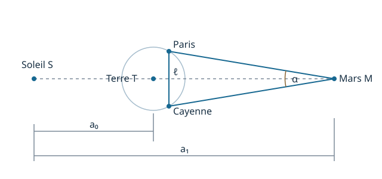

# Mines-Ponts MP — Physique 1 2024 · Corrigé brut

*Corrigé rédigé par IA, non officiel. Signalez toute erreur.*

## I — Les lois de Kepler et l’unité astronomique

### I.A — Mouvements d’une planète sous l’action d’un astre attracteur

### Question 1

Si $m_P\ll m_A$, le déplacement de $A$ autour du barycentre est négligeable devant celui de $P$. On traite alors $A$ comme fixe dans le référentiel galiléen du modèle. La force sur $P$ est attractive et $r$ est la distance entre les deux centres.

$$
\boxed{\vec F_{A\to P}=-\frac{Gm_A m_P}{r^2}\hat u_r.}
$$

### Question 2

La symétrie sphérique impose un champ radial $\vec g_A=g_A(r)\hat u_r$, de composante constante sur chaque sphère centrée en $A$. Sur la sphère de rayon $r>R_A$, le théorème de Gauss donne le flux $4\pi r^2 g_A(r)=-4\pi Gm_A$. En multipliant le champ par $m_P$, on retrouve exactement la force de Q1.

### Question 3

Oui, tant que les deux boules sont disjointes et gardent leur symétrie sphérique. Le champ de $A$ en chaque point de $P$ est celui d’une masse $m_A$ ponctuelle en $A$, d’après Q2.

La force totale sur $P$ est donc celle qu’exercerait ce point.

Or le champ de $P$ au point $A$ est celui d’une masse $m_P$ ponctuelle en $P$.

Par action et réaction, la force du point $A$ sur la boule $P$ est opposée à celle de la boule $P$ sur le point $A$. On retrouve l’expression de Q1.

### Question 4

Le moment de la force par rapport à $A$ est nul car la force est centrale. Ainsi le moment cinétique $\vec L_A=m_P\vec r\wedge\vec v$ est constant.

Si $\vec L_A\ne\vec 0$, le rayon vecteur reste dans le plan passant par $A$ perpendiculaire à $\vec L_A$. Si $\vec L_A=\vec 0$, le mouvement est radial. Dans la suite on choisit l’orientation du plan pour que le mouvement orbital ait $\dot\theta>0$.

Dans la base polaire, $\vec L_A=m_P r^2\dot\theta\hat u_z$. L’aire balayée par unité de temps vaut $r^2\dot\theta/2$. La **constante des aires**, égale au double de la vitesse aréolaire, vaut donc $C=r^2\dot\theta$.

### Question 5

La deuxième loi de Newton donne $\mathrm d\vec v/\mathrm dt=-Gm_A\hat u_r/r^2$. Puisque $\dot\theta=C/r^2$,

$$
\frac{\mathrm d\vec v}{\mathrm d\theta}=-\frac{Gm_A}{C}\hat u_r.
$$

Or $\mathrm d\hat u_\theta/\mathrm d\theta=-\hat u_r$. On intègre et on factorise le coefficient $Gm_A/C$ pour écrire

$$
\begin{aligned}
\vec v(\theta)&=\frac Cp(\hat u_\theta+\vec e),\\
p&=\frac{C^2}{Gm_A}.
\end{aligned}
$$

$C/p$ est une vitesse. Le vecteur d’intégration $\vec e=(p/C)\vec v-\hat u_\theta$ est donc sans dimension et appartient au plan du mouvement.

### Question 6

Dans la base polaire, $\hat u_y=\sin\theta\,\hat u_r+\cos\theta\,\hat u_\theta$. En identifiant les composantes de $\vec v$,

$$
\begin{aligned}
\dot r&=\frac Cp e\sin\theta,\\
r\dot\theta&=\frac Cp(1+e\cos\theta).
\end{aligned}
$$

Comme $r\dot\theta=C/r$, on obtient $r=p/(1+e\cos\theta)$. Pour un mouvement borné, $r$ est majoré et $\dot\theta=C/r^2$ est minoré par une constante strictement positive.

Le mouvement parcourt donc toutes les directions. Le dénominateur doit rester strictement positif, en particulier pour $\theta=\pi$, d’où $e<1$. La trajectoire est une ellipse de foyer $A$, ou un cercle si $e=0$.

### I.B — Période du mouvement

### Question 7

Sur un tour, $\mathrm dt=r^2\mathrm d\theta/C$. Avec l’orbite de Q6 et $C=\sqrt{Gm_Ap}$, on trouve

$$
\begin{aligned}
T&=\frac{p^{3/2}}{\sqrt{Gm_A}}I,\\
I&=\int_0^{2\pi}\frac{\mathrm d\theta}{(1+e\cos\theta)^2}.
\end{aligned}
$$

### Question 8

Si $e=0$, l’orbite est un cercle de rayon $a=p$ et $I=2\pi$. D’après Q7,

$$
\begin{aligned}
T&=\boxed{2\pi\sqrt{\frac{a^3}{Gm_A}}},\\
T^2&=\frac{4\pi^2}{Gm_A}a^3.
\end{aligned}
$$

C’est la **troisième loi de Kepler**, ou loi des périodes. Pour les planètes qui tournent autour du Soleil, le carré de la période de révolution est proportionnel au cube du demi-grand axe de l’orbite.

### Question 9

On intègre numériquement suivant $\theta$ pour chaque excentricité. La première grille, fine, sert à tracer la courbe continue. La seconde grille, indépendante, fournit dix points régulièrement espacés, bornes comprises. `quad` renvoie la valeur de l’intégrale et une estimation d’erreur. Le tracé utilise uniquement la première composante.

```python
import numpy as np
from scipy.integrate import quad
import matplotlib.pyplot as plt


def integrale(e):
    def integrande(theta):
        return (1 + e * np.cos(theta)) ** (-2)

    valeur, _ = quad(integrande, 0, 2 * np.pi)
    return valeur


e_courbe = np.linspace(0, 0.5, 201)
e_points = np.linspace(0, 0.5, 10)
plt.figure()
plt.plot(e_courbe, [integrale(e) for e in e_courbe], "-")
plt.plot(e_points, [integrale(e) for e in e_points], "o")
plt.xlabel("Paramètre e")
plt.ylabel("Intégrale I")
plt.grid()
plt.show()
```

### I.C — Mesure de l’unité astronomique

### Question 10

Au moment de la mesure, le Soleil $S$, le centre terrestre $T$ et Mars $M$ sont dans cet ordre. Les segments $ST=a_0$ et $SM=a_1$ donnent $TM=a_1-a_0$.

Les deux directions de visée joignent Paris et Cayenne à $M$. Leur angle est $\alpha$, mesuré au sommet $M$, et la base est le segment rectiligne entre les observatoires, de longueur $\ell$.



Le dessin utilise une base transverse à la ligne Terre–Mars. Cette hypothèse de modélisation, nécessaire pour employer directement $\ell$, explicite la géométrie simplifiée du calcul qui suit.

### Question 11

Dans la géométrie idéale, les observatoires se trouvent de part et d’autre de l’axe de visée. Le triangle de parallaxe donne $\ell=2d\tan(\alpha/2)$, où $d$ est la distance de Mars au milieu de la base. À cette précision on assimile $d$ à $a_1-a_0$, car le rayon terrestre est petit devant la distance à Mars. Pour $\alpha$ petit exprimé en radians, on a $\alpha\simeq\ell/(a_1-a_0)$.

La troisième loi de Kepler appliquée aux deux orbites circulaires donne $a_1/a_0=(T_1/T_0)^{2/3}$. En combinant les deux équations,

$$
\boxed{a_0\simeq\frac{\ell}{\alpha\big[(T_1/T_0)^{2/3}-1\big]}.}
$$

Si la base est inclinée, le développement au premier ordre fait intervenir sa longueur projetée perpendiculairement à la visée. La seule distance rectiligne entre observatoires ne suffit alors pas à déterminer $a_0$.

### Question 12

Avec $\alpha=14\times4{,}85\ \mathrm{\mu rad}$ et $(T_1/T_0)^{2/3}\simeq1{,}52$, le modèle donne

$$
a_0\simeq\frac{7{,}07\times10^6}{(6{,}8\times10^{-5})\,(0{,}52)}
\simeq2{,}0\times10^{11}\ \mathrm m.
$$

Cette estimation dépasse d’environ un tiers la valeur de référence $1{,}5\times10^{11}\ \mathrm m$. Dans ce modèle, on attendrait un angle d’environ $19''$, donc les $14''$ ne concordent pas quantitativement. Une base projetée d’environ $5{,}3\times10^3\ \mathrm{km}$ suffirait à réconcilier les nombres dans ce calcul. L’orientation effective des stations et l’approximation des orbites par des cercles limitent la comparaison historique.

## II — Structure et énergie des étoiles

### II.A — L’énergie gravitationnelle

### Question 13

La gravitation attire la matière dans le sens du déplacement pendant son assemblage. L’opérateur exerce une force opposée, de sorte que son travail quasi statique est négatif. Ainsi $W_g<0$. La quantité $E_\ell=-W_g>0$ est l’énergie à fournir pour dissocier l’étoile et porter toute sa matière à grande distance, au repos.

### Question 14

La masse volumique vaut $\rho=3M/(4\pi R^3)$. À masse volumique constante, la masse intérieure est proportionnelle au volume, et la coquille ajoutée a pour volume $4\pi r^2\mathrm dr$ au premier ordre.

$$
\begin{aligned}
m(r)&=M\left(\frac rR\right)^3,\\
\mathrm dm&=\frac{3Mr^2}{R^3}\mathrm dr.
\end{aligned}
$$

### Question 15

À l’extérieur de la masse déjà en place, son potentiel est $-Gm/r$, avec l’origine du potentiel à l’infini. Le travail de l’opérateur qui apporte quasi statiquement la coquille est donc $\mathrm dW_g=-Gm\,\mathrm dm/r$. L’autoénergie de cette coquille est d’ordre deux en $\mathrm dm$. Chaque interaction entre couches est comptée à l’arrivée de la couche extérieure.

$$
\begin{aligned}
W_g&=-\frac{3GM^2}{R^6}\int_0^R r^4\mathrm dr,\\
W_g&=-\frac{3GM^2}{5R}.
\end{aligned}
$$

### II.B — Pression cinétique

### Question 16

La pression sur la base pousse vers le haut avec $SP(z_1)\hat u_z$. Celle sur le sommet pousse vers le bas avec $-SP(z_2)\hat u_z$. Les actions de pression sur les faces latérales se compensent horizontalement. Le poids s’écrit $S\hat u_z\int_{z_1}^{z_2}\rho(z)G(z)\mathrm dz$, avec $G(z)<0$.

Le bilan à l’équilibre donne $P(z_2)-P(z_1)=\int_{z_1}^{z_2}\rho(z)G(z)\mathrm dz$. Comme cette relation vaut pour toute tranche,

$$
\boxed{\frac{\mathrm dP}{\mathrm dz}=\rho(z)G(z).}
$$

La pression décroît dans le sens des altitudes croissantes.

### Question 17

Pour un gaz parfait classique à l’équilibre thermique, la translation des particules apporte $3k_BT/2$ d’énergie cinétique moyenne par particule. Avec $PV=Nk_BT$, on obtient $E_c=3PV/2$. Dans le modèle monoatomique, cette énergie de translation constitue aussi toute l’énergie interne du gaz idéal.

### Question 18

La sphère de rayon $r\le R$ contient $Mr^3/R^3$. Le théorème de Gauss appliqué à cette sphère et la symétrie radiale donnent $\vec G(r)=-GM r\hat u_r/R^3$. L’équilibre hydrostatique radial fournit alors

$$
\frac{\mathrm dP}{\mathrm dr}=-\frac{3GM^2r}{4\pi R^6}.
$$

La pression du milieu extérieur est négligée, donc $P(R)=0$. En intégrant entre $r$ et $R$,

$$
\boxed{P(r)=\frac{3GM^2}{8\pi R^6}(R^2-r^2).}
$$

### Question 19

La densité volumique d’énergie cinétique est $3P(r)/2$. On intègre sur les coquilles sphériques pour obtenir

$$
\begin{aligned}
E_c&=\frac{9GM^2}{4R^6}\int_0^R (R^2-r^2)r^2\mathrm dr,\\
E_c&=\frac{3GM^2}{10R}.
\end{aligned}
$$

Ainsi $2E_c=-W_g$. Les deux contributions sont du même ordre, et leur somme reste négative. Ce résultat correspond au viriel du modèle en équilibre à pression de bord nulle.

### II.C — Pression de confinement quantique

### Question 20

La masse due aux électrons est négligeable devant celle des protons, donc $N\simeq M/m_p$. Chaque cellule a pour volume $a^3=V/N$, d’où

$$
\boxed{a=R\left(\frac{4\pi m_p}{3M}\right)^{1/3}.}
$$

### Question 21

En séparant le facteur temporel, on obtient $-\hbar^2\varphi''/(2m)=\hbar\omega\varphi$. Les parois impénétrables imposent $\varphi(0)=\varphi(a)=0$. Le premier nombre d’onde non nul est $k=\pi/a$. En normalisant sur la boîte et en choisissant la phase globale réelle,

$$
\begin{aligned}
\varphi_1(x)&=\sqrt{\frac2a}\sin\left(\frac{\pi x}{a}\right),\quad 0<x<a,\\
\epsilon_1&=\frac{h^2}{8ma^2}.
\end{aligned}
$$

La fonction est nulle à l’extérieur. La localisation impose $\Delta x\le a/2$, donc $\Delta p_x\ge\hbar/(2\Delta x)\ge\hbar/a$. Ici $\langle p_x\rangle=0$ et $\langle p_x^2\rangle=(\hbar\pi/a)^2$, en accord avec une énergie cinétique croissant comme $1/a^2$ lorsque la boîte se resserre.

### Question 22

Le laplacien cartésien est une somme de trois opérateurs unidimensionnels. Le fondamental est le produit des trois fondamentaux à une dimension. Leurs énergies s’ajoutent.

$$
\begin{aligned}
\varphi_{111}(x,y,z)
&=\left(\frac2a\right)^{3/2}
\sin\left(\frac{\pi x}{a}\right)
\sin\left(\frac{\pi y}{a}\right)
\sin\left(\frac{\pi z}{a}\right),\\
\epsilon_{111}&=\frac{3h^2}{8ma^2}.
\end{aligned}
$$

La fonction d’onde spatiale est nulle hors du cube.

### Question 23

Il y a $N$ protons et $N$ électrons, chacun dans une cellule de côté $a$. Le modèle donne

$$
E_c=N\frac{3h^2}{8a^2}\left(\frac1{m_e}+\frac1{m_p}\right).
$$

En remplaçant $N$ et $a$ par leurs expressions de Q20,

$$
\begin{aligned}
E_c&=\gamma\frac{M^{5/3}}{R^2},\\
\gamma&=\frac{3h^2}{8}\left(\frac3{4\pi}\right)^{2/3}
   m_p^{-5/3}\left(\frac1{m_e}+\frac1{m_p}\right).
\end{aligned}
$$

La contribution des électrons domine d’un facteur $m_p/m_e$.

### II.D — Le cas des naines blanches

### Question 24

Pour une masse fixée, $E(R)=A/R^2-B/R$ avec $A=\gamma M^{5/3}$ et $B=3GM^2/5$, tous deux positifs. Sa dérivée vaut $(BR-2A)/R^3$ pour $R>0$. Elle passe de négative à positive à l’unique point critique, qui minimise donc l’énergie totale.

$$
\boxed{R_{\rm eq}=\frac{2A}{B}=\frac{10\gamma}{3GM^{1/3}}.}
$$

### Question 25

Avec $\gamma=1{,}6\times10^6\ \mathrm{m^4\,kg^{-2/3}\,s^{-2}}$ et $M=M_\odot=1{,}99\times10^{30}\ \mathrm{kg}$, on trouve **$R_{\rm wd}\simeq6{,}4\times10^6\ \mathrm m$**, soit environ $6{,}4\times10^3\ \mathrm{km}$. Cette étoile de masse solaire a le rayon de la Terre, environ un centième du rayon solaire. Elle est donc très compacte.

### Question 26

Dans le modèle de Fowler, l’énergie cinétique est dominée par les électrons. Une naine blanche carbonée compte environ un électron pour deux nucléons, donc $N_e\simeq M/(2m_p)$. À l’équilibre, Q24 implique $E_c=3GM^2/(10R_{\rm eq})$. En égalant cette énergie à $N_e m_e v_{\rm rms}^2/2$, on estime

$$
\begin{aligned}
v_{\rm rms}&\simeq\sqrt{\frac{6GMm_p}{5R_{\rm eq}m_e}},\\
v_{\rm rms}&\simeq2{,}1\times10^8\ \mathrm{m\,s^{-1}}.
\end{aligned}
$$

Cela vaut environ $0{,}71c$ avec $c\simeq3{,}0\times10^8\ \mathrm{m\,s^{-1}}$. Si l’on conserve le comptage du modèle à hydrogène, $N_e\simeq M/m_p$, la vitesse est réduite d’un facteur $\sqrt2$, soit environ $0{,}51c$. Dans les deux cas, la vitesse issue de la formule classique est une fraction importante de $c$. Cela justifie un traitement relativiste du confinement, comme l’a proposé Chandrasekhar.
