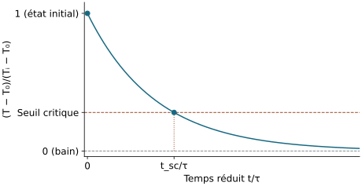

# Mines-Ponts MP — Physique 2 2024 · Corrigé guidé

*Corrigé rédigé par IA, non officiel. Signalez toute erreur.*

## Présentation du sujet

L’épreuve dure trois heures sans calculatrice. Les deux problèmes sont indépendants. Vous pouvez réserver 65 minutes aux transferts thermiques, 95 minutes au réfrigérateur et 20 minutes à la lecture et à la relecture. Q1 à Q3, Q8 à Q10 et Q12 à Q15 donnent des points d’entrée proches du cours. Gardez du temps pour vérifier le signe de la détente et arrondissez les valeurs finales à deux chiffres significatifs.

## I — Refroidissement des supraconducteurs

### Question 1

> [!INDICATION]
> Comparez les unités dans les lois de Newton et de Fourier.

> [!INDICATION]
> Écrivez le bilan sur une tranche en distinguant ses deux faces.

#### Solution

La densité de flux thermique est en $\mathrm{W\,m^{-2}}$. La loi de Newton donne $[k]=\mathrm{W\,m^{-2}\,K^{-1}}$. La loi de Fourier $j=-\lambda\,\partial_xT$ donne $[\lambda]=\mathrm{W\,m^{-1}\,K^{-1}}$.

Pour une tranche de section $S$ et d’épaisseur $\mathrm dx$, le stockage d’énergie par unité de temps égale le flux net entrant,
$$
\rho cS\,\mathrm dx\,\partial_tT=S[j(x)-j(x+\mathrm dx)].
$$
En divisant par le volume et en prenant la limite, on trouve
$$
\rho c\,\partial_tT=-\partial_xj=\lambda\,\partial_x^2T
$$
pour un milieu homogène sans source.

### Question 2

> [!INDICATION]
> Reconnaissez le coefficient du laplacien.

> [!INDICATION]
> Comparez le rayon à la longueur diffusée.

#### Solution

Le coefficient de diffusion est $D_{\mathrm{th}}=\lambda/(\rho c)$, en $\mathrm{m^2\,s^{-1}}$. La chaleur diffuse à la distance d’ordre $\sqrt{D_{\mathrm{th}}t}$ en un temps $t$. Pour que la diffusion homogénéise le solide à l’échelle de son rayon, il faut $t\gg R^2/D_{\mathrm{th}}$.

Dans le modèle de température uniforme, on suppose donc que l’évolution d’ensemble est lente devant le temps de diffusion interne. Ce critère porte sur la durée caractéristique du refroidissement, car un refroidissement imposé très vite en surface peut entretenir des gradients.

> [!JURY]
> Construisez le temps de diffusion et interprétez sa comparaison avec la durée du refroidissement.

### Question 3

> [!INDICATION]
> Calculez la masse à partir du volume.

> [!INDICATION]
> Divisez l’écart de température par la puissance pariétale.

#### Solution

La capacité thermique de la boule est le produit de sa masse par sa capacité thermique massique,
$$
C_{\mathrm{th}}=\frac43\pi R^3\rho c.
$$
La puissance sortante donnée par Newton est $\Phi=4\pi R^2k(T-T_s)$, avec $T_s$ la température du fluide au bord. La résistance pariétale vaut donc
$$
R_{\mathrm{th}}=\frac{T-T_s}{\Phi}=\frac1{4\pi R^2k},
$$
en $\mathrm{K\,W^{-1}}$.

### Question 4

> [!INDICATION]
> Utilisez le stockage négligeable dans le liquide.

> [!INDICATION]
> Appliquez les deux conditions aux limites après intégration radiale.

#### Solution

Le liquide étant immobile et son stockage thermique négligé, sa température vérifie $\Delta T_f=0$ à chaque instant à l’extérieur de la boule. Par symétrie sphérique,
$$
\frac{\partial}{\partial r}\left(r^2\frac{\partial T_f}{\partial r}\right)=0.
$$
Deux intégrations donnent une constante et un terme en $1/r$. La température vaut $T_0$ à l’infini et $T_s(t)$ à $r=R$. Ainsi
$$
T_f(r,t)=T_0+[T_s(t)-T_0]\frac Rr.
$$

### Question 5

> [!INDICATION]
> Suivez la puissance à travers des sphères de rayons différents.

> [!INDICATION]
> Calculez le flux de Fourier à partir du profil précédent.

#### Solution

L’absence de stockage dans le liquide est l’hypothèse de régime quasi stationnaire. À chaque instant, la puissance traverse toutes les sphères avec la même valeur. D’après Fourier, cette puissance est proportionnelle à l’écart de température,
$$
\Phi=4\pi r^2(-\lambda'\partial_r T_f)=4\pi R\lambda'(T_s-T_0).
$$
L’écart sur la puissance définit donc une résistance constante $R'_{\mathrm{th}}=1/(4\pi R\lambda')$.

> [!JURY]
> La résistance s’applique à chaque instant parce que la puissance ne s’accumule pas dans le fluide.

### Question 6

> [!INDICATION]
> Comparez les deux résistances en série.

> [!INDICATION]
> Écrivez le bilan de puissance de la boule avec la résistance dominante.

#### Solution

Les deux résistances sont en série, car la même puissance les traverse. L’hypothèse $\lambda'/R\gg k$ donne $R'_{\mathrm{th}}/R_{\mathrm{th}}=kR/\lambda'\ll 1$. Le bilan de la boule est
$$
C_{\mathrm{th}}\frac{\mathrm dT}{\mathrm dt}
=-\frac{T-T_0}{R_{\mathrm{th}}+R'_{\mathrm{th}}}
\simeq-4\pi R^2k(T-T_0).
$$
Ainsi $\tau\,\mathrm dT/\mathrm dt+T-T_0=0$ avec $\tau=\rho Rc/(3k)$.

### Question 7

> [!INDICATION]
> Résolvez l’équation avec la température initiale.

> [!INDICATION]
> Repérez l’intersection de la courbe avec la droite critique.

#### Solution

Pour $T(0)=T_i$, la solution est $T(t)=T_0+(T_i-T_0)e^{-t/\tau}$. Si $T_i>T_{\mathrm{sc}}>T_0$, elle décroît vers l’asymptote $T_0$ et atteint le seuil à
$$
t_{\mathrm{sc}}=\tau\ln\frac{T_i-T_0}{T_{\mathrm{sc}}-T_0}.
$$
Si la température est initialement au seuil ou au-dessous, aucun délai positif de franchissement n’est nécessaire.

### Question 8

> [!INDICATION]
> Isolez un cylindre de rayon r.

> [!INDICATION]
> Reliez sa puissance produite à la puissance évacuée.

#### Solution

L’aire de section de la partie étudiée vaut $\pi r^2$. Sur la hauteur $H$, le volume producteur vaut $\pi r^2H$. En régime permanent, la puissance évacuée vaut donc $P_s(r)=p_u\pi r^2H$.

### Question 9

> [!INDICATION]
> Identifiez la surface réellement traversée.

> [!INDICATION]
> Utilisez le résultat de la Q8 avant de prendre la limite à l’axe.

#### Solution

Le flux est radial par symétrie et ne traverse pas les extrémités du tronçon. Il traverse l’aire latérale $2\pi rH$, donc
$$
j_{\mathrm{th}}(r)=\frac{P_s(r)}{2\pi rH}=\frac{p_ur}{2}.
$$
Le flux est sortant, nul sur l’axe par continuité.

### Question 10

> [!INDICATION]
> Évaluez le flux conducteur au bord.

> [!INDICATION]
> Raccordez-le au flux donné par la loi de Newton.

#### Solution

À la surface, la loi de Newton impose $j_{\mathrm{th}}(R)=k(T_s-T_0)$. On obtient $T_s=T_0+p_uR/(2k)$.

### Question 11

> [!INDICATION]
> Déduisez le signe du gradient de Fourier.

> [!INDICATION]
> Intégrez jusqu’au centre, puis imposez le seuil critique.

#### Solution

Fourier impose $-\lambda T'(r)=p_ur/2$. Pour $p_u>0$, la température décroît lorsque $r$ croît. L’intégration à partir de la surface donne
$$
T(r)=T_s+\frac{p_u}{4\lambda}(R^2-r^2).
$$
Le maximum est sur l’axe. D’après la Q10,
$$
T_{\max}=T_0+p_u\left(\frac{R}{2k}+\frac{R^2}{4\lambda}\right).
$$
Le fil reste partout au-dessous de la température critique si $p_u<p_{\max}$, avec
$$
p_{\max}=\frac{T_{\mathrm{sc}}-T_0}{R/(2k)+R^2/(4\lambda)}.
$$

## II — Réfrigérateur à détente de gaz

### Question 12

> [!INDICATION]
> Utilisez le poids de Boltzmann du niveau.

> [!INDICATION]
> Normalisez par la somme de tous les poids.

#### Solution

Pour un niveau non dégénéré d’énergie $\varepsilon_j$, la probabilité canonique est
$$
\begin{aligned}
P_j&=\frac{e^{-\beta\varepsilon_j}}{Z(\beta)}\\
Z(\beta)&=\sum_{j=1}^p e^{-\beta\varepsilon_j}.
\end{aligned}
$$
Le nombre moyen de particules sur ce niveau vaut $NP_j$.

### Question 13

> [!INDICATION]
> Dérivez la fonction de partition.

> [!INDICATION]
> Passez de l’énergie moyenne d’une particule à l’énergie du gaz.

#### Solution

La dérivée s’écrit $Z'=-\sum_j\varepsilon_je^{-\beta\varepsilon_j}$. Ainsi
$$
\begin{aligned}
\bar\varepsilon&=\sum_jP_j\varepsilon_j=-Z'/Z,\\
U&=N\bar\varepsilon=-N\frac{\mathrm d\ln Z}{\mathrm d\beta}.
\end{aligned}
$$
La deuxième relation suppose que l’énergie du gaz idéal est la somme des énergies individuelles.

### Question 14

> [!INDICATION]
> Partez de la définition de la variance.

> [!INDICATION]
> Pour des particules indépendantes, additionnez les variances.

#### Solution

L’écart-type individuel est défini par
$$
\sigma_\varepsilon=\left[\sum_{j=1}^p P_j(\varepsilon_j-\bar\varepsilon)^2\right]^{1/2}.
$$
Pour des particules indépendantes, les covariances s’annulent. Les variances s’additionnent et $\sigma_U=\sqrt N\,\sigma_\varepsilon$.

L’écart-type de l’énergie par particule est $\sigma_\varepsilon/\sqrt N$. Il tend vers zéro à la limite thermodynamique. Quand $\bar\varepsilon\ne0$, la fluctuation relative de l’énergie totale est d’ordre $1/\sqrt N$ à température fixée.

> [!PIÈGE]
> Les variances s’ajoutent pour des variables indépendantes. Les écarts-types demandent de prendre une racine.

### Question 15

> [!INDICATION]
> Reliez la densité au nombre d’états dans une tranche d’énergie.

> [!INDICATION]
> Le nombre d’états est sans dimension.

#### Solution

Le nombre d’états $\mathrm dg=q(\varepsilon)\mathrm d\varepsilon$ est sans dimension, donc $q$ s’exprime en $\mathrm{J^{-1}}$.

### Question 16

> [!INDICATION]
> Comptez les vitesses dans une boule.

> [!INDICATION]
> Dérivez le nombre cumulé d’états par rapport à l’énergie.

#### Solution

L’énergie cinétique vaut $\varepsilon=mv^2/2$, avec $v$ la norme de la vitesse. Toutes les positions dans le volume du récipient contribuent un même facteur. Le nombre d’états d’énergie inférieure à $\varepsilon$ est proportionnel au volume de la boule de vitesses de rayon $\sqrt{2\varepsilon/m}$. Ce volume varie comme $\varepsilon^{3/2}$. La dérivation donne $q(\varepsilon)=Q\sqrt\varepsilon$. Le même raisonnement s’applique dans l’espace des quantités de mouvement.

### Question 17

> [!INDICATION]
> Rescalez l’énergie par l’inverse de la température.

> [!INDICATION]
> Suivez séparément la racine et l’élément différentiel.

#### Solution

Le changement de variable $x=\beta\varepsilon$ donne
$$
\begin{aligned}
Z(\beta)&=Q\int_0^\infty\sqrt\varepsilon\,e^{-\beta\varepsilon}\,\mathrm d\varepsilon\\
&=Q\beta^{-3/2}\int_0^\infty\sqrt x\,e^{-x}\,\mathrm dx\\
&=QA\beta^{-3/2}.
\end{aligned}
$$

### Question 18

> [!INDICATION]
> Calculez la dérivée logarithmique de la fonction de partition.

> [!INDICATION]
> Distinguez les contributions translationnelles et rotationnelles.

#### Solution

La dérivée logarithmique donne $U=3N/(2\beta)=\tfrac32Nk_BT$. C’est l’équipartition entre les trois contributions quadratiques de translation, chacune valant $k_BT/2$ par particule.

Pour un gaz diatomique dans le domaine où les deux rotations sont excitées et les vibrations gelées, deux contributions quadratiques s’ajoutent. On obtient $U=\tfrac52Nk_BT$ hors constante d’énergie. À température suffisamment élevée, l’activation du mode vibratoire apporte deux autres contributions dans la limite classique.

### Question 19

> [!INDICATION]
> Identifiez l’attraction moléculaire à grande distance.

> [!INDICATION]
> Prenez l’opposé de la dérivée du potentiel.

#### Solution

Le potentiel en $1/r^6$ modélise une attraction de van der Waals, par exemple de dispersion pour des molécules neutres. À cette attraction s’ajoute dans le modèle l’exclusion de contact des sphères. La force radiale pour $r>2r_0$ vaut
$$
F_r=-\frac{\mathrm d}{\mathrm dr}(-\alpha/r^6)=-6\alpha/r^7.
$$
Elle est dirigée vers l’autre molécule quand $\alpha>0$.

### Question 20

> [!INDICATION]
> Calculez le volume d’une coquille mince.

> [!INDICATION]
> Multipliez le potentiel par le nombre de molécules de chaque coquille.

#### Solution

La coquille sphérique a pour volume $4\pi r^2\mathrm dr$. En l’absence d’effet de bord et avec la densité indiquée, $\mathrm dN=(N/V)4\pi r^2\mathrm dr$. Le volume étant grand devant $r_0^3$, on prolonge la borne haute à l’infini pour cette intégrale dominée par les faibles distances,
$$
\bar\varepsilon_1=-4\pi\alpha\frac NV\int_{2r_0}^{\infty}\frac{\mathrm dr}{r^4}
=-\frac{4\pi\alpha N}{3V(2r_0)^3}.
$$

### Question 21

> [!INDICATION]
> Comptez les paires en partant de chaque molécule.

> [!INDICATION]
> Corrigez le double comptage avant d’identifier le paramètre a.

#### Solution

En faisant la somme pour les $N$ molécules, on compte chaque paire deux fois. Il faut donc ajouter à l’énergie cinétique la quantité $N\bar\varepsilon_1/2$. Ainsi
$$
\begin{aligned}
U&=\frac{Nk_BT}{\gamma-1}-\frac{N^2a}{V},\\
a&=\frac{2\pi\alpha}{3(2r_0)^3}=\frac{\pi\alpha}{12r_0^3}.
\end{aligned}
$$

> [!JURY]
> Chaque interaction apparaît une fois pour chacune des deux molécules avant correction du comptage.

### Question 22

> [!INDICATION]
> Étudiez l’entropie à volume constant.

> [!INDICATION]
> Utilisez la positivité de la capacité thermique.

#### Solution

À volume et effectif fixes, chauffer le fluide accroît son énergie et son entropie. En effet, $\mathrm dS=\mathrm dU/T$ et la capacité thermique est positive. L’expression proposée donne $\partial_T S=cNk_B/T$. Le coefficient $c$ est donc strictement positif.

### Question 23

> [!INDICATION]
> Différentiez par rapport à la température et au volume.

> [!INDICATION]
> Identifiez chaque coefficient dans l’identité thermodynamique.

#### Solution

Pour $N$ fixé, on différentie les deux fonctions,
$$
\begin{aligned}
\mathrm dU&=\frac{Nk_B}{\gamma-1}\mathrm dT+\frac{N^2a}{V^2}\mathrm dV,\\
T\mathrm dS&=Nk_Bc\,\mathrm dT+\frac{Nk_BT}{V-u}\mathrm dV.
\end{aligned}
$$
En identifiant dans $\mathrm dU=T\mathrm dS-P\mathrm dV$,
$$
\begin{aligned}
c&=\frac1{\gamma-1},\\
P&=\frac{Nk_BT}{V-u}-\frac{N^2a}{V^2}.
\end{aligned}
$$
C’est une équation de van der Waals. Le volume exclu réduit le volume accessible et augmente la pression. L’attraction abaisse la pression. Dans la limite diluée, les deux corrections disparaissent devant la pression idéale et $PV\simeq Nk_BT$.

### Question 24

> [!INDICATION]
> Écrivez l’enthalpie comme somme de deux termes.

> [!INDICATION]
> Dans les contributions déjà petites, remplacez le volume par celui du gaz parfait.

#### Solution

Au premier ordre en $A$ et $B$, l’équation d’état molaire donne
$$
PV=RT+PB-\frac{A}{V}+O(AB).
$$
Dans les termes déjà multipliés par $A$, la valeur d’ordre zéro $1/V=P/(RT)$ suffit. En ajoutant $PV$ à l’énergie interne molaire,
$$
H=\frac{\gamma R}{\gamma-1}T+PB-\frac{2AP}{RT}
\quad\text{au premier ordre}.
$$
Avec $C_P=\gamma R/(\gamma-1)$ et $K=2A/R$, on obtient
$$
\begin{aligned}
H&=C_PT-KP\left(\frac1T-\frac1{T_r}\right)\\
T_r&=\frac{2A}{RB}.
\end{aligned}
$$
Les deux constantes sont positives. $C_P$ est la capacité thermique molaire idéale qui intervient dans ce modèle.

### Question 25

> [!INDICATION]
> Calculez la pente à enthalpie constante.

> [!INDICATION]
> Comparez les températures d’inversion à la température ambiante.

#### Solution

Il s’agit d’une détente de Joule–Thomson, dite aussi de Joule–Kelvin. L’écoulement à travers un étranglement est irréversible. À enthalpie constante, $\mathrm dH=T\mathrm dS+V\mathrm dP=0$ implique que l’entropie molaire croît quand la pression baisse.

Dans le modèle approché,
$$
\left(\frac{\partial T}{\partial P}\right)_H
=\frac{K(1/T-1/T_r)}{C_P+KP/T^2}.
$$
Le dénominateur est positif et une baisse de pression refroidit si $T<T_r$. Au seuil, l’effet local s’annule, puis change de signe. Les températures d’inversion déduites des données sont
$$
\begin{aligned}
T_r(\mathrm N_2)&\simeq8{,}6\times10^2\,\mathrm K,\\
T_r(\mathrm H_2)&\simeq2{,}2\times10^2\,\mathrm K.
\end{aligned}
$$
Vers $300\,\mathrm K$, la détente refroidit le diazote et réchauffe le dihydrogène dans ce modèle. Il faut donc prérefroidir le dihydrogène sous sa température d’inversion pour utiliser cette détente comme étape frigorifique.

> [!PIÈGE]
> Une pente positive en pression signifie un refroidissement lorsque la pression diminue.

## Bilan

- Pour un refroidissement par évaporation, identifiez le seuil d’énergie des particules qui s’échappent. Évaluez l’énergie emportée avant de mettre à jour le nombre de particules et la température.
- Dans une détente en régime permanent, établissez le bilan de puissance avec les hypothèses du modèle. En déduire l’égalité des enthalpies massiques permet de relier pression et température.
- Le signe du coefficient de Joule–Thomson se lit avec celui de la variation de pression. La température d’inversion s’obtient en annulant ce coefficient.
