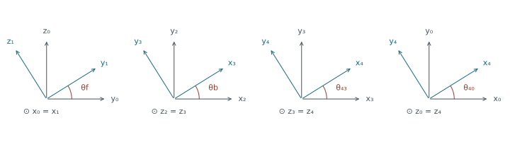
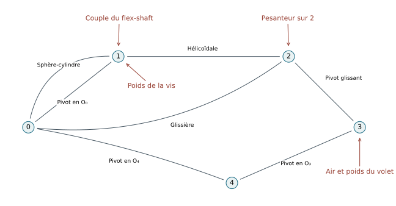
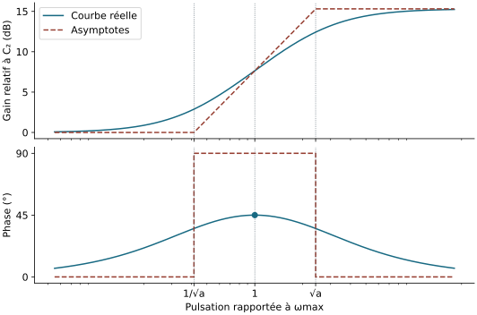

# Mines-Ponts MP — Sciences industrielles 2024 · Corrigé guidé

*Corrigé rédigé par IA, non officiel. Signalez toute erreur.*

## Présentation du sujet

L’épreuve dure trois heures sans calculatrice. Elle part du freinage d’un avion, puis étudie la cinématique et l’asservissement de son inverseur de poussée. Gardez le cahier-réponse et les deux annexes à portée de main. Vous pouvez prévoir 35 minutes pour le freinage et la chaîne, 60 minutes pour la cinématique et les efforts, 65 minutes pour les asservissements et 20 minutes pour les lectures et vérifications. Q1–Q4, Q7–Q11 et Q20–Q24 offrent des entrées proches du cours.

## 2 — Freinage de l’avion

### Question 1

> [!INDICATION]
> Isolez l’avion entier, avec les roues.

> [!INDICATION]
> Projetez la résultante verticale avant d’additionner les frottements.

#### Solution

On isole l’avion avec ses 22 roues. Par glissement de Coulomb, $T_i=-fN_i$ pour chaque contact. La résultante de l’air est purement horizontale. Le théorème de la résultante dynamique suivant $\vec y$ donne $\sum_i N_i=Mg$. Suivant $\vec x$, il donne
$$
Ma=-fMg-\frac12\rho SC_x v^2.
$$
La composante algébrique $a=\dot v$ est négative. La valeur positive de la décélération est son opposé.

> [!JURY]
> Le nom du théorème et ses deux projections font partie de la justification.

### Question 2

> [!INDICATION]
> Écrivez la variation totale d’énergie cinétique.

> [!INDICATION]
> Transformez chaque puissance en travail sur la durée du freinage.

#### Solution

Le théorème de l’énergie cinétique s’applique à l’avion entre le contact avec la piste et l’arrêt à $T$. Le poids et les normales ont une puissance nulle. En conservant les travaux sous forme intégrale,
$$
\begin{aligned}
W_f&=\int_0^T\sum_{i=1}^{22}T_i v(t)\,\mathrm dt,\\
W_a&=\int_0^T-\frac12\rho SC_x v(t)^3\,\mathrm dt,\\
-E_{c,0}&=W_f+W_a.
\end{aligned}
$$
Avec $v_0=260/3{,}6\simeq72{,}2\,\mathrm{m\,s^{-1}}$ et $M=4{,}0\times10^5\,\mathrm{kg}$, l’énergie à dissiper vaut $Mv_0^2/2\simeq1{,}04\times10^9\,\mathrm J$.

> [!JURY]
> Définissez les bornes, la variable et les puissances intégrées.

### Question 3

> [!INDICATION]
> Utilisez la fonction FI passée en argument.

> [!INDICATION]
> Séparez la vitesse ancienne de la vitesse ajoutée à la liste.

#### Solution

On prend $A_0=-fg$ et $A_1=-\rho SC_x/(2M)$, comme dans l’équation de Q1. La dérivée de la position et la puissance aérodynamique sont évaluées avec la vitesse ancienne, disponible dans `V[-1]` tant que la nouvelle vitesse n’est pas ajoutée. Les lignes du cahier-réponse se complètent ainsi.

```python
    while v > 0:                                      # ligne 13
        v = v + pas * FI(v)                           # ligne 14
        x.append(x[-1] + pas * V[-1])                 # ligne 15
        V.append(v)
        Wf.append(Wf[-1] + A0 * M * v * pas)
        Wa.append(Wa[-1] + A1 * M * V[-2]**3 * pas)   # ligne 18
        t.append(t[-1] + pas)
```

La ligne 17 imposée utilise la vitesse nouvelle. Le décalage d’un pas avec le calcul de position disparaît lorsque le pas tend vers zéro. Pour éviter une ultime vitesse négative, on peut arrêter l’intégration au zéro interpolé dans le dernier pas.

> [!JURY]
> Faites l’appel à la fonction passée en argument.

### Question 4

> [!INDICATION]
> Regardez le terme ajouté en ligne 17.

> [!INDICATION]
> Mettez-le en relation avec l’incrément de distance.

#### Solution

La ligne 17 donne une contribution au travail de frottement proportionnelle à la distance élémentaire parcourue. La force de Coulomb totale est constante et vaut $-fMg$ selon la piste. En prenant l’origine du travail au début du freinage,
$$
W_f(x)=-fMgx.
$$
Le travail est une droite décroissante. La figure 5 représente l’énergie dissipée, soit $-W_f$, qui croît donc linéairement.

### Question 5

> [!INDICATION]
> Repérez le point où la dissipation atteint cent pour cent.

> [!INDICATION]
> Convertissez l’exigence « un tiers vacant » en distance admissible.

#### Solution

Les deux figures représentent une dissipation totale croissante qui atteint l’énergie cinétique initiale à l’arrêt. La figure 5 est en joules et la figure 6.a en pourcentage, donc leurs valeurs finales sont équivalentes après normalisation. La part des freins domine en fin de freinage, tandis que la traînée agit surtout quand la vitesse est élevée. L’arrêt apparaît autour de $700\,\mathrm m$ sur la figure 5, proche de l’ordre de grandeur du sec dans la figure 6.a.

À $700\,\mathrm m$, les freins seuls ont dissipé environ $0{,}84\,\mathrm{GJ}$ sur la figure 5. L’effort moyen associé est donc d’environ $1{,}2\,\mathrm{MN}$. Rapporté au poids de l’avion de $400\,\mathrm t$, il correspond à un coefficient apparent proche de $0{,}30$. Cette lecture est compatible avec le sec. La valeur du tableau pour le glacé est $0{,}10$. La figure 5 ne suffit donc pas à vérifier le critère sur le glacé, pour lequel on utilise les courbes constructeur.

On lit les distances lorsque la dissipation totale atteint $100\,\%$. Sans inverseurs, elles sont d’environ $0{,}8\,\mathrm{km}$ sur le sec et $3{,}9\,\mathrm{km}$ sur le glacé. Avec inverseurs, elles sont d’environ $0{,}75\,\mathrm{km}$ et $1{,}2\,\mathrm{km}$.

Sur la piste glacée de $2{,}7\,\mathrm{km}$, réserver un tiers impose de s’arrêter avant $1{,}8\,\mathrm{km}$. Le cas sans inverseurs échoue et celui avec inverseurs satisfait ce critère. Les deux cas sur le sec sont en dessous de cette distance.

### Question 6

> [!INDICATION]
> Comparez les distances avec et sans dispositif sous chaque condition.

> [!INDICATION]
> Expliquez les conséquences pour l’exploitation d’une piste.

#### Solution

Sur piste sèche, le gain est faible, de l’ordre de quelques dizaines à une centaine de mètres avec la précision du graphe. Sur piste glacée, il est d’environ $2{,}7\,\mathrm{km}$, soit près de $70\,\%$ de la distance sans inverseurs. L’inverseur réduit la dépendance à l’adhérence des roues. Pour la compagnie, cela améliore la marge de sécurité et rend davantage de pistes accessibles dans des conditions de faible adhérence.

## 3 — Chaîne structurelle de l’eTras

### Question 7

> [!INDICATION]
> Suivez successivement les formes de puissance.

> [!INDICATION]
> Identifiez séparément le capteur moteur et les capteurs des vis.

#### Solution

Dans la chaîne de puissance, la génératrice et son filtrage **alimentent** le système. Le TRCU **distribue** la puissance électrique au moteur, avec une sortie continue de $24\,\mathrm V$. Le moteur à courant continu **convertit** en puissance mécanique de rotation. Les flex-shafts et les renvois d’angle **transmettent** cette rotation. Les ensembles vis-écrou **transforment** la rotation en translation. La partie mobile de nacelle et le mécanisme des volets **agissent** en modifiant le chemin du flux secondaire.

Dans la chaîne d’information, le codeur incrémental de l’arbre moteur et les quatre capteurs RVDT des vis **acquièrent** les positions et renseignent le synchronisme. Le FADEC et l’électronique de commande assurent le traitement. Le bus communique les ordres vers la chaîne de puissance.

### Question 8

> [!INDICATION]
> Suivez les variables du schéma-blocs.

> [!INDICATION]
> Distinguez vitesse, position, retour de mesure et perturbation.

#### Solution

De gauche à droite, on place **adaptateur de consigne**, comparateur $\varepsilon=N_c-N_m$, **correcteur et TRCU**, **moteur**, **intégrateur $1/p$**, **flex-shaft**, **vis-écrou** et **chaîne cinématique**. Le moteur délivre $\omega_m$ et l’intégrateur délivre $\theta_m$. Le bloc flex-shaft fournit $\theta_f$, puis le bloc vis-écrou fournit $\lambda_v$.

Le retour de $\theta_m$ au comparateur passe par le codeur incrémental, qui fournit $N_m$. Les actions extérieures sur les volets sont ramenées par la transmission au moteur en tant que **couple perturbateur résistant**.

## 4 — Modèle en aval des flex-shafts

### Question 9

> [!INDICATION]
> Cherchez la paire de vecteurs et l’axe commun de chaque rotation.

> [!INDICATION]
> Orientez les angles de l’ancienne base vers la nouvelle.

#### Solution

Les quatre changements de base, dans l’ordre du paramétrage, sont les rotations suivantes.

- De $(\vec y_0,\vec z_0)$ vers $(\vec y_1,\vec z_1)$, d’angle $\theta_f$ autour de $\vec x_0=\vec x_1$.
- De $(\vec x_2,\vec y_2)$ vers $(\vec x_3,\vec y_3)$, d’angle $\theta_b$ autour de $\vec z_2=\vec z_3$.
- De $(\vec x_3,\vec y_3)$ vers $(\vec x_4,\vec y_4)$, d’angle $\theta_{43}$ autour de $\vec z_3=\vec z_4$.
- De $(\vec x_0,\vec y_0)$ vers $(\vec x_4,\vec y_4)$, d’angle $\theta_{40}$ autour de $\vec z_0=\vec z_4$.

Pour le deuxième changement, la glissière 2/0 donne aussi $\vec x_2=\vec x_0$ et $\vec y_2=\vec y_0$. En particulier $\theta_{40}=\theta_b+\theta_{43}$ modulo $2\pi$.



### Question 10

> [!INDICATION]
> Fermez le contour des quatre points.

> [!INDICATION]
> Utilisez le dessin pour choisir le signe de la racine.

#### Solution

La fermeture suivant $O_1O_2O_3O_4O_1$ s’écrit
$$
\lambda\vec x_0+L_3\vec x_3+L_4\vec y_4-L\vec x_0-H\vec y_0=\vec0.
$$
Ses projections donnent
$$
\begin{aligned}
\lambda&=L-L_3\cos\theta_b+L_4\sin\theta_{40},\\
L_4\cos\theta_{40}&=H-L_3\sin\theta_b.
\end{aligned}
$$
Sur les figures 7 et 8, $O_4$ est à gauche de $O_3$, d’où $\sin\theta_{40}>0$ pour la configuration retenue. Ainsi
$$
\lambda=L-L_3\cos\theta_b+
\sqrt{L_4^2-(H-L_3\sin\theta_b)^2}.
$$

### Question 11

> [!INDICATION]
> Lisez les positions aux deux angles extrêmes.

> [!INDICATION]
> Comparez leur différence à la course requise.

#### Solution

On lit environ $250\,\mathrm{mm}$ à $5^\circ$ et $786\,\mathrm{mm}$ à $85^\circ$. La course est leur différence, soit environ $536\,\mathrm{mm}$. Elle dépasse les $500\,\mathrm{mm}$ demandés par l’exigence 1.2.2.

### Question 12

> [!INDICATION]
> Comparez un ajustement global et une tangente locale.

> [!INDICATION]
> Lisez la pente variable et retrouvez les attributs de l’objet entraîné.

#### Solution

L’ajustement affine minimise la somme des carrés des écarts sur toutes les mesures. Il donne une pente moyenne utile sur l’ensemble du débattement. Une tangente en un seul point représente mieux une petite zone autour de ce point. Sur $[5^\circ,30^\circ]$, le graphe de droite montre que la pente passe d’environ $14$ à $6{,}5\,\mathrm{mm\,deg^{-1}}$. Un gain constant décrit donc mal le début de l’ouverture.

Dans le code du cahier-réponse, les trois lignes s’écrivent ainsi.

```python
model_linReg.fit(X_train, Y)   # ligne 22
a = model_linReg.coef_[0]      # ligne 24
b = model_linReg.intercept_    # ligne 25
```

### Question 13

> [!INDICATION]
> Dérivez la droite de régression.

> [!INDICATION]
> Convertissez degrés en radians et millimètres en mètres.

#### Solution

La droite ajustée est de la forme $\lambda_{\mathrm{mm}}=a\theta_{b,\deg}+b$, avec $a\simeq6{,}3\,\mathrm{mm\,deg^{-1}}$ lu sur la figure 11. La dérivation élimine l’ordonnée à l’origine. On obtient
$$
K_{cc}=\frac{\omega_b}{V_{20}}=\frac{10^3\pi}{180a}
\simeq2{,}8\,\mathrm{rad\,m^{-1}}
$$
pour les grandeurs en SI.

### Question 14

> [!INDICATION]
> Reliez la fréquence de rotation à la vitesse d’avance de la vis.

> [!INDICATION]
> Combinez ce résultat au gain cinématique.

#### Solution

À la vitesse de $N_m$ tours par minute, la vis donne $V_{20}=pN_m/60$, où $p$ désigne ici le pas en mètres par tour. Pour le modèle linéarisé,
$$
t_{\rm ouv}=\frac{60\,(\theta_{\max}-\theta_{\min})}{K_{cc}pN_m}.
$$
En utilisant l’écart de $80^\circ$, le pas de $8\,\mathrm{mm}$ et $N_m=2000\,\mathrm{tr\,min^{-1}}$, on trouve environ $1{,}9\,\mathrm s$. Avec la course de Q11, on obtiendrait environ $2{,}0\,\mathrm s$. Les deux estimations sont inférieures à $3\,\mathrm s$.

### Question 15

> [!INDICATION]
> Écrivez la force sur un élément de surface et transportez son moment.

> [!INDICATION]
> Appuyez-vous sur la symétrie de la largeur pour simplifier l’intégrale.

#### Solution

On note $u$ la coordonnée suivant $\vec x_3$ depuis $O_2$ et $w$ la coordonnée suivant $\vec z_3$ depuis le plan médian. La pression est uniforme. La flèche de pression de la figure 12 pointe vers $-\vec y_3$.

Pour respecter la convention signée $F_{\rm air}\vec y_3$ de la suite, on écrit $\mathrm d\vec R=-p_s\,\mathrm du\,\mathrm dw\,\vec y_3$.

On intègre pour $u\in[0,L_3]$ et $w\in[-b/2,b/2]$. Le moment élémentaire transporté à $O_2$ vaut $(u\vec x_3+w\vec z_3)\times\mathrm d\vec R$. La contribution impaire en $w$ s’annule. Les deux composantes du torseur sont donc
$$
\begin{aligned}
\vec R&=F_{\rm air}\vec y_3,\qquad F_{\rm air}=-p_s bL_3,\\
\vec M_{O_2}&=\frac12L_3 F_{\rm air}\vec z_3.
\end{aligned}
$$
Pour les dimensions de la figure 12, la norme de la force vaut $187{,}5\,\mathrm N$ et celle du moment vaut $28{,}1\,\mathrm{N\,m}$.

> [!JURY]
> Passez du modèle élémentaire au torseur résultant par intégration.

### Question 16

> [!INDICATION]
> Reportez chaque paire de pièces liée par le schéma mécanique.

> [!INDICATION]
> Ajoutez les actions sans liaison, en particulier sur 1 et 3.

#### Solution

Le graphe possède les arêtes suivantes.

- 0–1, pivot d’axe $(O_0,\vec x_0)$ et sphère-cylindre sur le même axe, avec le second appui représenté au droit de $O_1$, sur l’axe de la vis qui passe sous la glissière. Le texte de paramétrage cite $O_0$ pour le centre de ce second appui.
- 1–2, hélicoïdale d’axe $(O_0,\vec x_0)$, de pas $p$.
- 0–2, glissière de direction $\vec x_0$.
- 2–3, pivot glissant d’axe $(O_2,\vec z_2)$.
- 3–4, pivot d’axe $(O_3,\vec z_2)$.
- 4–0, pivot d’axe $(O_4,\vec z_0)$.

Ajouter les actions de la pesanteur sur les solides massifs, de l’air sur 3 et du flex-shaft sur 1. La bielle 4 est de masse négligeable.



### Question 17

> [!INDICATION]
> Identifiez l’axe de révolution et les plans de symétrie.

> [!INDICATION]
> Déduisez les produits d’inertie nuls des symétries.

#### Solution

L’axe de la vis est un axe de symétrie de révolution dans le modèle. Il est principal en $O_0$. Toute paire d’axes orthogonaux dans son plan normal est équivalente, ce qui donne des termes diagonaux transverses égaux à $B_1$ et des produits d’inertie nuls.

Pour le volet modélisé par une plaque rectangulaire homogène, les plans médians du rectangle et celui de la plaque sont des plans de symétrie. Les axes correspondants en $G_3$ sont principaux et annulent les produits d’inertie. Les trois moments principaux peuvent être différents.

### Question 18

> [!INDICATION]
> Écrivez la vitesse du centre de masse du volet.

> [!INDICATION]
> Ramenez chaque énergie cinétique à la vitesse angulaire de la vis.

#### Solution

Notons $h=p/(2\pi)$ et $l_g=O_2G_3=L_3/2$. La relation hélicoïdale donne $V=h\dot\theta_f$ dans la convention d’ouverture et $\omega_b=K_{cc}V$. La vitesse de $G_3$ vaut
$$
\vec V_{G_3}=V\vec x_0+l_g\omega_b\vec y_3.
$$
Comme $\vec x_0\cdot\vec y_3=-\sin\theta_b$, le carré de cette norme vaut
$$
V^2+l_g^2\omega_b^2-2Vl_g\omega_b\sin\theta_b.
$$

La vis fournit $\tfrac12 A_1\dot\theta_f^2$, la pièce 2 fournit $\tfrac12M_2V^2$, et le volet fournit son énergie de translation du centre de masse plus $\tfrac12C_3\omega_b^2$. La bielle est négligée. En identifiant à $\tfrac12J_{\rm eq}\dot\theta_f^2$ pour un volet,
$$
\begin{aligned}
A_{\rm eq}&=A_1+h^2[M_2+M_3+(C_3+M_3l_g^2)K_{cc}^2],\\
B_{\rm eq}&=-2h^2M_3l_gK_{cc}.
\end{aligned}
$$
On obtient l’inertie $J_{\rm eq}=A_{\rm eq}+B_{\rm eq}\sin\theta_b$.

### Question 19

> [!INDICATION]
> Faites un bilan de puissances sur l’ensemble mobile.

> [!INDICATION]
> Tenez compte de la dérivée de l’inertie quand elle varie pendant le mouvement.

#### Solution

On isole $\{1,2,3,4\}$ et on applique le théorème de l’énergie cinétique sous forme de puissances. Les liaisons parfaites ne fournissent pas de puissance nette. Le poids de la vis et celui de la pièce 2 ne travaillent pas. Pour le volet, le poids fournit $-M_3g l_g\omega_b\cos\theta_b$.

La puissance de l’air, calculée au point $O_2$, vaut $F_{\rm air}(-V\sin\theta_b+l_g\omega_b)$. Celle du couple moteur transmis par le flex-shaft vaut $C_f\dot\theta_f$. Ainsi
$$
\frac{\mathrm d}{\mathrm dt}\left(\tfrac12J_{\rm eq}\dot\theta_f^2\right)
=C_f\dot\theta_f+F_{\rm air}(-V\sin\theta_b+l_g\omega_b)
-M_3g l_g\omega_b\cos\theta_b.
$$
En mouvement, on peut diviser par $\dot\theta_f$ pour obtenir
$$
C_f=J_{\rm eq}\ddot\theta_f+\frac12\dot J_{\rm eq}\dot\theta_f
+hF_{\rm air}(\sin\theta_b-l_gK_{cc})
+hM_3g l_gK_{cc}\cos\theta_b.
$$
Le terme en $\dot J_{\rm eq}$ subsiste même si la vitesse de la vis est momentanément constante et que l’inertie varie.

> [!JURY]
> Précisez l’isolement et les puissances des actions extérieures.

## 5 — Asservissement de la transmission

### Question 20

> [!INDICATION]
> Transformez les équations électrique et mécanique.

> [!INDICATION]
> Repérez le signal entrant dans chacun des blocs.

#### Solution

Sous conditions de Heaviside, l’équation électrique donne $I=(U-E)/(R+Lp)$. Le couple vaut $K_m I$. L’équation mécanique donne $\Omega_m=(C_m-C_r)/(J_mp)$. La force contre-électromotrice vaut $K_m\Omega_m$. Les quatre blocs sont donc
$$
\begin{aligned}
H_1(p)&=(R+Lp)^{-1},& K_2(p)&=K_m,\\
H_3(p)&=(J_mp)^{-1},& K_4(p)&=K_m .
\end{aligned}
$$

### Question 21

> [!INDICATION]
> Reliez l’erreur de tension à la consigne et au courant.

> [!INDICATION]
> Considérez l’effet du PI en régime établi.

#### Solution

En régime établi, l’intégrateur du correcteur PI annule l’écart de tension si la boucle est stable et non saturée. Ainsi $K_a I_c=R_e I$. Pour obtenir $I=I_c$, il faut $K_a=R_e$.

### Question 22

> [!INDICATION]
> Imposez réellement le blocage de l’arbre.

> [!INDICATION]
> Suivez le trajet ouvert depuis le comparateur jusqu’au capteur.

#### Solution

Moteur bloqué, $\Omega_m=0$ et la force contre-électromotrice s’annule. Le trajet direct de l’erreur de tension à la tension mesurée donne
$$
\frac{U_{\rm mes}(p)}{\varepsilon_U(p)}=\frac{R_e C(p)}{R+Lp}.
$$

### Question 23

> [!INDICATION]
> Identifiez le pôle sur la partie électrique.

> [!INDICATION]
> Faites coïncider sa valeur avec le zéro du PI.

#### Solution

Le pôle de l’induit est $-R/L$. Le zéro du PI est $-1/\tau_i$. La compensation impose $\tau_i=L/R$.

### Question 24

> [!INDICATION]
> Simplifiez la branche directe après compensation.

> [!INDICATION]
> Fermez la boucle avec le gain du capteur.

#### Solution

Après compensation, le trajet direct de $\varepsilon_U$ à $I$ vaut $K_p/(\tau_i Rp)$. En bouclant avec le retour de gain $R_e$ et l’adaptateur $K_a=R_e$,
$$
\frac{I(p)}{I_c(p)}=\frac{R_eK_p}{R_eK_p+\tau_i R p}.
$$
La boucle est du premier ordre, de gain statique unitaire et de constante de temps $L/(R_eK_p)$.

### Question 25

> [!INDICATION]
> Utilisez le temps caractéristique du premier ordre.

> [!INDICATION]
> Comparez le temps à la limite et vérifiez le sens de l’inégalité sur le gain.

#### Solution

Le temps de réponse à $5\,\%$ d’un premier ordre vaut la constante de temps multipliée par $\ln20$. On obtient
$$
t_{5\,\%}=\frac{L\ln20}{R_e K_p}.
$$
Pour viser moins de $0{,}3\,\mathrm{ms}$, il faut $K_p>L\ln20/(R_e\times3\times10^{-4}\,\mathrm s)\simeq9{,}99$. Le choix $K_p=10$ donne environ $0{,}300\,\mathrm{ms}$ et satisfait le critère au calcul nominal, avec une marge très faible.

### Question 26

> [!INDICATION]
> Lisez la valeur finale et deux points caractéristiques du transitoire.

> [!INDICATION]
> Comparez le plateau et le temps de réponse aux critères.

#### Solution

Avec correcteur, la réponse est monotone et son écart à la valeur finale décroît comme une exponentielle. Le courant final vaut environ $1\,\mathrm A$ pour une consigne de $1\,\mathrm A$. La constante de temps est proche de $0{,}10\,\mathrm{ms}$ à $63\,\%$, et le seuil à $95\,\%$ est atteint autour de $0{,}30\,\mathrm{ms}$.

Le modèle de premier ordre et l’absence d’erreur statique sont cohérents avec la figure. Le temps demandé est à la limite de la résolution graphique. Sans correcteur, le courant final ne vaut qu’environ $0{,}09\,\mathrm A$.

> [!JURY]
> Une courbe simplement croissante ne suffit pas à justifier le premier ordre. Utilisez aussi la valeur finale et les repères temporels.

### Question 27

> [!INDICATION]
> Les deux couples se somment.

> [!INDICATION]
> Écrivez la dynamique de la vis avant d’isoler la vitesse de sortie.

#### Solution

Les contributions visqueuse et élastique s’ajoutent. La dynamique de la vis donne
$$
J_r p\Omega_f=(f+k/p)(\Omega_m-\Omega_f).
$$
En isolant la sortie,
$$
\frac{\Omega_f}{\Omega_m}=\frac{fp+k}{J_r p^2+fp+k}.
$$

### Question 28

> [!INDICATION]
> Écrivez la transformée de la rampe.

> [!INDICATION]
> Appliquez la valeur finale à l’écart, en vérifiant la stabilité.

#### Solution

Pour une rampe de pente $a_{m0}$, $\Omega_m=a_{m0}/p^2$. L’écart de vitesses vaut
$$
\Omega_m-\Omega_f=\frac{J_r a_{m0}}{J_r p^2+fp+k}.
$$
Avec les paramètres mécaniques positifs, les pôles sont à partie réelle négative. Le théorème de la valeur finale donne un écart de vitesses tendant vers zéro.

### Question 29

> [!INDICATION]
> Comparez les vitesses puis les angles.

> [!INDICATION]
> Identifiez le couple qui subsiste pour accélérer la vis.

#### Solution

À long terme, la vis suit la rampe de vitesse moteur avec la même accélération. La torsion, intégrale de l’écart de vitesses, peut rester non nulle. Avec des conditions initiales nulles, le théorème de la valeur finale appliqué à cette intégrale donne
$$
\lim_{t\to\infty}(\theta_m-\theta_f)=\frac{J_r a_{m0}}k.
$$
Le terme visqueux disparaît et le couple élastique fournit le couple d’accélération $J_r a_{m0}$.

### Question 30

> [!INDICATION]
> Décomposez le correcteur en un gain, un zéro et un pôle.

> [!INDICATION]
> Placez la pulsation du maximum de phase entre les deux cassures.

#### Solution

Notons $C_2$ le gain constant positif du correcteur. Les deux cassures sont $1/(a\tau)$ et $1/\tau$. Le gain bas vaut $20\log_{10}C_2$, puis la pente vaut $+20\,\mathrm{dB}$ par décade, et le plateau haut vaut $20\log_{10}(aC_2)$.

La phase réelle est $\arctan(a\tau\omega)-\arctan(\tau\omega)$. Elle est positive entre les extrêmes et tend vers zéro aux deux extrémités. Le maximum est à $\omega_{\max}=1/(\tau\sqrt a)$, où le gain linéaire vaut $C_2\sqrt a$. La phase asymptotique des deux facteurs vaut zéro, puis $90^\circ$, puis zéro dans la représentation par paliers.



### Question 31

> [!INDICATION]
> Lisez la phase non corrigée à la pulsation demandée.

> [!INDICATION]
> Convertissez la marge exigée en phase corrigée minimale.

#### Solution

À $\omega_{\rm BP}$, la figure 20 donne une phase sans correction proche de $-180^\circ$. Pour une marge de $45^\circ$, la phase corrigée doit y être au moins $-135^\circ$. On centre le maximum de l’avance sur $\omega_{\rm BP}$ et on choisit $\varphi_{\max}\simeq45^\circ$.

### Question 32

> [!INDICATION]
> Calculez le rapport qui règle l’avance de phase.

> [!INDICATION]
> Ajustez ensuite le gain pour avoir la coupure à la même pulsation.

#### Solution

La formule fournie et le calage du maximum donnent
$$
\begin{aligned}
a&=\frac{1+\sin\varphi_{\max}}{1-\sin\varphi_{\max}}
=3+2\sqrt2\simeq5{,}83,\\
\tau&=\frac1{\omega_{\rm BP}\sqrt a}.
\end{aligned}
$$
Le gain non corrigé à cette pulsation vaut environ $-40\,\mathrm{dB}$ d’après la figure 20. Il faut donc apporter $+40\,\mathrm{dB}$. Ainsi
$$
\begin{aligned}
20\log_{10}(C_2\sqrt a)&=40,\\
C_2&=\frac{100}{\sqrt a}\simeq41.
\end{aligned}
$$

## 6 — Validation des performances

### Question 33

> [!INDICATION]
> Relisez les critères chiffrés du diagramme des exigences.

> [!INDICATION]
> Distinguez ce qui est lu sur la courbe et ce qui vient du réglage.

#### Solution

- Freinage sur piste glacée avec inverseurs, environ $1{,}2\,\mathrm{km}$, inférieur aux $1{,}8\,\mathrm{km}$ admissibles.
- Course d’ouverture, environ $536\,\mathrm{mm}$, supérieure à $500\,\mathrm{mm}$.
- Débattement des volets, de $5^\circ$ à $85^\circ$ sur la figure 21. Le plein débattement est atteint aux environs de $2{,}6\,\mathrm s$, inférieur à $3\,\mathrm s$.
- Boucle de courant, erreur statique nulle avec PI et temps de réponse voisin de $0{,}30\,\mathrm{ms}$. Le calcul nominal respecte la limite et le graphique seul ne permet pas de quantifier la marge.
- Boucle de position, le correcteur est dimensionné pour une coupure à $\omega_{\rm BP}$ et une marge d’environ $45^\circ$ dans le modèle. La réponse de position de la figure 21 valide le débattement et la durée, mais ne mesure pas la marge de phase.
- Compatibilité avec d’autres nacelles, aucune validation chiffrée dans cette étude.

## Bilan

Gardez la même convention de signe tout au long d’un calcul de travail ou de puissance. Pour une validation, associez la valeur calculée ou lue au seuil correspondant. Un réglage nominal de la boucle et une lecture graphique près d’un seuil apportent des garanties différentes.
