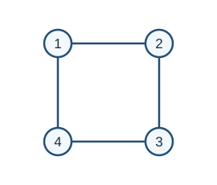

# Mines-Ponts MPI — Mathématiques 2 2024 · Corrigé guidé

*Corrigé rédigé par IA, non officiel. Signalez toute erreur.*

## Présentation du sujet

Le PDF officiel réunit l’énoncé aux pages 1–9 et la proposition de corrigé du concours aux pages 10–18.

L'épreuve dure quatre heures, sans calculatrice. La partie algébrique étudie les matrices d'adjacence d'étoiles et de graphes reliés par une arête. La suite étudie à partir de quelle échelle de probabilité les graphes aléatoires contiennent une arête, puis une copie d'un graphe fixé.

- **Partie I (Q1–Q10).** Changement de base, rang et polynôme caractéristique. Q10 introduit la probabilité des graphes à arêtes indépendantes.
- **Partie II (Q11–Q16).** Utiliser l'espérance et la variance pour trouver la fonction de seuil de présence d'une arête.
- **Partie III (Q17–Q27).** Compter les copies candidates, puis les couples de copies selon le nombre de sommets communs.

Les parties probabilistes peuvent être abordées sans réaliser les calculs de matrices. Q1–Q4 et Q10–Q16 sont des points d'entrée. Prévoir du temps pour la décomposition du déterminant en Q8 et pour le calcul du second moment en Q21–Q25.

Chercher d'abord la question, puis consulter les indications une à une. Dans la partie III, garder distincts le nombre de copies candidates, le nombre de copies présentes dans le graphe aléatoire et le nombre de couples qui partagent des sommets.

## Partie I — Quelques propriétés algébriques des matrices d’adjacence

Un graphe non orienté et sans boucle donne une matrice symétrique de diagonale nulle. Les changements d'indexation correspondent à des changements de base et la structure du graphe se lit dans les colonnes.

### Question 1

> [!INDICATION]
> Associez à $M$ un endomorphisme et réordonnez les vecteurs de sa base selon $\rho$.

> [!INDICATION]
> Pour les deux indexations, composez l'une avec l'inverse de l'autre puis comparez les deux indices du coefficient d'adjacence.

#### Solution

Soit $u$ l'endomorphisme de matrice $M$ dans la base canonique $(e_1,\ldots,e_n)$.

La famille $(e_{\rho(1)},\ldots,e_{\rho(n)})$ est une base.

Pour chaque $j$, le coefficient de $e_{\rho(i)}$ dans $u(e_{\rho(j)})$ vaut $m_{\rho(i),\rho(j)}$.

La matrice dans cette autre base est donc $(m_{\rho(i),\rho(j)})_{i,j}$, **semblable à $M$** puisque les deux représentent $u$.

Pour les indexations du graphe, posons $\rho=\sigma^{-1}\circ\sigma'$. Alors $\sigma'(i)=\sigma(\rho(i))$. La définition de l'adjacence donne $(M_{G,\sigma'})_{i,j}=(M_{G,\sigma})_{\rho(i),\rho(j)}$. **Les deux matrices d'adjacence sont donc semblables.**

> [!JURY]
> Le rapport préfère une justification par changement de base à une affirmation non démontrée sur les matrices de permutation. Les coefficients se lisent ici dans la nouvelle base.

### Question 2

> [!INDICATION]
> Quelle propriété de la matrice traduit le fait que les arêtes ne sont pas orientées ? Appliquez le théorème adapté.

#### Solution

La matrice d'adjacence est réelle symétrique, car une arête est une paire non ordonnée. **Le théorème spectral donne sa diagonalisation dans une base orthonormée.**

### Question 3

> [!INDICATION]
> Distinguez le cas où le graphe n'a aucune arête.

> [!INDICATION]
> S'il y a une arête, étudiez le mineur qui utilise uniquement ses deux extrémités.

#### Solution

En l'absence d'arête, la matrice est nulle et de rang zéro. Si une arête relie les sommets d'indices $i$ et $j$, la sous-matrice sur ces deux lignes et ces deux colonnes est

$$
\begin{pmatrix}0&1\\1&0\end{pmatrix}.
$$

Elle est inversible, donc les colonnes $i,j$ sont indépendantes. **Le rang est alors au moins deux et ne vaut jamais un.**

> [!METHODE]
> Un mineur inversible donne une minoration du rang. Pour un graphe sans boucle, une arête suffit à exhiber un mineur d'ordre deux.

### Question 4

> [!INDICATION]
> Décrivez les trois types de colonnes représentés par le centre, les feuilles et les sommets isolés.

> [!INDICATION]
> Pour l'exemple, cherchez un graphe à quatre sommets où les sommets opposés ont chacun les mêmes deux voisins.

#### Solution

En plaçant le centre en premier, la colonne du centre vaut $v$, somme des vecteurs canoniques des feuilles. Toutes les colonnes des feuilles valent le vecteur du centre $e$, et les colonnes des sommets isolés sont nulles. Les vecteurs $e,v$ sont non nuls et à supports disjoints. **Le rang est deux.**

Considérons maintenant le cycle $1-2-3-4-1$.

Ses colonnes $1$ et $3$ valent $e_2+e_4$, tandis que ses colonnes $2$ et $4$ valent $e_1+e_3$. Ces deux vecteurs sont indépendants, donc le rang est encore deux. Tous les sommets ont degré deux, tandis qu'une étoile à quatre sommets présente trois feuilles de degré un. **Ce cycle fournit l'exemple demandé.**

> [!PIEGE]
> Un rang égal à deux ne caractérise pas les étoiles. Il faut vérifier à la fois le rang de l'exemple et la différence de sa structure.

### Question 5

> [!INDICATION]
> Transportez une indexation d'un graphe à l'autre avec la bijection de copie.

> [!INDICATION]
> L'existence d'une indexation commune à comparer suffit, puisque le polynôme ne dépend pas du choix de l'ordre.

#### Solution

Si $G$ est vide, sa copie est vide et les deux polynômes valent $1$. Sinon, transportons une indexation de $G$ vers $G'$ par la bijection qui préserve les arêtes. Les matrices obtenues sont égales coefficient par coefficient. Comme le polynôme caractéristique ne dépend pas de l'indexation, **$\chi_G=\chi_{G'}$**.

### Question 6

> [!INDICATION]
> Exprimez les deux coefficients au moyen des valeurs propres.

> [!INDICATION]
> Pour le second, développez le carré de la somme des valeurs propres et reliez la somme de leurs carrés à la diagonale de $M^2$.

#### Solution

Notons $M$ la matrice d’adjacence du graphe et $\lambda_1,\ldots,\lambda_n$ ses valeurs propres comptées avec multiplicité. Le coefficient de $X^{n-1}$ vaut $-\sum_i\lambda_i=-\operatorname{Tr}M=0$ puisque la diagonale est nulle. Le coefficient de $X^{n-2}$ vaut $\sum_{i<j}\lambda_i\lambda_j$. En développant le carré de leur somme, qui est nulle,

$$
2\sum_{i<j}\lambda_i\lambda_j=-\sum_i\lambda_i^2=-\operatorname{Tr}(M^2).
$$

Pour chaque $i$, $(M^2)_{i,i}=\sum_j M_{i,j}^2$ est le nombre de voisins du sommet. Chaque arête est comptée deux fois dans la somme des degrés. Ainsi **$a_{n-1}=0$ et $a_{n-2}=-|A|$**.

> [!METHODE]
> La trace de $M^2$ compte ici les incidences sommet-arête. La formule du carré d'une somme permet de convertir ce comptage en coefficient du polynôme.

### Question 7

> [!INDICATION]
> La matrice est diagonalisable de rang connu. Qu'en déduire sur la multiplicité éventuelle de zéro ?

> [!INDICATION]
> Pour les vecteurs propres, distinguez la coordonnée centrale, la somme des coordonnées aux feuilles et les coordonnées isolées.

#### Solution

Par Q2 et Q4, la matrice est diagonalisable de rang deux, donc le facteur $X$ a multiplicité $n-2$ dans le polynôme caractéristique. Comme une étoile à $d$ branches a $d$ arêtes, Q6 donne

$$
\boxed{\chi_G(X)=X^{n-2}(X^2-d).}
$$

Notons $e$ le vecteur canonique du centre et $v$ la somme de ceux des feuilles.

La matrice envoie $e$ sur $v$ et $v$ sur $de$.

Les espaces propres pour $\sqrt d$ et $-\sqrt d$ sont donc respectivement les droites engendrées par $\sqrt d\,e+v$ et $-\sqrt d\,e+v$.

Le noyau est constitué des vecteurs dont la coordonnée au centre est nulle et dont les coordonnées aux feuilles ont une somme nulle. Les coordonnées des sommets isolés sont libres. Lorsque $n=2$, ce noyau est réduit à zéro et zéro n'est pas valeur propre.

### Question 8

> [!INDICATION]
> Indexez d'abord les sommets d'un graphe, puis ceux de l'autre. Examinez les seuls coefficients non nuls en dehors des blocs diagonaux.

> [!INDICATION]
> Dans un produit du déterminant, un passage d'un bloc à l'autre force un passage inverse. Identifiez le signe et les indices encore libres de cette permutation.

#### Solution

Indexons d'abord les sommets de $G_1$, puis ceux de $G_2$.

Dans $XI-M_G$, les deux blocs diagonaux sont $XI-M_{G_1}$ et $XI-M_{G_2}$.

Les seuls coefficients non nuls hors de ces blocs sont deux $-1$, aux positions $(s_1,s_2)$ et $(s_2,s_1)$ avec les indices de cette indexation.

Dans le développement du déterminant par permutations, les termes qui n'utilisent aucun de ces deux coefficients donnent $\chi_{G_1}\chi_{G_2}$. Un terme non nul qui en utilise un doit utiliser l'autre, car une permutation envoie autant d'indices du premier bloc vers le second que du second vers le premier. Elle échange donc $s_1$ et $s_2$ et conserve séparément les autres indices de chaque bloc. La transposition donne un signe moins et les deux coefficients $-1$ ont un produit égal à un. Les termes ainsi obtenus sont les produits des déterminants des blocs amputés, avec ce signe moins. La convention du déterminant vide convient si une composante n'a qu'un sommet. Ainsi,

$$
\boxed{\chi_G=\chi_{G_1}\chi_{G_2}-\chi_{G_1\setminus s_1}\chi_{G_2\setminus s_2}.}
$$

> [!METHODE]
> Une permutation ne peut utiliser qu'un nombre équilibré de passages dans les deux sens entre les blocs. Lorsqu'une seule arête les relie, cet équilibre réduit le développement à deux cas.

### Question 9

> [!INDICATION]
> Appliquez Q8 en supprimant les deux centres dans le second terme.

> [!INDICATION]
> Factorisez la plus petite puissance de $X$ et utilisez la diagonalisation pour relier sa multiplicité au rang.

#### Solution

Chaque étoile à $d_i\ge1$ branches a le polynôme $X^{d_i-1}(X^2-d_i)$ par Q7. Après suppression du centre, ses $d_i$ feuilles isolées donnent le polynôme $X^{d_i}$. Par Q8,

$$
\boxed{\chi_G(X)
=X^{d_1+d_2-2}\bigl(X^4-(d_1+d_2+1)X^2+d_1d_2\bigr).}
$$

Comme $d_1d_2>0$, la multiplicité de zéro est $d_1+d_2-2$. La matrice, réelle symétrique, est diagonalisable. Son ordre est $d_1+d_2+2$, donc **son rang vaut quatre**.

### Question 10

> [!INDICATION]
> Utilisez l'indépendance sur toutes les paires possibles, présentes ou absentes.

> [!INDICATION]
> Regroupez les graphes selon leur nombre d'arêtes, puis reconnaissez le développement d'une puissance.

#### Solution

Pour un graphe donné $G$ à $a$ arêtes, l'événement $\{G\}$ fixe à un les $a$ indicatrices de ses arêtes et à zéro les $N-a$ autres.

Par indépendance, **$\mathbb P(\{G\})=p_n^a q_n^{N-a}$**.

Il y a $\binom Na$ graphes ayant $a$ arêtes, puisqu'on choisit $a$ paires parmi $N$.

En sommant sur les graphes puis en utilisant le binôme,

$$
\begin{aligned}
\mathbb P(\Omega_n)&=\sum_{a=0}^N\binom Na p_n^a q_n^{N-a}\\
&=(p_n+q_n)^N\\
&=1,
\end{aligned}
$$

où $\Omega_n$ désigne l'ensemble des graphes de sommets $\llbracket1,n\rrbracket$.

## Partie II — Une première fonction de seuil

On estime la probabilité d'existence d'une arête avec une borne par l'espérance et une borne par le rapport entre variance et carré de l'espérance.

**Section A — Deux inégalités**

### Question 11

> [!INDICATION]
> Comparez $X$ à l'indicatrice de l'événement où elle est strictement positive.

#### Solution

Comme $X$ prend ses valeurs dans $\mathbb N$, l'indicatrice de $\{X>0\}$ est inférieure ou égale à $X$. Par croissance de l'espérance, **$\mathbb P(X>0)\le\mathbb E(X)$**.

### Question 12

> [!INDICATION]
> Traduisez l'événement $X=0$ en un écart à la moyenne. Vérifiez le signe du seuil à utiliser.

#### Solution

Si $\mathbb E(X)\ne0$, cette espérance est strictement positive puisque $X\ge0$. L'événement $\{X=0\}$ est contenu dans $\{|X-\mathbb E(X)|\ge\mathbb E(X)\}$. Comme $X$ a une variance finie, Bienaymé-Tchebychev donne

$$
\boxed{\mathbb P(X=0)\le\frac{\operatorname{Var}(X)}{\mathbb E(X)^2}.}
$$

> [!PIEGE]
> Le seuil de Bienaymé-Tchebychev doit être strictement positif. Ici il s'agit d'une espérance non nulle d'une variable positive ou nulle.

**Section B — Une fonction de seuil**

### Question 13

> [!INDICATION]
> Écrivez le nombre d'arêtes comme une somme d'indicatrices, puis rappelez ce qui est admis sur ces indicatrices.

#### Solution

Le nombre d'arêtes $A_n$ est la somme des $N$ indicatrices de paires, indépendantes et toutes de loi de Bernoulli de paramètre $p_n$. **$A_n$ suit donc la loi binomiale $\mathcal B(N,p_n)$.**

### Question 14

> [!INDICATION]
> Calculez l'espérance à partir de Q13, puis appliquez Q11.

#### Solution

Si $p_n=o(n^{-2})$, alors $Np_n\le n^2p_n/2\to0$. Par Q11 appliquée à $A_n$ de moyenne $Np_n$, **$\mathbb P(A_n>0)\to0$**.

### Question 15

> [!INDICATION]
> Calculez le rapport de Q12 pour la variable binomiale.

> [!INDICATION]
> Regardez le comportement de la moyenne quand la probabilité d'une arête domine le seuil indiqué.

#### Solution

Si $n^{-2}=o(p_n)$, alors $Np_n\to+\infty$ car $N\sim n^2/2$. Par Q13, $\operatorname{Var}(A_n)=Np_nq_n$. La moyenne est non nulle et Q12 donne

$$
\begin{aligned}
0&\le\mathbb P(A_n=0)\\
&\le\frac{q_n}{Np_n}\\
&\le\frac1{Np_n}\longrightarrow0.
\end{aligned}
$$

Donc **$\mathbb P(A_n>0)\to1$**.

### Question 16

> [!INDICATION]
> Identifiez l'événement des deux questions précédentes et énoncez les deux régimes de la définition.

#### Solution

La propriété $\mathcal P_n$ est « le graphe contient au moins une arête ». Les deux régimes de Q14 et Q15 montrent que **$t_n=n^{-2}$ est une fonction de seuil** au sens de l'énoncé.

## Partie III — Fonction de seuil de la copie d’un graphe

Le raisonnement change selon le régime. En dessous du seuil, on contrôle une espérance. Au-dessus, on montre que la variance est petite devant le carré de l'espérance grâce à un dénombrement des recouvrements.

### Question 17

> [!INDICATION]
> Pour contenir un sous-graphe, quelles arêtes faut-il imposer et lesquelles sont libres ?

> [!INDICATION]
> L'espérance d'une indicatrice est la probabilité de l'événement associé.

#### Solution

L'événement $H\subset G$ impose la présence des $a_H$ arêtes de $H$, sans imposer l'absence des autres arêtes de $G$.

Les sommets de $H$ appartiennent déjà à ceux de $G$.

Par indépendance des indicatrices d'arêtes et puisque $X_H=\mathbf1_{\{H\subset G\}}$, **$\mathbb E(X_H)=p_n^{a_H}$**.

Cela vaut aussi pour $a_H=0$, où l'événement est certain.

> [!METHODE]
> Un sous-graphe peut être présent alors que des arêtes supplémentaires relient ses sommets dans le graphe ambiant. L'événement n'impose que les arêtes du sous-graphe.

### Question 18

> [!INDICATION]
> Choisissez d'abord l'ensemble des sommets sans tenir compte des arêtes.

> [!INDICATION]
> Majorez le nombre de structures sur cet ensemble par celui des transports possibles depuis les sommets de $G_0$.

#### Solution

Sur un ensemble fixé de $s_0$ sommets, le nombre $c_0$ ne dépend pas de cet ensemble. Toute bijection entre deux tels ensembles transporte les copies. Ainsi, pour $n\ge s_0$,

$$
\boxed{|\mathcal C_0|=c_0\binom n{s_0}.}
$$

Chaque copie sur un ensemble de $s_0$ sommets s'obtient par au moins une des $s_0!$ bijections depuis les sommets de $G_0$. Donc $c_0\le s_0!$, et $|\mathcal C_0|\le n(n-1)\cdots(n-s_0+1)\le n^{s_0}$. Si $n<s_0$, aucune copie n'est possible. **La majoration vaut dans tous les cas.**

### Question 19

> [!INDICATION]
> Associez une indicatrice à chaque copie candidate et additionnez-les.

> [!INDICATION]
> Utilisez la linéarité de l'espérance avant d'introduire le dénombrement.

#### Solution

Chaque copie candidate contribue un exactement quand elle est contenue dans $G$. Ainsi, $X_n^0=\sum_{H\in\mathcal C_0} X_H$. Par linéarité de l'espérance, Q17 et Q18,

$$
\boxed{\begin{aligned}
\mathbb E(X_n^0)
&=\sum_{H\in\mathcal C_0}\mathbb P(H\subset G)\\
&=|\mathcal C_0|p_n^{a_0}\\
&\le n^{s_0}p_n^{a_0}.
\end{aligned}}
$$

### Question 20

> [!INDICATION]
> Prenez la copie d'un sous-graphe qui réalise le minimum dans la définition de $\omega_0$.

> [!INDICATION]
> L'apparition du graphe entier implique celle de ce sous-graphe. Appliquez les questions de premier moment à ce dernier graphe.

#### Solution

Choisissons un sous-graphe $H_0\subset G_0$ qui atteint le minimum de la définition de $\omega_0$. Il existe, car la famille de sous-graphes d'au moins une arête est finie et non vide. Une copie de $G_0$ dans $G$ contient l'image de $H_0$ par un isomorphisme, donc une copie de $H_0$.

En appliquant Q19 au graphe fixé $H_0$, puis Q11 au nombre de ses copies, on obtient

$$
\begin{aligned}
\mathbb P(X_n^0>0)
&\le n^{s_{H_0}}p_n^{a_{H_0}}\\
&=(n^{\omega_0}p_n)^{a_{H_0}},
\end{aligned}
$$

puisque $s_{H_0}/a_{H_0}=\omega_0$. Sous l'hypothèse $p_n=o(n^{-\omega_0})$, cette borne tend vers zéro. **$\mathbb P(X_n^0>0)\to0$.**

> [!METHODE]
> Quand une propriété implique la présence de plusieurs motifs, on peut choisir celui dont la présence est la plus restrictive pour prouver une limite nulle.

### Question 21

> [!INDICATION]
> Développez le carré de la somme d'indicatrices.

> [!INDICATION]
> L'événement intersection impose les arêtes de l'union. Attention aux arêtes communes qu'il faut compter une seule fois.

#### Solution

Dans le carré de la somme de Q19, les couples de copies sont ordonnés. Le produit $X_HX_{H'}$ indique que les deux copies sont contenues dans $G$, donc que leur union de sommets et d'arêtes y est contenue. Cette union a $2a_0-a_{H\cap H'}$ arêtes, par la formule du cardinal d'une union. Par Q17,

$$
\boxed{\begin{aligned}
\mathbb E((X_n^0)^2)
&=\sum_{(H,H')\in\mathcal C_0^2}\mathbb P(H\cup H'\subset G)\\
&=\sum_{(H,H')\in\mathcal C_0^2}p_n^{2a_0-a_{H\cap H'}}.
\end{aligned}}
$$

> [!PIEGE]
> Les indicatrices des copies peuvent partager des arêtes. Il faut exprimer la probabilité jointe par la réunion des arêtes avant de factoriser les probabilités élémentaires.

### Question 22

> [!INDICATION]
> Lorsque les sommets sont disjoints, que vaut le nombre d'arêtes communes ?

> [!INDICATION]
> Comparez le nombre de couples de ce type au nombre de tous les couples.

#### Solution

Si les ensembles de sommets de $H$ et $H'$ sont disjoints, leur intersection n'a aucune arête. D'après Q21, chaque couple de ce type contribue $p_n^{2a_0}$. Il y a au plus $|\mathcal C_0|^2$ couples ordonnés. Par Q19,

$$
\boxed{\Sigma_0\le|\mathcal C_0|^2p_n^{2a_0}=\mathbb E(X_n^0)^2.}
$$

### Question 23

> [!INDICATION]
> Pour $H$ fixé, choisissez séparément les sommets de $H'$ à l'intérieur et à l'extérieur de $H$.

> [!INDICATION]
> Transportez $H\cap H'$ dans $G_0$ et utilisez le minimum définissant $\omega_0$ pour contrôler le nombre d'arêtes communes.

#### Solution

Fixons $H\in\mathcal C_0$ et $1\le k\le s_0$.

Pour construire l'ensemble des sommets de $H'$, on choisit d'abord $k$ sommets de $H$. On complète par $s_0-k$ sommets dans le complémentaire, de taille $n-s_0$.

Chaque ensemble ainsi choisi porte $c_0$ copies, par Q18.

Pour chacun de ces couples, le graphe $H\cap H'$ a $k$ sommets.

Il est inclus dans $H$, donc isomorphe à un sous-graphe de $G_0$.

S'il a des arêtes, la définition de $\omega_0$ donne $\omega_0 a_{H\cap H'}\le k$.

L'inégalité reste vraie s'il n'a aucune arête.

Comme $0<p_n<1$, le terme de Q21 est majoré par $p_n^{2a_0-k/\omega_0}$.

On obtient, pour $n\ge s_0$,

$$
\boxed{\Sigma_k\le
\sum_{H\in\mathcal C_0}\binom{s_0}k\binom{n-s_0}{s_0-k}
c_0p_n^{2a_0-k/\omega_0}.}
$$

Un coefficient binomial vaut zéro si le nombre d'éléments demandés dépasse celui des éléments disponibles.

> [!METHODE]
> Il y a deux dénombrements différents. Le nombre de sommets communs contrôle le nombre de choix de la copie. Le nombre d'arêtes communes contrôle sa probabilité jointe.

### Question 24

> [!INDICATION]
> Dans la formule du coefficient binomial, minorez chaque facteur du numérateur par une même proportion de $r$.

> [!INDICATION]
> Divisez Q23 par le carré exact de l'espérance. Comparez les puissances de $n$ dans le quotient des coefficients binomiaux.

> [!INDICATION]
> Regroupez la puissance restante de $n$ et celle de $p_n$ de manière à utiliser l'hypothèse de cette sous-partie.

#### Solution

Pour $1\le q\le r$, chaque facteur $r-j$ du numérateur de $\binom rq$ vérifie, pour $0\le j\le q-1$,

$$
r-j\ge r-(q-1)\ge r\left(1-\frac{q-1}{q}\right),
$$

car $r\ge q$. En multipliant et en divisant par $q!r^q$,

$$
\boxed{\binom rq r^{-q}\ge\frac1{q!}\left(1-\frac{q-1}{q}\right)^q.}
$$

Pour $n\ge s_0$, on a $\mathbb E(X_n^0)=|\mathcal C_0|p_n^{a_0}>0$ par Q19. En divisant Q23 par le carré de cette expression puis en utilisant $|\mathcal C_0|=c_0\binom n{s_0}$, on obtient

$$
\frac{\Sigma_k}{\mathbb E(X_n^0)^2}
\le \binom{s_0}k\frac{\binom{n-s_0}{s_0-k}}{\binom n{s_0}}
p_n^{-k/\omega_0}.
$$

Le numérateur du quotient de coefficients est au plus $n^{s_0-k}/(s_0-k)!$.

La première inégalité, appliquée à $r=n$ et $q=s_0$, minore son dénominateur par une constante strictement positive fois $n^{s_0}$.

Ainsi le membre de droite est majoré par une constante indépendante de $n$ fois $(n^{\omega_0}p_n)^{-k/\omega_0}$.

Cette expression tend vers zéro par l'hypothèse de la sous-partie.

**Pour chaque $1\le k\le s_0$, $\Sigma_k=o(\mathbb E(X_n^0)^2)$.**

### Question 25

> [!INDICATION]
> Décomposez le second moment en contributions suivant la taille de l'intersection.

> [!INDICATION]
> Comparez la contribution d'intersection vide au carré de l'espérance avant d'utiliser les petits ordres.

#### Solution

Par Q21, $\mathbb E((X_n^0)^2)=\sum_{k=0}^{s_0}\Sigma_k$. La contribution $\Sigma_0$ est au plus $\mathbb E(X_n^0)^2$ par Q22. Ainsi,

$$
\begin{aligned}
0&\le\frac{\operatorname{Var}(X_n^0)}{\mathbb E(X_n^0)^2}\\
&\le\sum_{k=1}^{s_0}\frac{\Sigma_k}{\mathbb E(X_n^0)^2}.
\end{aligned}
$$

Les $s_0$ termes tendent tous vers zéro par Q24 et $s_0$ est fixé. **Le quotient de variance tend donc vers zéro.**

> [!PIEGE]
> La contribution des couples de sommets disjoints n'a pas besoin d'être négligeable devant le carré de l'espérance. La contribution est majorée par ce carré. Soustraire le carré de l’espérance dans la variance donne donc une contribution non positive.

### Question 26

> [!INDICATION]
> Utilisez Q20 pour l'un des régimes. Pour l'autre, appliquez Q12 après avoir contrôlé la variance et la positivité de l'espérance.

#### Solution

Si $p_n=o(n^{-\omega_0})$, Q20 donne $\mathbb P(X_n^0>0)\to0$.

Si $n^{-\omega_0}=o(p_n)$, alors $n^{\omega_0}p_n\to+\infty$ et Q25 s'applique.

Pour $n\ge s_0$, la moyenne est strictement positive et Q12 majore $\mathbb P(X_n^0=0)$ par le quotient de Q25.

Donc $\mathbb P(X_n^0>0)\to1$.

**La suite $t_n=n^{-\omega_0}$ est bien une fonction de seuil.**

### Question 27

> [!INDICATION]
> Identifiez le graphe fixé le plus simple qui représente la présence d'une arête.

> [!INDICATION]
> Dans un sous-graphe d'une étoile qui a au moins une arête, comptez le nombre minimal de sommets nécessaires pour porter ses arêtes.

#### Solution

Prenons d'abord $G_0$ égal à l'unique arête sur deux sommets. Le seul sous-graphe de $G_0$ ayant au moins une arête a deux sommets et une arête. L'exposant de Q26 vaut donc $2$, ce qui redonne **$t_n=n^{-2}$** pour la présence d'au moins une arête.

Pour une étoile à $d$ branches, un sous-graphe ayant $a\ge1$ arêtes contient le centre et au moins $a$ feuilles distinctes. Il a donc au moins $a+1$ sommets et son rapport sommets sur arêtes est au moins $(a+1)/a\ge(d+1)/d$. La dernière valeur est atteinte par l'étoile entière. Par Q26, **une fonction de seuil est $t_n=n^{-(d+1)/d}$**.

## Bilan

- Décrire les colonnes et leurs dépendances avant de calculer un rang. Une base réordonnée donne directement la formule de similitude.
- Pour un déterminant presque par blocs, repérer quels produits peuvent traverser les blocs et avec quel signe.
- Pour prouver qu'une propriété apparaît rarement, majorer la probabilité par l'espérance du nombre de motifs nécessaires.
- Pour prouver qu'une propriété apparaît avec probabilité tendant vers un, comparer la variance au carré de l'espérance. Dans une somme d'indicatrices, regrouper les couples qui partagent les mêmes quantités de sommets.
- Distinguer dans un graphe fixé le nombre de sommets, qui gouverne le nombre de placements, et le nombre d'arêtes, qui gouverne la probabilité de présence.
