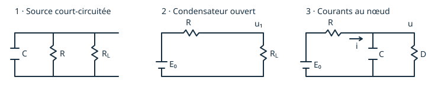
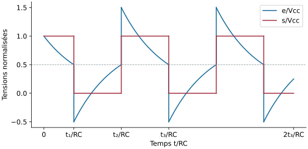
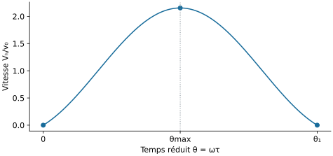
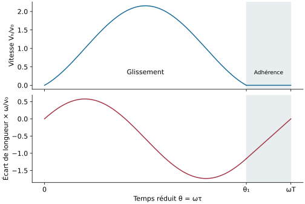

# Mines-Ponts MPI — Physique 2 2024 · Corrigé brut

*Corrigé rédigé par IA, non officiel. Signalez toute erreur.*

Les applications numériques finales sont données à un chiffre significatif. Les chiffres intermédiaires sont conservés pour les comparaisons et la simulation.

## I — Oscillateur à tube

### Question 1

La solution homogène représente le transitoire. On remplace la source idéale par un fil pour isoler ce régime. Le condensateur se décharge dans les deux résistances en parallèle, donc
$$
\begin{aligned}
\tau_\alpha&=C\frac{R R_L}{R+R_L}=\frac{\alpha}{1+\alpha}\tau_0,\\
u_H(t)&=A\exp(-t/\tau_\alpha).
\end{aligned}
$$
La constante de temps est indépendante de $E_0$. L’amplitude $A=u(0)-u_1$ peut dépendre de la source à condition initiale fixée.



### Question 2

La solution particulière représente le permanent si elle est choisie constante. Le condensateur est alors un circuit ouvert, comme au panneau central de la figure 1. Le pont diviseur donne
$$
u_1=\frac{R_L}{R+R_L}E_0=\frac{\alpha}{1+\alpha}E_0.
$$
Le permanent est indépendant de $C$ et dépend du rapport des résistances.

### Question 3

Lampe éteinte, $R_{\mathrm e}\gg R$, donc $\alpha_{\mathrm e}\gg1$. Lampe allumée, $R_{\mathrm a}\ll R$, donc $\alpha_{\mathrm a}\ll1$.

### Question 4

Lampe éteinte, $\tau_{\mathrm e}=RC\,R_{\mathrm e}/(R+R_{\mathrm e})\simeq RC=4\,\mathrm s$. Lampe allumée, $\tau_{\mathrm a}=CR_{\mathrm a}/(1+R_{\mathrm a}/R)\simeq0{,}19\,\mathrm s$, soit $0{,}2\,\mathrm s$ à un chiffre significatif.

### Question 5

Les limites si chaque état est maintenu sont
$$
\begin{aligned}
u_{\infty,\mathrm e}&=\frac{E_0}{1+R/R_{\mathrm e}}\simeq E_0,\\
u_{\infty,\mathrm a}&=\frac{E_0}{1+R/R_{\mathrm a}}=\frac{E_0}{21}.
\end{aligned}
$$
En partant de zéro avec $E_0>0$, $u$ reste positive. La charge doit dépasser le seuil d’allumage et la décharge passer sous le seuil d’extinction. Une limite au seuil ne l’atteint pas en temps fini. Il faut ainsi
$$
(1+R/R_{\mathrm e})U_{\mathrm a}<E_0<(1+R/R_{\mathrm a})U_{\mathrm e}.
$$
Les bornes sont proches de $90\,\mathrm V$ et $1\times10^3\,\mathrm V$ à un chiffre significatif. La borne haute avant arrondi vaut $1\,470\,\mathrm V$. À $120\,\mathrm V$, les deux seuils sont franchis dans le modèle considéré.

En régime périodique, la charge entre les deux seuils dure environ $4\ln(50/30)\simeq2\,\mathrm s$. La décharge dure $\tau_{\mathrm a}\ln[(U_{\mathrm a}-u_{\infty,\mathrm a})/(U_{\mathrm e}-u_{\infty,\mathrm a})]$, soit environ $0{,}05\,\mathrm s$. Les éclats sont séparés de plusieurs secondes et leur durée est de l’ordre du temps de réponse visuel. Le clignotement est observable.

### Question 6

Le booléen `al` signifie « lampe allumée ». Les lignes 3 à 6 choisissent le nouvel état à partir de l’état précédent et de la tension courante. La lampe s’éteint sous $U_{\mathrm e}$ et s’allume au-dessus de $U_{\mathrm a}$, avec les inégalités du code à l’égalité.

Au nœud du panneau droit de la figure 1, le courant $i$ se partage entre $C\,\mathrm du/\mathrm dt$ et $\texttt{al}\,u/R_{\mathrm a}$. La résistance de la lampe éteinte est ici traitée comme infinie. La ligne 7 multiplie la dérivée obtenue par la loi des nœuds par le pas et l’ajoute à $u$.

### Question 7

`LT = LU = []` crée une seule liste à deux noms. Les deux appels à `append` y entrelacent temps et tensions. `plot` reçoit donc deux fois la même liste. On initialise deux listes distinctes.

```python
LT, LU = [], []
```

Le pas $h=20/500=0{,}04\,\mathrm s$ est proche de la durée du passage entre les deux seuils en décharge. Augmenter $N$ affine le franchissement des seuils et les amplitudes.

### Question 8

Les portions croissantes correspondent à la lampe éteinte, avec une limite voisine de $120\,\mathrm V$. Les portions décroissantes correspondent à la lampe allumée, avec une limite voisine de $6\,\mathrm V$. Le niveau haut $a$ vaut environ $90\,\mathrm V$. Le code attend un échantillon strictement supérieur au seuil pour basculer.

En décharge, un échantillon encore au-dessus de $70\,\mathrm V$ entraîne un pas entier dans l’état allumé. Le pas peut faire passer $u$ sous $70\,\mathrm V$. Le point est conservé avant que la charge reprenne à l’itération suivante. Près du seuil, la baisse par pas est d’environ $(0{,}04/0{,}19)(70-6)\simeq13\,\mathrm V$.

Pour $N=500$, la simulation donne des minima proches de $58{,}4\,\mathrm V$, du même ordre que les $59\,\mathrm V$ donnés. Lorsque le pas tend vers zéro, le minimum tend vers le seuil.

## II — Oscillateur à portes logiques

### Question 9

Relier les deux entrées produit une inversion. Il reste donc NAND et NOR. Avec la seconde entrée à zéro, la sortie est constamment à un. La porte est une NAND, car la NOR donnerait l’inverse de la première entrée.

### Question 10

On note $a\uparrow b=\mathrm{NAND}(a,b)$. Pour NOT, on relie les deux entrées d’une porte à $a$. Pour AND, on envoie $a$ et $b$ dans une NAND puis on relie sa sortie aux deux entrées d’une seconde NAND. Pour OR, deux NAND inversent séparément $a$ et $b$, puis une troisième reçoit ces deux résultats.
$$
\begin{aligned}
\mathrm{NOT}(a)&=a\uparrow a,\\
\mathrm{AND}(a,b)&=(a\uparrow b)\uparrow(a\uparrow b),\\
\mathrm{OR}(a,b)&=(a\uparrow a)\uparrow(b\uparrow b).
\end{aligned}
$$
Les tables confirment les sorties.
$$
\begin{array}{c|c}
a & \mathrm{NOT}(a)\\ \hline
0&1\\
1&0
\end{array}
\qquad
\begin{array}{cc|cc}
a&b&\mathrm{AND}(a,b)&\mathrm{OR}(a,b)\\ \hline
0&0&0&0\\
0&1&0&1\\
1&0&0&1\\
1&1&1&1
\end{array}
$$

### Question 11

Deux broches servent à l’alimentation. Chaque NAND indépendante requiert deux entrées et une sortie. Les douze broches disponibles permettent ainsi au maximum quatre portes indépendantes.

### Question 12

On note $q$ la tension de sortie de la porte 1 et $\tau_c=RC$. Dès que $v=0$, $q=s=V_{\mathrm{cc}}$, indépendamment de l’état du condensateur. La loi des nœuds au point d’entrée donne
$$
C\frac{\mathrm d(e-s)}{\mathrm dt}=\frac{q-e}{R}.
$$
Comme $q$ et $s$ sont fixes, $e$ converge exponentiellement vers $V_{\mathrm{cc}}$.

À l’équilibre, $e=s=V_{\mathrm{cc}}$ et $b_e=b_s=1$. Une perturbation de $e$ revient vers cette valeur et ne modifie pas les sorties.

### Question 13

Après validation, l’entrée $e$ est haute et la porte 1 bascule, donc $q=0$. La porte 2 reste haute car elle reçoit le niveau bas de la porte 1. La tension du condensateur $e-s$ est continue et vaut zéro de part et d’autre de la validation. Ainsi $e(0^+)=V_{\mathrm{cc}}$.

Avec $q=0$ et $s$ fixe, on trouve
$$
\begin{aligned}
e(t)&=V_{\mathrm{cc}}\exp(-t/\tau_c),\\
t_1&=\tau_c\ln2.
\end{aligned}
$$
L’instant $t_1$ correspond à la première atteinte de $V_{\mathrm{cc}}/2$.

### Question 14

La porte 1 repasse au niveau haut. La porte 2 reçoit deux niveaux hauts et produit $s(t_1^+)=0$. La baisse de $s$ de $V_{\mathrm{cc}}$ entraîne un saut identique de $e$, soit $e(t_1^+)=-V_{\mathrm{cc}}/2$.
$$
e(t)=V_{\mathrm{cc}}\left[1-\frac32 e^{-(t-t_1)/\tau_c}\right]
\quad(t_1<t<t_2).
$$
On résout $e(t_2^-)=V_{\mathrm{cc}}/2$, d’où $t_2=t_1+\tau_c\ln3=\tau_c\ln6$.

### Question 15

Le franchissement vers le haut fait repasser la porte 1 au niveau bas et donne $s(t_2^+)=V_{\mathrm{cc}}$. La conservation de $e-s$ impose $e(t_2^+)=3V_{\mathrm{cc}}/2$. Alors
$$
\begin{aligned}
e(t)&=\frac32V_{\mathrm{cc}}e^{-(t-t_2)/\tau_c},\\
t_3&=t_2+\tau_c\ln3=\tau_c\ln18.
\end{aligned}
$$
À $t_3$, l’évolution revient à l’état qui suit $t_1$.

### Question 16

La sortie $s$ alterne entre $V_{\mathrm{cc}}$ et zéro. Après chaque franchissement, $e$ saute de la même quantité que $s$.

Le tracé va jusqu’à $2t_3$ et les unités sont $RC$ et $V_{\mathrm{cc}}$.



### Question 17

La validation lance des oscillations de relaxation. Après le transitoire, chaque état dure $RC\ln3\simeq0{,}1\,\mathrm s$. La période vaut
$$
\begin{aligned}
T&=2RC\ln3\simeq0{,}2\,\mathrm s,\\
f\simeq5\,\mathrm{Hz}.
\end{aligned}
$$
Le signal peut commander périodiquement la hauteur ou le volume d’une note et produire un vibrato ou un trémolo.

## III — Le crissement

### Question 18

La figure 8 donne $x_H(0)=-\ell_0$, puisque le point A est initialement à l’origine et le ressort à sa longueur à vide. Cette valeur corrige le signe dans le texte et donne $X_H(0)=0$. L’allongement vaut $x_A-x_H-\ell_0$, donc
$$
\begin{aligned}
\vec F_{\mathrm{ressort}}&=k(v_0t-X_H)\vec e_x,\\
\vec R_N&=Mg\vec e_z.
\end{aligned}
$$
La réaction normale équilibre le poids puisque l’accélération verticale est nulle.

### Question 19

À l’arrêt, le frottement équilibre la traction $kv_0t$ tant que $kv_0t\leq f_sMg$. Le départ se produit à
$$
t_0=\frac{f_sMg}{kv_0}.
$$
La traction devient alors supérieure au frottement dynamique puisque $f_s>f_d$.

### Question 20

À $\tau=0$, $x_A=v_0t_0=f_sMg/k$, $X_H=0$ et $V_H=0$. Le mobile part vers $+x$. En glissement, la composante tangentielle vaut $-f_dMg\vec e_x$. D’après la deuxième loi de Newton,
$$
M X_H''=k[v_0(t_0+\tau)-X_H]-f_dMg.
$$
Ainsi $\omega=\sqrt{k/M}$ et $\gamma=(f_s-f_d)g$ dans l’équation demandée.

### Question 21

Une solution particulière est $v_0\tau+\gamma/\omega^2$. On lui ajoute une sinusoïde dont les coefficients sont fixés par les deux conditions initiales nulles. En écrivant $\alpha=\gamma/(\omega v_0)$, on trouve
$$
\begin{aligned}
X_H(\tau)&=v_0\tau+\frac{v_0}{\omega}\{\alpha[1-\cos(\omega\tau)]-\sin(\omega\tau)\},\\
V_H(\tau)&=v_0[1-\cos(\omega\tau)+\alpha\sin(\omega\tau)].
\end{aligned}
$$

### Question 22

Avec $\theta=\omega\tau$, la vitesse s’écrit
$$
V_H/v_0=1-\sqrt{1+\alpha^2}\cos(\theta+\arctan\alpha).
$$
Le premier maximum est atteint pour $\theta_{\max}=\pi-\arctan\alpha$. Il vient
$$
\begin{aligned}
\cos\theta_{\max}&=-\frac1{\sqrt{1+\alpha^2}},\\
\sin\theta_{\max}&=\frac{\alpha}{\sqrt{1+\alpha^2}},\\
V_{\max}&=v_0(1+\sqrt{1+\alpha^2}).
\end{aligned}
$$
La vitesse croît d’abord, puis décroît jusqu’à son premier nouveau zéro, obtenu lorsque $\theta+\arctan\alpha=2\pi-\arctan\alpha$. Donc
$$
\begin{aligned}
\theta_1&=2\pi-2\arctan\alpha,\\
\cos\theta_1&=\frac{1-\alpha^2}{1+\alpha^2},\\
\sin\theta_1&=-\frac{2\alpha}{1+\alpha^2}.
\end{aligned}
$$



### Question 23

Comme $x_A=v_0(t_0+\tau)$ et $x_H=X_H-\ell_0$, on obtient
$$
\begin{aligned}
\ell(\tau)&=\ell(0)+\frac{v_0}{\omega}[\sin\theta-\alpha(1-\cos\theta)],\\
\ell(0)&=\ell_0+v_0t_0.
\end{aligned}
$$
En substituant le sinus et le cosinus à $\theta_1$, le crochet vaut $-2\alpha$. À l’arrêt, la traction selon $x$ vaut $(2f_d-f_s)Mg$, de norme inférieure à $f_sMg$. Le frottement statique permet donc l’immobilité.

Le point A avance et allonge le ressort à la vitesse $v_0$ jusqu’à retrouver $\ell(0)$. La durée d’arrêt vaut $\tau_2=2\alpha/\omega$. L’adhérence recharge la traction. En glissement, après une hausse initiale, l’allongement chute jusqu’à sa valeur à l’arrêt. La vitesse recommence ensuite le même cycle.
$$
\begin{aligned}
T&=\tau_1+\tau_2,\\
\Omega&=\frac{2\pi}{\tau_1+\tau_2}=\frac{2\pi\omega}{\theta_1+2\alpha}.
\end{aligned}
$$



### Question 24

Avec $\theta_{\max}=5\pi/6$, on a $\arctan\alpha=\pi/6$, donc $\alpha=1/\sqrt3\simeq0{,}6$ et $\theta_1=5\pi/3$.

L’accélération $\gamma=(1-0{,}6)g$ vaut environ $4\,\mathrm{m\,s^{-2}}$. Pour $v_0=10^{-2}\,\mathrm{m\,s^{-1}}$, on obtient $\omega=\gamma/(\alpha v_0)\simeq7\times10^2\,\mathrm{rad\,s^{-1}}$.
$$
\begin{aligned}
\Omega&=\frac{2\pi\omega}{5\pi/3+2/\sqrt3}\simeq7\times10^2\,\mathrm{rad\,s^{-1}},\\
f&=\frac{\Omega}{2\pi}\simeq1\times10^2\,\mathrm{Hz}.
\end{aligned}
$$
La pulsation fondamentale du son coïncide avec celle des relaxations. Le modèle prédit une fréquence audible du côté des graves. La forme non sinusoïdale du mouvement permet aussi des harmoniques plus aiguës.
