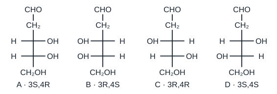
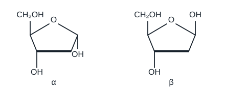
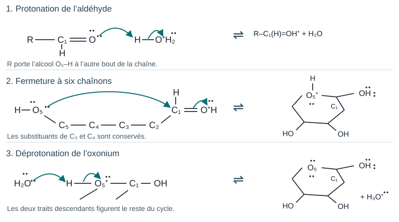
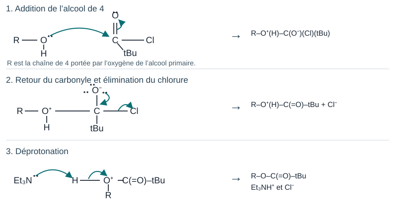
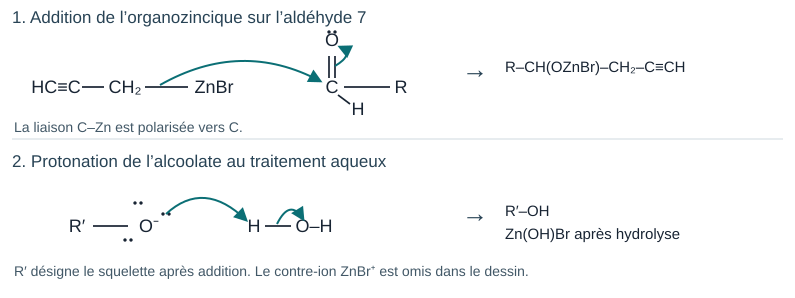
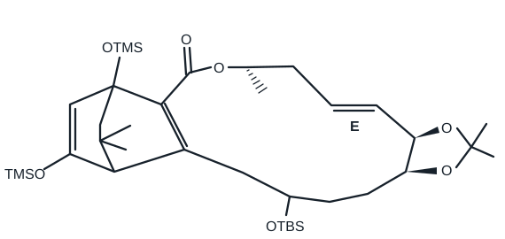
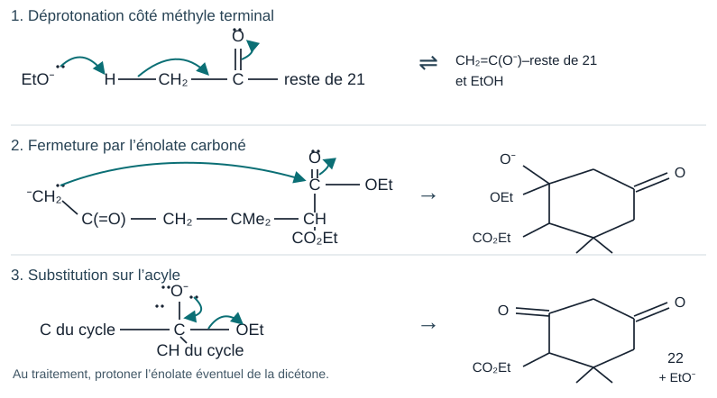
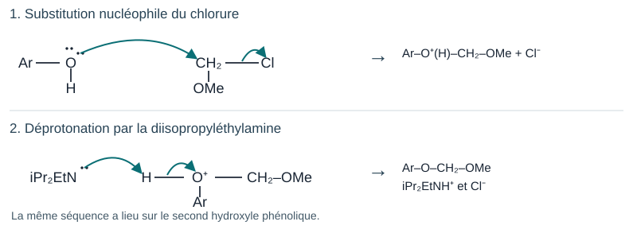
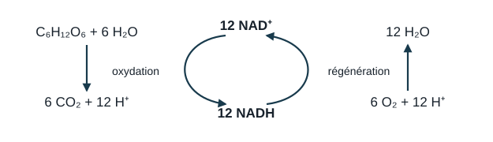

# Mines-Ponts PC — Chimie 2024 · Corrigé guidé

*Corrigé rédigé par IA, non officiel. Signalez toute erreur.*

## Présentation du sujet

Les deux parties du sujet sont indépendantes. La première suit une synthèse organique à plusieurs étapes, du sucre de départ à la déprotection finale. Elle mobilise la stéréochimie, les groupes protecteurs, les additions sur carbonyles, le contrôle orbitalaire et la spectroscopie. La seconde part de l’équilibre de dissolution du dioxygène, puis combine cinétique, complexation, thermochimie, électrochimie et diffusion. Les annexes donnent notamment les données RMN, infrarouge et thermodynamiques.

Avant de rédiger, repérer sur le sujet les questions qui réutilisent un résultat antérieur. Marquer les réponses de Q26, Q35, Q41 et Q42 pour les calculs suivants. Dans la première partie, garder une notation stable pour les groupes protecteurs et numéroter les carbones autour des sites réactifs. Les questions de stéréochimie et les applications numériques brèves constituent de bons points d’entrée. Prévoir un temps distinct pour vérifier les formes majoritaires, les signes et les unités.

## Synthèse totale de l’aigialomycine D

Les questions suivent trois transformations structurales. On construit d’abord le macrocycle, on prépare et on engage le diène, puis on règle la protection et l’élimination finales.

### Question 1

> [!INDICATION]
> Numéroter les carbones à partir de l’aldéhyde. Repérer ceux qui portent quatre substituants différents.

> [!INDICATION]
> Construire la projection de Fischer avec CHO en haut. Pour former l’image miroir, inverser simultanément les deux positions des OH.

#### Solution

La chaîne est $\mathrm{CHO{-}CH_2{-}CHOH{-}CHOH{-}CH_2OH}$. Les carbones stéréogènes sont C3 et C4. Les quatre projections de Fischer sont spécifiées ci-dessous. On place CHO en haut, puis C2, C3 et C4, et enfin le groupe $\mathrm{CH_2OH}$ en bas. Sur les liaisons horizontales, H occupe le côté opposé à OH.

| Structure | OH en C3 | OH en C4 | Configuration |
|---|---|---|---|
| A, 2-désoxy-D-ribose | droite | droite | $(3S,4R)$ |
| B | gauche | gauche | $(3R,4S)$ |
| C | gauche | droite | $(3R,4R)$ |
| D | droite | gauche | $(3S,4S)$ |

A/B et C/D sont des couples d’énantiomères. A/C, A/D, B/C et B/D sont des couples de diastéréoisomères. Les extrémités différentes de la chaîne excluent une forme méso.

> [!METHODE]
> En Fischer, les liaisons horizontales sont vers l’observateur. Inverser le sens lu si le substituant de priorité 4 est horizontal.

### Question 2

> [!INDICATION]
> Compter les atomes du cycle en incluant l’oxygène nucléophile.

> [!INDICATION]
> Repartir de la projection de Fischer du D-sucre et examiner les deux faces de l’aldéhyde.

#### Solution

L’oxygène du groupe OH en C4 se lie à C1. Le cycle est $\mathrm{O_4{-}C1{-}C2{-}C3{-}C4}$, refermé de C4 sur $\mathrm{O_4}$. En projection de Haworth avec $\mathrm{O_4}$ en haut et C1 à droite, on place $\mathrm{CH_2OH}$ de C4 au-dessus et OH de C3 au-dessous du plan moyen. Le proton correspondant à chacun de ces substituants se place sur la face opposée. C2 porte deux hydrogènes. En C1, le groupe OH est au-dessous pour l’anomère $\alpha$ et au-dessus pour l’anomère $\beta$. H occupe l’autre face dans chaque cas. La cyclisation du D-sucre donne **deux anomères**.

> [!PIEGE]
> Le cycle à cinq atomes et celui à six atomes résultent de l’attaque de deux OH différents.

### Question 3

> [!INDICATION]
> Identifier l’alcool qui permet un cycle à six chaînons.

> [!INDICATION]
> Protoner d’abord le groupe qui doit être rendu plus électrophile, puis régénérer le catalyseur.

#### Solution

La forme pyranose résulte d’une **hémiacétalisation intramoléculaire** par l’alcool primaire en C5. Après protonation réversible de l’oxygène de l’aldéhyde, un doublet de l’oxygène en C5 attaque C1 tandis que les électrons $\pi$ se déplacent vers l’oxygène carbonylé. Cette fermeture donne un oxonium cyclique à six atomes. L’eau capte le proton de l’oxonium et régénère le catalyseur. C1 porte alors OH et l’oxygène du cycle. Les trois étapes sont réversibles.

> [!JURY]
> Le rapport 2024 attend une hémiacétalisation et des étapes réversibles, avec les flèches électroniques usuelles.

### Question 4

> [!INDICATION]
> Repérer les deux OH devenus les oxygènes du pont protecteur. D’où vient le carbone portant deux méthyles ?

> [!INDICATION]
> Identifier le sous-produit de la condensation et une manière de l’éliminer du milieu.

#### Solution

On fait réagir le diol vicinal avec de la propanone en présence d’une quantité catalytique d’acide para-toluènesulfonique, dans le toluène. L’élimination de l’eau formée, par entraînement hétéroazéotropique, déplace l’équilibre vers l’acétonide **3**. Le pont $\mathrm{O{-}C(CH_3)_2{-}O}$ relie les deux oxygènes des OH vicinaux. L’OH anomérique demeure libre.

> [!METHODE]
> Pour une protection équilibrée, le choix du réactif et le déplacement de l’équilibre se justifient séparément.

### Question 5

> [!INDICATION]
> L’oxygène alcoolique joue le rôle de nucléophile. Quelle liaison de l’électrophile peut se rompre ?

> [!INDICATION]
> Écrire l’intermédiaire tétraédrique et le transfert de proton qui conduit au produit neutre.

#### Solution

Dans **5**, le groupe $\mathrm{CH_2OH}$ de **4** est remplacé par $\mathrm{CH_2OC(=O)C(CH_3)_3}$. L’acétonide, l’alcène et les liaisons stéréochimiques de **4** sont conservés.

Le doublet de l’oxygène alcoolique attaque le carbone du chlorure de pivaloyle. La liaison $\pi$ du carbonyle se déplace vers son oxygène. L’intermédiaire tétraédrique se referme sur le carbonyle en expulsant le chlorure, ce qui donne l’ester protoné. La triéthylamine déprotone cet ester et fixe l’acide sous forme de chlorure de triéthylammonium.

> [!JURY]
> Le rapport 2024 relève que la triéthylamine est trop peu basique pour commencer par déprotoner quantitativement l’alcool.

### Question 6

> [!INDICATION]
> La fonction transformée est l’alcène terminal. Suivre le carbone sur lequel le bore s’attache.

> [!INDICATION]
> La deuxième étape réutilise la liaison C–B. Préciser le milieu qui permet l’action du peroxyde.

#### Solution

Le fragment alcène de **5**, $\mathrm{{-}CH_2{-}CH{=}CH_2}$, devient $\mathrm{{-}CH_2{-}CH_2{-}CH_2OH}$ dans **6**. Le groupe pivalate, l’acétonide et la configuration des centres existants subsistent.

On effectue l’hydroboration par $\mathrm{BH_3}$ dans le THF, puis l’oxydation par $\mathrm{H_2O_2}$ en présence de soude. Dans l’addition concertée, le bore se fixe de préférence au carbone terminal, le moins encombré. L’oxydation substitue OH au bore. Il en résulte l’alcool primaire, produit anti-Markovnikov.

> [!PIEGE]
> Le mécanisme concerté d’hydroboration ne fait intervenir aucun carbocation libre.

### Question 7

> [!INDICATION]
> Repérer l’alcool primaire qui vient d’être formé en Q6.

> [!INDICATION]
> La chaîne carbonée garde sa longueur lors de cette oxydation.

#### Solution

L’alcool primaire introduit à la Q6 est oxydé en aldéhyde. Le fragment $\mathrm{{-}CH_2{-}CH_2{-}CH_2OH}$ devient **$\mathrm{{-}CH_2{-}CH_2{-}CHO}$** dans **7**. Le pivalate et l’acétonide restent présents.

### Question 8

> [!INDICATION]
> Repérer un proton acide dans le réactif et deux sites électrophiles dans le substrat.

> [!INDICATION]
> Écrire d’abord l’alcoolate métallique puis faire le bilan de l’hydrolyse.

#### Solution

Un organomagnésien portant un alcyne terminal peut déprotoner l’alcyne d’une autre molécule de réactif. Le $pK_a$ de l’alcyne vaut environ 25, inférieur à celui de l’hydrocarbure conjugué de l’organomagnésien. Par ailleurs, un Grignard peut s’additionner sur le carbonyle de l’ester pivalique de **7**. La basicité et la nucléophilie plus faibles de l’organozincique permettent la réaction voulue sur l’aldéhyde.

Le carbone lié à Zn s’additionne sur le carbone carbonylé de **7**. La liaison $\pi$ du carbonyle se déplace vers l’oxygène et forme l’alcoolate $\mathrm{R{-}CH(OZnBr){-}CH_2{-}C{\equiv}CH}$. À l’hydrolyse, l’oxygène est protoné. On obtient **$\mathrm{R{-}CH(OH){-}CH_2{-}C{\equiv}CH}$** et des sels de zinc, schématiquement $\mathrm{Zn(OH)Br}$ après hydrolyse par l’eau. $\mathrm{R}$ désigne le reste de **7**.

> [!JURY]
> La justification des deux réactions parasites et les sous-produits de l’hydrolyse sont attendus.

### Question 9

> [!INDICATION]
> Comparer les deux chaînes latérales de 8 et 9. Compter les carbones de celle qui portait le pivalate.

> [!INDICATION]
> Profiter du pivalate déjà en place pour protéger sélectivement l’autre OH, puis faire apparaître un carbonyle sur la première branche.

#### Solution

On conserve le squelette et l’acétonide de **8**, puis on modifie les deux branches de la manière suivante.

| Étape | Transformation structurale | Conditions possibles |
|---|---|---|
| Protection de l’alcool secondaire | $\mathrm{{-}CH(OH){-}CH_2{-}C{\equiv}CH}$ devient $\mathrm{{-}CH(OTBS){-}CH_2{-}C{\equiv}CH}$ | TBSCl, imidazole, DMF, ou TBSCl et triéthylamine selon le document 1 |
| Libération de l’alcool primaire | $\mathrm{{-}CH_2OPiv}$ devient $\mathrm{{-}CH_2OH}$ | Saponification alcaline contrôlée, puis traitement aqueux |
| Oxydation | $\mathrm{{-}CH_2OH}$ devient $\mathrm{{-}CHO}$ | Parikh–Doering, comme pour **6** vers **7** |
| Méthylénation | $\mathrm{{-}CHO}$ devient $\mathrm{{-}CH{=}CH_2}$, ce qui donne **9** | Ylure $\mathrm{Ph_3P{=}CH_2}$ préparé séparément, en milieu anhydre |

Le pivalate masque l’alcool primaire pendant la silylation. Le TBS protège ensuite l’alcool secondaire pendant l’oxydation. On évite les conditions acides prolongées et les fluorures lors de l’hydrolyse du pivalate. La méthylénation par l’ylure du schéma 2, déjà utilisé pour transformer 3 en 4, apporte le carbone terminal de l’alcène. On évite d’introduire sur le substrat un excès de la base forte utilisée pour préparer l’ylure, car l’alcyne est terminal.

> [!PIEGE]
> Une déshydratation conserve le nombre de carbones et ne peut expliquer l’allongement demandé.

### Question 10

> [!INDICATION]
> Identifier le carbone auquel doit se lier le carbone de la future fonction acide.

> [!INDICATION]
> Utiliser l’acidité du proton de l’alcyne, puis choisir un électrophile apportant un carbone et deux oxygènes.

#### Solution

Dans le THF ou l’éther anhydre, le bromure d’éthylmagnésium déprotone l’alcyne terminal de **9**, avec dégagement d’éthane. L’acétylure magnésien attaque ensuite le carbone du $\mathrm{CO_2}$, introduit par exemple sous forme de carboglace. L’hydrolyse acide contrôlée transforme le carboxylate magnésien en **10**, dont l’extrémité est $\mathrm{{-}C{\equiv}C{-}CO_2H}$.

> [!METHODE]
> Séparer les conditions anhydres de la formation de l’organométallique du traitement final qui libère l’acide.

### Question 11

> [!INDICATION]
> La géométrie des deux H vinyliques affecte un paramètre de la RMN du proton.

> [!INDICATION]
> Chercher la comparaison cis/trans dans l’annexe 7 plutôt que dans la table des déplacements chimiques.

#### Solution

On mesure le couplage vicinal des deux protons vinyliques en RMN du proton. Les deux protons de l’alcène E sont trans. L’annexe 7 donne typiquement **13 à 18 Hz** en trans et **8 à 12 Hz** en cis. Un grand couplage dans la première plage corrobore la configuration E.

### Question 12

> [!INDICATION]
> Interpréter les indices et exposants de la notation du pouvoir rotatoire.

> [!INDICATION]
> Comparer les valeurs qui seraient attendues pour deux énantiomères purs dans des conditions identiques, puis examiner les centres du sucre conservés.

#### Solution

Les deux valeurs sont des **pouvoirs rotatoires spécifiques** à $25\,^\circ\mathrm C$, mesurés à la raie D du sodium, dans le chloroforme aux concentrations indiquées. Les deux composés sont lévogyres. Dans les mêmes conditions, des énantiomères purs donneraient des pouvoirs spécifiques opposés. Ici les configurations héritées du sucre sont communes aux deux composés. Les deux formes E sont des diastéréoisomères. Une séparation est possible en principe, par exemple par chromatographie, ou l’on peut conserver le mélange si les étapes ultérieures sélectionnent ou font converger les deux formes. Dans cette séquence, le centre portant OTBS a été créé lors de l’addition de Q8 et peut différer entre les deux formes. La formation de l’alcène en Q24 supprime ce centre et permet à ces épimères de converger.

> [!PIEGE]
> Les nombres fournis sont déjà ramenés à la longueur de cuve et à la concentration selon la convention de mesure.

### Question 13

> [!INDICATION]
> Repérer les nouvelles liaisons métal–ligand puis la liaison créée au moment du départ du produit.

> [!INDICATION]
> Suivre les électrons formellement attribués aux ligands pour nommer le changement au nickel.

#### Solution

**A** est une substitution de ligands. Le départ de deux phosphines permet la coordination du carbonyle et de l’alcyne de **13** au nickel(0). **D** est une élimination réductrice formant la liaison $\mathrm{C{-}H}$ du produit et régénérant le nickel(0).

### Question 14

> [!INDICATION]
> Attribuer une charge formelle aux ligands carbonés, oxygénés et hydrure.

> [!INDICATION]
> Comparer le nombre de ligands de type X à chaque intermédiaire. Une coordination d’alcène est neutre.

#### Solution

A remplace des phosphines par des fonctions neutres coordinées. Le nickel demeure au degré 0. En B, la cyclisation oxydante transforme le carbonyle et l’alcyne en deux ligands formellement anioniques, alkoxyde et alcényle. Le nickel passe de 0 à $+II$. En C, le transfert de $\mathrm{Et_3Si}$ à l’oxygène et de H au métal remplace une liaison Ni–O par une liaison Ni–H sans changer le degré d’oxydation. En D, le couplage des ligands hydrure et alcényle donne un produit neutre et régénère Ni(0).

| Étape | Évolution du nombre d’oxydation |
|---|---|
| A | $0 \to 0$ |
| B | $0 \to +II$ |
| C | $+II \to +II$ |
| D | $+II \to 0$ |

> [!METHODE]
> Écrire le degré du métal avant et après chaque étape limite les confusions entre variation et valeur absolue.

### Question 15

> [!INDICATION]
> Comparer d’abord les deux différences d’énergie HO–BV. Choisir un donneur et un accepteur.

> [!INDICATION]
> Comparer ensuite les coefficients aux seuls carbones terminaux de chaque partenaire. Repérer la liaison de 12 qui n’est pas engagée.

#### Solution

Les écarts sont $0{,}1-(-8{,}1)=8{,}2\ \mathrm{eV}$ pour HO(15)–BV(12) et $0{,}6-(-10{,}7)=11{,}3\ \mathrm{eV}$ pour HO(12)–BV(15). L’interaction principale est donc **HO(15)–BV(12)**.

Aux extrémités réactives, la BV du modèle de **12** porte les coefficients $-0{,}22$ en C3 et $+0{,}66$ en C4. La HO du modèle de **15** porte $+0{,}43$ en C2 et $-0{,}59$ en C5. Le meilleur appariement associe les deux coefficients les plus grands en module. Les produits des coefficients ont le même signe aux deux extrémités, ce qui permet un recouvrement constructif simultané après choix de la phase globale. Les nouvelles liaisons sont **C3(12)–C2(15)** et **C4(12)–C5(15)**.

Dans **16**, l’ancienne triple liaison devient C3(12)=C4(12) et la double liaison du diène se retrouve entre ses carbones internes C3(15) et C4(15). Le pont C2(15)–C7(15)–C8(15)–C5(15) porte les deux méthyles en C8(15). Les groupes OTMS sont en C2(15) et C4(15). La double liaison préexistante du macrocycle reste **E**. Le tableau orbitalaire fixe la connectivité majoritaire. Il ne détermine pas à lui seul la face d’attaque ou l’orientation relative du pont et de la partie macrocyclique.

> [!JURY]
> Le rapport 2024 demande de choisir l’interaction principale par les écarts d’énergie avant d’examiner les coefficients.

### Question 16

> [!INDICATION]
> Identifier la portion saturée qui relie les deux têtes de pont du diène initial.

> [!INDICATION]
> Dessiner d’abord la double liaison entre les deux atomes expulsés, puis leur conserver leurs substituants.

#### Solution

La rétro-Diels–Alder rompt les deux liaisons qui joignent le pont saturé au reste de l’adduit. Une double liaison se forme entre les deux carbones du pont, dont l’un porte deux méthyles. Le sous-produit est **$\mathrm{CH_2{=}C(CH_3)_2}$**, le 2-méthylpropène. La formation du cycle aromatique accompagne cette fragmentation.

### Question 17

> [!INDICATION]
> Remonter de l’énone à l’alcool qui aurait perdu de l’eau.

> [!INDICATION]
> Les deux moitiés de cet alcool doivent pouvoir être obtenues à partir de la même cétone à trois carbones.

#### Solution

**18** est la propanone, $\mathrm{CH_3COCH_3}$. Deux molécules donnent le diacétone-alcool par aldolisation (cétolisation). Sa déshydratation, ou crotonisation, conduit à l’oxyde de mésityle **19**.

### Question 18

> [!INDICATION]
> Localiser le site déprotoné du malonate et les deux carbones électrophiles de l’énone.

> [!INDICATION]
> Comparer les modules de la BV de 19 sur le carbone du carbonyle et sur le carbone bêta.

#### Solution

L’éthanolate arrache un proton au carbone entre les deux esters du malonate. On compare les coefficients de la BV de **19** sur le carbone carbonylé C2 et le carbone $\beta$ C4. Leurs modules sont respectivement 0,56 et 0,66. L’attaque carbonée de l’énolate en C4 donne l’addition conjuguée 1,4. La protonation au carbone de l’énolate produit, ou sa protonation sur O puis tautomérisation, conduit à la cétone **21**.

$$
\boxed{\mathrm{CH_3CO{-}CH_2{-}C(CH_3)_2{-}CH(CO_2Et)_2}}
$$

> [!PIEGE]
> La protonation sur l’oxygène peut donner un énol intermédiaire. La structure majoritaire à présenter est la cétone.

### Question 19

> [!INDICATION]
> Tracer la chaîne reliant la cétone aux deux esters dans 21. Chercher quelle paire d’atomes peut fermer un cycle à six.

> [!INDICATION]
> Choisir le côté de l’énolisation de la cétone qui permet cette fermeture. Identifier le groupe qui quitte l’intermédiaire tétraédrique.

#### Solution

Dans **21**, le carbone du méthyle terminal de la cétone doit rejoindre le carbone carbonylé de l’un des deux esters. L’éthanolate permet l’énolisation du côté $\mathrm{CH_3CO{-}}$. La forme de résonance carbonée de cet énolate attaque le carbonyle de l’ester dans une fermeture intramoléculaire à six chaînons. Les deux autres sites carbonés énolisables conduiraient à des fermetures à quatre chaînons. La liaison $\pi$ de l’ester se déplace vers son oxygène. Le retour du doublet de cet oxygène forme le carbonyle en expulsant l’éthanolate. La déprotonation possible entre les deux carbonyles puis la protonation au traitement conduisent au produit isolé. C’est une condensation de Claisen intramoléculaire.

L’ordre des groupes autour du cycle de **22**, dans la forme dicétonique, est

$$
\boxed{\mathrm{C(=O){-}CH_2{-}C(=O){-}CH_2{-}C(Me)_2{-}CH(CO_2Et)}}
$$

Le dernier CH est lié au premier carbone carbonylé. L’ester latéral est conservé. Le bilan formel de **21** vers **22** est une perte d’éthanol, compatible avec $\mathrm{C_{11}H_{16}O_4}$.

> [!METHODE]
> Compter les atomes du nouveau cycle avant de détailler la substitution nucléophile d’acyle.

### Question 20

> [!INDICATION]
> Repérer d’abord les deux signaux qui ont le même couplage et décrivent un éthyle.

> [!INDICATION]
> Attribuer les quatre autres signaux en repérant les carbones voisins qui portent ou non des H.

#### Solution

| Signal | Attribution et multiplicité |
|---|---|
| 4,22 ppm, q, 2 H | $\mathrm{OCH_2}$ de l’ester éthylique, couplé aux trois H du méthyle voisin |
| 3,63 ppm, s, 2 H | $\mathrm{CH_2}$ entre les deux carbonyles cétoniques, sans proton vicinal |
| 2,89 ppm, s, 1 H | CH du cycle portant $\mathrm{CO_2Et}$, encadré par un carbone carbonylé et le carbone quaternaire |
| 2,32 ppm, s, 2 H | $\mathrm{CH_2}$ entre une cétone et $\mathrm{CMe_2}$, sans proton vicinal |
| 1,21 ppm, t, 3 H | $\mathrm{CH_3}$ de l’éthyle, couplé aux deux H de $\mathrm{OCH_2}$, avec le même $J$ de 8,0 Hz |
| 0,99 ppm, s, 6 H | les deux méthyles sur le carbone quaternaire, sans proton vicinal, observés au même déplacement |

Le tableau attribue les signaux tels qu’ils sont donnés. La molécule porte un centre stéréogène. Des protons d’un méthylène ou les deux méthyles géminaux peuvent être non équivalents en toute rigueur. Le spectre fourni les présente sans séparation résolue à ces positions.

> [!JURY]
> Le rapport 2024 demande de justifier chaque multiplicité en nommant les voisins.

### Question 21

> [!INDICATION]
> Inventorier les liaisons polaires caractéristiques et distinguer les deux types de carbonyle.

> [!INDICATION]
> Utiliser l’annexe 8 pour placer les bandes principales.

#### Solution

Les bandes fortes des carbonyles se situent vers $1735$–$1750\ \mathrm{cm^{-1}}$ pour l’ester et $1650$–$1730\ \mathrm{cm^{-1}}$ pour les cétones, d’après l’annexe 8.

Les liaisons C–O absorbent vers $1050$–$1450\ \mathrm{cm^{-1}}$, et les C–H aliphatiques vers $2800$–$3000\ \mathrm{cm^{-1}}$. Une fraction énolique peut ajouter une contribution O–H.

### Question 22

> [!INDICATION]
> Le traitement par KOH est une saponification. Écrire le produit dans son état de protonation à cette étape.

> [!INDICATION]
> Après acidification, repérer la relation entre l’acide carboxylique et la cétone la plus proche.

#### Solution

Dans **23**, le squelette cyclique de **22** est conservé et le groupe $\mathrm{CO_2Et}$ est remplacé par **$\mathrm{CO_2^-K^+}$**, produit de la saponification. Après acidification, on obtient un acide $\beta$-cétonique, qui perd $\mathrm{CO_2}$ au chauffage. L’énol produit se tautomérise en **24**, le 5,5-diméthylcyclohexane-1,3-dione. Le fragment cyclique $\mathrm{CH(CO_2H)}$ est donc devenu $\mathrm{CH_2}$.

> [!JURY]
> Le rapport 2024 précise que l’ion carboxylate était attendu pour 23.

### Question 23

> [!INDICATION]
> Identifier le nucléophile sur 17 et le carbone porteur du chlore dans MOMCl.

> [!INDICATION]
> Distinguer la substitution et le transfert de proton. Répéter le mécanisme pour le deuxième phénol.

#### Solution

Le doublet d’un oxygène phénolique attaque le carbone $\mathrm{CH_2}$ de $\mathrm{ClCH_2OCH_3}$, avec rupture simultanée de C–Cl. L’oxonium ainsi obtenu cède son proton à la diisopropyléthylamine. La répétition de cette séquence sur le second phénol donne **25** et deux équivalents de chlorure d’ammonium. On peut aussi décrire l’attaque du phénolate formé par un équilibre acido-basique préalable. Chaque groupe $\mathrm{Ar{-}O{-}CH_2{-}O{-}Me}$ est un **acétal mixte** (éther MOM).

> [!JURY]
> Le rapport 2024 attend les actes élémentaires.

### Question 24

> [!INDICATION]
> Libérer l’alcool sans hydrolyser les acétals. Transformer ensuite OH en bon groupe partant.

> [!INDICATION]
> Repérer les deux carbones voisins possibles pour l’élimination. Comparer la conjugaison des produits.

#### Solution

L’ion fluorure, apporté par exemple par $\mathrm{Bu_4NF}$ dans le THF, coupe le groupe TBS de **25**. L’alcool libéré est converti en tosylate par le chlorure de tosyle en présence d’une base telle que la pyridine. Une base suffisamment forte et peu nucléophile, par exemple DBU, favorise alors une élimination E2.

Dans le fragment initial $\mathrm{Ar{-}CH_2{-}CH(OTs){-}CH_2{-}}$, l’arrachement d’un H benzylique et la rupture de la liaison C–OTs forment **$\mathrm{Ar{-}CH{=}CH{-}CH_2{-}}$**, le motif de **26**. L’alcène ainsi obtenu est conjugué au noyau aromatique, ce qui le favorise par rapport à l’autre régioisomère. L’élimination exige une géométrie anti-périplanaire entre H et OTs. Les conditions basiques préservent les acétals.

> [!JURY]
> Le rapport 2024 signale que la déshydratation acide compromettrait l’acétal et attend le passage par un tosylate.

### Question 25

> [!INDICATION]
> Déterminer les trois groupes protecteurs qui restent dans 26 et leur mode de coupure commun.

> [!INDICATION]
> Le temps et la force de l’acide doivent permettre de conserver la lactone.

#### Solution

Un traitement acide aqueux contrôlé, par exemple par HCl dilué dans un mélange de THF et d’eau, hydrolyse les deux acétals MOM et l’acétonide. Il libère les deux phénols et le diol vicinal. Les conditions sont ajustées pour préserver la lactone, ce qui conduit à l’aigialomycine D.

## Le dioxygène et la respiration branchiale chez le requin

Cette partie suit le dioxygène depuis son entrée dans l’eau jusqu’à sa consommation. Une fois le besoin molaire calculé, on compare les résistances au transport à travers les branchies.

### Question 26

> [!INDICATION]
> Écrire des activités sans dimension avant de poser le quotient de réaction.

> [!INDICATION]
> La pression intervenant dans l’équilibre est la pression partielle, accessible par la composition de l’air.

#### Solution

On prend $p^\circ=1\ \mathrm{bar}$ et $c^\circ=1\ \mathrm{mol\,L^{-1}}$. À dilution suffisante, l’activité du dioxygène dissous vaut $c/c^\circ$. Le gaz est assimilé à un gaz parfait. Pour l’équilibre de dissolution,

$$
K^\circ_{\mathrm d}=\frac{c_s/c^\circ}{p_{\mathrm O_2}/p^\circ}.
$$

L’air contient 20 % de dioxygène sous 1 bar. À $25\,^\circ\mathrm C$,

$$
\boxed{c_s=c^\circ K^\circ_{\mathrm d}\frac{p_{\mathrm O_2}}{p^\circ}
       =2{,}6\times10^{-4}\ \mathrm{mol\,L^{-1}}}.
$$

Cette solubilité correspond à $0{,}26\ \mathrm{mol\,m^{-3}}$, soit environ $8{,}3\ \mathrm{mg\,L^{-1}}$.

> [!JURY]
> Le rapport 2024 attend les deux références standard dans l’expression de la constante.

### Question 27

> [!INDICATION]
> Utiliser le signe de l’enthalpie standard dans la relation de Van ’t Hoff.

> [!INDICATION]
> Juste après le changement de température, comparer le quotient initial à la nouvelle constante. Pour le calcul, intégrer entre les deux températures en kelvins.

#### Solution

La dissolution est exothermique. La relation de Van ’t Hoff donne une dérivée négative de $\ln K^\circ_{\mathrm d}$ par rapport à $T$. Juste après le chauffage, à composition inchangée, le quotient de réaction est supérieur à la nouvelle constante. L’équilibre se déplace donc vers le dégazage.

À pression partielle constante, $c_s$ est proportionnelle à $K^\circ_{\mathrm d}$. Pour $T_1=298\ \mathrm K$ et $T_2=304\ \mathrm K$,

$$
\ln\frac{c_{s,2}}{c_{s,1}}
=\frac{\Delta_{\mathrm d}H^\circ}{R}\left(\frac1{T_1}-\frac1{T_2}\right)
\simeq -0{,}10 .
$$

La variation relative est $\exp(-0{,}10)-1$, soit une **baisse d’environ 10 %**.

### Question 28

> [!INDICATION]
> Choisir le signe en testant une eau sous-saturée.

> [!INDICATION]
> Isoler les dimensions de la concentration multipliée par la surface afin d’obtenir l’unité du coefficient.

#### Solution

En sous-saturation, $c<c_s$ et la quantité de dioxygène dissous doit augmenter. Pour $k_t>0$, on a donc

$$
\boxed{\frac{\mathrm dn}{\mathrm dt}=k_t(c_s-c)S}.
$$

Le produit d’une concentration molaire par une aire est en $\mathrm{mol\,m^{-1}}$. Il vient $[k_t]=\mathrm{m\,s^{-1}}$. Si $c>c_s$, la même expression donne un dégazage.

### Question 29

> [!INDICATION]
> Identifier le coefficient de $1/T$ dans la forme logarithmique d’Arrhenius.

> [!INDICATION]
> La pente lue concerne des températures en kelvins. Vérifier que le produit avec $R$ donne une énergie molaire.

#### Solution

Avec la loi d’Arrhenius, $\ln k_t=\ln A-E_{\mathrm a}/(RT)$ quand on exprime les coefficients dans les mêmes unités. La pente de la droite en fonction de $1/T$ est $-E_{\mathrm a}/R$ et s’exprime en kelvins. On déduit

$$
\boxed{E_{\mathrm a}\simeq950R=7{,}6\ \mathrm{kJ\,mol^{-1}}}.
$$

### Question 30

> [!INDICATION]
> Pour une couche homogène, relier le stock de matière à l’aire, à la profondeur et à la concentration.

> [!INDICATION]
> Résoudre l’équation sur l’écart à la saturation. Comparer les écarts de départ et d’arrivée.

#### Solution

Pour une couche uniforme de profondeur $h$, on a $n=cSh$. À température fixe, $c_s$ est constante. En posant $x=c/c_s$,

$$
\frac{\mathrm dx}{\mathrm dt}=\frac{k_t}{h}(1-x).
$$

On résout cette équation avec la condition initiale.

$$
1-x(t)=(1-x(0))\,\exp(-k_t t/h).
$$

Le déficit de saturation passe de 0,10 à 0,01. Pour $h=0{,}10\ \mathrm m$ et $k_t=4{,}0\times10^{-4}\ \mathrm{m\,s^{-1}}$,

$$
\boxed{t=\frac{h}{k_t}\ln 10\simeq5{,}8\times10^2\ \mathrm s
       \simeq 9{,}6\ \mathrm{min}}.
$$

L’ordre de grandeur est la dizaine de minutes pour une couche mince supposée homogénéisée. L’échange diverge en temps dans cette loi si l’on exige exactement 100 % de saturation.

> [!PIEGE]
> L’exponentielle décrit le déficit de saturation, pas directement la saturation.

### Question 31

> [!INDICATION]
> Former le rapport saturation sur fraction libre. Il donne directement le rapport des deux concentrations protéiques.

> [!INDICATION]
> Combiner la loi d’action des masses avec l’équilibre de dissolution et chercher la pression à laquelle le rapport vaut un.

#### Solution

Avec des activités de solutés ramenées à $c^\circ$, la constante de formation est

$$
\beta=\frac{[\mathrm{MbO_2}]/c^\circ}
{([\mathrm{Mb}]/c^\circ)([\mathrm{O_2}]/c^\circ)}.
$$

D’où $Y_{\mathrm{Mb}}/(1-Y_{\mathrm{Mb}})=\beta[\mathrm{O_2}]/c^\circ$. La relation de dissolution donne

$$
\boxed{Y_{\mathrm{Mb}}=\frac{p_{\mathrm O_2}}
 {p_{\mathrm O_2}+p_{\mathrm{Mb}}^*}}.
$$

La pression caractéristique vaut

$$
\boxed{p_{\mathrm{Mb}}^*=\frac{p^\circ}{\beta K^\circ_{\mathrm d}}}.
$$

Cette pression correspond à la demi-saturation de la myoglobine.

### Question 32

> [!INDICATION]
> Déterminer la puissance de l’activité du dioxygène dans la loi d’action des masses.

> [!INDICATION]
> Dans le dénominateur commun, regrouper les constantes sous une puissance $n$ pour identifier une pression caractéristique.

#### Solution

Dans le modèle à deux états, on compte les formes Hb et $\mathrm{Hb(O_2)_n}$, cette dernière étant seule comptée comme saturée. La loi d’action des masses donne

$$
\frac{Y_{\mathrm{Hb}}}{1-Y_{\mathrm{Hb}}}
=\beta'\left(\frac{[\mathrm{O_2}]}{c^\circ}\right)^n .
$$

Après substitution de l’équilibre de dissolution,

$$
\boxed{Y_{\mathrm{Hb}}=
\frac{p_{\mathrm O_2}^{\,n}}
{p_{\mathrm O_2}^{\,n}+(p_{\mathrm{Hb}}^*)^{n}}}.
$$

La pression caractéristique vaut

$$
\boxed{p_{\mathrm{Hb}}^*=\frac{p^\circ}
{K^\circ_{\mathrm d}(\beta')^{1/n}}}.
$$

### Question 33

> [!INDICATION]
> Prendre le logarithme du rapport saturation sur fraction libre.

> [!INDICATION]
> Comparer la pente à la stœchiométrie prévue par le modèle à deux états, puis à celle d’un modèle de sites indépendants.

#### Solution

Les lois précédentes donnent, pour une référence de pression fixe $p^\circ$,

$$
\ln\frac{Y}{1-Y}
=n\ln\frac{p_{\mathrm O_2}}{p^\circ}
 -n\ln\frac{p^*}{p^\circ}.
$$

La pente 1 de la myoglobine correspond à son unique site. Pour l’hémoglobine, le modèle concerté strict à quatre sites donnerait une pente de 4. La pente observée 3 est un exposant effectif. Pour des sites identiques et indépendants, la saturation de chacun suit une loi de type myoglobine, de pente 1 dans ce tracé. La pente 3 témoigne ainsi d’une coopérativité et traduit les limites du modèle qui néglige les formes partiellement oxygénées. Elle ne donne pas le nombre total de sites.

### Question 34

> [!INDICATION]
> Comparer la saturation de l’hémoglobine aux deux pressions et celle de la myoglobine dans le muscle.

> [!INDICATION]
> Construire le transfert en additionnant une dissociation de l’hémoglobine et autant de fixations sur la myoglobine.

#### Solution

À 130 mbar, l’hémoglobine est presque saturée. La loi empirique avec $n=3$ donne environ 99 %. À 40 mbar, la saturation tombe à environ 70 %. La baisse permet une livraison substantielle de dioxygène. À 40 mbar, la myoglobine reste saturée à environ $40/(40+7)\simeq85$ %. Sa pression de demi-saturation est plus faible. Elle capte le dioxygène et sert de réserve dans les muscles, notamment lorsque la pression baisse davantage à l’effort.

Dans le modèle de complexation, l’équation-bilan du transfert est

$$
\boxed{\mathrm{Hb(O_2)_n}+n\,\mathrm{Mb}
 \rightleftharpoons \mathrm{Hb}+n\,\mathrm{MbO_2}}.
$$

Pour une hémoglobine entièrement chargée, la stœchiométrie réelle est de quatre dioxygènes par molécule.

### Question 35

> [!INDICATION]
> Équilibrer C et H avant O. Indiquer les états physiques.

> [!INDICATION]
> Faire le bilan des enthalpies de formation en gardant les coefficients stœchiométriques.

#### Solution

L’équation-bilan est

$$
\mathrm{C_6H_{12}O_6(aq)}+6\,\mathrm{O_2(g)}
\longrightarrow 6\,\mathrm{CO_2(g)}+6\,\mathrm{H_2O(l)}.
$$

La loi de Hess donne

$$
\begin{aligned}
\Delta_{\mathrm c}H^\circ
&=6\Delta_{\mathrm f}H^\circ(\mathrm{CO_2})
 +6\Delta_{\mathrm f}H^\circ(\mathrm{H_2O})
 -\Delta_{\mathrm f}H^\circ(\mathrm{glucose})\\
&=6(-390)+6(-280)-(-1300)\\
&=\boxed{-2720\ \mathrm{kJ\,mol^{-1}}}.
\end{aligned}
$$

L’enthalpie standard de formation du dioxygène gazeux, corps simple dans son état standard de référence, est nulle.

### Question 36

> [!INDICATION]
> Calculer d’abord l’entropie standard de réaction, puis l’enthalpie libre.

> [!INDICATION]
> Utiliser l’approximation fournie pour $RT\ln10$ afin de donner l’exposant décimal.

#### Solution

Les entropies molaires standard de tous les participants, y compris $\mathrm{O_2(g)}$, interviennent.

$$
\Delta_{\mathrm c}S^\circ
=6(210)+6(70)-210-6(210)
=210\ \mathrm{J\,K^{-1}\,mol^{-1}}.
$$

À 298 K, $\Delta_{\mathrm c}G^\circ=\Delta_{\mathrm c}H^\circ-T\Delta_{\mathrm c}S^\circ\simeq-2783\ \mathrm{kJ\,mol^{-1}}$. D’après $\Delta_{\mathrm c}G^\circ=-RT\ln K^\circ$ et l’approximation $RT\ln10\simeq6\ \mathrm{kJ\,mol^{-1}}$,

$$
\boxed{\log_{10}K^\circ\simeq464
       \qquad\text{et}\qquad K^\circ\simeq10^{464}}.
$$

La combustion est thermodynamiquement très favorisée. Cet ordre de grandeur dépend fortement de l’arrondi de $RT\ln 10$.

> [!PIEGE]
> L’entropie standard du dioxygène gazeux intervient dans le bilan, même si son enthalpie standard de formation est nulle.

### Question 37

> [!INDICATION]
> Écrire les demi-équations avec $\mathrm{H_2O}$, $\mathrm{H^+}$ et les électrons. En déduire le nombre total d’électrons échangés.

> [!INDICATION]
> Utiliser la relation entre enthalpie libre et force électromotrice, puis compter les électrons captés par chaque $\mathrm{NAD^+}$.

#### Solution

En milieu acide, la demi-équation d’oxydation est

$$
\mathrm{C_6H_{12}O_6}+6\,\mathrm{H_2O}
\longrightarrow 6\,\mathrm{CO_2}+24\,\mathrm{H^+}+24\,\mathrm{e^-}.
$$

Elle libère **24 électrons par molécule de glucose**. Avec le dioxygène comme oxydant, la force électromotrice standard est $-\Delta_{\mathrm c}G^\circ/(24F)\simeq1{,}16\ \mathrm V$. À pH 0,

$$
\boxed{E^\circ(\mathrm{CO_2/glucose})
=E^\circ(\mathrm{O_2/H_2O})+\frac{\Delta_{\mathrm c}G^\circ}{24F}
\simeq0{,}07\ \mathrm V}.
$$

Chaque $\mathrm{NAD^+}$ fixe deux électrons et un proton. Il faut **12 molécules de $\mathrm{NAD^+}$** par glucose. Les deux étapes sont

$$
\begin{aligned}
\mathrm{C_6H_{12}O_6}+6\,\mathrm{H_2O}+12\,\mathrm{NAD^+}
&\longrightarrow 6\,\mathrm{CO_2}+12\,\mathrm{NADH}+12\,\mathrm{H^+},\\
12\,\mathrm{NADH}+12\,\mathrm{H^+}+6\,\mathrm{O_2}
&\longrightarrow 12\,\mathrm{NAD^+}+12\,\mathrm{H_2O}.
\end{aligned}
$$

> [!METHODE]
> Vérifier le cycle en additionnant les deux étapes. Les formes NAD⁺ et NADH doivent disparaître du bilan global.

### Question 38

> [!INDICATION]
> Ramener l’énergie stockée dans l’ATP à une mole de glucose.

> [!INDICATION]
> Utiliser comme dénominateur l’énergie libérée par la consommation de cette même quantité de glucose.

#### Solution

L’énergie récupérable, estimée à partir de l’hydrolyse des 36 molécules d’ATP, vaut environ $36\times30=1080\ \mathrm{kJ}$ par mole de glucose. Rapportée à l’énergie libérée par la combustion du glucose, elle donne

$$
\boxed{\eta\simeq\frac{1080}{2720}=0{,}40}.
$$

Pour un bilan formulé en énergie libre, on emploie $|\Delta_{\mathrm c}G^\circ|$ et l’énergie libre d’hydrolyse de l’ATP dans des conditions compatibles. Avec les valeurs approchées de l’énoncé, cela donne également environ 40 %. Le reste n’est pas stocké sous forme d’ATP.

### Question 39

> [!INDICATION]
> Raisonner d’abord sur un motif $\mathrm{CH_2}$, puis multiplier par $n$.

> [!INDICATION]
> Tenir compte de l’enthalpie de formation du combustible dans la loi de Hess.

#### Solution

L’équation ajustée dans le modèle de l’énoncé est

$$
\mathrm{(CH_2)_n}+\frac{3n}{2}\,\mathrm{O_2(g)}
\longrightarrow n\,\mathrm{CO_2(g)}+n\,\mathrm{H_2O(l)}.
$$

Avec l’enthalpie standard de formation du combustible donnée en annexe 2, la loi de Hess donne

$$
\boxed{\Delta_{\mathrm c}H^\circ_2
=n(-390)+n(-280)-(-30n)
=-640n\ \mathrm{kJ\,mol^{-1}}}.
$$

### Question 40

> [!INDICATION]
> Repérer les deux coefficients stœchiométriques de dioxygène.

> [!INDICATION]
> Diviser la valeur absolue de chaque enthalpie par son coefficient. Vérifier que $n$ disparaît.

#### Solution

On divise l’énergie libérée par le coefficient stœchiométrique de $\mathrm{O_2}$. Pour le glucose, $2720/6$ donne $453\ \mathrm{kJ\,mol^{-1}}$ de dioxygène. Pour les lipides, $640n/(3n/2)$ donne $427\ \mathrm{kJ\,mol^{-1}}$ de dioxygène. Les deux valeurs sont proches de **$0{,}4\ \mathrm{MJ\,mol^{-1}}$ de dioxygène**. Dans ce modèle, l’écart est d’environ 6 % et le glucose libère légèrement plus par mole de dioxygène.

### Question 41

> [!INDICATION]
> Écrire d’un côté la puissance utile du requin et de l’autre sa puissance d’alimentation.

> [!INDICATION]
> Utiliser la définition du rendement pour faire apparaître le débit de matière.

#### Solution

Le requin fournit la puissance utile $m\mathcal P_m$. La source chaude apporte une puissance $\phi\mathcal E_1$. Leur rapport vaut $\eta$, donc

$$
\boxed{\phi=\frac{m\mathcal P_m}{\eta\mathcal E_1}
=\frac{100\times0{,}6}{0{,}40\times0{,}4\times10^6}
\simeq3{,}8\times10^{-4}\ \mathrm{mol\,s^{-1}}}.
$$

> [!JURY]
> Selon le rapport 2024, l’analyse dimensionnelle seule ne suffit pas à établir la relation.

### Question 42

> [!INDICATION]
> Quel profil de concentration est compatible avec un flux et une diffusivité constants ?

> [!INDICATION]
> Fixer l’orientation de mer vers sang avant de calculer la pente de concentration.

#### Solution

En régime stationnaire, sans production ni consommation dans la membrane, le flux est constant. Comme $D$ et $S$ sont constants, la loi de Fick impose un profil de concentration affine entre $c_m=[\mathrm{O_2}]_m$ en $x=0$ et $c_s=[\mathrm{O_2}]_s$ en $x=e$. Il vient

$$
\boxed{\phi=\frac{DS}{e}(c_m-c_s)}.
$$

Le signe est positif dans le sens mer vers sang si $c_m>c_s$.

### Question 43

> [!INDICATION]
> Simplifier le résultat précédent en utilisant la fixation rapide par le sang.

> [!INDICATION]
> Substituer la concentration de la mer issue de l’équilibre gaz–solution. Vérifier les unités de volume.

#### Solution

L’hémoglobine maintient la concentration libre dans le sang négligeable. Si l’eau est à l’équilibre avec l’air, l’expression de Q26 donne

$$
\boxed{\phi=\frac{DS}{e}\,c^\circ K^\circ_{\mathrm d}
                 \frac{p_{\mathrm O_2}}{p^\circ}}.
$$

La concentration de référence est à exprimer en $\mathrm{mol\,m^{-3}}$ pour des données géométriques en unités SI.

### Question 44

> [!INDICATION]
> Isoler l’aire dans le bilan de diffusion.

> [!INDICATION]
> Comparer au résultat réel après avoir converti la concentration en $\mathrm{mol\,m^{-3}}$ et l’épaisseur en mètres.

#### Solution

Avec $D=2{,}0\times10^{-9}\ \mathrm{m^2\,s^{-1}}$, $e=15\times10^{-6}\ \mathrm m$ et $c_m=0{,}26\ \mathrm{mol\,m^{-3}}$,

$$
\boxed{S=\frac{\phi e}{D c_m}\simeq11\ \mathrm{m^2}}.
$$

Cette surface est inférieure à la surface réelle donnée de $30\ \mathrm{m^2}$. Le modèle fournit le flux pour une concentration de surface égale à celle du volume de l’eau.

### Question 45

> [!INDICATION]
> Écrire le même flux de chaque côté de l’interface, en distinguant les trois concentrations.

> [!INDICATION]
> Déduire la concentration de surface de la seule diffusion interne, puis remonter au coefficient de transfert et à la vitesse.

#### Solution

On note $c_\ell$ la concentration à la surface des lamelles. La constance du flux donne

$$
\frac{\phi}{S}=k_t(c_m-c_\ell)=\frac{D}{e}c_\ell .
$$

Il vient $c_\ell=\phi e/(SD)$, puis

$$
\boxed{k_t=\frac{\phi}{S c_m-\phi e/D}}.
$$

Le dénominateur est positif ici. Avec $S=30\ \mathrm{m^2}$, on trouve $c_\ell\simeq0{,}094\ \mathrm{mol\,m^{-3}}$ et $k_t\simeq7{,}5\times10^{-5}\ \mathrm{m\,s^{-1}}$. La loi donnée étant croissante avec la vitesse, l’égalité pour le flux demandé fournit la vitesse minimale.

$$
\boxed{v_{\min}=\left(\frac{3 k_t L^{1/2}\nu^{1/6}}{D_m^{2/3}}\right)^2
\simeq1{,}0\ \mathrm{m\,s^{-1}}\simeq3{,}7\ \mathrm{km\,h^{-1}}}.
$$

On a pris $L=2\times10^{-3}\ \mathrm m$, $\nu=10^{-6}\ \mathrm{m^2\,s^{-1}}$ et $D_m=10^{-9}\ \mathrm{m^2\,s^{-1}}$. Le seuil est inférieur à la vitesse moyenne annoncée de $8\ \mathrm{km\,h^{-1}}$ et reste du même ordre de grandeur.

> [!METHODE]
> Les deux résistances au transport s’ajoutent en série. Si le débit dépasse celui permis par la membrane seule, aucune vitesse finie ne suffit dans ce modèle.

## Bilan

- En synthèse, repérer les sites effectivement transformés et inventorier les groupes conservés. Comparer les squelettes carbone par carbone lorsqu’une étape change leur longueur. Distinguer les sélectivités liées à l’orientation de l’addition et celles liées à la face d’attaque.
- En contrôle orbitalaire, sélectionner l’interaction par la différence d’énergie, puis examiner les coefficients aux sites réactifs. Pour l’alcène conservé en Q15, vérifier visuellement quels substituants se font face de part et d’autre de l’axe de la double liaison.
- En chimie générale, écrire les activités avec leurs états de référence. Pour un rendement, ramener les énergies au même avancement. Pour des flux en série, introduire la concentration d’interface et utiliser la continuité du flux.
- Pour réviser, reprendre trois raisonnements transposables. Résoudre une cinétique sur l’écart à l’équilibre, relier une enthalpie libre à un potentiel et calculer un débit traversant deux résistances de transfert.
