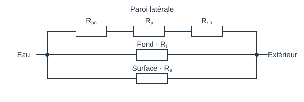

# Mines-Ponts PC — Physique 1 2024 · Corrigé guidé

*Corrigé rédigé par IA, non officiel. Signalez toute erreur.*

## Présentation du sujet

L’épreuve suit un spa depuis son installation jusqu’à sa vidange. La première partie traite du gonflage, du chauffage et de la diffusion du rayonnement solaire. La deuxième construit le bilan thermique puis examine la commande du chauffage par une thermistance. La troisième relie la vitesse d’évacuation à la hauteur d’eau et estime la durée du démarrage.

Les applications numériques sont demandées à deux chiffres significatifs et la calculatrice est interdite. On peut progresser dans les questions thermiques ou dans la vidange même si l’estimation optique est incomplète. Les questions 7 et 20 demandent deux bilans locaux utiles à identifier dès la première lecture. Le formulaire est regroupé à la fin.

## I.A — Installation du spa · Gonflage

Le gaz parfait permet de relier le volume à gonfler au débit, puis de raisonner sur la pression et son évolution.

### Question 1

> [!INDICATION]
> Identifier la section occupée par la seule enveloppe d’air.

> [!INDICATION]
> Utiliser le diamètre intérieur exact donné, puis convertir le volume et la durée en unités compatibles.

#### Solution

L’air remplit une enveloppe cylindrique annulaire de hauteur $H$. Son volume, dans la forme finale, est

$$
V_a=\frac{\pi H}{4}(d_{\mathrm{ext}}^2-d_{\mathrm{int}}^2)
\simeq1{,}6\ \mathrm{m^3}.
$$

Il est alors à la pression atmosphérique $p_0$. Le volume d’air fourni, compté aux conditions de l’aspiration, est $V_a$ si l’air est initialement absent et si sa température finale est celle de l’air aspiré. Ainsi,

$$
\boxed{D_p=\frac{V_a}{t_g}\simeq2{,}6\ \mathrm{L\,s^{-1}}}.
$$

> [!PIEGE]
> Le volume d’air à gonfler et le volume d’eau correspondent à deux sections différentes.

### Question 2

> [!INDICATION]
> À température et volume constants, relier la hausse de pression à la quantité de matière ajoutée.

> [!INDICATION]
> Exprimer le débit molaire à partir de l’air aspiré, où la pression est connue.

#### Solution

Notons $n_g=p_0V_a/(RT)$ la quantité d’air présente à la fin du gonflage. Au débit volumique $D_p$ compté à l’aspiration, le débit molaire vaut $\dot n=p_0D_p/(RT)$.

À $V_a$ et $T$ constants, une surpression $p$ exige la quantité supplémentaire $\Delta n=pV_a/(RT)$. En supposant le débit de la pompe inchangé dans cette petite plage de surpression,

$$
\boxed{\Delta t=\frac{\Delta n}{\dot n}=\frac{p}{p_0}\,t_g\simeq60\ \mathrm s}.
$$

La valve s’ouvre environ **onze minutes après le début du gonflage**, soit une minute après que l’enveloppe a pris sa forme définitive.

> [!JURY]
> Le rapport 2024 relève que la proportionnalité entre pression et durée est souvent affirmée sans justification.

### Question 3

> [!INDICATION]
> Tant que la valve ne s’ouvre pas, le spa contient la même quantité de gaz.

> [!INDICATION]
> Utiliser la pression absolue au seuil et calculer le rapport des températures en kelvins.

#### Solution

Tant que la valve reste fermée, la quantité d’air et le volume sont constants. La pression absolue est proportionnelle à la température absolue. Si l’air du spa atteint l’équilibre thermique avec l’extérieur, le seuil vérifie

$$
\boxed{T_{\rm seuil}=T_0\left(1+\frac{p}{p_0}\right)}.
$$

Avec $T_0=288\ \mathrm K$, on obtient $T_{\rm seuil}\simeq317\ \mathrm K$, soit **$44\,^\circ\mathrm C$**.

## I.B — Installation du spa · Chauffage de l’eau

La température de l’eau augmente en recevant de l’énergie. L’éclairement au niveau du spa dépend de la projection des rayons et de leur atténuation dans l’air.

### Question 4

> [!INDICATION]
> Estimer d’abord le temps annoncé par le manuel, puis établir le bilan d’énergie de l’eau.

> [!INDICATION]
> La capacité thermique totale est la capacité massique multipliée par la masse d’eau du cylindre intérieur.

#### Solution

Au taux indiqué, la durée de montée de $20$ à $40\,^\circ\mathrm C$ est

$$
\boxed{t_c=\frac{40-20}{2}\ \mathrm h=10\ \mathrm h}.
$$

Le volume d’eau vaut $V_e=S_e h_e$, avec $S_e=\pi d_{\rm int}^2/4$. On obtient $V_e\simeq1{,}2\ \mathrm{m^3}$ et une masse d’environ $1{,}2\times10^3\ \mathrm{kg}$. Le bilan d’énergie de cette eau, sans pertes, donne pour la puissance reçue

$$
P_{\rm eau}=\rho_e V_e c_e\frac{\Delta T}{t_c}\simeq2{,}7\ \mathrm{kW}.
$$

À $2{,}5\ \mathrm{kW}$, le temps calculé sans pertes est voisin de $11\ \mathrm h$. Les données du manuel concordent à la précision de ces estimations. Si on les prenait comme des valeurs exactes, la puissance annoncée serait légèrement inférieure à celle nécessaire pour chauffer toute l’eau à $2\,^\circ\mathrm C\,h^{-1}$.

> [!METHODE]
> Vérifier la cohérence du manuel en calculant soit la puissance pour le temps annoncé, soit le temps pour la puissance annoncée.

### Question 5

> [!INDICATION]
> Comparer la section d’un même faisceau sur un plan horizontal et sur un plan orthogonal aux rayons.

> [!INDICATION]
> La projection de la surface du spa dans le second plan fait intervenir l’angle par rapport à la verticale.

#### Solution

Un faisceau ayant une puissance surfacique $E_\perp$ dans un plan perpendiculaire à sa direction transmet à la surface horizontale d’aire $S_e$ une puissance $E_\perp S_e\cos\theta$, où $\theta$ est l’angle entre la direction du faisceau et la verticale. À météo et environnement identiques, cette puissance est maximale au **midi solaire local**, lorsque le Soleil est le plus haut. L’épaisseur d’atmosphère traversée est aussi minimale. Le Soleil ne passe au zénith qu’en des lieux et à des dates particuliers.

> [!JURY]
> Le rapport 2024 distingue la position la plus haute du Soleil et un éventuel passage au zénith.

### Question 6

> [!INDICATION]
> Penser à la distance de la source par rapport à la taille du domaine dans lequel on décrit l’onde.

> [!INDICATION]
> Pour la polarisation, repérer les forces en sens opposés sur les noyaux et les électrons.

#### Solution

À l’échelle du spa, la distance du Soleil et les rayons de courbure des fronts d’onde sont très grands. Une composante locale du rayonnement se modélise par une onde plane progressive. Le rayonnement réel est polychromatique et comporte plusieurs polarisations. On étudie ici une composante de pulsation $\omega$ et de champ transverse suivant $\widehat{\mathbf e}_z$.

Le champ exerce des forces de sens opposés sur les charges négatives et positives de la molécule. Il déplace le nuage électronique par rapport au noyau et crée un dipôle **induit**. Le modèle de l’électron élastiquement lié donne à $\omega_0$ le sens de pulsation propre, celle autour de laquelle la réponse est résonante dans le modèle amorti. L’expression fournie néglige cet amortissement.

> [!PIEGE]
> Une molécule sans moment dipolaire permanent peut se polariser sous l’action d’un champ.

### Question 7

> [!INDICATION]
> Faire un bilan de puissance sur une tranche mince contenant un nombre connu de molécules.

> [!INDICATION]
> Exprimer la puissance surfacique moyenne avec le vecteur de Poynting. Éliminer l’amplitude entre cette expression et celle de la puissance rayonnée.

#### Solution

Dans une tranche d’aire $S$ et d’épaisseur $\mathrm dx$, il y a $nS\,\mathrm dx$ molécules. Si le rayonnement réémis est retiré du faisceau direct, le bilan de puissance à la pulsation considérée est

$$
S\,\mathrm d E_\omega=-nS\,\mathcal P\,\mathrm dx .
$$

La relation de structure donne $\mathbf B=\widehat{\mathbf e}_x\times\mathbf E/c$. Le vecteur de Poynting a pour composante suivant $x$ la grandeur $E^2/(\mu_0 c)$. En moyennant sur une période, on obtient $E_\omega=E_0^2/(2\mu_0 c)$. La puissance réémise par une molécule est

$$
\mathcal P=\frac{e^4E_0^2}{12\pi\varepsilon_0 c^3m^2(\kappa^2-1)^2}
$$

$$
\kappa=\frac{\omega_0}{\omega}.
$$

On utilise $\varepsilon_0\mu_0c^2=1$. Pour $n$ uniforme, il vient

$$
\frac{\mathrm d E_\omega}{\mathrm dx}=-\frac{E_\omega}{H_\omega}
$$

$$
\boxed{H_\omega=\frac{6\pi m^2(\kappa^2-1)^2}{n\mu_0^2e^4}} .
$$

Donc $E_\omega(x)=E_\omega(0)\exp(-x/H_\omega)$. Le produit $\mu_0 e^2$ a pour dimension masse fois longueur. Ainsi $n(\mu_0 e^2)^2$ a pour dimension masse au carré divisée par une longueur. $H_\omega$ a bien la dimension d’une longueur.

> [!METHODE]
> La perte d’un faisceau rapportée à sa puissance sur une distance élémentaire définit une longueur d’atténuation.

### Question 8

> [!INDICATION]
> Choisir d’abord une longueur d’onde caractéristique à partir de la température solaire.

> [!INDICATION]
> Estimer la densité moléculaire à l’aide du gaz parfait. Comparer ensuite les deux échelles de longueur plutôt que les deux altitudes seules.

#### Solution

La loi de Wien donne $\lambda_{\max}=2\,900\ \mathrm{\mu m\,K}/T_S\simeq0{,}50\ \mathrm{\mu m}$.

Une pulsation caractéristique vaut $\omega=2\pi c/\lambda_{\max}\simeq3{,}8\times10^{15}\ \mathrm{rad\,s^{-1}}$. On a alors $\kappa\simeq6{,}1$.

Avec $p_0=1{,}0\ \mathrm{bar}$ et une température d’air représentative de $290\ \mathrm K$, le gaz parfait donne $n=p_0N_A/(RT)\simeq2{,}5\times10^{25}\ \mathrm{m^{-3}}$. D’où

$$
\boxed{H_\omega\simeq8{,}0\times10^5\ \mathrm m}.
$$

Dans le modèle uniforme et pour un trajet vertical de $100\ \mathrm{km}$, le rapport des éclairements vaut environ $\exp(-0{,}13)\simeq0{,}88$. Une hausse d’altitude raccourcit le trajet dans l’air et augmente l’éclairement direct. Pour quelques kilomètres, la variation à la pulsation estimée est faible. Ce modèle suppose un ciel clair et ignore la variation de densité de l’air, la diffusion selon les directions et l’effet de l’altitude sur les pertes thermiques.

## II.A — Utilisation du spa · Pertes calorifiques

Le modèle thermique sépare les chemins de sortie de la chaleur et leur effet sur la température de l’eau.

### Question 9

> [!INDICATION]
> Écrire la définition de la résistance avant de choisir une géométrie.

> [!INDICATION]
> Dans une paroi cylindrique, la surface traversée par la puissance dépend du rayon même si la puissance reste constante.

#### Solution

En régime stationnaire, pour une puissance thermique $\Phi$ comptée du chaud vers le froid, la résistance thermique est $R_{\rm th}=(T_{\rm chaud}-T_{\rm froid})/\Phi$, en $\mathrm{K\,W^{-1}}$. On utilise cette relation en régime quasi stationnaire, à chaque instant.

Pour la paroi latérale, on note $r_i=d_{\rm int}/2$ et $r_o=d_{\rm ext}/2$. On modélise le transfert radial sur la hauteur mouillée $h_e$. Le flux traversant la surface $2\pi r h_e$ est constant, donc la loi de Fourier donne

$$
\Phi_p=-\lambda_a\,2\pi r h_e\,\frac{\mathrm dT}{\mathrm dr}.
$$

L’intégration fournit les résistances de la paroi d’air et du tapis d’herbe d’épaisseur $e_h$,

$$
\boxed{R_p=\frac{\ln(r_o/r_i)}{2\pi\lambda_a h_e}}
$$

$$
\boxed{R_t=\frac{e_h}{\lambda_h S_{\rm ext}}} .
$$

Pour le fond, on modélise le transfert par une conduction verticale sur l’emprise extérieure du spa, $S_{\rm ext}=\pi d_{\rm ext}^2/4$. Cette aire est cohérente avec la valeur de $R_t$ donnée dans l’énoncé. On retrouve environ $3\ \mathrm{K\,W^{-1}}$ pour la paroi et $5\times10^{-2}\ \mathrm{K\,W^{-1}}$ pour le tapis.

> [!JURY]
> Le rapport 2024 relève que le régime quasi stationnaire est rarement évoqué et que la géométrie cylindrique a causé des erreurs.

### Question 10

> [!INDICATION]
> Identifier les chemins qui relient la même eau au même extérieur.

> [!INDICATION]
> Dans chaque chemin additionner les résistances en série. Écrire ensuite le bilan de l’eau et vérifier le signe du flux sortant.

#### Solution

On note $R_\ell$ la résistance totale de la branche latérale. Elle est la somme de $R_{pc}$, de $R_p$ et de la résistance de convection extérieure $R_{\ell,a}=1/(h_a 2\pi r_o h_e)$. Les branches latérale, inférieure et supérieure sont en parallèle.

Leur conductance totale vaut

$$
G_0=\frac1{R_\ell}+\frac1{R_t}+\frac1{R_s}.
$$

Avec $C_e=\rho_e S_e h_e c_e$, le premier principe appliqué à l’eau donne

$$
C_e\frac{\mathrm d T_{\rm int}}{\mathrm dt}=-G_0(T_{\rm int}-T_{\rm ext}).
$$

D’où la loi exponentielle demandée et sa constante de temps,

$$
T_{\rm int}(t)-T_{\rm ext}
=(T_{\rm int}(0)-T_{\rm ext})\exp(-t/\tau_0)
$$

$$
\boxed{\tau_0=\frac{C_e}{G_0}} .
$$

On calcule $R_\ell\simeq3{,}0\ \mathrm{K\,W^{-1}}$, $G_0\simeq37\ \mathrm{W\,K^{-1}}$ et $C_e\simeq4{,}9\times10^6\ \mathrm{J\,K^{-1}}$. Ainsi $\tau_0\simeq1{,}3\times10^5\ \mathrm s$, soit **37 h** (environ un jour et demi). Pour une différence initiale de $13\ \mathrm K$, la baisse prévue pendant les premières heures est d’environ $0{,}35\ \mathrm{K\,h^{-1}}$.

> [!PIEGE]
> Les conductances des chemins parallèles s’ajoutent. Le bilan doit donner une température qui tend vers celle du milieu extérieur.

### Question 11

> [!INDICATION]
> Déterminer quelle branche reçoit la toile et laquelle reçoit la couverture.

> [!INDICATION]
> Évaluer les deux nouvelles résistances de conduction et comparer les conductances avant et après l’installation.

#### Solution

Le tapis à bulles ajoute en série avec le fond une résistance $R_{\rm toile}=e_t/(\lambda_a S_{\rm ext})\simeq0{,}064\ \mathrm{K\,W^{-1}}$. La couverture s’étend sur le disque extérieur. En modélisant la conduction transverse sur ce disque, elle ajoute $R_{\rm couv}=e_s/(\lambda_a S_{\rm ext})\simeq3{,}2\ \mathrm{K\,W^{-1}}$. Sur sa face supérieure, la résistance de convection vaut $R_{\rm s,c}=1/(h_a S_{\rm ext})\simeq0{,}032\ \mathrm{K\,W^{-1}}$.

La conductance totale devient

$$
\boxed{G_1=\frac1{R_\ell}
+\frac1{R_t+R_{\rm toile}}
+\frac1{R_{\rm s,c}+R_{\rm couv}}\simeq9{,}4\ \mathrm{W\,K^{-1}}}.
$$

Le rapport $\tau_1/\tau_0=G_0/G_1$ est voisin de **3,9**. La constante de temps devient $\tau_1\simeq5{,}2\times10^5\ \mathrm s$, soit **6,1 jours**. Le sol reste la voie dominante de fuite thermique. Si l’on retient pour la couverture la seule aire au-dessus de l’eau, on obtient un gain de 4,0 et une constante de 6,2 jours.

### Question 12

> [!INDICATION]
> Interpréter une température constante comme une variation nulle d’énergie interne.

> [!INDICATION]
> Reprendre le réseau du spa couvert et identifier les termes du bilan stationnaire.

#### Solution

À température constante, la puissance de chauffage doit compenser toutes les pertes. Pour $\Delta T=38-25=13\ \mathrm K$,

$$
\boxed{P_{\rm maintien}=G_1\Delta T\simeq1{,}2\times10^2\ \mathrm W}.
$$

Cette puissance moyenne est bien moindre que la puissance du mode de chauffe. Les pertes réelles peuvent être plus fortes si l’isolation comporte des fuites ou si la couverture est retirée.

## II.B — Utilisation du spa · Module de commande et maintien en température

Le modèle de Drude relie la conductivité à la dynamique des électrons. Le circuit transforme la résistance de la thermistance en condition de commutation.

### Question 13

> [!INDICATION]
> Choisir un axe dans le sens du courant et écrire la loi d’Ohm locale.

> [!INDICATION]
> Déduire la tension par intégration du champ. Expliciter la convention récepteur.

#### Solution

On prend l’axe du cylindre dans le sens du courant $I$. En régime permanent et loin des bords, $\mathbf j=I\widehat{\mathbf e}_x/S$. Avec la convention récepteur, la tension $U$ est le potentiel à l’entrée du courant moins celui à sa sortie. La loi d’Ohm locale $\mathbf j=\sigma\mathbf E$ et l’intégration du champ sur la longueur $L$ donnent

$$
\begin{aligned}U &= \int_0^L E_x\,\mathrm dx \\
&= \frac{LI}{\sigma S}.\end{aligned}
$$

$$
\boxed{R_{\rm él}=\frac{L}{\sigma S}} .
$$

### Question 14

> [!INDICATION]
> Projeter le principe fondamental de la dynamique sur la direction du champ si nécessaire.

> [!INDICATION]
> Pour déduire le courant, multiplier la vitesse de dérive par la charge de l’électron et par la densité d’électrons.

#### Solution

Avec $e$ positif, l’électron de charge $-e$ obéit à

$$
m\frac{\mathrm d\mathbf v}{\mathrm dt}
=-e\mathbf E-\frac{m\mathbf v}{\tau_d}.
$$

La solution est $\mathbf v(t)=\mathbf v_\infty+(\mathbf v(0)-\mathbf v_\infty)\exp(-t/\tau_d)$. À temps grand devant $\tau_d$, la vitesse moyenne de dérive tend vers $\mathbf v_\infty=-e\tau_d\mathbf E/m$. La densité de courant est $\mathbf j=-en_e\mathbf v_\infty$. Ainsi,

$$
\boxed{\sigma=\frac{n_e e^2\tau_d}{m}} .
$$

> [!PIEGE]
> Les électrons dérivent en sens opposé au champ. Le courant conventionnel est dirigé dans le sens du champ.

### Question 15

> [!INDICATION]
> Pendant un vol libre, isoler la force électrique dans l’équation du mouvement.

> [!INDICATION]
> La moyenne des vitesses juste après une collision est nulle dans le modèle de randomisation. Relier la dérive au temps libre et à l’agitation du réseau.

#### Solution

Entre deux collisions, l’électron est accéléré par le champ sans force collisionnelle. Si le vol libre dure $\Delta t$ après un départ à vitesse $\mathbf v_0$, alors

$$
\boxed{\mathbf v(t_0+\Delta t^-)=\mathbf v_0-\frac{e\mathbf E}{m}\Delta t}.
$$

Si les collisions randomisent complètement les vitesses, la vitesse moyenne de départ est nulle. Sur un grand nombre de vols, la moyenne des vitesses juste avant la collision est $\langle\mathbf v^-\rangle=-e\mathbf E\langle\Delta t\rangle/m$. Dans le modèle de Drude à taux de collision indépendant de la vitesse, les électrons qui entrent en collision échantillonnent sans biais les vitesses stationnaires. La comparaison avec la vitesse de dérive de Q14 donne $\tau_d=\langle\Delta t\rangle$. $\tau_d$ s’interprète comme le **temps moyen entre collisions qui relâchent la quantité de mouvement**.

Dans le cuivre et la plage étudiée, la hausse de température accroît l’agitation du réseau et le taux de diffusion des électrons par ce réseau. Le temps $\tau_d$ diminue. À densité d’électrons et géométrie pratiquement constantes, la conductivité diminue et la **résistance augmente**.

### Question 16

> [!INDICATION]
> Les courants d’entrée de l’ALI sont nuls. Lire indépendamment les deux diviseurs de tension.

> [!INDICATION]
> Égaler les deux tensions pour trouver le seuil, puis propager une erreur de réglage de la résistance variable.

#### Solution

Les entrées de l’ALI idéal n’absorbent aucun courant. Les deux diviseurs donnent

$$
V^+=V_0\frac{R_1}{R_1+R_2}
$$

$$
V^-=V_0\frac{R_1}{R_1+R_{\rm th}} .
$$

Pour $V_0>0$, la saturation haute exige $R_{\rm th}>R_2$, donc $T>T_*$. La bascule se fait à l’égalité, soit

$$
\boxed{T_*=T_{\rm ref}+\frac{R_2/R_0-1}{\alpha}}.
$$

On règle la résistance variable $R_2$ pour imposer le seuil souhaité. Le maintien dans l’intervalle utilise deux réglages, aux températures $T_{\min}$ et $T_{\max}$, et une commande qui mémorise l’état entre les deux seuils.

À $R_0$ et $\alpha$ supposés connus, la propagation d’une petite erreur $\delta R_2$ donne

$$
\boxed{\frac{|\delta R_2|}{R_2}
\lesssim\frac{\alpha(1\ \mathrm K)}{1+\alpha(T_*-T_{\rm ref})}
\simeq4{,}0\times10^{-3}} .
$$

Le réglage de $R_2$ doit être précis à environ **0,4 %**. L’expression exacte donne environ 0,37 % près de $40\,^\circ\mathrm C$.

> [!METHODE]
> Dans un comparateur, on teste le signe de la différence des tensions aux entrées à partir du circuit extérieur.

## III — Vidange du spa

On établit d’abord un débit en supposant l’écoulement permanent, puis on estime le domaine de validité de cette hypothèse.

### Question 17

> [!INDICATION]
> Comparer un fluide soumis à l’adhérence à la paroi et un fluide parfait.

> [!INDICATION]
> Le même débit traverse toute section. Utiliser l’aire et la vitesse moyenne de chaque section.

#### Solution

On assimile loin de la contraction l’écoulement à un mouvement unidirectionnel dans la cuve et dans le tuyau. La viscosité est négligée. La condition de glissement au contact des parois ne force donc pas une vitesse tangentielle nulle, et on modélise chaque profil par une vitesse uniforme sur la section. Pour l’incompressibilité, le résultat suivant resterait valable avec les vitesses moyennes de section.

Avec $S_t=\pi d_t^2/4$ et $S_e=\pi d_{\rm int}^2/4$, la conservation du volume impose

$$
S_e v_s=S_t v_t
$$

$$
\boxed{v_s=\beta v_t}.
$$

Ici $\beta=(d_t/d_{\rm int})^2\ll1$.

$v_s$ désigne la vitesse de l’eau côté cuve, prise positive vers le fond. En vidange libre, elle coïncide avec la vitesse de descente de la surface, $-\mathrm dh_e/\mathrm dt$.

### Question 18

> [!INDICATION]
> Choisir les deux extrémités de la ligne de courant où la pression est connue.

> [!INDICATION]
> Comparer les termes cinétiques avec le rapport des sections avant de simplifier Bernoulli.

#### Solution

On applique Bernoulli le long d’une ligne de courant de la surface libre, à l’altitude $h_{e,0}$, jusqu’à la sortie du tuyau, à l’altitude zéro. Les deux extrémités sont à la pression atmosphérique. Pour cet écoulement permanent et non dissipatif,

$$
gh_{e,0}+\frac{v_s^2}{2}=\frac{v_t^2}{2}.
$$

Comme $v_s=\beta v_t$, on obtient $v_t^2=2gh_{e,0}/(1-\beta^2)$. À l’ordre dominant en $\beta$,

$$
\boxed{v_t\simeq\sqrt{2gh_{e,0}}}.
$$

### Question 19

> [!INDICATION]
> Exprimer la variation du volume d’eau avec la hauteur.

> [!INDICATION]
> Simplifier l’équation en prenant comme inconnue la racine carrée de la hauteur.

#### Solution

En régime quasi permanent, $v_t(t)\simeq\sqrt{2gh_e(t)}$. Le volume d’eau décroît au débit $S_t v_t$, d’où

$$
\boxed{\frac{\mathrm dh_e}{\mathrm dt}=-\beta\sqrt{2gh_e}} .
$$

Tant que la hauteur est positive, $\sqrt{h_e(t)}=\sqrt{h_e(0)}-\beta\sqrt{2g}\,t/2$. Son premier zéro donne

$$
\boxed{t_v=\frac{1}{\beta}\sqrt{\frac{2h_e(0)}{g}}
=\left(\frac{d_{\rm int}}{d_t}\right)^2\sqrt{\frac{2h_e(0)}{g}}}.
$$

### Question 20

> [!INDICATION]
> Projeter Euler sur la tangente à une ligne de courant à un instant donné.

> [!INDICATION]
> L’intégrale du terme local d’accélération est dominée par la colonne dans le tuyau. Garder les différences de pression, d’altitude et de vitesse aux deux bornes.

#### Solution

On oriente une ligne de courant de la surface libre $A$ à la sortie $B$. Le déplacement $\mathrm d\mathbf r$ est tangent à la ligne, donc colinéaire à $\mathbf v$. Le terme $\mathbf v\times(\nabla\times\mathbf v)$ est orthogonal à ce déplacement. La projection et l’intégration d’Euler à l’instant $t$ donnent

$$
\int_A^B\frac{\partial\mathbf v}{\partial t}\cdot\mathrm d\mathbf r
+\frac{v_B^2-v_A^2}{2}+g(z_B-z_A)+\frac{p_B-p_A}{\rho_e}=0.
$$

Les pressions aux deux extrémités sont égales. Pendant le démarrage, $z_B-z_A=-h_e(0)$ et $v_A\ll v_B=v_t$. Dans ce modèle, l’inertie principale est celle de la colonne d’eau dans le tuyau. L’accélération dans la cuve est de l’ordre de $\beta\,\mathrm dv_t/\mathrm dt$ par la continuité. On néglige donc sa contribution devant celle du tuyau dans le modèle considéré, ce qui suppose notamment $\beta h_e(0)\ll\ell$. On suppose aussi la zone de contraction courte devant le tuyau. L’intégrale vaut alors $\ell\,\mathrm dv_t/\mathrm dt$. On obtient

$$
\boxed{\ell\frac{\mathrm dv_t}{\mathrm dt}= gh_e(0)-\frac{v_t^2}{2}}
$$

$$
v_t(0)=0.
$$

> [!PIEGE]
> Au démarrage, la dérivée temporelle de la vitesse ne s’annule pas dans l’équation d’Euler.

### Question 21

> [!INDICATION]
> Utiliser la vitesse limite pour introduire une vitesse sans unité.

> [!INDICATION]
> Séparer les variables et utiliser la primitive du formulaire. Comparer le temps obtenu au temps global de vidange.

#### Solution

On pose $v_\infty=\sqrt{2gh_e(0)}$ et $u=v_t/v_\infty$. L’équation précédente devient

$$
\frac{\mathrm du}{1-u^2}=\frac{v_\infty}{2\ell}\,\mathrm dt .
$$

En intégrant avec $u(0)=0$ et la primitive fournie,

$$
\boxed{v_t(t)=v_\infty\tanh(t/\tau_e)}
$$

$$
\boxed{\tau_e=\frac{2\ell}{v_\infty}} .
$$

La durée caractéristique est de l’ordre de $\tau_e$. La vitesse dépasse $0{,}96\,v_\infty$ au bout de $2\tau_e$. La quasi-permanence après le démarrage demande $\tau_e\ll t_v$. Or $t_v=2h_e(0)/(\beta v_\infty)$. Donc

$$
\boxed{\ell\ll h_e(0)\left(\frac{d_{\rm int}}{d_t}\right)^2}.
$$

Il faut choisir un tuyau suffisamment court pour respecter cette borne. Le petit rapport $d_t/d_{\rm int}$ laisse une marge importante dans ce modèle.

### Question 22

> [!INDICATION]
> Suivre la pression à la surface libre quand le volume d’eau diminue.

> [!INDICATION]
> Déterminer la dépression qui annulerait la charge disponible entre la surface et la sortie.

#### Solution

Pour une couverture étanche maintenue en place, l’air extérieur ne remplace pas le volume d’eau parti. Si une poche d’air est enfermée, son volume augmente et sa pression $p_A$ diminue. La relation de charge motrice à la surface devient, en négligeant sa vitesse,

$$
\frac{v_t^2}{2}\simeq gh_e+\frac{p_A-p_0}{\rho_e}.
$$

Si la poche est initialement à $p_0$, la charge motrice est d’abord positive. À hauteur nulle, elle serait négative puisque la poche se serait dilatée et sa pression aurait baissé. La charge s’annule donc à une hauteur intermédiaire, lorsque la dépression atteint $\rho_e gh_e$. La charge hydrostatique initiale représente environ $7{,}4\ \mathrm{kPa}$. Sans volume d’air initial et sous un couvercle fixe, une vidange soutenue est également impossible dans le modèle incompressible. Il faut **ouvrir un évent ou retirer la couverture**. Si la couverture est libre de descendre avec l’eau, sa mobilité change le bilan de pression et il faut modéliser son mouvement.

## Bilan

- **Gaz parfait et chauffage** — Bien distinguer les surfaces de l’eau et de l’enveloppe. Raisonner sur les pressions et les températures absolues lorsqu’il s’agit d’un rapport d’états du gaz.
- **Atténuation et pertes thermiques** — Dans un bilan de tranche, prendre la même aire pour les puissances reçue et transmise. Dans un réseau thermique, identifier les branches en lisant leurs températures de départ et d’arrivée.
- **Mesure et vidange** — Les deux entrées du comparateur servent à définir un seuil. Pour une vidange, comparer le temps de mise en mouvement au temps de variation de la hauteur avant de supposer le régime quasi permanent.
