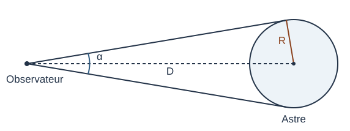
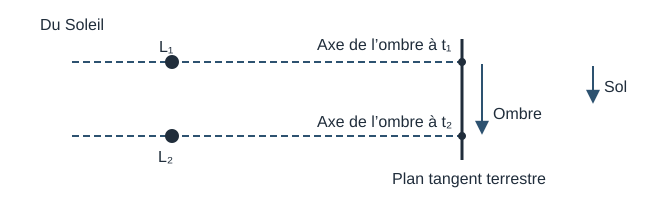
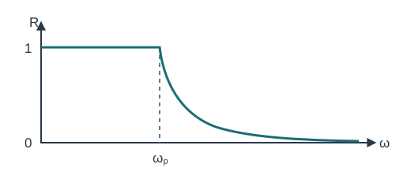

# Mines-Ponts PC — Physique 2 2024 · Corrigé brut

*Corrigé rédigé par IA, non officiel. Signalez toute erreur.*

## I.A — Les éclipses du Soleil par la Lune · Le système Soleil, Terre, Lune

### Question 1

La définition de $G$ entraîne $M_T\overrightarrow{TG}=M_L\overrightarrow{GL}$. Les trois points sont alignés et $G$ est entre $T$ et $L$. Ainsi,

$$
\boxed{D_{GT}=\frac{M_L}{M_T+M_L}D_{TL}\simeq4{,}6\times10^6\ \mathrm m}.
$$

Cette distance est inférieure à $R_T=6{,}4\times10^6\ \mathrm m$. Le barycentre est donc **à l’intérieur de la Terre**.

### Question 2

Notons $\mathcal G$ la constante de gravitation. En projetant le principe fondamental de la dynamique selon la direction de $G$ vers le Soleil, on obtient

$$
(M_T+M_L)\omega_0^2D_{TS}=\frac{\mathcal G M_S(M_T+M_L)}{D_{TS}^2}.
$$

Donc $\omega_0=\sqrt{\mathcal G M_S/D_{TS}^3}\simeq2{,}0\times10^{-7}\ \mathrm{rad\,s^{-1}}$. La période $T_0=2\pi/\omega_0$ vaut **environ une année**, soit $3{,}2\times10^7\ \mathrm s$.

### Question 3

Les axes de $(R_g)$ gardent les directions de ceux de $(R_0)$. Le référentiel $(R_g)$ est en translation et sa vitesse angulaire relativement à $(R_0)$ est nulle. La force de Coriolis est donc nulle. Le mouvement de $G$ étant accéléré, la force d’inertie d’entraînement subsiste.

### Question 4

La force d’inertie d’entraînement sur la Lune est opposée à l’accélération de $G$. Sa norme est $M_L\omega_0^2D_{TS}$. La force exercée par la Terre a pour norme $\mathcal G M_TM_L/D_{TL}^2$. Il en résulte

$$
\boxed{\frac{f_e}{f_T}=\frac{M_S}{M_T}
 \left(\frac{D_{TL}}{D_{TS}}\right)^2\simeq2{,}1}.
$$

La force d’entraînement prise isolément est du même ordre que l’attraction terrestre. En revanche, elle se combine avec l’attraction solaire.

### Question 5

La somme est la **force de marée solaire** dans le référentiel barycentrique. À l’alignement Soleil–Terre–Lune, $\mathbf f_S$ est dirigée vers le Soleil, tandis que $\mathbf f_e$ est dirigée en sens opposé. Avec $D_{LO}\simeq D_{TS}+D_{TL}$,

$$
\boxed{\frac{F_m}{f_T}
=\frac{M_S D_{TL}^2}{M_T}
 \left[\frac1{D_{TS}^2}-\frac1{(D_{TS}+D_{TL})^2}\right]} .
$$

Le premier ordre en $D_{TL}/D_{TS}$ donne $2(M_S/M_T)(D_{TL}/D_{TS})^3\simeq1{,}1\times10^{-2}$. La perturbation solaire résiduelle est donc de l’ordre de **1 %** de l’attraction terrestre dans cette configuration.

## I.B — Les éclipses du Soleil par la Lune · Périodes et géométrie

### Question 6

Après deux alignements successifs de même orientation, l’angle de la Lune mesuré depuis la direction Terre–Soleil a avancé de $2\pi$. On a $(\omega_1-\omega_0)T'_1=2\pi$, donc

$$
\boxed{\frac1{T'_1}=\frac1{T_1}-\frac1{T_0}} .
$$

Cela donne $T_1=T'_1/(1+T'_1/T_0)$. Au premier ordre en $T'_1/T_0=3/37$, on obtient

$$
\boxed{T_1\simeq\frac{34}{37}T'_1\simeq27\ \mathrm j}.
$$

La fraction demandée se rapporte à la période synodique $T'_1$, puisque l’exprimer en fraction de $T_1$ même serait tautologique.

### Question 7

Pour un astre de rayon $R$ à distance $D$ de l’observateur, la tangente donne un demi-angle $\arcsin(R/D)$. Le diamètre angulaire est donc approximativement $2R/D$.

$$
\alpha_S\simeq9{,}3\times10^{-3}\ \mathrm{rad}\simeq32'
$$

$$
\alpha_L\simeq9{,}1\times10^{-3}\ \mathrm{rad}\simeq31'.
$$

Pour la Lune, on s’est placé près du point sublunaire, où $D_L\simeq D_{TL}-R_T$. Pour le Soleil, on peut assimiler la distance d’observation à $D_{TS}$. Les diamètres apparents sont très voisins. Une petite variation des distances peut faire passer d’une éclipse totale à une éclipse annulaire. Avec les valeurs centrales données, la Lune paraît légèrement plus petite.

Au voisinage du maximum, la surface terrestre est localement assimilée à un plan transverse aux rayons. Le décalage de la direction Terre–Lune relativement à la direction Terre–Soleil est $\delta\varphi=(\omega_1-\omega_0)\delta t$. Pour des rayons solaires quasi parallèles, le déplacement de l’axe de l’ombre sur ce plan est de l’ordre de $D_{TL}\delta\varphi$. D’où

$$
\boxed{v_{\rm ombre}\simeq D_{TL}\omega'_1\simeq9{,}5\times10^2\ \mathrm{m\,s^{-1}}}.
$$

La rotation prograde de la Terre emporte la surface dans le même sens général que l’ombre et réduit la vitesse relative au sol.

La composante dans cette direction est au plus $R_T\omega_J\simeq4{,}5\times10^2\ \mathrm{m\,s^{-1}}$, soit une réduction allant jusqu’à presque la moitié près de l’équateur lorsque les deux vitesses sont alignées. À la latitude $\lambda$, la vitesse du sol vaut $R_T\omega_J\cos\lambda$ avant projection.

## II.A — Ondes dans les fluides · Le modèle fluide

### Question 8

$\mathbf f_{\rm autres}$ est une densité volumique de force supplémentaire, par exemple une force électromagnétique dans un fluide chargé. Dans l’équation d’Euler, elle s’ajoute à la gravité volumique et au gradient de pression. Elle est en **$\mathrm{N\,m^{-3}}$**.

### Question 9

$\nabla(v^2/2)$ représente l’accélération convective lorsque l’écoulement est irrotationnel. En effet, $(\mathbf v\cdot\nabla)\mathbf v=\nabla(v^2/2)-\mathbf v\times(\nabla\times\mathbf v)$ et le dernier terme est nul ici. Son unité est **$\mathrm{m\,s^{-2}}$**.

### Question 10

Notons $U$ l’amplitude de la vitesse du fluide et $L$ l’échelle de variation spatiale de l’onde. Le temps caractéristique associé vaut $L/c$.

L’ordre de grandeur de $\nabla(v^2/2)$ est $U^2/L$. Celui de $\partial_t\mathbf v$ est $Uc/L$.

Leur rapport est de l’ordre de **$U/c$**. On néglige donc le terme quadratique à l’ordre linéaire lorsque $U\ll c$.

### Question 11

La conservation locale de la masse s’écrit

$$
\boxed{\frac{\partial\rho}{\partial t}+\nabla\cdot(\rho\mathbf v)=0}.
$$

## II.B — Ondes dans les fluides · Ondes acoustiques

### Question 12

Pour une masse fixée de gaz parfait à $\gamma$ constant, en transformation isentropique, $PV^\gamma$ est constant. On en déduit à l’état de repos

$$
\boxed{\chi_S=-\frac1V\left(\frac{\partial V}{\partial P}\right)_S
=\frac1{\gamma P_0}} .
$$

### Question 13

Au premier ordre en perturbations autour du repos, et avec la masse volumique de référence donnée uniforme,

$$
\partial_t(\delta\rho)+\rho_0\partial_xv_x=0.
$$

En notant $\delta\rho=A\exp[i(\omega t-kx)]$, cela donne $i\omega A-ik\rho_0 V_0=0$. Donc

$$
\boxed{V_0=\frac{\omega A}{k\rho_0}} .
$$

### Question 14

Dans la projection horizontale de l’équation linéarisée, la pesanteur n’intervient pas. Avec $\delta P=\delta\rho/(\rho_0\chi)$, on a $i\omega\rho_0V_0=ikA/(\rho_0\chi)$. La relation de Q13 fournit

$$
\boxed{\omega^2=\frac{k^2}{\rho_0\chi}}.
$$

La vitesse de phase $1/\sqrt{\rho_0\chi}$ est indépendante de la pulsation avec les paramètres supposés constants. La propagation est **non dispersive** et la vitesse de groupe égale la vitesse de phase.

### Question 15

Pour la propagation acoustique isentropique dans le gaz parfait, $P_0/\rho_0=RT/M$. On obtient

$$
\boxed{v_g=\sqrt{\frac{\gamma RT}{M}}\simeq3{,}4\times10^2\ \mathrm{m\,s^{-1}}}.
$$

## II.C — Ondes dans les fluides · Ondes de gravité

### Question 16

La masse volumique et l’inertie de l’air sont faibles devant celles de l’eau. Dans ce modèle, les variations de pression liées au mouvement et à la pesanteur dans l’air sont négligeables devant la pression dynamique ou la variation hydrostatique correspondante dans l’eau. On prend ainsi $P=P_0$ côté air. L’écoulement de l’eau est supposé irrotationnel dans un domaine simplement connexe. Il existe donc un potentiel $A$ tel que $\mathbf v=\nabla A$.

### Question 17

L’incompressibilité donne $\nabla\cdot\mathbf v=0$, donc **$\Delta A=0$**. L’équation d’Euler linéarisée s’écrit

$$
\nabla\left(\partial_t A+\frac{P}{\rho_0}+gz\right)=\mathbf 0 .
$$

Le terme entre parenthèses est une fonction du temps. Comme ajouter une fonction du temps ne change pas $\nabla A$, on peut choisir la jauge de $A$ pour rendre ce terme nul.

Le long d’un point matériel, la dérivée de $gz$ est $gv_z$. Le terme $\mathbf v\cdot\nabla(\partial_t A)$ est d’ordre deux en la perturbation. La dérivée de la relation précédente le long du mouvement s’écrit alors

$$
\boxed{\partial_t^2 A+\frac1{\rho_0}\frac{\mathrm DP}{\mathrm Dt}+gv_z=0}.
$$

Dans (2), la présence de $gv_z$ suppose une dérivée suivie pour la pression totale. Si $\partial_t P$ y désigne la dérivée à position fixe comme écrit, l’équation imprimée contient un terme de trop. La dérivée à position fixe de la relation intégrée s’écrit $\partial_t^2 A+\partial_t P/\rho_0=0$. À la surface libre suivie dans son mouvement, la forme matérielle encadrée s’applique avec $\mathrm DP/\mathrm Dt=0$, puisque la pression reste imposée par l’air.

### Question 18

Avec $k>0$, l’équation de Laplace entraîne $f''-k^2f=0$. Le terme en $\exp(-kz)$ diverge au fond, situé vers $z=-\infty$, et son coefficient est nul. Il reste

$$
\boxed{f(z)=f_0\exp(kz)} .
$$

### Question 19

À la surface suivie dans son mouvement, $P=P_0$ et $\mathrm DP/\mathrm Dt=0$. Les autres termes de (2) sont déjà d’ordre un, donc ils s’évaluent en $z=0$ à cet ordre. Comme $v_z=\partial_z A$, l’équation devient $\partial_t^2 A+g\partial_z A=0$ en $z=0$. Après substitution,

$$
\boxed{\omega^2=gk}.
$$

On retrouve cette condition en combinant $\partial_t\eta=v_z(0)$ et $\partial_t A(0)+g\eta=0$ pour la hauteur $\eta$ de la surface libre. La vitesse de phase $\omega/k=g/\omega$ varie avec la pulsation. La propagation est **dispersive**.

### Question 20

Avec $v_\varphi=\omega/k=20\ \mathrm{m\,s^{-1}}$, la dispersion donne $k=g/v_\varphi^2$ et $\omega=g/v_\varphi$. Ainsi,

$$
\boxed{f=\frac{g}{2\pi v_\varphi}\simeq7{,}8\times10^{-2}\ \mathrm{Hz}}
$$

$$
\boxed{\lambda=\frac{2\pi v_\varphi^2}{g}\simeq2{,}6\times10^2\ \mathrm m}.
$$

## II.D — Ondes dans les fluides · Ondes de sillage

### Question 21

Le bateau se trouve à $\mathbf Vt$ dans $(R_0)$ et les axes sont parallèles. Ainsi $x'=x-V_0t$, $y'=y$. En remplaçant $\mathbf r$ par $\mathbf r'+\mathbf Vt$ dans l’expression de l’onde, on obtient

$$
\boxed{Z(\mathbf r',t)=Z_0\exp\!\left(i[(\omega-\mathbf k\cdot\mathbf V)t-\mathbf k\cdot\mathbf r']\right)} .
$$

### Question 22

À $\mathbf r'$ fixé dans le bateau, le sillage est stationnaire. Le coefficient temporel dans la phase doit donc s’annuler. On retrouve la relation de Kelvin

$$
\boxed{\omega=\mathbf k\cdot\mathbf V}.
$$

### Question 23

Le vecteur $\mathbf k$ au point $Q$ est dirigé selon la propagation radiale $\overrightarrow{OQ}$ de l’onde émise en $O$. Ainsi $\mathbf k\cdot\overrightarrow{OQ}=kv_\varphi t=\omega t$. Par la relation de Kelvin, $\mathbf k\cdot\overrightarrow{OB}=t\,\mathbf k\cdot\mathbf V=\omega t$. En soustrayant,

$$
\mathbf k\cdot\overrightarrow{QB}=0.
$$

Comme $\mathbf k$ est colinéaire à $\overrightarrow{OQ}$, il vient $\boxed{\overrightarrow{OQ}\cdot\overrightarrow{QB}=0}$.

### Question 24

Le triangle $OQB$ est rectangle en $Q$ et son angle en $B$ vaut $\theta$. Il donne $\sin\theta=OQ/OB=v_\varphi/V_0$. Par conséquent,

$$
\boxed{v_\varphi=V_0\sin\theta}.
$$

### Question 25

Les positions de l’éclipse pour des dates croissantes sont vers l’est et légèrement vers le sud. Les losanges correspondant à des dates séparées de cinq minutes sont distants d’environ $230$ à $270\ \mathrm{km}$ sur la carte, par exemple environ $250\ \mathrm{km}$ en $300\ \mathrm s$ entre les deux positions proches de 10 h 20 et 10 h 25. La vitesse de la source est donc de l’ordre de $8\times10^2\ \mathrm{m\,s^{-1}}$, cohérente avec le résultat grossier de Q7.

Les branches du sillage donnent un demi-angle d’environ $30$ à $35^\circ$ lorsqu’on utilise les deux échelles de la carte. Le modèle de Q24 conduit à une vitesse de phase **de quelques $10^2\ \mathrm{m\,s^{-1}}$**, environ $4{,}5\times10^2\ \mathrm{m\,s^{-1}}$ en prenant $\theta\simeq33^\circ$ et $V_0\simeq8{,}2\times10^2\ \mathrm{m\,s^{-1}}$.

Elle est plus proche de la célérité acoustique de Q15 que des $20\ \mathrm{m\,s^{-1}}$ des ondes de gravité de Q20. Le sillage visible est donc compatible avec une perturbation acoustique. Une telle estimation ne suffit pas à attribuer toutes les perturbations observées à un seul mode.

## III.A — Les sondages ionosphériques · Densité électronique et fréquence de plasma

### Question 26

Pour le gaz parfait au sol, $P_0=n^*k_BT_0$. Donc

$$
\boxed{n^*=\frac{P_0}{k_BT_0}\simeq2{,}6\times10^{25}\ \mathrm{m^{-3}}}.
$$

### Question 27

L’équilibre hydrostatique impose $\mathrm dP/\mathrm dz=-m_0gn(z)$. En écrivant $n(z)=P(z)/(k_BT_0)$, on obtient une équation différentielle du premier ordre de solution

$$
\boxed{P(z)=P_0\exp(-z/H)}
$$

$$
\boxed{H=\frac{k_BT_0}{m_0 g}} .
$$

Avec $m_0=M/N_A$ et $M\simeq29\ \mathrm{g\,mol^{-1}}$, on trouve $H\simeq8{,}0\ \mathrm{km}$, soit un ordre de grandeur de **$10^4\ \mathrm m$**.

### Question 28

À l’altitude considérée, la population moléculaire vaut $n^*\exp(-z/H)\simeq2{,}6\times10^{15}\ \mathrm{m^{-3}}$. La proportion ionisée est d’environ $10^{-3}$, ce qui donne

$$
\boxed{n_{\max}\simeq2{,}6\times10^{12}\ \mathrm{m^{-3}}}.
$$

Cette estimation confirme l’ordre de grandeur $10^{12}\ \mathrm{m^{-3}}$. Pour les applications suivantes, on adopte la borne $n_0\le10^{12}\ \mathrm{m^{-3}}$ imposée par le sujet.

### Question 29

Le champ électrique de cette partie ne dépend pas de l’espace, donc $\nabla\times\mathbf E=\mathbf0$. La loi de Maxwell–Faraday donne $\partial_t\mathbf B=\mathbf0$. Le champ magnétique est **indépendant du temps**.

### Question 30

En prenant $e>0$ pour la valeur absolue de la charge électronique, la seconde loi de Newton est $i\omega m_e\mathbf v=-e\mathbf E$. Les ions sont immobiles et les électrons produisent le courant $\mathbf j=-n_0e\mathbf v$. Ainsi,

$$
\boxed{\mathbf j=\sigma(\omega)\mathbf E}
$$

$$
\boxed{\sigma(\omega)=-i\,\frac{n_0 e^2}{m_e\omega}} .
$$

### Question 31

La loi de Maxwell–Ampère est

$$
\nabla\times\mathbf B=\mu_0\mathbf j+\mu_0\varepsilon_0\partial_t\mathbf E .
$$

En négligeant $\mathbf B$ et en cherchant une oscillation non triviale dans le milieu homogène, on doit avoir $\sigma+i\varepsilon_0\omega=0$. Le champ et le courant peuvent donc osciller spontanément à la pulsation

$$
\boxed{\omega_p=\sqrt{\frac{n_0e^2}{\varepsilon_0m_e}}}.
$$

### Question 32

La borne de densité donne $\omega_p\le56\times10^6\ \mathrm{rad\,s^{-1}}$. Donc

$$
\boxed{f_p=\frac{\omega_p}{2\pi}\lesssim8{,}9\ \mathrm{MHz}} .
$$

L’extrémité supérieure est de l’ordre de **10 MHz**, dans le domaine des ondes radio.

## III.B — Les sondages ionosphériques · Ondes électromagnétiques

### Question 33

Le membre de gauche est le terme inertiel, la masse de l’électron multipliée par son accélération. À droite figurent la force électrique $-e\mathbf E$, le rappel élastique $-m_e\omega_0^2\boldsymbol\xi$ avec $\boldsymbol\xi=\mathbf v/(i\omega)$, et le frottement effectif dû aux collisions, $-m_e\mathbf v/\tau$. Le paramètre $\tau$ est le temps de relaxation associé. Le régime $\tau\to\infty$ supprime la dissipation.

La force magnétique créée par l’onde est d’ordre deux en amplitude, car $\mathbf v$ et $\mathbf B$ sont toutes deux induites par l’onde. De plus, pour une onde transverse, $\|\mathbf B\|/\|\mathbf E\|=|k|/\omega$ par Maxwell–Faraday, de sorte que $|e\mathbf v\times\mathbf B|/|e\mathbf E|\lesssim v|k|/\omega$, soit $v/v_\varphi$ en régime propagatif.

Pour des électrons non relativistes, $v\ll c$, ce rapport est petit si $v_\varphi$ est de l’ordre de $c$ ou supérieur. L’argument d’ordre deux permet de négliger ce terme dans le modèle linéaire.

### Question 34

Comme la densité de charge est nulle, Maxwell–Gauss donne $\mathbf k\cdot\mathbf E=0$. Maxwell–flux donne $\mathbf k\cdot\mathbf B=0$. Pour $\tau\to\infty$, l’équation mécanique s’écrit

$$
i m_e\left(\omega-\frac{\omega_0^2}{\omega}\right)\mathbf v=-e\mathbf E .
$$

Il s’ensuit $\mathbf j=\sigma\mathbf E$ avec $\sigma=-i n_0 e^2\omega/[m_e(\omega^2-\omega_0^2)]$. Maxwell–Faraday donne $\mathbf B=(\mathbf k\times\mathbf E)/\omega$. En l’insérant dans Maxwell–Ampère et en utilisant $\mathbf k\times(\mathbf k\times\mathbf E)=-k^2\mathbf E$, on trouve

$$
\boxed{k^2=\frac{\omega^2}{c^2}
 \left(1+\frac{\omega_p^2}{\omega_0^2-\omega^2}\right)} .
$$

### Question 35

On a $N^2=c^2k^2/\omega^2$. Avec $a=\omega_p^2/\omega_0^2$ et $u=\omega^2/\omega_0^2$, on utilise $a\ll u\ll1$.

En développant avec $\omega_p\ll\omega\ll\omega_0$, on obtient

$$
\boxed{N\simeq 1+\frac{\omega_p^2}{2\omega_0^2}
+\frac{\omega_p^2}{2\omega_0^4}\omega^2}.
$$

Le premier terme qui dépend de la pulsation est quadratique. Avec $\omega=2\pi c/\lambda_0$, où $\lambda_0$ est la longueur d’onde dans le vide, cette loi prend la forme de Cauchy $A+B/\lambda_0^2$. L’indice est légèrement supérieur à un et augmente avec la fréquence dans le domaine étudié.

### Question 36

Pour $\omega_0=0$,

$$
\boxed{k^2c^2=\omega^2-\omega_p^2}.
$$

Une onde progressive existe pour $\omega>\omega_p$. Pour $\omega<\omega_p$, le vecteur d’onde est imaginaire et l’onde est évanescente. Dans le domaine transparent, la vitesse de phase $c/\sqrt{1-\omega_p^2/\omega^2}$ dépend de la fréquence. Le milieu est dispersif.

## III.C — Les sondages ionosphériques · Écho ionosphérique

### Question 37

La relation de structure est $\mathbf B=(\mathbf k\times\mathbf E)/\omega$. Les composantes suivant $z$ des vecteurs d’onde valent respectivement $\omega/c$, $-\omega/c$ et $k$. En notant $\tau_E$ le coefficient de transmission en amplitude, on trouve

$$
\begin{aligned}
\mathbf B_i&=\frac{E_0}{c}\exp[i\omega(t-z/c)]\,\widehat{\mathbf e}_y,\\
\mathbf B_r&=-\frac{\rho E_0}{c}\exp[i\omega(t+z/c)]\,\widehat{\mathbf e}_y,\\
\mathbf B_t&=\frac{k\tau_E E_0}{\omega}\exp[i(\omega t-kz)]\,\widehat{\mathbf e}_y.
\end{aligned}
$$

La continuité en $z=0$ de $\mathbf E$ et de $\mathbf B$ donne $1+\rho=\tau_E$ et $1-\rho=(ck/\omega)\tau_E$. Ainsi,

$$
\boxed{\rho=\frac{\omega-ck}{\omega+ck}} .
$$

Au-dessus du seuil, on choisit $ck$ réel et positif pour une onde s’éloignant de l’interface. Au-dessous, on choisit $ck=-i\sqrt{\omega_p^2-\omega^2}$ afin que l’onde transmise décroisse pour $z>0$. Il vient

$$
\rho(\omega)=
\begin{cases}
\dfrac{\omega+i\sqrt{\omega_p^2-\omega^2}}{\omega-i\sqrt{\omega_p^2-\omega^2}}, & 0<\omega<\omega_p,\\[4pt]
\dfrac{\omega-\sqrt{\omega^2-\omega_p^2}}{\omega+\sqrt{\omega^2-\omega_p^2}}, & \omega\ge\omega_p.
\end{cases}
$$

### Question 38

Les ondes incidente et réfléchie sont dans le même milieu. Le rapport des modules de leurs flux moyens de Poynting est **$R=|\rho|^2$**, le coefficient de réflexion en puissance.

Au-dessous du seuil, $ck$ est imaginaire pur. Le numérateur et le dénominateur de $\rho$ sont conjugués, donc $R=1$. Au seuil, $R$ reste égal à un. Au-dessus, $ck/\omega$ augmente de 0 vers 1. Le coefficient $R$ décroît de 1 vers 0.

On attend un écho fort si la pulsation émise est inférieure à la pulsation plasma du milieu rencontré. Dans l’interface abrupte du modèle, une réflexion partielle peut encore donner un écho au-dessus du seuil lorsqu’elle reste détectable.

### Question 39

Dans le modèle d’un trajet aller-retour quasi vertical assimilé au vide jusqu’à la couche réfléchissante, le retard est approximativement $\Delta t=2h/c$. La durée $\delta t$ de l’impulsion doit être très inférieure à ce retard pour distinguer le signal émis et son écho. Elle fixe un ordre de grandeur de résolution $\delta h\simeq c\delta t/2$. On choisit donc

$$
\boxed{\delta t\ll 2h/c}
$$

tout en gardant suffisamment de périodes dans l’impulsion pour identifier sa fréquence. Dans un milieu dispersif étendu, le retard est un temps de groupe et $c\Delta t/2$ représente une hauteur apparente.
