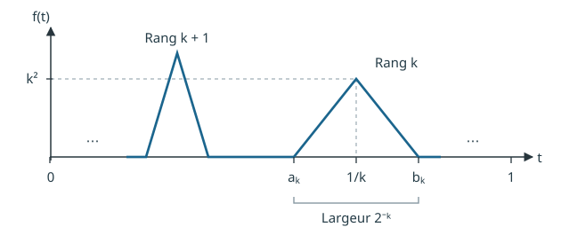

# Mines-Ponts PSI — Mathématiques 2 2024 · Corrigé brut

*Corrigé rédigé par IA, non officiel. Signalez toute erreur.*

## 1 — Une propriété sur les sommes de Riemann

### Question 1

La restriction $g$ est continue et intégrable sur $]a,b[$, et son intégrale est celle de $f$ sur $[a,b]$. Posons $\delta_n=(b-a)/n$. La continuité de $f$ sur le segment permet d’appliquer le théorème des sommes de Riemann aux rectangles à gauche,
$$
\delta_n\sum_{k=0}^{n-1}f(a+k\delta_n)
\longrightarrow\int_a^b f(t)\,\mathrm dt.
$$
Après division par $b-a$, on retranche le terme $f(a)/n$, qui tend vers zéro. Les termes restants ne font intervenir que $g$. On obtient exactement la condition définissant $\mathcal D_{a,b}$.

### Question 2

Pour $k\ge1$,
$$
a_k-b_{k+1}=\frac1{k(k+1)}-\frac3{2^{k+2}}.
$$
Comme $k(k+1)2^{-k}\to0$, cette différence est strictement positive pour tout $k$ assez grand.

Comme $a_k\sim1/k$ et $b_k\to0$, on peut choisir $k_0\ge2$ pour que l’inégalité soit valable et que $[a_k,b_k]\subset]0,1[$ pour tout $k\ge k_0$. Ces intervalles sont deux à deux disjoints.

Le milieu de $[a_k,b_k]$ est $1/k$. À ce point, les deux expressions affines de l’énoncé valent $k^2$. Elles s’annulent respectivement en $a_k$ et $b_k$. Chaque intervalle porte donc un triangle continu raccordé à zéro à ses extrémités.

Comme $a_k$ et $b_k$ tendent vers zéro, tout point de $]0,1[$ possède un voisinage qui ne rencontre qu’un nombre fini de ces intervalles. La fonction est ainsi bien définie et continue sur $]0,1[$.

L’aire du triangle de rang $k$ vaut $\tfrac12(b_k-a_k)k^2=k^2/2^{k+1}$. La série de ces aires converge par le critère de d’Alembert.

Pour tout $0<\delta<1$, l’intégrale de la fonction non négative sur $[\delta,1]$, avec prolongement nul en $1$, est majorée par la somme des aires. Elle admet donc une limite finie lorsque $\delta\to0^+$. Ainsi $f$ est intégrable.

Pour $n\ge k_0$, le point $1/n$ est échantillonné dans la somme et $f(1/n)=n^2$. Par positivité,
$$
\begin{aligned}\frac1n\sum_{j=1}^{n-1}f(j/n)&\ge\frac{f(1/n)}n\\&=n.\end{aligned}
$$
Les sommes divergent vers $+\infty$. Par conséquent, **$f\notin\mathcal D_{0,1}$**.

### Question 3

La fonction $\varphi(t)=t^{-1/2}$ est continue sur $]0,1[$. Son intégrale converge en zéro par le critère des intégrales de Riemann et elle est bornée au voisinage de $1$. Elle est donc intégrable sur $]0,1[$, d’intégrale $2$.

Sur chaque maille, la décroissance de $\varphi$ permet de comparer sa valeur au point d’échantillonnage avec son intégrale à gauche et à droite. Pour $n\ge2$,
$$
\begin{aligned}\int_{1/n}^1\varphi(t)\,\mathrm dt&\le\frac1n\sum_{k=1}^{n-1}\varphi(k/n)\\
&\le\int_0^{(n-1)/n}\varphi(t)\,\mathrm dt.\end{aligned}
$$
Les deux intégrales tendent vers $2$. L’encadrement donne **$\varphi\in\mathcal D_{0,1}$**.

### Question 4

Sur $]0,1/2]$, la fonction $t\mapsto t(1-t)$ est strictement croissante et positive. Sa racine inverse $\widetilde h$ est donc décroissante. De plus, $0<\widetilde h(t)\le\sqrt2\,\varphi(t)$ sur cette demi-partie. Par Q3, elle y est intégrable.

Avec $\delta_n=1/(2n)$, la même comparaison par rectangles que dans Q3 donne
$$
\begin{aligned}\int_{\delta_n}^{1/2}\widetilde h(t)\,\mathrm dt&\le\delta_n\sum_{k=1}^{n-1}\widetilde h(k\delta_n)\\
&\le\int_0^{(n-1)\delta_n}\widetilde h(t)\,\mathrm dt.\end{aligned}
$$
Les deux bornes convergent vers $\int_0^{1/2}\widetilde h$. En multipliant par $2$, on obtient précisément la normalisation demandée dans la définition. La restriction à l’intervalle ouvert appartient donc à **$\mathcal D_{0,1/2}$**.

### Question 5

On a $h(1-t)=h(t)$ pour tout $t\in]0,1[$. Le changement de variable $u=1-t$ ramène l’intégrale sur $]1/2,1[$ à celle sur $]0,1/2[$, convergente d’après Q4. Ainsi $h$ est intégrable et
$$
\boxed{\int_0^1 h(t)\,\mathrm dt=2\int_0^{1/2}\widetilde h(t)\,\mathrm dt.}
$$

### Question 6

La symétrie associe le terme d’indice $k$ à celui d’indice $2n-k$. Le terme central, d’indice $n$, reste seul. Ainsi
$$
\begin{aligned}\frac1{2n}\sum_{k=1}^{2n-1}h\!\left(\frac{k}{2n}\right)&=\frac1n\sum_{k=1}^{n-1}\widetilde h\!\left(\frac{k}{2n}\right)\\
&+\frac{h(1/2)}{2n}.\end{aligned}
$$
Le premier terme tend vers $2\int_0^{1/2}\widetilde h$ par Q4, et le second tend vers zéro. Q5 identifie la limite à $\int_0^1h$.

### Question 7

Posons $\delta_n=1/(2n+1)$. Les points échantillonnés jusqu’à l’indice $n$ sont tous à gauche de $1/2$. Par décroissance sur cette demi-partie, on a
$$
\begin{aligned}\int_{\delta_n}^{n\delta_n}\widetilde h(t)\,\mathrm dt&\le\delta_n\sum_{k=1}^{n}h(k\delta_n)\\
&\le\int_0^{n\delta_n}\widetilde h(t)\,\mathrm dt .\end{aligned}
$$
Pour la borne inférieure, on utilise les mailles de l’indice $1$ à l’indice $n-1$. Le $n$-ième rectangle est positif. Comme $\delta_n\to0$ et $n\delta_n\to1/2$, on obtient la limite $\int_0^{1/2}\widetilde h$.

Dans la somme complète, l’indice $k$ est associé à $2n+1-k$ et il n’y a pas de terme central isolé. La somme complète vaut donc le double de la demi-somme. Sa limite est $\int_0^1h$ d’après Q5.

### Question 8

Dans la suite des sommes figurant dans la définition de $\mathcal D_{0,1}$, la sous-suite des dénominateurs pairs converge vers $\int_0^1h$ par Q6. La sous-suite des dénominateurs impairs a la même limite par Q7. La suite entière converge donc vers cette limite. Comme $h$ est continue sur l’intervalle ouvert et intégrable par Q5, **$h\in\mathcal D_{0,1}$**.

### Question 9

Le changement de variable $t=\sin^2 u$ envoie $]0,\pi/2[$ sur $]0,1[$. Sur cet intervalle, il est de classe $\mathcal C^1$ et strictement croissant, avec
$$
\begin{aligned}\mathrm dt&=2\sin u\cos u\,\mathrm du,\\
\sqrt{t(1-t)}&=\sin u\cos u.\end{aligned}
$$
On peut d’abord changer de variable sur des segments intérieurs et passer aux bornes, les intégrales étant convergentes. Il vient
$$
\boxed{\int_0^1 h(t)\,\mathrm dt=2\int_0^{\pi/2}\mathrm du=\pi.}
$$

### Question 10

En réécrivant la somme de Q3,
$$
\begin{aligned}\frac1{\sqrt n}\sum_{k=1}^{n-1}\frac1{\sqrt k}&=\frac1n\sum_{k=1}^{n-1}\varphi(k/n)\\&\longrightarrow2.\end{aligned}
$$
Ajouter le terme d’indice $n$ ajoute $1/n$ au membre de gauche, donc ne change pas la limite. Ainsi
$$
\boxed{\sum_{k=1}^{n}\frac1{\sqrt k}\sim 2\sqrt n.}
$$

### Question 11

Pour $1\le i<n$, on a $1/\sqrt{i(n-i)}=h(i/n)/n$. La propriété de Q8 et la valeur de Q9 donnent
$$
\boxed{\sum_{i=1}^{n-1}\frac1{\sqrt{i(n-i)}}\longrightarrow\pi.}
$$

### Question 12

Notons $w_{n,i}=1/\sqrt{i(n-i)}$ et $W_n=\sum_{i=1}^{n-1}w_{n,i}$. La suite $(W_n)$ est bornée par Q11.

Fixons $\eta>0$ et prenons $m$ tel que $|\varepsilon_i|\le\eta$ pour $i\ge m$. Pour $n>m$,
$$
\begin{aligned}0&\le\sum_{i=1}^{n-1}w_{n,i}|\varepsilon_i|\\
&\le\sum_{i=1}^{m-1}w_{n,i}|\varepsilon_i|+\eta W_n.\end{aligned}
$$
La première somme tend vers zéro, car elle comporte un nombre fixe de termes et $w_{n,i}\to0$ pour tout $i$ fixé. Le second terme est au plus $\eta$ fois une constante indépendante de $n$ et de $\eta$. Comme $\eta$ est arbitraire, la somme de gauche tend vers zéro.

### Question 13

La suite $(\varepsilon_i)$ est bornée. Notons $C=\sup_i|\varepsilon_i|$ et reprenons $w_{n,i}$ et $W_n$ de Q12. Pour $n$ assez grand, $1+\varepsilon_n\ge1/2$. En développant le numérateur,
$$
\left|\frac{(1+\varepsilon_i)(1+\varepsilon_{n-i})}{1+\varepsilon_n}-1\right|
\le 2\bigl((1+C)|\varepsilon_i|+|\varepsilon_{n-i}|+|\varepsilon_n|\bigr).
$$
En sommant avec les poids $w_{n,i}$, les deux sommes en $|\varepsilon_i|$ et $|\varepsilon_{n-i}|$ sont égales par le changement d’indice $i\mapsto n-i$. Elles tendent vers zéro par Q12. Le dernier terme est proportionnel à $|\varepsilon_n|W_n$, qui tend aussi vers zéro par Q11. La somme demandée tend donc vers zéro.

## 2 — Une étude de marche aléatoire

### Question 14

La variable $Y_n=(1+X_n)/2$ prend ses valeurs dans $\{0,1\}$. Comme $X_n$ est centrée, $\mathbb E[Y_n]=1/2$.

Or l’espérance d’une variable de Bernoulli est sa probabilité de valoir $1$. Ainsi **$Y_n$ suit la loi de Bernoulli de paramètre $1/2$**.

### Question 15

L’événement $A_i$ est celui où, parmi les $2i$ premiers pas, il y a exactement $i$ pas égaux à $1$.

Les variables $Y_1,\ldots,Y_{2i}$ sont indépendantes et de même loi de Bernoulli de paramètre $1/2$. Leur somme suit donc la loi binomiale de paramètres $2i$ et $1/2$. On obtient
$$
\boxed{\mathbb P(A_i)=\frac{\binom{2i}{i}}{4^i}.}
$$

### Question 16

Si $B_n=\sum_{k=1}^{n}Y_k$, alors $B_n$ suit la loi binomiale de paramètres $n$ et $1/2$, et $S_n=2B_n-n$.

L’événement $\{S_n=\ell\}$ est donc impossible lorsque $\ell-n$ est impair. Lorsque $\ell-n$ est pair, il équivaut à $\{B_n=(n+\ell)/2\}$. Ainsi
$$
\boxed{\mathbb P(S_n=\ell)=
\begin{cases}
2^{-n}\binom{n}{(n+\ell)/2},&\ell-n\text{ pair},\\
0,&\ell-n\text{ impair}.
\end{cases}}
$$
Dans le cas pair, la convention de l’énoncé donne aussi zéro si $|\ell|>n$.

### Question 17

Comme $c_n/d_n\to1$, on a $d_n\ge c_n/2$ à partir d’un certain rang. La série $\sum d_n$ diverge donc par comparaison.

Pour appliquer le théorème 1 avec des termes non nuls, introduisons $a_n=|c_n-d_n|+d_n/n$ pour $n\ge1$. Ces termes sont strictement positifs et $a_n/d_n\to0$. Le théorème donne
$$
\frac{\sum_{k=1}^n a_k}{\sum_{k=1}^n d_k}\longrightarrow0.
$$
Comme le module de $\sum_{k=1}^n(c_k-d_k)$ est majoré par $\sum_{k=1}^n a_k$, on en déduit
$$
\boxed{\sum_{k=1}^n c_k\sim\sum_{k=1}^n d_k.}
$$

### Question 18

Une somme d’un nombre impair de pas valant chacun $1$ ou $-1$ est impaire. Les seuls indices d’égalité possibles sont donc les indices $2i$ pour $1\le i\le n$. Il s’ensuit que $N_n=\sum_{i=1}^n\mathbf 1_{A_i}$, et en particulier $0\le N_n\le n$. L’espérance est finie. Par linéarité et d’après Q15,
$$
\boxed{\mathbb E(N_n)=\sum_{i=1}^{n}\frac{\binom{2i}{i}}{4^i}.}
$$

### Question 19

La formule de Stirling appliquée à $(2i)!$ et à $i!$ donne
$$
u_i:=\frac{\binom{2i}{i}}{4^i}
=\frac{(2i)!}{4^i(i!)^2}
\sim\frac1{\sqrt{\pi i}}.
$$
Les termes sont positifs et la série de terme général $1/\sqrt{\pi i}$ diverge par le critère des séries de Riemann. La série de terme général $u_i$ diverge elle aussi par comparaison. On peut donc utiliser Q17 pour sommer l’équivalent. Avec Q18 puis Q10,
$$
\boxed{\mathbb E(N_n)\sim\frac1{\sqrt\pi}\sum_{i=1}^n \frac1{\sqrt i}
\sim\frac2{\sqrt\pi}\sqrt n.}
$$

### Question 20

Chaque ordre des $2n$ boules supposées étiquetées a la même probabilité. Une suite de couleurs donnée correspond à $(n!)^2$ de ces ordres. Ainsi les $\binom{2n}{n}$ suites comportant $n$ boules de chaque couleur sont équiprobables.

L’urne est équilibrée exactement lorsqu’on a retiré autant de boules de chaque couleur. Un indice d’égalité est donc nécessairement pair. Pour $1\le i\le n$, l’événement $B_{2i}$ exige $i$ boules de chaque couleur dans les $2i$ premières positions. Les $2n-2i$ positions restantes doivent alors comporter $n-i$ boules de chaque couleur. Le décompte donne
$$
\mathbb P(B_{2i})=\frac{\binom{2i}{i}\binom{2n-2i}{n-i}}{\binom{2n}{n}}.
$$
On a $M_n=\sum_{i=1}^n\mathbf 1_{B_{2i}}$, donc $M_n$ est bornée et d’espérance finie. En sommant les probabilités et en remplaçant $i$ par $n-i$ dans la somme,
$$
\boxed{\mathbb E(M_n)=\sum_{i=0}^{n-1}
\frac{\binom{2i}{i}\binom{2n-2i}{n-i}}{\binom{2n}{n}}.}
$$
Le terme d’indice $0$ dans cette expression provient de l’indice terminal $2n$, qui est toujours un indice d’égalité.

### Question 21

Avec $u_i$ de Q19 et $u_0=1$, la formule de Q20 devient
$$
\mathbb E(M_n)=1+\sum_{i=1}^{n-1}\frac{u_i u_{n-i}}{u_n}.
$$
Pour $j\ge1$, posons $\varepsilon_j=\sqrt{\pi j}\,u_j-1$. Ces réels sont strictement supérieurs à $-1$ et tendent vers zéro par Q19. Pour les indices intérieurs de la somme,
$$
\frac{u_i u_{n-i}}{u_n}
=\sqrt{\frac n\pi}\,\frac1{\sqrt{i(n-i)}}
\frac{(1+\varepsilon_i)(1+\varepsilon_{n-i})}{1+\varepsilon_n}.
$$
D’après Q13, la somme pondérée du dernier facteur diffère d’une quantité qui tend vers zéro de la somme des seuls poids. Par Q11, celle-ci tend vers $\pi$. Il vient
$$
\mathbb E(M_n)=1+\sqrt{\frac n\pi}\bigl(\pi+o(1)\bigr),
$$
et finalement **$\mathbb E(M_n)\sim\sqrt{\pi n}$**.

FIN
