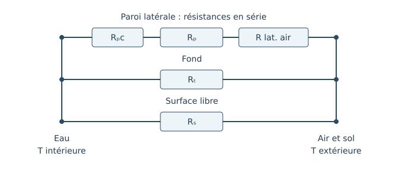
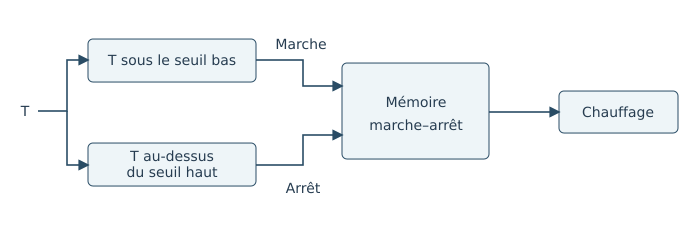

# Mines-Ponts PSI — Physique 1 2024 · Corrigé brut

*Corrigé rédigé par IA, non officiel. Signalez toute erreur.*

## I — Installation du spa

### Question 1

Les rayons intérieur et extérieur sont $r_i=d_{\mathrm{int}}/2$ et $r_e=d_{\mathrm{ext}}/2$. En négligeant le fond, le volume d’air est
$$
V_a=\pi H(r_e^2-r_i^2)=\frac{\pi H}{4}(d_{\mathrm{ext}}^2-d_{\mathrm{int}}^2).
$$
Il vaut environ $1{,}6\ \mathrm{m^3}$. À la pression atmosphérique, le débit moyen de la pompe est **$D_p=V_a/t_g\simeq2{,}6\ \mathrm{L\,s^{-1}}$**.

### Question 2

Une fois le volume fixé, à température constante, $P$ est proportionnelle à la quantité de matière. La pression absolue de seuil est $1{,}1\ \mathrm{bar}$ contre $1{,}0\ \mathrm{bar}$ à la fin du gonflage. Il faut donc ajouter $10\,\%$ de la quantité de matière déjà présente. En supposant que le débit d’aspiration, ramené aux conditions atmosphériques, reste le même,
$$
\boxed{\Delta t=t_g\frac{p}{P_{\mathrm{atm}}}\simeq1{,}0\ \mathrm{min}.}
$$
La valve ouvre environ $11\ \mathrm{min}$ après le début, ou une minute après la fin du gonflage normal.

### Question 3

Entre le gonflage et le début d’ouverture, $n$ et $V_a$ sont constants, donc $P/T$ est constant. L’air initial est à $T_i=288\ \mathrm K$. Si l’air intérieur suit la température extérieure, la condition est
$$
\boxed{T_{\rm seuil}=T_i\frac{P_{\mathrm{atm}}+p}{P_{\mathrm{atm}}}\simeq317\ \mathrm K\simeq44\,{}^\circ\mathrm C.}
$$

### Chauffage de l’eau

### Question 4

La notice donne **$t=(40-20)/2\simeq10\ \mathrm h$**. L’eau occupe $V_e=\pi r_i^2h_e\simeq1{,}2\ \mathrm{m^3}$, soit environ $1{,}2\times10^3\ \mathrm{kg}$. Le premier principe appliqué à cette masse d’eau, en négligeant les pertes et le stockage dans les parois, donne $Q=m_ec_e\Delta T\simeq9{,}9\times10^7\ \mathrm J$.
$$
t_{\rm idéal}=\frac{Q}{P_c}\simeq11\ \mathrm h.
$$
Les deux estimations sont du même ordre. Le modèle idéal prédit déjà un temps légèrement supérieur à dix heures.

Le taux de chauffage arrondi de la notice ne peut donc pas être pris pour une valeur exacte à ce volume, d’autant que les pertes allongent la chauffe.

### Question 5

Le chauffage direct est normalement maximal autour du **midi solaire**, quand la hauteur du Soleil est maximale. Pour une surface horizontale, la puissance reçue d’un faisceau direct par unité d’aire comporte le facteur $\cos i$, où $i$ est l’angle avec la normale. Ce facteur est maximal lorsque le Soleil est le plus haut. Le trajet atmosphérique est aussi plus court, ce qui réduit les pertes par diffusion et absorption. La réflexion de la lumière sur l’eau tend à augmenter pour les incidences rasantes. La météo ou un ombrage peuvent modifier cette tendance.

### Question 6

À l’échelle d’une région très petite devant la distance au Soleil, le front d’onde d’une direction donnée peut être considéré localement plan. On étudie une composante monochromatique et polarisée parmi les composantes du rayonnement. Le champ est transverse à la propagation et, avec les axes de l’énoncé, son expression est une onde harmonique de phase $\omega(t-x/c)$. Le champ électrique déplace légèrement les électrons liés par rapport aux noyaux. Les charges de signe opposé ne se superposent plus et la molécule acquiert un dipôle oscillant.

### Question 7

La moyenne du vecteur de Poynting d’une onde plane dans l’air assimilé au vide donne $E_\omega=E_0^2/(2\mu_0c)$. Le volume $S\,\mathrm dx$ contient $nS\,\mathrm dx$ molécules. En assimilant leur rayonnement à une perte pour le faisceau direct, $S\,\mathrm dE_\omega=-n S\,\mathrm dx\,\mathcal P$. La puissance donnée et l’expression de $p_0$ fournissent
$$
\frac{\mathcal P}{E_\omega}
=\frac{\mu_0^2e^4}{6\pi m^2(\kappa^2-1)^2}.
$$
Dans la simplification d’une densité $n$ uniforme, $\mathrm dE_\omega/\mathrm dx=-E_\omega/H_\omega$. On obtient
$$
\begin{aligned}
E_\omega(x)&=E_\omega(0)e^{-x/H_\omega},\\
H_\omega&=\frac{6\pi m^2(\kappa^2-1)^2}{n\mu_0^2e^4}.
\end{aligned}
$$
La dimension de $\mu_0e^2/m$ est celle d’une longueur, car $[\mu_0]=\mathrm{kg\,m\,A^{-2}\,s^{-2}}$ et $[e]=\mathrm{A\,s}$. Ainsi $n(\mu_0e^2/m)^2$ a la dimension de l’inverse d’une longueur.

### Question 8

Pour le vert, prenons $\lambda\simeq550\ \mathrm{nm}$, soit $\omega\simeq3{,}4\times10^{15}\ \mathrm{rad\,s^{-1}}$ et $\kappa\simeq6{,}7$. À partir de $\rho_a$ et d’une masse molaire d’air proche de $29\ \mathrm{g\,mol^{-1}}$, on trouve $n=\rho_a N_A/M_{\rm air}\simeq2{,}5\times10^{25}\ \mathrm{m^{-3}}$.
$$
\boxed{H_\omega\simeq1{,}2\times10^6\ \mathrm m.}
$$
Même pour un trajet vertical de $100\ \mathrm{km}$ à densité supposée constante, le rapport trajet sur $H_\omega$ est d’environ $0{,}08$. Quelques kilomètres d’altitude ne changent ce rapport que de quelques millièmes.

À météo et température égales, ce mécanisme seul modifie peu le chauffage du spa.

La densité réelle de l’air décroît avec l’altitude, contrairement à l’approximation uniforme.

## II — Utilisation du spa

### Pertes calorifiques

### Question 9

En régime stationnaire ou quasi stationnaire, la résistance thermique $R_{\rm th}$ est le rapport entre l’écart de température et la puissance thermique qui passe de la face chaude vers la face froide. Dans la paroi verticale sur une hauteur d’échange $h_e$, la puissance radiale vaut $-\lambda_a(2\pi rh_e)\,\mathrm dT/\mathrm dr$. En l’intégrant du rayon intérieur au rayon extérieur,
$$
\boxed{R_p=\frac{\ln(r_e/r_i)}{2\pi h_e\lambda_a}.}
$$
Pour le tapis d’épaisseur $e_h$, la conduction est plane. Avec l’empreinte en contact avec le sol $S_t\simeq\pi r_e^2$,
$$
\boxed{R_t=\frac{e_h}{\lambda_hS_t}.}
$$
Les estimations obtenues sont compatibles avec les valeurs arrondies données.

### Question 10

La voie latérale comprend en série la convection eau–paroi, la conduction dans l’air de la paroi et la convection vers l’air extérieur. On note $R_\ell=R_{pc}+R_p+1/(h_a2\pi r_e h_e)$.

Les trois voies latérale, par le fond et par la surface libre sont en parallèle entre $T_{\rm int}$ et $T_{\rm ext}$. Avec la capacité thermique de l’eau $C_e=m_ec_e$,
$$
\begin{aligned}
R_{\rm eq}^{-1}&=R_\ell^{-1}+R_t^{-1}+R_s^{-1},\\
C_e\frac{\mathrm dT_{\rm int}}{\mathrm dt}&=-\frac{T_{\rm int}-T_{\rm ext}}{R_{\rm eq}}.
\end{aligned}
$$
D’où $T_{\rm int}(t)-T_{\rm ext}=(T_{\rm int}(0)-T_{\rm ext})e^{-t/\tau}$ et **$\tau=C_eR_{\rm eq}\simeq1{,}3\times10^5\ \mathrm s\simeq37\ \mathrm h$**. La variation à court terme est lente, ce qui justifie l’approximation quasi stationnaire pour les résistances. Les pertes par évaporation sont omises dans ce modèle.

### Question 11

La toile de sol ajoute $e_t/(\lambda_a S_t)\simeq0{,}064\ \mathrm{K\,W^{-1}}$ à la voie par le fond. La couverture ajoute une résistance conductrice d’environ $e_s/(\lambda_a\pi r_i^2)\simeq6{,}4\ \mathrm{K\,W^{-1}}$ sur la voie supérieure. Si l’on attribue toute la surface extérieure à la conduction de la couverture, on trouve environ $3{,}2\ \mathrm{K\,W^{-1}}$, encore très supérieur aux résistances convectives de surface. La conclusion est insensible à cette différence d’aire.

La voie latérale reste inchangée. La résistance totale passe d’environ $0{,}027$ à $0{,}11\ \mathrm{K\,W^{-1}}$. La capacité thermique de l’eau reste la même, d’où **$\tau_{\rm isolé}\simeq1{,}5\times10^2\ \mathrm h$**, soit un gain d’environ un facteur quatre. La voie par le sol reste dominante.

### Question 12

Avec les deux isolants, la puissance moyenne nécessaire pour maintenir $38\,{}^\circ\mathrm C$ quand l’extérieur est à $25\,{}^\circ\mathrm C$ est
$$
\boxed{P=\frac{T_{\rm int}-T_{\rm ext}}{R_{\rm eq,isolé}}\simeq1{,}2\times10^2\ \mathrm W.}
$$
Ce résultat est la puissance thermique moyenne du modèle. Un chauffage commandé par intermittence peut délivrer une puissance instantanée supérieure.

### Maintien en température

### Question 13

Pour un cylindre homogène en régime permanent, en négligeant les effets de bord, le champ est axial et uniforme, de module $U/L$. La loi locale donne $j=\sigma U/L$. L’intensité est $I=jS$. D’où
$$
\boxed{R_{\rm él}=\frac{U}{I}=\frac{L}{\sigma S}.}
$$

### Question 14

Avec une charge $-e$, la deuxième loi de Newton donne $m\dot{\vec v}=-e\vec E-m\vec v/\tau_d$. À champ constant, la solution est
$$
\begin{aligned}
\vec v(t)&=\vec v_\infty+\bigl[\vec v(0)-\vec v_\infty\bigr]e^{-t/\tau_d},\\
\vec v_\infty&=-\frac{e\tau_d}{m}\vec E.
\end{aligned}
$$
Pour $t\gg\tau_d$, le terme transitoire disparaît.

Le courant volumique vaut $\vec j=-n_e e\vec v_\infty$, donc **$\sigma=n_e e^2\tau_d/m$**.

### Question 15

Pour une durée de vol libre $t$, la vitesse juste avant la collision suivante vaut $\vec v=\vec v_0-(e/m)\vec E\,t$. Les directions aléatoires après collision donnent $\langle\vec v_0\rangle=0$. La dérive moyenne juste avant collision est donc $-(e/m)\vec E\,\langle t\rangle$. Dans le modèle simple de Drude, où les collisions randomisent la vitesse et sont statistiquement distribuées avec un taux constant, $\tau_d$ s’interprète comme le temps moyen entre collisions. Quand le métal chauffe, l’agitation du réseau accroît la fréquence de diffusion des électrons et réduit $\tau_d$. La conductivité diminue et la résistance augmente.

### Question 16

À courant d’entrée négligeable, les diviseurs de la figure 2 donnent
$$
\begin{aligned}
V_+&=V_0\frac{R_1}{R_1+R_2},\\
V_-&=V_0\frac{R_1}{R_1+R_{\rm th}}.
\end{aligned}
$$
Le changement de signe de $V_+-V_-$ se produit pour $R_{\rm th}=R_2$. Ainsi
$$
\boxed{T_c=T_{\rm ref}+\frac{R_2/R_0-1}{\alpha}.}
$$
La sortie est positive au-dessus du seuil pour $V_0>0$.

Avec $R_0$ et $\alpha$ considérés exacts, $|\Delta T_c|=|\Delta R_2|/(\alpha R_0)$.

Une précision d’un kelvin demande donc **$|\Delta R_2|/R_2\lesssim \alpha R_0(1\,\mathrm K)/R_2$**, soit environ $0{,}4\,\%$ aux températures d’utilisation. À $40\,{}^\circ\mathrm C$, la valeur avant arrondi est environ $0{,}37\,\%$.

### Question 17

Ajuster un comparateur à $T_{\min}$ et le second à $T_{\max}$. Une logique à mémoire, par exemple une bascule marche–arrêt, reçoit une commande de mise en chauffe quand $T<T_{\min}$ et une commande d’arrêt quand $T>T_{\max}$. Avec le montage de Q16, on inverse la logique du premier comparateur pour détecter la température basse. Dans l’intervalle, aucune entrée active ne change l’état. Le chauffage allumé persiste jusqu’au seuil haut et le chauffage arrêté reste éteint jusqu’au seuil bas.

### Brassage de l’eau

### Question 18

Notons $V_f$ le volume au fond et $V_s$ celui à la surface. À température constante, et en négligeant la surpression de tension superficielle, $P_fV_f=P_0V_s$ avec $P_f=P_0+\rho_eg h_e$. Donc
$$
\frac{V_s-V_f}{V_f}=\frac{\rho_eg h_e}{P_0}\simeq0{,}074.
$$
L’augmentation est d’environ $7{,}4\,\%$, et celle du rayon d’environ $2{,}4\,\%$. La variation peut être négligée dans un modèle de premier ordre de remontée.

### Question 19

On a $\mathrm{Re}=2R\rho_e v_b/\eta_e$. Pour $R\simeq1\ \mathrm{mm}$ et des vitesses autour de $0{,}2$ à $1\ \mathrm{m\,s^{-1}}$, le résultat est de l’ordre de $4\times10^2$ à $2\times10^3$.

Cette gamme est bien au-dessus de celle du régime de Stokes. La figure 3 place $C_x$ près de son plateau, à quelques dixièmes. Avec la section projetée $\pi R^2$, on adopte
$$
\boxed{F_t=\tfrac12\rho_e C_x\pi R^2 v_b^2,}
$$
orientée en sens inverse du mouvement. Considérer $C_x$ constant est une approximation à cette échelle de vitesses.

### Question 20

Dans le modèle où seule l’inertie du gaz est retenue, la masse est $m_b=\rho_a(4\pi R^3/3)$. La poussée d’Archimède moins le poids vaut $(\rho_e-\rho_a)(4\pi R^3/3)g$. La traînée de Q19 s’oppose à la montée. Ainsi,
$$
\begin{aligned}
v_\infty&=\sqrt{\frac{8(\rho_e-\rho_a)gR}{3\rho_e C_x}},\\
\tau_b&=\frac{\rho_av_\infty}{(\rho_e-\rho_a)g},\\
\dot v_b&=\frac{v_\infty}{\tau_b}\left(1-\frac{v_b^2}{v_\infty^2}\right).
\end{aligned}
$$
La séparation des variables et $v_b(0)=0$ donnent **$v_b(t)=v_\infty\tanh(t/\tau_b)$**. La vitesse $v_\infty$ est la limite de régime permanent et $\tau_b$ est l’échelle d’établissement.

La vitesse donnée, $0{,}21\ \mathrm{m\,s^{-1}}$, est compatible avec le nombre de Reynolds retenu près du régime permanent. Le temps $25\ \mathrm{\mu s}$ est négligeable devant une remontée de plusieurs secondes, mais est peu réaliste pour le démarrage. Le modèle y emploie une traînée quadratique jusque vers la vitesse nulle et néglige l’inertie du liquide entraîné, qui domine celle du gaz.

### Question 21

L’écoulement est radial par symétrie, et l’incompressibilité impose $\partial_r(r^2v_r)=0$ dans le liquide. Dans le domaine $r≥ R(t)$, à la surface, la condition cinématique est $v_r(R(t),t)=\dot R(t)$. Il vient
$$
\boxed{\vec v(r,t)=\frac{R(t)^2\dot R(t)}{r^2}\vec e_r.}
$$

### Question 22

Avec $R=R_0+\varepsilon$, la vitesse radiale à l’ordre un vaut $R_0^2\dot\varepsilon/r^2$. Le terme convectif, quadratique en vitesse, est d’ordre deux dans le modèle perturbatif. L’équation proposée devient
$$
\boxed{\frac{\partial P}{\partial r}=-\frac{\rho_e R_0^2}{r^2}\ddot\varepsilon.}
$$
Le coefficient demandé est donc $\rho_e R_0^2$. En intégrant avec $P(\infty,t)=P_0$, on trouve $P(r,t)=P_0+\rho_e R_0^2\ddot\varepsilon/r$. Sans saut de pression à l’interface dans ce modèle et en prenant $r=R_0$ au premier ordre,
$$
\boxed{P_a(t)=P_0+\rho_e R_0\ddot\varepsilon(t).}
$$

### Question 23

Le gaz parfait suit $P_aV^{\gamma_a}=P_0V_0^{\gamma_a}$. Puisque $V/V_0=(1+\varepsilon/R_0)^3$, le développement au premier ordre donne
$$
\boxed{P_a(t)=P_0\left[1-3\gamma_a\frac{\varepsilon(t)}{R_0}\right].}
$$
Une augmentation du rayon abaisse la pression intérieure.

### Question 24

En combinant Q22 et Q23, on obtient
$$
\begin{aligned}
\ddot\varepsilon+\omega_b^2\varepsilon&=0,\\
\omega_b&=\frac1{R_0}\sqrt{\frac{3\gamma_a P_0}{\rho_e}}.
\end{aligned}
$$
Le rayon oscille autour de $R_0$. Pour $R_0=1{,}0\ \mathrm{mm}$, **$f_b=\omega_b/(2\pi)\simeq3{,}3\ \mathrm{kHz}$**, soit une période d’environ $3{,}1\times10^{-4}\ \mathrm s$.

La diffusivité thermique du gaz est de l’ordre de $a_{\rm th}=\lambda_a/(\rho_a c_a)\simeq2{,}9\times10^{-5}\ \mathrm{m^2\,s^{-1}}$ avec les données. Le temps de diffusion sur le rayon vaut $R_0^2/a_{\rm th}\simeq3{,}4\times10^{-2}\ \mathrm s$, bien supérieur à la période. Les échanges thermiques sont donc faibles sur un cycle. Avec la réversibilité adoptée par le modèle linéaire non dissipatif, l’hypothèse isentropique est cohérente à cet ordre.

### Question 25

L’énergie cinétique de l’eau autour d’une bulle vaut
$$
E_c(t)=\frac{\rho_e}{2}\int_{R(t)}^\infty
\left(\frac{R(t)^2\dot R(t)}{r^2}\right)^2 4\pi r^2\,\mathrm dr
=2\pi\rho_e R(t)^3\dot R(t)^2.
$$
Si $\varepsilon(t)=\varepsilon_m\cos(\omega_b t+\phi)$, à l’ordre dominant, $\langle\dot R^2\rangle=\omega_b^2\varepsilon_m^2/2$. Ainsi
$$
\boxed{\langle E_c\rangle\simeq\pi\rho_e R_0^3\omega_b^2\varepsilon_m^2
\simeq1{,}3\times10^{-3}\left(\frac{\varepsilon_m}{R_0}\right)^2\ \mathrm J.}
$$
L’amplitude n’est pas fournie. Une amplitude égale à $1\,\%$ du rayon ne donne qu’environ $1{,}3\times10^{-7}\ \mathrm J$ par bulle. Ce mouvement d’eau est essentiellement local, avec une vitesse radiale qui décroît en $1/r^2$. Dans le modèle sans dissipation, l’énergie s’échange périodiquement avec le gaz. Un brassage durable exige d’autres effets, notamment l’entraînement par les bulles en ascension et les interactions d’un grand nombre de bulles.

FIN
