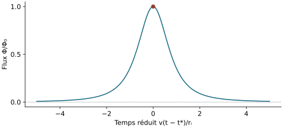
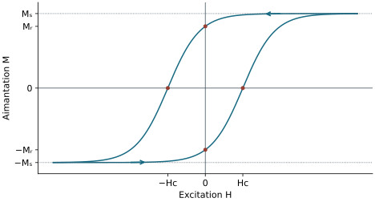
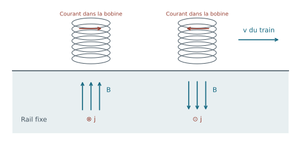
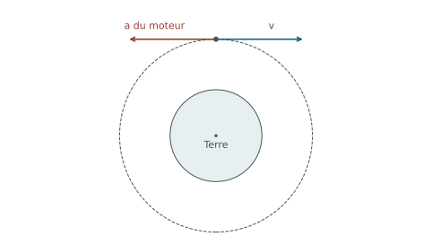

# Mines-Ponts PSI — Physique 2 2024 · Corrigé guidé

*Corrigé rédigé par IA, non officiel. Signalez toute erreur.*

## Présentation du sujet

L’épreuve dure quatre heures sans calculatrice. Les deux problèmes sont indépendants et le formulaire est en dernière page. Vous pouvez réserver 85 minutes au premier problème, 130 minutes au second et 25 minutes à la lecture et aux vérifications. Q1 à Q6, Q16 à Q18 et Q21 à Q25 permettent de démarrer par des applications directes du cours. Gardez du temps pour vérifier les orientations des courants et les comparaisons de durées.

## I — Freinage d’une chute libre

### Question 1

> [!INDICATION]
> Choisissez un axe dans le sens de la chute.

> [!INDICATION]
> Déduisez la durée de la loi de position, puis divisez la distance par la durée.

#### Solution

On oriente l’axe vers le bas à partir du point de lâcher. Le mouvement vérifie $z=g_0t^2/2$. Ainsi
$$
\begin{aligned}
\Delta t_h&=\sqrt{2h/g_0}\simeq0{,}2\,\mathrm s,\\
v_m&=h/\Delta t_h=\sqrt{g_0h/2}\simeq1\,\mathrm{m\,s^{-1}}.
\end{aligned}
$$
La vitesse moyenne vaut la moitié de la vitesse finale dans cette chute uniformément accélérée.

> [!JURY]
> La vitesse moyenne et la vitesse d’arrivée sont deux grandeurs différentes.

### Question 2

> [!INDICATION]
> Projetez poids et traînée avec leurs signes.

> [!INDICATION]
> Identifiez les coefficients devant le terme constant et le terme quadratique.

#### Solution

Selon l’axe descendant, $m\dot v=mg_0-C_x\rho\pi r^2 v^2/2$. L’identification avec la forme proposée donne
$$
\begin{aligned}
\dot v&=\frac{v_\infty^2-v^2}{v_\infty\tau},\\
v_\infty/\tau&=g_0,\\
v_\infty\tau&=\frac{2m}{C_x\rho\pi r^2}.
\end{aligned}
$$
La vitesse limite $v_\infty>0$ équilibre poids et traînée. Le paramètre $\tau$ fixe l’échelle temporelle d’approche de cette limite.

### Question 3

> [!INDICATION]
> Choisissez le diamètre comme longueur caractéristique.

> [!INDICATION]
> Utilisez la masse volumique et la viscosité du fluide.

#### Solution

Le nombre de Reynolds se calcule avec la masse volumique et la viscosité de l’air, et une longueur caractéristique égale au diamètre de la sphère,
$$
\mathcal R=\frac{\rho v_m(2r)}{\eta}\simeq1{,}3\times10^3.
$$
En prenant le rayon comme longueur caractéristique, on garderait l’ordre de grandeur $10^3$.

### Question 4

> [!INDICATION]
> Lisez la valeur sur les deux axes logarithmiques.

> [!INDICATION]
> Réutilisez les deux relations de la Q2.

#### Solution

La figure 1 donne $C_x\simeq0{,}5$ à ce nombre de Reynolds. Les relations de Q2 donnent
$$
\tau=\sqrt{\frac{2m}{g_0 C_x\rho\pi r^2}}\simeq6\,\mathrm s.
$$
La vitesse limite est de l’ordre de $60\,\mathrm{m\,s^{-1}}$, très supérieure à la vitesse atteinte sur $20\,\mathrm{cm}$.

### Question 5

> [!INDICATION]
> Comparez la vitesse atteinte et la vitesse limite.

> [!INDICATION]
> Estimez le rapport entre la traînée et le poids.

#### Solution

Sur $0{,}2\,\mathrm s$, la vitesse reste au plus égale à celle de la chute libre, environ $2\,\mathrm{m\,s^{-1}}$. Le rapport traînée sur poids vaut $(v/v_\infty)^2$, donc au plus de l’ordre de $10^{-3}$. La chute reste pratiquement libre. Le temps observé de quatre secondes exige un autre mécanisme dans ce modèle.

### Question 6

> [!INDICATION]
> Identifiez le chemin suivi par le courant.

> [!INDICATION]
> Distinguez sa longueur et sa section.

#### Solution

Pour un courant orthoradial, le trajet est une circonférence de longueur approximative $2\pi r_i$. La section traversée vaut $e\,\mathrm dz$. Avec la conductivité $\gamma$, on a
$$
\mathrm dG=\frac{\gamma e\,\mathrm dz}{2\pi r_i}.
$$
L’approximation néglige la variation du périmètre dans l’épaisseur du tube. Ici $e/r_i=7/15\simeq0{,}47$. Le résultat relève donc du modèle approché demandé, avec une précision géométrique limitée.

### Question 7

> [!INDICATION]
> Localisez la position d’alignement de l’aimant avec l’anneau.

> [!INDICATION]
> Comparez les dimensions de flux, de moment et de perméabilité.

#### Solution

Le flux est maximal à $t_*=-z/v$, où il vaut $\Phi_0$, et décroît symétriquement vers zéro de part et d’autre. En variable réduite, $\Phi/\Phi_0=[1+(v(t-t_*)/r_i)^2]^{-3/2}$.

Comme le facteur géométrique est sans dimension, $[\Phi_0]=\mathsf M\mathsf L^2\mathsf T^{-2}\mathsf I^{-1}$. Par ailleurs $[\mu_0]=\mathsf M\mathsf L\mathsf T^{-2}\mathsf I^{-2}$ et $[M_0]=\mathsf I\mathsf L^2$.

On compare d’abord les puissances de $\mathsf M$, puis celles de $\mathsf I$ et $\mathsf L$. On obtient $a=1$, $b=1$ et $c=-1$.

### Question 8

> [!INDICATION]
> Dérivez le flux à anneau fixé.

> [!INDICATION]
> Utilisez la conductance et changez ensuite de variable dans la description des anneaux.

#### Solution

La force électromotrice est $\mathcal E=-\mathrm d\Phi/\mathrm dt$. Pour un anneau donné, $\dot x=v/r_i$, d’où
$$
\mathcal E=\frac{3\mu_0M_0v\,x}{r_i^2(1+x^2)^{5/2}}.
$$
La puissance dissipée vaut $\mathcal E^2\,\mathrm dG$. Pour intégrer sur les anneaux à un instant fixé, on a $\mathrm dz=r_i\,\mathrm dx$. Par conséquent
$$
\mathrm dP_J=
\frac{9\gamma e\mu_0^2M_0^2v^2}{2\pi r_i^4}
\frac{x^2\,\mathrm dx}{(1+x^2)^5}.
$$

### Question 9

> [!INDICATION]
> Regardez où l’intégrande est le plus grand.

> [!INDICATION]
> Comparez la distance aux bords avec le rayon intérieur.

#### Solution

Les anneaux actifs sont surtout à une distance axiale de l’ordre de $r_i$ du mobile. Pour $|x|\gg1$, le facteur d’intégration décroît comme $|x|^{-8}$. Si l’aimant est à plusieurs rayons des deux extrémités, on peut donc prolonger les bornes à l’infini. Le tube est long devant $r_i$, ce qui laisse une région centrale où cette hypothèse est pertinente. L’approximation se dégrade à l’entrée et à la sortie.

> [!JURY]
> Utilisez la longueur du tube et la décroissance de l’intégrande.

### Question 10

> [!INDICATION]
> Écrivez la puissance mécanique de la force résistante.

> [!INDICATION]
> Utilisez sa direction imposée par la symétrie.

#### Solution

La puissance mécanique de la force résistante vaut $-P_J$. Par symétrie, la force est axiale et s’oppose au mouvement. On en déduit $\vec F=-KM_0^2\vec v$.

### Question 11

> [!INDICATION]
> Repérez la dépendance de la constante à la conductivité.

> [!INDICATION]
> Reliez cette constante à la vitesse limite.

#### Solution

À dimensions égales et pour un matériau agissant seulement par sa conductivité, $K$ est proportionnel à $\gamma$. La vitesse limite est inversement proportionnelle à $K$ car le poids équilibre $KM_0^2v$. Si cette vitesse est atteinte rapidement, la durée est proportionnelle à $\gamma$.

On estime donc environ $4{,}0\,\mathrm s\times3{,}7/5{,}7\simeq2{,}6\,\mathrm s$ pour l’aluminium, et $4{,}0\,\mathrm s\times0{,}77/5{,}7\simeq0{,}54\,\mathrm s$ pour un acier supposé sans effet magnétique propre. Ces durées sont des estimations à vitesse limite. En partant du repos, le modèle linéaire donne une distance $v_\infty[t-(v_\infty/g_0)(1-e^{-tg_0/v_\infty})]$. Le retard d’approche vaut environ $0{,}008\,\mathrm s$ pour l’aluminium et $0{,}04\,\mathrm s$ pour l’acier. Ce dernier cas donne donc plutôt $0{,}6\,\mathrm s$ avec le transitoire.

Un acier ferromagnétique modifie le champ et peut aussi attirer l’aimant. Sa conductivité seule ne suffit alors pas à prédire la chute réelle.

### Question 12

> [!INDICATION]
> Estimez la vitesse sur les quatre secondes.

> [!INDICATION]
> Utilisez l’équilibre entre poids et résistance inductive.

#### Solution

La vitesse de chute presque uniforme vaut $h/\Delta t_h\simeq0{,}05\,\mathrm{m\,s^{-1}}$. Le bilan des forces donne
$$
M_0=\sqrt{\frac{mg_0}{Kv}}\simeq1{,}7\,\mathrm{A\,m^2},
$$
soit environ $2\,\mathrm{A\,m^2}$ à un chiffre significatif. Le temps d’approche $m/(KM_0^2)=v/g_0\simeq0{,}005\,\mathrm s$ est bien inférieur aux quatre secondes.

### Question 13

> [!INDICATION]
> Marquez les deux saturations, puis les intersections des branches avec les axes.

> [!INDICATION]
> Reliez le moment total à l’aimantation par le volume.

#### Solution

Un cycle large possède deux branches distinctes. L’aimantation à forte excitation tend vers $\pm\mathcal M_s$. Lorsque l’excitation revient à zéro après saturation, on lit $\pm\mathcal M_r$. Les annulations de l’aimantation ont lieu à $\pm H_c$.

En utilisant le volume $V=4\pi r^3/3$ et en supposant l’aimantation rémanente uniforme, $M_0=\mathcal M_r V$. La mesure donne donc accès à $\mathcal M_r$, d’ordre $4\times10^5\,\mathrm{A\,m^{-1}}$.

### Question 14

> [!INDICATION]
> Lisez les flèches sur la face visible des spires.

> [!INDICATION]
> Appliquez la règle de la main droite à chaque bobine.

#### Solution

Vues du dessus, les spires de gauche sont parcourues dans le sens antihoraire et celles de droite dans le sens horaire, d’après les flèches au premier plan. La règle de la main droite donne un champ montant sous la bobine gauche et descendant sous la bobine droite.

### Question 15

> [!INDICATION]
> Cherchez le sens de la force reçue par le rail.

> [!INDICATION]
> Combinez action réciproque et produit vectoriel.

#### Solution

Prenons $\vec e_x$ vers l’avant du train, $\vec e_z$ vers le haut et $\vec e_y$ entrant dans la page. Dans le repère des bobines, le rail se déplace selon $-v\vec e_x$. Au voisinage de chaque axe, les courants induits se referment autour de la zone de flux mobile. La branche de courant sous la bobine est transverse à la marche et au champ vertical.

Le champ électromoteur de mouvement est dirigé dans le sens de $(-v\vec e_x)\times\vec B$. Le courant entre donc dans la page à gauche, où le champ monte, et sort à droite, où il descend. Dans les deux cas, la force de Laplace $\vec j\times\vec B$ entraîne le rail vers l’avant. Par action réciproque, le train subit une force vers l’arrière, en accord avec la loi de Lenz.

> [!JURY]
> Reliez le freinage du train à la force opposée appliquée au rail.

## II — Freinage et chute de satellites

### Question 16

> [!INDICATION]
> Utilisez le potentiel gravitationnel extérieur.

> [!INDICATION]
> Éliminez la masse terrestre grâce à la pesanteur au sol.

#### Solution

En symétrie sphérique, la gravitation extérieure est celle d’une masse ponctuelle $M_T$ au centre. En choisissant le zéro à l’infini, $E_p=-G M_TM/(R_T+h)$. Comme $GM_T=g_0 R_T^2$,
$$
E_p=-\frac{M g_0 R_T^2}{R_T+h}.
$$

### Question 17

> [!INDICATION]
> Identifiez l’accélération centripète.

> [!INDICATION]
> Additionnez les énergies cinétique et potentielle.

#### Solution

La gravitation fournit l’accélération centripète. En posant $\mu=GM_T=g_0R_T^2$ et $r=R_T+h$,
$$
\begin{aligned}
v&=\sqrt{\mu/r},\\
E&=\tfrac12Mv^2-M\mu/r=-M\mu/(2r).
\end{aligned}
$$
On a notamment $E=-E_c$ sur l’orbite circulaire.

### Question 18

> [!INDICATION]
> Comparez les deux rayons orbitaux.

> [!INDICATION]
> Gardez des chiffres intermédiaires avant de soustraire les vitesses.

#### Solution

La vitesse circulaire croît quand le rayon diminue. Ainsi $v_0>v_1$. En gardant des chiffres pour calculer la différence,
$$
\begin{aligned}
v_1&\simeq7{,}44\,\mathrm{km\,s^{-1}},\\
v_0&\simeq7{,}88\,\mathrm{km\,s^{-1}},\\
v_1-v_0&\simeq-0{,}44\,\mathrm{km\,s^{-1}}.
\end{aligned}
$$
Le satellite gagne donc en vitesse orbitale au cours de cette descente quasi circulaire.

### Question 19

> [!INDICATION]
> Comparez la direction du moteur et la tangente orbitale.

> [!INDICATION]
> Choisissez le sens qui fait diminuer l’énergie.

#### Solution

Le moteur exerce une accélération tangentielle opposée à $\vec v$. Sa puissance est alors négative et diminue l’énergie mécanique, ce qui abaisse le rayon orbital. La diminution progressive du rayon explique qu’une action de freinage puisse s’accompagner d’une augmentation de la norme de la vitesse orbitale.

### Question 20

> [!INDICATION]
> Calculez la différence des énergies orbitales.

> [!INDICATION]
> Estimez la puissance du moteur avec une vitesse représentative.

#### Solution

Le travail moteur est approximativement $-Ma_{\rm fr}\bar v\,\Delta t$, où $\bar v$ est une vitesse représentative entre les deux valeurs de Q18. Entre les deux orbites, $E_0-E_1=-M(v_0^2-v_1^2)/2$. En prenant $\bar v\simeq(v_0+v_1)/2$,
$$
\Delta t\simeq\frac{v_0-v_1}{a_{\rm fr}}\simeq1{,}1\times10^7\,\mathrm s.
$$
Il faut environ quatre mois. La variation relative de $v$ reste faible, ce qui justifie l’estimation de sa valeur représentative.

### Question 21

> [!INDICATION]
> Projetez sur l’axe qui monte.

> [!INDICATION]
> Identifiez le régime où l’accélération s’annule.

#### Solution

Sur l’axe ascendant, l’équation vectorielle est $\dot{\vec v}=-g_0\vec e_z-\vec v/\tau$. Sa solution est
$$
\vec v(t)=-g_0\tau\vec e_z+
[\vec v(0)+g_0\tau\vec e_z]e^{-t/\tau}.
$$
Le transitoire s’éteint et la vitesse limite vaut $\vec v_\infty=-g_0\tau\vec e_z$.

### Question 22

> [!INDICATION]
> Considérez le volume balayé près d’une surface.

> [!INDICATION]
> Multipliez le volume par unité de temps par la densité.

#### Solution

Le nombre de particules franchissant une surface perpendiculaire au courant est la densité multipliée par le volume balayé par unité de temps. Ainsi $\vec j_g=n^*\vec v_\infty=-n^*g_0\tau\vec e_z$.

### Question 23

> [!INDICATION]
> Écrivez le gradient du nombre de particules par unité de volume.

> [!INDICATION]
> Faites intervenir la durée dans le bilan dimensionnel.

#### Solution

La loi de Fick s’écrit $\vec j_d=-D\nabla n^*$. Les dimensions sont
$$
\begin{aligned}
[n^*]&=\mathsf L^{-3}, &[\nabla n^*]&=\mathsf L^{-4},\\
[\vec j_d]&=\mathsf L^{-2}\mathsf T^{-1}, &[D]&=\mathsf L^2\mathsf T^{-1}.
\end{aligned}
$$
Le courant diffusif va des régions denses vers les régions moins denses.

### Question 24

> [!INDICATION]
> Divisez la diffusivité par le temps avant de prendre une racine.

> [!INDICATION]
> Reliez cette grandeur à l’agitation microscopique.

#### Solution

L’écriture $D=u^2\tau$ donne $[u]=\mathsf L\mathsf T^{-1}$. On peut interpréter $u$ comme une vitesse d’agitation thermique, qui croît avec la température puisque l’énergie cinétique microscopique croît. À $\tau$ fixé, $D$ augmente aussi.

Si $\tau$ varie, la tendance de $D$ dépend également des collisions. Dans un gaz dilué à densité fixée, avec libre parcours approximativement constant, on a typiquement $\tau\sim\ell/u$ et $D\sim \ell u$, encore croissant.

### Question 25

> [!INDICATION]
> Imposez un courant total nul.

> [!INDICATION]
> Séparez les variables avant d’appliquer la valeur au sol.

#### Solution

À l’équilibre, $\vec j_d+\vec j_g=\vec0$. La projection verticale donne $D\,\mathrm dn^*/\mathrm dz=-g_0\tau n^*$. Si $u$ est constant,
$$
\begin{aligned}
n^*(z)&=n_0^*\exp(-z/H),\\
H&=u^2/g_0.
\end{aligned}
$$

### Question 26

> [!INDICATION]
> Identifiez l’échelle logarithmique des abscisses.

> [!INDICATION]
> Choisissez deux points à distance suffisante sur une partie presque droite.

#### Solution

Une exponentielle donne une droite dans la représentation semi-logarithmique. L’azote et l’oxygène suivent approximativement ce comportement entre zéro et $60\,\mathrm{km}$. Par exemple, pour $\mathrm N_2$, la densité diminue d’un facteur proche de $10^2$ entre zéro et $50\,\mathrm{km}$. On estime $H\simeq50/\ln100\simeq11\,\mathrm{km}$.

Le $\mathrm{CO_2}$ est aussi approximativement rectiligne sur une partie de la figure, avec des changements de pente en altitude. La vapeur d’eau présente des ruptures plus marquées, liées notamment aux échanges avec les phases condensées et aux variations de température. Des profils réels peuvent aussi dépendre du brassage et de la composition. Un modèle à $H$ constant ne décrit que certains intervalles.

> [!JURY]
> Une droite sur un axe logarithmique représente une exponentielle dans la grandeur physique.

### Question 27

> [!INDICATION]
> Écrivez la puissance de la force de frottement.

> [!INDICATION]
> Dérivez l’énergie orbitale par rapport à l’altitude et séparez les variables.

#### Solution

La puissance de la traînée est $\vec F\cdot\vec v=-K\rho(h)v^3$. La puissance dissipée est son opposé. Avec l’énergie et la vitesse quasi circulaires,
$$
\frac{M\mu}{2(R_T+h)^2}\dot h
=-K\rho_0e^{-h/H}\left(\frac{\mu}{R_T+h}\right)^{3/2}.
$$
On en tire $\dot h=-(2K\rho_0/M)\sqrt{\mu(R_T+h)}\,e^{-h/H}$. Pour $h\ll R_T$, le facteur racine est approximativement $\sqrt{g_0R_T^3}$. L’intégration donne
$$
\begin{aligned}
e^{h_0/H}-e^{h(t)/H}&=t/\tau,\\
\tau&=\frac{MH}{2K\rho_0\sqrt{g_0R_T^3}}.
\end{aligned}
$$

### Question 28

> [!INDICATION]
> Imposez l’altitude finale du modèle.

> [!INDICATION]
> Convertissez le temps en mois.

#### Solution

À $h=0$, la durée vaut $\tau(e^{h_0/H}-1)$. L’aide numérique donne $e^{200/11}\simeq7{,}9\times10^7$. On obtient environ $5{,}5\times10^6\,\mathrm s$, soit deux mois.

### Question 29

> [!INDICATION]
> Comparez les deux exponentielles.

> [!INDICATION]
> Distinguez résultat du modèle et prévision réelle.

#### Solution

Avec les mêmes paramètres, doubler l’altitude multiplie approximativement la durée par $e^{200/11}\simeq8\times10^7$. Le calcul donnerait environ $4\times10^{14}\,\mathrm s$, soit de l’ordre de dix millions d’années. Cette extrapolation n’est pas une prévision pour l’ISS. La densité thermosphérique ne suit pas le prolongement uniforme du modèle et le rapport masse sur coefficient de traînée n’est pas celui du satellite précédent.

### Question 30

> [!INDICATION]
> Identifiez le sens du moment terrestre.

> [!INDICATION]
> Évaluez la formule dipolaire dans le plan équatorial.

#### Solution

Dans l’approximation du dipôle aligné, le pôle nord géographique est proche d’un pôle sud magnétique. Le moment dipolaire est donc dirigé vers le sud géographique. Dans le plan équatorial, le champ d’un dipôle est opposé à son moment, d’où $\vec B_0=B_0\vec e_z$ dans la base de la figure 6. Sa norme décroît comme l’inverse du cube de la distance,
$$
B_0=B_e\left(\frac{R_T}{R_T+h}\right)^3.
$$
On la suppose uniforme sur le câble.

> [!JURY]
> Le nord géographique n’est pas le nord du dipôle magnétique.

### Question 31

> [!INDICATION]
> Utilisez le résultat de l’orbite circulaire pour la norme.

> [!INDICATION]
> Orientez la vitesse en imposant une force de freinage.

#### Solution

Sur l’orbite circulaire, $v_0=\sqrt{g_0R_T^2/(R_T+h)}$. Le courant descend le long de $-\vec e_x$. Sa force de Laplace est donc parallèle à $(-\vec e_x)\times\vec e_z=\vec e_y$. Puisque cette force doit freiner le mouvement orbital, on obtient $\vec v=-v_0\vec e_y$.

### Question 32

> [!INDICATION]
> Exprimez la résistance d’un conducteur rectiligne.

> [!INDICATION]
> Calculez le volume d’aluminium avant la masse.

#### Solution

Pour le câble d’aluminium,
$$
\begin{aligned}
R_0&=\ell/(\gamma_{\rm Al}s)\simeq135\,\Omega,\\
m_0&=\rho_{\rm Al}\ell s\simeq14\,\mathrm{kg}.
\end{aligned}
$$
Le câble représente une petite fraction de la masse du satellite de référence. Sa résistance de l’ordre de $10^2\,\Omega$ limite le courant malgré la bonne conductivité de l’aluminium, à cause de la longueur et de la faible section.

### Question 33

> [!INDICATION]
> Suivez l’orientation imposée par le courant.

> [!INDICATION]
> Calculez la variation de l’aire balayée par le câble.

#### Solution

On oriente la boucle dans le sens du courant $I$, avec le câble parcouru selon $-\vec e_x$. Dans le modèle de la figure 7, le câble mobile balaie une surface à la vitesse $\ell v_0$. L’élément d’aire balayé s’oriente comme $\vec v\times\mathrm d\vec\ell$, soit selon $-\vec e_z$. Le flux orienté décroît de $\Phi(t)-\Phi(0)=-B_0\ell v_0t$. La loi de Faraday donne
$$
e=-\frac{\mathrm d\Phi}{\mathrm dt}=B_0\ell v_0.
$$
On retrouve le signe en intégrant $\vec v\times\vec B_0=-v_0B_0\vec e_x$ le long du câble. Numériquement $e\simeq740\,\mathrm V$, soit environ $7\times10^2\,\mathrm V$.

### Question 34

> [!INDICATION]
> Précisez quelle résistance entre dans la loi d’Ohm.

> [!INDICATION]
> Utilisez la force de Laplace et vérifiez son sens par rapport au mouvement.

#### Solution

En négligeant la résistance du retour dans le plasma, le courant satisfait $I=e/R_0$. La force de Laplace sur le câble est opposée à la vitesse. Les valeurs sont
$$
\begin{aligned}
I&=\gamma_{\rm Al}s B_0v_0\simeq5{,}5\,\mathrm A,\\
f&=I\ell B_0\simeq0{,}55\,\mathrm N.
\end{aligned}
$$
Une résistance de retour positive réduirait ces valeurs. Pour $10^3\,\mathrm{kg}$, cette force correspond à une accélération de l’ordre de $5\times10^{-4}\,\mathrm{m\,s^{-2}}$. Elle est faible devant la gravitation, mais peut produire un effet orbital sur une longue durée. La puissance mécanique retirée $fv_0$ vaut $eI$ dans ce modèle, et égale la dissipation du câble lorsque celui-ci fournit toute la résistance.

## Bilan

Pour un freinage, vérifiez d’abord le signe de la puissance et identifiez la grandeur qui dissipe l’énergie. Lorsqu’une loi de densité est extrapolée, examinez à quelles altitudes elle a été comparée à des données. Dans les calculs d’induction, gardez la même orientation pour le courant, le contour et le flux.
