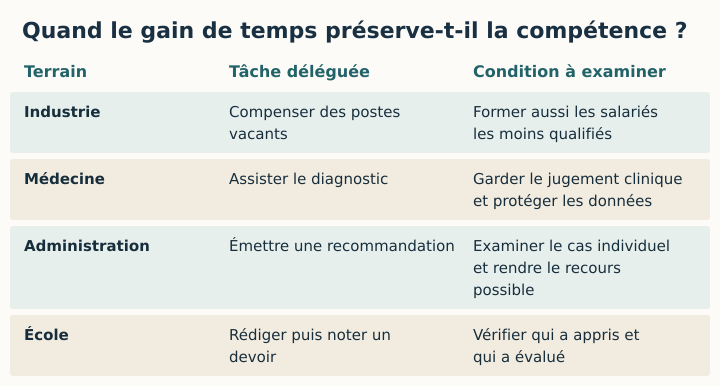

# X-ENS · MP-MPI-PC-PSI · Allemand 2024 — Corrigé guidé

*Corrigé rédigé par IA, non officiel. Signalez toute erreur.*

**Rédaction** · GPT-6.2 Astra Ultra · vitesse non renseignée

**Révision (tour 1)** · GPT-6.2 Astra Ultra · vitesse non renseignée

[Sujet commun](https://www.polytechnique.edu/admission-cycle-ingenieur/sites/admission/files/content/2024%20MP-MPI-PC-PSI%20SUJET%20ALLEMAND%20(XEULSR).pdf) · [Fascicule PSI](https://www.ens.psl.eu/sites/default/files/2024_psi_lv_allemand_xusr.pdf) · [Rapport du jury](https://www.polytechnique.edu/admission-cycle-ingenieur/sites/admission/files/content/2024%20MP-MPI-PC%20RAPPORT%20ECRIT%20ALLEMAND%20(XEULSR).pdf)

## Préparer la composition

Le document 4 juxtapose deux requêtes. L’élève demande un devoir de 5 000 mots sur Goethe. Une enseignante en demande l’évaluation et le logiciel propose « 1+ », une très bonne note allemande. Le parallélisme des poses et le « Blabla » dans les deux réponses changent le sens du dessin. Le risque concerne aussi l’acte de corriger. Croiser cette scène avec l’argument de Meidinger sur la vérification et celui du Conseil d’éthique sur la perte de compétences professionnelles. Ne pas confondre ce problème avec la démographie des usines.

Dans l’éditorial de Makartsev, le test de Turing mesure la difficulté à identifier l’interlocuteur. Il n’évalue pas les droits de la personne qui le consulte. Éprouver la proposition d’une meilleure formation sur un cas où l’usager n’a pas les moyens d’enquêter seul. Distinguer la responsabilité de l’utilisateur, celle de l’institution qui choisit le service et celle de son concepteur.

## A · Synthèse des documents 1 à 4

### Wer prüft, wenn die Maschine schon geprüft hat?

Eine Schülerin oder ein Schüler könnte einen langen Aufsatz über Goethe von einem Programm schreiben lassen. Die Lehrkraft könnte demselben Programm die Bewertung überlassen. Die Zeichnung von Cloud Science spielt beide Möglichkeiten durch und stellt damit eine Frage, die weit über die Schule hinausreicht. Welche Arbeit soll eine Maschine Menschen abnehmen, und welche Fähigkeiten müssen gerade diejenigen behalten, die sie einsetzen? Drei Beiträge der deutschen Presse behandeln diese Frage unter den Bedingungen eines alternden Arbeitsmarkts und angesichts neuer Möglichkeiten, menschliche Leistungen nachzuahmen.

In der Industrie fehlt es zunächst an Menschen, die bestimmte Arbeit überhaupt übernehmen können. Wie Svea Junge in der FAZ erläutert, treffen bereits bestehende Engpässe im Bauwesen und in der Industrie auf den bevorstehenden Ruhestand der geburtenstarken Jahrgänge. Mehr Erwerbstätigkeit von Frauen und Älteren sowie Zuwanderung kommen als Antworten in Betracht. Maschinen sind in Deutschland allerdings längst Teil der Produktion. Die Dichte der Industrieroboter ist im europäischen Vergleich besonders hoch. Die Pandemie veränderte zudem die Nachfrage außerhalb der herkömmlichen Fabrikhalle. Während der Absatz von Industrierobotern im Jahr 2020 kaum zunahm, verkauften sich deutlich mehr Serviceroboter, etwa für Lager oder Reinigung. Mit dem Alter der Bevölkerung wächst auch der Bedarf an Unterstützung bei der Pflege.

Ob diese Entlastung den Beschäftigten zugutekommt, hängt von ihren Möglichkeiten zum Berufswechsel ab. Die von Junge angeführte OECD erwartet keinen entsprechenden Anstieg der Arbeitslosigkeit, obwohl sie viele Stellen für gefährdet hält. Neue Aufgaben entstehen, während sich andere nur teilweise automatisieren lassen. Allerdings brauchen Beschäftigte für die neuen Aufgaben häufig bessere Qualifikationen. Ausgerechnet diejenigen, deren bisherige Arbeit besonders leicht zu ersetzen ist, haben in Deutschland vergleichsweise selten Zugang zu Weiterbildung. Mehr Maschinen können daher gleichzeitig eine Personallücke schließen und bestehende Unterschiede zwischen Beschäftigten vertiefen.

Der Bericht der Süddeutschen Zeitung über den Deutschen Ethikrat macht deutlich, dass auch hochqualifizierte Arbeit betroffen ist. Ein System kann Ärzten zu genaueren Diagnosen verhelfen und bei knapper Personalbesetzung die Versorgung verbessern. Verlernen die Ärzte dabei das eigenständige Urteil, geht jedoch auch die Fähigkeit verloren, einen falschen Vorschlag zu erkennen. Hinzu kommt der Schutz der Patientendaten. In Behörden verlangen Entscheidungen mit Folgen für einzelne Bürger wiederum die Möglichkeit, den eigenen Fall einzusehen und Einspruch zu erheben. Aus einer überzeugenden Nachahmung menschlicher Leistungen folgt für den Ethikrat keine persönliche Verantwortung der Software. Diese verbleibt bei denen, die eine Empfehlung übernehmen.

Was das für die Ausbildung bedeutet, zeigt Steve Haaks Bericht über die Haltung des Deutschen Lehrerverbandes. Dessen Präsident Heinz-Peter Meidinger möchte Textgeneratoren im Unterricht behandeln, weil junge Leute ihnen ohnehin begegnen und ihre bisweilen falschen Antworten prüfen lernen müssen. Ein Verbot wie die Zugangssperre an New Yorker Schulrechnern schützt nach dieser Auffassung kaum auf Dauer. Ähnliche Sorgen um die Urheberschaft schulischer Leistungen begleiteten schon die Verbreitung von Suchmaschinen. Auch Digitalminister Wissing befürchtet, dass zu weitreichende Verbote die Nutzung kaum verhindern und zugleich die Möglichkeit beschneiden, sie nach eigenen Maßstäben zu gestalten.

Die Zeichnung verschärft diesen Einwand, indem sie die Erwachsenen in die Betrachtung einbezieht. Links lässt sich der Schüler mit Getränk und Kopfhörern fünftausend Wörter liefern. Rechts hält die Lehrerin ihr Glas und lässt sich für den eingesandten Aufsatz eine Eins mit Plus vorschlagen. Das wiederkehrende „Blabla“ macht die glänzende Bewertung verdächtig. Beide haben Zeit gespart, aber wer könnte noch erklären, was der Schüler über Goethe weiß? Darin berührt sich die Satire mit der Sorge des Ethikrates um die ärztliche Urteilskraft. Ein Verfahren kann die äußeren Zeichen seiner erfolgreichen Durchführung produzieren und zugleich seinen Zweck verfehlen.

Die Beiträge unterscheiden sich somit weniger in ihrer Einschätzung der technischen Leistungsfähigkeit als in der Frage, wer die Folgen einer Übertragung von Arbeit tragen kann. Wo körperliche Hilfe fehlt, eröffnet sie Handlungsmöglichkeiten. Wo eine Person das Ergebnis verstehen, beurteilen oder anfechten muss, setzt ihr sinnvoller Einsatz voraus, dass diese Fähigkeiten weiterhin geübt werden.

*617 mots hors titre, par unités séparées par des espaces.*

## B · Texte d’opinion

Wenn ich einem Sprachassistenten einen Termin absage, möchte ich wissen, ob die Absage angekommen ist. Ob ich ein menschliches Gegenüber am Tonfall erkannt hätte, interessiert mich wenig. Anders liegt der Fall, wenn mir dieselbe freundliche Stimme mitteilt, dass mein Vater keinen Anspruch auf häusliche Hilfe habe. Hier will ich einen Verantwortlichen erreichen können. Gerade der Unterschied zwischen den beiden Gesprächen zeigt, weshalb der von Alexei Makartsev angeregte neue Turing-Test für sich genommen wenig Orientierung bieten würde.

Dem Autor ist zuzustimmen, dass eine flüssige Unterhaltung einen Vertrauensvorschuss erzeugen kann, den sich die Maschine in keiner Weise verdient hat. Im Alltag haben wir gelernt, aus dem Zögern, der Wortwahl oder einer Rückfrage unseres Gegenübers auf Aufmerksamkeit zu schließen. Ein Programm kann solche Zeichen liefern, ohne die Folgen eines Irrtums tragen zu müssen. Deshalb würde ich bei einem Dienst verlangen, dass er sich am Anfang des Gesprächs eindeutig zu erkennen gibt. Der Nutzer sollte seine Kräfte darauf verwenden können, eine Antwort zu prüfen, statt erst erraten zu müssen, mit wem er es zu tun hat.

Aus dieser Forderung ergibt sich allerdings noch keine brauchbare Antwort auf den zweiten Anruf. Ein Hinweis auf das Programm nützt meinem Vater wenig, falls die Auskunft falsch ist und die Frist für einen Antrag verstreicht. Die zuständige Stelle müsste Auskunft darüber geben, auf welche Unterlagen sich ihre Entscheidung stützt. Sie müsste außerdem jemanden benennen, der den Fall erneut prüfen und die Entscheidung ändern kann. Je wichtiger ein Bescheid für das Leben eines Menschen ist, desto weniger darf dessen Berichtigung davon abhängen, wie gut er die Grenzen eines Sprachmodells erklären kann.

Makartsevs Vertrauen in die Bildung teile ich durchaus. Ich würde Schülerinnen und Schüler im Unterricht zwei scheinbar gelungene Auskünfte über denselben Sachverhalt überprüfen lassen. Welche Behauptung lässt sich anhand eines verlässlichen Dokuments bestätigen? Wo hat eine höfliche Formulierung eine Unsicherheit verdeckt? Die entscheidende Leistung läge in der begründeten Korrektur. Eine solche Erfahrung wäre auch später nützlich, wenn die nächste Generation von Programmen ganz andere Fehler macht. Für Einrichtungen, die Software auswählen, gilt dieser Bildungsauftrag mindestens ebenso sehr wie für die Bürger, die ihnen gegenüberstehen.

Schwieriger ist die Sache, wenn eine Maschine aus Stimme oder Mimik auf persönliche Eigenschaften schließt. Selbst ein gut informierter Kunde kann beim Gespräch kaum feststellen, welche Auswertung im Hintergrund erfolgt. Hier würde ich die Erhebung auf das für den erklärten Zweck Erforderliche begrenzen und überprüfbare Regeln für die Löschung verlangen. Bei einer Terminabsage gibt es keinen überzeugenden Grund, zugleich die Stimmung des Anrufers für spätere Werbung zu speichern. Genau an diesem Punkt braucht der ethische Kompass, den der Autor von der Wissenschaft verlangt, eine institutionelle Entsprechung.

Ich würde den alten Test also durch eine Reihe viel unspektakulärerer Fragen ergänzen. Erfährt der Betroffene, wie eine Auskunft zustande kam? Kann er einen Fehler rechtzeitig berichtigen lassen? Kann er auf eine Auswertung verzichten, die mit seinem Anliegen nichts zu tun hat? Werden diese Fragen überzeugend beantwortet, kann eine synthetische Stimme eine große Hilfe sein. Bleiben sie offen, würde auch die vollkommenste Unterscheidung zwischen Mensch und Maschine niemandem den verlorenen Anspruch auf Pflege zurückgeben. *(506 mots)*
