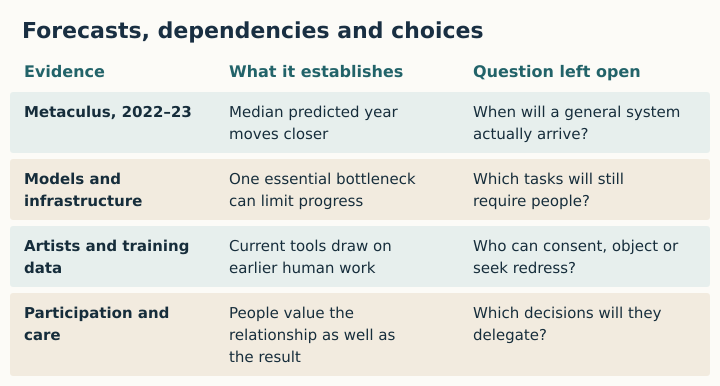

# X-ENS · MP-MPI-PC-PSI · Anglais 2024 — Corrigé guidé

*Corrigé rédigé par IA, non officiel. Signalez toute erreur.*

**Rédaction** · GPT-6.2 Astra Ultra · vitesse non renseignée

**Révision (tour 1)** · GPT-6.2 Astra Ultra · vitesse non renseignée

[Sujet commun](https://www.polytechnique.edu/admission-cycle-ingenieur/sites/admission/files/content/2024%20MP-MPI-PC-PSI%20SUJET%20ANGLAIS%20(XEULSR).pdf) · [Fascicule PSI](https://www.ens.psl.eu/sites/default/files/2024_psi_lv_anglais_xusr.pdf) · [Rapport du jury](https://www.polytechnique.edu/admission-cycle-ingenieur/sites/admission/files/content/2024%20MP-MPI-PC%20RAPPORT%20ECRIT%20ANGLAIS%20(XEULSR).pdf)

## Préparer la composition

Lire les deux axes du graphique. La date en abscisse est celle de la prévision, celle en ordonnée est l’année prédite pour la mise au point, la vérification et l’annonce du premier système général. La médiane passe d’environ 2040 à un peu après 2030. Le 75e percentile a parfois dépassé 2070. Les 640 participants de Metaculus ont émis des prévisions et le graphique les agrège en donnant plus de poids aux plus récentes. Une courbe qui descend signifie que la date attendue se rapproche. Elle ne mesure ni une progression des performances ni le pourcentage de personnes craignant l’IA.

Croiser les deux articles de *The Economist* sur les tâches qui résistent à l’automatisation. Pour le cas des artistes, distinguer la collecte des données d’entraînement, la licéité d’un résultat donné et la possibilité pratique d’un recours. Getty a engagé une procédure. L’article de Naughton ne préjuge pas de la décision des juges. Dans la seconde composition, répondre au plaidoyer d’octobre en examinant deux instruments qu’il propose, l’évaluation commune et l’engagement volontaire. Tester chacun sur un cas où une personne a effectivement besoin d’obtenir réparation.

## A · Synthèse des documents 1 à 4

### Who gets to decide what machines can do?

Each time a computer does something previously reserved for people, the date at which it might surpass them seems to draw closer. Yet the British press in 2023 offered sharply different answers to the question of what follows. Two contributions to The Economist examine the prospects of general intelligence and its implications for human agency. John Naughton's account in The Guardian of a dispute over images reveals just how much depends on people who can already claim a part in creating what machines produce.

Confidence in a timetable is particularly elusive. The chart accompanying The Economist's May article tracks forecasts from the Metaculus platform about when the first general system will have been devised, tested and announced. Between early summer 2022 and May 2023 the median moves from around 2040 to the early 2030s. The later estimates fluctuate much more widely before converging somewhat. The ironic reference to astrology in the chart's heading qualifies the apparent precision of forecasts from 640 contributors. Meanwhile the sums invested in the industry and the capabilities demonstrated by new models give both optimists and pessimists reasons to take the prospect seriously. Neither investment nor a revised prediction establishes that the moment has arrived.

The scale of the consequences also depends on what remains beyond automation. The economists cited in the May article find that production could expand spectacularly if even research could be fully automated. A single indispensable activity that resists improvement can instead slow the entire process. In July, Blaise Agüera y Arcas and his colleagues identify a related limitation in predictions of human extinction. Greater intelligence alone gives an organism no automatic claim to survival. Even a vastly superior computer system would rely on human provision of energy, chips and infrastructure, leaving opportunities for intervention. By contrast, today's imperfect systems already expose private information, reproduce discrimination and facilitate surveillance. Their susceptibility to error can be as consequential as their most impressive accomplishments.

Naughton's artists have discovered another dependency behind the apparent ease with which a machine translates an instruction into an image. Training draws on material made available online, including work for which artists say they gave neither permission nor a licence. The value created for a customer may thus come at a cost to the people whose work made it possible. Artists are contesting the legality of particular uses, while Getty's suit against Stability AI suggests the potential scale of the liabilities. Court action costs money and usually follows the alleged harm. A tool developed in Chicago offers artists a means of protecting images in advance if companies insist on taking them. Such disputes give concrete force to the July authors' preference for dealing with present deployments over regulating hypothetical independent agents.

Yet the persistence of a specifically human contribution could also sustain demand for it. The May article suggests that the origin of a work may itself give it value, even when a machine-made equivalent is available. A person may confide in another human being because of how that individual will handle a secret. Someone receiving care may value the time freely given as much as the service performed. Politics presents a further case. A model might reconcile stated preferences, but participation in reaching a decision can give the decision legitimacy. Nor would material abundance necessarily eliminate the desire to influence others.

The documents thus locate uncertainty on two distinct levels. Predicting when a machine will meet a given test is difficult enough. Predicting what people will allow it to take, whom they will trust or which decisions they will delegate requires an account of institutions and relationships as well as technical performance. The copyright disputes already under way illustrate how far choices made in the present can shape the future being forecast.

*623 mots hors titre, par unités séparées par des espaces.*

## B · Texte d’opinion

A patient refused an appointment because a system has wrongly assigned her a low priority has little to gain from an international agreement about a machine that might one day outsmart its designers. She has equally little to gain from the observation that the science is still developing. The Economist is right to question the haste to legislate against extinction. I would draw a different conclusion about when governments must act and who should bear the cost of uncertainty.

The editorial makes a strong case for an international body that can compare evidence. A government cannot sensibly demand that a developer pass a test if nobody can explain what a pass establishes. A common account of what has been observed, which results can be repeated and where experts disagree would help a parliament resist pressure to legislate after a particularly dramatic demonstration. The climate analogy also has a limit worth remembering. An assessment body can describe the evidence. Deciding what protection a citizen is owed involves a political choice that an expert panel cannot make on her behalf.

In the patient's case, the choice seems clear enough already. The clinic should have to tell her that an automated recommendation affected the decision, provide a prompt route to a qualified human reviewer and correct inaccurate information. Its responsibility should follow from the authority it exercises over access to care. Waiting for an agreed definition of a frontier model serves no purpose here. A thoroughly ordinary piece of software can make a life difficult. Conversely, imposing the clinic's duties on anyone who writes a program for private experimentation would consume resources to little public benefit.

The editorial is also right about competition. If a licence requires a large legal department, the most heavily financed companies can afford to welcome it. I would ask public buyers of software to publish their requirements and accept shared, independently run assessments. A small supplier could then demonstrate compliance once for several prospective customers. The buyer would still have to examine how the product operates among its own patients or pupils. Otherwise a certificate would become a convenient way of passing responsibility to somebody else.

Finally, the voluntary promises the editorial describes are worth obtaining precisely because they can be tested against what firms subsequently do. They are a poor last resort for someone who was never a party to the agreement. Public commitments need a timetable for reporting, a route for outsiders to flag omissions and an authority able to require a response. At the same time, a spectacular prediction should earn funding for investigation only to the extent that investigators can say what evidence would change their assessment. That is one way to take severe possibilities seriously without handing their proponents a permanent claim on public attention.

I would judge the pace of regulation by what happens after the next identifiable mistake. If the clinic can explain what went wrong, put it right and stop the same mistake reaching the next patient, an intelligible rule will have done some good. A code signed in a hurry or a law postponed indefinitely could each leave her waiting at the same door.

*525 mots, selon le même décompte.*
