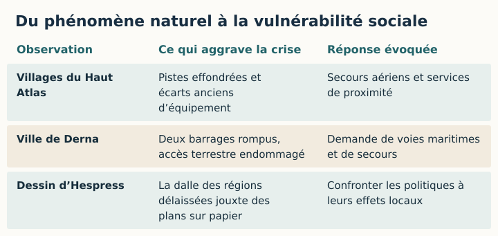

# X-ENS · MP-MPI-PC-PSI · Arabe 2024 — Corrigé brut

*Corrigé rédigé par IA, non officiel. Signalez toute erreur.*

**Rédaction** · GPT-6.2 Astra Ultra · vitesse non renseignée

**Révision (tour 1)** · GPT-6.2 Astra Ultra · vitesse non renseignée

[Sujet commun](https://www.polytechnique.edu/admission-cycle-ingenieur/sites/admission/files/content/2024%20MP-MPI-PC-PSI%20SUJET%20ARABE%20(XEULSR).pdf) · [Fascicule PSI](https://www.ens.psl.eu/sites/default/files/2024_psi_lv_arabe_xusr.pdf) · [Rapport du jury](https://www.polytechnique.edu/admission-cycle-ingenieur/sites/admission/files/content/2024%20MP-MPI-PC%20RAPPORT%20ECRIT%20ARABE%20(XEULSR).pdf)

## A · Synthèse des documents 1 à 4

### حين تكشف الكارثة ما كان قائما قبلها

في سبتمبر من عام ٢٠٢٣ وجد سكان قرى في جبال الأطلس وسكان أحياء في مدينة درنة الليبية أنفسهم معزولين عن فرق الإنقاذ. اختلفت القوة التي ضربت المنطقتين، ففي المغرب اهتزت الأرض وفي ليبيا جرفت السيول المباني والطرق. لكن تقارير التلفزيون العربي وهسبريس وصحيفة العرب تطرح سؤالا مشتركا عن نصيب الاختيارات البشرية في حجم الخسائر. ويضيف رسم نشرته هسبريس إلى صور الخراب سؤالا عن المسافة بين ما كتب في خطط التنمية وما وجده سكان المناطق المنكوبة حين احتاجوا إلى طريق أو مستشفى.

يضع تقرير التلفزيون العربي الحادثتين في سياق أوسع. فمؤشر المخاطر الذي يستشهد به يجمع بين التعرض للخطر ودرجة هشاشة المجتمع وقدرته على المواجهة. ومن ثم لا يكفي أن يعرف المرء أن بلدا يقع في منطقة نشاط زلزالي حتى يقدر ما سيحل بأهله عند وقوع هزة. فموقع الأبنية وطريقة تشييدها والاستثمار في الوقاية عناصر مؤثرة. وفي المناطق المعرضة للفيضانات تؤدي النظم البيئية والحواجز الطبيعية وظيفة مختلفة ينبغي الحفاظ عليها. ويربط الخبراء بين ضعف الاستعداد وخسائر تدوم بعد انقضاء الخطر المباشر، إذ يضيع على السكان ما حققته سنوات من التنمية وتتراجع قدرتهم على كسب عيشهم.

وتقدم درنة مثالا على تراكم أسباب الهشاشة. ينقل التلفزيون العربي عن ممثل للأهالي أن ضعف الصيانة طال سنوات وأن الوضع السياسي والاقتصادي أعاق إعادة الإعمار. وتذكر صحيفة العرب أن سكان ليبيا كانوا يشكون أصلا من تردي الخدمات اليومية، من الماء والكهرباء إلى النقل والصحة. وعندما وصلت العاصفة دانيال أعلن المجلس البلدي انهيار سدين، وغمرت المياه مساكن وانجرفت منشآت وتضرر الممر البري المؤدي إلى المدينة. لهذا ارتبط طلب ممثل البلدية تدخلا دوليا عاجلا بطلب محدد هو فتح ممرات بحرية. فحجم الوسائل التي يمكن تعبئتها خارج المدينة لا يكفي ما لم توجد وسيلة للوصول إلى من يحتاج إليها داخلها.

وفي المغرب بين المصطفى الرياني في هسبريس كيف أمكن الجمع بين جهود رسمية وأهلية. نقل المتطوعون ما جمعوه من مساعدات، وتناقلت شبكات التواصل نداءات من دواوير انقطعت عنها السبل. وأقامت الفرق الطبية خدمات ميدانية ونقل الجرحى إلى المستشفى في مراكش، واستعين بالمروحيات حين أعاقت التضاريس وانهيار الطرق حركة المنقذين. ويبرز الكاتب وقع زيارة الملك للمصابين وتبرعه بالدم، كما يتوقف عند دعم الأسر التي تهدمت منازلها ورعاية الأيتام. لكن الصورة التي تقدمها هذه التعبئة لبلد متضامن تقترن في المقال نفسه بصورة قرى يبدو على أهلها أثر التهميش منذ زمن طويل.

يستعيد الرسم هذا التناقض من غير أن يرسم طابورا من المتبرعين أو يسمي مسؤولا بعينه. ففي وسط الحجارة المتهدمة كتلة كبيرة تحمل عبارة «المغرب غير النافع»، وأمامها كراس أخضر كتب عليه «المخططات النظرية». تحيل التسمية الأولى على نظرة قديمة تجعل قيمة الإقليم تابعة للمنفعة التي يجنيها منه المركز. أما الكراس فتبدو أوراقه عاجزة عن حماية الطرق والبيوت التي كان يفترض أن تصل إليها ثمار التخطيط. ويجد هذا الاعتراض صدى في دعوة الرياني إلى ربط المسؤولية بالمحاسبة ومحاربة الفساد وردم الفجوة بين الريف والمدينة في المرافق وفرص العيش.

ولا تعرض المواد الاستجابة للكارثة باعتبارها عملا ينتهي بخروج آخر مصاب من منطقة الخطر. ففي ليبيا يستدعي تأهيل البنية الاقتصادية والاجتماعية اختيار المشاريع على ضوء حاجات التنمية وضمان استكمالها بعد عقود من الإهمال وأضرار الصراع. وفي المغرب يشدد الرياني على المواكبة النفسية والاجتماعية إلى جانب العلاج وعلى إشراك المواطنين في القرارات التي تخص مناطقهم. وإذا كان الإعلان عن درنة مدينة منكوبة يتيح إجراءات استثنائية، وكانت تعبئة المغاربة تسرع وصول النجدة، فإن كليهما يترك مطروحا سؤال ما يمكن عمله بصورة منتظمة بين أزمتين. وفي الحالتين تصبح نوعية الطريق التي يسلكها المنقذ دليلا ملموسا على القرارات التي اتخذت في زمن الهدوء، وعلى ما أهملته السلطات أو أجلته طويلا.

وهكذا تختلف حاجات المدينة الساحلية التي اجتاحتها المياه عن حاجات القرية الجبلية التي انهارت منازلها، لكن التمييز بين قوة الظاهرة وقدرة المجتمع على مواجهتها يفسر جانبا من تجربة كلتيهما. وتكشف مقارنة الشهادات بالرسم أن المسألة تتعلق أيضا بمن تصل إليه الخدمات في الأيام العادية، وبقدرة السكان على جعل حاجاتهم مسموعة قبل أن تحولهم الكارثة إلى موضوع لخبر عاجل.

*611 mots hors titre, par unités séparées par des espaces.*

## B · Texte d’opinion

حين تدفع أسرة من مالها لمساعدة قرية تضررت من زلزال الحوز، يكون من حقها أن تعرف إلى أين ستذهب مساهمتها. ولكن هناك من له حق أسبق في التفسير، وهو من فقد بيته وينتظر أن يعرف أين سينام أطفاله هذه الليلة ومتى يستطيع العودة بهم إلى قريته. من هذا الموقع أقرأ ما نشرته صحيفة العرب عن إنشاء الحساب الخاص لتدبير آثار الزلزال. أرى في الصندوق وسيلة مناسبة لجمع الجهود، على أن يقاس نجاحها أولا بما يستطيع المتضرر أن يفعله بفضلها في حياته اليومية.

للحساب الموحد مزية ظاهرة. فبدل أن تتنافس مبادرات كثيرة على إيصال البطانيات إلى الدوار الذي ذاعت صوره وتنسى دوارا لم يستطع أهله تصوير خسائرهم، يمكن توجيه الأموال إلى حيث تكون الحاجة أشد. ويساعد إعفاء المساهمات من الاقتطاعات البنكية على جعل المبلغ الذي يصل مطابقا لما أراد المتبرع تقديمه. كما أن فتح المجال للمقيمين والمغاربة في الخارج يربط موارد متفرقة بعمل مشترك. لكن جمع المال في مكان واحد لا يضمن بذاته معرفة المكان الذي ينبغي إنفاقه فيه. فما يستطيع موظف أن يراه من مكتبه يختلف عما تعرفه ممرضة تزور الأسر التي انتقلت من قرية إلى أخرى.

لذلك أقترح أن يقترن الإعلان عن قيمة الهبات بنشر بيان يسهل على سكان كل منطقة فهمه. كم أسرة حصلت على مأوى مؤقت، وكم منزلا تمت معاينته، ومتى يبت في طلب من لم يظهر اسمه في القوائم؟ ويجب أن يكون للاعتراض طريق متاح لمن فقد وثائقه أو تعذر عليه الاتصال بالإنترنت. قد يبدو هذا تفصيلا إداريا إلى جانب مشاهد الإنقاذ، إلا أن الخطأ في اسم أو عنوان كفيل بأن يحول تأخرا قصيرا في نظر الإدارة إلى شتاء كامل في نظر أسرة.

وتحسن المقالة حين تذكر أن للصندوق وظائف تتجاوز بناء الجدران. فالطفل الذي فقد من يرعاه يحتاج إلى متابعة بعد انصراف المتطوعين، وصاحب الحرفة الذي نجا من الهزة قد لا يتمكن من استئناف عمله إذا دمر محله أو انقطعت الطريق إلى السوق. وهنا أتحفظ على لغة الانتصار التي يستعملها بعض من تنقل عنهم الصحيفة. من يفكر من الآن في خمس أو ست سنوات من العمل يعترف ضمنا بأن لحظة التعبئة ليست مقياسا كافيا للحكم على النتيجة. وستكون العناية بمن لم يستعد رزقه بعد سنة امتحانا للتضامن أصعب من المساهمة الأولى.

وليس من الضروري أن يختار الناس بين الثقة في القائمين على الصندوق ومراقبة إنفاقه. فالشفافية تحمي المتطوع النزيه من الشبهة، وتعين المسؤول على تعديل قرار ثبت أنه لم يلب الحاجة، وتتيح للأهالي أن يبينوا لماذا يفضلون مثلا إصلاح مسلك يصلهم بالمدرسة على إقامة مرفق جديد يصعب الوصول إليه. ولا يعني إعطاء السكان هذه الكلمة أن يحملوا وحدهم مسؤولية اختبارات السلامة أو تمويل الأشغال الكبرى. تلك التزامات عامة تحتاج إلى خبرة وموارد دائمة، ولا يجوز أن تتوقف على مقدار ما يجمع من هبات في أسبوع معين.

أوافق إذن على توجيه العطاء الفردي من خلال مؤسسة تستطيع أن تخطط لسنوات. وأرى أن أجمل ما يمكن الاحتفاظ به من لحظة التضامن هو العلاقة التي تنشأ بين مواطن بادر إلى العون ومواطن يستطيع أن يقول له كيف انتفع به أو لماذا لم يصله. يوم تملك الأسرة المتضررة جوابا عن موعد العودة ومكان المدرسة وطريقة الاعتراض على قرار مجحف، يصبح لعبارة إعادة الإعمار معنى يمكن لها أن تختبره بنفسها.

*500 mots, selon le même décompte.*

