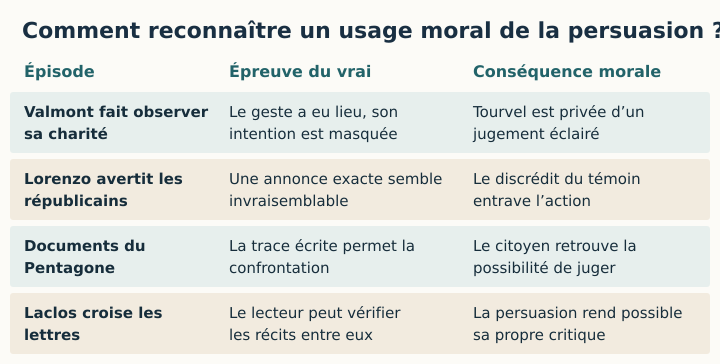

# X-ENS · MP-MPI-PC-PSI · Français 2024 — Corrigé guidé

*Corrigé rédigé par IA, non officiel. Signalez toute erreur.*

**Rédaction** · GPT-6.2 Astra Ultra · vitesse non renseignée

**Révision (tour 1)** · GPT-6.2 Astra Ultra · vitesse non renseignée

[Sujet commun](https://www.polytechnique.edu/admission-cycle-ingenieur/sites/admission/files/content/2024%20MP-MPI-PC%20SUJET%20FRANCAIS%20(XEULSR).pdf) · [Fascicule PSI](https://www.ens.psl.eu/sites/default/files/2024_psi_francais_xusr.pdf) · [Rapport du jury](https://www.polytechnique.edu/admission-cycle-ingenieur/sites/admission/files/content/2024%20MP%2C%20MPI%2C%20PC%20RAPPORT%20ECRIT%20DE%20FRANCAIS%20(XEULSR).pdf)

## Préparer la composition

Les deux fascicules officiels donnent le même passage et la même consigne. Le rapport publié par l’X est intitulé « filières MP, MPI et PC ». La rubrique PSI de l’ENS donne accès au sujet.

Suivre le changement de sens du mot *vérité*. Dans la première phrase, elle peut servir de règle pour juger une société. Dans la seconde, le possessif et le complément de temps désignent ironiquement ce que cette société autorise à passer pour vrai. « Premier trait » peut désigner le signe auquel on reconnaît un mal, sans prétendre en avoir isolé la cause. La dissertation vérifie dans les deux sens le rapport entre persuasion et mœurs. Une société qui récompense la tromperie encourage celui qui voudrait tromper. Inversement, une personne trompée délibère et agit sur la foi d’une représentation fausse.

Faire subir à chaque exemple une épreuve précise. Chez Laclos, mettre en regard ce que sait le lecteur et ce qu’une destinataire peut vérifier. Chez Musset, suivre le même personnage du temps où il construit sa réputation au moment où il cherche à parler vrai. Chez Arendt, distinguer les faits, qu’une majorité ne décide pas, et les choix qui appellent un débat public. Pour éprouver l’argument, demander si une persuasion réussie peut avoir servi le vrai et si une déclaration exacte peut avoir servi une tromperie. La scène de la charité chez Laclos répond au second test.

## Dissertation

Lorenzo annonce à des républicains qu’Alexandre va mourir. Ils auraient toutes les raisons de souhaiter sa mort, et Lorenzo sait de quoi il parle puisqu’il prépare lui-même le meurtre. Pourtant ils le laissent parler. Il lui a fallu des années pour que Florence le croie capable de toutes les bassesses. Cette persuasion a si bien réussi qu’il ne peut plus la défaire en disant vrai. À quoi reconnaît-on alors la corruption des mœurs ? Montaigne, dans « Du démentir », choisit pour « premier trait » l’exil de la vérité. Puis le mot qu’il vient d’employer au singulier revient sous une forme presque méconnaissable. « Notre vérité de maintenant » désigne le crédit qu’une parole réussit à obtenir. On comprend le scandale. La faculté de décider ce qui vaut pour tous est passée du côté de celui qui sait gagner un auditeur. Mais comment un fait dont j’ai été seul témoin pourrait-il entrer dans notre vie commune si je ne réussissais à en persuader personne ? Les deux essais de Hannah Arendt, le drame de Musset et le roman épistolaire de Laclos obligent à tenir ensemble ces deux propositions. Nous examinerons d’abord comment la réussite de la persuasion peut devenir une mesure des conduites. Nous chercherons ensuite ce qui, dans le réel et dans l’expérience morale des personnages, résiste à cette souveraineté des apparences. Il restera à comprendre quelle persuasion peut restituer à la vérité une place parmi les hommes.

### La persuasion érigée en règle des mœurs

La force du diagnostic de Montaigne tient à la manière dont il fait entrer autrui dans la définition d’un vice. Il ne suffit pas de se tromper pour avoir de mauvaises mœurs. Il faut encore pouvoir tirer de l’erreur de quelqu’un un avantage et trouver cet avantage digne d’être recherché. Dans *Les Liaisons dangereuses*, Valmont fait secourir une famille dans la détresse. Le bienfait est réel. Un témoin peut rapporter à la présidente de Tourvel ce qu’il a vu sans proférer un seul mensonge. Or le vicomte a compté sur la surveillance à laquelle il se sait soumis. La présence de l’observateur donne son prix à l’action. La présidente, à laquelle le récit de la charité parvient, peut croire avoir percé la réputation d’un libertin et découvert une vertu cachée. Elle a vu ce que Valmont voulait qu’elle vît. Sa responsabilité morale tient à cette confiscation de la faculté de juger. Il lui laisse la satisfaction de se croire plus juste que les médisants et fait de cette qualité même l’instrument de sa conquête.

La corruption change d’échelle lorsqu’une société entière récompense cette manière de conduire autrui. La marquise de Merteuil, dans la lettre LXXXI, présente son apprentissage comme un long travail sur les signes. Elle a appris à donner à son visage une expression différente de ce qu’elle éprouve, et jusqu’à faire de l’attention qu’elle semble prêter à un interlocuteur un moyen de l’observer. Dans le monde qu’elle décrit, une femme qui laisserait s’exercer sur elle les libertés qu’on accorde à un homme serait perdue. Sa lucidité sur l’inégalité des sexes donne force à son récit de formation. Mais quelle émancipation a-t-elle obtenue, si son triomphe consiste à pouvoir disposer à son tour de la réputation de Prévan ou de l’avenir de Cécile ? Elle demeure fidèle à la règle qui la contraignait. Être crue, obtenir que l’autre soit condamné par les mêmes salons, voilà de quoi faire un succès. Le vice individuel manifeste ici très exactement un vice des mœurs.

Une administration moderne peut obéir à une règle voisine sans qu’un libertin en ait conçu le plan. Dans « Du mensonge en politique », Arendt lit les documents du Pentagone sur l’engagement américain au Vietnam. L’objectif de préserver une image de puissance finit par dicter les raisonnements tenus à Washington. Une décision peut alors paraître rationnelle pour la seule raison qu’une autre serait interprétée comme un aveu de faiblesse. Les difficultés rencontrées sur le terrain deviennent autant de problèmes de présentation. Des analystes disposent bien d’informations susceptibles de contredire leurs modèles. La disposition à les écouter disparaît lorsqu’on tient davantage à la cohérence d’un scénario qu’à ce qui se passe. L’agent public chargé de juger un résultat en vient ainsi à employer comme critère l’effet qu’une annonce produira. Le mal touche désormais aussi ceux qui persuadent. Ils perdent l’usage d’une information dont l’État qu’ils servent a payé le prix.

### Ce que la persuasion laisse subsister

Montaigne a-t-il pour autant raison de parler de « bannissement » ? Le mot évoque une cité qui a poussé quelqu’un hors de ses murs. Les faits, pourtant, ne partent pas sur l’ordre de celui qui les chasse de son discours. Le duc Alexandre meurt effectivement dans la chambre où Lorenzo l’a attiré. Une longue comédie a rendu le meurtre possible, mais aucun mot de Lorenzo ne peut abolir ce qu’un homme vient de faire à un autre. C’est précisément l’écart entre l’événement et l’effet politique espéré qui donne à la pièce de Musset sa fin si amère. Florence peut avoir un duc de moins sans gagner la liberté. Le meurtrier a pensé pouvoir ressaisir toute sa vie dans un acte dont l’évidence réveillerait les républicains. Le remplacement d’Alexandre par Côme le détrompe. Il serait donc aussi téméraire de faire de la vérité une force irrésistible que de croire la persuasion toute-puissante. Les conséquences des actes s’imposent aux hommes sans leur en dicter le sens.

La résistance du réel a également une dimension morale. Lorsque Valmont reprend pour Tourvel la formule de rupture que Merteuil lui a fournie, le retour mécanique du même prétexte tourne en dérision la demande d’explication de la destinataire. Il n’y a aucune commune mesure entre les quelques mots qu’il a fallu copier pour sauver son prestige de libertin et la souffrance qui en résulte. Le lecteur a sous les yeux la fabrication de la lettre. Il peut donc tenir ensemble deux réalités que le succès mondain de Valmont tendrait à disjoindre, le jeu de préséance entre les complices et ce que la réception d’une lettre fait subir à une personne singulière. La mort de Tourvel ne démontre pas par une sanction providentielle qu’une vérité triomphe toujours. Elle interdit de compter la victoire de Valmont selon les seules règles qu’il a acceptées. Un tribunal moral qui se laisserait impressionner par l’ingéniosité du libertin oublierait de faire comparaître celle que ce jeu a détruite.

Il y a plus. La satire même de Montaigne suppose que son lecteur sait encore faire cette distinction. S’il parvient à nous persuader que la vérité est bannie, sa réussite fait-elle de lui un agent de la corruption qu’il dénonce ? L’objection cesse d’être un simple jeu de mots si l’on revient à Arendt. Dans « Vérité et politique », elle imagine le désaccord des historiens sur les responsabilités de la Première Guerre mondiale. On peut discuter de ces responsabilités tout en maintenant le sens dans lequel les troupes ont franchi la frontière entre l’Allemagne et la Belgique. Impossible d’obtenir par un vote que l’armée belge ait envahi l’Allemagne en août 1914. Mais des générations ultérieures tiendront ce fait de témoins et de documents qu’il aura bien fallu conserver, transmettre et rendre dignes de foi. Un fait politique est à la fois indépendant de notre assentiment et exposé au pouvoir de ceux qui peuvent supprimer ses traces ou discréditer les témoins. Cette vulnérabilité explique que nous ayons une responsabilité envers lui.

### Les conditions d’un jugement libre

À quelles conditions la persuasion peut-elle prendre cette responsabilité au sérieux ? Lorsqu’une information qui déplaît atteint le public, sa valeur morale tient d’abord à la liberté nouvelle qu’elle rend à ceux qui la reçoivent. Les documents du Pentagone permettent au citoyen américain de confronter des déclarations publiques à des délibérations que son gouvernement lui a cachées. Il peut se demander quels buts furent réellement poursuivis et juger les décisions prises en son nom. Cet accès ne lui prescrit aucune opinion automatique sur la suite à donner à la guerre. Il lui restitue quelque chose de plus précieux que l’avantage d’avoir été momentanément rangé du bon côté d’un débat. Il dispose désormais de raisons de corriger son jugement, y compris contre l’avis de celui qui a porté les documents à sa connaissance. La persuasion se soumet au vrai lorsqu’elle donne à autrui de quoi lui résister.

La littérature peut exercer le lecteur à cette liberté dans des conditions particulières. La préface du rédacteur des *Liaisons* fait valoir le service que rendrait aux mœurs le dévoilement des procédés des corrupteurs. Les lettres XXI et XXII mettent cette prétention à l’épreuve. Valmont raconte à Merteuil comment il a fait le bien en sachant qu’on l’observait. Tourvel confie à Mme de Volanges ce que ce même secours lui fait espérer du caractère de Valmont. L’argent a effectivement soulagé une famille. La méprise porte sur ce qu’on est fondé à en déduire d’un homme. En laissant le lecteur rapprocher ces deux lettres, Laclos lui fait éprouver la différence entre une preuve de générosité et la preuve d’un geste généreux. Rien ne lui garantit le succès moral de l’entreprise. Le lecteur pourrait admirer Merteuil et apprendre des ruses de Valmont. Mais le choix de la forme épistolaire lui retire au moins le confort de la passivité. D’une lettre à l’autre, il voit une interprétation de Tourvel démentie par la confidence du vicomte à sa complice. Il peut également mesurer ce qu’un récit complaisant de Valmont dissimule, en le confrontant aux effets de sa conduite sur ses correspondantes. Laclos persuade en redistribuant les pièces du dossier. Le lecteur s’exerce alors à une justice que les personnages, privés les uns des lettres des autres, avaient bien peu de moyens d’appliquer.

Il reste à convertir cette liberté de jugement en une pratique des mœurs. Lorenzo, dans son entretien avec Philippe Strozzi, peut enfin expliquer le chemin qui l’a conduit à fréquenter le duc. Philippe l’écoute assez longtemps pour entendre ce que cache sa réputation. Mais il ne suffit pas qu’un homme en comprenne un autre pour qu’une cité retrouve la capacité de vouloir et d’agir ensemble. La distance est considérable entre la chambre d’une confidence et les lieux où Florence décide de son avenir. Il faut des interlocuteurs capables d’entendre une déclaration compromettante, de la vérifier et de se reconnaître ensuite responsables de ce qu’ils feront de leur savoir. Arendt attire l’attention sur la fonction d’activités dont l’indépendance est toujours fragile, de l’enquête historique au travail d’information. À chacun sa tâche, celle de produire les raisons qu’il a de dire vrai, puis celle de juger des actions possibles en sachant ce qui a eu lieu. Un peuple peut se diviser sur les fins à poursuivre. Pour que cette division mérite le nom de débat, il lui faut encore un monde dans lequel les adversaires puissent ensemble désigner ce dont ils parlent.

Le succès d’une persuasion renseigne sur le crédit de celui qui parle, sur les attentes de celui qui écoute, quelquefois sur la perfection d’une mise en scène. Le prendre pour une preuve de vérité est bien le signe, et bientôt une cause, de la corruption des mœurs. Cela permet de disposer d’autrui tout en se félicitant d’avoir obtenu son accord. L’expérience des trois œuvres invite cependant à pousser plus loin la formule de Montaigne. La fidélité à la vérité engage également une manière de s’adresser à autrui. Elle exige que l’on puisse montrer ses raisons, accepter leur examen et répondre de leurs conséquences. Une cité retrouve le sens du vrai le jour où quelqu’un peut y perdre une discussion devant un témoin qui avait de meilleurs faits à lui opposer, sans que cette défaite lui paraisse une humiliation.

[Programme officiel](https://www.education.gouv.fr/bo/2023/Hebdo28/ESRS2317934A) · [Laclos, lettre XXI](https://fr.wikisource.org/wiki/Les_Liaisons_dangereuses/Lettre_21) · [Laclos, lettre XXII](https://fr.wikisource.org/wiki/Les_Liaisons_dangereuses/Lettre_22)
