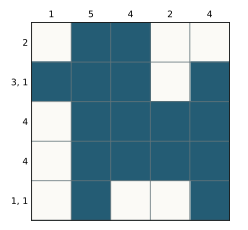
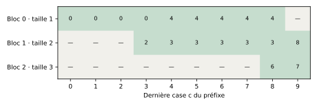

# X-ENS MP–PC–PSI · Informatique B 2024 · Corrigé guidé

*Corrigé rédigé par IA, non officiel. Signalez toute erreur.*

**Rédaction** · GPT-6.2 Astra Ultra · vitesse non renseignée · 24 novembre 2026

## Repères

Une case inconnue vaut −1, une blanche 0 et une noire 1. Les colonnes de M correspondent aux blocs d’une seule ligne. Une entrée de M contient une position de début et non une couleur. Un préfixe se termine à son indice inclus.

## I · Vérifier une solution

### Question 1 · Compter les cases noires

**Indication.** Chaque case noire appartient à un et un seul bloc de sa ligne.

#### Solution

Additionner toutes les tailles de blocs. S’il y a $n_l$ lignes et $K_l$ clés au total, le coût est $\Theta(n_l+K_l)$, y compris si certaines listes sont vides, avec un espace auxiliaire constant. Pour les clés de la figure 1 : $2+(3+1)+4+4+(1+1)=16$.

```python
def cases_noires(cle_l):
    total = 0
    for cles in cle_l:
        for taille in cles:
            total += taille
    return total
```

### Question 2 · Compatibilité des totaux

**Indication.** La même case noire est comptée une fois par sa ligne et une fois par sa colonne.

#### Solution

Comparer les deux sommes. Dans la figure 1, les colonnes donnent également $1+5+4+2+4=16$. L’égalité est une condition nécessaire. Les clés individuelles peuvent toutefois être incompatibles avec leurs positions ou leur dimension.

```python
def compatibles(cle_l, cle_c):
    return cases_noires(cle_l) == cases_noires(cle_c)
```

### Question 3 · Taille minimale d’un motif

**Indication.** Compter les séparateurs internes et distinguer les deux bords.

#### Solution

Avec les $B$ clés strictement positives $s_0,\ldots,s_{B-1}$, il faut $\sum_b s_b+B-1$ cases. Le placement contigu avec exactement une blanche entre deux blocs réalise cette longueur. Pour $[3,5,2]$ on obtient 12. Par commodité, on renvoie 0 pour la liste vide.

```python
def taille_minimale(cles):
    if len(cles) == 0:
        return 0
    minimum = len(cles) - 1
    for taille in cles:
        minimum += taille
    return minimum
```

### Question 4 · Diagnostiquer et corriger le vérificateur

**Indication.** Dans le programme imprimé, distinguer un bloc trop long, un bloc en trop, puis des clés qui n’ont jamais été lues.

#### Solution

Pour une ligne $i=0$, `sol=[[1,1]]`, `cle_l=[[1]]` fait échouer la comparaison de taille à la fin : la taille lue vaut 2 au lieu de 1. Avec `sol=[[1,0,1]]`, `cle_l=[[1]]`, le premier bloc est reconnu, puis le second fait échouer le test sur le nombre de clés disponibles. Les deux cas arrivent ligne 13 pour deux raisons distinctes.

Le programme accepte à tort `sol=[[1,0]]`, `cle_l=[[1,1]]` : il ne vérifie pas que toutes les clés ont été consommées. Remplacer le retour final par la comparaison de l’indice de bloc avec le nombre de clés. Il faut aussi vérifier explicitement que chaque couleur vaut 0 ou 1. Par exemple, `sol=[[-1]]` et `cle_l=[[]]` sont acceptés à tort par le code imprimé. La fonction ci-dessous corrige les deux défauts.

```python
def verif_ligne(sol, cle_l, i):
    b, taille = 0, 0
    for j in range(nc):
        couleur = sol[i][j]
        if couleur == 1:
            taille += 1
        elif couleur != 0:
            return False
        if taille > 0 and (couleur == 0 or j + 1 == nc):
            if b == len(cle_l[i]) or taille != cle_l[i][b]:
                return False
            b += 1
            taille = 0
    return b == len(cle_l[i])
```

## II · Recherche systématique

### Question 5 · Numéroter les cases par lignes

**Indication.** Une ligne contient exactement le nombre de colonnes.

#### Solution

La division euclidienne $n=kn_c+\ell$ avec $0\leq\ell<n_c$ donne $k=n\mathbin{//}n_c$ et $\ell=n\bmod n_c$. Si $n=n_l n_c$, toutes les lignes sont remplies ; tester ce cas avant d’accéder à une nouvelle case.

### Question 6 · Énumérer toutes les solutions

**Indication.** Une grille de travail peut être partagée entre les appels, mais chaque résultat enregistré doit en être une copie indépendante.

#### Solution

Les deux branches imposent respectivement blanc et noir à la première case libre. Par récurrence sur le nombre de cases restantes, elles partitionnent sans recouvrement l’ensemble des prolongements du préfixe. Restaurer la case à la sortie rétablit le préfixe attendu par l’appelant. Au dernier niveau, le vérificateur contrôle lignes et colonnes avant la copie.

Pour $m=n_l n_c$, l’arbre a $2^m$ feuilles et $2^{m+1}-1$ nœuds. Le contrôle et une éventuelle copie coûtent $O(m)$ par feuille, donc $O(m2^m)$ en tout. La pile et la grille occupent $O(m)$ en plus des $O(mS)$ cases des $S$ solutions conservées. Sur le logimage de la figure 1, l’énumération renvoie une seule solution.

```python
def liste_solutions(cle_l, cle_c):
    def liste_solutions_aux(n, sol_p, liste):
        if n == nl * nc:
            if verif(sol_p, cle_l, cle_c):
                liste.append(copy_sol(sol_p))
            return
        i, j = n // nc, n % nc
        for couleur in (0, 1):
            sol_p[i][j] = couleur
            liste_solutions_aux(n + 1, sol_p, liste)
        sol_p[i][j] = -1

    solutions = []
    liste_solutions_aux(0, init_sol(nl, nc, -1), solutions)
    return solutions
```



### Question 7 · Couper les branches en excès de noir

**Indication.** Seules la ligne et la colonne de la dernière case modifiée peuvent dépasser leur quota.

#### Solution

Préparer les totaux par ligne et par colonne, ainsi que deux tableaux de compteurs initialement nuls. La branche blanche ne les modifie pas. Pour la branche noire en $(i,j)$, entrer seulement si les compteurs courants sont strictement inférieurs à leurs deux quotas. Les incrémenter tous deux avant l’appel et les décrémenter aussitôt au retour. Chaque chemin admissible reste exploré puisque ses compteurs partiels ne peuvent dépasser ceux de la grille complète. Le test agit en temps constant par branche et la vérification finale demeure nécessaire pour les tailles et l’ordre des blocs.

## III · Placer un bloc

### Question 8 · Premier conflit avec un bloc

**Indication.** Inspecter les positions dans leur ordre numérique, en respectant les bords.

#### Solution

Tester la case de gauche, les $s$ cases du bloc puis la case de droite. Une garde sur la gauche évite de lire par erreur le dernier élément via un indice Python négatif. Le premier test positif est le plus petit conflit. Au plus $s+2$ cases sont lues, soit $O(s)$ pour $s\geq1$. La sentinelle $n_c$ est strictement plus grande que tout indice de case.

```python
def conflit(c, s):
    ligne = sol_p[i_ligne]
    if c > 0 and ligne[c - 1] == 1:
        return c - 1
    for j in range(c, c + s):
        if ligne[j] == 0:
            return j
    if c + s < nc and ligne[c + s] == 1:
        return c + s
    return nc
```

### Question 9 · Premier placement valide en temps linéaire

**Indication.** Conserver le nombre de cases blanches dans la fenêtre du bloc courant.

#### Solution

Une fenêtre sans blanc peut contenir les $s$ cases noires du bloc si aucun voisin immédiat n’est déjà noir. Un décalage d’une case retire une couleur et en ajoute une. La première fenêtre coûte $O(s)$ et chaque décalage $O(1)$, soit $O(n_c)$ au total puisque $s\leq n_c$ lorsque la première fenêtre existe. L’arrêt sur la dernière fenêtre évite tout accès au-delà de la ligne. Dans l’exemple de la page 5, la réponse pour $(1,3)$ est 3.

```python
def prochain(c, s):
    ligne = sol_p[i_ligne]
    if c + s > nc:
        return -1
    blancs = 0
    for j in range(c, c + s):
        if ligne[j] == 0:
            blancs += 1
    while c + s <= nc:
        if (blancs == 0 and (c == 0 or ligne[c-1] != 1)
            and (c+s == nc or ligne[c+s] != 1)):
            return c
        if c + s == nc:
            break
        if ligne[c] == 0:
            blancs -= 1
        if ligne[c+s] == 0:
            blancs += 1
        c += 1
    return -1
```

## IV · Placer tous les blocs

### Question 10 · Calcul des colonnes de la matrice

**Indication.** Le sous-problème s’arrête en c : un noir déjà fixé en c+1 ne gêne pas un bloc qui se termine en c.

#### Solution

Si le préfixe précédent était réalisable et la dernière case peut être blanche, conserver son début minimal. Tout bloc finissant en $c$ commencerait à $d=c-s+1$, plus tard qu’un bloc déjà terminé avant $c$. Sinon le dernier bloc doit se terminer en $c$. Pour $b>0$, il faut un préfixe réalisable en $d-2$, une case de séparation $d-1$ qui ne soit pas noire, et aucun blanc entre $d$ et $c$ inclus. La condition $d\geq2$ sécurise les indices du préfixe précédent. Ces tests sont exactement la condition de conflit de l’énoncé restreinte aux cases déjà considérées.

Le tableau auxiliaire $W[j]$ compte les blancs connus aux indices strictement inférieurs à $j$. Il n’y a aucun blanc dans le bloc si $W[c+1]=W[d]$. Avec $B$ blocs, le remplissage coûte $O(n_c+n_c B)$, donc $O(n_c^2)$ pour les clés d’une ligne de $n_c$ cases, avec $O(n_c)$ d’espace auxiliaire. Avec la fonction `conflit` à la place des préfixes, le coût est également $O(n_c^2)$ pour des clés géométriquement possibles puisque $\sum_b s_b\leq n_c$. En cas de clés arbitrairement nombreuses fournies hors format, la matrice demandée a elle-même $n_c B$ entrées.

```python
def calcul_matrice(M):
    ligne, cles = sol_p[i_ligne], cle_l[i_ligne]
    blancs = [0]
    for couleur in ligne:
        blancs.append(blancs[len(blancs) - 1] + (couleur == 0))
    for b in range(1, len(cles)):
        s = cles[b]
        for c in range(nc):
            d = c - s + 1  # Début si le bloc se termine en c.
            if c > 0 and ligne[c] != 1 and M[c-1][b] >= 0:
                M[c][b] = M[c-1][b]
            elif (d >= 2 and ligne[d-1] != 1
                  and blancs[c+1] == blancs[d]
                  and M[d-2][b-1] >= 0):
                M[c][b] = d
            else:
                M[c][b] = -1
```

### Question 11 · Initialisation avec la première case noire

**Indication.** Si le premier noir est dans le préfixe, il doit être couvert par son unique bloc.

#### Solution

Pour $b=0$, garder $M[c-1][0]$ si $c>0$, cette valeur est réalisable et la case $c$ n’est pas noire. Sinon prendre $d=c-s+1$ si $d\geq0$, si $p=-1$ ou $d\leq p$, et si `conflit(d,s) > c`. Dans tous les autres cas écrire $-1$. Quand $p\leq c$, la condition $d\leq p$ interdit un premier noir oublié à gauche. Quand $p>c$, ce noir est hors du sous-problème et la condition est automatiquement vérifiée. En cas de conflit en $c+1$ seulement, le placement reste permis pour ce préfixe.

```python
def initialise_premier(M):
    ligne = sol_p[i_ligne]
    if len(cle_l[i_ligne]) == 0:
        return
    s = cle_l[i_ligne][0]
    p = -1
    for j in range(nc):
        if ligne[j] == 1:
            p = j
            break
    for c in range(nc):
        d = c - s + 1
        if c > 0 and ligne[c] != 1 and M[c-1][0] >= 0:
            M[c][0] = M[c-1][0]
        elif d >= 0 and (p == -1 or d <= p) and conflit(d, s) > c:
            M[c][0] = d
        else:
            M[c][0] = -1
```

### Question 12 · Premiers débuts compatibles avec la ligne entière

**Indication.** Un début de bloc à d laisse au bloc précédent les positions allant au plus jusqu’à d−2.

#### Solution

Partir de la dernière case et du dernier bloc. La case $M[c][b]$ donne le plus petit début $d$ possible pour ce bloc sur le préfixe. Réserver son séparateur blanc puis passer à $M[d-2][b-1]$. On obtient un placement valide en $O(B)$ et dans l’ordre des clés.

Ces minima sont simultanément réalisables. Pour deux placements valides, prendre le minimum composante par composante conserve l’ordre et les séparateurs, car ces contraintes sont de la forme $d_{b+1}\geq d_b+s_b+1$. Chaque bloc ainsi choisi provient de l’un des deux placements et évite les blancs. Si un noir est couvert dans les deux placements par des blocs d’indices différents, le bloc du plus grand indice qui le couvre est choisi à son début le plus précoce : dans l’autre placement ce bloc est strictement à droite du noir. S’il a le même indice dans les deux, le minimum le couvre aussi. Les placements sont donc fermés par minimum ; reconstruire les débuts les plus précoces de droite à gauche donne ce minimum commun. Pour une liste de clés vide, la liste des positions est vide.

```python
def premiere_case(M):
    B = len(cle_l[i_ligne])
    positions = [0 for b in range(B)]
    c = nc - 1
    for b in range(B - 1, -1, -1):
        if c < 0 or M[c][b] < 0:
            return []
        d = M[c][b]
        positions[b] = d
        c = d - 2  # Réserver la case blanche précédant le bloc.
    return positions
```



### Question 13 · Cases noires certaines

**Indication.** Intersecter les intervalles couverts par le bloc dans ses placements extrêmes.

#### Solution

Pour une taille $s_b$, chaque placement admissible couvre les cases de $d_b$ à $d_b+s_b-1$. Celles qui sont couvertes même pour les deux positions extrêmes sont les indices $\mathrm{dp}_b\leq i<\mathrm{pp}_b+s_b$. L’intervalle est vide si les bornes sont inversées. Pour le bloc de taille 4 de l’exemple, les débuts vont de 5 à 8 ; l’intersection contient la seule case 8.

```python
def remplissage(liste_pp, liste_dp):
    for b in range(len(liste_pp)):
        fin = liste_pp[b] + cle_l[i_ligne][b]
        for i in range(liste_dp[b], fin):
            sol_p[i_ligne][i] = 1
```

### Question 14 · Cases certainement blanches entre deux obstacles

**Indication.** Pour un segment maximal sans blanc connu, comparer sa longueur aux tailles des blocs qui pourraient atteindre chaque position.

#### Solution

Pour la case $j$ dans le segment $[a,e[$, la longueur maximale d’un bloc sans rencontrer de blanc est $e-a$. Un bloc $b$ peut être candidat selon les deux listes si $\mathrm{pp}_b\leq j<\mathrm{dp}_b+s_b$. Si tous ces candidats ont une taille supérieure à $e-a$, ou s’il n’y en a aucun, marquer la case blanche. Sous la précondition d’une solution, cette règle ne transforme jamais un noir fixé en blanc. Le code met en œuvre un passage du critère sur les segments déterminés à l’entrée. On peut le réappliquer si les nouvelles cases blanches permettent d’autres déductions. Coût $O(n_c(1+B))$, espace auxiliaire constant.

```python
def cases_blanches(liste_pp, liste_dp):
    ligne = sol_p[i_ligne]
    cles = cle_l[i_ligne]
    i = 0
    while i < nc:
        if ligne[i] == 0:
            i += 1
            continue
        debut = i
        while i < nc and ligne[i] != 0:
            i += 1
        fin = i  # Segment initial sans blanc, borne exclue.
        for j in range(debut, fin):
            possible = False
            for b in range(len(cles)):
                if (liste_pp[b] <= j < liste_dp[b] + cles[b]
                    and cles[b] <= fin - debut):
                    possible = True
                    break
            if not possible:
                ligne[j] = 0
```
