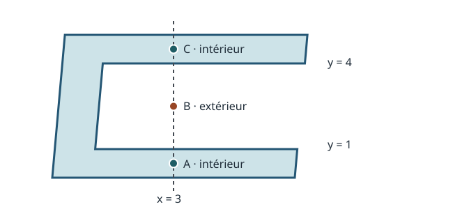

# X-ENS MP-MPI — Informatique A 2024 · Corrigé brut

*Corrigé rédigé par IA, non officiel. Signalez toute erreur.*

**Rédaction** · GPT-6.2 Sol · effort non renseigné · vitesse non renseignée

**Révision (tour 1)** · modèle non renseigné · effort non renseigné · vitesse non renseignée

**Révision (tour 2)** · GPT-6.2 Astra Ultra · vitesse non renseignée · 24 novembre 2026

## Partie I — Préliminaires

### Question 1

Si la racine est $x$, ses deux autres éléments sont à droite et peuvent être organisés de deux façons. Si elle est $z$, les deux autres sont à gauche avec deux possibilités. Si elle est $y$, les deux sous-arbres sont imposés. Il y a donc **cinq arbres**. Dans les dessins, G et D désignent les branches gauche et droite. Les branches omises sont vides.

```text
x          x          y          z          z
└─D y      └─D z      ├─G x      └─G x      └─G y
    └─D z      └─G y  └─D z          └─D y      └─G x
```

### Question 2

L’arbre vide a un parcours infixe strictement croissant. Pour un nœud de racine $x$, le parcours concatène le parcours de gauche, la valeur $x$, puis le parcours de droite.

Si cette séquence est strictement croissante, les deux sous-séquences sont strictement croissantes, toutes les valeurs à gauche précèdent $x$ et toutes les valeurs à droite le suivent dans l’ordre strict. Réciproquement, ces trois conditions assurent que la concaténation entière est strictement croissante. **On obtient l’équivalence**, y compris si l’un des sous-arbres est vide.

### Question 3

Sur trois éléments, une racine extrême donnerait des hauteurs $0$ et $2$, ce qui est interdit. Il reste **un seul AVL**, de racine $y$ et d’enfants $x$ et $z$.

Sur quatre éléments, une racine extrême aurait un sous-arbre vide et un sous-arbre à trois nœuds, de hauteur au moins 2. Une racine intérieure répartit les éléments en sous-arbres de tailles 1 et 2. Le premier a hauteur 1 et le second hauteur 2, quelle que soit la racine choisie pour celui-ci. On obtient **quatre AVL**.

```text
Trois éléments
y
├─G x
└─D z

Quatre éléments
x          x          y          y
├─G w      ├─G w      ├─G w      ├─G x
└─D y      └─D z      │   └─D x  │   └─G w
    └─D z      └─G y  └─D z      └─D z
```

### Question 4

Montrons par récurrence sur la hauteur que $n(t)+1\ge2^{h(t)/2}$. Pour les hauteurs 0 et 1, les membres de gauche valent respectivement 1 et 2.

Si $h\ge2$, un sous-arbre a hauteur $h-1$ et l’autre au moins $h-2$, par équilibre. Chaque sous-arbre a une hauteur inférieure à $h$. Par récurrence,
$$
\begin{aligned}
n(t)+1&=(n(\ell)+1)+(n(r)+1)\\
&\ge 2\cdot 2^{(h-2)/2}=2^{h/2}.
\end{aligned}
$$
Le logarithme de base 2 donne **$h(t)\le2\log(n(t)+1)$**.

### Question 5

La comparaison à la racine permet d’éliminer un sous-arbre entier.

```ocaml
let rec mem x = function
  | E -> false
  | N (_, l, y, r) ->
      if eq x y then true
      else if lt x y then mem x l
      else mem x r
```

On visite au plus un nœud par niveau et chaque étape prend un temps constant. Q4 donne un coût $O(1+h(t))=O(1+\log(n(t)+1))$, donc **$O(\log n(t))$ asymptotiquement**.

## Partie II — Construire des arbres AVL

### Question 6

Considérons `join_right`. À chaque appel, notons $h$ la hauteur du premier arbre et $b$ celle de $r$. L’invariant est $h\ge b+2$. Il est assuré par la ligne 2 de `join`, et la condition d’entrée dans la branche de la ligne 9 l’assure pour l’argument `lr`. Le premier arbre est donc non vide et la ligne 12 n’est jamais atteinte. La récursion s’effectue sur un sous-arbre strict du premier argument, ce qui prouve la terminaison.

Dans la branche des lignes 4–7, appelons $A$ et $B$ les hauteurs de `ll` et `lr`. Puisque le premier argument est AVL de hauteur $h$, $A\ge h-2\ge b$.

Si la ligne 7 est exécutée, la hauteur de `t` dépasse $A+1$, donc $\max(B,b)>A$. Il faut alors $B>A$, ce qui rend `lr` non vide. La rotation droite de `t` est donc définie. Son résultat est un nœud et donne un fils droit non vide à l’arbre passé à la rotation gauche.

Dans la branche récursive, l’appel ligne 9 termine sans échec par récurrence sur la hauteur. Si la rotation ligne 11 est demandée, le fils droit `t` a une hauteur supérieure à $A+1$, donc il est non vide. La rotation gauche est définie. En inversant droite et gauche, les mêmes invariants valent pour `join_left`. La dernière branche de `join` construit directement un nœud.

### Question 7

On prouve par récurrence sur $h$ l’alternative demandée, en vérifiant aussi l’équilibre des arbres renvoyés. Notons $A=h(\texttt{ll})$, $B=h(\texttt{lr})$ et $b=h(r)$.

On a $\max(A,B)=h-1$, $|A-B|\le1$ et $b\le h-2$.

**Branche sans récursion, lignes 4–7.** Ici $B\le b+1$. Comme $B\ge h-2\ge b$, le nœud `t` de la ligne 5 est équilibré et a hauteur $B+1$.

- Si $B\le A$, la ligne 6 renvoie le nœud de hauteurs filles $(A,B+1)$. On a $A=h-1$.

  Si $B=h-2$, les deux hauteurs valent $h-1$ et le résultat a hauteur $h$. Si $B=h-1$, les hauteurs filles valent $(h-1,h)$ et le résultat a hauteur $h+1$.
- Si $B>A$, on a $B=h-1$ et $A=b=h-2$. Écrivons $\texttt{lr}=\langle L,u,R\rangle$.

  Les hauteurs de $L$ et $R$ sont à distance au plus un de $h-2$ et au plus $h-2$. Les deux rotations donnent
  $$
  \left\langle\langle\texttt{ll},\texttt{lx},L\rangle,\ u,\ \langle R,x,r\rangle\right\rangle.
  $$
  Les deux fils sont équilibrés, chacun de hauteur $h-1$. La hauteur finale est $h$.

Cette branche couvre le cas minimal $h=2$, puisque alors $b=0$ et $B\le1$.

**Branche récursive, lignes 9–11.** L’hypothèse de récurrence s’applique à `lr`. Le résultat `t` est équilibré et sa hauteur $T$ vaut $B$ ou $B+1$. Si $T=B+1$, ses fils ont hauteurs $(B-1,B)$.

- Si $T\le A+1$, alors $T\ge B\ge A-1$ et le nouveau nœud est équilibré. Sa hauteur est au moins $1+\max(A,B)=h$.

  Elle vaut $h+1$ seulement si $T=h$, auquel cas la condition $T\le A+1$ impose $A=h-1$. Les fils sont bien de hauteurs $(h-1,h)$.
- Si $T>A+1$, les inégalités $T\le B+1$ et $B\le A+1$ imposent $B=A+1$ et $T=B+1$.

  Ainsi $A=h-2$, $B=h-1$ et les fils de `t` ont hauteurs $(h-2,h-1)$.

  Après la rotation gauche, le nouveau fils gauche réunit deux arbres de hauteur $h-2$, donc a hauteur $h-1$. Le fils droit garde hauteur $h-1$. Le résultat est équilibré et a hauteur $h$.

**Les deux seules hauteurs sont donc $h$ et $h+1$, avec la forme annoncée lorsque la hauteur augmente.**

### Question 8

Lorsque les hauteurs diffèrent d’au plus un, le nœud construit directement respecte la condition AVL et a hauteur $1+\max(h(l),h(r))$. Sinon, Q7 donne l’équilibre et la borne du côté gauche plus haut, et son miroir donne les mêmes propriétés du côté droit plus haut.

Pour l’ordre, chaque opération `node` réunit un sous-arbre, une valeur et un second sous-arbre en conservant leur ordre relatif dans le parcours infixe. Dans `join_right`, la jointure récursive insère d’abord $x$ et $r$ après les éléments du sous-arbre droit. Les rotations ne changent pas la séquence infixe. Par récurrence le parcours final est celui de $l$, suivi de $x$ puis de celui de $r$, strictement croissant par précondition. Il en va de même pour la branche miroir. Le résultat est donc un AVL représentant l’union attendue.

On utilisera aussi la **borne inférieure $\max(h(l),h(r))\le h(\texttt{join}\ l\ x\ r)$**, qui résulte de Q7, de son miroir et du cas directement équilibré.

### Question 9

Dans `join_right`, le second arbre reste de hauteur $b$ et la hauteur du premier diminue d’au moins un à chaque appel de la ligne 9. Les appels ne descendent jamais en dessous de $b+2$, par l’invariant de Q6. Il y a donc au plus $h(l)-b-1$ appels, chacun de coût propre constant, rotations incluses. Le miroir donne la borne symétrique.

Le cas déjà équilibré prend un temps constant. La borne uniforme est **$O(1+|h(l)-h(r)|)$**, ce qui donne le $O(|h(l)-h(r)|)$ annoncé lorsque l’écart croît.

### Question 10

`split t y` renvoie $(l,b,r)$ où $l$ contient exactement les éléments de $t$ strictement inférieurs à $y$.

L’arbre $r$ contient exactement ceux qui lui sont strictement supérieurs. Le booléen $b$ indique si $y$ apparaît dans $t$.

Si la valeur à la racine égale $y$, on rend directement ses sous-arbres. Si elle est supérieure à $y$, on scinde le fils gauche. La partie supérieure de cette scission est réunie avec l’ancienne racine et le fils droit. Si elle est inférieure à $y$, la combinaison symétrique forme la partie inférieure. L’arbre vide donne deux arbres vides et un booléen faux.

### Question 11

L’AVL initial a racine $b$, fils gauche $a$ et fils droit $d$. Dans `split t c`, on descend à droite depuis $b$, puis à gauche depuis $d$, jusqu’au sous-arbre vide.

- En remontant à $d$, on obtient $(E,\texttt{false},\{d\})$ en reconstruisant son côté supérieur.
- En remontant à $b$, on obtient $(\langle\{a\},b,E\rangle,\texttt{false},\{d\})$. Le côté inférieur est produit par `join` avec la racine $b$.
- On joint ces deux AVL avec $c$ au milieu. Leurs hauteurs 2 et 1 autorisent une construction directe.

```text
Initial        Après split côté < c    Après split côté > c      Final
b              b                       d                         c
├─G a          └─G a                                             ├─G b
└─D d                                                            │   └─G a
                                                                 └─D d
```

### Question 12

On procède par récurrence sur la hauteur de $t$. Pour l’arbre vide, les deux résultats sont vides. Si $y$ est la racine, les résultats sont ses deux sous-arbres AVL, de hauteurs au plus $h(t)-1$.

Si $y$ est plus petit que la racine, l’appel récursif renvoie deux AVL de hauteurs au plus celle du fils gauche. Le premier est conservé. Le second est joint à la racine et au fils droit, dans l’ordre établi en Q10. Par Q8, cet AVL reconstruit a hauteur au plus
$$
1+\max(h(\ell),h(r))=h(t).
$$
Quand $y$ est plus grand, le premier résultat est reconstruit et le second conservé. Le même calcul de maximum s’applique. **Les deux arbres renvoyés sont donc équilibrés et de hauteur au plus $h(t)$.**

### Question 13

La Q10 assure la séparation stricte des éléments autour de $x$. La Q12 assure que les deux arbres obtenus sont AVL. La jointure finale est donc valide et Q8 garantit le résultat demandé, y compris si $x$ était déjà présent.

Pour le coût de `split`, on suit un seul chemin de longueur au plus $h(t)$. À un niveau de remontée, une seule des deux composantes renvoyées est reconstruite. Appelons $u$ sa hauteur avant la jointure, $b$ la hauteur du frère d’origine et $v$ la hauteur de la composante reconstruite. Q12 donne $u$ au plus égal à la hauteur du fils où l’on vient de descendre. L’équilibre de l’arbre initial entraîne donc $u\le b+1$.

Par la borne inférieure de Q8, $v\ge\max(u,b)$. Si $b\ge u$, alors $b-u\le v-u$. Dans l’autre cas, $u-b\le1$.

Ainsi Q9 borne le coût de la jointure par $O(1+v-u)$. La hausse de hauteur se télescope séparément pour chacune des deux composantes, qui ont à la fin hauteur au plus $h(t)$. En ajoutant le coût propre des niveaux, `split` prend donc $O(1+h(t))$.

La jointure finale coûte également $O(1+h(t))$ par Q9 et Q12. Avec Q4, **l’insertion est logarithmique**.

### Question 14

Le tableau contient les tailles $0,1,\ldots,n-1$, puisque chaque insertion ajoute une valeur nouvelle. Le nombre total d’occurrences quand on compte chaque arbre séparément est donc
$$
\boxed{f(n)=\frac{n(n-1)}2.}
$$
Le tableau prend $O(n)$ emplacements. Par Q13, chaque insertion effectue $O(1+\log i)$ opérations lorsqu’elle construit l’arbre d’indice $i$. Chaque appel à `node` alloue un nœud de taille constante. Même en comptant toutes ces allocations, leur total est $O(n\log(n+1))$. La pile d’un appel ajoute au plus un terme du même ordre.

On peut donc prendre $g(n)=n(1+\log(n+1))$, qui est $o(f(n))$. Il n’y a pas de contradiction, car les AVL sont persistants. Un même sous-arbre intact peut être référencé dans plusieurs versions, et ses éléments sont comptés plusieurs fois dans $f(n)$.

### Question 15

Le maximum est le dernier élément rencontré en suivant les fils droits. Au retour, on restaure l’équilibre avec `join`.

```ocaml
let rec split_last = function
  | E -> invalid_arg "split_last"
  | N (_, l, x, E) -> (l, x)
  | N (_, l, x, r) ->
      let reste, dernier = split_last r in
      (join l x reste, dernier)
```

La hauteur du résultat baisse d’au plus un. En effet, si le fils gauche était au moins aussi haut que le fils droit, il garde son ancienne hauteur et Q8 borne la hauteur reconstruite entre l’ancienne hauteur moins un et l’ancienne hauteur. Si le fils droit était plus haut, il avait exactement un niveau de plus et sa réduction d’au plus un laisse la jointure dans le cas directement équilibré. Le cas terminal suit de l’équilibre avec un fils droit vide. Chaque jointure a donc un écart de hauteurs au plus deux, et le chemin complet a un coût $O(h(t))$.

### Question 16

On prélève le maximum du côté gauche pour servir de pivot. Les arbres vides n’ont besoin d’aucune reconstruction.

```ocaml
let join2 l r =
  match l, r with
  | E, _ -> r
  | _, E -> l
  | _, _ ->
      let reste, x = split_last l in
      join reste x r
```

Le coût de l’extraction et de la jointure est $O(h(l)+h(r))$ lorsque les deux arbres sont non vides.

### Question 17

On scinde autour de la valeur puis on rassemble les deux côtés sans la remettre. Si la valeur est absente, on peut rendre directement l’arbre d’origine.

```ocaml
let remove x t =
  let l, present, r = split t x in
  if present then join2 l r else t
```

Q12, Q13 et Q16 donnent un temps logarithmique.

## Partie III — Localisation d’un point dans le plan

### Question 18

Chaque arête traverse au plus $N$ tranches et le nombre d’arêtes est $O(N)$. La somme des nombres de traversées est donc $O(N^2)$.

Pour une borne inférieure, plaçons les $N$ sommets $(j,j^2)$ pour $0\le j<N$ et formons leur polygone convexe. Triangulons-le en éventail depuis $p_0$. Les diagonales de l’éventail ne se croisent pas et les triangles constituent une subdivision admissible.

Pour chaque $1\le j<N$, l’arête $p_0p_j$ traverse $j$ tranches. Ces seules arêtes donnent $N(N-1)/2$ traversées. **Le total peut donc être en $\Theta(N^2)$.**

### Question 19

Deux arêtes actives ont un intervalle d’abscisses commun d’intérieur non vide. L’ordre sur cet intérieur est constant, car le signe d’une différence d’ordonnées ne change pas sans intersection. On évalue les deux ordonnées au milieu de l’intervalle commun, ce qui évite les égalités éventuelles en un sommet partagé.

```ocaml
let ordonnee ((x1, y1), (x2, y2)) x =
  y1 +. (x -. x1) *. (y2 -. y1) /. (x2 -. x1)

let lt e1 e2 =
  let gauche = max (xmin e1) (xmin e2) in
  let droite = min (xmax e1) (xmax e2) in
  let x = gauche +. (droite -. gauche) /. 2. in
  ordonnee e1 x < ordonnee e2 x
```

On représente une arête partagée par un seul segment géométrique. La comparaison utilise les conventions de calcul sur les coordonnées du sujet.

### Question 20

Si une arête partagée est donnée plusieurs fois, on commence par dédupliquer les couples d’extrémités par tri. On trie ensuite les enregistrements d’extrémités par abscisse, par exemple par tri fusion. Chaque enregistrement garde l’arête et indique si elle démarre ou se termine. On regroupe les enregistrements de même abscisse, ce qui donne les sommets ordonnés et deux listes d’événements par sommet. Le tri et le regroupement coûtent $O(N\log N)$ en temps et $O(N)$ en mémoire auxiliaire, puisqu’il y a $O(N)$ arêtes.

On part d’un AVL vide et on balaie les sommets. Pour passer à la tranche suivante, on supprime d’abord les arêtes finissantes avec Q17. Les comparaisons portent alors sur des arêtes qui traversaient la tranche précédente. Les arêtes restantes gardent leur ordre dans la nouvelle tranche. On insère ensuite les arêtes commençantes avec la fonction `insert`, en comparant seulement les arêtes actives dans la tranche nouvelle. Q19 donne chaque comparaison en temps constant. On sauvegarde la racine obtenue avec les bornes de la tranche.

Chaque arête est insérée puis retirée une fois. Il y a $O(N)$ opérations AVL et chacune coûte $O(\log(N+1))$ en temps et en nœuds nouvellement créés, par les analyses de Q13 et Q17. Le partage des sous-arbres inchangés permet de stocker toutes les versions du tableau en **$O(N\log N)$ en temps et en espace**.

### Question 21

On cherche le premier bord droit supérieur ou égal à l’abscisse, en accord avec les tranches ouvertes à gauche et fermées à droite. La dernière tranche fournit un bord droit $+\infty$.

```ocaml
let find_slab slabs x =
  let rec cherche bas haut =
    if bas = haut then slabs.(bas)
    else
      let mil = bas + (haut - bas) / 2 in
      if x <= slabs.(mil).xright then cherche bas mil
      else cherche (mil + 1) haut
  in
  cherche 0 (Array.length slabs - 1)
```

La recherche divise la longueur de l’intervalle à chaque étape. Son coût est $O(\log(N+1))$.

### Question 22

L’AVL permet de trouver l’arête immédiatement en dessous et celle immédiatement au-dessus. **Ces deux arêtes ne suffisent pas en général à décider l’appartenance à un polygone**, comme le signale le rapport. Par exemple, trois triangles extérieurs peuvent partager chacun un côté d’un triangle central, sans se toucher autrement qu’aux sommets. Les mêmes arêtes décrivent la subdivision avec ou sans le triangle central dans l’ensemble des polygones. Un point strictement dans le triangle central a les mêmes données d’entrée dans les deux cas, mais doit recevoir deux réponses différentes. On peut choisir les sommets avec des abscisses distinctes en tournant la configuration.

Voici la recherche des deux voisins. On conserve les meilleures bornes déjà rencontrées et on suit un seul fils, car les ordonnées s’inscrivent dans le même ordre que l’AVL. L’ordre reste valable dans un sens large au bord droit d’une tranche. Le point, par hypothèse, ne se trouve sur aucune arête.

```ocaml
let bords slabs (x, y) =
  let tranche = find_slab slabs x in
  let rec descente bas haut = function
    | E -> (bas, haut)
    | N (_, l, e, r) ->
        if y < ordonnee e x then descente bas (Some e) l
        else descente (Some e) haut r
  in
  descente None None tranche.tree

let find slabs p =
  match bords slabs p with
  | Some bas, Some haut -> Between (bas, haut)
  | _ -> Outside
```

Cette fonction `find` répond sous l’hypothèse implicite supplémentaire que tout intervalle borné entre deux arêtes consécutives est intérieur. Pour répondre au problème général, il suffit d’enrichir le prétraitement avec l’information indiquant, pour chaque arête, si sa face incidente du dessus appartient à un polygone. On peut obtenir cette étiquette à partir des contours orientés et de leur incidence sur les arêtes, puis l’indexer par segment.

```ocaml
let find_avec_faces interieur_au_dessus slabs p =
  match bords slabs p with
  | Some bas, Some haut when interieur_au_dessus bas -> Between (bas, haut)
  | _ -> Outside
```

En effet, l’intervalle entre les arêtes trouvées appartient à la face qui borde l’arête inférieure par le dessus. S’il manque une arête, l’intervalle est non borné verticalement, donc extérieur à tout polygone. La dichotomie puis la descente dans l’AVL prennent chacune $O(\log(N+1))$. Une consultation d’étiquette en temps constant, ou même en $O(\log(N+1))$, conserve cette borne.

Dans le polygone de la figure, la droite $x=3$ rencontre successivement les arêtes aux ordonnées $0,1,4,5$. Le point $B=(3,2{,}5)$ est entre deux arêtes et pourtant extérieur. Les points $A=(3,0{,}5)$ et $C=(3,4{,}5)$ appartiennent aux deux bras. Les sommets s’obtiennent en appliquant le cisaillement $(x,y)\mapsto(x+y/16,y)$ au contour $(0,0),(6,0),(6,1),(1,1),(1,4),(6,4),(6,5),(0,5)$, ce qui respecte l’hypothèse des abscisses distinctes.



Pour construire la table de Q22, orienter chaque contour simple dans le sens trigonométrique. Son intérieur reste à gauche de son parcours. Lorsqu’une arête est parcourue vers la droite, sa face du dessus appartient au polygone. Lorsqu’elle est parcourue vers la gauche, c’est celle du dessous. Une arête partagée conserve les deux incidences. Comme chaque segment du sujet va d’une abscisse à une autre, cette règle traite tous ses segments. La canonisation géométrique et le tri de Q20 permettent de rattacher l’étiquette au segment en $O(N\log N)$ avant les recherches.
