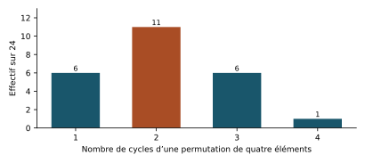
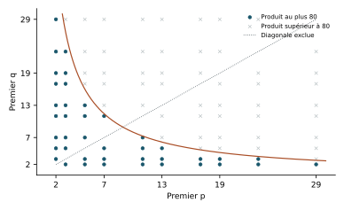

# X-ENS MP-MPI — Mathématiques A 2024 · Corrigé brut

*Corrigé rédigé par IA, non officiel. Signalez toute erreur.*

**Attribution archivée** · « IA (GPT-6.2 Sol), relue et révisée par IA »

**Révision (tour 1)** · GPT-6.2 Astra Ultra · vitesse non renseignée

**Révision (tour 2)** · GPT-6.2 Astra Ultra · vitesse non renseignée · 26 novembre 2026

Les renvois dans les preuves suivent les repères de l’énoncé officiel, repris dans les titres.

## Première partie — Permutations

### Question 1a

Soit $\mathbf 1=(1,\ldots,1)^{\mathsf T}$. On a $-M_0=I_n-\mathbf 1\mathbf 1^{\mathsf T}$. Sur $\mathbb R\mathbf 1$, la matrice agit par multiplication par $1-n$. Sur l’hyperplan $H=\{v:\sum_i v_i=0\}$, elle agit comme l’identité.

Tout vecteur se décompose en sa moyenne fois $\mathbf 1$ et un vecteur de $H$. On a donc les deux espaces propres $\mathbb R\mathbf 1$ et $H$, de dimensions 1 et $n-1$. Ils sont supplémentaires, ce qui donne la diagonalisation.

### Question 1b

Puisque $M_x=M_0+xI_n$, le déterminant se calcule dans la base propre de 1a. Il vaut $(x-1)^{n-1}(x+n-1)$. Dans le développement de Leibniz, chaque produit $\prod_i (M_x)_{i,\sigma(i)}$ comporte le facteur $x$ exactement aux points fixes de $\sigma$. Les autres facteurs valent 1. On obtient donc
$$
F_n(x):=\sum_{\sigma\in S_n}\varepsilon(\sigma)x^{\nu(\sigma)}
=(x-1)^{n-1}(x+n-1).
$$
Les termes d’exposant nul représentent le polynôme constant 1.

### Question 2

La première somme vaut $F_n(1)=0$ puisque $n\ge2$. La deuxième vaut $F_n'(1)$. Pour $n=2$, $F_2(x)=x^2-1$ et la somme vaut 2. Pour $n\ge3$, la racine 1 est multiple et la somme vaut 0.

La troisième est $\int_0^1 F_n(x)\,\mathrm dx$, car on intègre une somme finie et $\int_0^1x^k\,\mathrm dx=1/(k+1)$. Par $u=1-x$,
$$
\begin{aligned}
\int_0^1 F_n(x)\,\mathrm dx
&=(-1)^{n-1}\int_0^1u^{n-1}(n-u)\,\mathrm du\\
&=(-1)^{n-1}\frac{n}{n+1}.
\end{aligned}
$$

### Question 3

La différence entre l’effectif des permutations paires et celui des impaires vaut la première somme de 2, soit zéro. Les deux ensembles forment une partition de $S_n$, donc chacun compte $n!/2$ éléments. Une signature prescrite a ainsi une probabilité $1/2$.

### Question 4

Un dérangement est une permutation avec $\nu(\sigma)=0$. Le terme constant de $F_n$ est donc la différence des nombres de dérangements de signature $+1$ et $-1$. L’évaluation en zéro dans 1b donne $(-1)^{n-1}(n-1)$, d’où l’égalité demandée.

### Question 5a

Dans chacune des deux familles, le polynôme d’indice $k$ est unitaire de degré $k$. Toute combinaison linéaire non triviale a donc un terme dominant issu du plus grand indice de coefficient non nul. Chaque famille est libre et compte $m+1$ éléments, soit la dimension de $\mathbb R_m[X]$. Ce sont donc deux bases.

### Question 5b

Dans la base d’arrivée, la coordonnée d’indice $\ell$ de $X^k$ vaut $\binom{k}{\ell}$ si $\ell\le k$ et zéro sinon, par le binôme de Newton.

Le coefficient de ligne $\ell$ et colonne $k$ de la matrice est donc $M_{k,\ell}$. La matrice de l’identité est $M^{\mathsf T}$.

### Question 5c

L’identité est un isomorphisme, donc $M^{\mathsf T}$ et $M$ sont inversibles.

En échangeant les deux bases, le coefficient de ligne $\ell$ et colonne $k$ de $(M^{\mathsf T})^{-1}$ est celui de $X^\ell$ dans $(X-1)^k$. Par le binôme de Newton, la transposée de cette matrice donne
$$
(M^{-1})_{k,\ell}=
\begin{cases}
(-1)^{k-\ell}\binom{k}{\ell}&\text{si }\ell\le k,\\
0&\text{sinon}.
\end{cases}
$$

### Question 5d

Pour les colonnes $u$ et $v$, la relation initiale est $u=Mv$. En appliquant $M^{-1}$ puis en lisant la coordonnée $k$ avec 5c, on obtient
$$
v_k=\sum_{\ell=0}^k(-1)^{k-\ell}\binom{k}{\ell}u_\ell.
$$

### Question 6

Posons $D_0=1$, correspondant à la permutation vide. Pour toute taille $j$, une permutation avec $\ell$ points non fixes se construit en choisissant ces points puis un dérangement de cet ensemble. Les autres points sont fixés. Ainsi
$$
j!=\sum_{\ell=0}^j\binom j\ell D_\ell.
$$
Par 5d, appliquée à $u_j=j!$ et $v_j=D_j$, on obtient
$$
\begin{aligned}
D_n&=\sum_{\ell=0}^n(-1)^{n-\ell}\binom n\ell\ell!\\
&=n!\sum_{k=0}^n\frac{(-1)^k}{k!}
\end{aligned}
$$
après le changement d’indice $k=n-\ell$.

### Question 7a

Une permutation cyclique de longueur $n$ est un dérangement pour $n\ge2$, donc $D_n>0$.

Par 4, les effectifs de signatures $+1$ et $-1$ ont pour différence $(-1)^{n-1}(n-1)$ et pour somme $D_n$. Sous la loi uniforme, pour $\eta\in\{-1,1\}$,
$$
\mathbb P(Y_n=\eta)=\frac12\left(1+\eta\frac{(-1)^{n-1}(n-1)}{D_n}\right).
$$

### Question 7b

La série exponentielle en $-1$ donne $D_n/n!\to e^{-1}$ par 6. En particulier $(n-1)/D_n\to0$ puisque $(n-1)/n!\to0$. D’après 7a, pour chacune des deux signatures, la probabilité tend vers $1/2$.

### Question 8a

Pour $0\le k\le n$, on choisit les $k$ points fixes de $\binom nk$ façons et on dérange les autres de $D_{n-k}$ façons. Ainsi
$$
\begin{aligned}
\mathbb P(Z_n=k)&=\frac{\binom nkD_{n-k}}{n!}\\
&=\frac{D_{n-k}}{k!(n-k)!}.
\end{aligned}
$$
En dehors de ces indices entiers, la probabilité vaut zéro. La convention $D_0=1$ couvre $k=n$.

### Question 8b

Pour tout $k\in\mathbb N$ fixé, $n-k\to+\infty$. En utilisant $D_{n-k}/(n-k)!\to e^{-1}$ établi en 7b, on trouve $\mathbb P(Z_n=k)\to e^{-1}/k!$.

### Question 8c

On a $Z_n=\sum_{i=1}^n\mathbf 1_{\{\sigma(i)=i\}}$. Pour un $i$ fixé, les $(n-1)!$ permutations des autres points sont toutes possibles. Cet événement a donc pour probabilité $1/n$. Par linéarité de l’espérance, $\mathbb E[Z_n]=1$ pour tout $n$, et sa limite est 1.

### Question 9

Pour $n=2$, l’identité et la transposition ont 2 et 1 cycles, donc la moyenne vaut $3/2$. Pour $n=3$, l’identité a 3 cycles, les 3 transpositions en ont 2 et les 2 cycles de longueur 3 en ont 1. La moyenne vaut $(3+6+2)/6=11/6$.

Pour $n=4$, les nombres de cycles se déduisent des cinq types suivants.

- Une identité avec 4 cycles.
- Six transpositions avec 3 cycles.
- Huit permutations de type $3+1$ et trois de type $2+2$, chacune avec 2 cycles.
- Six cycles de longueur 4, avec 1 cycle.

Pour le type $3+1$, on choisit le point fixe de 4 façons, puis un cycle sur les trois autres de 2 façons. Pour le type $2+2$, le partenaire du point 1 détermine les deux paires. Les cycles de longueur 4 s’écrivent en commençant par 1 puis en ordonnant les trois autres points. La moyenne vaut $(4+18+22+6)/24=25/12$.

### Question 10

La seule permutation à $n$ cycles est l’identité, donc $s(n,n)=1$. Un cycle de longueur $n$ s’écrit en commençant par 1, puis en ordonnant les autres éléments. Il y en a $(n-1)!$, ce qui donne $s(n,1)$.

Si $\sigma(1)=1$, supprimer ce singleton laisse $k-1$ cycles sur les $n-1$ autres éléments. Sinon, on retire 1 de son cycle en reliant son prédécesseur à son successeur. Il reste $k$ cycles. Réciproquement, on peut réinsérer 1 après n’importe lequel des $n-1$ éléments, et ce choix se retrouve comme son prédécesseur. Les deux constructions sont bijectives dans leur cas. Pour $2\le k\le n-1$,
$$
s(n,k)=s(n-1,k-1)+(n-1)s(n-1,k).
$$

### Question 11

Avec $P_n(x)=\sum_{k=1}^n s(n,k)x^k$, on a $P_1(x)=x$. Pour $n\ge2$, le coefficient de $x^k$ dans $(x+n-1)P_{n-1}(x)$ est celui donné par 10 pour $2\le k\le n-1$.

Le coefficient de $x$ vaut $(n-1)(n-2)!=(n-1)!$. Celui de $x^n$ vaut 1. Les termes constants sont nuls. Ainsi $P_n=(x+n-1)P_{n-1}$ et, par récurrence,
$$
P_n(x)=\prod_{i=0}^{n-1}(x+i).
$$

### Question 12

D’après 11, $P_n(1)=n!$. Notons $H_n=\sum_{i=1}^n 1/i$. On a
$$
\frac{P_n'(1)}{n!}=H_n.
$$
En dérivant la somme dans la définition de $P_n$, le membre de gauche est $\mathbb E[X_n]$. L’estimation admise pour $H_n$ donne $\mathbb E[X_n]=\ln n+\gamma+O(1/n)$.

### Question 13a

En dérivant deux fois le produit de 11 et en évaluant en 1, on obtient
$$
\frac{P_n''(1)}{n!}
=\sum_{\substack{1\le i,j\le n\\i\ne j}}\frac1{ij}
=\sum_{i=1}^n\sum_{j=1}^n\frac1{ij}-\sum_{i=1}^n\frac1{i^2}.
$$
La dérivée seconde de la somme des coefficients donne au membre de gauche $\frac1{n!}\sum_{k=1}^n k(k-1)s(n,k)$.

### Question 13b

En ajoutant la contribution de $k$ dans $k^2=k(k-1)+k$, l’identité de 13a devient
$$
\begin{aligned}
\frac1{n!}\sum_{k=1}^n k^2s(n,k)
&=\mathbb E[X_n]+H_n^2\\&\quad-\sum_{i=1}^n\frac1{i^2}.
\end{aligned}
$$

### Question 14a

Notons $Z=\sum_{i\ge1}i^{-2}$, qui est fini par le critère de Riemann. Par décroissance,
$$
\begin{aligned}
0&\le Z-\sum_{i=1}^n i^{-2}\\&\le\int_n^\infty t^{-2}\,\mathrm dt=\frac1n.
\end{aligned}
$$
D’autre part, $H_n=\ln n+\gamma+r_n$ avec $r_n=O(1/n)$. En développant le carré, $H_n^2=(\ln n)^2+2\gamma\ln n+\gamma^2+O((\ln n)/n)$. Par 12 et 13b, la somme cherchée est $\mathbb E[X_n^2]$, et
$$
\mathbb E[X_n^2]
=(\ln n)^2+(2\gamma+1)\ln n+c+O((\ln n)/n).
$$
La constante vaut $c=\gamma^2+\gamma-\sum_{i\ge1}i^{-2}$.

### Question 14b

La moyenne cherchée est $\mathbb E[X_n^2]-2(\ln n)\mathbb E[X_n]+(\ln n)^2$. Avec 12, le terme central vaut $-2(\ln n)^2-2\gamma\ln n+O((\ln n)/n)$. En ajoutant 14a, on trouve
$$
\mathbb E[(X_n-\ln n)^2]=\ln n+c+O((\ln n)/n)
$$
avec la même constante $c$.

### Question 15

Par 14b, il existe $C>0$ tel que $\mathbb E[(X_n-\ln n)^2]\le C\ln n$ pour $n\ge2$, quitte à agrandir $C$ pour les premiers rangs. L’inégalité de Markov appliquée à ce carré, pour le seuil $\varepsilon^2(\ln n)^2$, donne
$$
\mathbb P(|X_n-\ln n|>\varepsilon\ln n)\le\frac{C}{\varepsilon^2\ln n}.
$$
La borne imprimée avec $n=1$ a un dénominateur nul. Si l’on prolonge la définition à $S_1$, alors $X_1=1$, et l’événement avec seuil nul est certain. L’inégalité s’énonce donc pour $n\ge2$.

## Deuxième partie — Diviseurs premiers

### Question 16

La fonction $A$ est constante sur chacun des intervalles $[k,k+1[$ où elle vaut $A(k)$. Le produit $A b'$ est intégrable par morceaux. Par Chasles et le théorème fondamental du calcul intégral,
$$
\int_2^n b'(t)A(t)\,\mathrm dt=\sum_{k=2}^{n-1}A(k)\bigl(b(k+1)-b(k)\bigr).
$$
Après regroupement, $A(n)b(n)$ moins cette somme vaut $\sum_{k=2}^n(A(k)-A(k-1))b(k)$. Avec $A(1)=0$, la différence vaut $a_k$ pour chaque $k$. La formule vaut aussi pour $n=2$, où l’intégrale est nulle.

### Question 17a

Notons $P(n)=\prod_{p\le n,\ p\ \mathrm{premier}}p$. On a $P(1)=1$, $P(2)=2$ et $P(3)=6$.

Ces trois valeurs sont respectivement inférieures ou égales à $4$, $16$ et $64$.

### Question 17b

Posons $n=2m$ avec $m\ge2$. Pour chaque premier $m<p\le2m$, le nombre $p$ divise $(2m)!$ et ne divise pas $m!$.

Le coefficient $\binom{2m}{m}=(2m)!/(m!)^2$ est entier. Par le lemme de Gauss, chaque $p$ le divise. Les premiers étant distincts, leur produit divise aussi ce coefficient. Par le binôme, $\binom{2m}{m}\le 2^{2m}=4^m$. On a donc
$$
P(2m)\le P(m)4^m\le4^{2m}.
$$
La dernière inégalité utilise l’hypothèse de récurrence.

### Question 17c

Pour $m+1<p\le2m+1$, le premier $p$ divise le numérateur $(2m+1)!$ et aucun des deux facteurs $m!$ et $(m+1)!$ du dénominateur. Le lemme de Gauss donne la divisibilité par chacun de ces premiers, puis par leur produit puisqu’ils sont deux à deux premiers entre eux.

Dans la somme des coefficients de la ligne $2m+1$ du binôme, les deux coefficients d’indices $m$ et $m+1$ sont égaux. La somme entière vaut $2^{2m+1}$ et les termes sont positifs. Ainsi $2\binom{2m+1}{m}\le2^{2m+1}$, d’où $\binom{2m+1}{m}\le4^m$.

### Question 17d

Pour $n=2m+1\ge5$, le produit des premiers strictement supérieurs à $m+1$ et au plus égaux à $2m+1$ est au plus $4^m$ par 17c. L’hypothèse de récurrence donne alors
$$
P(2m+1)\le P(m+1)4^m\le4^{m+1}4^m=4^{2m+1}.
$$
Les cas initiaux de 17a et les deux parités de 17b et 17d établissent la propriété pour tout entier $n\ge1$.

### Question 18

Par additivité des valuations dans un produit, $\nu_p(n!)=\sum_{j=1}^n\nu_p(j)$. Un entier divisible exactement par $p^r$ apporte 1 à chacun des comptages des multiples de $p,p^2,\ldots,p^r$. Il y a $\lfloor n/p^k\rfloor$ multiples de $p^k$ entre 1 et $n$.

En additionnant ces contributions, toutes nulles pour $p^k>n$, on obtient
$$
\nu_p(n!)=\sum_{k\ge1}\left\lfloor\frac{n}{p^k}\right\rfloor.
$$
Le premier terme est strictement supérieur à $n/p-1$. En majorant chacun par $n/p^k$, on obtient d’autre part $\nu_p(n!)\le n/(p-1)=n/p+n/[p(p-1)]$.

### Question 19a

La croissance de $\ln$ donne
$$
\begin{aligned}
\int_1^n\ln t\,\mathrm dt&\le\sum_{k=1}^n\ln k\\
&\le\int_1^n\ln t\,\mathrm dt+\ln n.
\end{aligned}
$$
En effet, sur chaque intervalle $[k,k+1]$, sa valeur est comprise entre les deux valeurs aux bornes. L’intégrale vaut $n\ln n-n+1$, d’où la formule avec un reste $O(\ln n)$.

### Question 19b

Par le théorème fondamental de l’arithmétique, $n!=\prod_{p\le n}p^{\nu_p(n!)}$, où les produits et sommes de cette partie portent sur les nombres premiers. En prenant les logarithmes et en appliquant 18 pour $n\ge2$, il vient
$$
\begin{aligned}
n\sum_{p\le n}\frac{\ln p}{p}-\sum_{p\le n}\ln p
&<\ln(n!)\\
&\le n\sum_{p\le n}\frac{\ln p}{p}+
n\sum_{p\le n}\frac{\ln p}{p(p-1)}.
\end{aligned}
$$
Par 17, $\sum_{p\le n}\ln p=\ln P(n)\le n\ln4$, ce qui donne la minoration demandée. Pour $n=1$, les sommes sont vides et l’inégalité se lit $-\ln4<0\le0$.

### Question 19c

Pour $k\ge2$, $k(k-1)\ge k^2/2$. Comme $\ln k=O(\sqrt{k})$, on a $\ln k/[k(k-1)]=O(k^{-3/2})$. La série, à termes positifs, converge par comparaison.

### Question 19d

Notons $T(n)=\sum_{p\le n}(\ln p)/p$. Par 19b et 19c, il existe une constante $B$ telle que
$$
T(n)-\ln4<\frac{\ln(n!)}n\le T(n)+B.
$$
Ainsi $T(n)=\ln(n!)/n+O(1)$. La formule de 19a donne $\ln(n!)/n=\ln n-1+O((\ln n)/n)$, d’où $T(n)=\ln n+O(1)$.

### Question 20a

Posons $a_k=(\ln k)/k$ si $k$ est premier et $a_k=0$ sinon. Pour ces choix, $A(t)=\ln t+R(t)$. Avec $b(t)=1/\ln t$, on a $b'(t)=-1/[t(\ln t)^2]$. La formule de 16 donne
$$
\sum_{p\le n}\frac1p
=1+\frac{R(n)}{\ln n}+
\int_2^n\frac{\ln t+R(t)}{t(\ln t)^2}\,\mathrm dt.
$$
La contribution de $\ln t$ est $\ln_2(n)-\ln_2(2)$, ce qui donne l’égalité demandée.

### Question 20b

Pour $t\ge2$, la somme définissant $R$ est identique à celle prise jusqu’à $\lfloor t\rfloor$. La différence $\ln t-\ln\lfloor t\rfloor$ est bornée, donc $R$ est bornée sur $[2,+\infty[$ par 19d, avec la borne ajustée sur le premier segment. Elle est continue par morceaux sur tout segment. Ainsi
$$
\left|\frac{R(t)}{t(\ln t)^2}\right|
\le\frac{B}{t(\ln t)^2}.
$$
La primitive $-1/\ln t$ montre que le majorant a une intégrale finie sur $[2,+\infty[$. L’intégrale demandée converge absolument.

### Question 20c

Dans 20a, remplaçons l’intégrale jusqu’à $n$ par l’intégrale jusqu’à l’infini moins la queue. Par la majoration de 20b, cette queue vaut $O(1/\ln n)$. Le terme $R(n)/\ln n$ a la même borne. Il vient
$$
\begin{aligned}
\sum_{p\le n}\frac1p&=\ln_2(n)+c_1+O(1/\ln n),\\
c_1&=1-\ln_2(2)+\int_2^\infty\frac{R(t)}{t(\ln t)^2}\,\mathrm dt .
\end{aligned}
$$
La même estimation vaut pour un réel $x$ tendant vers l’infini. La somme ne change pas en remplaçant $x$ par $\lfloor x\rfloor$, et les deux valeurs de $\ln_2$ diffèrent de $O(1/(x\ln x))$ par les accroissements finis.

### Question 21a

Les indices $j$ admissibles vont de 1 à $\lfloor x/q\rfloor$, donc le cardinal vaut $\lfloor x/q\rfloor$. Sa différence avec $x/q$ a une valeur absolue strictement inférieure à 1, uniformément en $x$ et en $q$.

### Question 21b

Les sommes sont finies. En comptant chaque paire $(n,p)$ avec $p\mid n$, les deux sommes étant limitées à $n,p\le x$,
$$
\sum_n\omega(n)=\sum_p\lfloor x/p\rfloor .
$$
Par 21a, la différence avec $x\sum_{p\le x}1/p$ est majorée en valeur absolue par le nombre de premiers au plus égaux à $x$, qui est inférieur ou égal à $x$. En divisant par $x$ puis en appliquant 20c, on trouve
$$
\frac1x\sum_{n\le x}\omega(n)=\ln_2(x)+O(1).
$$

### Question 22a

Posons $L=\ln_2(x)$. Le développement donne
$$
\begin{aligned}
\frac1x\sum_{n\le x}(\omega(n)-L)^2
&=\frac1x\sum_{n\le x}\omega(n)^2\\
&\quad-\frac{2L}{x}\sum_{n\le x}\omega(n)
+\frac{\lfloor x\rfloor}{x}L^2.
\end{aligned}
$$
Par 21b, le deuxième terme vaut $-2L^2+O(L)$. Le dernier vaut $L^2+O(L^2/x)$, avec $L^2/x=o(L)$ à l’infini. La somme des deux termes vaut donc $-L^2+O(L)$.

### Question 22b

Pour $n\le x$, on a $\omega(n)=\sum_{p\le x}\mathbf 1_{\{p\mid n\}}$. Son carré s’écrit comme une somme sur les paires ordonnées $(p_1,p_2)$ de premiers au plus égaux à $x$. Le produit des deux indicatrices vaut 1 précisément si les deux divisent $n$. En sommant sur $n$ puis en permutant ces sommes finies, on obtient le dénombrement demandé.

### Question 22c

Pour deux premiers distincts, les multiples communs sont les multiples de leur produit. Notons $U(x)$ la somme de ces cardinaux sur les couples ordonnés distincts de premiers au plus égaux à $x$. Seuls les couples de produit au plus $x$ contribuent.

À chaque couple admissible $(p,q)$ associons l’entier $m=pq\le x$. L’unicité de la factorisation donne exactement deux antécédents pour chaque entier de l’image, $(p,q)$ et $(q,p)$. Le nombre de couples est donc au plus $2\lfloor x\rfloor$. Pour chacun, $0\le x/(pq)-\lfloor x/(pq)\rfloor<1$. En sommant sur les couples de produit au plus $x$, on obtient
$$
\left|U(x)-x\!\sum_{\substack{p,q\ \mathrm{premiers},\ p\ne q\\pq\le x}}\frac1{pq}\right|\le 2\lfloor x\rfloor .
$$
Cette erreur est $O(x)$. Il reste à contrôler le poids des couples exclus par les conditions $p\ne q$ et $pq\le x$.

Pour la somme pondérée, posons $A_x=\sum_{p\le x}1/p$. Par 20c, $A_x=\ln_2(x)+O(1)$. Si $pq>x$, l’un des premiers est strictement supérieur à $\sqrt x$. Ces couples ont donc un poids total majoré par $2A_x(A_x-A_{\sqrt x})$.

Or $\ln_2(\sqrt x)=\ln_2(x)-\ln2$, donc $A_x-A_{\sqrt x}=O(1)$ et le poids écarté est $O(\ln_2(x))$. Le poids de la diagonale est borné par $\sum_{n\ge2}n^{-2}$.

On en déduit que la somme des $1/(pq)$ sur les couples distincts avec $pq\le x$ vaut $A_x^2+O(\ln_2(x))=(\ln_2(x))^2+O(\ln_2(x))$. Après multiplication par $x$ et ajout du contrôle des parties entières, on obtient
$$
U(x)-x(\ln_2(x))^2=O(x\ln_2(x)).
$$

### Question 22d

Sur la diagonale, le cardinal de 22b est $\lfloor x/p\rfloor$. La somme de ces cardinaux, égale à $\sum_{n\le x}\omega(n)$, vaut $O(x\ln_2(x))$ par 21b. Le résultat de 22c donne alors
$$
\frac1x\sum_{n\le x}\omega(n)^2=(\ln_2(x))^2+O(\ln_2(x)).
$$
En reportant dans 22a, les carrés de $\ln_2(x)$ s’annulent, d’où
$$
\frac1x\sum_{n\le x}(\omega(n)-\ln_2(x))^2=O(\ln_2(x)).
$$

### Question 23

Écrivons $L=\ln_2(x)$. Les entiers $n<\sqrt x$ apportent au plus $\sqrt x$ au cardinal. Pour $\sqrt x\le n\le x$, on a $L-\ln2\le\ln_2(n)\le L$.

Pour un tel $n$ dans $S$, la définition donne $|\omega(n)-\ln_2(n)|\ge(\ln_2(n))^{3/4}$. Par l’inégalité triangulaire,
$$
|\omega(n)-L|\ge(L-\ln2)^{3/4}-\ln2.
$$
Pour $x$ assez grand, le membre de droite est au moins $\tfrac12L^{3/4}$. Chaque entier de $S$ sur cette plage contribue donc au moins $\tfrac14L^{3/2}$ à la somme de carrés de 22d. Comme cette somme est $O(xL)$, le cardinal sur la plage est $O(x/\sqrt L)$. Avec les petits entiers,
$$
\frac{\#\{n\le x:n\in S\}}x=O\bigl(x^{-1/2}+(\ln_2(x))^{-1/2}\bigr)\longrightarrow0.
$$
Enfin, hors de $S$, l’écart relatif est inférieur à $(\ln_2(n))^{-1/4}$, qui tend vers zéro. Cela donne bien $\omega(n)=\ln_2(n)(1+o(1))$ hors d’un ensemble de densité nulle.
