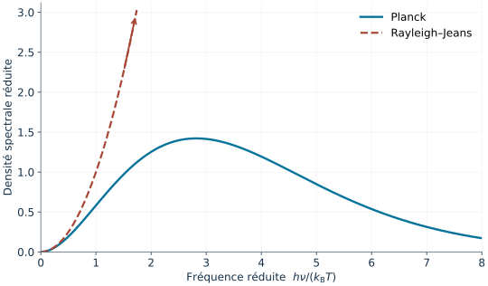
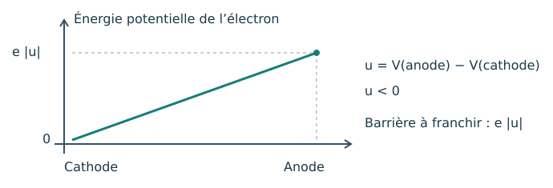
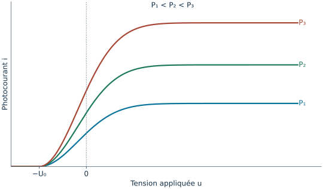
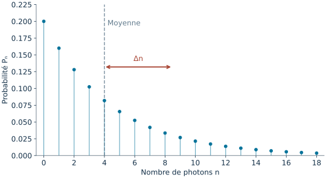
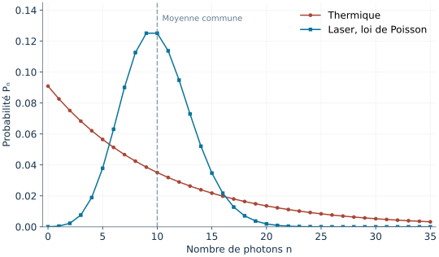

# X-ENS MP — Physique 2024 · Corrigé guidé

*Corrigé rédigé par IA, non officiel. Signalez toute erreur.*

**Rédaction** · GPT-6.2 Sol · effort non renseigné · vitesse non renseignée

**Révision** · modèle non renseigné · effort non renseigné · vitesse non renseignée

**Révision (tour 2)** · GPT-6.2 Astra Ultra · vitesse non renseignée

**Révision (tour 3)** · GPT-6.2 Astra Ultra · vitesse non renseignée · 26 novembre 2026

## Présentation du sujet

Cette épreuve de quatre heures sans calculatrice étudie le champ électromagnétique classique, le rayonnement du corps noir et les statistiques de photons. Les trois parties sont indépendantes. L’énoncé officiel passe directement de la question 31 à la question 33.

Les questions 1–2, 9–11, 16–20 et 36–38 donnent des points d’entrée. Réservez du temps aux facteurs géométriques de Q12–13, aux lectures expérimentales de Q25 et Q39–40, puis à l’interprétation des statistiques de Q42–45. Vérifiez les unités et gardez un ou deux chiffres significatifs selon les indications du sujet.

## Partie I — Champ électromagnétique classique et grandeurs mécaniques associées

Le champ induit par un courant variable transfère une impulsion à une charge. Établissez d’abord les champs et leurs directions, puis comparez leurs variations de quantité de mouvement.

### Question 1

> [!INDICATION]
> Identifier la grandeur transportée par unité de surface et de temps.

#### Solution

Le vecteur de Poynting vaut $\vec\Pi=\vec E\wedge\vec B/\mu_0$. Sa norme représente une puissance surfacique. On l’exprime en $\mathrm{W\,m^{-2}}$. Sa dimension est $\mathsf M\mathsf T^{-3}$.

### Question 2

> [!INDICATION]
> Utiliser la relation entre la célérité, la permittivité et la perméabilité du vide.

#### Solution

Comme $\epsilon_0\mu_0c^2=1$, **$\vec g_{\rm em}=\vec\Pi/c^2$**. Sa dimension est $\mathsf M\mathsf L^{-2}\mathsf T^{-1}$. Le produit vectoriel avec $\overrightarrow{OM}$ ajoute un facteur de longueur, donc $[\vec\ell_{\rm em}]=\mathsf M\mathsf L^{-1}\mathsf T^{-1}$.

Après intégration sur le volume, on retrouve respectivement les dimensions $\mathsf M\mathsf L\mathsf T^{-1}$ d’une quantité de mouvement et $\mathsf M\mathsf L^2\mathsf T^{-1}$ d’un moment cinétique.

### Question 3

> [!INDICATION]
> Utiliser le modèle du solénoïde infini et choisir un contour d’Ampère longitudinal.

> [!JURY]
> Précisez à la fois l’approximation géométrique du solénoïde long et l’approximation de régime quasi stationnaire employée pendant l’extinction.

#### Solution

Avec le sens du courant de la figure 1, la règle de la main droite donne un champ intérieur vers $+\vec e_z$ pour $i>0$. Dans le modèle infini, la distribution est symétrique par rapport à un plan perpendiculaire à $Oz$ passant par le point d’observation. Le champ magnétique est normal à ce plan. Les invariances par translation longitudinale et rotation impliquent que sa composante axiale ne dépend que de $r$. Un contour rectangulaire entièrement à l’extérieur ne traverse aucun courant et montre que le champ extérieur est constant. Il est nul dans le modèle du solénoïde infini, par annulation loin de l’axe.

Un contour de longueur axiale $\ell$ à cheval sur l’enroulement enlace $N\ell/L$ spires. En régime variable on applique le théorème d’Ampère dans l’approximation magnétique des régimes quasi stationnaires. Ainsi
$$
\vec B_{\rm sol}(M,t)=
\begin{cases}
\mu_0(N/L)i(t)\,\vec e_z & r<b,\\
\vec 0 & r>b .
\end{cases}
$$
Le champ intérieur est uniforme dans l’espace. Son amplitude correspond à $i_0$ pour $t<0$, à $i(t)$ pour $0\le t<\tau$ et à zéro pour $t\ge\tau$. Le champ extérieur est nul pendant les trois phases.

### Question 4

> [!INDICATION]
> Appliquer Faraday sur deux cercles, selon que le flux traverse ou non toute la section du solénoïde.

#### Solution

On ne considère que le champ induit par le solénoïde. Les invariances cylindriques et le changement de sens sous une réflexion dans un plan méridien imposent une composante azimutale, constante sur un cercle d’axe $Oz$. La circulation sur ce cercle vaut $2\pi r E_\theta$. Le flux orienté selon $+\vec e_z$ traverse une surface efficace $\pi\min(r^2,b^2)$. La loi de Faraday donne
$$
\vec E_{\rm sol}(M,t)=-\frac{\mu_0N\dot i(t)}{2L}
\begin{cases}
r\,\vec e_\theta & r<b,\\
(b^2/r)\,\vec e_\theta & r>b .
\end{cases}
$$
On a utilisé le champ de Q3, en négligeant les effets d’extrémité. Le champ électrique est nul pour $t<0$ et $t\ge\tau$ lorsque le courant est constant. Pendant l’extinction du courant, il est en général non uniforme de part et d’autre de l’enroulement.

### Question 5

> [!INDICATION]
> Intégrer la force pendant l’extinction. La charge reste au voisinage de son point initial.

#### Solution

Au point $P$ extérieur au solénoïde, le champ magnétique est nul dans le modèle et $\vec e_\theta(P)=\vec e_y$. Pendant $[0,\tau]$, on évalue le champ électrique en $r=a$. En intégrant $m\dot{\vec v}=q\vec E_{\rm sol}(P,t)$ et en tenant compte du repos initial, on obtient
$$
\boxed{\vec v_P(t\ge\tau)=\frac{\mu_0Nqb^2i_0}{2mLa}\,\vec e_y.}
$$
Le courant est ensuite nul et la vitesse demeure constante dans les approximations du sujet.

### Question 6

> [!INDICATION]
> Orienter le vecteur géométrique de la source vers le point d’observation.

#### Solution

Pour $M\ne P$, la loi de Coulomb donne
$$
\vec E_q(M)=\frac{q}{4\pi\epsilon_0}\frac{\overrightarrow{PM}}{\|\overrightarrow{PM}\|^3}.
$$

### Question 7

> [!INDICATION]
> Repérer le volume où les champs électrique et magnétique se recouvrent. Contrôler l’orientation du produit vectoriel.

#### Solution

Pour $t<0$, le champ électrique est celui de la charge et le champ magnétique est confiné au solénoïde. En notant $B_0=\mu_0Ni_0/L$, on obtient
$$
\vec G_{\rm em}(t<0)
=\frac{q B_0}{4\pi}
\left(\iiint_{V_{\rm sol}}\frac{\overrightarrow{PM}}{\|\overrightarrow{PM}\|^3}\,\mathrm dV\right)\wedge\vec e_z
=\frac{qB_0b^2}{2a}\,\vec e_y .
$$
Pour $t\ge\tau$, le champ du solénoïde est nul. Les champs propres d’une charge ponctuelle ne sont pas comptés dans l’impulsion d’interaction du modèle. Avec cette approximation, **$\vec G_{\rm em}(t\ge\tau)=\vec0$**.

### Question 8

> [!INDICATION]
> Comparer les deux bilans entre avant et après l’extinction. Vérifier le signe de la variation du champ.

#### Solution

La quantité de mouvement de la charge augmente de $qB_0b^2\vec e_y/(2a)$ et celle du champ diminue exactement de cette quantité. Chacune varie, et **leur somme se conserve dans le modèle**.

Pendant l’extinction, en figeant la position de la charge comme en Q5, l’impulsion de couplage calculée en Q7 est $q b^2 B_{\rm int}(t)\vec e_y/(2a)$, où $B_{\rm int}(t)=\mu_0Ni(t)/L$ est la composante axiale intérieure. Le terme propre au solénoïde $\epsilon_0\vec E_{\rm sol}\wedge\vec B_{\rm sol}$ est radial et s’intègre à zéro par symétrie. La loi de Newton en Q5 donne alors $\mathrm d(m\vec v_P)/\mathrm dt=-\mathrm d\vec G_{\rm em}/\mathrm dt$. Le champ électrique induit assure le transfert.

## Partie II — Du classique au quantique : le rayonnement du corps noir

Le comptage des modes est commun aux deux modèles de rayonnement. Les deux approches diffèrent par leur énergie moyenne par mode.

### II.A — Densité de modes électromagnétiques dans une cavité

### Question 9

> [!INDICATION]
> Partir des équations de Maxwell dans le vide entre les deux parois.

#### Solution

Dans le vide sans charge ni courant, les équations de Maxwell conduisent à
$$
\Delta\vec E-\frac1{c^2}\frac{\partial^2\vec E}{\partial t^2}=\vec0 .
$$
Avec la forme harmonique du sujet, $\partial_t^2$ donne $-\omega^2$ et le laplacien se réduit à la dérivée seconde en $x$. Ainsi **$E_0''+k^2E_0=0$**, avec $k=\omega/c$.

### Question 10

> [!INDICATION]
> Examiner la composante tangentielle donnée par la relation de passage, puis les zéros d’un sinus.

#### Solution

La relation de passage autorise un saut normal. Ici $\vec E$ est tangent aux deux plaques et nul dans le métal. Sa composante tangentielle est donc nulle en $x=0$ et $x=L$. Avec $E_0(x)=A\cos(kx)+B\sin(kx)$, la première condition impose $A=0$. Pour un mode non nul, la seconde donne $kL=n\pi$. Donc
$$
\begin{aligned}E_0(x)&=B\sin\!\left(\frac{n\pi x}{L}\right),\\
\boxed{\omega_n}&=\frac{n\pi c}{L},\quad n\ge1.\end{aligned}
$$

### Question 11

> [!INDICATION]
> Vérifier si la deuxième direction de polarisation est tangentielle aux plaques.

#### Solution

La polarisation suivant $\vec e_z$ est, comme celle suivant $\vec e_y$, tangentielle aux plaques et ne change ni l’équation scalaire ni ses conditions aux limites. On retrouve donc $\omega_n=n\pi c/L$. Pour chaque $n$, **les polarisations rectilignes suivant $\vec e_y$ et $\vec e_z$** donnent deux modes indépendants.

### Question 12

> [!INDICATION]
> Dans l’espace des vecteurs d’onde, compter les nœuds, puis les polarisations par nœud.

> [!JURY]
> Le jury relève l’oubli fréquent de l’octant positif. Comptez séparément les nœuds accessibles et le nombre de polarisations par nœud.

#### Solution

Exactement, $N(\omega)$ est deux fois le nombre de triplets d’entiers strictement positifs dans la sphère de rayon $k=\omega/c$ après multiplication des coordonnées par le pas $\pi/L$. Lorsque $kL/\pi\gg1$, on divise le volume accessible par celui d’une maille et on néglige les corrections de bord. Le volume accessible est le huitième de la sphère, car chaque composante est positive. Les deux polarisations donnent
$$
N(\omega)\simeq 2\,\frac{(4\pi/3)(\omega/c)^3/8}{(\pi/L)^3}
=\boxed{\frac{V\omega^3}{3\pi^2c^3}}.
$$

### Question 13

> [!INDICATION]
> Dériver le comptage cumulé, puis conserver le nombre de modes dans un intervalle lors du changement de variable.

> [!METHODE]
> Pour convertir une densité entre deux variables, partez du même nombre de modes dans deux intervalles correspondants.

#### Solution

Dans l’approximation continue,
$$
D_\omega(\omega)=\frac{\mathrm dN}{\mathrm d\omega}
=\frac{V\omega^2}{\pi^2c^3}.
$$
Le nombre de modes entre deux bornes est indépendant de la variable utilisée. Avec $\omega=2\pi\nu$ et $D_\nu(\nu)\,\mathrm d\nu=D_\omega(\omega)\,\mathrm d\omega$,
$$
\boxed{D_\nu(\nu)=\frac{8\pi V}{c^3}\nu^2}.
$$

### II.B — Composition spectrale du rayonnement : approche de Rayleigh-Jeans

### Question 14

> [!INDICATION]
> Compter les termes quadratiques dans l’énergie d’un mode, puis utiliser la densité de modes.

#### Solution

Chaque mode équivaut à un oscillateur harmonique à un degré de liberté. L’énergie comprend deux termes quadratiques, l’un dans la coordonnée et l’autre dans l’impulsion. Chacun apporte $k_BT/2$ en moyenne, donc $\overline E=k_BT$ par mode. On multiplie par la densité de modes, qui inclut déjà les deux polarisations, et on trouve
$$
\begin{aligned}U_{\rm RJ}(\nu)&=\frac{8\pi V}{c^3}\nu^2 k_BT,\\
\boxed{A}&=\frac{8\pi V}{c^3}.\end{aligned}
$$

### Question 15

> [!INDICATION]
> Lire les deux axes de la figure 3 et traduire une loi de puissance en pente dans cette échelle.

> [!JURY]
> Les deux axes de la figure 3 sont logarithmiques. Comparez une pente à la puissance de la loi théorique.

#### Solution

La figure 3 utilise une échelle logarithmique en fréquence et en intensité. La loi $U_{\rm RJ}\propto\nu^2$ donne une pente 2, compatible avec la montée aux basses fréquences. Les données atteignent ensuite un maximum et décroissent fortement. La loi classique continue au contraire de croître et prédit une énergie totale divergente, $\int_0^\infty U_{\rm RJ}(\nu)\,\mathrm d\nu=+\infty$. Cette divergence à haute fréquence est la **catastrophe ultraviolette**. L’hypothèse en cause est l’équipartition classique jusqu’aux fréquences où l’énergie échangée par quanta ne peut plus être traitée comme continue.

### II.C — Hypothèse des quanta et approche de Planck

### Question 16

> [!INDICATION]
> Appliquer le poids de Boltzmann à l’état dont l’énergie est indiquée.

#### Solution

Pour $\beta=1/(k_BT)$, le poids de l’état $n$ est $e^{-\beta nh\nu}$. Ainsi $P_n(\nu)=e^{-\beta nh\nu}/Z(\beta,\nu)$, où $Z$ est la somme de ces poids et assure la normalisation.

### Question 17

> [!INDICATION]
> Reconnaître une série géométrique et préciser sa raison.

#### Solution

Posons $x=e^{-\beta h\nu}$. Pour $\nu>0$ et $T>0$, $0<x<1$. La normalisation impose
$$
\begin{aligned}Z&=\sum_{n=0}^\infty x^n=\frac1{1-x},\\
\boxed{P_n}&=(1-x)x^n.\end{aligned}
$$

### Question 18

> [!INDICATION]
> Dériver la somme géométrique par rapport à sa raison pour faire apparaître le facteur n.

#### Solution

On a $\sum_{n\ge0}nx^n=x/(1-x)^2$. Avec la probabilité de Q17,
$$
\begin{aligned}\bar n&=(1-x)\sum_{n=0}^\infty n x^n=\frac{x}{1-x},\\
\boxed{\bar n}&=\frac1{e^{\beta h\nu}-1}.\end{aligned}
$$

### Question 19

> [!INDICATION]
> Exprimer la raison de la loi géométrique à partir de la moyenne.

#### Solution

L’identité $\bar n=x/(1-x)$ donne $x=\bar n/(1+\bar n)$ et $1-x=1/(1+\bar n)$. Ainsi
$$
\boxed{P_n=\frac1{1+\bar n}\left(\frac{\bar n}{1+\bar n}\right)^n.}
$$

### Question 20

> [!INDICATION]
> Multiplier l’énergie d’un photon par l’occupation moyenne puis compter les modes dans une bande de fréquence.

#### Solution

Pour un mode, $\overline E(\nu)=h\nu\,\bar n=h\nu/(e^{\beta h\nu}-1)$. En multipliant par $D_\nu(\nu)$,
$$
\boxed{U(\nu)=\frac{8\pi V}{c^3}\frac{h\nu^3}{e^{\beta h\nu}-1}.}
$$

### Question 21

> [!INDICATION]
> Comparer l’énergie du photon à l’énergie thermique. Factoriser l’exponentielle dominante à haute fréquence.

#### Solution

Avec $x=h\nu/(k_BT)$, la comparaison porte sur $h\nu$ et $k_BT$. À basse fréquence, $x\ll1$ et $e^x-1\sim x$, si bien que
$$
U(\nu)\sim \frac{8\pi V}{c^3}\nu^2k_BT .
$$
À haute fréquence, $x\gg1$ et $e^x-1\sim e^x$, d’où
$$
U(\nu)\sim\frac{8\pi V}{c^3}h\nu^3 e^{-h\nu/(k_BT)}.
$$
Pour le tracé, l’échelle verticale commune est $U_*=8\pi V(k_BT)^3/(c^3h^2)$. Les deux lois se rejoignent au voisinage de l’origine. Le modèle de Planck présente ensuite un maximum puis une décroissance, tandis que Rayleigh-Jeans croît sans borne. La décroissance exponentielle rend l’intégrale d’énergie convergente.

## Partie III — Interprétation quantique du rayonnement électromagnétique

La cellule photoélectrique mesure une énergie seuil. Le photomultiplicateur mesure des événements, dont la dispersion permet ensuite de caractériser la source.

### III.A — Effet photoélectrique

### Question 22

> [!INDICATION]
> Comparer l’énergie d’un photon individuel au travail d’extraction.

#### Solution

Le photon de longueur d’onde $0{,}546\ \mathrm{\mu m}$ a l’énergie
$$
E_\gamma=\frac{hc}{\lambda}\simeq\frac{1{,}2}{0{,}546}\ \mathrm{eV}\simeq2{,}2\ \mathrm{eV}.
$$
Le travail d’extraction vaut $2{,}4\ \mathrm{eV}$. De façon équivalente, la longueur d’onde seuil est $hc/W_0\simeq0{,}50\ \mathrm{\mu m}$, inférieure à la longueur d’onde incidente. Dans le modèle d’absorption d’un photon, **aucun électron ne peut être extrait à 546 nm**.

### Question 23

> [!INDICATION]
> Distinguer les électrons déjà dirigés vers l’anode et ceux qu’une tension retardatrice peut arrêter.

#### Solution

Même à tension nulle, des électrons quittent la cathode avec une vitesse dirigée vers l’anode et l’atteignent. Ils donnent un photocourant. Pour $u<0$, l’anode est à un potentiel plus faible que la cathode. L’énergie potentielle de l’électron croît vers l’anode et l’électron est freiné.

Dans l’approximation d’un champ uniforme entre les électrodes, seule l’énergie cinétique de la composante normale permet de remonter la barrière, de hauteur $e|u|$. Lorsque $|u|$ croît, moins de directions initiales permettent d’atteindre l’anode. À partir de la tension appliquée **$u=-U_0$**, même les électrons les plus favorables cessent d’être collectés.

### Question 24

> [!INDICATION]
> Écrire les bilans d’énergie lors de l’extraction puis lors du freinage, avec le signe de la tension appliquée.

> [!PIEGE]
> Distinguez la valeur positive du seuil et la tension négative effectivement appliquée.

#### Solution

Après extraction, l’énergie cinétique vaut $h\nu-W_0$. À la limite du freinage pour l’électron émis normalement, $0=h\nu-W_0+eu$. Pour $h\nu>W_0$, on obtient
$$
\begin{aligned}U_0&=\frac{h\nu-W_0}{e}>0,\\
u_{\rm arrêt}&=-U_0.\end{aligned}
$$
La figure 4(b) repère la tension appliquée négative. La figure 4(c) trace sa valeur absolue $U_0$. Pour un matériau donné, le seuil dépend de la fréquence et la puissance n’intervient pas dans le bilan d’un photon.

### Question 25

> [!INDICATION]
> Lire deux points éloignés sur la droite de la figure 4(c), puis convertir sa pente en une constante d’action.

#### Solution

La figure 4(c) donne une droite de pente $h/e$. Son intersection avec l’axe horizontal est à $\nu_0=57{,}0\times10^{13}\ \mathrm{Hz}$. Un point éloigné se lit vers $96\times10^{13}\ \mathrm{Hz}$ pour environ $1{,}6\ \mathrm V$. Ainsi
$$
h\simeq e\,\frac{1{,}6}{(96-57)\times10^{13}}\ \mathrm{V\,s}
\simeq\boxed{6{,}6\times10^{-34}\ \mathrm{J\,s}}.
$$
Pour estimer l’incertitude de lecture, prenons environ $0{,}02$ à $0{,}04\ \mathrm V$ verticalement et $0{,}5\times10^{13}\ \mathrm{Hz}$ sur chacune des abscisses. Rapportées aux écarts utilisés, ces erreurs représentent quelques pour cent. On obtient **$\Delta h$ de l’ordre de $3\times10^{-35}\ \mathrm{J\,s}$**, avec une précision limitée par la lecture de la figure.

### Question 26

> [!INDICATION]
> Interpréter le courant comme un nombre de charges collectées par unité de temps.

#### Solution

Lorsque $u>0$, le champ attire les électrons vers l’anode. En augmentant $u$, on collecte progressivement les électrons émis sous des directions qui les auraient fait manquer l’anode dans la cellule de taille finie. À tension suffisante, pratiquement tous les photoélectrons émis sont collectés. L’augmentation de tension modifie encore leur vitesse, mais plus leur débit de collecte. Le courant atteint **le plateau $I_{\rm sat}$**.

### Question 27

> [!INDICATION]
> Compter les photons incidents puis les électrons émis par seconde. Chercher un lien entre puissances et hauteurs des plateaux.

#### Solution

Le flux de photons vaut $P/(h\nu)$. En saturation, la collecte de photoélectrons est complète. On mesure donc
$$
\boxed{I_{\rm sat}=e\eta\,\frac{P}{h\nu}}.
$$
À fréquence fixée, le seuil $-U_0$ est commun et les plateaux croissent proportionnellement à $P$. Pour plusieurs puissances, on relève le plateau, puis on trace $I_{\rm sat}$ en fonction de $P$. Sa pente $a$ donne $\eta=ah\nu/e$.

### III.B — Statistiques d’émission de photons

### III.B.a — Source de rayonnement thermique

### Question 28

> [!INDICATION]
> Obtenir le second moment en dérivant à nouveau la somme géométrique de Q18.

#### Solution

Pour $x=\bar n/(1+\bar n)$, on a $P_n=(1-x)x^n$. La dérivée seconde de la série géométrique donne $\sum_{n\ge0}n(n-1)x^n=2x^2/(1-x)^3$. Donc $\langle n(n-1)\rangle=2\bar n^2$. En ajoutant $\bar n$ on trouve $\langle n^2\rangle=2\bar n^2+\bar n$, et finalement
$$
\boxed{\Delta n=\sqrt{\bar n(1+\bar n)}.}
$$

### Question 29

> [!INDICATION]
> Identifier l’entier le plus probable et distinguer cette valeur de l’abscisse moyenne.

#### Solution

La suite $P_n$ est géométrique décroissante. Le maximum est $P_0=1/(1+\bar n)$, tandis que la moyenne $\bar n$ est positive. Une longueur horizontale égale à $\Delta n$ donne l’échelle des fluctuations.

### III.B.b — Source laser

### Question 30

> [!INDICATION]
> Diviser l’énergie émise par seconde par l’énergie d’un photon, puis inverser le débit.

#### Solution

Pour une source monochromatique, $\Phi=P/(h\nu)=P\lambda/(hc)$. Avec $P=10^{-3}\ \mathrm W$ et $\lambda=4{,}0\times10^{-7}\ \mathrm m$,
$$
\boxed{\Phi\simeq2{,}0\times10^{15}\ \mathrm{s^{-1}},\qquad
\Phi^{-1}\simeq5{,}0\times10^{-16}\ \mathrm s.}
$$

### Question 31

> [!INDICATION]
> Associer une variable de Bernoulli à chacun des intervalles élémentaires.

#### Solution

Chaque intervalle $\delta\tau=\tau/N$ contient zéro photon ou un photon dans l’approximation du sujet. La probabilité d’en contenir un vaut $p$, identique pour chaque intervalle puisque la puissance est constante. L’hypothèse d’émissions indépendantes permet de multiplier les probabilités des intervalles disjoints, dans la limite où la probabilité de deux émissions par intervalle est négligeable.

Pour obtenir $n$ émissions, on choisit $n$ intervalles parmi $N$. Ainsi $P_n=\binom Nn p^n(1-p)^{N-n}$. Comme la moyenne vaut $Np$, on a **$p=\bar n/N=\Phi\,\delta\tau$**.

*L’énoncé passe de la question 31 à la question 33.*

### Question 33

> [!INDICATION]
> Comparer les variances à moyenne égale et prendre la limite des petits intervalles.

#### Solution

La variance binomiale vaut $Np(1-p)=\bar n(1-\bar n/N)$. Pour $N\gg\bar n$,
$$
\boxed{\Delta n_{\rm laser}\simeq\sqrt{\bar n}.}
$$
La source thermique monomode a $\Delta n=\sqrt{\bar n(1+\bar n)}$, plus grand à même moyenne. Les comptes du laser fluctuent donc moins d’une fenêtre à l’autre. L’écart devient marqué quand $\bar n$ dépasse l’unité.

### Question 34

> [!INDICATION]
> Séparer le facteur combinatoire de la puissance de la probabilité de n’avoir aucune émission.

#### Solution

À $n$ et $\bar n$ fixés, la loi binomiale s’écrit
$$
P_n=\frac{\bar n^n}{n!}
\frac{N!}{(N-n)!N^n}
\left(1-\frac{\bar n}{N}\right)^{N-n}.
$$
Le facteur combinatoire normalisé tend vers 1 par (12). Pour le dernier facteur, le logarithme donne $(N-n)\ln(1-\bar n/N)\to-\bar n$. Donc
$$
\boxed{P_n\longrightarrow e^{-\bar n}\frac{\bar n^n}{n!}.}
$$

### Question 35

> [!INDICATION]
> À moyenne commune, comparer la position du maximum et la dispersion, puis placer les deux lois sur les mêmes axes.

#### Solution

Pour $\bar n=10$, la loi thermique décroît dès $n=0$, où elle vaut $1/11$. Elle possède une longue queue et $\Delta n_{\rm th}=\sqrt{110}$. La loi du laser est concentrée autour de 10, avec $\Delta n_{\rm laser}=\sqrt{10}\simeq3{,}2$. Pour la loi de Poisson discrète, les deux maxima sont à 9 et 10 puisque $P_{n+1}/P_n=10/(n+1)$.

### III.C — Détection de photons et caractérisation expérimentale d’une source

### III.C.a — Fonctionnement d’un photomultiplicateur

### Question 36

> [!INDICATION]
> Calculer la charge totale produite par un photon détecté et la répartir sur le temps du pic.

#### Solution

Le nombre d’électrons vaut approximativement $2^{20}\simeq10^6$ après les 20 dynodes. La charge vaut $2^{20}e$. Sur une largeur typique $\delta t=20\ \mathrm{ns}$, l’ordre de grandeur du courant du pic est $2^{20}e/\delta t$. La forme exacte fixerait un facteur numérique d’ordre un. Avec $R_c=1\ \mathrm{k\Omega}$,
$$
\boxed{u_{\max}\sim \frac{R_c2^{20}e}{\delta t}\sim8\ \mathrm{mV}.}
$$

### Question 37

> [!INDICATION]
> Relier la tension totale à la chute par résistance et employer la puissance consommée par le diviseur.

#### Solution

Le diviseur présente une résistance totale $kR$ et une tension $U_0=k\Delta U$. Avec la puissance $\mathcal P=2\ \mathrm W$,
$$
\boxed{R=\frac{k(\Delta U)^2}{\mathcal P}=1{,}0\times10^5\ \Omega}.
$$
Entre deux dynodes, un électron gagne $e\Delta U=100\ \mathrm{eV}$, environ 45 fois le travail d’extraction $W_{\rm GaP}$. L’éjection d’électrons secondaires est énergétiquement possible.

### Question 38

> [!INDICATION]
> Appliquer le rendement quantique au débit de photons arrivant sur la photocathode.

#### Solution

Lorsque les impulsions sont résolues, le taux moyen de détection vaut
$$
\boxed{\Gamma=\eta\,\frac{P}{h\nu}=\eta\,\frac{P\lambda}{hc}.}
$$

### Question 39

> [!INDICATION]
> Choisir la courbe commune aux modèles 110 et 113 à 400 nm. Lire son ordonnée sur une échelle logarithmique et convertir les picowatts.

#### Solution

À 400 nm, la courbe des modèles 110 et 113 donne environ $5\times10^5\ \mathrm{Hz\,pW^{-1}}$, soit environ $5\times10^{17}\ \mathrm{J^{-1}}$. L’énergie d’un photon vaut $hc/\lambda\simeq5{,}0\times10^{-19}\ \mathrm J$, donc
$$
\boxed{\eta=\frac{\Gamma}{P}\frac{hc}{\lambda}\simeq0{,}25.}
$$
Il s’agit d’une estimation graphique.

### Question 40

> [!INDICATION]
> Comparer l’intervalle moyen entre événements à la largeur d’un pic et lire le départ de la zone linéaire sur la figure 6.

> [!METHODE]
> Le temps de réponse fixe une échelle de saturation. Utilisez la courbe constructeur pour déterminer à quel taux la proportionnalité commence déjà à se dégrader.

#### Solution

Deux détections espacées de moins de $20\ \mathrm{ns}$ peuvent donner des pics qui se recouvrent. Le circuit sous-compte alors les événements et la proportionnalité avec la puissance se dégrade. L’échelle de taux donnée par le temps de réponse est
$$
\Gamma_{\max}\sim\frac1{20\ \mathrm{ns}}\sim5\times10^7\ \mathrm{Hz}.
$$
La courbe expérimentale commence à s’écarter sensiblement de la droite vers $10^7\ \mathrm{Hz}$ et plafonne à quelques $10^7\ \mathrm{Hz}$. Ces ordres de grandeur sont cohérents. À 400 nm, le rapport de Q39 donne environ $10^2\ \mathrm{pW}$ si l’on prend l’inverse du temps de réponse pour seuil. En se fondant sur le début de la perte de linéarité, on vise plutôt **$P\lesssim20\ \mathrm{pW}$**. Le flux d’un laser usuel doit être fortement atténué.

Un modèle simple permet de quantifier la perte de linéarité. Pour des événements de Poisson au taux $\lambda_d=\eta\Phi$ et un temps mort fixe $\tau_d$ qui ne se prolonge pas après un événement manqué, le délai moyen entre deux comptes vaut $\tau_d+1/\lambda_d$. Le taux mesuré est donc $\lambda_d/(1+\lambda_d\tau_d)$. Avec $\tau_d=20\ \mathrm{ns}$, une perte de 10 % correspond déjà à $\lambda_d\simeq5{,}6\times10^6\ \mathrm{s^{-1}}$, bien en dessous de la valeur asymptotique $1/\tau_d$. Ce modèle illustre la différence entre une tolérance de linéarité et une fréquence de saturation.

### III.C.b — Mesure de la statistique d’émission d’un laser

### Question 41

> [!INDICATION]
> Multiplier le flux compté par la durée de la fenêtre. Utiliser la variance de Poisson pour les comptes.

#### Solution

Dans le modèle par intervalles de Q31, une émission de probabilité $p$ suivie d’une détection indépendante de rendement $\eta$ donne une probabilité comptée $\eta p$. La limite de Poisson de Q34 s’applique donc avec une moyenne multipliée par $\eta$.

Avec $\eta=0{,}25$, $P=10^{-13}\ \mathrm W$, $h\nu\simeq5{,}0\times10^{-19}\ \mathrm J$ et $\tau=0{,}1\ \mathrm s$,
$$
\begin{aligned}\bar n&=\frac{\eta P\tau}{h\nu}\simeq5{,}0\times10^3,\\
\Delta n&=\sqrt{\bar n}\simeq71.\end{aligned}
$$
Les deux quantités sont des nombres de détections.

### Question 42

> [!INDICATION]
> Répéter les fenêtres de comptage et comparer plusieurs moyennes pour vérifier la loi de fluctuation.

#### Solution

On compte les impulsions dans de nombreuses fenêtres disjointes de même durée, à puissance stabilisée et dans le domaine linéaire de l’appareil. On mesure les comptes noirs à laser occulté pour vérifier que leur moyenne et leur variance sont négligeables, ou pour corriger leurs contributions si le fond est indépendant. On estime ensuite la moyenne, la variance et l’histogramme des comptes. On compare ce dernier à la loi de Poisson paramétrée par la moyenne mesurée.

En répétant pour plusieurs puissances ou durées, on vérifie que la variance croît linéairement avec la moyenne avec pente unité, ou que le **rapport signal sur bruit croît comme $\sqrt{\bar n}$**. Ces essais permettent de distinguer cette loi de la variance de la source thermique monomode.

### III.C.c — Mesure de la statistique d’émission d’une source thermique

### Question 43

> [!INDICATION]
> Convertir la largeur en longueur d’onde en une largeur fréquentielle, puis prendre l’inverse de cette largeur.

#### Solution

La largeur spectrale correspondant à $\Delta\lambda$ est, au premier ordre, $\Delta\nu\simeq c\,\Delta\lambda/\lambda_0^2$. Le temps de cohérence est de l’ordre de son inverse. Avec $\lambda_0=10^{-6}\ \mathrm m$ et $\Delta\lambda=3{,}0\times10^{-7}\ \mathrm m$,
$$
\boxed{\tau_c\sim\frac{\lambda_0^2}{c\,\Delta\lambda}\sim10^{-14}\ \mathrm s.}
$$
La largeur relative étant de l’ordre de 0,3, cette conversion donne une estimation d’ordre de grandeur.

### Question 44

> [!INDICATION]
> Comparer le temps de cohérence au temps de réponse et à la durée de comptage.

#### Solution

Le détecteur répond sur environ $20\ \mathrm{ns}$, soit plus d’un million de temps de cohérence. Les fenêtres de comptage sont encore plus longues. Chaque mesure mélange ainsi un très grand nombre de fluctuations d’intensité faiblement corrélées. Les fortes fluctuations sur une durée $\tau_c$ sont moyennées et difficiles à observer séparément.

On peut séparer la perte de photons du changement de statistique dû au nombre de modes. Si $N$ photons arrivent et que chacun est détecté indépendamment avec probabilité $\eta$, on a $\mathbb E[C\mid N]=\eta N$ et $\mathrm{Var}(C\mid N)=\eta(1-\eta)N$. Par la variance totale, $\mathrm{Var}(C)=\eta(1-\eta)\mathbb E[N]+\eta^2\mathrm{Var}(N)$. Ainsi une source thermique monomode garde après détection une variance $\bar C+\bar C^2$, tandis qu’une source de Poisson garde une variance $\bar C$. L’atténuation réduit le contraste absolu de l’excès thermique.

### Question 45

> [!INDICATION]
> Dans la variance donnée, examiner le terme supplémentaire dû à un mode thermique. Relier la largeur spectrale au temps de cohérence.

#### Solution

À moyenne totale $\bar n$ fixée, le terme $\bar n^2/N_m$ diminue lorsque le nombre de modes indépendants augmente. Pour $N_m\gg\bar n$, l’écart-type se rapproche de $\sqrt{\bar n}$, caractéristique de Poisson.

Dans le modèle de $N_m$ modes thermiques indépendants de poids égaux, chaque mode a une moyenne $\bar n/N_m$. Notons $x=\bar n/(N_m+\bar n)$.

Toute répartition de $n$ photons entre les modes a la même probabilité $(1-x)^{N_m}x^n$. Il y a $\binom{N_m+n-1}{n}$ répartitions, obtenues en plaçant $N_m-1$ séparations parmi les $n$ photons et les séparations.

Pour $n$ fixé, ce nombre est équivalent à $N_m^n/n!$. Comme $N_m x\to\bar n$ et $(1-x)^{N_m}\to e^{-\bar n}$, on retrouve **$P_n\to e^{-\bar n}\bar n^n/n!$**.

L’élargissement spectral raccourcit le temps de cohérence et fait moyenner davantage de fluctuations indépendantes par fenêtre, ce qui rejoint Q44. Pour observer la statistique thermique, on sélectionne une bande très étroite et, si possible, un seul mode spatial et une seule polarisation. On augmente ainsi le temps de cohérence et on choisit une fenêtre de détection au plus du même ordre. Un laser ordinaire n’est pas un substitut à une source thermique filtrée, car sa statistique d’émission est différente.

## Bilan

- En régime variable, relier le champ électrique au flux magnétique et vérifier les signes du transfert de quantité de mouvement.
- Pour compter des modes, préciser l’espace accessible, la maille et la multiplicité. Convertir les densités en conservant le même nombre de modes.
- Comparer l’énergie d’un quantum à l’énergie thermique pour identifier les régimes d’un spectre.
- Pour des comptes de photons, distinguer le temps de cohérence, le temps de réponse du détecteur et la durée de la fenêtre de comptage.
