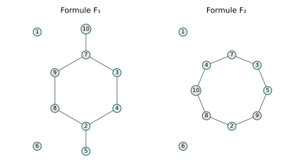
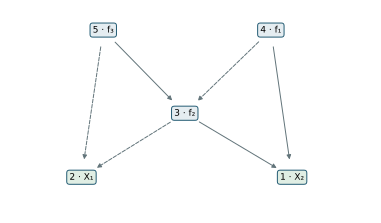

# X-ENS MPI · Informatique C 2024 · Corrigé brut

*Corrigé rédigé par IA, non officiel. Signalez toute erreur.*

**Rédaction** · GPT-6.2 Astra Ultra · vitesse non renseignée · 24 novembre 2026

## I · Équivalences de littéraux

### Question 1 · Traduire la formule donnée

Avec $X_1$ interprétée vraie, $F_0$ est logiquement équivalente à

$$
(\neg X_3\lor\neg X_2)\land(X_3\lor X_2)\land(\neg X_4\lor X_3)\land(\neg X_3\lor X_4)\land\neg X_5 .
$$

Les contraintes échangées $X_4\leftrightarrow X_3$ et $X_3\leftrightarrow X_4$ donnent les mêmes deux clauses. Pour une formule ordinaire où la variable $X_1$ serait libre, ajouter la clause unitaire $X_1$ afin de rendre la convention explicite.

### Question 2 · Réduction vers 2-SAT

Remplacer $a\leftrightarrow b$ par $(\neg a\lor b)\land(\neg b\lor a)$ et ajouter la clause $X_1$. Chaque valuation admissible de la formule d’origine satisfait ces clauses exactement lorsqu’elle satisfait toutes les équivalences. Réciproquement, toute valuation satisfaisant les clauses respecte la constante et les contraintes. On émet deux clauses par contrainte en temps linéaire dans la taille de l’entrée.

### Question 3 · Coder les littéraux

Les entrées valides vont de 1 à $2n$, bornes incluses. La négation échange les deux moitiés en conservant l’indice de variable. Le vérificateur de formules renvoie un booléen sans faire échapper l’exception applicable aux deux fonctions de littéraux.

```ocaml
exception Bad_literal of int
exception Exn_unsat

let var_of_lit i =
  if i < 1 || i > 2*n then raise (Bad_literal i);
  if i <= n then i else i-n

let neg_lit i =
  let x = var_of_lit i in
  if i <= n then x+n else x

let eform1_is_wf contraintes =
  let valide i = 1 <= i && i <= 2*n in
  List.for_all (fun (i,j) -> valide i && valide j) contraintes
```

### Question 4 · Les graphes de F₁ et F₂

Pour $n=5$, les dix sommets portent les numéros 1 à 10. Les listes suivantes donnent toutes les arêtes non orientées ; 1 et 6 sont isolés dans les deux graphes.

| Formule | Arêtes issues des contraintes dans l’ordre, avec leur image par négation |
|---|---|
| $F_1$ | $(3,4),(8,9)$ ; $(4,2),(9,7)$ ; $(3,7),(8,2)$ ; $(5,2),(10,7)$ |
| $F_2$ | $(9,2),(4,7)$ ; $(2,8),(7,3)$ ; $(4,10),(9,5)$ ; $(3,5),(8,10)$ |



### Question 5 · Construire le graphe

Initialiser les $2n$ sommets, y compris ceux qui n’apparaissent jamais dans une contrainte. Pour chaque paire non triviale, ajouter les deux arêtes complémentaires. Le constructeur du sujet tolère les répétitions d’une arête. Une contradiction indirecte sera détectée par les composantes connexes.

```ocaml
let eform1_to_graph contraintes =
  let g = g_create (2*n) in
  List.iter (fun (i,j) ->
    if i = neg_lit j then raise Exn_unsat;
    if i <> j then begin
      g_add_edge g i j;
      g_add_edge g (neg_lit i) (neg_lit j)
    end) contraintes;
  g
```

### Question 6 · Coût avec la bibliothèque fournie

Créer le graphe coûte $O(n)$. Le parcours des $p$ contraintes coûte $O(p)$ hors ajouts, et chacune entraîne au plus deux appels à `g_add_edge` sur $2n$ sommets, à $O(n)$ chacun. Total $O(n+p+np)=O(n(1+p))$, soit $O(np)$ pour $p\geq1$. La spécification ne donne que des majorants pour les primitives : elle ne suffit pas pour imposer un minorant $\Omega(np)$ à toute implémentation.

### Question 7 · Calculer les composantes

Un parcours en profondeur marque les sommets accessibles depuis son point de départ. Un nouveau parcours commence à chaque sommet encore non marqué, même s’il est isolé. Le compteur représente alors le nombre de composantes rencontrées et $c[0]=0$. Avec des listes d’adjacence, le temps est $O(|V|+|E|)$.

```ocaml
let g_cc_array g =
  let k = g_nb_vertex g in
  let c = Array.make (k+1) 0 in
  let numero = ref 0 in
  let rec visite i =
    if c.(i) = 0 then begin
      c.(i) <- !numero;
      List.iter visite (g_succ g i)
    end
  in
  for i = 1 to k do
    if c.(i) = 0 then begin incr numero; visite i end
  done;
  (c, !numero)
```

### Question 8 · Propager les équivalences sur un chemin

Si une arête provient directement d’une équivalence, toute valuation modèle donne les mêmes valeurs à ses deux extrémités. Si elle provient de l’équivalence des négations, nier les deux valeurs montre encore leur égalité. Deux sommets d’une composante sont reliés par un chemin. La transitivité de l’égalité le long du chemin donne $F\models\operatorname{lit}(i)\leftrightarrow\operatorname{lit}(j)$.

### Question 9 · Image d’une composante par négation

L’application $i\mapsto\bar i$ est une involution bijective qui envoie une arête sur une arête. L’image d’un chemin est donc un chemin et $\bar C$ est connexe. Si $v$ est relié à $\bar C$, alors $\bar v$ est relié à $C$ et appartient à $C$ par maximalité de la composante. Donc $v\in\bar C$ et $\bar C$ est une composante entière.

### Question 10 · Caractériser une contradiction

Si une composante contient $i$ et $\bar i$, Q8 imposerait à un littéral d’être égal à sa négation. Réciproquement, si ce cas ne se produit jamais, Q9 partitionne les composantes en paires distinctes $(C,\bar C)$. Affecter 1 à la composante de $X_1$, 0 à sa complémentaire, puis choisir arbitrairement pour chaque paire restante une composante vraie et l’autre fausse. Les valeurs des variables ainsi obtenues donnent les bonnes valeurs aux deux littéraux de chaque variable. Les extrémités de toute contrainte sont dans la même composante (ou identiques), donc cette valuation satisfait $F$.

### Question 11 · Tester le tableau des composantes

Pour $1\leq i\leq n$, comparer les numéros des composantes de $i$ et de $i+n$. Q10 donne l’équivalence entre le succès de tous ces tests et la satisfiabilité. La case zéro est réservée.

```ocaml
let cc_is_sat c =
  let rec teste i =
    i > n || (c.(i) <> c.(i+n) && teste (i+1))
  in teste 1
```

### Question 12 · Construire une valuation témoin

La construction ci-dessous réalise Q10. Le tableau de couleurs distingue une composante encore libre ($-1$), vraie (1) ou fausse (0). Quand une couleur existe, celle de la composante complémentaire a été fixée dans la même étape. À la toute première étape $X_1$ reçoit donc 1. La recherche en profondeur utilise $O(n+p)$ opérations puisque deux arêtes au plus ont été introduites par contrainte. Les coloriages, l’allocation et le test utilisent $O(n)$ ; avec Q6, le total est $O(n(1+p))$, soit la borne demandée pour $p\geq1$. Une contrainte contradictoire directe produit elle aussi `None`.

```ocaml
let eform1_sat contraintes =
  try
    let c,m = g_cc_array (eform1_to_graph contraintes) in
    if not (cc_is_sat c) then None
    else begin
      let couleur = Array.make (m+1) (-1) in
      let v = Array.make (n+1) 0 in
      for i = 1 to n do
        let a,b = c.(i), c.(i+n) in
        if couleur.(a) = -1 then begin
          couleur.(a) <- 1;
          couleur.(b) <- 0
        end;
        v.(i) <- couleur.(a)
      done;
      Some v
    end
  with Exn_unsat -> None
```

## II · Conjonction de deux littéraux

### Question 13 · Réduire les contraintes avec conjonction à 3-SAT

Pour $a\leftrightarrow(b\land c)$ écrire $(\neg a\lor b)\land(\neg a\lor c)\land(a\lor\neg b\lor\neg c)$. Ajouter la clause unitaire $X_1$ pour la convention de vérité. Les deux premières clauses donnent $a\Rightarrow b\land c$ ; la dernière donne l’implication inverse. La transformation est linéaire en la longueur de la formule et donc polynomiale, et ne change pas l’existence d’une valuation modèle.

### Question 14 · Dérivation en déduction naturelle

Notons $\Gamma=\{X_2\to(\neg X_2\land X_3),(\neg X_2\land X_3)\to X_2\}$ et $\Delta=\Gamma\cup\{X_2\}$. Les lignes suivantes donnent la formule établie, le contexte et la règle de l’annexe.

| Ligne | Séquent | Règle |
|---|---|---|
| 1 | $\Delta\vdash X_2$ | axiome |
| 2 | $\Delta\vdash X_2\to(\neg X_2\land X_3)$ | axiome |
| 3 | $\Delta\vdash\neg X_2\land X_3$ | élimination de $\to$, 2 et 1 |
| 4 | $\Delta\vdash\neg X_2$ | première élimination de $\land$, 3 |
| 5 | $\Delta\vdash\bot$ | élimination de $\neg$, 4 et 1 |
| 6 | $\Gamma\vdash\neg X_2$ | introduction de $\neg$, décharge de $X_2$ |

La seconde hypothèse de $\Gamma$ peut rester inutilisée.

### Question 15 · Simplification de l’équivalence (5)

La règle s’applique uniquement si le membre gauche est la constante vraie. Le membre droit est alors impossible si l’un de ses littéraux est la constante fausse ou si ses littéraux sont complémentaires. Dans tous les autres cas, il suffit d’imposer que chacun soit vrai ; cela inclut une paire de littéraux identiques.

```ocaml
type contr2 = { ll : int; lr1 : int; lr2 : int }

let contr2_simplify_eq5 e =
  if e.ll <> 1 then None
  else if e.lr1 = n+1 || e.lr2 = n+1 || e.lr1 = neg_lit e.lr2
  then raise Exn_unsat
  else Some [(1,e.lr1); (1,e.lr2)]
```

### Question 16 · Encoder une valuation partielle

Pour chaque variable affectée, écrire son équivalence à la constante correspondante. Une valuation totale qui satisfait cette liste prend la valeur prescrite sur chaque variable affectée. Inversement, toute valuation totale compatible rend vraie chaque équivalence construite. Les variables libres n’ajoutent aucune contrainte. L’équivalence $(1,1)$ est bien présente puisque l’énoncé demande la liste de tous les indices affectés strictement positifs.

```ocaml
let eform1_of_valp v =
  let resultat = ref [] in
  for i = n downto 1 do
    if v.(i) = 1 then resultat := (i,1) :: !resultat
    else if v.(i) = 0 then resultat := (i,n+1) :: !resultat
  done;
  !resultat
```

### Question 17 · Terminaison de la figure 1

Pour un appel auxiliaire, prendre la mesure lexicographique $(|l_2|,u)$ où $u$ est le nombre de variables encore non affectées. Ligne 17, on retire la première contrainte. Lignes 24 et 28, la variable du littéral droit `lr1` n’était pas affectée : si elle l’était, après substitution ce littéral serait la constante vraie ou fausse et l’une des règles (1) ou (2) s’appliquerait, ou la contrainte ferait échouer la branche. Chaque appel de décision diminue donc $u$ à $|l_2|$ constant. Cet ordre sur les paires d’entiers naturels est bien fondé. Chaque appel lance au plus deux appels directs et les primitives terminent ; l’arbre est fini.

### Question 18 · Correction de l’appel principal

La liste accumulée est vide, donc vraie. La valuation partielle initiale impose seulement $X_1=1$, valable pour toute valuation autorisée par l’énoncé ; la case 0 est une convention de stockage. Par l’hypothèse de correction de l’auxiliaire, son succès fournit donc exactement un modèle du problème initial. Son échec par `Exn_unsat` signifie qu’aucun modèle n’existe ; le gestionnaire transforme cet échec en `None`.

### Question 19 · Correction de la feuille de recherche

Lorsque $l_2=[]$, les modèles cherchés sont ceux de $F_1$ compatibles avec $v_p$. Q16 montre qu’il s’agit exactement des modèles de $F_1\land F(v_p)$, codée par `l1' @ l1`. La ligne 11 décide cette formule grâce à Q12. La ligne 12 restitue le témoin ou lève l’exception suivant que cet ensemble est non vide ou vide.

### Question 20 · Correction d’une simplification

Écrire $F_2=e_2\land F_2'$. La simplification substitue les constantes déjà fixées et applique une équivalence de $E(X)$. Pour **toute valuation totale prolongeant** $v_p$, $e_2$ et la formule $L'$ renvoyée ont donc la même vérité. Ainsi le problème de l’appel est équivalent à $F_2'\land L'\land F_1$ avec la même compatibilité. C’est précisément l’appel de la ligne 17. Son résultat correct est un résultat correct pour l’appel initial. L’égalité des deux évaluations partielles à la seule valeur indéterminée ne suffirait pas à elle seule ; la justification repose sur les règles d’équivalence.

### Question 21 · Correction du branchement

La variable $x$ choisie était libre par le raisonnement de Q17. Toute valuation totale compatible lui attribue soit 1 soit 0. Si la branche $x=1$ réussit, son modèle satisfait les contraintes initiales et prolonge $v_p$. Si elle échoue, aucun modèle compatible avec cette première affectation n’existe ; la branche $x=0$ explore alors tous les candidats restants. Un échec des deux branches signifie donc que l’ensemble total de modèles est vide. Les copies empêchent une affectation de la première tentative de contaminer la seconde.

### Question 22 · Complexité de la recherche

Une décision choisit une nouvelle variable et rend aussitôt simplifiable la contrainte de tête. Une branche a au plus $d=\min(k,n-1)$ décisions et au plus $k$ suppressions de contraintes. L’arbre binaire des décisions a au plus $2^d$ feuilles et $2^d-1$ bifurcations. On peut majorer le coût des simplifications unaires par $O(k2^d)$ et celui des copies de tableaux par $O(n2^d)$. À la feuille, il y a au plus $2k$ contraintes accumulées et $n$ dues à la valuation. Q12 donne $O(n(1+k+n))$ par résolution. Une borne globale justifiée est donc $O(2^{\min(k,n-1)}n(n+k))$. L’arrêt au premier modèle peut réduire le travail sur une entrée particulière.

## III · Égalités et différences entre entiers

### Question 23 · Définir une cellule de contraintes

Chaque cellule porte le test égalité/différence, les deux indices de variables et un lien vers la prochaine cellule. L’adresse nulle termine la liste.

```c
typedef struct eform3_s {
    bool is_eq;
    int xi, xj;
    struct eform3_s *next;
} eform3_t;
```

### Question 24 · Imprimer la formule

La liste vide représente vrai. Pour toute autre liste, chaque itération écrit une contrainte puis avance du lien suivant. La dernière cellule imprime également son retour à la ligne.

```c
void eform3_print(eform3_t *lst) {
    if (lst == NULL) puts("true");
    for (; lst != NULL; lst = lst->next)
        printf("X_%d %s X_%d\n", lst->xi,
               lst->is_eq ? "=" : "!=", lst->xj);
}
```

### Question 25 · Calculer la clôture des égalités

Créer les singletons de 0 à $n$ inclus. Fusionner les deux classes de chaque égalité. Les différences ne renseignent pas la relation d’équivalence. À la fin, deux indices sont dans la même classe exactement lorsqu’une chaîne d’égalités les relie (y compris par réflexivité).

```c
uf_t *eform3_to_uf(eform3_t *lst) {
    uf_t *cs = uf_create((size_t)n + 1);
    for (; lst != NULL; lst = lst->next)
        if (lst->is_eq) uf_union(cs, lst->xi, lst->xj);
    return cs;
}
```

### Question 26 · Décider les contraintes entières

Après les fusions, comparer les représentants des extrémités de chaque différence. Un échec est nécessairement contradictoire par transitivité des égalités. En l’absence d’échec, associer à chaque classe d’indices de variables un entier distinct : toutes les égalités et toutes les différences sont satisfaites simultanément. Le cas vide est vrai. Le pseudocode C utilise `uf_destroy` pour rendre à la bibliothèque la structure qu’elle a allouée ; le sujet laisse les champs privés et le nom de son destructeur non spécifiés. Pour une implémentation dont `parent` est le seul tableau alloué, ce destructeur libère successivement `cs->parent` et `cs`.

```c
/* Destructeur de l'implémentation de la bibliothèque union-find. */
void uf_destroy(uf_t *cs);

bool eform3_sat_int(eform3_t *lst) {
    if (lst == NULL) return true;
    uf_t *cs = eform3_to_uf(lst);
    bool ok = true;
    for (eform3_t *e = lst; ok && e != NULL; e = e->next)
        if (!e->is_eq && uf_find(cs,e->xi) == uf_find(cs,e->xj))
            ok = false;
    uf_destroy(cs);
    return ok;
}
```

### Question 27 · Coût de la décision sur les entiers

La création coûte $\Theta(n+1)$. Le premier parcours coûte $O(d+e(1+\log(n+1)))$ et le second au pire $O(e+d(1+\log(n+1)))$. Le total est $O(n+(e+d)(1+\log(n+1)))$ pour une liste non vide. Le cas nul est traité en temps constant avant la création.

### Question 28 · Nombre de classes

Le nombre de classes est le nombre d’indices $i$ tels que $parent[i]=i$. Le test comprend l’éventuel singleton réservé 0, puisqu’on compte les classes de **toute la structure**. Aucun appel à `uf_find` n’est nécessaire. Le temps est linéaire en `nelem`.

```c
int uf_classes(uf_t *cs) {
    if (cs == NULL) return 0;
    int k = 0;
    for (size_t i = 0; i < cs->nelem; ++i)
        if (cs->parent[i] == (int)i) ++k;
    return k;
}
```

### Question 29 · Numéroter les classes sans lacunes

Un tableau auxiliaire associe un petit numéro à chaque racine rencontrée. Lors de la première visite d’une racine de variable, lui donner le prochain numéro en partant de 1, puis réutiliser ce numéro pour toute sa classe. Préserver $v[0]=0$. Les classes réelles reçoivent des valeurs de 1 à $k-1$ si 0 est le singleton réservé, donc bien dans $[1,k]$. Il y a $n$ recherches à $O(\log(n+1))$ et $O(n)$ autres opérations. Le tableau renvoyé appartient à l’appelant.

```c
int *uf_valuation(uf_t *cs) {
    size_t s = cs->nelem;
    int *v = malloc(s * sizeof(*v));
    int *numero = calloc(s, sizeof(*numero));
    if (v == NULL || numero == NULL) {
        free(v); free(numero); return NULL;
    }
    int prochain = 0;
    v[0] = 0;
    for (size_t i = 1; i < s; ++i) {
        int r = uf_find(cs, (int)i);
        if (numero[r] == 0) numero[r] = ++prochain;
        v[i] = numero[r];
    }
    free(numero);
    return v;
}
```

### Question 30 · Satisfaction de toutes les contraintes

Pour toute égalité, Q25 place ses deux variables dans la même classe et Q29 leur donne la même valeur. Pour toute différence, le succès de Q26 garantit des représentants distincts, dont les numéros attribués en Q29 sont distincts. Comme la formule est une conjonction, la valuation la satisfait.

### Question 31 · Cardinal minimal de l’image

Sans différence et avec $n\geq1$, une valeur est nécessaire et suffisante : poser toutes les variables à zéro. Avec une seule différence $X_i\ne X_j$, si les égalités imposent $i\sim j$ il n’y a pas de modèle. Sinon deux valeurs sont nécessaires. Donner 1 à toute la classe de $j$ et 0 à toutes les autres fournit un modèle à exactement deux valeurs.

### Question 32 · Valuation utilisant deux valeurs

Prendre un sommet par classe d’égalité de variables, sans le singleton 0. Pour chaque $X_i\ne X_j$, ajouter une arête entre leurs deux classes ; une boucle interdit tout modèle. Une valuation à au plus deux valeurs est exactement une 2-coloration de ce graphe. Parcourir par profondeur ou largeur chaque composante, en donnant à un voisin une couleur opposée et en rejetant tout conflit. Le parcours coûte $O(|V|+|E|)$, avec au plus $n$ sommets et $d$ arêtes. Construire le quotient avec Q25 et les recherches de classes coûte $O(n+(e+d)(1+\log(n+1)))$. Pour obtenir **exactement** deux valeurs, une arête garantit que les deux couleurs apparaissent ; en l’absence d’arêtes, il suffit d’au moins deux classes, à colorer différemment. Avec une seule classe réelle, l’image ne peut avoir taille deux.

## IV · Égalités et différences d’expressions

### Question 33 · Sous-termes des deux expressions

Posons $q=f_2(X_1,X_2)$. Alors $T(t_1)=\{X_1,X_2,q,f_1(q,X_2)\}$ et $T(t_2)=\{X_1,X_2,q,f_3(X_1,q)\}$. Le sous-terme $q$ est partagé et les cinq termes non vides de l’union occupent cinq positions distinctes dans le tableau de la figure 3.



### Question 34 · Tester une différence de termes

Si les représentants coïncident, la différence contredit les égalités établies. Sinon un modèle des termes quotientés peut choisir des entiers distincts pour les deux classes. Pour rendre l’interprétation de chaque symbole fonctionnel cohérente, les classes doivent inclure les identifications imposées par congruence ; c’est le rôle de Q36.

```c
bool term_is_diff(egraph_t *g, int tid1, int tid2) {
    return uf_find(g->uf, tid1) != uf_find(g->uf, tid2);
}
```

### Question 35 · Congruence de deux applications

La définition formelle de $C_g$ porte sur les **applications binaires** $f_i$. Deux feuilles ne forment donc pas de paire de cette relation de propagation, même si une feuille est évidemment égale à elle-même dans $\equiv_g$. Une convention étendant la congruence aux symboles de rang zéro donnerait aussi le vrai pour deux occurrences de la même variable ; l’indexation unique de `tset` en fait alors le même identifiant, déjà traité par Q34. Pour les applications, comparer les étiquettes par leur contenu, puis les représentants des deux enfants gauches et des deux enfants droits. Les comparaisons d’étiquettes sont supposées constantes. Les quatre recherches donnent un temps $O(1+\log s)$ pour $s=\mathrm{tset\_sz}$.

```c
#include <string.h>

bool term_is_congruent(egraph_t *g, int tid1, int tid2) {
    tnode_t u = g->tset[tid1], v = g->tset[tid2];
    if (u.li == 0 || v.li == 0) return false;
    return strcmp(u.label,v.label) == 0
        && !term_is_diff(g,u.li,v.li)
        && !term_is_diff(g,u.ri,v.ri);
}
```

### Question 36 · Fermer une fusion par congruence

Avant la fusion de classes distinctes $A$ et $B$, recueillir les parents directs d’au moins un membre de $A$, puis ceux d’au moins un membre de $B$. La structure donne deux indices d’enfants par application, ce qui permet de lire directement les arcs sans parcourir chaque ligne de la matrice dense `pre`. Un parent peut être dans les deux listes ; y faire figurer une seule fois chaque parent et par classe suffit. Unir les classes. Pour chaque paire de parents issue des listes opposées, tester **à nouveau** les classes et la congruence avant l’appel récursif, car un appel précédent a pu les réunir.

Initialement l’e-graphe est clos. Toute congruence nouvellement vraie a dû gagner une égalité d’arguments, donc ses parents figurent dans l’une de ces paires. Les fusions récursives appliquent le même raisonnement aux conséquences ultérieures. Chaque fusion est justifiée par l’égalité ajoutée ou par le principe fonctionnel, ce qui donne la plus petite clôture voulue. La prise des parents sur les classes entières est indispensable : une égalité ancienne entre $a$ et $b$, puis une nouvelle entre $b$ et $c$, doit pouvoir identifier $f(a,x)$ et $f(c,x)$ même si $b$ n’est le fils direct d’aucun de ces termes.

```c
void merge(egraph_t *g, int tid1, int tid2) {
    uf_t *cs = g->uf;
    int ca = uf_find(cs,tid1), cb = uf_find(cs,tid2);
    if (ca == cb) return;
    size_t s = g->tset_sz;
    int *parents_a = malloc(s * sizeof(*parents_a));
    int *parents_b = malloc(s * sizeof(*parents_b));
    if (parents_a == NULL || parents_b == NULL) {
        free(parents_a); free(parents_b); abort();
    }
    size_t na = 0, nb = 0;
    for (size_t u = 1; u < s; ++u) {
        tnode_t t = g->tset[u];
        if (t.li == 0) continue;
        int gauche = uf_find(cs,t.li), droite = uf_find(cs,t.ri);
        if (gauche == ca || droite == ca) parents_a[na++] = (int)u;
        if (gauche == cb || droite == cb) parents_b[nb++] = (int)u;
    }
    uf_union(cs,tid1,tid2);
    for (size_t i = 0; i < na; ++i)
        for (size_t j = 0; j < nb; ++j) {
            int u = parents_a[i], v = parents_b[j];
            if (term_is_diff(g,u,v) && term_is_congruent(g,u,v))
                merge(g,u,v);
        }
    free(parents_a);
    free(parents_b);
}
```

### Question 37 · Nombre de fusions récursives

Posons $s=\mathrm{tset\_sz}$ ; il y a $s-1$ termes réels. Une fusion effective diminue de un le nombre de classes et chaque appel récursif est précédé d’un test de différence. À partir d’au plus $s-1$ classes réelles, il y a donc au plus $s-2$ fusions en comptant l’appel initial, soit au plus $\max(0,s-3)$ appels récursifs supplémentaires. Si les deux termes sont déjà égaux il n’y en a aucun. La borne est réalisable : prendre les termes $t_0=x$, $t_{j+1}=f(t_j,t_j)$ et fusionner $t_0,t_1$. La congruence réunit successivement tous les termes de la chaîne.

### Question 38 · Complexité de la fermeture

Soit $a$ le nombre d’arcs du DAG, $s$ la taille du tableau et $m$ le nombre de fusions effectives. Le parcours de Q36 scanne $s$ positions et examine les deux enfants de chaque application, soit un coût $O(s+a(1+\log s))$ par fusion. Les deux arcs peuvent viser le même fils ; cela ne change ce compte que d’un facteur constant. Pour une fusion de $A$ et $B$, chaque paire de parents comparée possède un arc vers un enfant de $A$ et un arc vers un enfant de $B$. On peut lui associer une paire de tels arcs. Dans une même fusion, deux paires de parents différentes donnent des paires d’arcs différentes. Dans des fusions différentes, une même paire d’arcs ne peut servir de nouveau : ses deux enfants sont désormais dans la même classe, et aucune classe ne se sépare. Il y a donc $O(a^2)$ comparaisons de parents **sur tout l’arbre des appels**, chacune en $O(1+\log s)$.

Au total, une borne pour ce code est $O(m[s+a(1+\log s)]+a^2(1+\log s))$, avec $m\leq s-2$. Tous les appels après le premier fusionnent des applications, donc $m=O(1+a)$ également : chaque fusion entre deux classes de parents diminue le nombre de classes qui contiennent au moins une application. Il en résulte la borne $O((1+a)s+a^2(1+\log s))$. Une implémentation relisant toute la matrice dense des prédécesseurs à chaque appel aurait un autre coût.
