# X-ENS — PC, Chimie A 2024 · Corrigé guidé

*Corrigé rédigé par IA, non officiel.*

**Rédaction** · GPT-6.2 Astra Ultra · vitesse non renseignée

**Couverture.** Les 69 questions des quatre parties sont traitées. La lecture des courbes distingue le domaine mesuré des extrapolations. La question 56 explicite le bilan du silicium entre les structures B et D de l’énoncé.

## A. Orbitales et dioxyde de carbone

### Question 1 — Construire un diagramme d’orbitales moléculaires

> [!INDICATION]
> Partir de la base des orbitales atomiques et rechercher des couples possédant une symétrie et une énergie compatibles.

#### Solution

On choisit l’axe internucléaire $z$. La combinaison linéaire conserve le nombre total d’orbitales. Un couplage important demande une même symétrie par rapport à l’axe, un recouvrement non nul et des énergies suffisamment proches. Des lobes en phase dans la zone de recouvrement donnent une combinaison liante, leurs opposés une combinaison antiliante à nœud supplémentaire. Les $p_z$ se recouvrent axialement, les $p_x$ et $p_y$ se recouvrent latéralement en deux familles dégénérées par symétrie cylindrique.

### Question 2 — Quatre combinaisons du fragment dioxygène

> [!INDICATION]
> Prendre des orbitales $p$ parallèles sur les deux oxygènes, dans une première direction puis dans sa perpendiculaire.

#### Solution

Pour $j=x,y$, $\pi_{u,j}\propto p_j(O_g)+p_j(O_d)$ est liante et $\pi_{g,j}\propto p_j(O_g)-p_j(O_d)$ antiliante, pour des orbitales atomiques orientées dans le même sens. L’orbitale antiliante présente un plan nodal médian supplémentaire. Les dessins des deux directions sont superposables par rotation de 90° autour de $z$.

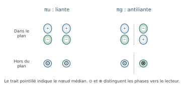

### Question 3 — Deux systèmes π de CO₂

> [!INDICATION]
> Faire tourner de 90° autour de l’axe O–C–O chacune des trois orbitales montrées.

#### Solution

Dans chacune des directions transverses, $1\pi_u$ a des lobes en phase sur les trois atomes, $\pi_g$ a des contributions opposées des deux oxygènes et un coefficient nul sur C, $2\pi_u$ a des lobes terminaux en phase entre eux et en opposition avec le lobe central. Les trois orbitales manquantes sont les mêmes combinaisons avec $p_y$ à la place de $p_x$ ou inversement. Les fonctions des deux directions sont orthogonales, notamment par réflexion dans un plan contenant $z$, et leur couplage est nul.

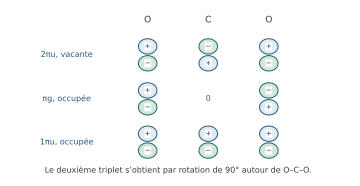

### Question 4 — Occupation des niveaux π

> [!INDICATION]
> Regrouper les électrons des liaisons π et des doublets d’oxygène ayant la symétrie π.

#### Solution

Le système contient huit électrons. Dans la description de Lewis, les deux doubles liaisons apportent quatre électrons π, auxquels s’ajoutent quatre électrons des deux doublets d’oxygène orientés transversalement qui appartiennent à ce système. On remplit $(1\pi_u)^4(\pi_g)^4(2\pi_u)^0$, avec deux électrons de spins opposés dans chacune des deux composantes de chaque niveau occupé.

### Question 5 — Ajout d’un électron

> [!INDICATION]
> Identifier la plus basse orbitale vacante sur le diagramme neutre.

#### Solution

L’électron additionnel entre dans $2\pi_u$, antiliante entre C et les deux O. L’ordre de liaison moyen diminue et les liaisons s’allongent. Le passage de 112 à 120 pm va dans le sens prévu.

### Question 6 — Retrait d’un électron

> [!INDICATION]
> Comparer le caractère de la HO avec celui de la BV au niveau des liaisons C–O.

#### Solution

Le cation perd un électron du niveau $\pi_g$, essentiellement non liant entre C et O dans ce modèle, puisque le coefficient sur C est nul. On prévoit une variation de longueur nettement plus faible que pour l’anion. Le calcul fournit effectivement 115 pm, soit +3 pm, contre +8 pm pour l’anion. Le léger allongement effectif peut relever de la relaxation de la distribution électronique et de la géométrie, au-delà du diagramme figé.

## Spéciation en solution

### Question 7 — Formule de Lewis de l’acide carbonique

> [!INDICATION]
> Placer deux hydrogènes sur des oxygènes terminaux et vérifier l’octet du carbone.

#### Solution

La structure majoritaire est $\mathrm{HO{-}C(=O){-}OH}$. Chaque O porte deux doublets non liants et chaque H une liaison. Les trois oxygènes et le carbone ont leur octet, sans charge formelle dans cette écriture.

### Question 8 — Sens des trois notations aqueuses

> [!INDICATION]
> Distinguer la convention de bilan du processus moléculaire d’hydratation.

#### Solution

Dans les bilans du sujet, $\mathrm{CO_2(aq)}$, $\mathrm{CO_2,H_2O}$ et $\mathrm{H_2CO_3}$ désignent le même réservoir acide dissous. Microscopiquement, l’équilibre $\mathrm{CO_2(aq)+H_2O\rightleftharpoons H_2CO_3}$ distingue le CO₂ simplement dissous du véritable acide carbonique hydraté, minoritaire. Le premier $pK_a$ fourni s’applique à la convention globale adoptée.

### Question 9 — Prédominance du carbone dissous

> [!INDICATION]
> Placer les deux $pK_a$ sur l’axe des pH.

#### Solution

En dessous de 6,4, $\mathrm{CO_2(aq)}$ prédomine. Entre 6,4 et 10,3, il s’agit de $\mathrm{HCO_3^-}$, puis de $\mathrm{CO_3^{2-}}$ au-dessus de 10,3. Sur chaque frontière, les deux espèces voisines ont la même activité.

### Question 10 — Distribution des trois espèces

> [!INDICATION]
> Écrire les trois fractions avec un dénominateur commun et repérer le maximum du bicarbonate.

#### Solution

Posons $h=[H^+]/c^\circ$ et $D=h^2+K_{a1}h+K_{a1}K_{a2}$. Les fractions du CO₂ dissous, du bicarbonate et du carbonate sont respectivement $h^2/D$, $K_{a1}h/D$ et $K_{a1}K_{a2}/D$. Aux pH 6,4 et 10,3 les deux formes voisines sont chacune très proches de 50 %. Au pH moyen 8,35, le bicarbonate est maximal, environ 97,8 %, et chacune des formes extrêmes représente environ 1,1 %. Les limites aux pH très acides et très basiques sont respectivement 100 % de CO₂ dissous et de carbonate.

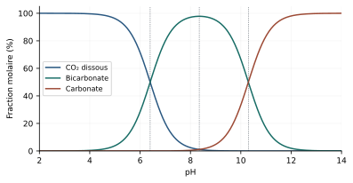

### Question 11 — Carbonate et pression partielle

> [!INDICATION]
> Éliminer le bicarbonate entre les deux équilibres acides, puis substituer la loi de dissolution.

#### Solution

La dissolution donne $[\mathrm{CO_2(aq)}]/c^\circ=Kp/p^\circ$. Les deux dissociations donnent $[\mathrm{CO_3^{2-}}]/[\mathrm{CO_2(aq)}]=K_{a1}K_{a2}/h^2$. Ainsi $[\mathrm{CO_3^{2-}}]=c^\circ K K_{a1}K_{a2}(p/p^\circ)(c^\circ/[H^+])^2$. Le symbole $p$ représente ici la pression partielle du CO₂.

### Question 12 — Approximation vers pH 8

> [!INDICATION]
> Isoler la concentration en protons avec le premier équilibre acide et identifier ce que le modèle de réservoir garde presque constant.

#### Solution

On a $[H^+]=K_{a1}K(c^\circ)^2(p/p^\circ)/[\mathrm{HCO_3^-}]$. Près de pH 8 le bicarbonate est de loin l’espèce majoritaire. Pour une variation modérée à concentration totale de carbone presque constante, ou à alcalinité du réservoir pratiquement fixée dans cette approximation, $[\mathrm{HCO_3^-}]$ varie peu. Alors $[H^+]\propto p$. La prédominance seule ne suffirait pas à fixer la concentration absolue de bicarbonate si le réservoir changeait fortement.

### Question 13 — Sens de l’équilibre du carbonate de calcium

> [!INDICATION]
> Remplacer la concentration en protons par sa dépendance obtenue en Q12.

#### Solution

L’équation de précipitation est $\mathrm{Ca^{2+}+CO_3^{2-}\rightleftharpoons CaCO_3(s)}$. Comme $[\mathrm{CO_3^{2-}}]\propto p/[H^+]^2\propto1/p$, une hausse de $p$ diminue le produit ionique à activité de calcium fixée. Un solide en équilibre tend alors à se dissoudre. Une baisse de $p$ favorise inversement la précipitation.

### Question 14 — Seuil thermodynamique et délais de cristallisation

> [!INDICATION]
> Comparer le produit ionique au produit de solubilité et séparer la croissance d’un cristal de la formation de son premier germe.

#### Solution

La saturation se situe à $\Omega=1$. Pour $\Omega>1$, la précipitation est thermodynamiquement favorable. Les seuils expérimentaux 6 et 20 reflètent la cinétique. Entre 1 et 6, une sursaturation peut persister. À partir d’environ 6, un cristal préexistant peut croître. La création d’une nouvelle interface pour former un germe a un coût énergétique plus élevé et demande ici une sursaturation supérieure à 20.

## Calcification des récifs

### Question 15 — Transports aux abords du squelette

> [!INDICATION]
> Comparer le pH de l’eau extérieure et celui du fluide calcifiant. Utiliser aussi la destination finale du calcium.

#### Solution

Le modèle fonctionnel associe un apport de $\mathrm{Ca^{2+}}$ de l’eau vers le fluide calcifiant et une évacuation de $H^+$ en sens opposé. Le fluide est plus basique (8,39 contre 8,07), ce qui déplace la spéciation vers le carbonate. Il est aussi plus sursaturé ($8,90$ contre $3,58$) et le squelette incorpore du calcium. Ces mesures et ce bilan suggèrent les deux flux. Le produit ionique seul ne mesure pas séparément un flux de Ca et un flux de protons.

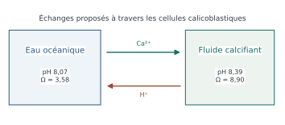

### Question 16 — Rôle des cellules calicoblastiques

> [!INDICATION]
> Situer les deux valeurs mesurées de sursaturation par rapport au seuil de croissance, puis considérer le transport du CO₂ à l’échelle du récif.

#### Solution

Les cellules séparent un petit fluide calcifiant de l’eau extérieure et règlent ses échanges ioniques. La croissance est peu efficace dans l’eau à $\Omega=3{,}58<6$. Le fluide à $\Omega=8{,}90$ permet la croissance du squelette existant. Le contrôle local est d’autant plus efficace que les renouvellements diffusif et convectif sont lents par rapport à la précipitation. Il ne suffit pas à établir une nucléation spontanée au seuil 20.

### Question 17 — Bilan de photosynthèse

> [!INDICATION]
> Équilibrer carbone, hydrogène et oxygène après avoir placé une molécule de glucose parmi les produits.

#### Solution

Le bilan de photosynthèse oxygénique est $6\,\mathrm{CO_2}+6\,\mathrm{H_2O}\xrightarrow{\text{lumière}}\mathrm{C_6H_{12}O_6}+6\,\mathrm{O_2}$. On peut aussi écrire douze eaux réactives et six produites avant simplification. L’énergie lumineuse rend possible la conversion.

### Question 18 — Croissance du récif et lumière

> [!INDICATION]
> Relier la consommation locale de CO₂ au pH, puis à la concentration en carbonate et à la sursaturation.

#### Solution

La photosynthèse des algues symbiotiques consomme du CO₂ le jour. La concentration en protons diminue, la proportion de carbonate augmente et la calcification est favorisée. Dans le cadre du modèle lumineux du dossier, la croissance est donc plus favorable **le jour et, à latitude et conditions comparables, en été** où la durée ou l’intensité d’éclairement est plus élevée. L’accumulation nocturne de CO₂ par respiration agit en sens inverse.

## B. Polymorphes du carbonate de calcium

### Question 19 — Effet de la température sur les polymorphes

> [!INDICATION]
> Écrire les grandeurs de la réaction dans le sens calcite vers aragonite.

#### Solution

$\Delta_r H^\circ=-1207{,}6-(-1207{,}4)=-0{,}2\ \mathrm{kJ\,mol^{-1}}$, $\Delta_r S^\circ=88{,}7-92{,}9=-4{,}2\ \mathrm{J\,K^{-1}\,mol^{-1}}$. Le passage vers l’aragonite est exothermique, donc une élévation de température favorise la calcite. À 298 K, $\Delta_rG^\circ\simeq+1{,}05\ \mathrm{kJ\,mol^{-1}}$. Le quotient $\Delta_rH^\circ/\Delta_rS^\circ\simeq48$ K n’est qu’une extrapolation si l’on gèle ces données de 298 K.

### Question 20 — Motifs dans la maille de calcite

> [!INDICATION]
> Compter les calcium sur une vue latérale et vérifier les superpositions en vue de dessus.

#### Solution

Pour le prisme à base losange de la figure 3, les huit sommets fournissent un calcium au total, les quatre milieux des arêtes verticales en fournissent un autre, et les quatre ions intérieurs comptent chacun pour un. Il y a donc **six ions calcium**, soit six motifs $\mathrm{CaCO_3}$ par électroneutralité et stœchiométrie.

### Question 21 — Volume molaire de la calcite

> [!INDICATION]
> La base de la maille est un losange et non un carré. Diviser par le nombre de motifs avant de multiplier par le nombre d’Avogadro.

#### Solution

$V_{\rm maille}=a^2 c\sin60^\circ\simeq3{,}68\times10^{-28}\ \mathrm{m^3}$. Le volume molaire est $V_{m,c}=N_A V_{\rm maille}/6\simeq3{,}69\times10^{-5}\ \mathrm{m^3\,mol^{-1}}$, soit $36{,}9\ \mathrm{cm^3\,mol^{-1}}$.

### Question 22 — Effet de la pression

> [!INDICATION]
> Comparer les volumes par mole plutôt que les volumes des deux mailles.

#### Solution

L’aragonite occupe $35{,}4\ \mathrm{cm^3\,mol^{-1}}$, contre $36{,}9$ pour la calcite. Pour calcite → aragonite, $\Delta_r V_m\simeq-1{,}5\ \mathrm{cm^3\,mol^{-1}}$. Une pression croissante abaisse davantage le potentiel chimique relatif de l’aragonite et la favorise.

### Question 23 — Configurations des cations alcalino-terreux

> [!INDICATION]
> Écrire les états fondamentaux des atomes neutres avant de retirer les deux électrons externes.

#### Solution

On remplit les sous-couches par énergie croissante (règle de Klechkowski), avec au plus deux électrons de spins opposés par orbitale (Pauli) et conformément à Hund pour les orbitales dégénérées. Mg neutre est $[\mathrm{Ne}]3s^2$ et Ca neutre $[\mathrm{Ar}]4s^2$. Après enlèvement des deux électrons externes, $\mathrm{Mg^{2+}}$ est $1s^22s^22p^6$ et $\mathrm{Ca^{2+}}$ est $1s^22s^22p^63s^23p^6$.

### Question 24 — Magnésium et stabilité de la calcite

> [!INDICATION]
> Une augmentation d’un produit de solubilité signifie que la dissolution est plus facile à activités comparables.

#### Solution

La figure 4 montre que $\log K_{sc}$ croît avec $x_{\rm Mg}$. La calcite est donc moins stable vis-à-vis de la dissolution à mesure que la proportion de Mg augmente. Un mécanisme qualitatif est la perturbation du réseau ou de ses sites de croissance par $\mathrm{Mg^{2+}}$, de même charge mais de rayon plus faible et plus fortement hydraté que $\mathrm{Ca^{2+}}$. Le tracé établit la tendance sans identifier à lui seul un mécanisme microscopique unique.

### Question 25 — Du rapport de concentrations à la fraction molaire

> [!INDICATION]
> Diviser le numérateur et le dénominateur de la fraction molaire par la concentration en calcium.

#### Solution

Si $r=[\mathrm{Mg^{2+}}]/[\mathrm{Ca^{2+}}]$, $x_{\rm Mg}=r/(1+r)$. Au seuil $r\simeq4$, on obtient **0,80**.

### Question 26 — Produit de solubilité de l’aragonite

> [!INDICATION]
> Lire la courbe de la calcite à la fraction critique. L’autre polymorphe a un produit de solubilité presque indépendant de la fraction en Mg.

#### Solution

Au changement de forme dominante, $K_{sa}\simeq K_{sc}(0{,}80)$. La lecture de la figure donne $\log_{10}K_{sa}\simeq-7{,}8$ (à quelques centièmes près), soit $K_{sa}\simeq1{,}6\times10^{-8}$. Le graphe de l’aragonite est une droite horizontale passant par l’intersection avec celui de la calcite.

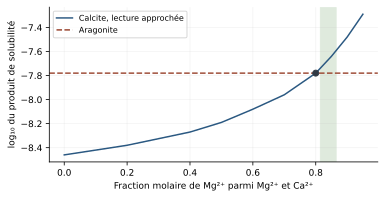

### Question 27 — Polymorphe favorisé dans l’eau de mer

> [!INDICATION]
> Convertir l’intervalle des rapports marins en fractions. À activité égale, rechercher le produit de solubilité le plus petit.

#### Solution

Le domaine $4{,}4\le r\le6{,}4$ correspond à $0{,}815\lesssim x_{\rm Mg}\lesssim0{,}865$, entièrement à droite de 0,80. Dans cette gamme $K_{sc}>K_{sa}$. L’aragonite est donc favorisée parmi les deux formes comparées et doit prédominer dans les conditions océaniques du modèle.

## C.1. Cinétique de cristallisation

### Question 28 — Normaliser l’avancement de cristallisation

> [!INDICATION]
> Identifier la quantité qui peut disparaître de la solution entre l’état initial et l’équilibre.

#### Solution

À volume constant, la quantité précipitée est proportionnelle à $c_0-c(t)$ et la quantité précipitable à $c_0-s$. Leur quotient $\alpha=(c_0-c)/(c_0-s)$ part de zéro lorsque $c=c_0$ et atteint un lorsque $c=s$. Cette normalisation suppose $c_0>s$.

### Question 29 — Cristallisation et dimension linéaire

> [!INDICATION]
> Relier la quantité de solide à son volume. Préciser dans quelles conditions une seule longueur représente toute la population.

#### Solution

On suppose des cristaux géométriquement semblables, une masse volumique fixe et une population constante de germes identiques ou de même évolution relative. La masse solide est proportionnelle à $Nr^3$. Si la taille initiale des germes est négligeable, $\alpha=Nr^3/(Nr_{\rm fin}^3)=(r/r_{\rm fin})^3$. Des germes de taille appréciable imposeraient de retrancher leur volume initial au numérateur et au dénominateur.

### Question 30 — Autre phénomène cinétique

> [!INDICATION]
> La vitesse de croissance d’un germe déjà présent ne fixe pas le nombre de germes.

#### Solution

La **nucléation** est une troisième étape. Un long temps d’induction ou une production continue de germes peut changer fortement l’évolution de la masse cristallisée. La convection de la solution peut également modifier l’alimentation du cristal en soluté.

### Question 31 — Profils à réaction lente ou à régime mixte

> [!INDICATION]
> Repérer le profil qui traduit un gradient de concentration en solution.

#### Solution

La droite pleine, horizontale à $c_0$, correspond à b. La diffusion alimente plus vite l’interface que la réaction ne consomme le soluté, donc la concentration y reste proche de celle du volume. La courbe pointillée correspond à c. Le gradient permet un flux diffusif, tandis que la concentration de surface reste entre $s$ et $c_0$ pour alimenter une réaction de vitesse finie.

### Question 32 — Profil limité par la diffusion

> [!INDICATION]
> Une surface qui incorpore rapidement le soluté est presque à l’équilibre local.

#### Solution

Pour a, $c(0^+)\simeq s$ à la surface et $c(x)\to c_0$ loin du cristal au début de l’expérience. Le profil croît depuis $s$ puis s’aplatit. Partant d’une solution sursaturée, le gradient engendre un flux orienté vers la surface et $s$ n’est en général pas nul.

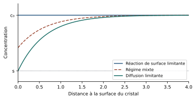

### Question 33 — Évolution du profil plein

> [!INDICATION]
> Suivre l’appauvrissement du réservoir quand la croissance à la surface reste lente par rapport au mélange diffusif.

#### Solution

À un instant intermédiaire le profil reste pratiquement horizontal, à une valeur $c(t)$ avec $s<c(t)<c_0$. À l’équilibre il devient horizontal à $s$ et le flux net disparaît. Une petite différence surface–volume suffit en pratique à entretenir le faible flux intermédiaire.

### Question 34 — Analogie électrochimique

> [!INDICATION]
> Chercher une autre interface à laquelle les ions doivent arriver avant de réagir.

#### Solution

À une électrode, la vitesse peut être limitée par le transfert d’électron à l’interface, par la diffusion du réactif depuis la solution ou par les deux. La couche de diffusion et le courant limite sur une courbe intensité–potentiel illustrent l’analogie.

### Question 35 — Équation différentielle du degré cristallisé

> [!INDICATION]
> Exprimer $r$ en fonction de $\alpha$ et $c-s$ en fonction de $1-\alpha$ avant de dériver.

#### Solution

Les deux bilans donnent $r=r_{\rm fin}\alpha^{1/3}$ et $c-s=(c_0-s)(1-\alpha)$. Puis $d\alpha/dt=3r^2(dr/dt)/r_{\rm fin}^3$. En insérant la loi de croissance, on trouve $d\alpha/dt=[3vD(c_0-s)/r_{\rm fin}^2]\,\alpha^{1/3}(1-\alpha)$. Les concentrations et le volume $v$ s’expriment sur la même base de quantité de matière.

### Question 36 — Constante du chronomal

> [!INDICATION]
> Séparer les variables et reconnaître l’intégrale définie par le sujet.

#### Solution

Entre le début de la croissance et l’état $\alpha$, $t=K_DI_D(\alpha)$ avec $K_D=r_{\rm fin}^2/[3vD(c_0-s)]$. La grandeur $v(c_0-s)$ est sans dimension lorsque les concentrations sont des nombres d’entités par volume pour un $v$ par entité, ou des concentrations molaires pour un volume molaire. Ainsi $K_D$ a la dimension de $r^2/D$, donc d’un temps.

### Question 37 — Attribution des deux expériences

> [!INDICATION]
> Comparer les deux fractions cristallisées au même instant dans la zone où les séries se séparent.

#### Solution

La série 6.1 monte le plus rapidement, par exemple vers 15 min où $\alpha$ approche 0,92 contre environ 0,72 pour 6.2. À conditions de germination et de croissance comparables, la plus grande sursaturation accroît la force motrice. On attribue **6.1 à $3{,}7\times10^{-3}$** et **6.2 à $1{,}2\times10^{-3}\ \mathrm{mol\,L^{-1}}$**.

### Question 38 — Domaine de linéarité en temps

> [!INDICATION]
> Comparer $I_D/t$ aux différents instants et utiliser l’origine imposée par la définition.

#### Solution

Sur 6.1b, les points vers 6,5, 10 et 15 min s’alignent approximativement avec l’origine. À 20 min, $I_D$ reste voisin de sa valeur à 15 min. La loi est donc compatible avec le début de l’expérience jusqu’à **environ 15 min**, avec des mesures à partir d’environ 6,5 min.

### Question 39 — Intervalle de cristallisation contrôlé par diffusion

> [!INDICATION]
> Reporter le dernier temps du segment linéaire sur la courbe 6.1a.

#### Solution

À 15 min on lit $\alpha\simeq0{,}92$. Le domaine compatible avec le modèle s’étend ainsi du début jusqu’à **environ 0,9–0,92**, soit près de 90 % cristallisés. Les points mesurés dans ce domaine commencent vers 0,57.

### Question 40 — Constante de temps et diffusion

> [!INDICATION]
> L’ordonnée du graphe est le chronomal, de sorte que la pente du graphe est l’inverse de la constante de temps.

#### Solution

Le point $(15\ \mathrm{min},3{,}3)$ donne $K_D\simeq15/3{,}3=4{,}5\ \mathrm{min}$, cohérent avec $10/2{,}2$ et avec une estimation entre 4,5 et 4,7 min. Cela représente environ $2{,}7\times10^2$ s. On en tire $D=r_{\rm fin}^2/[3v(c_0-s)K_D]$, en unités compatibles.

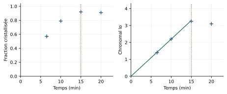

## C.2. Dégradation du complexe de DTPA

### Question 41 — Acidités successives du DTPA

> [!INDICATION]
> Compter les fonctions carboxyliques et amines, puis comparer les séries de dissociation aux constantes de l’EDTA.

#### Solution

Le DTPA possède cinq carboxyles et trois fonctions amines protonables. L’attribution macroscopique attendue associe $-0{,}1$, 0,7, 1,6, 2,0 et 2,6 aux cinq dissociations carboxyliques, puis 4,3, 8,6 et 10,5 aux trois dissociations ammonium/amine. L’EDTA ne compte que quatre carboxyles et deux amines. Les charges positives voisines stabilisent la formation de carboxylates et peuvent aussi rendre une première déprotonation ammonium relativement facile par diminution des répulsions. Ces constantes successives de la molécule entière ne repèrent pas individuellement une branche symétrique.

### Question 42 — Denticité maximale selon le pH

> [!INDICATION]
> Compter un donneur habituel par carboxylate et un doublet par amine libre.

#### Solution

Le DTPA peut être **octadentate** pour un même cation. Il apporte trois azotes amines et cinq oxygènes de carboxylates dans le mode chélatant usuel. En milieu acide, les amines protonées sont indisponibles et les carboxyles protonés coordonnent moins efficacement. L’augmentation du pH rend davantage de donneurs disponibles. La coordinence du métal et son éventuelle hydrolyse peuvent limiter la réalisation du maximum.

### Question 43 — La sonde comme intégrateur de l’exposition radicalaire

> [!INDICATION]
> Écrire les deux voies parallèles de disparition du composé sonde, puis diviser par sa concentration.

#### Solution

Avec $S$ la sonde et $O$ l’ozone, $-d\ln[S]/dt=k_{\rm HO,1}[\mathrm{HO^\bullet}]+k_{O,1}[O]$. L’intégration donne les deux expositions pondérées par leurs constantes. Lorsque la contribution directe de l’ozone à la sonde est négligeable, $\ln([S]/[S]_0)\simeq-k_{\rm HO,1}\int_0^t[\mathrm{HO^\bullet}]\,dt$. Le critère est $k_{O,1}\ll k_{\rm HO,1}R$, satisfait par les pentes de la figure 9. Le radical est $\mathrm{HO^\bullet}$, distinct de l’ion hydroxyde.

### Question 44 — Exposition totale à l’ozone

> [!INDICATION]
> Transformer l’absorbance mesurée en concentration avant d’intégrer.

#### Solution

Après correction du blanc et étalonnage à la longueur d’onde choisie, Beer–Lambert donne $[O_3](t)=A(t)/(\varepsilon l)$. Calculer l’aire $X(t)=\int_0^t[O_3](u)\,du$, par exemple par somme des trapèzes entre temps expérimentaux. Une concentration en $\mathrm{mol\,L^{-1}}$ et un temps en secondes donnent une exposition en $\mathrm{mol\,L^{-1}\,s}$.

### Question 45 — Des expositions aux concentrations instantanées

> [!INDICATION]
> Distinguer la pente de la portion rectiligne d’une droite artificiellement contrainte à passer par le premier point.

#### Solution

Sur la plus grande partie de chaque série, la dépendance de $\ln([S]/[S]_0)$ en $X$ est affine, de pente négative $m$. Après le bref transitoire initial, dériver par rapport au temps donne $-k_{\rm HO,1}[\mathrm{HO^\bullet}]\simeq m[O_3]$. On obtient un rapport local pratiquement constant $r=[\mathrm{HO^\bullet}]/[O_3]\simeq-m/k_{\rm HO,1}$. L’ordonnée à l’origine extrapolée traduit le transitoire et n’impose pas une proportionnalité exacte des intégrales depuis $t=0$.

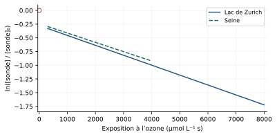

### Question 46 — Ordre cinétique apparent

> [!INDICATION]
> Remplacer la concentration radicalaire inconnue par sa valeur déduite de la sonde.

#### Solution

Pour le composé cible $C$, $-d[C]/dt=(k_{O,2}[O_3]+k_{\rm HO,2}[\mathrm{HO^\bullet}])[C]$. Sur le domaine étalonné par la sonde, $[\mathrm{HO^\bullet}]=r[O_3]$, d’où $-d[C]/dt=k_{\rm app}[O_3][C]$, avec $k_{\rm app}=k_{O,2}+rk_{\rm HO,2}$. On retrouve un ordre un en chacun des deux réactifs suivis et un ordre global apparent deux.

### Question 47 — Séparer les deux contributions à la constante apparente

> [!INDICATION]
> La sonde fixe le rapport des oxydants, le composé fournit une deuxième droite indépendante.

#### Solution

Sur le même intervalle, porter $\ln([C](t)/[C](t_1))$ en fonction de $X(t)-X(t_1)$. Sa pente vaut $-k_{\rm app}$. À partir du rapport $r$ mesuré avec la sonde et de la valeur connue de $k_{\rm HO,2}$, on obtient $k_{O,2}=k_{\rm app}-r k_{\rm HO,2}$. Les deux mesures doivent se rapporter au même échantillon et au même domaine affine.

### Question 48 — Parts du radical et de l’ozone

> [!INDICATION]
> Lire une différence d’ordonnées sur la partie linéaire en prenant garde aux micromoles de l’axe des abscisses.

#### Solution

Pour le lac, entre environ 1 000 et 7 000 $\mu\mathrm{mol\,L^{-1}\,s}$, l’ordonnée passe d’environ $-0{,}45$ à $-1{,}50$. La pente vaut environ $-175\ \mathrm{L\,mol^{-1}\,s^{-1}}$. Pour la Seine, on lit une pente du même ordre, environ $-165$ à $-180$ dans les mêmes unités. Ainsi $r\simeq(3{,}3\text{ à }3{,}6)\times10^{-8}$ et $r k_{\rm HO,2}\simeq50$ à $54\ \mathrm{L\,mol^{-1}\,s^{-1}}$. Les fractions sont $500/(500+r k_{\rm HO,2})\simeq0{,}90$–$0{,}91$ pour **l’ozone** et environ **9–10 %** pour le radical. Les deux oxydants réagissent, mais le plus concentré fournit la contribution dominante.

### Question 49 — Influence de l’origine de l’eau

> [!INDICATION]
> Identifier un paramètre de matrice susceptible d’agir sur la spéciation, l’exposition ou une constante apparente.

#### Solution

Le pH, la température et la composition des eaux peuvent différer. La matière organique dissoute ou certains ions peuvent piéger les radicaux et modifier le rapport $r$. La spéciation du complexe métallique et la force ionique peuvent également changer. Une constante apparente mesurée sur la matrice varie alors, même quand la constante élémentaire à température, activités et spéciation fixées serait inchangée.

## D. Clavulolactones et premier fragment

### Question 50 — Relation entre les deux produits naturels

> [!INDICATION]
> Aligner les deux squelettes en conservant le centre étoilé et repérer la double liaison exocyclique près de la cétone.

#### Solution

Les deux composés ont la même constitution, la même configuration au carbone étoilé et la même configuration au carbone de la lactone. Ils diffèrent à la double liaison exocyclique qui relie le cycle énonné à la chaîne diénique, avec **E pour II, Z pour III**. Ce sont des diastéréoisomères géométriques.

### Question 51 — Réactif carboné nucléophile

> [!INDICATION]
> Repérer le carbone portant initialement le brome du dérivé propargylique.

#### Solution

L’insertion métallique conduit à un nucléophile propargylique représenté $\mathrm{HC{\equiv}C{-}CH_2MgBr}$, avec une liaison C–Mg polarisée vers C. Des espèces organozinciques peuvent participer par transmétallation en présence du sel de zinc. L’énoncé n’établit pas une spécification unique en solution. Pour le produit B, l’équivalent nucléophile qui se lie au carbonyle est $\mathrm{^-CH_2C{\equiv}CH}$.

### Question 52 — Structure et configuration de B

> [!INDICATION]
> À C1, comparer les chemins vers C2, C5 et le méthylène propargylique. Raisonner ensuite sur la face qui porte déjà l’éther silylé.

#### Solution

La double liaison C2=C3 et l’OTBDMS de C4 sont conservés. Le carbonyle C1 devient un alcool tertiaire portant $\mathrm{CH_2C{\equiv}CH}$. Dans B majoritaire, le OH de C1 et l’OTBDMS de C4 sont sur la même face, la chaîne propargyle est sur la face opposée. En C1 l’ordre CIP est OH, chemin C2 (double liaison prise en compte), chemin C5, puis $\mathrm{CH_2C{\equiv}CH}$. Pour départager les deux méthylènes, le chemin C5 rencontre au rang suivant un carbone portant O, prioritaire sur le carbone acétylénique. Avec la chaîne orientée vers l’arrière, le parcours 1–2–3 est horaire dans la représentation de la figure, donc **1R**. En C4 l’ordre est O, C3, C5, H et l’on conserve **4S**.

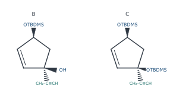

### Question 53 — Formation des deux alcools

> [!INDICATION]
> Comparer les deux faces du carbonyle en tenant compte du centre déjà présent en C4.

#### Solution

Le carbone trigonal C1 possède deux faces diastéréotopiques. Une attaque de chacune, puis protonation de l’alcoolate, donne les deux configurations de C1 sans modifier C4. L’approche opposée au volumineux OTBDMS de C4 est moins encombrée et fournit principalement $(1R,4S)$. L’autre trajectoire reste accessible et conduit au minoritaire $(1S,4S)$.

### Question 54 — Structure de C

> [!INDICATION]
> Relever quelle fonction de B peut être silylée une deuxième fois.

#### Solution

Le OH tertiaire de B devient O–TBDMS. C porte donc des **OTBDMS en C1 et C4 sur la même face** et la chaîne $\mathrm{CH_2{-}C{\equiv}CH}$ sur l’autre face en C1. La formation de la liaison O–Si conserve les liaisons des deux carbones stéréogènes. Les structures de B et C figurent dans le schéma de Q52.

### Question 55 — Alkylation de l’alcyne

> [!INDICATION]
> Comparer l’acidité de l’alcyne terminal à celle de l’alcane conjugué de la base.

#### Solution

C est plus électronégatif que Li, donc la liaison est polarisée $\mathrm{C^{\delta-}{-}Li^{\delta+}}$. Le carbone basique du butyllithium arrache le proton acétylénique, ce qui forme du butane et l’acétylure. Ce dernier attaque le carbone primaire de l’iodure de pentyle par substitution $S_\mathrm{N}2$, avec départ de $I^-$. La chaîne devient $\mathrm{CH_2{-}C{\equiv}C{-}C_5H_{11}}$.

### Question 56 — Effet du OH libre et bilan du silicium

> [!INDICATION]
> Comparer d’abord les acidités du OH et de l’alcyne. Contrôler ensuite le bilan élémentaire entre B et D.

#### Solution

Le OH de B est plus acide que son alcyne terminal. Un premier équivalent de base forme donc surtout l’alcoolate. Sur 1,5 équivalent introduit, il reste au plus environ 0,5 équivalent pour former l’acétylure. Une alkylation sur O peut aussi concurrencer l’alkylation carbonée. Cela explique un faible rendement de chaîne alkylée. **Le produit D tel qu’il est dessiné porte deux groupes TBDMS. B n’en possède qu’un et les seules conditions de Q55 n’apportent pas de silicium.** Avec ces réactifs, le produit C-alkylé après hydrolyse porte encore un OH libre. Une silylation supplémentaire est nécessaire pour obtenir exactement D.

### Question 57 — Pourquoi une chaîne allénique apparaît

> [!INDICATION]
> Pour un dérivé propargylique substitué, examiner la nucléophilie à l’autre extrémité du système de trois carbones.

#### Solution

À partir de $\mathrm{BrCH_2{-}C{\equiv}C{-}R}$, avec $R=\mathrm{C_5H_{11}}$, la forme métallée peut être décrite par les écritures limites $\mathrm{^-CH_2{-}C{\equiv}C{-}R\leftrightarrow CH_2{=}C{=}C^-{-}R}$. Lors de l’addition en position terminale substituée, le carbone portant R se lie à C1 du carbonyle et le doublet π de C=O est repoussé sur O. Après hydrolyse de l’alcoolate, C1 porte OH et la chaîne $\mathrm{{-}C(R){=}C{=}CH_2}$, tandis que C4 garde son OTBDMS. Cela rend compte de B′ et de sa différence de connectivité avec B.

## Deux voies de déprotection

### Question 58 — Déprotection sélective, oxydation et IR de F

> [!INDICATION]
> Déterminer quel alcool régénéré est oxydable en cétone et lequel doit rester protégé dans le produit à un silicium.

#### Solution

La voie b régénère préférentiellement le OH secondaire de C4, moins encombré. E porte donc C4–OH, C1–OTBDMS et la chaîne alcyne interne de D. L’oxydation transforme le CH–OH de C4 en C4=O et donne l’énone F, sans modifier la chaîne ni le groupe en C1. En IR, 2956 et 2859 $\mathrm{cm^{-1}}$ sont des élongations C–H aliphatiques, 2216 marque C≡C, 1727 le C=O de la cyclopenténone. Vers 1472 on attend des déformations des groupes alkyles et vers 1254 une vibration caractéristique de la partie Si–CH₃. Conformément à l’énoncé, on laisse la bande à 1680 sans attribution.

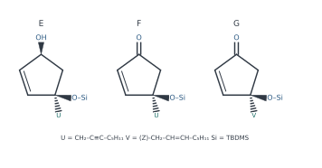

### Question 59 — Structure, IR et RMN de G

> [!INDICATION]
> Rechercher la transformation qui fait disparaître la bande à 2216 et explique un couplage vinylique inférieur à 10 Hz.

#### Solution

L’addition syn de $H_2$ à l’alcyne donne majoritairement la chaîne **$(Z){-}\mathrm{CH_2CH{=}CHC_5H_{11}}$** attachée par son premier méthylène à C1, de configuration spatiale conservée. C1 porte encore OTBDMS, C4 est carbonylé et C2=C3 est conservée. En IR, l’élongation C≡C a disparu, la bande 1724 correspond à C=O. Les bandes 2956 et 2858 sont aliphatiques, 1406 et 1360 sont compatibles avec des déformations alkyles, 1252 avec le groupe silylé. Pour la RMN, S1 (7,40 ppm) est H en $\beta$ de l’énone, sur C2, et S2 (6,10 ppm) est H en $\alpha$, sur C3. Ils donnent chacun un doublet à 5,7 Hz. S3 et S4, vers 5,5 et 5,35 ppm, correspondent aux deux H de l’alcène de la chaîne. Leur couplage d’environ 8 Hz appuie la géométrie Z. Les seules données spectrales ne fixent pas sûrement leur permutation entre les deux positions.

### Question 60 — Sous-produits de l’hydrogénation

> [!INDICATION]
> Examiner séparément la sur-réduction de la nouvelle double liaison et la réduction d’une autre double liaison déjà présente.

#### Solution

Un premier sous-produit conserve l’énone de G mais possède la chaîne entièrement saturée $\mathrm{{-}CH_2CH_2CH_2C_5H_{11}}$. Un deuxième conserve la chaîne Z de G mais possède une cyclopentanone saturée à la place de la cyclopenténone (C2–C3 simple). La quinoléine modère l’activité du palladium par adsorption sur les sites du métal. Cette désactivation favorise l’arrêt à l’alcène Z et limite les hydrogénations concurrentes.

### Question 61 — Voie à deux équivalents de fluorure

> [!INDICATION]
> Comparer le nombre de protections dans D avec la quantité de fluorure, puis suivre séparément le devenir des deux alcools.

#### Solution

Deux équivalents ajoutés en une fois peuvent désilyler les deux oxygènes. E′ est alors le diol C1–OH et C4–OH avec la chaîne alcyne interne. F′ porte la cétone C4=O, le OH **tertiaire** en C1 qui ne s’oxyde pas en cétone par simple perte d’un hydrogène sur C1, et le même alcyne. G′ conserve l’énone et le OH en C1 et porte la chaîne Z. La voie b économise le fluorure et exploite la différence d’accessibilité entre la protection secondaire en C4 et celle de l’alcool tertiaire ; E ne perd que la première.

## Assemblage et stéréochimie de la double liaison

### Question 62 — Allongement de deux carbones jusqu’à l’énal

> [!INDICATION]
> Identifier le fragment qui doit être conservé et choisir une oxydation compatible avec une lactone et un aldéhyde.

#### Solution

Notons L le fragment lactone chiral. Une oxydation douce et anhydre de $\mathrm{L{-}CH_2OH}$, par exemple au réactif de Dess–Martin, fournit $\mathrm{L{-}CHO}$ sans sur-oxydation en acide. Une oléfination de Wittig par l’ylure stabilisé préformé $\mathrm{Ph_3P{=}CH{-}CHO}$ prolonge la chaîne en $\mathrm{L{-}CH{=}CH{-}CHO}$. On retient l’isomère E du dessin. Après addition sur l’aldéhyde et fragmentation de l’oxaphosphétane, il se forme aussi $\mathrm{OPPh_3}$. Les conditions doivent préserver la lactone et son centre chiral. Cette voie en deux transformations évite une réduction qui attaquerait la lactone.

### Question 63 — Énolate de G

> [!INDICATION]
> Chercher le carbone saturé voisin du carbonyle qui possède encore des protons.

#### Solution

La base arrache un proton de C5, méthylène entre le carbonyle de C4 et le carbone substitué C1. L’énolate de lithium s’écrit $\mathrm{C4(O^-){=}C5H}$, avec $\mathrm{Li^+}$ comme contre-ion, ou $\mathrm{C4(=O){-}C5H^-}$ dans l’autre forme limite. La double liaison C2=C3 et l’alcène Z de la chaîne latérale ne changent pas.

### Question 64 — Addition de l’énolate à l’énal

> [!INDICATION]
> Suivre le carbone nucléophile de G et le carbone carbonylé de I. Leurs voisins appartiennent déjà à des fragments chiraux.

#### Solution

Le carbone C5 de l’énolate attaque le **carbone aldéhydique** de I (addition 1,2). Le doublet π C=O de l’aldéhyde va sur O. Le carbonyle C4 de G se rétablit. Après protonation on obtient une β-hydroxycétone de motif $\mathrm{C4(=O){-}C5(H){-}CH(OH){-}CH{=}CH{-}L}$, où L conserve la lactone et sa stéréochimie, et où C5 reste relié à C1 dans le cycle. Pour une même face d’attaque du cycle, les deux faces du carbonyle I donnent les deux configurations du CH–OH représentées en Q67. Le centre de C1 et celui de L rendent les approches diastéréomères et l’encombrement les différencie. L’expérience donne un rapport 1,6:1. Une seule détermination de proportions ne fixe pas à elle seule toutes les configurations absolues transitoires.

### Question 65 — Structures des deux produits d’élimination

> [!INDICATION]
> Remplacer le motif C5(H)–CH(OH) par C5=CH et attribuer la priorité des deux branches du cycle.

#### Solution

Les deux produits portent $\mathrm{C5{=}CH{-}CH{=}CH{-}L}$, le carbonyle en C4, OTBDMS et la chaîne Z en C1. Sur C5, la branche vers C4=O a priorité sur celle vers C1, car $[O,O,C]$ précède $[O,C,C]$. Sur le carbone exocyclique, la chaîne vers L précède H. Dans **J2 (E)**, C4 et la chaîne vers L sont de part et d’autre de C5=CH. Dans **J3 (Z)**, ils sont du même côté. Ces structures sont celles des produits II et III de Q50 avec OTBDMS à la place de OAc sur C1.

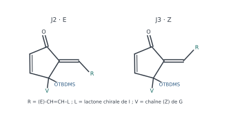

### Question 66 — Déshydratation par activation de l’alcool

> [!INDICATION]
> Distinguer l’activation du groupe OH de la rupture de la liaison C–O.

#### Solution

L’oxygène alcoolique attaque le soufre du chlorure de mésyle. Le départ de chlorure et la capture d’un proton par la triéthylamine donnent le mésylate $\mathrm{C5(H){-}CH(OMs)}$, sans inversion à ce dernier carbone. Une base arrache ensuite le proton de C5. Les électrons C5–H forment C5=C tandis que la liaison C–OMs se rompt. Une géométrie antipériplanaire favorise cette élimination E2. La mésylation transforme un mauvais groupe partant en un bon et la formation du diène conjugué à la cétone favorise l’élimination. L’ensemble constitue une condensation aldolique dont la déshydratation est pilotée séparément.

### Question 67 — Stéréochimie de l’élimination et rapports mesurés

> [!INDICATION]
> Regarder selon la liaison C5–carbone alcoolique et aligner H de C5 à l’opposé du futur OMs. Sur le carbone arrière, permuter H et la chaîne diénique.

#### Solution

Dans les projections de Newman données ci-dessous, C5 est devant, H à midi et OMs à six heures sur le carbone arrière. Avant activation, OH occupe la même position que OMs. Échanger sur le carbone arrière H et la chaîne $R=\mathrm{CH{=}CH{-}L}$ représente les deux alcools épimères pour la face du cycle considérée. Avec R opposé latéralement au chemin C4, l’élimination donne E. Avec R du même côté que C4, elle donne Z. Les deux arrangements anti ont des contacts différents entre R et les deux branches du cycle. Leur conversion et les réactions concurrentes peuvent donc différer. Normalisées à 100, les quantités d’alcools sont près de 61,5 et 38,5. Les rendements isolés de 61 et 18 sont compatibles avec une conversion apparente environ deux fois plus efficace pour le précurseur de E. Cette comparaison explique le changement de rapport sans déterminer à elle seule une constante de vitesse.

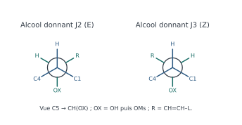

### Question 68 — Passage des produits protégés aux clavulolactones

> [!INDICATION]
> Comparer les structures des produits d’élimination avec les fonctions oxygénées finales sur C1.

#### Solution

Désilyler le groupe OTBDMS avec du fluorure, puis acétyler le OH tertiaire régénéré, par exemple avec de l’anhydride acétique et une base en présence d’un catalyseur d’acylation. L’oxygène alcoolique attaque un carbonyle activé du donneur d’acétyle, l’intermédiaire tétraédrique se referme avec départ du groupe sortant et un transfert de proton conduit à $\mathrm{C1{-}O{-}C(O)CH_3}$. La liaison C1–O reste intacte. En conservant les géométries des doubles liaisons, **J2 conduit à II** et **J3 à III**.

### Question 69 — Étapes déterminant la proportion II/III

> [!INDICATION]
> Repérer la création des centres transitoires puis la création de la double liaison qui distingue les produits finaux.

#### Solution

L’addition aldolique G + I fixe les proportions d’alcools diastéréoisomères, donc la quantité disponible pour chaque voie. Les conditions d’énolisation et d’addition peuvent influer sur cette sélection faciale. L’activation de OH suivie de l’élimination fixe ensuite la géométrie C5=CH et peut convertir différemment les deux précurseurs, comme le montrent les rapports 1,6:1 puis 3,4:1. La désilylation et l’acétylation finales conservent le rapport si la double liaison reste configurée.
