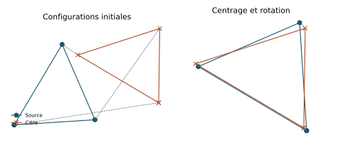
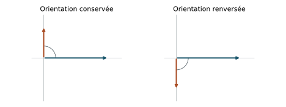

# X et ENS, filière PC — Mathématiques 2024 · Corrigé brut

*Corrigé rédigé par IA, non officiel. Signalez toute erreur.*

**Rédaction** · GPT-6.2 Astra Ultra · vitesse non renseignée

**Révision** · GPT-6.2 Astra Ultra · vitesse non renseignée

Le sujet compare des familles ordonnées de points à translation et rotation près. On note les rotations par R et les matrices de configurations centrées à mesure de leur introduction.

## 1 · Préliminaires

### Question 1

Comme $R^TR=I_d$, on a $1=\det(R^TR)=\det(R)^2$, donc $\det(R)\in\{-1,1\}$.

### Question 2

Par produit matriciel, $\langle A,B\rangle=\sum_{i,j}A_{ij}B_{ij}$. Cette expression est bilinéaire et symétrique. On a $\langle A,A\rangle=\sum_{i,j}A_{ij}^2\ge0$ avec égalité exactement pour la matrice nulle. C’est un produit scalaire.

### Question 3a

Le coefficient $(i,j)$ de $uv^T$ vaut $u_i v_j$. Ainsi $\langle uv^T,A\rangle=\sum_{i,j}u_iA_{ij}v_j=u^TAv=\langle u,Av\rangle_{\mathbb R^d}$.

### Question 3b

La trace de $AB$ vaut $\sum_{i,j} A_{ij}B_{ji}$. En échangeant $i$ et $j$, on reconnaît $\sum_{i,j}B_{ij}A_{ji}=\operatorname{tr}(BA)$.

### Question 3c

On a $\langle A,BC\rangle=\operatorname{tr}(A^TBC)=\operatorname{tr}((B^TA)^TC)=\langle B^TA,C\rangle$. Par 3b, la même trace vaut $\operatorname{tr}(CA^TB)=\operatorname{tr}((AC^T)^TB)=\langle AC^T,B\rangle$.

### Question 4a

La colonne $Re_i$ est unitaire. Par Cauchy–Schwarz, $|R_{ii}|=|\langle e_i,Re_i\rangle|\le1$.

### Question 4b

Comme $D$ est diagonale, $\langle D,R\rangle=\sum_i\alpha_i R_{ii}$. Les $\alpha_i$ sont positifs ou nuls et $R_{ii}\le1$, donc la somme est au plus $\sum_i\alpha_i=\operatorname{tr}D$.

## 2 · Ensemble des déplacements

### Question 5a

Les translations s’éliminent et $\phi_g(a)-\phi_g(b)=R(a-b)$. Puisque $R^TR=I_d$, $|R(a-b)|^2=|a-b|^2$, ce qui donne l’égalité des normes.

### Question 5b

Si $\phi_g=\phi_{g'}$, leurs valeurs en zéro donnent $\tau=\tau'$. Il reste $Rx=R'x$ pour tout $x$, donc $R=R'$. Ainsi $g=g'$. La réciproque découle de la définition de $\phi_g$.

### Question 5c

Le couple $e=(0,I_d)$ vérifie $\phi_e(x)=x$ pour tout $x$. Son unicité suit de 5b.

### Question 6a

Avec $g=(\tau,R)$ et $g'=(\tau',R')$, on trouve $\phi_{g'}(\phi_g(x))=R'Rx+R'\tau+\tau'$. Le produit $R'R$ est orthogonal de déterminant un. Le couple $g'g=(R'\tau+\tau',R'R)$ est donc un déplacement et 5b assure son unicité.

### Question 6b

Les applications de $g_1(g_2g_3)$ et de $(g_1g_2)g_3$ sont respectivement $\phi_{g_1}\circ(\phi_{g_2}\circ\phi_{g_3})$ et $(\phi_{g_1}\circ\phi_{g_2})\circ\phi_{g_3}$. L’associativité de la composition les rend égales, puis 5b identifie les couples.

### Question 7a

Pour tout $y$, l’équation $Rx+\tau=y$ admet l’unique solution $x=R^T(y-\tau)$. Chaque point a donc exactement un antécédent.

### Question 7b

La réciproque envoie $y$ sur $R^Ty-R^T\tau$. Comme $R^T\in SO_d$, le couple $g^{-1}=(-R^T\tau,R^T)$ convient. Il est unique par 5b.

### Question 7c

D’après 6a, $ge,eg$ ont pour application $\phi_g\circ\mathrm{Id}$ et $\mathrm{Id}\circ\phi_g$, donc valent $g$. De même, les applications de $gg^{-1}$ et $g^{-1}g$ sont l’identité, et 5c donne $gg^{-1}=g^{-1}g=e$.

### Question 8

Pour $d=1$, $SO_1=\{1\}$ et les translations commutent par commutativité de l’addition. Pour $d\ge2$, prenons la rotation $R$ d’angle $\pi$ dans le plan des deux premiers axes et l’identité sur son orthogonal. Elle envoie $e_1$ sur $-e_1$. Si $g=(0,R)$ et $h=(e_1,I_d)$, les translations de $gh$ et de $hg$ sont $-e_1$ et $e_1$. Les produits diffèrent. La seule dimension demandée est $1$.

## 3 · Distance à déplacement près

### Question 9a

Cette composante est $\phi_g(\phi_{g'}(z_i))=\phi_{gg'}(z_i)$ par 6a. L’égalité coordonnée par coordonnée donne celle des familles.

### Question 9b

Si $x=g\cdot y$, on a $g^{-1}\cdot x=(g^{-1}g)\cdot y=e\cdot y=y$.

### Question 10a

Par 5a, $\|g\cdot y-g\cdot x\|^2=\sum_i|\phi_g(y_i)-\phi_g(x_i)|^2=\sum_i|y_i-x_i|^2$. L’égalité se conserve à la racine carrée.

### Question 10b

La question 10a donne $\|y-g\cdot x\|=\|g^{-1}\cdot y-x\|$. L’application $g\mapsto g^{-1}$ est bijective car involutive. Les deux ensembles de valeurs ont donc le même infimum, soit $\delta(x,y)=\delta(y,x)$.

### Question 10c

L’inégalité triangulaire majore $\|z-g\cdot x\|$ par $\|z-(gg')\cdot y\|+\|(gg')\cdot y-g\cdot x\|$. Le second terme vaut $\|g'\cdot y-x\|$ par 9a et 10a.

### Question 10d

Fixons deux déplacements $h,k$ et appliquons 10c avec $g'=k$, $g=hk^{-1}$. Alors
$$\delta(x,z)\le\|z-h\cdot y\|+\|k\cdot y-x\|.$$
Les paramètres $h,k$ sont libres et indépendants. Prendre les deux infimums donne $\delta(x,z)\le\delta(y,z)+\delta(y,x)=\delta(y,z)+\delta(x,y)$.

### Question 11a

Il existe $g,h$ tels que $g\cdot x=h\cdot y$. D’où $x=(g^{-1}h)\cdot y$. Tout élément $k\cdot x$ de $c(x)$ est donc $(kg^{-1}h)\cdot y\in c(y)$. Échanger $x$ et $y$ fournit l’autre inclusion.

### Question 11b

Si $c(x)=c(y)$, alors $y=e\cdot y\in c(x)$ et il existe $g$ tel que $y=g\cdot x$. L’écart est nul pour ce $g$. Tous les écarts sont positifs ou nuls, donc $\delta(x,y)=0$.

## 4 · Un problème d’optimisation

### Question 12a

Posons $a_i=x_i-\bar x$, $b_i=y_i-\bar y$ et $c=\bar y-R\bar x-\tau$. On a $y_i-Rx_i-\tau=b_i-Ra_i+c$. Or $\sum_i(b_i-Ra_i)=0$. En développant la somme des carrés, le terme croisé disparaît et
$$J(\tau,R)=\sum_i|b_i-Ra_i|^2+n|\bar y-R\bar x-\tau|^2.$$

### Question 12b

Le terme $n|\bar y-R\bar x-\tau|^2$ de 12a est minimal et nul exactement lorsque $\tau=\bar y-R\bar x$. Le premier est indépendant de $\tau$. C’est donc l’unique translation minimisante $\tau(R)$.

En particulier, si l’on translate tous les $x_i$ du même vecteur $w$, les points centrés $a_i$ restent inchangés et la translation optimale devient $\tau(R)-Rw$. La rotation et le résidu centrés restent donc les mêmes, comme le montre le dessin.

### Question 13a

Chaque coefficient $(M^TM)_{ij}=\sum_k M_{ki}M_{kj}$ est polynomial en les coefficients de $M$, donc continu. Cela assure la continuité de l’application matricielle en dimension finie.

### Question 13b

Le groupe $SO_d$ est l’intersection de $f^{-1}(\{I_d\})$ et de $\det^{-1}(\{1\})$. Ces ensembles sont fermés par continuité de $f$ et du déterminant. Pour $R\in SO_d$, $\|R\|^2=\operatorname{tr}(R^TR)=d$, donc l’ensemble est borné.

### Question 14a

Le groupe $SO_d$ est non vide et compact car fermé borné en dimension finie. La fonction $R\mapsto J(\tau(R),R)=\sum_i|b_i-Ra_i|^2$ est continue et y atteint son minimum en $R^*$. Pour tout $(\tau,R)$, on a $J(\tau(R^*),R^*)\le J(\tau(R),R)\le J(\tau,R)$.

### Question 14b

Pour $d=2$ et $x_i=y_i=0$ pour tout $i$, $J(0,R)=0$ pour chaque rotation. L’identité et la rotation d’angle $\pi$ sont ainsi deux solutions distinctes.

### Question 15

Par invariance de la norme,
$$\sum_i|b_i-Ra_i|^2=nV_n(x)+nV_n(y)-2\sum_i b_i^TRa_i.$$
La dernière somme vaut $\langle Z,R\rangle$ pour $Z=\sum_i b_ia_i^T$ d’après 3a. Prendre le minimum en $(\tau,R)$ donne donc
$$\delta(x,y)^2=nV_n(x)+nV_n(y)-2\sup_{R\in SO_d}\langle Z,R\rangle.$$
L’ordre des facteurs dans $b_ia_i^T$ enregistre le déplacement de la famille $x$ vers la famille $y$.

## 5 · Déterminant strictement positif

### Question 16

La matrice $S=Z^TZ$ est symétrique réelle et $u^TSu=|Zu|^2>0$ pour $u\ne0$ puisque $Z$ est inversible. Le théorème spectral fournit une base orthonormée propre. Les valeurs propres y sont strictement positives et on réordonne la base pour avoir $\lambda_1\ge\cdots\ge\lambda_d>0$.

### Question 17a

On calcule $v_i^Tv_j=u_i^TSu_j/\sqrt{\lambda_i\lambda_j}=\lambda_j\delta_{ij}/\sqrt{\lambda_i\lambda_j}=\delta_{ij}$. Cette famille orthonormée de $d$ vecteurs est une base.

### Question 17b

L’égalité $Zu_i=\sqrt{\lambda_i}v_i$ pour chaque colonne donne $ZU=VD$. Comme $U^{-1}=U^T$, $Z=VDU^T$.

### Question 18

Dans les deux cas $Z_j^TZ_j=\operatorname{Diag}(4,1)$, donc on choisit $U=I_2$ et $D=\operatorname{Diag}(2,1)$. Les colonnes de $V$ sont $Z_je_1/2$ et $Z_je_2$. Cela donne respectivement
$$V_1=\begin{pmatrix}0&1\\1&0\end{pmatrix},\qquad
V_2=\begin{pmatrix}0&1\\-1&0\end{pmatrix}.$$
Elles sont orthogonales et $V_jDU^T=Z_j$.

### Question 19a

Comme $\det D>0$ et $\det Z>0$, le produit $\det V\det U$ est positif, donc vaut un. Pour $R\in SO_d$, $V^TRU$ est orthogonale et son déterminant vaut $\det V\det R\det U=1$.

### Question 19b

La cyclicité de la trace donne $\langle Z,R\rangle=\operatorname{tr}(UDV^TR)=\langle D,V^TRU\rangle$. L’application $R\mapsto V^TRU$ est bijective de $SO_d$ sur lui-même, d’inverse $Q\mapsto VQU^T$ par le calcul de signe précédent. Les deux suprema demandés coïncident.

### Question 20

Posons $\sigma_i=\sqrt{\lambda_i}$. D’après 4b, $\langle D,Q\rangle\le\sum_i\sigma_i$, borne atteinte en $Q=I_d$ et donc en $R=VU^T$. Par 15 et 19b,
$$\delta(x,y)=\sqrt{nV_n(x)+nV_n(y)-2\sum_{i=1}^d\sigma_i}.$$

## 6 · Déterminant strictement négatif

### Question 21a

Pour une valeur propre réelle $\lambda$, prenons un vecteur propre réel $w\ne0$. Alors $|w|=|Rw|=|\lambda|\,|w|$, donc $\lambda=\pm1$. C’est le sens de l’assertion pour l’endomorphisme réel de l’énoncé. Sur $\mathbb C$, on obtient seulement $|\lambda|=1$ et une rotation plane d’angle $\pi/2$ a les valeurs propres $\pm i$.

### Question 21b

Comme $RR^T=I_d$, $R+I_d=R(I_d+R^T)$. La multiplicativité du déterminant donne la relation demandée.

### Question 21c

Si $\det R=-1$, la question 21b donne $\det(R+I_d)=-\det(I_d+R^T)=-\det(R+I_d)$. Par conséquent $\det(R+I_d)=0$.

Cette preuve ne demande pas que toutes les valeurs propres complexes de $R$ soient réelles. Elle garantit spécifiquement que $-1$ est valeur propre réelle, avec un vecteur propre réel dans le noyau de $R+I_d$. C’est précisément la direction employée en 22a.

### Question 22a

Par 21c il existe $u_d$ unitaire tel que $Ru_d=-u_d$. Ainsi $R^Tu_d=-u_d$ également. Complétons-le par une base orthonormée $u_1,\ldots,u_{d-1}$ de $u_d^\perp$. Pour $x$ dans cet hyperplan $E_1$, $u_d^TRx=(R^Tu_d)^Tx=-u_d^Tx=0$.

### Question 22b

La dernière identité de 22a montre que $R(E_1)\subset E_1$. La restriction de $R$ y est injective, donc son image a la même dimension $d-1$. L’inclusion est une égalité.

### Question 23a

Puisque $U$ est orthogonale, $(U^TDU)^T(U^TRU)=U^TD^TRU$. La trace vaut $\operatorname{tr}(D^TR)$ par cyclicité. Ainsi $\langle S,R'\rangle=\langle D,R\rangle$.

### Question 23b

La stabilité de $E_1$ et $Ru_d=-u_d$ donnent $R'=\operatorname{Diag}(R_0,-1)$ par blocs. L’orthogonalité de $R'$ impose $R_0^TR_0=I_{d-1}$, d’où $R_0\in O_{d-1}$. Pour $d=1$, le premier bloc est vide.

### Question 24a

La matrice $S$ est symétrique. Dans $SR'$, le bloc diagonal supérieur est $S_0R_0$ et le dernier coefficient diagonal est $-S_{dd}$. La question 23a donne ainsi $\langle D,R\rangle=\operatorname{tr}(S_0R_0)-S_{dd}$.

### Question 24b

Pour $w\in\mathbb R^{d-1}$ et $z=(w,0)$, on a $w^TS_0w=(Uz)^TD(Uz)\ge0$. Le bloc $S_0$ est donc symétrique positif et se diagonalise orthogonalement en $S_0=W\Lambda W^T$ avec $\Lambda\ge0$ diagonale. La matrice $W^TR_0W$ est orthogonale. Par 4b, $\operatorname{tr}(S_0R_0)=\langle\Lambda,W^TR_0W\rangle\le\operatorname{tr}\Lambda=\operatorname{tr}S_0$. Pour un bloc vide les traces sont nulles.

### Question 24c

La trace est invariante par similitude, donc $\operatorname{tr}S_0+S_{dd}=\operatorname{tr}S=\operatorname{tr}D$. Les deux questions précédentes donnent $\langle D,R\rangle\le\operatorname{tr}S_0-S_{dd}=\operatorname{tr}D-2S_{dd}$.

### Question 25a

La dernière colonne de $U$ est $u_d$. Ainsi $S_{dd}=u_d^TDu_d=\sum_{j=1}^d\alpha_j U_{jd}^2$.

### Question 25b

Comme $\alpha_j\ge\alpha_d$ et $\sum_j U_{jd}^2=1$, on a $S_{dd}\ge\alpha_d$. La borne de 24c devient $\langle D,R\rangle\le\operatorname{tr}D-2\alpha_d=\sum_{j=1}^{d-1}\alpha_j-\alpha_d$.

### Question 26

Écrivons $Z=VDU^T$, avec $D=\operatorname{Diag}(\sigma_1,\ldots,\sigma_d)$ en ordre décroissant. Comme $\det Z<0$, $\det V\det U=-1$. L’application $R\mapsto V^TRU$ envoie bijectivement $SO_d$ sur les matrices orthogonales de déterminant $-1$, avec inverse $Q\mapsto VQU^T$. Par la trace et 25b, le maximum de $\langle Z,R\rangle$ est au plus $\sum_{j<d}\sigma_j-\sigma_d$. Il est atteint pour $Q=\operatorname{Diag}(1,\ldots,1,-1)$. Finalement
$$\delta(x,y)=\sqrt{nV_n(x)+nV_n(y)-2\left(\sum_{j<d}\sigma_j-\sigma_d\right)}.$$
La direction retournée correspond à la plus petite valeur singulière. Si $d=1$, la somme sur $j<d$ est vide et la formule reste valable.

Pour les matrices numériques de 18, les valeurs singulières sont $2$ et $1$. Le maximum de la trace vaut donc $3$ si le déterminant est positif et $1$ s’il est négatif. La différence $2$ est le double de la plus petite valeur singulière, ce qui donne une vérification indépendante de l’orientation sur la figure.

