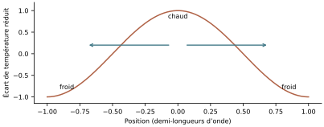
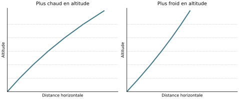
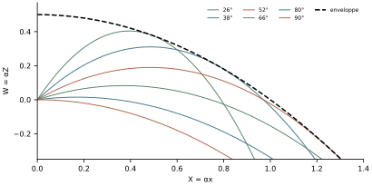

# Physique B — X-ENS PC 2024 · Corrigé brut

*Corrigé rédigé par IA, non officiel.*

**Rédaction** · GPT-6.2 Astra Ultra · vitesse non renseignée

Le corrigé traite intégralement 29 questions sur 32. La question 29 est limitée au principe de mesure halieutique. Les questions 30 et 32 sont exclues. Les trois figures illustrent la physique de la conduction et de la réfraction dans l’air.

## I · Domaine des équations acoustiques

### Question 1 — Échelle d’une particule fluide

La dimension de la cellule doit être grande devant le libre parcours moyen moléculaire et contenir assez de molécules pour que les fluctuations relatives soient faibles. Elle doit aussi être petite devant les longueurs de variation macroscopiques du champ étudié. On peut alors définir des valeurs locales reproductibles de densité, de température et de vitesse.

### Question 2 — Fermeture et non-linéarité

Les équations d’Euler et de continuité donnent quatre équations scalaires pour trois composantes de vitesse, la pression et la densité, soit cinq inconnues même avant d’expliciter $T$. Une loi thermodynamique et l’hypothèse sur l’évolution du fluide doivent compléter le système. Les produits $\rho\mathbf v$ et le terme convectif $(\mathbf v\cdot\nabla)\mathbf v$ rendent les équations couplées et non linéaires.

### Question 3 — Inertie locale

Au repos $\mathbf v_0=0$, donc $\rho\partial_t\mathbf v=(\rho_0+\delta\rho)\partial_t\delta\mathbf v$. Si $A_\rho/\rho_0\ll1$, le terme $\delta\rho\,\partial_t\delta\mathbf v$ est petit devant $\rho_0\partial_t\delta\mathbf v$. L’inertie linéarisée est $\rho_0\partial_t\delta\mathbf v$.

### Question 4 — Inertie convective

Les ordres de grandeur temporel et spatial sont $\omega$ et $k=\omega/c$. Le rapport de l’inertie convective à l’inertie locale est $kA_v^2/(\omega A_v)=A_v/c$. Elle est donc négligeable si le nombre de Mach acoustique est petit, $A_v\ll c$.

### Question 5 — Conservation linéaire de la masse

On développe $\partial_t\delta\rho+\rho_0\nabla\cdot\delta\mathbf v+\nabla\cdot(\delta\rho\,\delta\mathbf v)=0$, avec $\rho_0$ uniforme. Le produit a pour ordre $k A_\rho A_v$, petit devant $\rho_0 kA_v$ si $A_\rho\ll\rho_0$. Il reste $\partial_t\delta\rho+\rho_0\nabla\cdot\delta\mathbf v=0$. Rapporté à $\omega A_\rho$, le même terme est petit si $A_v/c\ll1$.

### Question 6 — Compressibilité isentropique

On développe autour de $(p_0,T_0)$ sur la même isentrope. Pour des perturbations assez petites pour que $\rho\chi_S$ puisse être remplacé par $\rho_0\chi_{S0}$, on a $\delta\rho=\rho_0\chi_{S0}\delta p$. Cela suppose notamment $A_\rho/\rho_0\ll1$ et une variation relative de $\chi_S$ faible dans le domaine exploré. En combinant la fermeture avec la continuité et Euler, $c^2=(\partial p/\partial\rho)_S=1/(\rho_0\chi_{S0})$, soit $\delta p=c^2\delta\rho$.

### Question 7 — Poids de la perturbation

L’équilibre statique donne $\nabla p_0=\rho_0\mathbf g$. Après soustraction, Euler devient $\rho_0\partial_t\delta\mathbf v=\delta\rho\,\mathbf g-\nabla\delta p$. Le rapport des deux termes à droite est d’ordre $A_\rho g/(k A_p)=g/(kc^2)=g/(\omega c)$. La pesanteur est négligeable dans les relations acoustiques lorsque $\omega\gg g/c$.

### Question 8 — Limite basse en fréquence

Il faut $f\gg g/(2\pi c)$. Pour l’air, $g/(2\pi c)\simeq5{,}3\times10^{-3}$ Hz. Pour l’eau, la valeur est $1{,}1\times10^{-3}$ Hz. Les sons audibles sont très au-dessus de ces seuils de l’ordre du millihertz. Les mouvements de très longue période demandent un examen distinct.

### Question 9 — Conduction entre régions comprimées et détendues

Les compressions échauffent localement le fluide et les détentes le refroidissent. La chaleur diffuse d’une zone chaude vers les zones froides voisines, dans le sens de $-\nabla T$. Pour un champ harmonique infini, le terme diffusif d’amplitude $Dk^2A_T$ est petit devant le terme instationnaire $\omega A_T$ si $Dk^2/\omega=D\omega/c^2\ll1$. Ainsi $\omega\ll c^2/D$. Équivalemment, la distance de diffusion sur $1/\omega$ est petite devant $1/k$.

### Question 10 — Limite thermique supérieure

La borne vaut $f\ll c^2/(2\pi D)$. Dans l’air, $c=300\ \mathrm{m\,s^{-1}}$ et $D=2{,}0\times10^{-5}\ \mathrm{m^2\,s^{-1}}$ donnent environ $7\times10^8$ Hz. Dans l’eau, $c=1\,500\ \mathrm{m\,s^{-1}}$ et $D=1{,}5\times10^{-7}\ \mathrm{m^2\,s^{-1}}$ donnent environ $2\times10^{12}$ Hz. Dans le volume du fluide, la conduction est ainsi négligeable pour les sons ordinaires.

### Question 11 — Terme visqueux

La densité de force visqueuse est d’ordre $\eta k^2A_v$ et l’inertie locale $\rho_0\omega A_v$. Leur rapport est $\nu k^2/\omega=\nu\omega/c^2$. Le modèle de fluide parfait est valable au premier ordre en volume pour $\omega\ll c^2/\nu$. Des couches limites peuvent demander un traitement particulier près de parois.

### Question 12 — Limite visqueuse supérieure

La condition $f\ll c^2/(2\pi\nu)$ donne $f\ll1{,}4\times10^9$ Hz dans l’air et $f\ll3{,}6\times10^{11}$ Hz dans l’eau. Les effets visqueux locaux restent faibles dans les deux milieux aux fréquences audibles, ce qui justifie le modèle de propagation sur les échelles considérées.

### Question 13 — Milieu lentement variable

Les équations linéaires contiennent des gradients de perturbation d’ordre $A_s/\lambda$ et des gradients relatifs des coefficients d’ordre $1/\ell$. Par exemple, en dérivant $\delta p=c(z)^2\delta\rho$, $\nabla\delta p=c^2\nabla\delta\rho+\delta\rho\nabla c^2$. Le deuxième terme est plus faible d’un facteur d’ordre $\lambda/\ell$. Si $\lambda\ll\ell$, on peut tirer localement les coefficients des dérivées au premier ordre et employer $\partial_{tt}\delta s\simeq c(z)^2\Delta\delta s$ pour la phase rapide. Sur de grandes distances, les variations de direction et d’amplitude peuvent néanmoins s’accumuler.

## II · Réfraction et rayons acoustiques

### Question 14 — Célérité dans l’air

Pour un gaz parfait calorifiquement parfait, $p/\rho^\gamma$ reste constant le long d’une isentrope, donc $c^2=(\partial p/\partial\rho)_s=\gamma p/\rho=\gamma RT/M$. L’excitation des degrés de liberté moléculaires dépend de la structure et de la température. Autour des conditions usuelles, l’air est essentiellement constitué de molécules diatomiques, avec trois translations et deux rotations actives, les vibrations restant gelées. L’équipartition donne $C_{V,m}=5R/2$ et $C_{P,m}=7R/2$, d’où $\gamma=7/5\simeq1{,}4$.

### Question 15 — Continuité de la phase

Sur l’interface $z=0$, la phase de l’onde transmise et celle de l’onde incidente doivent avoir la même dépendance tangentielle pour tout $x$ et tout $t$ (un décalage constant est permis). Ainsi $k_{1x}=k_{2x}$. Avec $k_i=\omega/c_i$ et des angles à la normale, $k_{ix}=(\omega/c_i)\sin\theta_i$, soit $\sin\theta_2/c_2=\sin\theta_1/c_1$.

### Question 16 — Loi de réfraction acoustique

C’est la loi de Snell-Descartes avec un indice proportionnel à $1/c$. Lorsque $c_2>c_1$, le rayon transmis s’écarte de la normale. Si le sinus requis dépasse un, aucune onde transmise progressive ne réalise cet angle. Pour $c_2<c_1$, le rayon se rapproche de la normale.

### Question 17 — Épaisseur des couches

La propagation par rayons dans chaque couche suppose une épaisseur grande devant la longueur d’onde locale, $\lambda_n=2\pi c_n/\omega\ll e$. Pour discrétiser un profil continu, on pourra choisir simultanément $e$ petit devant la longueur macroscopique de variation de la température.

### Question 18 — Trajectoires par morceaux

Le rayon est rectiligne dans chaque couche et sa direction change à chaque interface. Si $T_{n+1}>T_n$, alors $c_{n+1}>c_n$, $\theta$ augmente et la pente $\mathrm dz/\mathrm dx=\cot\theta$ décroît. Le tracé montant s’aplatit et peut se retourner si un seuil de réfraction est atteint. Si $T_{n+1}<T_n$, les angles diminuent, la pente augmente et le rayon montant se redresse. Seul le sens de courbure est assuré par la monotonie. Une asymptote ou un retournement dépend des valeurs atteintes par $c_n$.

### Question 19 — Angle d’une couche accessible

La relation à chaque interface conserve $\sin\theta_n/c_n$. Ainsi $\sin\theta_n=(c_n/c_1)\sin\theta_1=\sqrt{T_n/T_1}\,\sin\theta_1$ pour le gaz de composition constante. La branche montante prend l’arc sinus dans $[0,\pi/2]$ tant que le membre de droite est au plus égal à un. Après un retournement, il faut choisir la branche descendante.

### Question 20 — Échelle du gradient de célérité

À une altitude où $c'\ne0$, la longueur de variation est $\ell=1/|\partial_z\ln c|=c/|c'|$. La condition $2\pi c/\omega\ll\ell$ donne $2\pi|c'(z)|\ll\omega$ dans la zone parcourue. À des facteurs d’ordre unité près, la pulsation doit donc dépasser largement le gradient de célérité exprimé en $\mathrm{s^{-1}}$.

### Question 21 — Équation de la trajectoire

L’invariant de réfraction est $A=n(z)\sin\theta=n_0\sin\theta_0$. Puisque $Z'=\cot\theta$, on a $1+Z'^2=1/\sin^2\theta=n(Z)^2/A^2$. Cette équation fixe la tangente en fonction de l’altitude et de l’orientation initiale.

### Question 22 — Intégration au premier ordre

Dans le domaine $|\alpha z|\ll1$, $c^2(z)=c_0^2(1+2\alpha z)$ donne $n^2(z)\simeq n_0^2(1-2\alpha z)$. En remplaçant $A$, il vient $Z'^2=\cot^2\theta_0-2\alpha Z/\sin^2\theta_0$. En dérivant sur tout arc où $Z'\ne0$ puis en prolongeant continûment au sommet, $Z''=-\alpha/\sin^2\theta_0$. Les conditions $Z(0)=0$, $Z'(0)=\cot\theta_0$ donnent
$$Z(x)=x\cot\theta_0-\frac{\alpha x^2}{2\sin^2\theta_0}.$$
Cette parabole résout l’équation approchée dans le domaine de validité du développement.

### Question 23 — Variables réduites

En notant $X=\alpha x$ et $W=\alpha Z$, on obtient $W=BX^2+CX$, avec $B=-1/(2\sin^2\theta_0)<0$ et $C=\cot\theta_0$. Les deux coefficients sont sans dimension. La dérivée au départ vaut bien $\cot\theta_0$.

### Question 24 — Famille de rayons dans l’air

Posons $u=\cot\theta_0\ge0$. La famille est $W=uX-(1+u^2)X^2/2$. Chaque rayon passe par l’origine et a une concavité négative. Le sommet est situé en $X_s=u/(1+u^2)$ et $W_s=u^2/[2(1+u^2)]=\cos^2\theta_0/2$. Le second passage par $W=0$ se produit en $X=2X_s=\sin(2\theta_0)$. Pour $\theta_0=\pi/2$, le sommet est l’origine. Le tracé est celui du modèle au premier ordre, à interpréter localement quand $|W|\ll1$.

### Question 25 — Enveloppe géométrique

Pour $X>0$ donné, l’équation en $u$ est $X^2u^2-2Xu+X^2+2W=0$. Son discriminant est $4X^2(1-X^2-2W)$. La frontière où les deux orientations coïncident est donc $W_f(X)=(1-X^2)/2$. Dans le domaine complet de directions, l’intérieur $W<W_f$ admet des directions réelles et $W>W_f$ n’en admet aucune. Pour les seuls départs montants et vers la droite, il faut garder également $u\ge0$. En variant $u$, les points de tangence ont $u=1/X$. La validité physique du modèle reste limitée à la région de faible $|W|$.

### Question 26 — Source acoustique omnidirectionnelle

En un point générique de la région accessible, deux rayons géométriques distincts issus de la même source arrivent selon des directions différentes, donc peuvent produire deux directions apparentes. Sur l’enveloppe ces directions se confondent. La différence éventuelle des temps d’arrivée demande de calculer $\int\mathrm ds/c$ pour chaque trajet. Le dessin seul ne donne ni le retard ni l’intensité.

### Question 27 — Analogie mécanique

Le terme en $X$ fixe la pente au départ et le terme en $-X^2$ la concavité. C’est la forme du mouvement d’une petite balle lancée dans un champ de pesanteur uniforme, avec une vitesse horizontale constante et une accélération verticale constante. Dans le fluide, la courbure provient de la réfraction dans un gradient de célérité.

## Applications et limites de couverture

### Question 28 — Interpréter un écho en milieu stratifié

En mesure bathymétrique, la tangente de départ ou d’arrivée du son ne donne pas en général la droite géométrique qui joint le capteur au réflecteur. Le temps aller-retour est une intégrale de lenteur le long des trajets. Le convertir avec une célérité uniforme peut donc fausser la distance estimée. Selon le profil, certaines zones ne sont traversées par aucun rayon de la source et d’autres admettent des trajets multiples. Dans un milieu immobile réciproque, la courbure elle-même ne compromet pas le principe de retour inverse.

### Question 29 — Observation halieutique — principe général

Un bateau de pêche peut recevoir des échos de poissons sur des trajets acoustiques réfractés. Comparer une profondeur observée à une estimation de portée demande de connaître le profil de célérité et l’angle de départ. Une pente locale ne peut être extrapolée au-delà du domaine où sa linéarisation est valable. Cette réponse traite le principe de la mesure. L’exploitation chiffrée du profil naval commun aux questions finales reste hors couverture.

### Question 30 — Application navale

Cette application du profil au bâtiment décrit dans le sujet est hors du périmètre traité. La question n’est pas comptée comme résolue.

### Question 31 — Analogue optique

Un milieu à gradient d’indice peut guider la lumière près d’un maximum de l’indice optique. À la manière d’une fibre à gradient d’indice, des rayons voisins de l’axe se courbent et oscillent autour de lui sous l’effet de la réfraction continue. L’analogie est qualitative et porte sur la loi de réfraction dans un profil transversal.

### Question 32 — Application navale

La question sur l’emploi opérationnel du bâtiment est hors du périmètre traité. Le corrigé conserve le statut partiel.

[Sujet officiel](https://www.polytechnique.edu/admission-cycle-ingenieur/sites/admission/files/content/2024%20PC%20SUJET%20PHYSIQUE%20B%20(XEULS).pdf) · [Rapport du jury](https://www.polytechnique.edu/admission-cycle-ingenieur/sites/admission/files/content/2024%20PC%20RAPPORT%20ECRIT%20PHYSIQUE%20B%20(XEULS).pdf)
