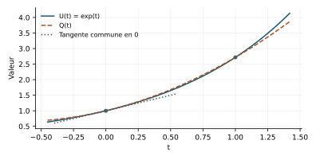
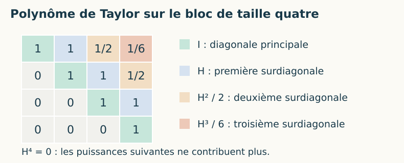
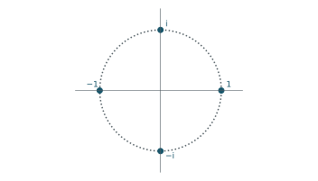

# X et ENS, filière PSI — Mathématiques 2024 · Corrigé brut

*Corrigé rédigé par IA, non officiel. Signalez toute erreur.*

**Rédaction** · GPT-6.2 Astra Ultra · vitesse non renseignée

**Révision (tour 1)** · GPT-6.2 Astra Ultra · vitesse non renseignée · 26 novembre 2026

La garde porte les noms des Écoles normales supérieures et de l’École polytechnique. Épreuve n° 1 de la filière PSI, lundi 15 avril 2024 de 8 h à 12 h. Les pages 3 et 4 fixent les notations du problème. Les pages 5 à 9 développent quatre parties. Le rapport Saclay commente explicitement la question 7 neutralisée. [Sujet officiel](https://ens-paris-saclay.fr/sites/default/files/CONCOURS/ANNALES_1C/1C_PSI/2024_PSI_Maths_XUSR.pdf) · [Rapport du jury](https://ens-paris-saclay.fr/sites/default/files/CONCOURS/ANNALES_1C/1C_PSI/2024_Rapport_PSI_Maths_ECRIT.pdf)

Dans tout le sujet, u désigne la suite des coefficients de la série entière de somme U. La fonction de matrice u(A) est définie à la question 13 par interpolation.

## I · Matrices compatibles avec une série entière

### Question 1

Si $R_u=0$, l’inégalité stricte $\varrho(A)<0$ est impossible. Si $R_u>0$, la matrice nulle est compatible puisque son rayon spectral vaut zéro. Ainsi $\mathcal M_n(u)=\varnothing$ équivaut à $R_u=0$. Par exemple, $u_k=k!$ convient car pour $z\ne0$ le rapport des modules de deux termes consécutifs est $(k+1)|z|\to\infty$.

### Question 2

Si $R_u=0$, l’ensemble est vide et diffère du singleton. Sinon, choisissons $0<r<R_u$. La matrice $rI_n$ est non nulle et compatible, car $\varrho(rI_n)=r$. Le singleton est donc exclu dans tous les cas.

### Question 3

Un rayon infini rend compatible toute matrice complexe, puisque son spectre est fini. Ainsi (i) implique (ii), qui implique la non-vacuité et la stabilité par addition de (iii). Réciproquement (iii) donne $R_u>0$ par 1. S’il était fini, $(R_u/2)I_n$ serait compatible, mais son double aurait pour rayon spectral $R_u$. Cette contradiction établit (i). La suite $u_k=1/k!$, de rayon infini et de termes tous non nuls, est un exemple.

### Question 4

Une matrice nilpotente a pour seule valeur propre zéro et est donc compatible avec tout rayon positif. Réciproquement, pour tout $r>0$ la suite $v_k=r^{-k}$ a pour rayon $r$. L’hypothèse donne $\varrho(A)<r$ pour tout $r>0$, donc $\varrho(A)=0$. Sur $\mathbb C$, le polynôme caractéristique est alors $X^n$. Cayley–Hamilton donne $A^n=0$.

### Question 5

Une série entière et sa série dérivée terme à terme ont le même rayon. En effet, pour $0<r<s<R_u$, la suite $|u_k|s^k$ est bornée et la multiplication par $k(r/s)^{k-1}$ préserve la sommabilité à rayon $r$ pour la dérivée. Réciproquement, la convergence absolue de la dérivée à un rayon $r>0$ entraîne celle de la série d’origine à ce rayon par division des coefficients par $k$. L’égalité des rayons vaut aussi si le rayon commun est nul ou infini. Par récurrence, $D_{u^{(m)}}=D_u$ pour chaque $m$.

### Question 6

Pour $|z|<\min(R_u,R_v)$, les deux séries convergent absolument. Leur somme et leur produit de Cauchy sont donc absolument convergents, avec pour coefficients $u+v$ et $u\star v$. Les deux rayons correspondants sont au moins $\min(R_u,R_v)$. Si $A$ appartient aux deux ensembles de gauche, $\varrho(A)$ est strictement plus petit que ce minimum, d’où les deux compatibilités voulues.

Une égalité des rayons est impossible à garantir. Prenons $u_k=1$ et $v_k=-1$ pour tout $k$. Les deux rayons valent un alors que $u+v$ est la suite nulle, de rayon infini. Ce sont bien des inclusions qui survivent à d’éventuelles annulations de coefficients.

### Question 7

Le rapport précise que le mot « réelles » manquait et que le jury a neutralisé la question. Dans le cas réel symétrique prévu, les espaces propres de $A$ sont stables par $B$ puisque $AB=BA$. La restriction de $B$ à chacun est symétrique. Le théorème spectral donne ainsi une base commune, et les valeurs propres de $AB$ sont des produits $a_jb_j$ avec $|a_j|,|b_j|<R_u$. D’où $\varrho(AB)<R_u^2\le R_u$.

Le résultat imprimé reste valable sur $\mathbb C$, où la symétrie seule ne garantit pas la diagonalisation. Deux matrices complexes commutantes se triangularisent simultanément. En effet, un espace propre de $A$ est non nul et stable sous $B$, donc contient un vecteur propre de $B$. La droite commune est stable et les endomorphismes induits sur le quotient commutent. Une récurrence sur la dimension, en relevant une base triangularisante du quotient, donne une base triangulaire commune. Les éléments diagonaux du produit sont encore les $a_jb_j$. La même majoration conclut.

Pour voir où intervient l’hypothèse réelle dans la première preuve, la matrice complexe symétrique $N=\left(\begin{smallmatrix}1&i\\i&-1\end{smallmatrix}\right)$ est non nulle et son carré est nul. Elle ne peut donc pas avoir une base propre. Dans la seconde preuve, seule la commutation intervient. Sur les diagonales triangulaires, $\max_j|a_jb_j|\le(\max_j|a_j|)(\max_j|b_j|)<R_u^2$ puisque $R_u>0$. Cela inclut la valeur extrême $R_u=1$.

## II · Polynôme minimal et interpolation

### Question 8

Le polynôme caractéristique de $A$ est unitaire de degré $n$, donc non nul, et annule $A$ par le théorème de Cayley–Hamilton. Il appartient à $V(A)$.

### Question 9

Par 8 et par bon ordre des entiers, il existe un plus petit degré $m$ d’annulateur non nul. En divisant un tel polynôme par son coefficient dominant, on obtient un annulateur unitaire de degré $m$. Si deux d’entre eux différaient, leur différence serait un annulateur non nul de degré strictement inférieur à $m$. L’unicité s’ensuit. Aucun polynôme constant non nul n’annule $A$, donc $m\ge1$.

### Question 10

Écrivons $P=S\phi_A+T$, avec $T=0$ ou $\deg T<m$. Par évaluation en $A$, $T(A)=0$. Un reste non nul contredirait la minimalité du degré de $\phi_A$. Ainsi $T=0$ et $\phi_A\mid P$.

### Question 11

Si $Aw=\lambda w$ avec $w\ne0$, alors $0=\phi_A(A)w=\phi_A(\lambda)w$, d’où $\phi_A(\lambda)=0$. Réciproquement, si $\phi_A=(X-\lambda)S$ et que $A-\lambda I_n$ était inversible, l’égalité $(A-\lambda I_n)S(A)=0$ donnerait $S(A)=0$. Ce polynôme non nul de degré $m-1$ contredirait 9. Ainsi $\lambda$ est bien valeur propre.

### Question 12

Si $A$ est réelle, la conjugaison de $\phi_A(A)=0$ donne $\overline{\phi_A}(A)=0$. Ce polynôme est unitaire de même degré que $\phi_A$. L’unicité de 9 donne $\overline{\phi_A}=\phi_A$, donc tous ses coefficients sont réels.

### Question 13

L’application $T$ est linéaire. Si $P\in\ker T$, chaque $\lambda_i$ est racine de $P$ d’ordre au moins $m_i$ (ou $P=0$). Les facteurs $(X-\lambda_i)^{m_i}$ sont premiers entre eux, donc leur produit $\phi_A$ divise $P$. Puisque $\deg P\le m-1$, le noyau est nul. Les deux espaces ont dimension $m$, donc $T$ est bijective. Les valeurs $U^{(k)}(\lambda_i)$ sont définies car $\lambda_i\in D_u$ et 5 s’applique. Le vecteur de ces données possède un unique antécédent $Q$.

Dans la première figure, pour les nœuds $0$ de multiplicité deux et $1$ de multiplicité un, les trois conditions sont $Q(0)=1$, $Q'(0)=1$ et $Q(1)=e$. Elles déterminent $Q(X)=1+X+(e-2)X^2$. Un deuxième polynôme quadratique ayant les mêmes données aurait une différence divisible par $X^2(X-1)$, donc nulle.

### Question 14

Par définition, $u(A)=P(A)$ équivaut à $(P-Q)(A)=0$. D’après 10, cela équivaut à $\phi_A\mid(P-Q)$, en incluant le cas du polynôme nul. La factorisation de $\phi_A$ traduit cette divisibilité par l’annulation des dérivées de $P-Q$ aux $\lambda_i$ jusqu’à l’ordre $m_i-1$. Ce sont précisément les égalités demandées.

### Question 15

Le polynôme minimal de $\alpha I_n$ est $X-\alpha$ puisqu’il annule la matrice et qu’aucun polynôme constant non nul ne l’annule. Le représentant de degré inférieur à un est donc le polynôme constant $U(\alpha)$. Ainsi $u(\alpha I_n)=U(\alpha)I_n$.

### Question 16

Le polynôme caractéristique est $(X-\alpha)(X-\beta)$. Chaque valeur propre doit être une racine du minimal, donc les deux polynômes coïncident. Le polynôme affine donnant les valeurs prescrites est $P(X)=U(\beta)+c(X-\beta)$ avec $c=(U(\alpha)-U(\beta))/(\alpha-\beta)$. Son évaluation donne
$$u(A)=\begin{pmatrix}U(\alpha)&\gamma\,\dfrac{U(\alpha)-U(\beta)}{\alpha-\beta}\\0&U(\beta)\end{pmatrix}.$$

### Question 17a

Pour toute valeur propre $\lambda$ de $A$ ou $B$, prenons la multiplicité maximale de $\lambda$ dans leurs deux polynômes minimaux, la multiplicité absente étant nulle. Sur la réunion des nœuds, imposons à $R$ les dérivées de $U$ jusqu’à cet ordre moins un. La preuve de 13, appliquée à ces nœuds distincts et à ces multiplicités, assure l’existence de $R$. Il satisfait simultanément les conditions de 14 pour les deux matrices.

Par exemple, les deux minimaux $(X-a)^2(X-b)$ et $(X-a)(X-b)^3$, avec $a\ne b$, demandent deux conditions en $a$ et trois en $b$. Le représentant commun a degré au plus quatre. Le même calcul explique l’emploi du maximum des multiplicités lorsque les matrices partagent une valeur propre.

### Question 17b

La question 17a appliquée à $BA$ et $AB$ fournit un même polynôme $R$ tel que $u(BA)=R(BA)$ et $u(AB)=R(AB)$. L’identité $A(BA)^k=(AB)^k A$ est vraie pour $k=0$ et passe à $k+1$ par associativité. En combinant linéairement ces identités, $Au(BA)=u(AB)A$.

### Question 18

Par 6, $A$ est compatible avec $u\star v$. Sur le disque commun, la série de cette suite a pour somme $U V$. Prenons les représentants $P$ de $u(A)$ et $S$ de $v(A)$. Pour tout nœud $\lambda_i$ et $0\le j<m_i$, la formule de Leibniz donne
$$(PS)^{(j)}(\lambda_i)=\sum_{a=0}^j\binom ja U^{(a)}(\lambda_i)V^{(j-a)}(\lambda_i)=(UV)^{(j)}(\lambda_i).$$
Les valeurs propres étant réelles dans la question, on peut appliquer Leibniz aux restrictions à l’axe réel. La question 14 assure alors $(u\star v)(A)=(PS)(A)=u(A)v(A)$.

## III · Matrices diagonalisables

### Question 19

Dans une base propre, $P(A)$ est diagonale de coefficients $P(\lambda)$ aux valeurs propres correspondantes. Le produit unitaire des facteurs linéaires distincts annule donc $A$. Le minimal le divise par 10 et est divisible par chacun des facteurs par 11. Ainsi $\phi_A=\prod_{k=1}^\ell(X-\lambda_k)$.

### Question 20a

On a $Q_k^A(\lambda_j)=\delta_{kj}$, y compris si le produit est vide pour $\ell=1$. Le polynôme $P=\sum_k U(\lambda_k)Q_k^A$ prend donc la valeur $U(\lambda_j)$ en chaque nœud. Comme toutes les racines du minimal sont simples, 14 donne $u(A)=\sum_k U(\lambda_k)Q_k^A(A)$.

### Question 20b

Sur $E_j=\ker(A-\lambda_jI_n)$, $Q_k^A(A)$ agit par le scalaire $\delta_{kj}$. La décomposition directe de l’espace en $E_j$ montre que cet opérateur est le projecteur sur $E_k$ parallèlement à $\bigoplus_{j\ne k}E_j$. Ce sont respectivement son image et son noyau.

Si $E_k$ est le seul espace propre, le produit vide donne $Q_k^A=1$. Plus généralement, par calcul sur chaque $E_j$, les opérateurs $P_k=Q_k^A(A)$ vérifient $P_k^2=P_k$ et $P_kP_h=0$ pour $k\ne h$. Ces identités confirment la description du noyau même si les sous-espaces propres ne sont pas orthogonaux.

### Question 20c

Pour $x=\sum_j x_j$, $x_j\in E_j$, on a $\sum_kQ_k^A(A)x=\sum_k x_k=x$. L’égalité d’endomorphismes donne $\sum_kQ_k^A(A)=I_n$.

### Question 21

Pour tout polynôme $P$, $P(BAB^{-1})=BP(A)B^{-1}$. Les matrices ont donc le même minimal, les mêmes données d’interpolation et le même représentant $Q$. Elles sont toutes deux compatibles puisqu’elles ont même spectre. En appliquant l’identité à $Q$, on trouve $u(BAB^{-1})=Bu(A)B^{-1}$.

### Question 22a

La matrice $D$ étant diagonale, $Q(D)$ est diagonale et son $i$-ème élément diagonal vaut $Q(D_{ii})$. Ce coefficient est une valeur de $Q$ à une valeur propre, donc vaut $U(D_{ii})$. Cela donne $u(D)=\operatorname{Diag}(U(D_{11}),\ldots,U(D_{nn}))$.

### Question 22b

Puisque $A=SDS^{-1}$, la question 21 donne $u(A)=S\operatorname{Diag}(U(D_{11}),\ldots,U(D_{nn}))S^{-1}$.

## IV · Exemples de calcul effectif

### Question 23a

On a $He_1=0$ et $He_j=e_{j-1}$ pour $j\ge2$. Ainsi $H^n=0$ mais $H^{n-1}e_n=e_1\ne0$. Son minimal divise $X^n$ et ne peut être aucune puissance d’exposant inférieur, donc $\phi_H=X^n$.

### Question 23b

Pour $A=H+\alpha I_n$, le même argument appliqué à $A-\alpha I_n$ donne $\phi_A=(X-\alpha)^n$. Son représentant est le polynôme de Taylor de $U$ en $\alpha$ à l’ordre $n-1$, qui a les dérivées prescrites. Ainsi
$$u(A)=\sum_{k=0}^{n-1}\frac{U^{(k)}(\alpha)}{k!}H^k.$$
La matrice $H^k$ a des uns sur la $k$-ième surdiagonale et zéro ailleurs. Donc $[u(A)]_{ij}=U^{(j-i)}(\alpha)/(j-i)!$ si $j\ge i$, et zéro si $j<i$. Cela donne toutes les entrées de la matrice triangulaire demandée.

Pour lire les surdiagonales sans recourir à une somme de matrices, on a $H^k e_j=e_{j-k}$ si $j>k$, et zéro pour $j\le k$. Un unique terme du polynôme de Taylor contribue donc à la case $(i,j)$ lorsque $i\le j$. L’exemple suivant prend $n=4$, $\alpha=0$ et $U(z)=e^z$.

### Question 24a

Pour tout $x$, $Gx=Y(Z^Tx)$ et $GZ=Y$ puisque $Z$ est unitaire réel. Ainsi l’image est exactement la droite complexe $\mathbb C Y$. Le rang vaut un.

### Question 24b

Comme $n\ge4$ et le rang vaut un, zéro est valeur propre. De plus $GY=cY$ avec $c=Z^TY$. Si $Gx=\lambda x$ et $\lambda\ne0$, alors $x\in\mathbb CY$ par 24a, donc $\lambda=c$. Ainsi le spectre est $\{0,c\}$, réduit à $\{0\}$ si $c=0$.

### Question 24c

Comme $Y,Z$ sont réels unitaires, $|c|=|Z^TY|\le1$ par Cauchy–Schwarz. Donc $\varrho(G)\le1<R_u$, ce qui donne la compatibilité.

### Question 24d

Le produit de rang un vérifie $G^2=Y(Z^TY)Z^T=cG$. Donc $X(X-c)$ annule $G$. Si $c\ne0$, ses deux racines sont valeurs propres et doivent figurer dans le minimal. Ainsi $\phi_G=X(X-c)$.

### Question 24e

Le polynôme affine $P(X)=U(0)+(U(c)-U(0))X/c$ a les bonnes valeurs en $0$ et $c$. D’après 14 et 24d, $u(G)=U(0)I_n+\dfrac{U(c)-U(0)}{c}G$.

### Question 24f

Pour $c=0$, $G^2=0$ mais $G\ne0$ par son rang. Son minimal est donc $X^2$. L’interpolation demande la valeur et la dérivée en zéro, ce qui donne $u(G)=U(0)I_n+U'(0)G$.

Le coefficient de $G$ en 24e est le taux d’accroissement de $U$ entre $0$ et $c$. Sa limite est $U'(0)$ quand $c$ tend vers zéro. Le calcul par le minimal $X^2$ démontre directement cette valeur au point de coïncidence et explique la présence d’une donnée de dérivée.

### Question 25a

La matrice $F$ est symétrique, donc $F^*=\overline F$. Le coefficient $(k,j)$ de $F\overline F$ vaut $\frac1n\sum_{r=0}^{n-1}\omega^{(k-j)r}$. Cette somme vaut un lorsque $j=k$, et zéro sinon par la formule géométrique puisque $\omega$ est primitive. Ainsi $F\overline F=I_n$ et $F^{-1}=\overline F$.

### Question 25b

Cette fois $[F^2]_{kj}=\frac1n\sum_{r=0}^{n-1}\omega^{(k+j-2)r}$. Le résultat est un si $k+j-2\equiv0\pmod n$ et zéro sinon. C’est la matrice réelle de la permutation $s\mapsto-s$ dans les indices décalés $s=j-1$ modulo $n$.

Avec l’indexation de l’énoncé, la première colonne de $F^2$ est $e_1$, et, pour $2\le j\le n$, sa colonne $j$ vaut $e_{n+2-j}$. Pour $n$ pair, les points fixes sont les indices $1$ et $1+n/2$. Pour $n$ impair, seul $1$ est fixe.

### Question 25c

La permutation de 25b est involutive, donc $(F^2)^2=I_n$. Le spectre de $F$ est inclus dans $\{1,-1,i,-i\}$, dont chaque élément est de module un. Ainsi $\varrho(F)=1<R_u$ et $F$ est compatible.

### Question 25d

Le minimal de $F$ divise $X^4-1$, qui est à racines simples. Les seules conditions à vérifier sont donc des valeurs. Posons
$$\begin{aligned}
P(X)={}&\tfrac14\big[U(1)(X+1)-U(-1)(X-1)\big](X^2+1)\\
 &+\tfrac i4\big[U(i)(X+i)-U(-i)(X-i)\big](X^2-1).
\end{aligned}$$
Aux nœuds $1,-1$, la seconde ligne est nulle et la première vaut respectivement $U(1),U(-1)$. Aux nœuds $i,-i$, la première s’annule et la seconde vaut $U(i),U(-i)$ car $i^2=-1$. Ainsi $u(F)=P(F)$ par 14, ce qui donne l’expression voulue en remplaçant $X$ par $F$ et les constantes par leurs multiples de $I_n$.

### Question 26a

Pour $X\sim\mathcal B(N,p)$, la série génératrice est le polynôme $U(z)=\sum_{k=0}^N\binom Nk p^k(1-p)^{N-k}z^k=(1-p+pz)^N$. Son rayon est infini. Le polynôme $U$ lui-même vérifie toutes les données de 14, donc $u(A)=((1-p)I_n+pA)^N$ pour toute matrice compatible.

### Question 26b

Écrivons $q=1-p\in(0,1)$. Pour $k\ge1$, $u_k=pq^{k-1}$ et $u_0=0$, donc $U(z)=pz/(1-qz)$ de rayon $1/q>1$. Si $A=S\operatorname{Diag}(\lambda_i)S^{-1}$ est compatible, $|q\lambda_i|<1$ et chaque $1-q\lambda_i$ est non nul. Par 22b,
$$u(A)=S\operatorname{Diag}\left(\frac{p\lambda_i}{1-q\lambda_i}\right)S^{-1}
=p(I_n-qA)^{-1}A.$$
La même diagonalisation justifie l’existence de l’inverse intervenant dans la formule.

Le coefficient d’ordre zéro disparaît car la probabilité du premier succès à l’essai zéro est nulle. En évaluant en $z=1$, on vérifie $p/(1-q)=1$. Sur une valeur propre $\lambda=0$, la formule donne aussi zéro. Enfin $A$ commute avec $I_n-qA$ et avec son inverse, ce qui permet les deux écritures du produit pour chaque $A$ diagonalisable demandé.
