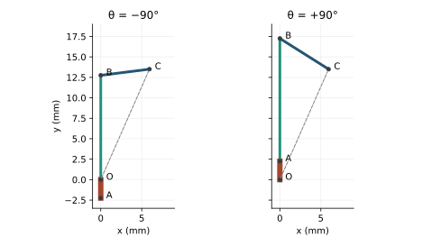
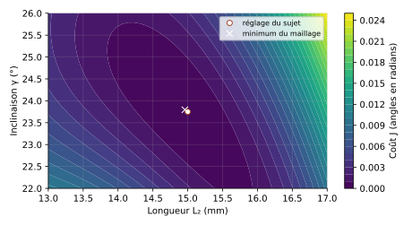
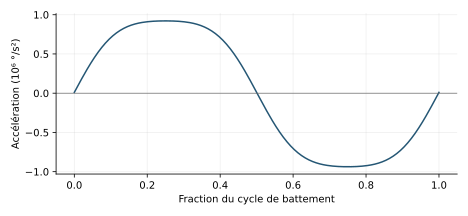
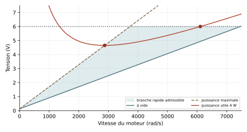
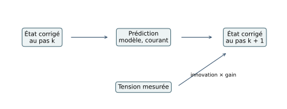

# X-ENS PSI — Modélisation 2024 · Corrigé brut

*Corrigé rédigé par IA, non officiel. Signalez toute erreur.*

**Rédaction** · GPT-6.2 Astra Ultra · vitesse non renseignée · 24 novembre 2026

**Révision** · GPT-6.2 Astra Ultra · vitesse non renseignée · 26 novembre 2026

## Comparer et modéliser les battements

### Question 1 · Comparer les prototypes

Les fréquences et dimensions des prototypes atteignent les mêmes ordres de grandeur que celles des colibris. À longueur d’aile comparable, les robots sont généralement plus lourds. La figure 2 place par exemple Colibri vers 20 à 25 g pour une aile voisine de 90 mm. Nano Hummingbird et KU-Beetle ont des ailes un peu plus courtes, autour de 65 à 70 mm, et l’AVFL dépasse 100 mm. Dans le second nuage, les quatre prototypes prolongent assez bien la décroissance de la fréquence avec la longueur d’aile. La réduction de la masse embarquée, moteur et batterie compris, est donc prioritaire. Comparer des points à masse ou longueur comparable évite de conclure à partir des seules valeurs extrêmes du nuage.

### Question 2 · Deux positions de la manivelle

On a $C=(L\sin\gamma,L\cos\gamma)$. Pour $\theta=-\pi/2$, placer $A=(0,-L_1)$ et $B=(0,L_2-L_1)$. Pour $\theta=+\pi/2$, placer $A=(0,L_1)$ et $B=(0,L_2+L_1)$. Dans chaque cas, $AB$ est vertical et $B$ est au-dessus de $A$ sur la branche de montage considérée. Le segment $BC$ fixe la direction du levier de sortie.



### Question 3 · Fermetures géométriques

La fermeture $OA+AB=OB$ donne $(L_1\cos\theta)^2+(h-L_1\sin\theta)^2=L_2^2$. La fermeture $OB+BC=OC$ donne $\tan\phi=(L\cos\gamma-h)/(L\sin\gamma)$. Substituer $h=L\cos\gamma-L\sin\gamma\tan\phi$ dans la première donne

$$
L_1^2\cos^2\theta+(L_1\sin\theta-L\cos\gamma+L\sin\gamma\tan\phi)^2=L_2^2.
$$


### Question 4 · Hauteurs extrêmes

Aux positions 1 et 2, $h_1=L_2-L_1$ et $h_2=L_2+L_1$. On obtient $\tan\phi_1=(L\cos\gamma-L_2+L_1)/(L\sin\gamma)$ et $\tan\phi_2=(L\cos\gamma-L_2-L_1)/(L\sin\gamma)$. Avec le réglage retenu $L_2=15$ mm, $\gamma=23{,}75^\circ$, les angles valent environ $+7{,}20^\circ$ et $-32{,}26^\circ$. Sur toute la plage d’essais, $\phi_2<0$, mais $\phi_1$ devient négatif si $L_2>L\cos\gamma+L_1$. Le signe dépend de la position relative de $B$ et $C$.

### Question 5 · Branche physique de la racine

$h=L_1\sin\theta+\sqrt{L_2^2-L_1^2\cos^2\theta}$. Donc

$$
\tan\phi=\frac{L\cos\gamma-L_1\sin\theta-\sqrt{L_2^2-L_1^2\cos^2\theta}}{L\sin\gamma}.
$$

Le radicand est positif sur le domaine car $L_2>L_1$, et $L\sin\gamma>0$. L’arctangente dans $]-\pi/2,\pi/2[$ est continue pour ce montage.

### Question 6 · Angle des ailes

La courroie ouverte sans glissement impose $D_4\dot\psi=D_3\dot\phi$. Ainsi $\psi(\theta)=\psi_{\rm ref}+(D_3/D_4)[\arctan(q(\theta))-\phi_{\rm ref}]$, où $q(\theta)$ est le membre droit de Q5. Avec l’origine angulaire commune à zéro, la constante d’intégration est nulle. Le rapport $D_3/D_4\simeq3{,}27$ amplifie le mouvement alternatif.

### Question 7 · Coût de forme

La cible est $\phi_m-A\sin\theta$, avec $A=20^\circ$ et $\phi_m=(\phi_1+\phi_2)/2$. L’intégrale du carré de la différence mesure l’erreur sur un tour entier. Les écarts de signes opposés ne se compensent pas et les écarts importants pèsent davantage. Le recentrage écarte le décalage statique.

### Question 8 · Carte du coût

Le tableau a une ligne par longueur et une colonne par inclinaison. La quadrature inclut les deux extrémités du tour.
```python
import numpy as np

def tableau_cout(thetac, paramL2, paramGamma, L, L1):
    th = np.deg2rad(thetac)
    amplit = np.deg2rad(20)
    tab = np.empty((len(paramL2), len(paramGamma)))
    for i, longueur in enumerate(paramL2):
        for j, angle in enumerate(paramGamma):
            g = np.deg2rad(angle)
            xc, yc = L * np.sin(g), L * np.cos(g)
            h = L1*np.sin(th) + np.sqrt(longueur**2-(L1*np.cos(th))**2)
            phi = np.arctan((yc-h)/xc)
            bornes = np.arctan((yc-longueur+np.array([L1, -L1]))/xc)
            err2 = (phi-bornes.mean()+amplit*np.sin(th))**2
            tab[i, j] = np.sum(np.diff(th)*(err2[:-1]+err2[1:])/2)
    return tab

TabJ = tableau_cout(thetac, paramL2, paramGamma, L, L1)
```
Les extrema géométriques ne coïncident pas forcément avec des nœuds du maillage de 200 points.



### Question 9 · Recentrer le battement

Si le tableau fourni est en degrés, les valeurs obtenues le sont aussi. La liste demandée s’écrit
```python
psic = [(D3 / D4) * ph for ph in phic]
```
Pour le calcul dynamique en unités SI, convertir ensuite les angles en radians.

### Question 10 · Accélération par changement de variable

Le régime stationnaire donne $\theta(t)=2\pi ft+\theta_0$ et $\ddot\theta=0$. Ainsi $\ddot\psi=(\dot\theta)^2\,d^2\psi/d\theta^2+\ddot\theta\,d\psi/d\theta=(2\pi f)^2\,d^2(\psi-\psi_m)/d\theta^2$ pour des angles exprimés en radians.

### Question 11 · Seconde différence

Notons $P_j=\psi_j-\psi_m$ et $\Delta t=\Delta\theta/(2\pi f)$. La vitesse avant est $(P_{j+1}-P_j)/\Delta t$. Une seconde différence donne $(P_{j+2}-2P_{j+1}+P_j)/\Delta t^2$. Cette combinaison est centrée à l’indice $j+1$. Sous forme récurrente $P_{j+2}=2P_{j+1}-P_j+\Delta t^2 a_{j+1}$. Les deux pas d’Euler successifs font donc intervenir trois positions.

### Question 12 · Tracé sur un cycle

Avec des angles tabulés en degrés et un pas uniforme,
```python
def acceleration_cycle(thetac, psic, f):
    th = np.deg2rad(np.asarray(thetac))
    psi = np.deg2rad(np.asarray(psic))
    dt = (th[1]-th[0])/(2*np.pi*f)
    coeur = psi[:-1]
    a = (np.roll(coeur, -1)-2*coeur+np.roll(coeur, 1))/dt**2
    return np.r_[a, a[0]]

TabA = acceleration_cycle(thetac, psic, 20)
```
Le résultat est en $\mathrm{rad\,s^{-2}}$. Pour comparer à l’annexe en degrés par seconde carrée, multiplier par $180/\pi$.



### Question 13 · Comparer les accélérations

La nouvelle transmission donne des crêtes opposées de l’ordre de $0{,}9$ à $1{,}0$ million de degrés par seconde carrée, contre environ $1{,}4$ à $1{,}5$ million auparavant. Les deux demi-cycles de la nouvelle réponse sont plus proches de l’antisymétrie recherchée, même si les sommets sont moins arrondis que la sinusoïde idéale. La diminution des extrêmes réduit les couples d’inertie nécessaires à battement comparable.

## Moteur et réducteur

### Question 14 · Puissances du moteur

$i=(u_m-k\omega_m)/R$. Donc $P_e=u_m(u_m-k\omega_m)/R$ et $P_m=k\omega_m[(u_m-k\omega_m)/R-i_0]$. Le couple de sortie tient compte du couple de pertes $ki_0$.

### Question 15 · Effet Joule

La perte résistive est $P_J=Ri^2=(u_m-k\omega_m)^2/R$. Le bilan détaillé est $P_e=P_m+ki_0\omega_m+P_J$. Attribuer toute la différence électrique-mécanique à l’échauffement de l’enroulement surestime celui-ci.

### Question 16 · Droite à vide

$C_m=0$ donne $i=i_0$, donc $u_m=k\omega_m+Ri_0$. La tension à vide conserve un terme de chute ohmique.

### Question 17 · Puissance maximale pour une tension

$\partial P_m/\partial\omega_m=(k/R)(u_m-Ri_0-2k\omega_m)$. La dérivée seconde vaut $-2k^2/R<0$, donc le lieu des maxima est $u_m=2k\omega_m+Ri_0$.

### Question 18 · Domaine du plan tension-vitesse

En fonctionnement moteur, $C_m\ge0$ à vitesse positive exige $u_m\ge k\omega_m+Ri_0$. Avec la limite de la batterie, le domaine complet satisfait $0\le\omega_m\le(6-Ri_0)/k$ et $k\omega_m+Ri_0\le u_m\le6$ V. L’axe de vitesse nulle en forme la frontière au démarrage. Pour une tension $u_m\le6$ V, la branche utile à vitesse élevée est comprise entre $\omega=(u_m-Ri_0)/(2k)$ et $\omega=(u_m-Ri_0)/k$. Dans le plan demandé, elle vérifie $\omega\ge0$ et $k\omega+Ri_0\le u_m\le\min(6,2k\omega+Ri_0)$. Les points plus lents peuvent aussi tourner en moteur, mais sur la branche de fort courant située en deçà du maximum de puissance. La droite de puissance maximale sépare ainsi deux branches à tension donnée. À puissance utile égale, la branche rapide demande le courant le plus faible.



### Question 19 · Ligne de puissance imposée

$C_m=P^*/\omega_m$ impose $i=i_0+P^*/(k\omega_m)$. Il faut donc $u_m=k\omega_m+Ri_0+RP^*/(k\omega_m)$. La tension demandée tend vers l’infini à vitesse nulle et présente un minimum à $\sqrt{RP^*}/k$.

### Question 20 · Dichotomie

```python
def dichotomie(f, a=0., b=7000., tol=1e-3):
    fa, fb = f(a), f(b)
    if fa == 0:
        return a
    if fb == 0:
        return b
    if fa * fb > 0 or not (a < b and tol > 0):
        raise ValueError("Le zéro doit être encadré")
    while b-a > 2*tol:
        c = a+(b-a)/2
        fc = f(c)
        if fa * fc <= 0:
            b = c
        else:
            a, fa = c, fc
    return (a+b)/2
```
Le test de zéro exact permet de reconnaître une racine déjà représentable à une borne. La terminaison repose sur la largeur, sans attendre qu’un flottant s’annule. Pour une fonction continue monotone sur l’intervalle et un changement de signe, l’erreur du milieu est au plus $\mathrm{tol}$.

### Question 21 · Deux fonctions monotones

Écraser la première équation en $k^2\omega^2-RP^*=0$. À $u_m=U_{\max}$, la grande racine vérifie $k\omega=(U_{\max}-Ri_0+\sqrt\Delta)/2$ avec $\Delta=(U_{\max}-Ri_0)^2-4RP^*$. Pour conserver deux fonctions monotones sur tout $[0,7000]$ sans résoudre explicitement la seconde équation, prolonger sa branche croissante par une branche affine négative sous $\omega_m^*=\sqrt{RP^*}/k$.
```python
def fmini(w):
    return (k*w)**2 - R*Petoile

def fmaxi(w):
    wm = (R*Petoile)**0.5 / k
    base = 2*k*wm + R*i0 - Umax
    if w < wm:
        return base + k*(w-wm)
    return k*w + R*i0 + R*Petoile/(k*w) - Umax
```
Les données donnent $\mathrm{base}<0$. Cette extension laisse la racine haute inchangée et évite la seconde intersection à faible vitesse. On peut aussi appeler la dichotomie directement entre $\omega_m^*$ et 7000.

### Question 22 · Vitesses limites

```python
omini = dichotomie(fmini)
omaxi = dichotomie(fmaxi)
```
Avec les constantes imprimées, on obtient $2875{,}148$ et $6107{,}820\ \mathrm{rad\,s^{-1}}$. La valeur de $6014\ \mathrm{rad\,s^{-1}}$ annoncée par la suite du sujet donnerait $u_m\simeq5{,}943$ V au lieu de 6 V. Pour suivre la suite de l’épreuve, on peut conserver sa valeur fournie en la distinguant du calcul.

### Question 23 · Échauffement à puissance imposée

$P_J=R[i_0+P^*/(k\omega_m)]^2$. Pour $\omega_m>0$ et les paramètres positifs considérés, le crochet est positif et strictement décroissant. L’échauffement ohmique décroît donc lorsque la vitesse moteur augmente.

### Question 24 · Rapport de réduction optimal

Le minimum de $P_J$ sur l’intervalle admissible est atteint à $\omega_{\max}$. Avec $\dot\theta=2\pi f$, $r_{\rm transm}=\omega_{\max}/(2\pi f)$. L’énoncé prescrit $\pi\simeq3{,}1$ et annonce 6014, donnant $48{,}5$. Les constantes calculées donnent $49{,}3$ avec la même approximation de $\pi$, ou $48{,}6$ avec sa valeur usuelle.

### Question 25 · Rapport du prototype

Un rapport réalisé avec des nombres entiers de dents se choisit sous contraintes d’encombrement, de masse, de résistance, de frottements et de disponibilité des étages. Le rapport 39 admet une marge de tension et de vitesse pour les transitoires lorsque la tension batterie chute ou que le couple varie. Il peut donc être préféré même avec un échauffement nominal supérieur à l’optimum du modèle stationnaire.

## Modèle électrique de la batterie

### Question 26 · Choix de l’accumulateur

La technologie lithium-polymère fournit une énergie spécifique élevée pour limiter la masse et une puissance spécifique suffisante pour les courants des battements. Les deux propriétés interviennent séparément, l’une dans la durée de fonctionnement et l’autre dans la capacité à fournir la puissance demandée.

### Question 27 · État électrochimique

Le condensateur équivalent vérifie $C_0\dot V_0=-i$, avec $V_0=a_0s$, où $s$ désigne le SOC selon l’unité choisie pour $a_0$. Dans le dipôle parallèle, $i=C_s\dot V_s+V_s/R_t$. Ainsi pour $X=(s,V_s)^T$,

$$
A=\begin{pmatrix}0&0\\0&-1/(R_tC_s)\end{pmatrix},\qquad B=\begin{pmatrix}-1/(a_0 C_0)\\1/C_s\end{pmatrix}.
$$

Si le SOC est une fraction, $Q_m=a_0C_0$ dans ce modèle. Avec une variable en pour cent, conserver le facteur 100 dans la pente de calibration ou dans l’équation de comptage.

### Question 28 · Tension de borne

La loi des mailles donne $V_b=V_0-V_s-R_i i=a_0s-V_s-R_i i$. Sous courant de décharge, les deux chutes diminuent la tension disponible.

### Question 29 · Observation

$V=V_b+R_i i=a_0s-V_s$. La matrice ligne d’observation est $C=(a_0,-1)$. Un éventuel terme constant de calibration devrait être retranché de la mesure avant d’utiliser cette ligne.

### Question 30 · Discrétisation

Avec $\Delta t=1/f_e$, $X_{k+1}=X_k+\Delta t(AX_k+Bi_k)$, donc $A_e=I+\Delta t A=\operatorname{diag}(1,1-\Delta t/(R_tC_s))$ et $B_e=\Delta t B$. L’erreur locale est $O(\Delta t^2)$ pour une solution régulière.

## Estimation de l’état de charge

### Question 31 · Erreur de l’estimateur

Notons $K=K_{k+1}$ et $\epsilon_k=\widehat X_k-X_k$. En substituant $V_{k+1}=CX_{k+1}+\Psi_{k+1}$ et $X_k=\widehat X_k-\epsilon_k$,

$$
\epsilon_{k+1}=MA_e\epsilon_k+(A_f-MA_e)\widehat X_k+(B_f-MB_e)i_k-M\Phi_k+K\Psi_{k+1}.
$$

Avec les hypothèses usuelles de bruits blancs du filtre, les deux bruits courants sont centrés et indépendants du passé. La seule stationnarité indiquée dans le texte ne suffirait pas à assurer cette indépendance. Dans l’espérance conditionnelle aux données antérieures les coefficients $\widehat X_k,i_k$ sont connus et les termes de bruit s’annulent. Pour une espérance non conditionnelle, on remplace également ces variables par leurs espérances.

### Question 32 · Éliminer le biais systématique

Choisir $A_f=MA_e$ et $B_f=MB_e$, avec $M=I-K_{k+1}C$. Alors $E(\epsilon_{k+1})=MA_e E(\epsilon_k)$ pour un gain déterminé par les covariances. Une erreur moyenne initialement nulle reste nulle.

### Question 33 · Prédiction et innovation

Soit $\widehat X^-_{k+1}=A_e\widehat X_k+B_ei_k$. L’estimateur devient $\widehat X_{k+1}=(I-KC)\widehat X^-_{k+1}+KV_{k+1}=\widehat X^-_{k+1}+K(V_{k+1}-C\widehat X^-_{k+1})$. L’innovation compare mesure et prédiction de la même grandeur.



### Question 34 · Symétrie de la covariance

$(\epsilon_k\epsilon_k^T)^T=\epsilon_k\epsilon_k^T$ donc $P_k^T=P_k$. Pour tout $v$, $v^TP_kv=E[(v^T\epsilon_k)^2]\ge0$. Cette positivité expliquera pourquoi la variance de l’innovation reste positive.

### Question 35 · Covariance corrigée

Avec $S=A_eP_kA_e^T+Q$ et $M=I-KC$, Q31 donne $P_{k+1}=MSM^T+\sigma^2KK^T$. C’est la forme de Joseph. Son développement est

$$
P_{k+1}=S-KCS-SC^TK^T+K(CSC^T+\sigma^2)K^T.
$$

Les facteurs $K$ sont des colonnes et $CSC^T$ est un scalaire, ce qui fixe l’ordre des produits.

### Question 36 · Gradient de trace

$\operatorname{tr}(AB)=\sum_{i,j}A_{ij}B_{ji}$ donne $\partial\operatorname{tr}(AB)/\partial A_{ij}=B_{ji}$, donc le gradient ambiant est $B^T$, y compris évalué en une matrice $A$ symétrique. Si les variations elles-mêmes sont restreintes aux matrices symétriques, la projection du gradient est $(B+B^T)/2$ pour le produit de Frobenius. Le gain de la question suivante est une colonne à entrées libres.

### Question 37 · Gain optimal

Posons $s_v=CSC^T+\sigma^2>0$ et $v=SC^T$. La trace à minimiser vaut $\operatorname{tr}S-2K^T v+s_v K^T K$. Son gradient est $2(s_v K-v)$, sa Hessienne $2s_vI$ est définie positive. Le minimum unique vaut $K=SC^T/(CSC^T+\sigma^2)$.

### Question 38 · Covariance simplifiée

L’identité $K s_v=SC^T$ annule dans Q35 les deux termes $-SC^TK^T+Ks_vK^T$. Il reste $P_{k+1}=(I-KC)S$. La forme de Joseph reste préférable pour préserver la symétrie et la positivité dans un calcul flottant sensible aux arrondis.

## Implantation en MicroPython

### Question 39 · Coût embarqué

Il y a deux états, une covariance $2\times2$ et une mesure scalaire. Toutes les sommes, multiplications et la seule division du gain ont donc un coût constant par pas, avec un nombre constant de flottants en mémoire. Pour $n$ mesures, le coût cumulé est $O(n)$ en temps et $O(1)$ en espace si l’on ne conserve pas l’historique. Un microcontrôleur peut assurer ces opérations si le temps mesuré d’une itération reste inférieur à l’intervalle d’échantillonnage.

### Question 40 · Initialisation en listes

On représente $X$ par une liste de deux nombres et $P,Q$ par des listes de deux lignes. La première composante initialisée à 1 exprime une fraction de charge. On nomme la pente du modèle de Q27 $a_0$. Si le coefficient de calibration fourni pour cette pente dans le programme est nommé $a$, on écrit
```python
def Initialisation():
    global X, P, Q, sigma2, a0
    X = [1.0, 0.0]
    P = [[0.0, 0.0], [0.0, 0.0]]
    Q = [[0.03**2, 0.0], [0.0, 0.03**2]]
    sigma2 = 0.01**2
    a0 = a
```
La constante $b$ du fragment du sujet intervient seulement si la calibration effectivement utilisée est affine. Le modèle annoncé aux Q27–29 utilise $V_0=a_0s$.

### Question 41 · Prédiction sans bibliothèque matricielle

Avec les trois fonctions de pas préexistantes et les variables de la boucle,
```python
def Prediction(X, P):
    h = a11(dt)
    xp = [X[0] + b0(dt)*ik, h*X[1] + b1(dt)*ik]
    pp = [[P[0][0] + Q[0][0], h*P[0][1] + Q[0][1]],
          [h*P[1][0] + Q[1][0], h*h*P[1][1] + Q[1][1]]]
    return xp, pp
```
Les deux termes hors diagonale reçoivent un seul facteur $h$. Aucun historique de matrices n’est utilisé.

### Question 42 · Mise à jour sur une tension

Pour une covariance symétrique, $v=PC^T$ et $s=Cv+\sigma^2$. On peut utiliser la soustraction de rang un $P-vv^T/s$ en conservant explicitement les deux termes hors diagonale égaux.
```python
def MiseAJour(X, P):
    v0 = a0*P[0][0] - P[0][1]
    v1 = a0*P[1][0] - P[1][1]
    s = a0*v0 - v1 + sigma2
    if s <= 0:
        raise ValueError("Variance d'innovation invalide")
    k0, k1 = v0/s, v1/s
    innovation = vk + Ri*ik - (a0*X[0] - X[1])
    xc = [X[0]+k0*innovation, X[1]+k1*innovation]
    p01 = P[0][1]-v0*v1/s
    pc = [[P[0][0]-v0*v0/s, p01], [p01, P[1][1]-v1*v1/s]]
    return xc, pc
```
Avec un modèle affine $V_0=a_0s+b$ calibré indépendamment, il faudrait aussi soustraire $b$ de la mesure corrigée. En précision réduite, la forme de Joseph de Q35 améliore la robustesse.

### Question 43 · Lire l’état de charge

Après la correction, $X[0]$ est l’estimation de la fraction de charge et $100X[0]$ celle du pourcentage restant. L’écart-type $\sqrt{P_{00}}$ donne une indication sur son incertitude dans le modèle. Pour convertir en temps restant, il faut encore une hypothèse sur la consommation future et la capacité utile.

## Dynamique en lacet

### Question 44 · Constante de temps

La courbe normalisée de la figure 10 coupe $0{,}632$ vers $45$ ms, à quelques millisecondes près. On retient $T_z\simeq0{,}045$ s. L’allure initiale expérimentale peut s’écarter de l’exponentielle exacte du modèle identifié.

### Question 45 · État du mouvement de lacet

$ I_z\dot\omega_z=C_{za}-D_z\omega_z$ et $T_z\dot C_{za}=C_z-C_{za}$. Pour l’ordre des états $(\omega_z,C_{za})$,

$$
A=\begin{pmatrix}-D_z/I_z&1/I_z\\0&-1/T_z\end{pmatrix},\qquad B=\begin{pmatrix}0\\1/T_z\end{pmatrix}.
$$


### Question 46 · Transfert en vitesse

En conditions initiales nulles, $\Omega_z/C_{za}=1/(I_zp+D_z)$ et $C_{za}/C_z=1/(1+T_zp)$. Donc $\Omega_z/C_z=1/[(I_zp+D_z)(1+T_zp)]$.

### Question 47 · Décrément logarithmique

Sur la barre, $I_z\ddot\phi_z+D_z\dot\phi_z+K_z\phi_z=0$. En régime sous-amorti, posons $\lambda=D_z/(2I_z)$ et $\omega_d=\sqrt{K_z/I_z-\lambda^2}$. L’enveloppe suit $e^{-\lambda t}$ et les maxima positifs sont séparés de $2\pi/\omega_d$. Le décrément usuel vaut

$$
\delta=\ln\frac{\phi^M_{z,i}}{\phi^M_{z,i+1}}
=\frac{2\pi D_z}{\sqrt{4I_zK_z-D_z^2}},\qquad
D_z=\frac{2\sqrt{I_zK_z}\,\delta}{\sqrt{4\pi^2+\delta^2}}.
$$

Le libellé imprimé place un logarithme au numérateur et au dénominateur. Pris littéralement, ce rapport vaut $\ln A_i/(\ln A_i-\delta)$ pour des amplitudes $A$ rendues sans dimension. Il dépend du maximum choisi et n’est pas le décrément. Le rapport du jury évoque bien le décrément logarithmique.

### Question 48 · Stabilité du modèle libre en vitesse

Pour $I_z,D_z,T_z>0$, les pôles sont réels négatifs, $-D_z/I_z$ et $-1/T_z$. Le modèle entrée-couple, sortie-vitesse est asymptotiquement stable. La position angulaire, intégrale de cette vitesse, n’est pas la sortie de Q46.

### Question 49 · Précision de la commande en vitesse

Le PI est $K_i(1+1/(T_i p))$. La plante a un gain statique non nul. La boucle ouverte possède donc un intégrateur. Si la boucle fermée est stable et non saturée, l’erreur de vitesse finale pour un échelon est $\lim_{p\to0}\omega_{\rm ref}/(1+L(p))=0$. Le critère de précision en vitesse est satisfait dans ces conditions.

### Question 50 · Marge de phase

Pour une marge de $60^\circ$, placer le croisement à $0$ dB à la pulsation où $\arg L=-180^\circ+60^\circ=-120^\circ$. Sur les courbes imprimées pour $K_i=1$, on lit environ $10$ à $11\ \mathrm{rad\,s^{-1}}$, avec un gain proche de $75$ à $77$ dB. Un ordre de grandeur du réglage est $K_i=10^{-G/20}\simeq(1{,}4\text{ à }1{,}8)\,10^{-4}$ dans les unités du correcteur. Le diagramme de gain se décale verticalement de $20\log_{10}K_i$ et sa phase reste inchangée pour $K_i>0$. Le choix indiqué correspond à la marge limite. La figure 13 se lit comme une donnée expérimentale du sujet. Son plateau de gain à basse fréquence ne prolonge pas l’asymptote à $-20$ dB/décade du PI idéal de Q49.

## Dynamique en tangage

### Question 51 · Traînée moyenne du battement

Si les durées sont égales et $|u|<w$, la moyenne suivant $x_B$ est proportionnelle à $[-(w+u)^2+(w-u)^2]/2=-2wu$. Le facteur positif de traînée et le nombre d’ailes se regroupent dans $K>0$ et donnent $F_D=-Ku$. Les termes indépendants de $u$ et ceux en $u^2$ s’annulent.

### Question 52 · Vitesse du centre de poussée

La vitesse de ce point vaut $\boldsymbol v_G+\boldsymbol\Omega\times\overrightarrow{GP}$. En projection longitudinale, la composante additionnelle est $z_d\dot\theta$ avec les signes du sujet. La vitesse relative utilisée en Q51 devient $u+z_d\dot\theta$, d’où $F_D=-Ku-Kz_d\dot\theta$.

### Question 53 · Résultante en tangage

La portance stabilisée normale à l’axe longitudinal n’a pas de composante sur $x_B$. Le poids fournit $mg\sin\theta\simeq mg\theta$ dans la convention de la figure 14, et la traînée donne Q52. À l’ordre un, $m\dot u=mg\theta-Ku-Kz_d\dot\theta$. Les produits entre petites perturbations sont négligés.

### Question 54 · Éliminer la vitesse longitudinale

$(mp+K)U=(mg-Kz_dp)\Theta$ et $(I_zp^2+M_\theta p)\Theta+M_uU=C_y$. Ainsi

$$
\frac{\Theta}{C_y}
=\frac{mp+K}{(mp+K)(I_zp^2+M_\theta p)+M_u(mg-Kz_dp)}.
$$

Dans l’ordre décroissant des puissances, $a_3=mI_z$, $a_2=KI_z+mM_\theta$, $a_1=KM_\theta-M_uKz_d$, $a_0=mg M_u$. La notation $I_z$ est celle donnée pour la dynamique autour de l’axe de tangage dans le sujet.

### Question 55 · Pôles et configuration

La figure 15 montre un pôle réel positif à $z_d=-40$ mm et une paire complexe à partie réelle positive à $+40$ mm. Les deux extrêmes sont instables. Près de la jonction des branches du lieu, légèrement à gauche de l’axe imaginaire sur la figure, une plage intermédiaire de réglage peut rendre les trois parties réelles négatives. Sa valeur dimensionnelle précise ne se lit pas sans graduation du lieu en $z_d$. Pour un jeu de coefficients déterminé, le test complet du cube est $a_i>0$ et $a_2a_1>a_3a_0$ avec $a_3>0$. Un pôle sur l’axe n’apporte pas de stabilité asymptotique.

### Question 56 · Erreur de tangage mesurée

Dans l’essai de la figure 16, la réponse oscille autour de zéro et les excursions apparaissent contenues dans une bande d’environ $\pm10^\circ$. Le creux le plus proche de la limite est de l’ordre de $-9^\circ$. Le critère est donc respecté sur l’enregistrement à la précision graphique. Les pôles tracés sont dans le demi-plan gauche. Leur position caractérise la stabilité du modèle, tandis que la mesure renseigne directement sur l’erreur atteinte pendant cet essai.

## Bilan

### Question 57 · Synthèse du projet

Le vol stationnaire biomimétique exige de produire de la portance avec une masse et une énergie embarquée réduites. La transmission rapproche les battements d’un mouvement symétrique. Le couplage moteur-réducteur limite l’échauffement pour la puissance utile, puis le modèle de batterie et son estimateur exploitent tension et courant pour suivre la charge. Les études de lacet et de tangage relient la dynamique, les perturbations et les mesures de précision. La confrontation des modèles aux courbes du prototype permet d’évaluer ces compromis sans prétendre que la seule cinématique assure la stabilité de vol.
