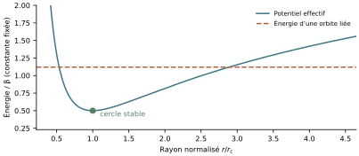
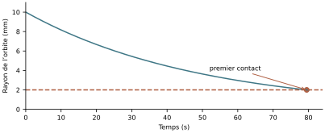
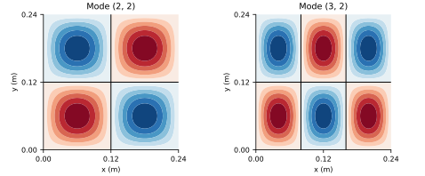
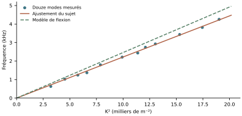
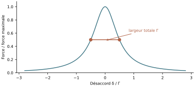

# Physique PSI — X-ENS PSI 2024 · Corrigé brut

*Corrigé rédigé par IA, non officiel.*

**Rédaction** · GPT-6.2 Astra Ultra · vitesse non renseignée

## I · Orbite d’une goutte autour d’une aiguille

### Question 1 — Champ de l’aiguille

Une translation le long du fil ou une rotation autour de lui conserve la distribution. Les réflexions dans le plan contenant le fil et $M$ et dans le plan transversal passant par $M$ imposent un champ radial $E_r(r)\mathbf e_r$. Pour le cylindre de rayon $r$ et de longueur $L$, le flux par les bases est nul. Le théorème de Gauss donne $2\pi rL E_r=\lambda L/\varepsilon_0$, soit $\mathbf E=\lambda\mathbf e_r/(2\pi\varepsilon_0r)$. Il pointe vers le fil puisque $\lambda<0$.

### Question 2 — Référence du potentiel

La relation $E_r=-\mathrm dV/\mathrm dr$ donne $V(r)-V(r_*)=-\lambda\ln(r/r_*)/(2\pi\varepsilon_0)$. Un rayon fini $r_*>0$ fixe le zéro du potentiel. L’intégrale diverge à l’infini pour ce fil idéal.

### Question 3 — Plan de l’orbite et vitesse angulaire

La force $q\mathbf E$ n’a aucune composante axiale, donc $m\ddot z=0$. Les deux conditions initiales $z(0)=\dot z(0)=0$ donnent $z(t)=0$. Dans ce plan, la force est parallèle au rayon vecteur depuis l’origine et son moment est nul. La composante axiale du moment cinétique, $L_z=mr^2\dot\theta=mr_0v_0$, fournit $\dot\theta=r_0v_0/r^2$.

### Question 4 — Potentiel effectif

L’énergie est $E_m=m(\dot r^2+r^2\dot\theta^2)/2+qV$. En éliminant $\dot\theta$, on obtient
$$E_m=\frac12m\dot r^2+\frac{\alpha}{r^2}+\beta\ln(r/r_*),\qquad \alpha=\frac{mr_0^2v_0^2}{2},\qquad \beta=-\frac{q\lambda}{2\pi\varepsilon_0}>0.$$
Le terme en $1/r^2$ contient l’énergie cinétique de rotation à moment cinétique fixé.

### Question 5 — Rayons accessibles

Près du fil, $1/r^2$ domine $|\ln r|$ si $v_0\ne0$. À grande distance, $\beta\ln(r/r_*)$ diverge. Le potentiel effectif tend donc vers $+\infty$ aux deux extrémités. Sa dérivée $(\beta r^2-2\alpha)/r^3$ change de signe en $r_c=\sqrt{2\alpha/\beta}$, minimum unique. La droite d’énergie finie au-dessus du minimum coupe la courbe en deux rayons de retournement. Au minimum le rayon reste constant. Tous ces mouvements sont radialement liés, sans état de diffusion dans le modèle de fil infini.

### Question 6 — Vitesse circulaire et stabilité

La composante radiale de la dynamique donne $mv_c^2/r_0=\beta/r_0$. Ainsi $v_c=\sqrt{-q\lambda/(2\pi\varepsilon_0m)}$, quelle que soit la valeur de $r_0$. Pour une orbite circulaire on a $r_0=r_c$. À moment cinétique fixé, $U_{\mathrm{eff}}''(r_c)=2\beta/r_c^2>0$. Un petit écart de rayon suscite donc une oscillation autour du minimum, ce qui établit la stabilité radiale.

### Question 7 — Avance axiale et extrémités

Pour le fil infini, $z(t)=\dot z(0)t$ et le mouvement transversal reste celui des questions précédentes. Un cercle transversal décrit une hélice de pas $2\pi r_0\dot z(0)/v_c$. Pour une aiguille finie, au-delà d’une extrémité les charges négatives se trouvent vers l’intérieur. Leur attraction possède alors une composante axiale de rappel. Le retournement est possible si l’énergie du mouvement vers l’extérieur est insuffisante pour s’échapper du puits de l’aiguille finie. Dans une description à rayon quasi fixé, cela revient à comparer $m\dot z(0)^2/2$ à la hausse d’énergie potentielle électrique vers l’extérieur. La valeur du seuil dépend du champ de bord.

### Question 8 — Choix de la traînée

Le nombre de Reynolds $\mathrm{Re}=\rho_a vL/\eta$ compare transport inertiel et diffusion visqueuse de la quantité de mouvement. Avec $v\simeq2\pi r_0/T_0=2{,}1\times10^{-2}\ \mathrm{m\,s^{-1}}$ et $L=2R=4$ mm, on trouve $\mathrm{Re}\simeq5{,}6$ (environ $3$ avec le rayon comme longueur). L’écoulement est intermédiaire, du côté des faibles vitesses. Les expressions proposées donnent $k_1v\simeq1{,}4\times10^{-8}$ N et $k_2v^2\simeq1{,}7\times10^{-9}$ N. On retient la loi linéaire de Stokes pour une estimation. Une prédiction précise exigerait la traînée intermédiaire puisque $\mathrm{Re}$ dépasse l’unité.

### Question 9 — Succession de cercles

Au premier ordre de l’approximation, l’accélération normale vaut $v^2/r$ et le frottement est tangent. La projection radiale donne $mv^2/r=\beta/r$, donc $v=\sqrt{\beta/m}$ au cours de la spirale. Quand le rayon diminue, c’est la période locale $2\pi r/v$ qui raccourcit.

### Question 10 — Bilan mécanique

La puissance reçue de l’air est $\mathcal P=\mathbf F_1\cdot\mathbf v=-k_1v^2$. À la précision quasi circulaire, $E_m=mv^2/2+\beta\ln(r/r_*)$, donc $\dot E_m=\beta\dot r/r$. Comme $\beta=mv^2$, le théorème de l’énergie mécanique donne $\dot r=-r/\tau$, avec $\tau=m/k_1$. Si l’on employait la seconde loi proposée, $\mathcal P=-k_2v^3$ et $\tau=m/(k_2v)$.

### Question 11 — Durée avant le contact

L’intégration donne $r(t)=r_0\exp(-t/\tau)$. Avec $m=4\pi\rho R^3/3\simeq3{,}4\times10^{-5}$ kg, $\tau=2\rho R^2/(9\eta)\simeq49$ s. Le contact d’une goutte de rayon $R$ avec une aiguille fine survient pour $r\simeq R$. Il faut donc $t_c=\tau\ln(r_0/R)\simeq79$ s, compatible en ordre de grandeur avec la durée observée. L’écrasement modifie la forme près du contact. Pour un rayon ponctuel, l’exponentielle ne s’annule à aucun instant fini.

### Question 12 — Variation sur le premier tour

Avec la période initiale $T_0=3$ s, $(r(T_0)-r_0)/r_0\simeq-T_0/\tau\simeq-0{,}061$. Plus précisément, l’intégrale $\int_0^{t_1}v/r(t)\,\mathrm dt=2\pi$ donne $r(t_1)/r_0=1/(1+T_0/\tau)$, soit une baisse de $5{,}7\,\%$. Le rayon évolue peu sur un tour au regard de sa variation sur l’ensemble de la trajectoire.

### Question 13 — Rôle de la microgravité

La force électrique centripète de l’orbite initiale vaut $mv^2/r_0$. Son rapport au poids terrestre est $v^2/(g r_0)\simeq4{,}5\times10^{-3}$. Le poids serait environ $220$ fois plus grand que la force produisant l’orbite observée. Une goutte libérée sur Terre tomberait avant de pouvoir réaliser cette expérience dans les mêmes conditions.

## II · Ondes et figures de Chladni

### Question 14 — Des liaisons au module de Young

Une liaison normale à la coupe traverse chaque carré de surface $r_0^2$, soit $\delta N=\mathrm dS/r_0^2$ liaisons en parallèle. La force de traction totale vaut $\delta F=(\mathrm dS/r_0^2)k(r-r_0)$. L’allongement relatif est $(r-r_0)/r_0=\partial_x\xi$. En identifiant à $E\,\partial_x\xi\,\mathrm dS$, on obtient $E=k/r_0$.

### Question 15 — Raideur d’un métal

Un pas de réseau métallique est de quelques dixièmes de nanomètre. En prenant $r_0\simeq3\times10^{-10}$ m et $k$ entre $15$ et $40\ \mathrm{N\,m^{-1}}$, le modèle donne environ $50$ à $130$ GPa. La valeur tabulée $69$ GPa pour l’aluminium appartient à cet intervalle. Une structure cristalline réelle mobilise plusieurs directions de liaison.

### Question 16 — Efforts sur une tranche

La largeur déformée est $\mathrm dx+\xi(x+\mathrm dx,t)-\xi(x,t)\simeq(1+\partial_x\xi)\,\mathrm dx$. Elle est proche de $\mathrm dx$ puisque $|\partial_x\xi|\ll1$. La face droite subit $+ES\,\partial_x\xi(x+\mathrm dx,t)\mathbf e_x$, la gauche $-ES\,\partial_x\xi(x,t)\mathbf e_x$. Leur somme vaut au premier ordre $ES\,\partial_{xx}\xi\,\mathrm dx\,\mathbf e_x$.

### Question 17 — Onde longitudinale

Le principe fondamental appliqué à la masse $\rho S\,\mathrm dx$ donne $\rho S\,\mathrm dx\,\partial_{tt}\xi=ES\,\mathrm dx\,\partial_{xx}\xi$. Ainsi $\partial_{tt}\xi=c^2\partial_{xx}\xi$ avec $c=\sqrt{E/\rho}$. Comme $[E]=\mathrm{kg\,m^{-1}\,s^{-2}}$ et $[\rho]=\mathrm{kg\,m^{-3}}$, le quotient a la dimension d’une vitesse au carré.

### Question 18 — Célérité dans l’aluminium

On trouve $c=\sqrt{6{,}9\times10^{10}/(2{,}7\times10^3)}\simeq5{,}1\times10^3\ \mathrm{m\,s^{-1}}$. Cette valeur décrit la compression longitudinale du barreau modélisé.

### Question 19 — Contraction transversale

Les longueurs relatives dans les trois directions sont $1+\varepsilon$, $1-\nu\varepsilon$, $1-\nu\varepsilon$. Leur produit donne $V'/V=(1+\varepsilon)(1-\nu\varepsilon)^2=1+(1-2\nu)\varepsilon+O(\varepsilon^2)$. Ainsi $\delta V/V=(1-2\nu)\varepsilon$ au premier ordre. L’incompressibilité impose $\nu=1/2$.

### Question 20 — Dispersion des ondes de flexion

Pour une onde proportionnelle à $\exp[i(\mathbf K\cdot\mathbf x-\omega t)]$, $\Delta^2z=K^4z$ et $\partial_{tt}z=-\omega^2z$. Posons $b=\sqrt{D/(\rho h)}$. La branche de fréquence positive vérifie $\omega=bK^2$. Les vitesses de phase et de groupe sont $v_\varphi=\omega/K=\sqrt{b\omega}$ et $v_g=\mathrm d\omega/\mathrm dK=2\sqrt{b\omega}$. Leurs dépendances en fréquence traduisent la dispersion. À $\omega>0$ la branche progressive possède un nombre d’onde réel, donc une amplitude constante dans ce modèle élastique sans dissipation.

### Question 21 — Modes d’une plaque simplement supportée

L’annulation en $x=0$ impose $\varphi_x=0$ modulo $\pi$. Celle en $x=a$ impose $K_x=m\pi/a$. On obtient de même $\varphi_y=0$ modulo $\pi$ et $K_y=n\pi/a$. Les entiers $m,n\ge1$ donnent les solutions non nulles. Avec $K^2=K_x^2+K_y^2$ et $D=Eh^3/[12(1-\nu^2)]$,
$$\omega_{mn}=\frac{\pi^2h}{a^2}\sqrt{\frac{E}{12\rho(1-\nu^2)}}\,(m^2+n^2).$$
Les bords sont immobiles verticalement dans cette question. Sur la plaque réelle excitée en son centre, les bords sont libres.

### Question 22 — Mesure sur la photographie

Deux nœuds consécutifs d’un sinus stationnaire sont séparés de $\lambda/2$. Sur le premier cliché de la figure 4, à $629{,}8$ Hz, suivre une verticale à environ un dixième du côté depuis le bord gauche. Entre les deux branches presque horizontales voisines de la mi-hauteur, on lit environ un quart de côté, soit $d\simeq0{,}25\times24\simeq6$ cm. La courbure et l’épaisseur des lignes limitent la précision. Le modèle longitudinal donnerait $d=c/(2f_1)\simeq4{,}0$ m, plus de seize côtés de plaque. L’écart dépasse de beaucoup l’incertitude de lecture.

### Question 23 — Influence de l’épaisseur

Pour un même motif, $K$ est fixé. Les questions 20 et 21 donnent alors $f\propto h$. Les trois rapports mesurés $f/h$ valent respectivement $630$, $650$ et $640\ \mathrm{Hz\,mm^{-1}}$. Les écarts relatifs à la première valeur sont de $3{,}2\,\%$ et $1{,}6\,\%$. La proportionnalité rend compte des observations à quelques pour cent. La fixation centrale, les tolérances d’épaisseur et les approximations de la théorie des plaques minces peuvent influer sur la fréquence.

### Question 24 — Ajustement en nombre d’onde

Le modèle prévoit $f/K^2=h\sqrt{E/[12\rho(1-\nu^2)]}/(2\pi)$. Avec $h=10^{-3}$ m, $E=6{,}9\times10^{10}$ Pa, $\rho=2{,}7\times10^3\ \mathrm{kg\,m^{-3}}$ et $\nu=0{,}33$, on trouve $0{,}246\ \mathrm{m^2\,s^{-1}}$. La figure 6 donne $0{,}222\ \mathrm{m^2\,s^{-1}}$, environ $10\,\%$ au-dessous du calcul. La dépendance quadratique est bien reproduite et le coefficient est proche à l’échelle de cette expérience.

### Question 25 — Échelle de l’agitation thermique

Pour que la conduction thermique reste négligeable pendant une oscillation acoustique, il suffit que la distance de diffusion de la chaleur pendant une période soit petite devant la séparation de deux nœuds. Les compressions et détentes du gaz peuvent alors être considérées comme localement adiabatiques. On suppose également l’air macroscopiquement au repos en moyenne.

### Question 26 — Vérification dans l’air

La célérité du son dans l’air est d’environ $340\ \mathrm{m\,s^{-1}}$. À $40$ kHz, la période vaut $25\ \mu\mathrm s$ et la demi-longueur d’onde $d=c/(2f)\simeq4{,}3$ mm. La diffusivité thermique est $\chi=\kappa/(\rho_a c_p)=2{,}0\times10^{-5}\ \mathrm{m^2\,s^{-1}}$. La durée de diffusion sur $d$ est $d^2/\chi\simeq0{,}9$ s, plus de $3\times10^4$ périodes. En une période, la chaleur diffuse sur environ $22\ \mu\mathrm m$, ce qui justifie l’hypothèse précédente.

## III · Oscillateur atomique et ralentissement laser

### Question 27 — Rappel électrostatique dans l’atome

Dans le modèle de Thomson, la charge positive enfermée par une sphère concentrique de rayon $r<R$ vaut $e(r/R)^3$. La symétrie sphérique et la loi de Gauss donnent $4\pi r^2 E_r=e(r/R)^3/\varepsilon_0$. Ainsi $\mathbf E=e\mathbf r/(4\pi\varepsilon_0 R^3)$ et, pour l’électron de charge $-e$, $\mathbf F=-k\mathbf r$ avec $k=e^2/(4\pi\varepsilon_0R^3)$.

### Question 28 — Oscillation libre

La dynamique s’écrit $\ddot{\mathbf r}+\omega_0^2\mathbf r=0$ avec $\omega_0=\sqrt{k/m}=\sqrt{e^2/(4\pi\varepsilon_0mR^3)}$. Les coefficients de la solution harmonique sont fixés par $\mathbf r(0)=\mathbf r_0$ et $\dot{\mathbf r}(0)=0$, donc $\mathbf r(t)=\mathbf r_0\cos(\omega_0t)$. Sur l’axe orienté selon la position initiale, la coordonnée algébrique est $r_0\cos(\omega_0t)$. La distance au centre est sa valeur absolue.

### Question 29 — Ordre de grandeur optique

Pour une raie visible de longueur d’onde représentative $550$ nm, $\omega_0=2\pi c/\lambda\simeq3{,}4\times10^{15}\ \mathrm{s^{-1}}$. On obtient $k=m\omega_0^2\simeq 11\ \mathrm{N\,m^{-1}}$, soit un ordre de grandeur de $10\ \mathrm{N\,m^{-1}}$.

### Question 30 — Échange entre énergie potentielle et énergie cinétique

Avec le zéro de l’énergie potentielle au centre, $E_m(0)=kr_0^2/2$. À la date $t$, l’énergie élastique vaut $kr_0^2\cos^2(\omega_0t)/2$ et l’énergie cinétique $m\omega_0^2r_0^2\sin^2(\omega_0t)/2$. Comme $m\omega_0^2=k$, leur somme reste $kr_0^2/2$.

### Question 31 — Perte par rayonnement

L’enveloppe $r_0(t)$ évoluant lentement, la moyenne de $\ddot r^2$ sur une période vaut à l’ordre dominant $\omega_0^4 r_0(t)^2/2$. La puissance positive émise est donc
$$P(t)=\frac{e^2\omega_0^4 r_0(t)^2}{12\pi\varepsilon_0c^3}=\frac{e^2\omega_0^2}{6\pi\varepsilon_0mc^3}\,E_m(t).$$
Le bilan de la charge est $\dot E_m=-P(t)$, d’où la décroissance exponentielle de son énergie.

### Question 32 — Durée de vie

L’équation précédente donne $E_m(t)=E_m(0)\exp(-t/\tau_0)$ avec $\tau_0=6\pi\varepsilon_0mc^3/(e^2\omega_0^2)$. Une durée $\tau_0$ ramène à $1/e$ la fraction d’énergie d’excitation encore portée par l’oscillateur. Avec la raie visible prise à la question 29, $\tau_0\simeq1{,}4\times10^{-8}$ s, d’ordre $10^{-8}$ s. L’amplitude décroît sur $2\tau_0$ puisque l’énergie est quadratique.

### Question 33 — Deux approximations du couplage optique

Pour une onde plane dans le vide, $B=E/c$, donc $|e\mathbf v\times\mathbf B|/(eE)\le v/c$. Le terme magnétique est négligeable pour un électron non relativiste. À l’échelle spatiale de l’atome, la phase varie au plus d’ordre $2\pi R/\lambda\simeq8\times10^{-4}$ pour $\lambda=800$ nm. L’approximation dipolaire permet donc d’écrire $\mathbf E(\mathbf r,t)\simeq\mathbf E(\mathbf 0,t)=\mathbf E_0\cos\omega t$ après avoir fixé l’origine des phases.

### Question 34 — Dipôle forcé en régime établi

La dynamique est $\ddot{\mathbf r}+\dot{\mathbf r}/\tau_0+\omega_0^2\mathbf r=-(e/m)\mathbf E$. Avec la convention $\exp(i\omega t)$, sa solution forcée est
$$\underline{\mathbf r}(t)=-\frac{e}{m}\frac{\mathbf E_0e^{i\omega t}}{\omega_0^2-\omega^2+i\omega/\tau_0},\qquad \underline{\mathbf p}(t)=-e\,\underline{\mathbf r}(t).$$
Le champ déplace les charges négatives dans un sens tel que le moment dipolaire statique s’aligne avec lui.

### Question 35 — Parties réelle et imaginaire de la polarisabilité

De $\underline{\mathbf p}=\varepsilon_0\alpha\underline{\mathbf E}$, on tire
$$\alpha=\frac{e^2}{m\varepsilon_0}\frac{1}{\omega_0^2-\omega^2+i\Gamma\omega},\qquad \Gamma=\frac1{\tau_0},\quad \alpha_0=\frac{e^2}{m\varepsilon_0\omega_0^2}.$$
Pour $\delta=\omega-\omega_0$ petit devant $\omega_0$, le dénominateur devient $\omega_0(-2\delta+i\Gamma)$. En multipliant par le conjugué et en écrivant $\alpha=\alpha'-i\alpha''$, on obtient
$$\alpha'=-\frac{\alpha_0\omega_0}{2}\frac{\delta}{\delta^2+\Gamma^2/4},\qquad \alpha''=\frac{\alpha_0\omega_0}{2}\frac{\Gamma/2}{\delta^2+\Gamma^2/4}.$$

### Question 36 — Un volume de polarisabilité

Au sens de la définition du sujet, $\alpha(0)=\alpha_0$ mesure le dipôle créé par un champ statique, divisé par $\varepsilon_0 E$. Comme $\omega_0^2=e^2/(4\pi\varepsilon_0mR^3)$, $\alpha_0=4\pi R^3$, de dimension $\mathrm{m^3}$. Cette grandeur est ici égale à trois fois le volume de la boule positive. À champ donné, une plus grande polarisabilité signifie un dipôle induit plus important.

### Question 37 — Profil de la force radiative

À intensité fixée et en traitant le petit intervalle spectral à $k$ constant, la norme suit $F(\delta)=F_{\max}/[1+4\delta^2/\Gamma^2]$ avec $F_{\max}=\hbar k(\Gamma/2)I/I_{\rm sat}$. La courbe lorentzienne est paire, culmine en $\delta=0$ et tend vers zéro dans les ailes. La force est dirigée selon la propagation du laser.

### Question 38 — Largeur à mi-hauteur

Pour $F/F_{\max}=1/2$ on a $4\delta^2/\Gamma^2=1$, d’où $\omega_\pm=\omega_0\pm\Gamma/2$. La largeur totale en pulsation est $\Delta\omega=\Gamma=1/\tau_0$. En fréquence ordinaire, la largeur est $\Gamma/(2\pi)$.

### Question 39 — Force radiative et poids du rubidium

À résonance et $I=I_{\rm sat}$, $F_{\max}=\hbar k\Gamma/2=(h/\lambda)\Gamma/2$. Pour $\lambda=8{,}0\times10^{-7}$ m et $\Gamma=2\pi\times6{,}0\times10^6\ \mathrm{s^{-1}}$, cela donne $1{,}6\times10^{-20}$ N. Le poids d’un atome serait $Mg\simeq1{,}4\times10^{-24}$ N, donc $F_{\max}/(Mg)\simeq1{,}1\times10^4$. La pression de radiation peut fortement modifier le mouvement d’un atome.

### Question 40 — Vitesse d’agitation

L’équipartition dans les trois directions donne $M\langle v^2\rangle/2=3k_BT/2$. La vitesse quadratique moyenne est $\sqrt{3k_BT/M}\simeq5{,}5\times10^2\ \mathrm{m\,s^{-1}}$ à $1\,000$ K. Cette vitesse décrit la dispersion des vitesses même si le gaz a une vitesse moyenne vectorielle nulle.

### Question 41 — Arrivées de deux impulsions

Pour chaque impulsion, $c(t'_i-t_i)=SR(t'_i)$ car la source est immobile. En soustrayant pour $i=2$ et $i=1$, il vient
$$T'=T+\frac{SR(t'_2)-SR(t'_1)}{c}.$$
La période reçue s’allonge pour un récepteur qui s’éloigne.

### Question 42 — Décalage Doppler au premier ordre

Sur la courte durée $T'$, $SR(t'_2)-SR(t'_1)\simeq T'\,\mathrm d(SR)/\mathrm dt=T'\mathbf u\cdot\mathbf v$, où $\mathbf u$ pointe de la source vers l’atome. On a donc $T'(1-\mathbf u\cdot\mathbf v/c)\simeq T$. En passant aux pulsations, $\omega'\simeq\omega(1-\mathbf u\cdot\mathbf v/c)$. Un atome qui va à la rencontre du faisceau reçoit une pulsation plus élevée.

### Question 43 — Atomes ralentis par un seul faisceau

Orientons l’axe $x$ selon le faisceau. La force radiative est positive. Elle retire de l’énergie cinétique aux atomes de vitesse $v_x<0$ car $F_xv_x<0$. Le ralentissement est efficace dans la classe de vitesses qui vérifie $|\delta-kv_x|\lesssim\Gamma/2$. Un laser légèrement désaccordé vers le rouge ($\delta<0$) sélectionne donc des atomes qui s’approchent. En ralentissant, ils sortent de la résonance et la force décroît. Même si un atome passe par $v_x=0$, le faisceau unique continue de pousser dans le même sens. Cette action seule ne stabilise aucun arrêt et ne refroidit pas symétriquement une distribution de vitesses.

[Sujet officiel](https://ens-paris-saclay.fr/sites/default/files/CONCOURS/ANNALES_1C/1C_PSI/2024_PSI_Physique_XSR.pdf) · [Rapport du jury](https://ens-paris-saclay.fr/sites/default/files/CONCOURS/ANNALES_1C/1C_PSI/2024_Rapport_PSI_Physique_ECRIT.pdf)
