# X-ENS PSI — Sciences industrielles 2024 · Corrigé brut

*Corrigé rédigé par IA, non officiel. Signalez toute erreur.*

**Rédaction** · GPT-6.2 Astra Ultra · vitesse non renseignée · 24 novembre 2026

**Révision (tour 1)** · GPT-6.2 Astra Ultra · vitesse non renseignée · 26 novembre 2026

Le sujet XSR comporte 58 questions. Les annexes A à D occupent les pages 18 à 24 du PDF officiel. Le cahier séparé contient quatre grilles à compléter. Les repères imprimés commencent après la garde.

[Sujet original](https://ens-paris-saclay.fr/sites/default/files/CONCOURS/ANNALES_1C/1C_PSI/2024_PSI_Sciences_Industrielles_XSR.pdf) · [Rapport du jury](https://ens-paris-saclay.fr/sites/default/files/CONCOURS/ANNALES_1C/1C_PSI/2024_Rapport_ecrit_SII.pdf) · [Quatre documents réponse](https://sti.eduscol.education.fr/sites/eduscol.education.fr.sti/files/concours-examens/17171/17171-document-reponse-x-ens-psi-2024-sii.pdf)

## Mettre le mélange en perspective

### Question 1 · Homogénéité

Si $c_k(M)$ désigne la fraction massique du pigment $k$ dans un échantillon de volume fixé centré en $M$, le mélange idéal vérifie $c_k(M)=\overline c_k$ dans tout le pot pour chaque pigment. En pratique on donne une tolérance sur la variance spatiale, ou sur $\max_M|c_k(M)-\overline c_k|$, à l’échelle pertinente pour la couleur de la couche déposée.

### Question 2 · Préparation en magasin

Une base commune et quelques pigments permettent de produire à la demande de nombreuses teintes avec une recette reproductible. On limite les quantités de pots préteintés à stocker et les invendus, tout en ajustant la couleur et la quantité au besoin du client.

### Question 3 · Mécanisme du mélange

Le mouvement relatif des couches de peinture transporte, étire et replie les zones riches en pigment. Le cisaillement disperse les particules et la diffusion agit sur les petits gradients de concentration. Les deux rotations font varier la direction des accélérations. Elles favorisent le brassage du volume et limitent les régions qui tourneraient presque en bloc avec la paroi.

### Question 4 · Exigences

En chargement, le plateau doit rester stable en porte-à-faux et accepter la gamme de diamètres et de hauteurs sans gêner l’opérateur. Pendant le mélange, le pot doit rester solidaire des plateaux et la compression doit respecter la déformation admissible des appuis. La fermeture de l’enceinte protège aussi l’opérateur des pièces mobiles.

### Question 5 · Vibrations et agitation immergée

L’agitation vibratoire travaille pot fermé et accepte différentes formes de récipients. Elle transmet des vibrations au bâti et peut brasser inégalement un produit très visqueux ou un grand volume. Un agitateur pneumatique immergé cisaille directement la peinture et sa vitesse se règle selon la viscosité. Il oblige à ouvrir le pot et à nettoyer l’organe entre deux teintes, avec risque de mélange des couleurs.

## Charger et serrer le pot

### Question 6 · Porte-à-faux

Le cas extrême donne $m_{\rm peinture}=25\times1{,}5=37{,}5$ kg. Si $d$ est la distance horizontale entre le support et la verticale du centre de masse, le poids crée $mgd$. En négligeant la tare et le poids du plateau, $d_{\max}=600/(37{,}5g)\simeq1{,}63$ m pour $g=9{,}81$. Une tare $m_t$ et un plateau de masse $m_P$ à la distance $d_P$ conduisent plutôt à $(37{,}5+m_t)gd+m_Pgd_P\le600\ \mathrm{N\,m}$. Ce bras de levier se mesure jusqu’au centre de masse, et la longueur utile du rail en découle selon sa géométrie.

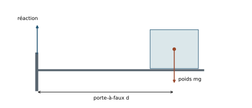

### Question 7 · Vis à pas opposés

Les supports sont guidés en translation et ne peuvent tourner avec la vis. Les deux filetages de même pas en valeur absolue et de sens opposés font avancer l’un des supports de $d_l=1{,}25$ mm et reculer l’autre d’autant par tour. La variation de l’écartement vaut $2d_l$ ; le plan médian reste fixe.

### Question 8 · Guidage des supports

Chaque support coulisse le long de guidages parallèles. Une rotation autour d’une colonne déplacerait latéralement l’autre guidage, ce que celui-ci interdit. Il reste une seule translation parallèle à la vis. Le guidage du support haut et celui du support bas se représentent chacun par une glissière par rapport à 1.

### Question 9 · Hypothèses constructives

Les colonnes sont supposées rectilignes, parallèles à la direction de translation et à distance fixe. Les alésages des supports sont alignés et suffisamment longs, les jeux et déformations compatibles avec la course, le bâti rigide à l’échelle du mouvement. Un défaut de parallélisme peut provoquer des efforts internes ou un coincement.

### Question 10 · Graphe de la figure 5

Depuis le bâti 1, deux branches rejoignent 5 et 6 par des glissières. La vis 2 rejoint 5 et 6 par deux hélicoïdales de pas opposés. Les liaisons 5–9 et 6–8 sont des pivots d’axe vertical. Les deux faces du pot $p$ portent sur 8 et 9. En adhérence complète sur une surface étendue, on peut regrouper $8,p,9$ en une classe rigide. Le modèle du montage avec palier axial ajoute le pivot 2–1 ; la figure simplifiée représente explicitement les deux couples antagonistes, qui seuls ne réalisent pas cette liaison.

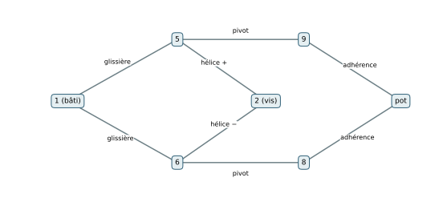

### Question 11 · Hyperstatisme

Avec le pot en adhérence, contractons les deux encastrements en une classe $P=\{8,p,9\}$. Il reste quatre solides mobiles $2,5,6,P$. Les deux glissières, deux hélicoïdales et deux pivots vers $P$ apportent $6\times5=30$ inconnues statiques. Pour le graphe de la figure 5 sans guidage supplémentaire 2–1, les mobilités sont la rotation de $P$ et une translation commune de la vis, des supports et de $P$ le long des colonnes. La fermeture impose une rotation nulle de la vis car les pas sont opposés et la hauteur du pot est fixe. Ainsi $h=30-6\times4+2=8$. Si l’on représente aussi le palier de la vis par un pivot 2–1, il ajoute cinq inconnues et supprime la translation commune, soit $h=35-24+1=12$. Le choix retenu doit figurer sur le graphe.

### Question 12 · Manchon d’accouplement

La chaîne de couple est $14\to15\to16\to12\to10$. L’arbre moteur 14 est centré dans le manchon 16 ; la clavette 15 empêche la rotation relative. La vis 10 est centrée dans l’autre extrémité de 16 et la goupille 12 traverse le manchon et la vis. Le roulement 13 relie le manchon au bloc 11 et guide sa rotation autour de l’axe commun. Le roulement ne transmet pas le couple moteur à la vis.

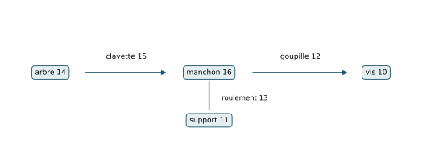

### Question 13 · Liaison équivalente

Le centrage 14–16 interdit quatre mobilités et la clavette interdit la rotation axiale. Le jeu axial figuré permet un coulissement limité de 14 dans 16 avant une éventuelle butée. Entre 10 et 16, le centrage et la goupille transversale interdisent les six mobilités. L’équivalent cinématique 14–10 est donc une glissière axiale dans l’intervalle de jeu. Le degré d’hyperstatisme dépend du découpage des surfaces. Par exemple, clavette solidaire de 14, flanc modélisé par un appui plan contre 16 et centrage par pivot glissant donnent $4+3-5=2$ contraintes redondantes. Goupille solidaire de 16, contact cylindrique transversal de la goupille avec 10 et centrage axial de 10 donnent $4+4-6=2$ de plus. Ces deux sous-ensembles en série donnent $h=4$ pour cette décomposition. Un contact de flanc remplacé par une seule contrainte tangentielle supprime ses deux redondances dans le modèle réduit.

### Question 14 · Couple de serrage

$F_{\max}=k\Delta E_{p,\max}=10^6\times4\,10^{-3}=4\,000$ N. En négligeant les frottements, $2\pi C=F_{\max}(2d_l)$ par tour, donc $C=F_{\max}d_l/\pi=1{,}59\ \mathrm{N\,m}$ à la sortie du réducteur. Si $\eta$ est le rendement des filetages, le couple nécessaire est $1{,}59/\eta$. Le couple annoncé de 4 N·m suffit dans ce modèle si $\eta\ge0{,}398$ ; il ne constitue pas une consigne permanente de serrage.

On peut contrôler le facteur deux à partir d’un tour entier. Les plateaux se rapprochent alors de 2,50 mm et la compression maximale de 4 mm correspond à 1,60 tour après le premier contact. À la limite, le travail par tour à force instantanée constante est $2Fd_l$, donc $C=Fd_l/\pi$.

[Feuillet officiel, p. 8 du PDF](https://ens-paris-saclay.fr/sites/default/files/CONCOURS/ANNALES_1C/1C_PSI/2024_PSI_Sciences_Industrielles_XSR.pdf#page=8)

### Question 15 · Cisaillement de la goupille

La figure 11 indique $d_a=18$ mm à cette portée et $d_g=6$ mm pour la goupille. Les deux efforts opposés $F$ forment un couple $F d_a=C_{\max}$, d’où $F=222$ N par plan. Avec $S_g=\pi d_g^2/4=28{,}3\ \mathrm{mm^2}$, la contrainte moyenne vaut $7{,}86$ MPa. Avec le coefficient 2, $15{,}7$ MPa reste inférieur à $270$ MPa. La vérification concerne le cisaillement moyen demandé.

## Vérifier le verrouillage

### Question 16 · Vis motrice

Sur le DR, prenons $\boldsymbol n=(\cos\gamma,-\sin\gamma)$ et $\boldsymbol t=(\sin\gamma,\cos\gamma)$ dans $(x,y)$. Dans le sens d’entraînement où la vis fournit l’effort de roue vers $+x$, le frottement sur la roue est dirigé vers $-\boldsymbol t$ pour le glissement correspondant à la vis motrice. L’action est $\boldsymbol R=N(\boldsymbol n-f\boldsymbol t)$. Sa composante utile $R_x=N(\cos\gamma-f\sin\gamma)$ est tangentielle à la roue de rayon $r_R$ et produit un couple de module $r_R|R_x|$. Sa composante opposée sur la vis donne le couple d’entrée.

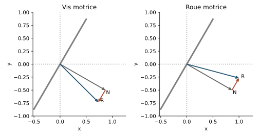

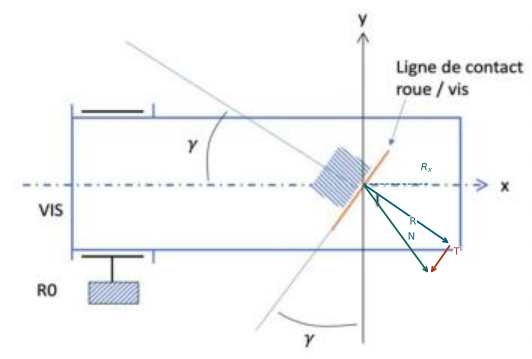

[Feuillet officiel, p. 9 du PDF](https://ens-paris-saclay.fr/sites/default/files/CONCOURS/ANNALES_1C/1C_PSI/2024_PSI_Sciences_Industrielles_XSR.pdf#page=9)

[Document réponse DR1](https://sti.eduscol.education.fr/sites/eduscol.education.fr.sti/files/concours-examens/17171/17171-document-reponse-x-ens-psi-2024-sii.pdf#page=1)

### Question 17 · Roue motrice

Sur le même flanc, l’action de la vis sur la roue est $N(\boldsymbol n+f\boldsymbol t)$. Par action-réaction, la composante tangentielle sur la vis vaut $N(\sin\gamma-f\cos\gamma)$ suivant $+y$ avec les axes retenus. Elle crée sur la vis un couple de module $r_V N|\sin\gamma-f\cos\gamma|$. L’entraînement en retour dans le sens souhaité exige $\tan\gamma>f$.

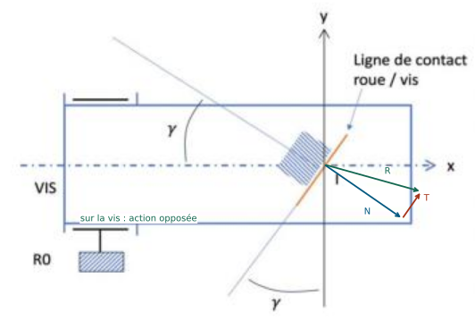

[Feuillet officiel, p. 9 du PDF](https://ens-paris-saclay.fr/sites/default/files/CONCOURS/ANNALES_1C/1C_PSI/2024_PSI_Sciences_Industrielles_XSR.pdf#page=9)

[Document réponse DR1](https://sti.eduscol.education.fr/sites/eduscol.education.fr.sti/files/concours-examens/17171/17171-document-reponse-x-ens-psi-2024-sii.pdf#page=1)

### Question 18 · Irréversibilité

La condition d’auto-blocage est $\tan\gamma\le f=\tan\varphi$, soit $\gamma\le\varphi$ pour des angles aigus. À l’égalité, on est à la limite de glissement. La donnée illustrative $\varphi=\gamma/2$ donne un mécanisme réversible au sens du modèle. Le verrouillage passif ne peut alors être garanti par ce contact seul.

## Commander le moteur de serrage

### Question 19 · Équations dans Laplace

Avec conditions initiales nulles, paramètres constants et couple de charge supplémentaire négligé, $U-K_E\Omega=(R+Lp)I$, $K_T I=(Jp+f)\Omega$. En substituant la seconde expression dans la première, $U-K_E\Omega=(R+Lp)(Jp+f)\Omega/K_T$.

### Question 20 · Inertie ramenée

Si $N=\omega_m/\omega_{\rm vis}$, alors $\omega_{\rm vis}=\omega_m/N$ et $|v_A|=|v_B|=d_l|\omega_m|/(2\pi N)$. En notant $J_r$ l’inertie du rotor et des éléments sur son axe et $J_s$ celle de la sortie, de la vis et des éléments tournant à sa vitesse,

$$
J_{\rm eq}=J_r+\frac{J_s}{N^2}+(m_A+m_B)\left(\frac{d_l}{2\pi N}\right)^2.
$$

Chaque roue intermédiaire ajoute $J_i(\omega_i/\omega_m)^2$. Les masses incluent les pièces solidaires de chaque support en translation. Cette expression identifie $E_c=J_{\rm eq}\omega_m^2/2$ avant contact.

### Question 21 · DR2 du moteur

Le comparateur reçoit $+U,-E$. Le bloc qui produit $I$ vaut $1/(R+Lp)$, celui qui produit $C_m$ vaut $K_T$, le bloc mécanique vaut $1/(Jp+f)$. La branche de retour de $\Omega$ à $E$ porte $K_E$. La force contre-électromotrice réduit la tension efficace aux bornes de l’induit.

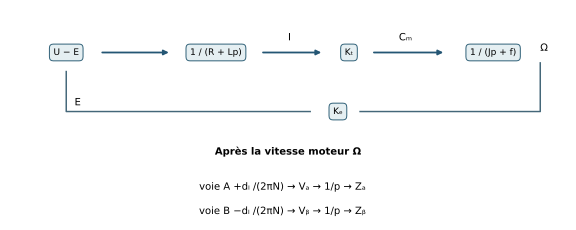

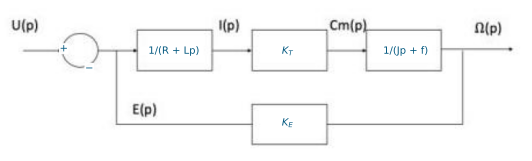

[Feuillet officiel, p. 10 du PDF](https://ens-paris-saclay.fr/sites/default/files/CONCOURS/ANNALES_1C/1C_PSI/2024_PSI_Sciences_Industrielles_XSR.pdf#page=10)

[Document réponse DR2](https://sti.eduscol.education.fr/sites/eduscol.education.fr.sti/files/concours-examens/17171/17171-document-reponse-x-ens-psi-2024-sii.pdf#page=2)

### Question 22 · Transfert de vitesse

$H=K_T/[(R+Lp)(Jp+f)+K_EK_T]$. Avec $L\simeq0$ et $f\simeq0$, $H=K/(1+Tp)$ où $K=1/K_E=10\ \mathrm{rad\,s^{-1}V^{-1}}$ et $T=RJ/(K_EK_T)=0{,}015$ s. Le système réduit est du premier ordre.

### Question 23 · Mesure protectrice

Un capteur de force sur un plateau permet de limiter le serrage à $4$ kN. Deux mesures de position ou une mesure de l’écartement permettent aussi de limiter l’écrasement après détection du contact. Le courant moteur peut servir de protection complémentaire après étalonnage des frottements.

### Question 24 · DR3 des deux positions

Le bloc initial est $H(p)$ de Q22. Depuis $\Omega$, la branche basse donne $V_A=+d_l\Omega/(2\pi N)$, la haute $V_B=-d_l\Omega/(2\pi N)$. Chaque vitesse est suivie d’un bloc $1/p$ pour donner la variation de $Z_A$ ou de $Z_B$ autour de la position initiale.

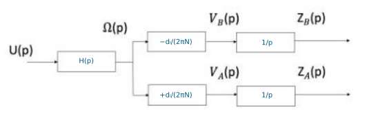

[Feuillet officiel, p. 10 du PDF](https://ens-paris-saclay.fr/sites/default/files/CONCOURS/ANNALES_1C/1C_PSI/2024_PSI_Sciences_Industrielles_XSR.pdf#page=10)

[Document réponse DR3](https://sti.eduscol.education.fr/sites/eduscol.education.fr.sti/files/concours-examens/17171/17171-document-reponse-x-ens-psi-2024-sii.pdf#page=3)

### Question 25 · DR4 symétrique

$V_A=-V_B$ et les déplacements autour du plan médian sont opposés tant que la géométrie reste symétrique. Pour la branche haute seule du DR4, les trois blocs sont $H(p)$, $-d_l/(2\pi N)$ et $1/p$ avec l’axe commun de Q24. On récupère l’autre déplacement par changement de signe et $L_p=Z_A-Z_B=-2Z_B$ pour les variations.

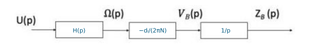

[Feuillet officiel, p. 11 du PDF](https://ens-paris-saclay.fr/sites/default/files/CONCOURS/ANNALES_1C/1C_PSI/2024_PSI_Sciences_Industrielles_XSR.pdf#page=11)

[Document réponse DR4](https://sti.eduscol.education.fr/sites/eduscol.education.fr.sti/files/concours-examens/17171/17171-document-reponse-x-ens-psi-2024-sii.pdf#page=4)

### Question 26 · Transfert du mécanisme

Sur les variations de positions, $L_p/U=(Z_A-Z_B)/U=2[d_l/(2\pi Np)]H(p)$. Cela donne $B(p)=Kd_l/[\pi Np(1+Tp)]$ avec $K=1/K_E$ et $T=RJ/(K_EK_T)$.

### Question 27 · Boucle fermée de position

Posons $a=K_r Kd_l/(\pi N)>0$. Alors $G=K_rB/(1+K_rB)=a/(Tp^2+p+a)$. Sous la forme $K_0/[1+2\xi p/\omega_0+p^2/\omega_0^2]$, on obtient $K_0=1$, $\omega_0=\sqrt{a/T}$ et $\xi=1/(2\sqrt{aT})$.

### Question 28 · Erreur statique

Pour une consigne $L_0/p$, la valeur finale de l’erreur vaut $L_0[1-G(0)]=0$ lorsque $K_r>0$. L’erreur statique théorique respecte donc les 0,5 cm demandés. Cette conclusion porte sur le modèle nominal : le dépassement transitoire et la force sur le pot nécessitent leurs propres vérifications.

### Question 29 · Retour tachymétrique

Un retour de vitesse opposé au mouvement ajoute un amortissement effectif. Il aide à réduire le dépassement des plateaux à l’approche du pot et à amortir les oscillations tout en maintenant la précision statique du retour de position. Le gain se règle en tenant compte du bruit du capteur et de la saturation.

### Question 30 · Ajustement affine

On pose $\hat p_j=a m_j+b$. La fonction coût est $J(a,b)=\sum_j(a m_j+b-p_j)^2$. La matrice de conception $X$ a pour lignes $(m_j,1)$ et le vecteur $y$ pour composantes $p_j$. Le système demandé peut s’écrire $A\theta=b_{\rm lin}$ où $\theta=(a,b)^T$, $A=X^TX$ et $b_{\rm lin}=X^Ty$. Sa solution est unique si au moins deux masses distinctes sont présentes. On peut résoudre directement le problème de moindres carrés par décomposition QR.

### Question 31 · Interpolation et bruit

L’interpolation de Lagrange de degré jusqu’à $n-1$ reproduit aussi le bruit. Entre les mesures, et surtout aux extrémités, elle peut osciller ou évoluer brutalement en extrapolation. Une régression affine utilise toutes les mesures pour estimer une tendance à deux paramètres. La figure donne un exemple où une seule mesure décalée modifie fortement l’interpolant à droite, tandis que l’estimation affine reste voisine de la tendance globale.

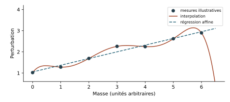

## Analyser une rotation uniaxiale

### Question 32 · Énergie sur un cycle

Avec une inertie $J$ constante et des liaisons parfaites, $P_m=J\omega\dot\omega$. Cette puissance est positive en accélération, nulle sur le plateau et négative au freinage. Entre deux arrêts, le travail mécanique net est nul. La consommation électrique nette ne serait nulle que pour une conversion idéale et un freinage entièrement régénératif. Avec pertes Joule, pertes de brassage ou freinage dissipatif, l’énergie prélevée est positive.

### Question 33 · Peinture au repos

L’équation d’Euler donne $\nabla p=\rho_f\boldsymbol g=-\rho_f g\,\boldsymbol e_z$ avec $z$ vertical ascendant. Ainsi $\partial_r p=0$ et $\partial_zp=-\rho_f g$. La pression diminue quand l’altitude augmente.

### Question 34 · Peinture entraînée

L’élément de volume $dV$ reçoit $-\nabla p\,dV$ des pressions et $\rho_f\boldsymbol g\,dV$ de son poids. Son accélération vaut $-\omega^2r\,\boldsymbol e_r$. Par conséquent $\nabla p=\rho_f\omega^2 r\,\boldsymbol e_r-\rho_fg\,\boldsymbol e_z$. L’axisymétrie annule la dérivée azimutale.

Les deux composantes de la force de pression résultante sont $-\rho_f\omega^2 r\,dV$ vers le centre et $+\rho_fg\,dV$ vers le haut. La seconde équilibre le poids, la première courbe la trajectoire.

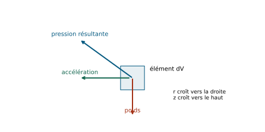

[Feuillet officiel, p. 12 du PDF](https://ens-paris-saclay.fr/sites/default/files/CONCOURS/ANNALES_1C/1C_PSI/2024_PSI_Sciences_Industrielles_XSR.pdf#page=12)

### Question 35 · Surface libre

La différentielle de $p$ est nulle sur la surface. On a $dz/dr=\omega^2 r/g$, d’où $z=z_c+\omega^2r^2/(2g)$. Si le fond est à $z=0$ et si tout le fond est couvert, la moyenne sur le disque vaut $H/2$ pour un pot à moitié rempli. Ainsi $z_c=H/2-\omega^2R^2/(4g)$. À 100 tr/min, $\omega=10{,}47\ \mathrm{rad\,s^{-1}}$, $R=0{,}15$ m et $H=0{,}24$ m. Le creux central se trouve à $5{,}71$ cm, le bord à $18{,}29$ cm, avec une différence d’environ $12{,}6$ cm. Le fond est couvert et le bord supérieur reste dégagé.

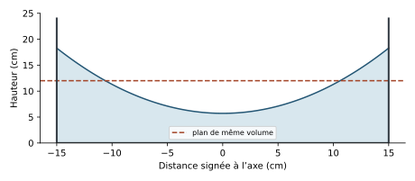

### Question 36 · Approximation locale

Autour de l’axe, le terme linéaire de $r$ est nul. Au premier ordre $z(r)\simeq z_c$. Si l’on remplace tout le contenu par un cylindre de même volume pour calculer une inertie, sa hauteur doit être $H/2$ : il s’agit du plan moyen conservant le volume. Plus généralement, autour de $r_*$ la tangente est $z(r_*)+\omega^2 r_*(r-r_*)/g$. À la vitesse de l’énoncé l’écart centre-bord est important, donc l’approximation plane demeure grossière.

### Question 37 · Inertie du remplissage approché

Pour un cylindre homogène de masse $m$, de rayon $R=D/2$ et de hauteur $h=H/2$, la matrice au centre $G$, dans une base dont le deuxième axe est vertical, vaut $\operatorname{diag}(J_t,J_a,J_t)$ avec $J_t=m(3R^2+h^2)/12$ et $J_a=mR^2/2$. Les produits d’inertie sont nuls par symétrie. Si l’on distingue le récipient et la peinture, ajouter la matrice du récipient en transportant les deux au même centre. Sa distribution détaillée n’est pas donnée.

### Question 38 · Désaxement

Le centre $G$ décrit un cercle de rayon $\delta r$. Le guidage doit exercer sur le pot une force centripète $-m\omega^2\delta r\,\boldsymbol e_r$ et compenser le poids par $+mg\,\boldsymbol e_z$. Le pot transmet les efforts opposés. Pour $m=7$ kg, l’ampleur du balourd vaut environ $768\,\delta r$ N si $\delta r$ est en mètres. Son orientation tourne avec le pot. La résultante seule ne fixe pas les réactions de deux paliers. En un point $O$ de l’axe, le moment des efforts de support se déduit par transport depuis $G$ ; lorsque l’axe de révolution du cylindre est vertical et fixe en direction, le moment dynamique propre en $G$ est nul. La hauteur de $G$ intervient dans le bras de levier de la composante radiale.

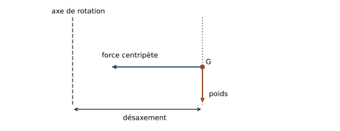

### Question 39 · Puissance du balourd

En rotation uniforme idéale, l’effort centripète est radial et la vitesse tangentielle, donc leur produit scalaire est nul. Le poids ne produit pas de travail sur ce mouvement horizontal. Le balourd augmente les charges de palier, sans couple moteur moyen supplémentaire en régime uniforme dans ce modèle. Il augmente l’inertie de $m\delta r^2$ au démarrage et peut entraîner des pertes réelles supplémentaires.

### Question 40 · Mélange à un ou deux axes

En rotation uniaxiale constante, un fluide entraîné finit par tourner presque en bloc, avec surface paraboloïdale stationnaire dans le pot. Le brassage relatif s’atténue. Une rotation sur deux axes change l’orientation de la gravité et des accélérations dans le pot et entretient les déplacements internes. Cela favorise le mélange, dont la qualité doit encore être contrôlée sur le produit réel.

## Maintenir le pot en rotation biaxiale

### Question 41 · Pot plein

Pour le cylindre homogène plein de hauteur $H$, rayon $R$ et masse $m$, $I_G=\operatorname{diag}(J_t,J_a,J_t)$ dans $(\boldsymbol x_p,\boldsymbol y_p,\boldsymbol z_p)$ avec $J_t=m(3R^2+H^2)/12$ et $J_a=mR^2/2$. Si l’on réduit en $O$ tel que $\overrightarrow{OG}=\rho\boldsymbol x_p$, le théorème de Huygens donne $I_O=\operatorname{diag}(J_t,J_a+m\rho^2,J_t+m\rho^2)$.

### Question 42 · Torseur cinétique

Notons $\boldsymbol e=\boldsymbol x_1$, $\boldsymbol n=\boldsymbol y_p$, $\boldsymbol r=\rho\boldsymbol x_p$, $a=\dot\alpha$, $b=\dot\beta$. Le point $O$ est fixe et $\boldsymbol\Omega=a\boldsymbol e+b\boldsymbol n$. La résultante cinétique est $m\boldsymbol v_G=m\boldsymbol\Omega\times\boldsymbol r$. Le moment cinétique vaut $I_G\boldsymbol\Omega$ en $G$ et $I_O\boldsymbol\Omega$ en $O$. Avec $\boldsymbol e=\cos\beta\,\boldsymbol x_p+\sin\beta\,\boldsymbol z_p$, on trouve $\boldsymbol v_G=\rho(a\sin\beta\,\boldsymbol y_p-b\boldsymbol z_p)$.

### Question 43 · Taux de remplissage

Les rapports des transmissions imposent le mouvement du pot rigide, quel que soit le remplissage tant qu’il reste entraîné sans glissement. La masse, la position de $G$ et les moments d’inertie changent. Les deux éléments du torseur cinétique et les efforts requis changent donc eux aussi. À remplissage partiel, les déplacements de la surface libre peuvent rendre le modèle d’un solide homogène insuffisant.

### Question 44 · Adhérence aux deux plateaux

Avec les notations du sujet, $\boldsymbol T_A=X_{8p}\boldsymbol x_p+Z_{8p}\boldsymbol z_p$, $\boldsymbol T_B=X_{9p}\boldsymbol x_p+Z_{9p}\boldsymbol z_p$. Pour les réactions sur le pot, $N_A=Y_{8p}\ge0$, $N_B=-Y_{9p}\ge0$. L’adhérence exige $\|\boldsymbol T_i\|\le fN_i$ pour les deux contacts. L’égalité concerne la limite de glissement. Un couple résistant au pivotement sur une surface étendue relève en outre de la répartition des pressions.

### Question 45 · Rapport des vitesses

Dans le repère porté par l’arbre principal, la roue conique fixe de 51 dents est vue tourner à la vitesse opposée à celle du porte-mécanisme. Le pignon mobile de 17 dents donne un facteur de module 3. La poulie de 10 crans entraîne celle de 15 crans par courroie, d’où $|\dot\beta|=(51/17)(10/15)|\dot\alpha|=2|\dot\alpha|$. En orientant l’axe secondaire dans le sens transmis par le renvoi on écrit $b=2a$ ; le renversement de cet axe change le signe de $b$ et de $\beta$ ensemble.

### Question 46 · Vitesses constantes

$\dot a=\dot b=0$ n’entraîne pas une orientation fixe de $\boldsymbol\Omega$ puisque $\dot{\boldsymbol n}=a\,\boldsymbol e\times\boldsymbol n$. L’orientation relative du pot et de la pesanteur évolue aussi. Le fonctionnement biaxial peut donc entretenir du brassage même à vitesse permanente des moteurs.

### Question 47 · Efforts tangentiels en régime permanent

Prenons $\overrightarrow{OA}=-(H/2)\boldsymbol n$, $\overrightarrow{OB}=+(H/2)\boldsymbol n$. Notons $P_\perp\boldsymbol u=\boldsymbol u-(\boldsymbol u\cdot\boldsymbol n)\boldsymbol n$ et $\boldsymbol g$ l’accélération de la pesanteur. En régime permanent, $\dot{\boldsymbol\Omega}=ab\,\boldsymbol e\times\boldsymbol n$ et $\boldsymbol a_G=\dot{\boldsymbol\Omega}\times\boldsymbol r+\boldsymbol\Omega\times(\boldsymbol\Omega\times\boldsymbol r)$. Posons

$$
\boldsymbol S=mP_\perp(\boldsymbol a_G-\boldsymbol g),\qquad
\boldsymbol M=\frac{d}{dt}_{R_0}(I_O\boldsymbol\Omega)-\boldsymbol r\times m\boldsymbol g.
$$

Le bilan de résultante impose $\boldsymbol T_A+\boldsymbol T_B=\boldsymbol S$. En projetant le moment sur le plan tangent, on obtient $(H/2)\boldsymbol n\times(\boldsymbol T_B-\boldsymbol T_A)=P_\perp\boldsymbol M$ car les couples de contact sont axiaux. D’où

$$
\|\boldsymbol T_A\|=\left\|\tfrac12\boldsymbol S+\boldsymbol n\times\boldsymbol M/H\right\|,\qquad
\|\boldsymbol T_B\|=\left\|\tfrac12\boldsymbol S-\boldsymbol n\times\boldsymbol M/H\right\|.
$$

Pour calculer ces vecteurs, écrire $A=J_t$, $B=J_a+m\rho^2$, $C=J_t+m\rho^2$, $s=\sin\beta$, $c=\cos\beta$. Dans le repère du pot, $\boldsymbol a_G=\rho(-b^2-a^2s^2,\,2ab c,\,a^2sc)$ et la dérivée inertielle du moment cinétique a pour composantes $(ab s(C-B-A),\,a^2sc(A-C),\,ab c(C+B-A))$. Ces termes incluent le terme gyroscopique de changement de base.

Un contrôle immédiat consiste à choisir $\rho=0$. La résultante tangentielle devient la projection du poids opposé, tandis que le moment des contacts conserve le terme gyroscopique $J_aab$. Même centré, le pot impose donc deux contributions distinctes aux plateaux.

[Feuillet officiel, p. 15 du PDF](https://ens-paris-saclay.fr/sites/default/files/CONCOURS/ANNALES_1C/1C_PSI/2024_PSI_Sciences_Industrielles_XSR.pdf#page=15)

### Question 48 · Maximum sur le cycle

Une écriture scalaire donne les valeurs maximales pour tout réglage. Avec la convention de Q42, $\boldsymbol g=(-g\sin\alpha\sin\beta,-g\cos\alpha,g\sin\alpha\cos\beta)$ dans le repère du pot. On évalue $S_x,S_z,M_x,M_z$ par Q47, puis

$$
F_{A,\max}=\sqrt{\max_{\alpha\in[0,2\pi]}[(S_x/2+M_z/H)^2+(S_z/2-M_x/H)^2]},\qquad
F_{B,\max}=\sqrt{\max_{\alpha\in[0,2\pi]}[(S_x/2-M_z/H)^2+(S_z/2+M_x/H)^2]},
$$

avec $\beta=\beta_0+(b/a)\alpha$. Pour des valeurs fixées de $a,\rho,\beta_0$, ces polynômes trigonométriques se maximisent en évaluant les bornes et les zéros de leur dérivée. Pour le cas centré $\rho=0$, les contributions de la pesanteur et du couple gyroscopique sont orthogonales dans le plan tangent. On trouve alors explicitement, aux positions $\lvert\sin\alpha\rvert=1$,

$$
F_{A,\max}=F_{B,\max}=\sqrt{(mg/2)^2+(J_a ab/H)^2}.
$$

Pour rendre l’évaluation du maximum effectivement finie même en présence d’excentration, noter $Q_i(\alpha)$ l’expression sous le maximum. Son degré trigonométrique est au plus huit car $|b/a|=2$. Écrire $Q_i=\sum_{k=-8}^8 c_k e^{ik\alpha}$. On peut déterminer les $c_k$ par les dix-sept valeurs équiréparties, $c_k=\frac1{17}\sum_{j=0}^{16}Q_i(2\pi j/17)e^{-2\pi i jk/17}$. Parmi les racines sur le cercle unité du polynôme $\sum_{k=-8}^{8} k c_k z^{k+8}$, retenir celle donnant la plus grande valeur de $Q_i(\arg z)$ et prendre la racine carrée. Si tous les coefficients non constants sont nuls, la force garde sa valeur en $\alpha=0$. Cette construction évite de maximiser indépendamment deux composantes dont les phases sont liées.

Les appuis doivent rester en compression et respecter $\|\boldsymbol T_i(t)\|\le fN_i(t)$ à chaque instant. Si seule une borne inférieure de serrage est disponible, $fN_{i,\min}\ge F_{i,\max}$ est une condition suffisante. Il faut simultanément respecter la limite de 4 kN du dispositif de serrage.

## Dimensionner et commander l’arbre principal

### Question 49 · Matrices des solides

Dans la base demandée, un solide sans symétrie donnée, par exemple le bloc moteur M2 considéré dans son ensemble, conserve la matrice symétrique générale $\left(\begin{smallmatrix}A&-F&-E\\-F&B&-D\\-E&-D&C\end{smallmatrix}\right)$. L’arbre 1a de révolution autour de $x_1$ a la forme $\operatorname{diag}(A,B,B)$. Les colonnes 1b, 1c et la vis 2, assimilées à des cylindres d’axe $y_2$, ont deux inerties transversales égales. Il en va de même des plateaux 8, 9 et du pot axisymétriques d’axe $y_2$. On écrit pour eux $\operatorname{diag}(A,B,A)$ dans leur base d’axe $y_2$. Les supports 5 et 6, dont le plan de symétrie a pour normale $z_2$, ont dans cette base $D=E=0$, le produit $F$ pouvant subsister. Pour toute pièce, une orientation différente entre cette base et $R_1$ impose $I_{G,1}=P I_{G,2}P^T$ avec $P$ la matrice de passage. Les valeurs $x_i,y_i,z_i$ interviennent ensuite dans le transport vers $O$, pas dans la symétrie au centre.

### Question 50 · Contrepoids

La masse fixée à la poulie compense le balourd des éléments montés hors de l’axe. En choisissant sa distance et sa position angulaire, on réduit le décalage du centre de masse, donc les efforts alternatifs sur les paliers et les vibrations. L’équilibrage dynamique complet peut demander une correction dans plusieurs plans.

### Question 51 · Puissance à l’arbre

À l’arbre 1, le couple moteur est $C_m\boldsymbol x_1$ et la vitesse angulaire relative au bâti $a\boldsymbol x_1$. La puissance fournie vaut leur produit scalaire $P_m=C_m a$. Un couple ramené sur l’arbre avant poulie doit être associé à la vitesse de cet arbre.

### Question 52 · Énergie cinétique totale

Pour chaque solide, $E_i=(m_i\|\boldsymbol v_{G_i}\|^2+\boldsymbol\Omega_i^T I_{G_i}\boldsymbol\Omega_i)/2$. Pendant le mélange, la vis de fermeture et ses supports ne se déplacent plus par rapport au porte-mécanisme. Pour une pièce qui tourne seulement autour de $x_1$, $2E_i/a^2=A_{i,1}+m_i(y_i^2+z_i^2)$. Pour une pièce centrée sur l’axe secondaire, de révolution autour de $\boldsymbol n$ et entraînée à $b=ka$ par rapport au porte-mécanisme, cette somme gagne $k^2 B_i$ ; le terme croisé est nul puisque $\boldsymbol x_1\perp\boldsymbol n$. Dans le modèle centré demandé, on peut donc écrire

$$
2E_c=a^2J_{\rm eq},\qquad
J_{\rm eq}=\sum_i[A_{i,1}+m_i(y_i^2+z_i^2)]+k^2\!\sum_{i\in\{8,9,p\}}\! B_i,
$$

si les deux plateaux et le pot sont solidaires en rotation, $k^2=4$. Pour une pièce secondaire excentrée ou non axisymétrique, employer directement la première formule et son centre réel, sans supprimer le terme croisé.

### Question 53 · Passage de l’énergie au couple

Le théorème de l’énergie cinétique donne $\dot E_c=C_m a$ si la pesanteur est négligée, les liaisons et transmissions idéales, les contacts sans glissement et le contenu entraîné comme un solide. Le moteur de serrage ne fournit alors pas de puissance mécanique relative. Pour identifier une inertie constante, il faut en outre le serrage fixe, le rapport de transmission fixe et le modèle centré et axisymétrique de Q52.

### Question 54 · Couple d’entraînement

Avec $J_{\rm eq}$ de Q52 constant, $C_m=J_{\rm eq}\ddot\alpha$, donc le couple d’accélération inclut quatre fois les inerties axiales secondaires. En régimes réels, ajouter le couple de pertes et de brassage ramené à l’arbre. Si la géométrie rend $J_{\rm eq}$ dépendant de l’angle, la dérivation donne en plus $\tfrac12J_{\rm eq}'(\alpha)\dot\alpha^2$.

### Question 55 · Choix du moteur

Une machine synchrone alimentée par onduleur fonctionne sans collecteur à balais, réduisant usure et entretien, et permet une commande précise du couple et de la vitesse par les courants. L’électronique de commande synchronise le champ avec le rotor.

### Question 56 · Limite de la commande linéarisée

Un régulateur accordé au régime nominal peut avoir un fort dépassement ou des marges insuffisantes hors de ce domaine. Une perturbation de couple peut saturer le courant, entraîner une perte de synchronisme et compromettre le cycle. Les limites de tension et de courant doivent donc intervenir dans l’évaluation du contrôle.

### Question 57 · Réseau de neurones

Un réseau peut approximer une dynamique ou une loi de commande non linéaire dépendant des flux, courants, vitesse et charge. En couvrant les configurations de pots, il peut corriger des écarts qu’un modèle linéarisé unique décrit mal. Sa précision dépend des données, et la stabilité en boucle fermée doit être vérifiée.

### Question 58 · Protocole numérique

À partir d’un simulateur ou de mesures, recueillir des trajectoires couvrant vitesses, couples et masses admissibles. Former les couples d’apprentissage avec l’état $(i_d,i_q,C_{\rm em},\omega_r)$, les tensions $(V_d,V_q)$ et la cible. Par exemple entraîner dans PyTorch un réseau de prédiction de l’état suivant, puis l’utiliser dans une commande prédictive bornée pour choisir les tensions. Séparer les essais par trajectoire, ajuster la normalisation sur l’apprentissage, définir l’architecture et minimiser la somme pondérée des erreurs de prédiction. Vérifier sur des trajectoires réservées puis en simulation bouclée la poursuite, le couple, le décrochage, les saturations et les perturbations. Comparer à la commande nominale, tester le temps de calcul, puis valider progressivement sur banc avec les limites de courant et d’arrêt.

Pour vérifier la généralisation à un nouveau pot, réserver des cycles complets à masse et remplissage absents de l’apprentissage. Mesurer l’écart quadratique de vitesse et le temps passé en saturation sur ces cycles. Un découpage aléatoire des instants d’un même cycle mêlerait des états voisins entre apprentissage et essai.

[Feuillet officiel, p. 17 du PDF](https://ens-paris-saclay.fr/sites/default/files/CONCOURS/ANNALES_1C/1C_PSI/2024_PSI_Sciences_Industrielles_XSR.pdf#page=17)
