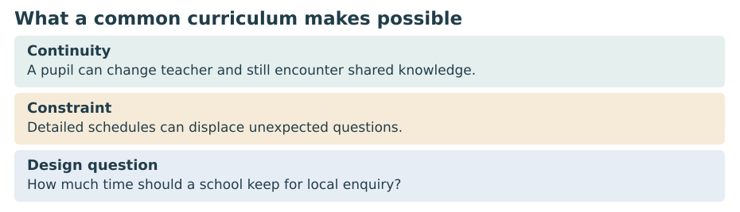

# École polytechnique FUI-FF, session 1 — Anglais 2024 · Corrigé brut

*Corrigé rédigé par IA, non officiel.*

**Rédaction** · modèle exact non renseigné (famille GPT-6) · effort non renseigné · vitesse non renseignée

**Révision** · modèle exact non renseigné (famille GPT-6) · effort non renseigné · vitesse non renseignée

**Révision** · GPT-6.2 Astra Ultra · vitesse non renseignée

**Révision** · GPT-6.2 Astra Ultra · vitesse non renseignée

**Révision (tour 4)** · GPT-6.2 Astra Ultra · vitesse non renseignée

## Reading comprehension

### 1. Shared curriculum, shared constraints

A shared programme protects access to basic learning, helps pupils continue after a change of teacher and can prevent schools from presenting denialism as fact. Yet politicians can also impose their own questionable priorities. Detailed requirements and examinations take time from unexpected discoveries, discourage teachers from responding to local events and leave children fewer opportunities to pursue genuine interests. (Monbiot, lines 36–47).

### 2. Metacognition and transferable abilities

Metacognition involves examining how one reaches a judgement, including the habits or assumptions that might distort it. Making this habit explicit could help a pupil notice susceptibility to misleading information. Broader abilities such as curiosity, collaboration and readiness to try an unfamiliar approach can help someone learn across different settings. Monbiot presents these transferable capacities as valuable beyond a particular job; he objects when a Scottish skills agency presents corporate performance as the reason for valuing empathy. (Monbiot, lines 60–75).

### 3. How testing can narrow learning

England’s assessments for the final primary year, as parents describe them to Monbiot, can turn an eager learner into someone anxious to complete a prescribed routine. Later examinations reinforce disciplinary divisions. A pupil trained to look for one approved method within each subject gets little practice in following a problem across several subjects. Pleasure in discovering unfamiliar material could instead make change easier to face. (Monbiot, lines 19–35).

### 4. Why complex systems belong at school

A machine can be intricate yet intelligible once each component and its task are understood. A food network behaves differently because relationships between its parts can amplify a disturbance until the whole pattern changes. Monbiot identifies food insecurity on a global scale and environmental collapse as urgent examples. Teaching pupils how interactions produce thresholds would help them recognise dangers that cannot be grasped within one school subject. (Monbiot, lines 48–59).

## Essay

A class receives a message claiming that tomorrow’s exam has been cancelled. It looks official, carries the school crest and has already reached most families. Before discussing whether the message is true, a teacher asks who wanted to believe it. That question creates an uncomfortable silence. The hope of an / extra evening to revise has influenced how carefully several pupils examined the announcement.

I would welcome lessons that make such influences easier to notice. A pupil who understands the attraction of reassuring news can pause before forwarding it. Equally, a frightening story might travel quickly because sharing it feels like / protecting a friend. Comparing those reactions reveals that a mistake need not come from ignorance or laziness. Conscientious people can also help a rumour spread when their concern outruns their efforts to check it.

Reflection alone, however, cannot settle whether the school actually postponed an examination. Someone must consult the / timetable, contact a responsible member of staff or check the established channel for urgent announcements. Pupils need concrete knowledge about how their school communicates and who can correct a false message. Otherwise, a lesson that begins by challenging excessive confidence may end by suggesting that no source deserves more trust / than any other.

I would ask small groups to design a response and then exchange proposals. One group might suggest publishing a correction on an official website. Another could point out that several families lack reliable internet access. A third might notice that the original message reached them through a / local sports club. Revising a proposal after hearing from classmates would turn private self-examination into a shared enquiry. The school could test its communication system at the same time.

This is where I hesitate to give self-awareness first place among school subjects. Its value depends partly on opportunities to compare / perspectives and on institutions willing to make their own decisions open to inspection. A thoughtful teenager cannot personally repair an unreliable announcement system. The adults running the school must put that system right. Teaching pupils to recognise how a wish shaped their first reaction would nevertheless give them something valuable: / a moment in which to change course, find trustworthy evidence and help others before a plausible message becomes an accepted fact.

*371 words.*
