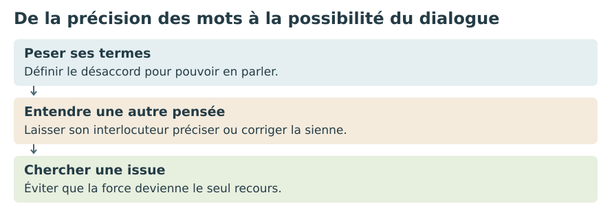
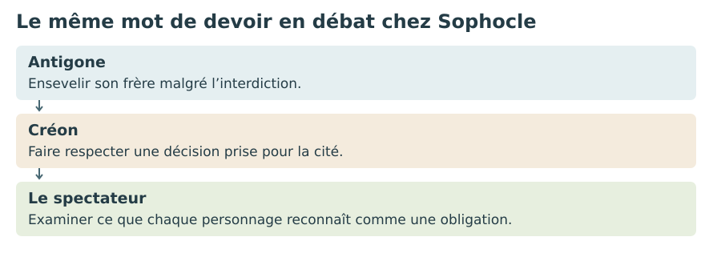

# École polytechnique FUI-FF, session 1 — Français 2024 · Corrigé guidé

*Corrigé rédigé par IA, non officiel.*

**Rédaction** · modèle exact non renseigné (famille GPT-6) · effort non renseigné · vitesse non renseignée

**Révision** · modèle exact non renseigné (famille GPT-6) · effort non renseigné · vitesse non renseignée

**Révision** · GPT-6.2 Astra Ultra · vitesse non renseignée

Cette épreuve de la filière universitaire internationale de formation francophone dure deux heures. Le texte est un entretien de 2007 avec l’helléniste Jacqueline de Romilly. Trois réponses de compréhension précèdent un bref essai personnel sans limite de mots imposée.

[Sujet officiel de la session 1](https://www.polytechnique.edu/admission-cycle-ingenieur/sites/admission/files/content/2024%20FUI-FF%20Session%201%20SUJET%20DE%20FRANCAIS.pdf)

## A1 · La thèse et le diagnostic

> [!INDICATION]
> Distinguer le bien que défend l’helléniste du danger qu’elle croit voir dans la société de son époque.

Jacqueline de Romilly défend l’étude des textes anciens, parce qu’elle y voit une école de précision, de raisonnement et de dialogue. À la journaliste qui la croit peut-être optimiste parce que son combat est honoré, elle répond que son inquiétude s’étend du grec à la langue française et aux humanités. Le recul des humanités lui paraît révéler une perte de confiance dans la raison et dans la possibilité de construire un monde commun par la parole. Elle redoute que le goût des formules sommaires et le refus des nuances n’ouvrent la voie à la violence, et présente ce danger comme évitable si la société réagit.

## A2 · Le moyen de sortir de la crise

> [!INDICATION]
> Identifier l’action qui pourrait faire reculer la violence. Distinguer l’objectif commun et l’exercice qui y prépare.

À ses yeux, il faut apprendre à formuler clairement une pensée, à choisir ses mots, à écouter ce que l’autre veut dire et à corriger son propre raisonnement. C’est ainsi que devient possible le dialogue, qu’elle présente comme le seul moyen d’endiguer la violence. L’étude de la littérature grecque est, à ses yeux, un moyen privilégié de se former à cette pratique.

## A3 · Comprendre la métaphore du rempart

> [!INDICATION]
> Décrire la fonction d’un rempart, puis identifier ce qui protégerait ici le rapport à autrui.

Le rempart est une protection contre une attaque. Dans cette image, la parole réfléchie protège les relations humaines du recours aux coups. Celui qui peut nommer l’objet d’un désaccord et entendre la réponse de son interlocuteur dispose d’un autre moyen de se faire comprendre. La « bestialité » désigne ici la brutalité aveugle. La formule porte donc sur la qualité d’un échange réel, qui exige de la précision et de l’écoute.

## B · Essai personnel sur le présent et les œuvres du passé

> [!INDICATION]
> Étudier un rapprochement précis entre une œuvre ancienne et une question du présent. Préciser jusqu’où ce rapprochement reste éclairant.

Avant de lire *Antigone*, je croyais savoir ce qu’il fallait répondre à quelqu’un qui refusait d’obéir à une loi qu’il jugeait injuste. Il suffisait, me semblait-il, de choisir son camp. La pièce de Sophocle m’a laissé avec une question plus embarrassante. Comment deux personnes qui croient toutes deux accomplir un devoir en arrivent-elles à ne plus pouvoir se parler ? C’est à cette expérience que je pense lorsque Jacqueline de Romilly défend les textes du passé.

Créon veut que la cité sortie de la guerre distingue entre ses défenseurs et ses ennemis. Antigone veut ensevelir son frère. Le spectateur entend successivement deux façons de comprendre le mot de devoir. Dans une discussion actuelle sur la désobéissance civile, je serais donc plus attentif au moment où une personne parle de responsabilité envers une institution et l’autre, d’obligation de conscience. La pièce ne décide pas à leur place. Elle m’aide à entendre ce qui se perd lorsqu’un même mot donne l’illusion que l’on s’est compris.

Je mettrais cependant une réserve au privilège que Jacqueline de Romilly accorde à la pensée littéraire. La photographie américaine *Migrant Mother*, prise par Dorothea Lange en 1936, a modifié ma manière de regarder les images actuelles de la pauvreté. J’ai d’abord vu dans cette mère entourée de ses enfants un symbole immédiatement lisible. Apprendre que la photographe avait choisi un cadre et un moment précis m’a conduit à me demander ce que cette image permettait de connaître de la vie de la personne photographiée et ce qu’elle laissait hors champ. Cette leçon de nuance m’est venue d’une image et de l’histoire de sa réalisation.

J’attends donc du passé une occasion de suspendre mes certitudes. Il peut exercer mon jugement, à condition que je respecte la distance entre une tragédie ancienne, une photographie du XXe siècle et une décision à prendre aujourd’hui.

> [!METHODE]
> Vérifier que chaque exemple est suivi d’une observation personnelle sur son effet. La copie peut être défendue sans supposer que le lecteur connaît déjà toutes les œuvres mentionnées.

> [!METHODE]
> L’objection finale vient de la journaliste : d’autres pensées que la pensée littéraire existent. Romilly les juge souvent sommaires. Dans la compréhension, attribuer ce jugement à l’helléniste. L’essai peut ensuite en discuter à partir d’une autre œuvre.
