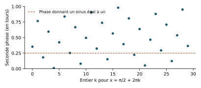
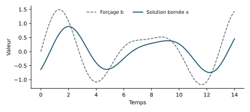

# École polytechnique FUI-FF, session 1 — Mathématiques 2024 · Corrigé guidé

*Corrigé rédigé par IA, non officiel. Signalez toute erreur.*

**Rédaction** · GPT-6.2 Astra Ultra · vitesse non renseignée · 24 novembre 2026

**Révision** · GPT-6.2 Astra Ultra · vitesse non renseignée · 26 novembre 2026

On note $\tau_a f(x)=f(x+a)$ et $A(f)=\{\tau_a f:a\in\mathbb R\}$. Le sujet caractérise les fonctions presque périodiques par la précompacité de cette orbite pour la norme uniforme.

## Partie 1 · Préliminaires sur la compacité

### Question 1

> [!INDICATION]
> Conserver un recouvrement du plus grand ensemble.

#### Solution

Pour tout $\varepsilon>0$, un recouvrement fini de $B$ par des boules ouvertes de rayon $\varepsilon$ recouvre aussi $A\subset B$. Les centres peuvent appartenir à l’espace ambiant, conformément à la définition du sujet. Ainsi $A$ est précompact.

### Question 2a

> [!INDICATION]
> Que reste-t-il de l’ensemble après avoir posé les boules centrées aux points déjà choisis ?

#### Solution

L’absence de recouvrement fini implique $A\ne\varnothing$. Prenons $x_0\in A$. Après $x_0,\ldots,x_n$, la réunion de leurs boules de rayon $\varepsilon$ ne recouvre pas $A$. Choisissons un $x_{n+1}$ de $A$ en dehors de cette réunion. Pour tous indices distincts, $d(x_i,x_j)\ge\varepsilon$. Aucune sous-suite ne peut être de Cauchy, donc aucune ne converge. Cette suite n’a pas de valeur d’adhérence.

### Question 2b

> [!INDICATION]
> Utiliser la caractérisation séquentielle donnée au début du problème.

#### Solution

Si un compact $A$ n’était pas précompact, il existerait un rayon comme en 2a. La suite construite n’aurait aucune sous-suite convergente, contrairement à la compacité de $A$. Tout compact est donc précompact.

### Question 3a

> [!INDICATION]
> Choisir les boules avec un rayon dont le double est au plus la distance demandée.

#### Solution

Recouvrons $A$ par un nombre fini de boules de rayon $\varepsilon/2$. Une de ces boules contient $x_n$ pour une infinité d’indices. En les rangeant dans l’ordre croissant, on obtient $\varphi$. Pour deux termes extraits, l’inégalité triangulaire passant par le centre donne une distance strictement inférieure à $\varepsilon$.

### Question 3b

> [!INDICATION]
> Répéter la sélection avec des diamètres décroissants en gardant les ensembles d’indices emboîtés.

#### Solution

Appliquons 3a successivement aux rayons prescrits $2^{-j}$, $j\ge1$, chaque fois à la sous-suite déjà retenue. Il en résulte des ensembles infinis d’indices $I_1\supset I_2\supset\cdots$, tels que $d(x_m,x_n)<2^{-j}$ pour $m,n\in I_j$. Choisissons $n_j\in I_j$ avec $n_j>n_{j-1}$. Si $p,q\ge j$, alors $n_p,n_q\in I_j$, donc $d(x_{n_p},x_{n_q})<2^{-j}$. La diagonale extraite est de Cauchy.

### Question 3c

> [!INDICATION]
> Pour le sens direct, comparer une suite de Cauchy à une de ses sous-suites convergentes.

#### Solution

Soit $A$ compact. Il est précompact par 2b. Une suite de Cauchy de $A$ admet une sous-suite convergeant vers $a\in A$. Pour $\varepsilon>0$, tous les termes assez tardifs sont à moins de $\varepsilon/2$ les uns des autres. Prenons parmi eux un terme de la sous-suite à moins de $\varepsilon/2$ de $a$. Tous sont alors à moins de $\varepsilon$ de $a$, donc $A$ est complet. Réciproquement, si $A$ est précompact et complet, 3b fournit dans toute suite une sous-suite de Cauchy. La complétude lui donne une limite dans $A$, d’où la compacité.

## Partie 2 · Convergence uniforme

### Question 4

> [!INDICATION]
> Vérifier que le supremum est fini et vérifier les trois propriétés d’une norme.

#### Solution

Les fonctions bornées sont stables par addition et multiplication par un complexe, car $|f(x)+g(x)|\le |f(x)|+|g(x)|$ et $|zf(x)|=|z||f(x)|$. Elles contiennent la fonction nulle. Le supremum des modules est fini et positif ou nul. Il s’annule exactement lorsque tous les $f(x)$ sont nuls. La seconde identité donne $\|zf\|_\infty=|z|\|f\|_\infty$ et la première, après passage au supremum, donne $\|f+g\|_\infty\le\|f\|_\infty+\|g\|_\infty$. On obtient bien une norme.

### Question 5

> [!INDICATION]
> Intercaler une seule fonction de la suite entre les deux valeurs de la limite.

#### Solution

Fixons $x_0\in\mathbb R$ et $\varepsilon>0$. Choisissons $N$ tel que $\|f-f_N\|_\infty<\varepsilon/3$. La continuité de $f_N$ en $x_0$ donne $\eta>0$ tel que $|f_N(x)-f_N(x_0)|<\varepsilon/3$ pour $|x-x_0|<\eta$. En insérant $f_N(x)$ et $f_N(x_0)$ dans la différence, on obtient $|f(x)-f(x_0)|<\varepsilon$. Ainsi $f$ est continue en chaque point.

### Question 6

> [!INDICATION]
> Prendre une suite du sous-espace qui converge dans l’espace ambiant.

#### Solution

Les combinaisons linéaires de fonctions continues bornées sont continues et bornées. Si des $f_n\in CB(\mathbb R,\mathbb C)$ convergent dans $B(\mathbb R,\mathbb C)$, leur limite $f$ est bornée par définition de l’espace ambiant et continue d’après 5. Le sous-espace est donc séquentiellement fermé, ce qui équivaut à la fermeture dans cet espace normé.

### Question 7

> [!INDICATION]
> La limite extraite doit appartenir à l’espace complet ambiant. Que donnerait la construction de 2a dans le sens réciproque ?

#### Solution

Si $A$ est précompact, 3b donne dans toute suite de $A$ une sous-suite de Cauchy pour la norme uniforme. La complétude de $CB$ assure sa convergence uniforme vers une fonction de $CB$. Cette limite peut être extérieure à $A$. Réciproquement, si $A$ n’est pas précompact, la suite $\varepsilon$-séparée de 2a n’a aucune sous-suite de Cauchy et donc aucune sous-suite uniformément convergente. On obtient l’équivalence.

## Partie 3 · Fonctions périodiques

### Question 8

> [!INDICATION]
> Ramener simultanément deux points voisins dans le même segment compact en leur retranchant un même multiple de la période.

#### Solution

Soit $T>0$ une période. Le maximum de $|f|$ sur $[0,T]$ existe par continuité, et majore $|f|$ sur toute la droite par périodicité. Sur le compact $[-T,2T]$, $f$ est uniformément continue. Pour $\varepsilon>0$, soit $0<\eta\le T$ un seuil correspondant. Si $|x-y|<\eta$, il existe $k\in\mathbb Z$ tel que $x-kT\in[0,T[$. Alors $y-kT\in[-T,2T]$ et $|f(x)-f(y)|=|f(x-kT)-f(y-kT)|<\varepsilon$. Le seuil est indépendant de $x,y$.

### Question 9

> [!INDICATION]
> Relier la distance de deux translatées à la continuité uniforme. Quelle portion de la droite paramètre toute l’orbite ?

#### Solution

La continuité de $f$ est celle de la question 8. Si $|a-b|<\eta$, l’uniforme continuité assure $|f(x+a)-f(x+b)|\le\varepsilon/2$ pour tout $x$, avec $\eta$ choisi au niveau $\varepsilon/2$. Le supremum est donc inférieur à $\varepsilon$, et $a\mapsto\tau_a f$ est continue en norme uniforme. Par périodicité, $A(f)$ est l’image du compact $[0,T]$ par cette application. Cette image est compacte.

### Question 10

> [!INDICATION]
> Éliminer une fréquence d’une relation linéaire par dérivation.

#### Solution

Pour une seule fréquence, $e_\lambda(0)=1$ suffit. Supposons la liberté démontrée pour $n-1$ fréquences distinctes et écrivons $\sum_{j=1}^n c_j e^{i\lambda_jx}=0$ pour tout $x$. Multiplions par $e^{-i\lambda_nx}$ puis dérivons. Il vient
$$\sum_{j=1}^{n-1} i(\lambda_j-\lambda_n)c_j e^{i(\lambda_j-\lambda_n)x}=0.$$
Les $n-1$ fréquences restantes sont distinctes. L’hypothèse de récurrence et $\lambda_j\ne\lambda_n$ donnent $c_1=\cdots=c_{n-1}=0$. La relation initiale entraîne $c_n=0$.

### Question 11a

> [!INDICATION]
> Dans quel cas la somme de deux réels majorés par un atteint-elle deux ?

#### Solution

Les deux cosinus doivent valoir $1$. Il existe donc $k,\ell\in\mathbb Z$ tels que $x=2\pi k$ et $\sqrt2 x=2\pi\ell$. Alors $k\sqrt2=\ell$. L’irrationalité de $\sqrt2$ impose $k=\ell=0$. Réciproquement $x=0$ convient.

### Question 11b

> [!INDICATION]
> Examiner en quel point la somme des deux cosinus atteint sa valeur en zéro.

#### Solution

Les fonctions $x\mapsto\cos x$ et $x\mapsto\cos(\sqrt2 x)$ sont continues, bornées et périodiques, de périodes respectives $2\pi$ et $2\pi/\sqrt2$. Si leur somme avait une période $T>0$, elle prendrait en $T$ sa valeur $2$ en $0$. D’après 11a cela imposerait $T=0$. L’ensemble des fonctions continues périodiques n’est donc pas stable par addition.

### Question 12

> [!INDICATION]
> Imposer au premier sinus de valoir un, puis examiner la seconde phase modulo un tour.

#### Solution

La somme est majorée par $2$. Aux points $x_k=\pi/2+2\pi k$ pour $k\in\mathbb Z$, le premier sinus vaut $1$ et la seconde phase, en tours, vaut $\sqrt2/4+k\sqrt2$ modulo $1$. Les multiples entiers de $\sqrt2$ sont denses modulo $1$. En effet, parmi les $N+1$ parties fractionnaires de $j\sqrt2$, $0\le j\le N$, deux appartiennent à un même intervalle de longueur $1/N$. En prenant leur différence dans le bon ordre, on obtient un multiple entier de $\sqrt2$ congru à $h$ avec $0<h<1/N$. Les points $0,h,\ldots,\lfloor1/h\rfloor h$ laissent des écarts d’au plus $h$ sur le cercle. La densité suit en faisant croître $N$.

La phase translatée peut ainsi s’approcher de $1/4$ modulo $1$. Par continuité, le second sinus s’approche de $1$. Le supremum cherché vaut donc $\boxed{2}$. Il n’est jamais atteint, car une égalité des deux sinus à $1$ imposerait $\sqrt2=(4\ell+1)/(4k+1)$.

## Partie 4 · Fonctions presque périodiques

### Question 13

> [!INDICATION]
> Appliquer le critère séquentiel à l’ensemble des translatées.

#### Solution

Tout terme d’une suite de $A(f)$ s’écrit $\tau_{a_n}f$ pour au moins un $a_n\in\mathbb R$. Réciproquement, chaque suite réelle $(a_n)$ fournit une telle suite de translatées. Par 7, $A(f)$ est précompact exactement lorsque chacune possède une sous-suite convergeant uniformément sur $\mathbb R$.

### Question 14

> [!INDICATION]
> Effectuer deux extractions successives avec les mêmes paramètres de translation.

#### Solution

Partons d’une suite réelle $(a_n)$. Par 13, il existe une sous-suite sur laquelle $\tau_{a_n}f\to F$ uniformément. Extrayons encore pour obtenir $\tau_{a_n}g\to G$ uniformément avec les mêmes indices. Sur cette dernière sous-suite, les sommes convergent vers $F+G$. Pour les produits, écrivons
$$\|(\tau_{a_n}f)(\tau_{a_n}g)-FG\|_\infty\le\|f\|_\infty\|\tau_{a_n}g-G\|_\infty+\|G\|_\infty\|\tau_{a_n}f-F\|_\infty.$$
Le membre de droite tend vers zéro. Comme translation commute avec somme et produit, 13 donne la presque-périodicité de $f+g$ et de $fg$.

### Question 15

> [!INDICATION]
> Approcher toute l’orbite de la limite par une seule orbite précompacte.

#### Solution

La limite uniforme $f$ est continue et bornée. Pour $\varepsilon>0$, choisissons $N$ tel que $\|f-f_N\|_\infty<\varepsilon/2$. Comme $x\mapsto x+a$ est une bijection de $\mathbb R$, $\|\tau_a f-\tau_a f_N\|_\infty=\|f-f_N\|_\infty$ pour tout $a$. Recouvrons $A(f_N)$ par un nombre fini de boules de rayon $\varepsilon/2$. Les boules de mêmes centres et de rayon $\varepsilon$ recouvrent $A(f)$ par l’inégalité triangulaire. Ainsi $f$ est presque périodique.

### Question 16

> [!INDICATION]
> Utiliser les fonctions constantes pour traiter la multiplication scalaire.

#### Solution

Une fonction continue périodique a une orbite compacte par 9, donc précompacte par 2b. Cela vaut notamment pour toutes les constantes, dont la fonction nulle. La stabilité par somme et produit, appliquée à une fonction et à une constante, donne par 14 la stabilité par combinaisons linéaires. La question 15 donne la fermeture en norme uniforme. Ainsi $PP(\mathbb R,\mathbb C)$ est un sous-espace vectoriel fermé contenant toutes les fonctions continues périodiques.

## Partie 5 · Solutions bornées d’équations différentielles

### Question 17a

> [!INDICATION]
> Contrôler la différence entre deux intégrales sur leur seule portion de queue. Vérifier aussi le sens des intégrales sur les segments.

#### Solution

Pour parler de ces intégrales, il faut que $\varphi$ soit intégrable sur tout segment considéré, par exemple continue. Le sujet n’énonce qu’une borne pour $s\le0$, qui ne suffit pas à elle seule. Par exemple, la fonction nulle sur $]-\infty,0]$ et égale à $1/s$ pour $s>0$ satisfait la borne et n’est pas intégrable de $-1$ à $1$. Les fonctions utilisées à la question 20 seront continues.

Sous l’hypothèse d’intégrabilité locale, pour $R,S\le\min(0,t)$,
$$\left|\int_R^t\varphi-\int_S^t\varphi\right|\le\frac C\delta\big|e^{\delta R}-e^{\delta S}\big|.$$
Si $R_n\to-\infty$, cette majoration montre que les intégrales forment une suite de Cauchy dans $\mathbb R$, donc convergente. En l’appliquant à $R_n,S_n$ pour deux suites tendant vers $-\infty$, on voit que leurs limites coïncident. Cela définit l’intégrale impropre.

### Question 17b

> [!INDICATION]
> Intégrer la majorante jusqu’à la borne supérieure variable.

#### Solution

Pour $t\le0$, en faisant tendre la borne inférieure vers $-\infty$, la comparaison absolue donne $\left|\int_{-\infty}^t\varphi(s)\,ds\right|\le C e^{\delta t}/\delta$. Ce majorant tend vers zéro quand $t\to-\infty$.

### Question 18

> [!INDICATION]
> Pour les temps négatifs, tenir compte du changement de sens dans l’intégrale depuis zéro.

#### Solution

Toutes les solutions sont $x(t)=K e^{A(t)}$, car $(e^{-A}x)'=0$ et $A(0)=0$. Pour $t\ge0$, $A(t)\le-\delta t$, donc $x(t)\to0$ en $+\infty$. Si $t\le0$, $A(t)=-\int_t^0a(s)\,ds\ge-\delta t\to+\infty$ en $-\infty$. Alors $x(t)$ tend vers $+\infty$ si $K>0$ et vers $-\infty$ si $K<0$. Pour $K=0$ elle est identiquement nulle.

### Question 19

> [!INDICATION]
> Étudier la différence de deux solutions bornées.

#### Solution

La différence $w$ de deux solutions bornées serait bornée et satisferait $w'=aw$. Par 18, la seule solution homogène bornée sur toute la droite est la solution nulle, d’où l’unicité éventuelle.

### Question 20

> [!INDICATION]
> Comparer le noyau à une exponentielle et scinder l’intégrale en un point fixe pour justifier la dérivée.

#### Solution

Si $s\le t$, $A(t)-A(s)=\int_s^t a(u)\,du\le-\delta(t-s)$. Pour $B=\|b\|_\infty$, l’intégrande continu est donc majoré en module par $Be^{-\delta(t-s)}$, intégrable en $s$ sur $]-\infty,t]$. On a $|x(t)|\le B/\delta$ pour tout $t$. Pour un $t_0$ fixé, la relation de Chasles donne, y compris si $t<t_0$,
$$x(t)= e^{A(t)}\left(e^{-A(t_0)}x(t_0)+\int_{t_0}^t b(s)e^{-A(s)}\,ds\right).$$
Le théorème fondamental appliqué à l’intégrande continu fournit $x'=ax+b$. Cette solution bornée est unique par 19.

### Question 21

> [!INDICATION]
> Décaler la solution d’une période du second membre.

#### Solution

Si $T>0$ est une période de $b$ et $a=-\delta$ est constant, $t\mapsto x(t+T)$ est encore une solution bornée de $y'=-\delta y+b$. L’unicité obtenue en 20 donne $x(t+T)=x(t)$ pour tout $t$. La solution est $T$-périodique.

### Question 22

> [!INDICATION]
> Faire le changement de variable qui élimine le temps de l’exponentielle. Contrôler ensuite les différences entre translatées.

#### Solution

Avec $u=t-s$, la solution s’écrit $x(t)=\int_0^\infty e^{-\delta u}b(t-u)\,du$. Ainsi pour tous $\alpha,\beta\in\mathbb R$,
$$\|\tau_\alpha x-\tau_\beta x\|_\infty\le\delta^{-1}\|\tau_\alpha b-\tau_\beta b\|_\infty.$$
Pour toute suite de paramètres, 13 fournit une sous-suite sur laquelle les translatées de $b$ convergent uniformément, donc sont de Cauchy. L’inégalité rend les translatées de $x$ de Cauchy sur les mêmes indices. Elles convergent dans $CB$ par complétude. Le critère 13 prouve que $x$ est presque périodique.

Pour lire la figure, le forçage choisi est $b(t)=\sin t+0{,}55\sin(\sqrt2\,t)$ et $\delta=1{,}2$. À chaque terme $\sin(\omega t)$ correspond la réponse bornée
$$x_\omega(t)=\frac{\delta\sin(\omega t)-\omega\cos(\omega t)}{\delta^2+\omega^2}.$$
En effet, $x_\omega'+\delta x_\omega=\sin(\omega t)$. La courbe de la solution représente donc $x_1+0{,}55x_{\sqrt2}$.

