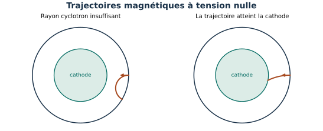
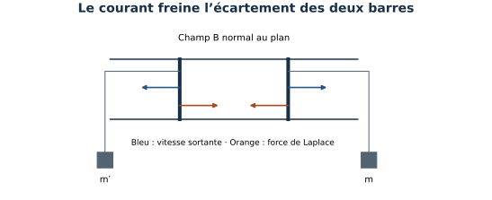
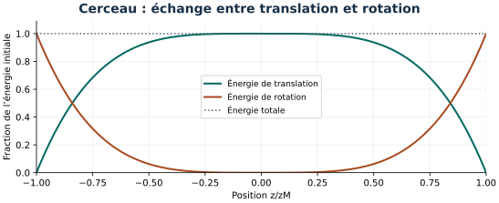
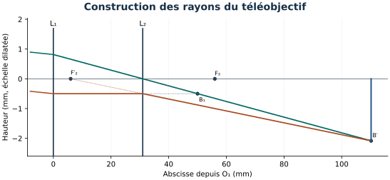

# École polytechnique, FUI-FF session 1 — Physique 2024 · Corrigé brut

*Corrigé rédigé par IA, non officiel. Signalez toute erreur.*

**Rédaction** · modèle exact non renseigné (famille GPT-6) · effort non renseigné · vitesse non renseignée

**Révision** · modèle exact non renseigné (famille GPT-6) · effort non renseigné · vitesse non renseignée · 24 novembre 2026

**Révision (tour 2)** · GPT-6.2 Astra Ultra · vitesse non renseignée · 24 novembre 2026

**Révision (tour 3)** · GPT-6.2 Astra Ultra · vitesse non renseignée · 26 novembre 2026

Formation francophone, session 1 (automne), trois heures sans calculatrice.

## Exercice 1 — Confinement électronique

### Question 1

On prend $V(a)=0$, $V(b)=U$, avec $b>a$, et on note $-e$ la charge électronique. En l’absence de champ magnétique, le mouvement est radial. La conservation de $mv^2/2-eV$ donne $mv_f^2/2=-eU$. Partant du repos, l’électron atteint le cylindre intérieur pour **$U<0$**, à la vitesse $v_f=\sqrt{-2eU/m}$, dirigée vers l’axe. À $U=0$ il reste immobile. Pour $U>0$ il est rappelé vers le cylindre extérieur.

### Question 2

À $U=0$, le champ électrique est nul. Une vitesse initiale $v_0$ radiale vers l’intérieur est perpendiculaire à $\mathbf B$. La force magnétique courbe la trajectoire sans travailler. Le cercle cyclotron a pour rayon $r_c=mv_0/(e|B|)$. Son centre est décalé tangentiellement de $r_c$ au point d’émission et se trouve à distance $\sqrt{b^2+r_c^2}$ de l’axe. La distance minimale à l’axe est donc $\sqrt{b^2+r_c^2}-r_c$. Il y a contact avec la cathode si
$$r_c\ge\frac{b^2-a^2}{2a}.$$
L’égalité donne un contact tangent. Si la cathode est atteinte, la norme de la vitesse finale est $v_0$. Pour $B=0$, la trajectoire rectiligne radiale atteint directement le cylindre.

### Question 3

Depuis le repos, l’entrée dans l’entrefer nécessite $U<0$. L’électron commence vers les $r$ décroissants. Le champ axial lui communique une composante azimutale, de sens opposé si on inverse $B$. Un champ faible courbe la trajectoire sans empêcher l’arrivée. Un champ suffisamment fort entraîne un demi-tour radial avant la cathode. Jusqu’au retour éventuel à l’anode, le rayon et l’azimut varient. Le champ électrique radial dépendant de $r$, la courbe n’est généralement pas un cercle.

Pour préciser le seuil, on prend $B$ algébrique suivant $+z$. L’équation azimutale conserve $mr^2\dot\theta-eBr^2/2=-eBb^2/2$. À $r=a$, $v_\theta=eB(a^2-b^2)/(2ma)$ et $v_r^2=-2eU/m-v_\theta^2$. Le contact est donc possible pour **$|B|\le [2a/(b^2-a^2)]\sqrt{-2mU/e}$**, à vitesse totale $\sqrt{-2eU/m}$. Cette condition à la cathode est bien la plus restrictive. En effet $V(r)=U\ln(r/a)/\ln(b/a)$ et le rapport de l’énergie cinétique azimutale à l’énergie rendue disponible par le potentiel croît vers l’intérieur comme $\sinh^2s/s$, avec $s=\ln(b/r)$.

## Exercice 2 — Induction dans un circuit

### Question 1

Notons $\ell$ l’écartement des rails, $u$ la vitesse de la barre droite vers sa poulie, $u'$ celle de la barre gauche vers sa poulie, et $w=u+u'$. Une augmentation de la surface donne une f.é.m. de module $B\ell w$ en valeur algébrique selon la convention de freinage. Comme les deux résistances sont en série, $i=B\ell w/(2R)$. La force de Laplace de module algébrique $F=B\ell i$ s’oppose à l’écartement. Les masses reliées aux barres vérifient
$$m\dot u=mg-F,\qquad m'\dot u'=m'g-F.$$
Posons $\mu=mm'/(m+m')$, $\tau=2R\mu/(B\ell)^2$. L’addition donne $\dot w+w/\tau=2g$, donc $w=2g\tau(1-e^{-t/\tau})$. La différence pondérée donne $mu-m'u'=(m-m')gt$, d’où
$$u=\frac{(m-m')gt+m'w}{m+m'},\qquad
u'=\frac{(m'-m)gt+mw}{m+m'}.$$
Une vitesse négative indique un mouvement opposé à celui choisi pour cette barre. Seule la vitesse d’écartement tend en général vers une constante.

### Question 2

Pour $m'=m$, $u=u'=w/2$. Ainsi **$u=u'=g\tau(1-e^{-t/\tau})$** avec $\tau=Rm/(B\ell)^2$. Dans le laboratoire, les deux barres se déplacent en sens opposés, et les deux masses descendent. À long terme la force magnétique compense leur poids.

### Question 3

Pour une inductance constante $\mathcal L$, les équations couplées sont
$$\mathcal L\dot i+2Ri=B\ell w,\qquad \dot w=2g-B\ell i/\mu.$$
Avec un circuit initialement sans courant, $i(0)=w(0)=0$. En dérivant la première équation,
$$\mathcal L\ddot i+2R\dot i+\frac{(B\ell)^2}{\mu}i=2gB\ell.$$
Le courant ne s’établit plus instantanément. Le transitoire est d’ordre deux. De discriminant réduit $D=R^2-\mathcal L(B\ell)^2/\mu$, l’équation donne deux exponentielles décroissantes pour $D>0$, un régime critique pour $D=0$ et des oscillations amorties pour $D<0$. Les valeurs asymptotiques sont les mêmes que précédemment, $i_\infty=2\mu g/(B\ell)$ et $w_\infty=2g\tau$.

Un bilan de puissance contrôle les signes de l’induction. Multiplions les équations mécaniques par $u$ et $u'$ puis l’équation électrique par $i$. Les termes d’échange $B\ell i(u+u')$ se compensent. Il vient
$$\frac{d}{dt}\left(\frac{mu^2+m'u'^2+\mathcal Li^2}{2}\right)=mgu+m'gu'-2Ri^2.$$
La puissance gravitationnelle alimente ainsi les énergies cinétique et magnétique et les pertes Joule dans les deux barres. Dans le régime sous-amorti, le courant part avec une pente nulle. En posant $\gamma=R/\mathcal L$ et $\omega^2=(B\ell)^2/(\mu\mathcal L)-\gamma^2$, on vérifie $i/i_\infty=1-e^{-\gamma t}[\cos(\omega t)+(\gamma/\omega)\sin(\omega t)]$.

## Exercice 3 — Cerceau chargé dans un champ magnétique

### Question 1

Dans les coordonnées de l’énoncé, $\nabla\cdot\mathbf B=(1/\rho)\partial_\rho(\rho B_\rho)+\partial_z B_z$ par axisymétrie. Les contributions valent $2B_0z/a^2$ et $-2B_0z/a^2$, donc leur somme est nulle. Il n’existe pas de source magnétique monopolaire et le flux magnétique à travers toute surface fermée est nul.

### Question 2

Un élément porte $dq=(Q/2\pi)d\theta$ et se déplace à $\mathbf v=R\omega\mathbf e_\theta+\dot z\mathbf e_z$. Il subit
$$d\mathbf F=dq\big(R\omega B_z\mathbf e_\rho+\dot zB_\rho\mathbf e_\theta-R\omega B_\rho\mathbf e_z\big),\quad B_\rho=B_0Rz/a^2.$$
À $z\ne0$, la composante tangentielle des forces peut lancer la rotation. Les composantes transverses de la résultante s’annulent en faisant le tour du cerceau, de même que les moments qui tendraient à le basculer.

### Question 3

La projection du moment élémentaire vaut $R\,dq\,\dot zB_\rho$. Intégrer sur le tour donne **$M_{Oz}=QR\dot zB_\rho=QB_0R^2 z\dot z/a^2$**.

### Question 4

Le théorème du moment cinétique donne $mR^2\dot\omega=QB_0R^2 z\dot z/a^2$. Avec $z(0)=0$ et $\omega(0)=0$, il vient **$\omega=QB_0z^2/(2ma^2)$**. Le signe de la rotation dépend de $QB_0$, et reste identique aux deux extrémités de l’oscillation.

### Question 5

Pour chaque charge, $\mathbf v\cdot(dq\,\mathbf v\times\mathbf B)=0$. Les contraintes du cerceau rigide ne dissipent pas d’énergie. Par conséquent $m\dot z^2/2+mR^2\omega^2/2=mv_0^2/2$. En reportant la loi de rotation,
$$\dot z^2=v_0^2\left[1-(z/z_M)^4\right],\qquad
z_M=\sqrt{\frac{2ma^2|v_0|}{|QB_0|R}}.$$
La vitesse prend le signe de la branche parcourue. Le champ étant donné au voisinage de $O$, ce résultat suppose que tout le trajet du cerceau reste dans la région décrite par le modèle. Aux deux altitudes extrêmes $\pm z_M$, la translation s’arrête et toute l’énergie cinétique est sous forme de rotation.

### Question 6

Sur le premier quart de période, $dt=dz/(|v_0|\sqrt{1-(z/z_M)^4})$. Avec $u=z/z_M$, $T/4=\alpha z_M/|v_0|$ et **$T=4\alpha z_M/|v_0|\simeq5{,}24 z_M/|v_0|$**. La période dépend de l’amplitude, contrairement à celle d’un oscillateur harmonique.

La dépendance de la période est vérifiable par un second calcul. La dérivée de la relation énergétique donne $\ddot z=-2v_0^2z^3/z_M^4$, une force de rappel cubique. Comme $z_M^2\propto|v_0|$, le coefficient de $z^3$ reste fixe et $T\propto1/z_M$. Le mouvement devient donc plus lent pour une plus petite amplitude.

## Exercice 4 — Appareil photographique

### Question 1

Les conditions de Gauss exigent des rayons proches de l’axe et faiblement inclinés sur lui. Au premier ordre, $\sin\theta\simeq\tan\theta\simeq\theta$ pour les angles en radians. On obtient un stigmatisme et un aplanétisme approchés.

### Question 2

Pour $p>f'_1$, la distance image est $d=f'_1p/(p-f'_1)$. Elle décroît quand $p$ augmente. Pour $p$ allant de $x$ à l’infini,
$$d_{\min}=f'_1,\qquad d_{\max}=\frac{f'_1x}{x-f'_1}.$$
Avec $x=650\ \mathrm{mm}$ et $f'_1=50\ \mathrm{mm}$, le capteur doit pouvoir passer de **50 mm à environ 54,2 mm** de la lentille.

### Question 3

À $D=2\ \mathrm{km}$, $d_1=f'_1D/(D-f'_1)\simeq50{,}0013\ \mathrm{mm}$. La hauteur algébrique vaut $-h\,d_1/D=-hf'_1/(D-f'_1)$. L’image retournée mesure **$h_1\simeq0{,}50\ \mathrm{mm}$** et l’encombrement de l’objectif simple est d’environ **50 mm**.

### Question 4

Orientons l’axe dans le sens de la lumière. Avec $e=\overline{O_1O_2}=31\ \mathrm{mm}$, on obtient
$$s=\overline{O_2A_1}=d_1-e=\frac{f'_1D}{D-f'_1}-e\simeq+19{,}00\ \mathrm{mm}.$$
Le point de convergence des rayons après la première lentille est donc à droite de la seconde.

### Question 5

Pour la seconde lentille, $A_1$ est un **objet virtuel** car les rayons incidents convergeraient vers ce point s’ils n’étaient pas réfractés. Puisque $\overline{O_2F_2}=-f'_2=25\ \mathrm{mm}$, $\overline{F_2A_1}=s+f'_2\simeq-6{,}00\ \mathrm{mm}$. $A_1$ se trouve entre $O_2$ et $F_2$.

### Question 6

Plaçons $O_1$ à 0, $O_2$ à 31 mm, $A_1$ à 50,00 mm et le foyer objet $F_2$ à 56 mm. Représentons deux rayons arrivant vers $B_1$. L’un traverse $O_2$ et reste rectiligne, l’autre arrive parallèle à l’axe et sort en semblant provenir de $F'_2$ (à 6 mm depuis $O_1$). Leur intersection donne l’image définitive. Le tracé ci-dessous respecte l’échelle horizontale. La verticale est agrandie pour montrer les faibles hauteurs.

### Question 7

La relation $1/\overline{O_2A'}-1/s=1/f'_2$ donne $s'=\overline{O_2A'}=f'_2s/(s+f'_2)\simeq+79{,}2\ \mathrm{mm}$. Le grandissement de $L_2$ est $s'/s\simeq+4{,}17$, celui de $L_1$ est négatif. La hauteur absolue de l’image finale vaut
$$h_2=h\frac{f'_1}{D-f'_1}\left|\frac{f'_2}{s+f'_2}\right|\simeq2{,}08\ \mathrm{mm}.$$
L’image reste retournée par rapport à l’arbre.

### Question 8

$$E'=e+s'=e+\frac{f'_2(d_1-e)}{d_1-e+f'_2}\simeq110\ \mathrm{mm}.$$
Les deux lentilles occupent ici environ 2,2 fois la profondeur de l’objectif simple de 50 mm. Elles donnent pourtant une image 4,2 fois plus grande. Pour un arbre lointain, une lentille unique produisant la même taille d’image aurait une focale voisine de $208\ \mathrm{mm}$.

### Question 9

De $f/8$ à $f/4$, le diamètre double et l’aire quadruple. Pour garder la même exposition, le temps de pose doit être divisé par quatre. Il faut choisir **$1/1000\ \mathrm s$** à ISO 100.

### Question 10

La plus grande ouverture $f/4$ produit de plus grands disques de flou pour les points hors du plan de mise au point. À cadrage et critère de netteté identiques, la **profondeur de champ diminue**.
