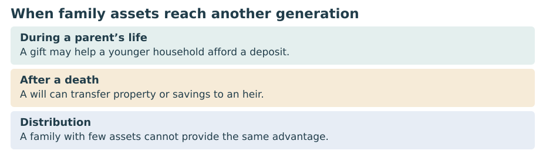
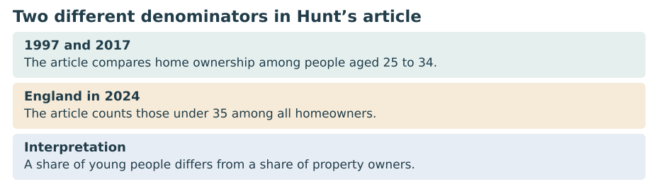
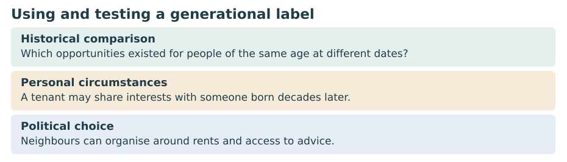

# École polytechnique FUI-FF, session 2 — Anglais 2024 · Corrigé guidé

*Corrigé rédigé par IA, non officiel.*

**Rédaction** · modèle exact non renseigné (famille GPT-6) · effort non renseigné · vitesse non renseignée

**Révision** · modèle exact non renseigné (famille GPT-6) · effort non renseigné · vitesse non renseignée

**Révision** · GPT-6.2 Astra Ultra · vitesse non renseignée

**Révision** · GPT-6.2 Astra Ultra · vitesse non renseignée

**Révision (tour 4)** · GPT-6.2 Astra Ultra · vitesse non renseignée

L’épreuve dure deux heures. Le sujet demande au moins 50 mots par réponse de compréhension et un essai de 360 à 440 mots, avec une barre tous les 50 mots. Les renvois aux lignes identifient les idées reprises de l’article.

[Sujet officiel](https://www.polytechnique.edu/admission-cycle-ingenieur/sites/admission/files/content/2024%20FUI-FF%20Session%202%20ANGLAIS.pdf)

## Reading comprehension

### 1. Age, assets and class

> [!INDICATION]
> Comparer deux personnes d’un même âge avec des ressources familiales différentes.

Two people celebrating their thirtieth birthdays together may face sharply different housing prospects. One can receive a deposit from relatives or inherit property; another must save from wages while paying a landlord. Access to assets that a family already owns can therefore explain their unequal security better than a label based only on when each person was born. (Hunt, lines 40–49).

### 2. Transferring money during one’s lifetime

> [!INDICATION]
> La première étude rapproche 11 milliards de livres de transferts privés annuels et 99 milliards passant par testament. L’Institute for Fiscal Studies évalue séparément à 17 milliards les dons et prêts des parents aux enfants adultes. Les catégories peuvent se recouper. Évitez de sommer ces trois nombres.

Here relatives pass on some wealth before they die. A parent might help a child purchase a home immediately, and richer families may also reduce future tax. Hunt reports one study distinguishing eleven billion pounds transferred privately each year from ninety-nine billion passed on by will. A separate estimate covers parental gifts and lending together, so it cannot simply be added to those totals. (Hunt, lines 30–39).

### 3. Financial effects of the pandemic

> [!INDICATION]
> Distinguer mortalité, succession plus précoce et inégalité des patrimoines transmis.

Older residents accounted for much of the unusually high mortality during the pandemic. Some younger relatives consequently received property or savings much earlier than anticipated, and inheritance-tax receipts rose. The Treasury reported £7.1 billion for its latest tax year, following £6.1 billion a year earlier. Hunt stresses that bereavement came first and that the financial effect was uneven: people whose relatives had few assets did not receive comparable help. (Hunt, lines 17–34 and 40–45).

### 4. Why home ownership became harder

> [!INDICATION]
> Pour les 35 %, partez des personnes âgées de 25 à 34 ans et demandez qui possède son logement. Pour les 10 %, partez des propriétaires de tout âge en Angleterre et demandez qui a moins de 35 ans. La première série compare 1997 et 2017, la seconde décrit 2022.

Rising prices and limited supply have forced younger households to rent longer. Within the group aged twenty-five to thirty-four, the share owning property dropped by twenty percentage points between 1997 and 2017, ending at thirty-five per cent. A different comparison starts with England’s owners of every age. In 2022 only one tenth of them were younger than thirty-five. Each statistic supports Hunt’s account from a different angle. (Hunt, lines 1–11).

Dans la dernière réponse, le pourcentage de propriétaires parmi les 25–34 ans est passé de 55 % à 35 %, soit vingt points. Le chiffre de 10 % cité ensuite a un autre dénominateur : il mesure la part des moins de 35 ans parmi l’ensemble des propriétaires anglais en 2022.

## Essay

> [!INDICATION]
> Éprouver l’effet des catégories générationnelles en comparant deux cas provenant d’âges différents puis deux individus de la même génération. L’immeuble, les voisins et la réunion sont imaginés.

At a tenants’ meeting, a retired librarian and a young mechanic find themselves waiting outside the same locked community hall. Both have just received a steep rent increase. Directly across the road lives the mechanic’s former classmate, who bought her flat with help from a relative. A newspaper headline about / a quarrel between generations would assign these three neighbours to groups that reveal surprisingly little about their immediate interests.

The headline could still point towards a legitimate question. Someone who entered a particular housing market decades ago may have had opportunities that later arrivals seldom encounter. Comparing people at similar / ages across different periods can show how the conditions surrounding an apparently personal decision have changed. Without that comparison, a family might interpret its youngest member’s difficulties as evidence of irresponsible spending. Historical information can replace blame with a more accurate account of the available choices.

Trouble begins when a / descriptive label supplies its own explanation. The librarian has rented throughout her working life and fears having to leave the neighbourhood where her friends live. She has more in common with the mechanic on this issue than with a wealthy landlord who happens to share her birthday. Meanwhile, his former / classmate may support better protection for tenants despite owning her home. A classification based on age cannot tell us what any of these people earns, owns or believes.

I would therefore organise the meeting around decisions on which neighbours can act together. They could ask the council for clearer information / about rent increases and invite local owners to explain their costs. They could also compare whether tenants of different ages can reach the advice centre during opening hours. Such questions would expose real disagreements, including conflicts over the distribution of costs, while leaving room for alliances that a generational headline / would conceal.

Names for age groups are convenient when a comparison identifies the dates, the place and the outcome being measured. They become especially misleading when a writer quietly moves from that evidence to assumptions about how millions of people feel. I would keep the comparison that helps explain why / buying a first home has become harder, then return to the locked hall. When those two neighbours finally get inside, what matters is their ability to make themselves heard together, regardless of the dates on their birth certificates.

*388 words.*

## Vérification des longueurs

Les quatre réponses de compréhension comptent respectivement 58, 64, 69 et 67 mots hors références. Dans l’essai, un groupe relié par un trait d’union compte pour un seul mot.
